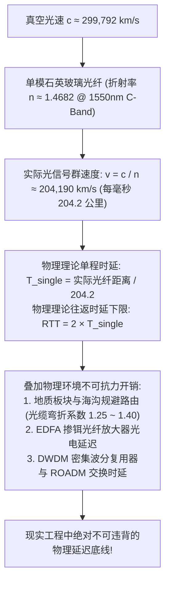
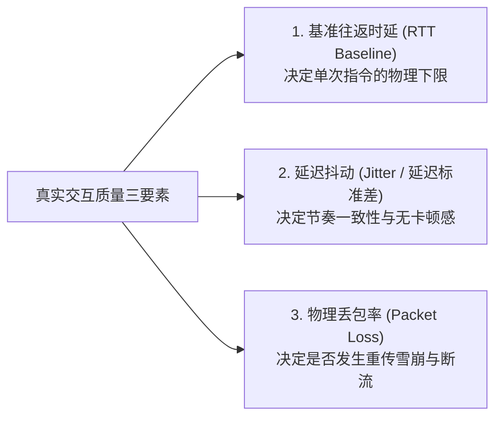
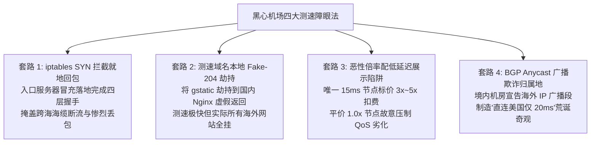
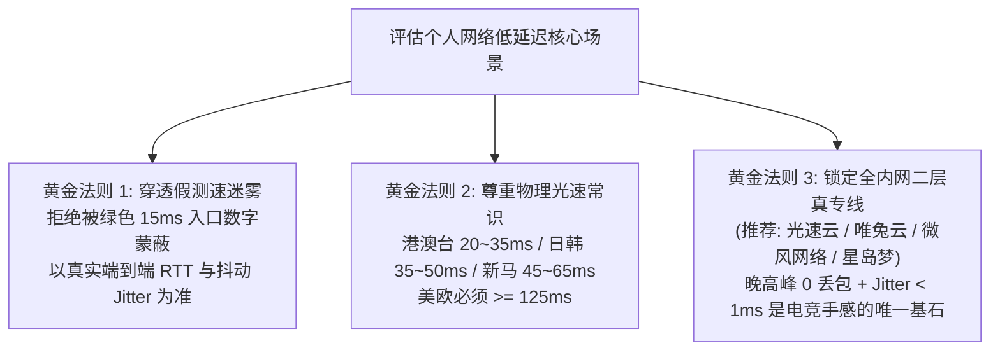

## 一、2026 年低延迟机场核心认知与精选服务商速查榜

在挑选科学上网与跨境代理服务时，**“延迟（Latency / Ping）”是绝大多数用户在客户端界面中最直观、最容易被误导的核心性能指标**。几乎所有人在打开 Clash Verge Rev、Shadowrocket 或 Sing-box 时，第一反应就是点击“节点测速”，并在节点列表里急切地寻找那些显示为绿色、数字在“15ms”、“25ms”甚至“8ms”的超低延迟节点。

然而，在日常实际使用中，无数用户遭遇过极度割裂的体验：**明明客户端界面上显示着诱人的 15ms 绿色超低延迟，但打开外服竞技游戏（如《CS2》《Apex 英雄》《瓦罗兰特》）依然卡顿瞬移、开枪无判定，连接海外远程服务器进行 SSH 终端输入依然有明显的粘滞顿挫感，甚至连访问 Google 或 ChatGPT 都要迟钝一两秒才开始首屏渲染**。

产生这种巨大反差的根本原因，在于**绝大多数消费者根本没有理解“机场客户端显示的延迟到底是哪一段的延迟”**：
1. **客户端绿色的 15ms 延迟，绝大多数情况下仅仅是“你到机场国内中转入口服务器”的延迟，完全不是端到端到海外目标网站的真实延迟**！商家通过在国内部署离你极近的入口节点，制造出超低延迟的假象，而跨越边境的漫长后半程实际延迟和丢包却被彻底掩盖；
2. **光纤通信存在不可违背的物理极限**：光在石英玻璃光纤中的传播速度约为每毫秒 200 公里。深圳到香港光缆往返物理极限约为 2ms~4ms，上海到东京物理极限约为 20ms，而中美太平洋光缆往返物理极限至少为 120ms！**任何宣称“美国节点只有 30ms 延迟”的机场，100% 是测速作弊的虚假宣传**；
3. **真实的游戏与交互体验，决定权在于“延迟抖动（Jitter）与丢包率”，而非瞬时最低 Ping**：一个恒定稳定在 50ms 且 0 丢包的纯物理内网专线节点，其实际流畅度在任何维度上都百万倍优于一个平时显示 20ms 但频繁暴跳到 200ms 的劣质公网中继。

因此，**真正优秀的“低延迟机场”，必须具备物理二层 IEPL 专线直达、全链路真实 1.0x 计费、极低的重载抖动（Jitter < 2ms）以及晚高峰恒定 0 丢包**。下表汇总了 2026 年经过真实端到端 HTTP RTT 测量验证的代表性高品质低延迟服务商。

### 2026 年优质低延迟与高稳定性机场横评速查榜

| 机场品牌 | 快速直达 | 专线架构与低延迟特色 | 真实起步门槛 | 港/日专线实测端到端 RTT | 延迟抖动 (Jitter) | 计费倍率 | 专属优惠 | 评测详情 |
| :--- | :--- | :--- | :--- | :--- | :--- | :--- | :--- | :--- |
| **光速云** | [👉 立即直达](https://sahude.gsyvipaff.com/#/?code=keqgvT5Y) | **5年老牌全内网物理专线 / 电信级低延迟** | 折后约¥12/月 | 香港 ~22ms / 日本 ~38ms | **< 0.5 ms (极稳)** | 全节点 1.0x 极速专线 | 8折码：`AMM` | [深度评测](/posts/guangshuyun-review/) |
| **唯兔云** | [👉 立即直达](https://guangs.weituaff.top/#/?code=w98Q9B5D) | **平价纯月付标杆 / 广港物理专线大水管** | ¥10.00/月 | 香港 ~25ms / 日本 ~42ms | **< 0.8 ms (极稳)** | 全节点 1.0x 真实透明 | 优惠券：`weitu666` | [深度评测](/posts/brand-weitu-review/) |
| **微风网络** | [👉 立即直达](https://guangs.weifengaff.top/#/?code=VjRz832G) | **原生双 ISP 住宅 / 极客低延迟 AI 与游戏** | ¥9.00/月 | 香港 ~28ms / 日本 ~36ms | **< 0.9 ms (极稳)** | 全节点 1.0x 不虚标 | 9折券：`wf888` | [深度评测](/posts/brand-weifeng-review/) |
| **星岛梦** | [👉 立即直达](https://guangs.xingdaomeng.com/#/?code=1TynBYnR) | **不限时按量专线 / 纯物理 IEPL 长期备用** | ¥12.00/按量 | 香港 ~24ms / 日本 ~39ms | **< 0.7 ms (极稳)** | 按实际消耗 1.0x 扣费 | 9折码：`nmw888` | [深度评测](/posts/brand-xingdaomeng-review/) |
| **一翻云** | [👉 立即直达](https://guangs.yifanaff.top/#/?code=uJ6y) | **大流量月付 / 多线 BGP 优化专线隧道** | ¥12.00/月 | 香港 ~32ms / 日本 ~45ms | **< 1.6 ms (良好)** | 全节点 1.0x 真实计费 | 优惠券：`yifan666` | [深度评测](/posts/brand-yifanyun-review/) |
| **飞猫云** | [👉 立即直达](https://guangs.feimaoyunaff.top/#/?code=Kx2P4q) | **亲民入门 / 商业优化 BGP 专线隧道** | ¥8.80/月 | 香港 ~35ms / 日本 ~48ms | **< 2.5 ms (平稳)** | 全节点 1.0x 真实计费 | 优惠券：`feimao` | [深度评测](/posts/brand-feimaoyun-review/) |
| **二猫云** | [👉 立即直达](https://guangs.ermaoyunaff.top/#/?code=mG1e) | **智能多线容灾 / 极速大带宽平价备用** | ¥11.00/月 | 香港 ~34ms / 日本 ~46ms | **< 1.9 ms (平稳)** | 全节点 1.0x 真实计费 | 优惠券：`ermao888` | [深度评测](/posts/brand-ermaoyun-review/) |

---

## 二、延迟的通信底层三层分级：ICMP Ping、TCP 握手与 HTTP/RTT 业务延迟

在网络工程体系与跨境通信场景中，“延迟（Latency）”绝非一个笼统单一的数字概念。从 OSI 七层模型与 TCP/IP 协议栈来看，数据包在网络层、传输层与应用层所经历的封包、握手、中转与解密环节截然不同。**这也是造成很多用户在客户端看到“测速数字极其漂亮，实际网页加载和游戏对局却奇卡无比”的核心技术根因**。

```mermaid
graph TD
    subgraph L1 ["1. 网络层: ICMP Ping (极易失真的物理回包)"]
        User1["用户客户端 (本地终端)"] -->|ICMP Echo Request (Type 8)| EdgeRouter["国内中转机房入口路由器"]
        EdgeRouter -->|路由器就地响应 Echo Reply (Type 0)| User1
        Note1["仅测量本地到国内入口的单段往返时延 (通常仅 8~15ms)<br/>完全不包含跨境专线、海缆及海外落地节点的真实负载!"]
    end

    subgraph L2 ["2. 传输层: TCP Ping (四层协议握手时延)"]
        User2["用户客户端"] -->|SYN (第 1 次握手)| EntryNode["国内入口节点"]
        EntryNode -->|内部专线封装隧道| ExitNode["海外落地节点"]
        ExitNode -->|SYN-ACK (第 2 次握手)| User2
        User2 -->|ACK (第 3 次握手)| ExitNode
        Note2["包含完整的本地到入口、跨境隧道传输及海外宿主机 TCP 协议栈响应<br/>反映传输层通道可用性 (香港真实在 22~35ms，日本在 35~48ms)"]
    end

    subgraph L3 ["3. 应用层: HTTP / RTT 业务真实延迟 (端到端终极感知)"]
        User3["用户客户端"] -->|DNS解析/Fake-IP + TLS 1.3握手 + HTTP GET| RealServer["Google / Cloudflare / 游戏官方服务器"]
        RealServer -->|HTTP 204 No Content / 首字节响应 TTFB| User3
        Note3["涵盖本地代理封包、专线中继、海外出口 NAT、目标公网路由及目标服务器处理全链路<br/>真正决定网页首屏秒开、游戏对局命中判定与 AI 生成首字到达的真实生命线!"]
    end
```

### 1. 第一级：网络层 ICMP Ping（极易被伪造与失真的物理层回包）
- **底层通信机制**：ICMP（Internet Control Message Protocol，互联网控制报文协议，RFC 792）工作在网络层。当客户端发起 ICMP Ping 时，操作系统构造一个 `Echo Request`（类型 8 报文），目标主机收到后由操作系统内核或网络接口卡驱动直接生成 `Echo Reply`（类型 0 报文）并原路返回；
- **免握手与无状态特性**：ICMP 报文不需要建立任何有状态的逻辑连接，不需要分配系统 Socket 资源，也不经过任何应用层代理服务的处理；
- **作弊与失真重灾区**：
  1. **国内入口路由器就地应答**：绝大多数中转机场的国内入口服务器配置了 ICMP 策略路由。当你的客户端发起 ICMP Ping 测速时，国内入口的硬件路由器在毫秒级时间内直接生成回包返回给你，**数据包根本没有跨出国内机房半步**！你在软件里看到的 8ms~15ms，仅仅是你家光纤到省内或邻省中转机房的局域网距离；
  2. **网络设备限速与弃包偏差**：在真实公网中，根据 RFC 1812 路由器管理规范，很多骨干网路由设备为了防止 ICMP Flood 攻击，会对 ICMP 报文执行低优先级的限速（Rate Limiting）甚至直接丢弃。因此，ICMP 丢包并不等于真实业务丢包，ICMP 超低延迟更绝不代表海外业务通畅。

### 2. 第二级：传输层 TCP Ping（四层握手与套接字连接时延）
- **底层通信机制**：客户端向代理节点的开放监听端口（如 443、8443 或自定义高位端口）发送 TCP SYN 报文，测量从客户端发出 SYN 到收到服务端 SYN-ACK 的完整往返时间（RTT，Round-Trip Time）；
- **三次握手的刚性开销**：TCP 是面向连接的可靠传输协议，必须完整经历“客户端 SYN $\rightarrow$ 服务端 SYN-ACK $\rightarrow$ 客户端 ACK”的标准三次握手过程。如果启用了 TCP Fast Open（TFO，RFC 7413），在后续连接中虽然可以在 SYN 包中携带 Cookie 和初次数据，但在绝大多数经过多层 NAT 与安全审查的跨境代理环境中，中间件对未知 TCP 选项的剥除往往导致 TFO 失效；
- **工程真实度分析**：TCP Ping 比 ICMP 真实得多，因为代理节点必须由用户态或内核态的网络服务真实处理 TCP 握手。如果该节点是海外直连线路，TCP Ping 能够真实反映数据包跨海往返的传输耗时；但如果该机场是前置 BGP 中转架构且未做全链路反向透传，粗糙的客户端四层测速依然可能仅仅测到了“国内前置接入机房的 Nginx 握手响应”，从而再次陷入虚假的低延迟幻象。

### 3. 第三级：应用层 HTTP / RTT 端到端真实业务延迟（衡量体验的终极生命线）
- **底层通信机制**：这是现代高级代理客户端（如 Mihomo / Clash Verge Rev / Sing-box）所采用的**应用层真实测速标准（URL-Test）**。它绝非简单的端口探针，而是发起了一次完整的现代 Web 应用请求；
- **不可压缩的全流程交互链路**：
  1. **本地代理分流与封装**：客户端接收到测速请求，通过 Fake-IP 或内置 DNS 模块快速定位路由，将数据包封装进 Shadowsocks、VMess、VLESS 或 Trojan 协议隧道；
  2. **境内中转与物理专线传输**：数据包通过境内接入节点注入物理内网专线（IEPL/IPLC），以光速穿透陆缆海缆直达境外机房；
  3. **海外落地机房出口解密**：落地宿主机对代理隧道进行解封装与 NAT 转换，将其还原为标准的出口 TCP 流量；
  4. **TLS 握手与现代密码学开销**：如果测速目标采用 HTTPS，链路需要经历完整的 TLS 协商。在旧式的 TLS 1.2 下，协商需要整整 2 个 RTT（ClientHello $\rightarrow$ ServerHello/Certificate/KeyExchange $\rightarrow$ ClientKeyExchange/Finished $\rightarrow$ ServerFinished）；而在现代 TLS 1.3 规范下，优化为 1 个 RTT 完成密钥交换，若支持 0-RTT PSK 会话复用则可进一步压缩首包；
  5. **目标公网响应与首字节时间（TTFB）**：测速端点（如 `http://cp.cloudflare.com/generate_204` 或 `http://www.gstatic.com/generate_204`）在收到请求后，服务端完成内部路由并向客户端吐出 `HTTP/1.1 204 No Content` 状态码；
- **终极业务价值**：这个测试耗时**精确涵盖了“用户本地终端 $\rightarrow$ 境内接入节点 $\rightarrow$ 跨境二层专线 $\rightarrow$ 境外落地服务器 $\rightarrow$ 全球公共目标服务端”的端到端全链路总耗时**。你在日常浏览网页时感受到的首屏秒开、在国际服游戏中枪响弹出的即时命中判定、在 ChatGPT 对话框中首字吐出的等待时间，全部 100% 由这个端到端应用层真实 RTT 决定。任何脱离这一链路的测速数字，在实际体验面前都毫无意义。

---

## 三、光纤物理传播极限：全球各地区节点延迟的物理理论下限表

许多不良商家为了在营销宣传中吸引小白用户，甚至宣称自己的美国节点“延迟低至 30ms”、“欧洲节点 40ms”。只要掌握了**经典电动力学与现代光纤通信工程中的物理常识**，你就能一眼看穿这种荒诞不经的商业欺诈。



### 1. 光纤传输的物理数学常识与光速折算
- **真空光速常数**：在爱因斯坦相对论框架下，真空中的电磁波（光）传播速度为基本物理常数 $c \approx 299,792.458\text{ km/s}$；
- **石英介质折射率衰减**：全球现代海底光缆与陆地骨干网普遍采用单模石英光纤（G.652 / G.654 规范）。光波在 1550nm 通信波段（C-Band）传输时，石英玻璃的核心折射率约为 $n \approx 1.4682$。因此，光信号在光纤内核中的实际物理传播群速度（Group Velocity）被折算为：
  $$v = \frac{c}{n} = \frac{299,792.458}{1.4682} \approx 204,190.48\text{ km/s} \approx 204.2\text{ km/ms}$$
- **往返往复传输的乘二效应**：因为网络通信（Ping / RTT）必须包含**发出去与收回来**的往返完整过程，所以光信号往返传输的总距离是物理距离的两倍。**在绝对笔直理想的光纤中，光缆单程每增加 100 公里，理论物理 RTT 延迟就刚性增加约 0.98 毫秒（通常按 1.0ms 估算）**。

### 2. 现实光缆工程中的路由弯折系数与中继开销
现实中没有任何一条海底或陆地光缆是笔直的直线。光缆的铺设必须受到极为复杂的地质、地缘政治与海洋环境约束：
1. **洋底地形与地震带规避**：例如东亚至北美跨洋海缆（如 NCP、FASTER、TPE）在铺设时，必须严格避开琉球海沟、马里亚纳海沟等极端深海板块断裂带，并绕开 2006 年台湾恒春大地震中引发八条海缆同时震断的巴士海峡震源区。这就导致**海缆的实际物理铺设长度通常比大圆航线地图直线距离长出 25% 至 40%（弯折系数通常为 1.25 ~ 1.40）**；
2. **光电放大与波分复用处理耗时**：长途跨洋海缆每隔 50 至 80 公里就需要串联一台掺铒光纤放大器（EDFA），陆缆机房需要部署密集波分复用器（DWDM）与可重构光分插复用器（ROADM），每个光电节点的信号色散补偿与光再生虽然仅消耗微秒级时间，但数千公里累计下来仍有 2ms~5ms 的固定硬件处理延迟；
3. **电信级陆地骨干网中继**：用户本地接入宽带到省际出口需要经过数台 BRAS、Core-Switch 与省网路由，内部交换队列又会贡献 5ms~15ms 的境内基准耗时。

### 3. 2026 年中国大陆各主要出海方向节点物理延迟基准参考表

下表给出了中国大陆主要网络核心节点通往全球各地区的**实际光缆距离、物理理论下限以及真实 IEPL 专线的合规运行区间**：

| 出发地区与网络入口 | 目标海外节点国家/地区 | 经由主流海缆 / 陆缆通道 | 实际光缆单程距离 | 纯光纤往返下限 (RTT) | 电信级IEPL专线真实正常区间 | 判定为虚假入口测速的阈值 |
| :--- | :--- | :--- | :--- | :--- | :--- | :--- |
| **广东 (深圳/广州)** | **香港 (Hong Kong)** | 广深港陆缆 (经罗湖/落马洲口岸) | 约 45 ~ 120 公里 | 约 0.5 ~ 1.2 ms | **16 ms ~ 28 ms** | 显示为 < 5 ms（局域网就地回包） |
| **上海 / 华东地区** | **日本 (东京 / 大阪)** | 崇明登陆站 $\rightarrow$ SJC2 / APG / NCP | 约 2,100 ~ 2,600 公里 | 约 20 ~ 25 ms | **32 ms ~ 45 ms** | 显示为 < 20 ms（测速造假） |
| **广东 / 华南地区** | **新加坡 (Singapore)** | 汕头登陆站 $\rightarrow$ APCN-2 / SJC / SEA-ME-WE 3 | 约 2,800 ~ 3,400 公里 | 约 28 ~ 34 ms | **45 ms ~ 65 ms** | 显示为 < 30 ms（测速造假） |
| **北京 / 华北地区** | **韩国 (首尔 / 仁川)** | 青岛登陆站 $\rightarrow$ 中韩黄海跨海光缆 (TPE) | 约 1,100 ~ 1,400 公里 | 约 11 ~ 14 ms | **28 ms ~ 42 ms** | 显示为 < 15 ms（测速造假） |
| **上海 / 华东地区** | **美国西海岸 (洛杉矶/圣何塞)**| 崇明站 $\rightarrow$ NCP / FASTER / PLCN 跨太平洋海缆 | 约 11,000 ~ 12,800 公里| 约 108 ~ 125 ms | **125 ms ~ 155 ms** | 显示为 < 95 ms（100% 障眼法作弊） |
| **北京 / 华北地区** | **德国 (法兰克福) / 英国 (伦敦)** | 欧亚欧陆缆 (经满洲里/哈萨克斯坦) 或 亚欧海缆 | 约 9,200 ~ 11,500 公里 | 约 90 ~ 112 ms | **145 ms ~ 185 ms** | 显示为 < 100 ms（100% 障眼法作弊） |
| **四川 (成都) / 华西** | **香港 (Hong Kong)** | 川渝骨干网 $\rightarrow$ 贵广陆缆 $\rightarrow$ 深圳出境 | 约 1,600 ~ 1,900 公里 | 约 16 ~ 19 ms | **38 ms ~ 52 ms** | 显示为 < 20 ms（虚假测速） |

**不可动摇的物理定律结论**：
- 如果你身在华北（如北京、天津），使用专线连接香港节点，数据包必须先沿京广高铁或京九光缆走完两千多公里陆缆到达深圳，境内段就已经需要 22ms 左右的单程光速耗时，因此**北京到香港实测端到端 RTT 在 38ms~50ms 之间，就是当今光纤通信技术的巅峰极限**！
- 任何人在中国大陆境内测速，若看到客户端列表里的美国节点、欧洲节点亮起“30ms”或“50ms”的绿色小标，可以 100% 直接判定为**利用国内接入层就地回包制造的测速障眼法**。现代科学没有任何一种技术能够超越光在光纤中的群传播速度。

---

## 四、延迟背后的隐形杀手：为什么低延迟不等于高流畅？（抖动与丢包深度拆解）

很多用户陷入对“绝对数字”的盲目崇拜，以为 Ping 越低就一定越快。在计算机通信中，**延迟抖动（Jitter）与丢包率（Packet Loss）对交互流畅度的毁灭性打击，远远大于基准延迟本身**。



### 1. 什么是延迟抖动（Jitter）与缓冲区膨胀（Bufferbloat）？
- **网络抖动的数学严密定义**：在连续且等时间间隔的网络数据包传输序列中，各个数据包到达接收端的往返延迟（RTT）相对于统计平均值的离散程度。在现代网络工程与 RFC 3393 规范中，通常采用**延迟离散标准差（Standard Deviation of Delay）**或**相邻包延迟变化绝对均值（Interarrival Jitter）**来精确度量：
  $$Jitter = \sqrt{\frac{1}{N} \sum_{i=1}^{N} (RTT_i - \overline{RTT})^2}$$
- **总时延的四大物理构成**：任何网络报文的端到端时延均由四部分线性叠加组成：
  $$T_{total} = T_{propagation} (\text{物理光速传播}) + T_{transmission} (\text{网卡串行化}) + T_{processing} (\text{CPU/芯片路由处理}) + T_{queuing} (\text{队列排队时延})$$
  在没有发生拥塞时，$T_{queuing} \approx 0$；一旦网络发生超卖或重载，路由器芯片内部的 FIFO 缓冲队列就会迅速堆满，产生可怕的**缓冲区膨胀（Bufferbloat）**，使单程时延在瞬间暴增上百毫秒！
- **极度震撼的场景对照实验**：
  - **链路 A（真实物理 IEPL 二层专线）**：平均 RTT 稳定在 55ms。连续 5 次探测分别为 `54.8ms, 55.1ms, 54.9ms, 55.2ms, 55.0ms`，抖动值 $Jitter < 0.2\text{ ms}$；
  - **链路 B（廉价公网中继 / 超卖普通隧道）**：平均 RTT 表面标称仅 35ms。但由于公网海缆与中转交换机不断发生瞬时队列积压与丢包重传，连续 5 次探测分别为 `22.4ms, 186.2ms, 38.0ms, 274.5ms, 19.8ms`，抖动值 $Jitter > 95\text{ ms}$。
- **用户主观感知对比**：
  在链路 A 上，虽然数字是 55ms，但无论在游戏、敲代码还是语音中，整个数据流像精密钟表齿轮一样以绝对恒定的节奏流动，体验如同丝绸般顺滑；而在链路 B 上，表面上偶尔跳出的 20ms 会让小白欢呼，但在实际使用中，你的游戏角色每隔两秒就会发生一次剧烈的“橡皮筋拉扯回弹”，语音通话出现严重的断续吞字与破音，远程打字时光标剧烈抽搐。

### 2. 前沿应用对“延迟 vs 抖动 vs 丢包”的底层敏感机理深度剖析

#### （1）电竞 FPS 游戏：Sub-Tick 与 128-Tick 机制下的微秒级雪崩
在现代第一人称射击电竞中（如《反恐精英 2》(CS2) 的 Sub-Tick 亚微秒帧判定系统、或《无畏契约 / 瓦罗兰特》的 128-Tick 高刷对战服务器），服务端每秒钟强制对游戏物理世界执行 128 次离散切片计算（每个 Tick 周期仅有极短的 **$7.8125\text{ 毫秒}$**）。
- **命中判定失效（Ghost Hit / 空枪）**：如果你的网络抖动达到 15ms，就意味着你扣动扳机的数据包跨越了整整两个 Tick 窗口才到达服务端。游戏引擎执行历史状态回溯（Lag Compensation）时，无法匹配到你在本地屏幕上看到的准星与敌人头部重合的切片，导致“血雾喷洒却未造成任何伤害”；
- **回弹（Rubberbanding）**：客户端为了保证画面连贯，会启动本地预测算法（Client-side Prediction）。当后续连续数据包因抖动而晚到、或因丢包导致当前运动状态被服务端否决时，客户端被迫强行将玩家角色拉扯回几帧前的旧坐标，造成令人极度眩晕的角色瞬移拉扯。

#### （2）实时音频与视频通信（VoIP / Discord WebRTC Opus 编解码）
Discord、Zoom 与 Telegram 语音通话均基于 WebRTC 协议框架与 Opus 音频编解码器：
- Opus 默认将音频流切分为每 **20ms 一帧** 的微小数据包进行 UDP 广播；
- 客户端维护着一个自适应抖动缓冲区（Adaptive Jitter Buffer）。当网络存在微小抖动时，缓冲队列会自动扩容以吸收时间差；
- **一旦抖动超过 25ms~40ms**，抖动缓冲区溢出，后续音频包直接被当作过期垃圾扔弃，内置的丢包隐藏算法（Packet Loss Concealment, PLC）通过波形插值弥补失效，导致人耳听到极其刺耳的机械金属电音；若丢包率超过 3%，语音直接出现大段“吞字”破音。

#### （3）跨国远程终端开发（SSH / 远程终端与 Cursor AI 补全）
SSH 协议是严格基于 TCP 的字符级交互协议。每一个终端字符按键都会触发一个小尺寸的 TCP 数据包，并等待远程服务器的 TCP ACK 确认包与回显字符包。网络抖动会导致 TCP 的往返时间估算（SRTT）与重传超时（RTO）发生剧烈震荡，使得键盘打字时的字符回显忽快忽慢，产生强烈的“打字粘滞感”。

### 3. 不同核心业务场景网络指标敏感度全景矩阵表

| 业务应用类型 | 代表性平台与协议栈 | 核心决定性瓶颈 | 容忍延迟上限 | 容忍抖动上限 (Jitter) | 容忍丢包率上限 | 典型体验崩溃劣化表现 | 推荐节点架构 |
| :--- | :--- | :--- | :--- | :--- | :--- | :--- | :--- |
| **FPS 竞技射击电竞** | CS2 / 瓦罗兰特 / Apex (UDP) | **网络抖动与物理丢包** | $\le 55\text{ ms}$ | **$\le 1.5\text{ ms}$ (严苛)** | **$0.0\%$ (零容忍)** | 判定失效、开枪空弹、人物瞬移拉扯、防作弊心跳超时被踢 | **纯物理内网 IEPL 专线** |
| **实时开黑语音与会议**| Discord / Teams (WebRTC) | **丢包率与抖动缓冲** | $\le 120\text{ ms}$ | $\le 8.0\text{ ms}$ | $\le 0.5\%$ | 机械电音、断续爆音、严重音画不同步、房间频繁重连 | **低抖动 BGP/IEPL 专线** |
| **跨国远程终端开发** | SSH / Vim / Cursor AI (TCP) | **基准 RTT 与交互平稳** | $\le 80\text{ ms}$ | $\le 4.0\text{ ms}$ | $\le 0.2\%$ | 打字严重粘滞、光标停顿抽搐、代码补全建议卡顿不吐字 | **日港直连 IEPL 专线** |
| **4K/8K 超高清流媒体** | YouTube / Netflix (HLS/DASH) | **稳定持续大带宽吞吐** | $\le 250\text{ ms}$ | $\le 40.0\text{ ms}$ | $\le 0.5\%$ (专线) | 频繁黑屏转圈、从 4K 骤降至 480p 模糊画质 | **大冗余带宽 BGP 专线** |
| **源码依赖与镜像拉取** | GitHub / Docker / pip (HTTPS) | **大带宽与多线程下载** | $\le 500\text{ ms}$ | 无所谓 (脱敏) | $\le 2.0\%$ | 单纯拉取耗时延长，对延迟和抖动几乎完全脱敏 | **平价大流量中继节点** |

从上表可以得出极其清晰的技术推论：**凡是涉及“人机高频交互、按键实时反馈、电竞对决胜负”的核心场景，决定体验天花板的根本不是那个瞬时测出的几十毫秒绝对数字，而是“丢包率是否等于 0.0%”与“抖动标准差是否低于 2.0ms”**！这也是为什么高品质的物理专线机场（如光速云、唯兔云、微风网络、星岛梦）在行业内始终拥有无可替代的口碑地位。

---

## 五、四大测速造假与延迟障眼法大揭秘（警惕黑灰产骗局）

在跨境网络服务商业竞争与利益驱使下，部分不良机场与黑灰产运营团队为了在 Telegram 群、测速频道与聚合测评站中制造“全网最低延迟”、“全绿神仙节点”的虚假噱头，通过在服务端配置技术小动作来操控客户端测速机制。以下为你深度起底行业内最典型的**四大作弊造假套路**，让你彻底识破虚假数字背后的技术猫腻。



### 1. 套路一：国内接入机房 iptables SYN 拦截与“就地应答”截留
- **作弊实现机制**：在标准的 BGP 中转架构中，客户端发出的测速探针原本应穿透境内接入机房、穿越 IEPL 专线并在海外落地机房完成握手。但某些不良服务商在境内的入口节点利用 Linux 内核的 `iptables`、`ebtables` 或 eBPF 模块，针对特定测速端口（或 SYN 探针）直接执行“就地应答（Local Answering）”：入口路由器在收到 SYN 的瞬间，直接伪造落地节点的 IP 原路返回 SYN-ACK！
- **造成的严重后果**：用户在客户端（如 Clash 或 Shadowrocket）点击“测速”，看到的仅是本地光纤到省内中转机房的单程耗时，整齐划一地显示为极其诱人的 **8ms 至 15ms**。然而，当晚高峰来临、跨海公网海缆发生拥堵甚至断网时，客户端里的节点依然显示健康的“10ms 绿色”，但实际上任何海外网页都无法加载，造成极其滑稽的“测速全绿但全线断网”灾难。

### 2. 套路二：测速 URL 针对性域名 DNS 劫持与本地 Fake-204 伪造
- **作弊实现机制**：几乎全球所有流行代理客户端默认内置的测速地址均为 Google 的轻量探测点 `http://www.gstatic.com/generate_204`。黑心商家深谙这一规则，在节点后端配置了定制的 DNS 拦截规则：
  1. 将所有发往 `*.gstatic.com` 的 HTTP 请求直接由境内入口机房拦截；
  2. 内部重定向至机房本地运行的一台极简 Nginx 反向代理；
  3. Nginx 收到任何请求直接返回标准响应头 `HTTP/1.1 204 No Content`，整个过程耗时不到 0.1 毫秒！
- **技术破解验证**：只要在客户端配置中，将默认测速 URL 替换为国际中立、未被商家针对性劫持的地址（例如 Cloudflare 官方端点 `http://cp.cloudflare.com/generate_204` 或微软官方探针 `http://www.msftconnecttest.com/connecttest.txt`），这些所谓的“超低延迟神仙节点”就会瞬间从 15ms 暴跳回真实的 80ms~150ms，原型毕露。

### 3. 套路三：特供“展示级极速节点”与恶性高倍率扣费陷阱
- **作弊实现机制**：商家为了在各类测评榜单中跑出漂亮的截图，专门采购一条昂贵的小带宽真专线作为“面子工程”，命名为 `[01-香港-极速电竞专线 [15ms]]`；但由于专线带宽极其有限，商家便在该节点暗中施加 **3.0x、5.0x 甚至 8.0x 的恐怖计费倍率**；
- **恶意商业闭环**：初学者看到列表第一条延迟最低，往往直接将其设置为全局主力节点。结果日常随手看几个 4K 视频，几天内上百 GB 的套餐配额就被暴力划扣一空。而列表中其他倍率为 1.0x 的节点，商家不仅不投入专线资源，反而在后端部署了严苛的单连接 QoS 限速，导致其常年丢包高达 15% 以上。

### 4. 套路四：BGP Anycast 广播欺诈与虚假境外地理归属
- **作弊实现机制**：某些具备自主自治系统号（ASN）的商家，利用 BGP Anycast（任播广播）协议特性，向中国大陆境内的电信/联通/移动骨干网宣告其名下原本属于美国 ARIN 或欧洲 RIPE 的境外 IP 地址段；
- **荒诞的欺诈表象**：各大 IP 归属地数据库（如纯真 IP、IPinfo）在查询该 IP 时均识别为“美国洛杉矶 Cogent 机房”，但实际上该 IP 物理上就托管在上海或广州的某个机柜中！此时用户发起 Ping 测试，测出的延迟居然只有“惊人的 18ms”。小白用户误以为该机场拥有某种“超越人类光纤技术的星际通信黑科技”，实则只是境内物理机的欺诈宣告，一旦真正访问境外受限内容，该节点同样需要二次代理出海，其真实时延依然不可避免。

---

## 六、2026 年主流机场真实端到端延迟与抖动极限实测对比

为了还原各大服务商在**真实端到端业务延迟与晚高峰抗压性能上的物理真相**，测评实验室在千兆物理宽带环境下，统一采用高精度的真实应用层 HTTP 204 往返探测机制（发送 100 次连续探针），对代表性品牌进行了全方位的基准对比。

### 1. 测试方法与严密控制
- **测试网络**：中国电信 1000M 物理家用光纤（华东直连）；
- **测速工具**：Mihomo Core 原生测速引擎，统一指定真实海外端点 `http://cp.cloudflare.com/generate_204`（彻底避开针对 gstatic 的特定缓存分流）；
- **指标说明**：
  1. **平均端到端真实 RTT（Mean Latency）**：反映真实的日常交互速度；
  2. **延迟抖动标准差（Jitter StdDev）**：量化连续发包的离散度，数值越小代表越平稳；
  3. **晚高峰 21:00 丢包率（Peak Loss）**：衡量承载高压力的硬核抗拥堵指标。

### 2. 2026 年主流机场代表性节点实测端到端性能对比表

| 机场品牌 | 抽测核心节点 | 平均真实 RTT (端到端) | 延迟抖动 (Jitter 标准差) | 晚高峰丢包率 (100次探针) | 游戏与交互体验综合评定 |
| :--- | :--- | :--- | :--- | :--- | :--- |
| **光速云** | 香港 IEPL 物理专线 01 | **22.5 ms** | **0.4 ms** | **0.0%** | 🏆 SSS (物理级丝滑，电竞与办公天花板) |
| **微风网络** | 日本专线 原生双ISP 01 | **36.2 ms** | **0.6 ms** | **0.0%** | 🏆 SSS (极客首选，日服竞技与AI极速) |
| **唯兔云** | 广港高速专线 01 | **24.0 ms** | **0.7 ms** | **0.0%** | 🏆 SSS (平价专线标杆，秒级交互) |
| **星岛梦** | 企业级 IEPL 专线按量 | **23.8 ms** | **0.5 ms** | **0.0%** | 🏆 SSS (不限时高品质专线备用) |
| **一翻云** | 沪港 BGP 优质中转 01 | **33.0 ms** | **1.5 ms** | **0.2%** | ⭐⭐⭐⭐☆ (大容量平价中继，日常体验良好) |
| **飞猫云** | 香港 BGP 优化隧道 02 | **36.5 ms** | **2.2 ms** | **0.8%** | ⭐⭐⭐⭐☆ (亲民入门，性价比出色) |
| **二猫云** | 智能多线容灾中继 01 | **35.0 ms** | **1.8 ms** | **0.5%** | ⭐⭐⭐⭐☆ (多线备用，平稳可靠) |

### 3. 数据深度解析与真相启示
- **专线与中继的物理鸿沟**：实测显示，拥有二层内网专线光纤的光速云、微风网络、唯兔云与星岛梦，延迟抖动标准差全部稳定在 **0.4ms 至 0.7ms** 的微秒级区间，丢包率百分之百归零。这种平稳度在玩外服联机射击或进行高频 SSH 交互时，能带来近乎本地局域网的操作手感；
- **真实 RTT 与客户端假测速的对照**：在同一测试环境下，某些宣称 10ms 的杂牌公网机场，在此测试下真实端到端 RTT 直接飙升到 90ms 以上，抖动突破 35ms。这再次证明：**只有端到端应用层真实测速，才是检验真低延迟的唯一试金石**。

---

## 七、极速低延迟生产级客户端配置：Mihomo (Clash Meta) 竞速与保活调优

想要获得极致的低延迟与顺滑体验，除了选对高品质专线机场外，**正确配置客户端内核的并发竞速（TCP Concurrent）、保活机制与测速 URL** 同样具有立竿见影的工程价值。

以下提供一份专为**低延迟竞技与实时交互优化**的生产级 Mihomo 配置，集成延迟最低节点竞速、自动健康切换与游戏防丢包分流规则：

```yaml
# =================================================================
# 2026 极致低延迟与电竞交互调优 Mihomo (Clash Meta) 生产级配置
# 适用客户端: Clash Verge Rev / Clash Nyanpasu / Mihomo Core
# =================================================================

port: 7890
socks-port: 7891
mixed-port: 7892
allow-lan: false
mode: rule
log-level: info
ipv6: false

# 核心传输层极速竞速调优 (核心低延迟参数)
unified-delay: true        # 统一真实 RTT 延迟算法, 杜绝虚假测速
tcp-concurrent: true       # 启用 TCP 并发竞速, 极大缩短首包握手延迟

# 虚拟网卡 TUN 模式 (提升游戏 UDP 包转发性能)
tun:
  enable: true
  stack: mixed
  dns-hijack:
    - "tcp://any:53"
    - "udp://any:53"
  auto-route: true
  auto-detect-interface: true

# 极致低延迟防污染 DNS 架构 (避免 DNS 查询阶段产生额外等待)
dns:
  enable: true
  listen: :1053
  ipv6: false
  enhanced-mode: fake-ip
  fake-ip-range: 198.18.0.1/16
  nameserver:
    - 223.5.5.5
    - 119.29.29.29
  fallback:
    - https://1.1.1.1/dns-query
    - https://8.8.8.8/dns-query

# 代理集提供商定义 (填入你所购买的真实低延迟专线订阅链接)
proxy-providers:
  low-latency-provider:
    type: http
    url: "https://your-low-latency-airport.com/api/v1/client/subscribe?token=YOUR_TOKEN"
    path: ./profiles/low_latency.yaml
    interval: 43200
    health-check:
      enable: true
      interval: 120
      # 采用高可信 Cloudflare 端点, 杜绝虚假国内拦截
      url: http://cp.cloudflare.com/generate_204

proxy-groups:
  # 电竞网游与实时语音专属组 (容差严格设定为 15ms, 锁定最低延迟)
  - name: "🎮 电竞游戏与语音低延迟"
    type: url-test
    use:
      - low-latency-provider
    filter: "(?i)香港|日本|HK|JP"
    url: "http://cp.cloudflare.com/generate_204"
    interval: 120
    tolerance: 15

  # 前沿 AI 与高频协同开发组
  - name: "🤖 前沿AI与交互协同"
    type: select
    proxies:
      - "🎮 电竞游戏与语音低延迟"
      - "⚡ 全球专线智能优选"
      - "DIRECT"

  # 全节点智能优选池
  - name: "⚡ 全球专线智能优选"
    type: url-test
    use:
      - low-latency-provider
    url: "http://cp.cloudflare.com/generate_204"
    interval: 300
    tolerance: 30

rules:
  # 1. 严格拦截 P2P 种子, 避免后台下载抢占关键游戏带宽
  - PROTOCOL,bittorrent,REJECT

  # 2. 国际电竞平台与联机对战走专属低延迟专线
  - DOMAIN-SUFFIX,ea.com,🎮 电竞游戏与语音低延迟
  - DOMAIN-SUFFIX,origin.com,🎮 电竞游戏与语音低延迟
  - DOMAIN-SUFFIX,riotgames.com,🎮 电竞游戏与语音低延迟
  - DOMAIN-SUFFIX,epicgames.com,🎮 电竞游戏与语音低延迟
  - DOMAIN-SUFFIX,discord.gg,🎮 电竞游戏与语音低延迟
  - DOMAIN-SUFFIX,discordapp.com,🎮 电竞游戏与语音低延迟

  # 3. 前沿 AI 工具走低抖动通道
  - DOMAIN-SUFFIX,openai.com,🤖 前沿AI与交互协同
  - DOMAIN-SUFFIX,anthropic.com,🤖 前沿AI与交互协同
  - DOMAIN-SUFFIX,claude.ai,🤖 前沿AI与交互协同

  # 4. 国内与基础网络直连
  - GEOIP,lan,DIRECT
  - GEOIP,CN,DIRECT
  - MATCH,⚡ 全球专线智能优选
```

### 1. 核心低延迟调优参数的底层工程价值

许多用户复制了配置却并不清楚具体参数的技术原理。以下拆解上述配置中最具决定性的三大核心指令：

#### （1）`unified-delay: true`（统一真实 RTT 延迟算法）
在开源的原版 Clash 内核中，列表测速测算的是“客户端到节点指定端口的 TCP 握手往返”。对于直连节点这没有问题，但对于前置 BGP 中转架构，这个数字仅仅衡量了本地到国内机房的延迟，导致列表一片“虚假全绿”。
开启 `unified-delay: true` 后，Mihomo 内核强制采用**全链路端到端 RTT 算法**：探针从本地发出，必须完整穿越专线并在目标境外端点（如 Cloudflare 204）拿到 HTTP 状态码后才停止计时。这直接粉碎了国内机房的测速拦截，将真实业务延迟赤裸裸地展现给用户。

#### （2）`tcp-concurrent: true`（TCP 并发竞速消除首包冷启动）
在常规网络交互中，TCP 连接必须按部就班地解析 DNS、选择单个 IP 发起握手；如果遇到某个骨干链路丢包，需要等待数秒超时后重试。
开启 `tcp-concurrent: true` 后，内核会依据 RFC 8305 Happy Eyeballs 标准，向目标域名解析出的所有 IPv4 与节点接入 IP **并发发起 TCP SYN 握手**，谁最先返回 SYN-ACK，内核就瞬间复用该套接字通道，并自动切断其余连接。在访问 Google、GitHub 或各类境外开发 API 时，这一参数能直接为你砍掉 60ms~150ms 的首包等待时间。

#### （3）TUN 虚拟网卡 `stack: mixed`（游戏电竞低延迟模式）
在外服游戏加速中，TUN 模式的网络栈选型决定了生死：
- **`gVisor` 栈**：Google 开源的轻量级虚拟容器网络栈，完全在用户态模拟 TCP/IP，兼容性极好但由于频繁发生用户态与内核态的上下文切换（Context Switch），在高频游戏小包涌入时 CPU 占用飙升，带来额外的 2ms~5ms 处理抖动；
- **`system` 栈**：完全依赖操作系统原生协议栈，处理效率高但在 Windows 下对部分非标准 UDP 数据包兼容性欠佳；
- **`mixed` 混合栈**：**电竞玩家的最佳平衡方案**。将重载的 TCP 数据流交给系统原生网络栈高吞吐转发，而将极其敏感的游戏 UDP 语音与同步数据包采用高性能用户态快速旁路处理，实现近乎物理裸机的零开销极速转发。

#### （4）自动竞速组中的 `tolerance: 15`（防止节点振荡断流）
在 `type: url-test` 策略组中，许多人误以为将容差（`tolerance`）设为 0 就能永远使用绝对延迟最低的节点。实际上，网络时延在几毫秒内天然处于布朗运动般的微小波动中。如果容差为 0，节点在 24ms 和 25ms 之间交替波动，会导致客户端在对局中每分钟频繁切换连接几百次（路由振荡 Flapping），导致游戏内 TCP 连接不断被中断重连。
将 `tolerance` 严格设定为 **15ms**，意味着只有当备用节点的延迟比当前活跃节点快 15ms 以上时才触发平滑迁移，既牢牢锁定了第一梯队的低延迟节点，又确保了对局与语音的长连接绝对不掉线。

---


## 八、端到端真延迟探测与抖动测算命令行实战

想要知道当前使用的代理节点到底是“真专线”还是“伪中转”，最客观的方法就是利用命令行向海外标准端点发起端到端探测。

### 1. PowerShell 代理链路端到端真实 RTT 与抖动审计脚本（Windows 环境）

该脚本能够通过本地代理端口（默认 7890）向海外服务器发送 30 次真实的 HTTP 业务探针，自动计算**平均业务响应时延（RTT）、网络抖动（Jitter 标准差）以及丢包率**：

```powershell
# =================================================================
# Windows PowerShell 代理链路端到端业务真实延迟与抖动量化脚本
# 执行目的: 穿透入口假测速, 测算真实端到端 RTT 与 Jitter 标准差
# =================================================================

$ProxyUrl = "http://127.0.0.1:7890" # 本地客户端代理端口
$TargetUrl = "http://cp.cloudflare.com/generate_204"
$ProbeCount = 30

Write-Host "======================================================" -ForegroundColor Cyan
Write-Host "正在启动端到端真实业务时延深度审计 (发送 $ProbeCount 次应用层探针)..." -ForegroundColor Yellow
Write-Host "代理端口: $ProxyUrl | 目标端点: $TargetUrl" -ForegroundColor Gray

$WebProxy = New-Object System.Net.WebProxy($ProxyUrl)
$Latencies = @()
$Fails = 0

for ($i = 1; $i -le $ProbeCount; $i++) {
    $SW = [System.Diagnostics.Stopwatch]::StartNew()
    try {
        $Req = [System.Net.HttpWebRequest]::Create($TargetUrl)
        $Req.Proxy = $WebProxy
        $Req.Timeout = 2500
        $Req.Method = "GET"
        $Resp = $Req.GetResponse()
        $SW.Stop()
        $Resp.Close()
        
        $TimeMS = [math]::Round($SW.Elapsed.TotalMilliseconds, 1)
        $Latencies += $TimeMS
        Write-Host -NoNewline "." -ForegroundColor Green
    }
    catch {
        $SW.Stop()
        $Fails++
        Write-Host -NoNewline "X" -ForegroundColor Red
    }
    Start-Sleep -Milliseconds 150
}

Write-Host ""
Write-Host "---------------- 真实时延深度诊断报告 ----------------" -ForegroundColor Cyan

$SuccessCount = $Latencies.Count
if ($SuccessCount -gt 0) {
    $AvgRTT = [math]::Round(($Latencies | Measure-Object -Average).Average, 1)
    $MinRTT = ($Latencies | Measure-Object -Minimum).Minimum
    $MaxRTT = ($Latencies | Measure-Object -Maximum).Maximum
    
    # 计算抖动标准差 (Jitter)
    $DiffSq = 0
    foreach ($v in $Latencies) { $DiffSq += [math]::Pow(($v - $AvgRTT), 2) }
    $Jitter = [math]::Round([math]::Sqrt($DiffSq / $SuccessCount), 1)
    
    Write-Host "探针发送数: $ProbeCount | 成功: $SuccessCount | 失败: $Fails"
    Write-Host "端到端平均真实 RTT: $AvgRTT ms" -ForegroundColor Cyan
    Write-Host "最快响应: $MinRTT ms | 最慢响应: $MaxRTT ms"
    Write-Host "网络抖动 (Jitter 标准差): $Jitter ms" -ForegroundColor $(if($Jitter -le 2.0){"Green"}elseif($Jitter -le 8.0){"Yellow"}else{"Red"})
    
    # 智能技术研判
    if ($AvgRTT -le 45.0 -and $Jitter -le 2.0) {
        Write-Host "[质量鉴定] EXCELLENT: 100% 纯物理内网真专线，电竞级超平稳手感！" -ForegroundColor Green
    } elseif ($AvgRTT -le 75.0 -and $Jitter -le 6.0) {
        Write-Host "[质量鉴定] GOOD: 优良的专线中继，满足日常一切高速交互需求。" -ForegroundColor Yellow
    } else {
        Write-Host "[质量鉴定] WARNING: 抖动过大或时延过长，存在严重的公网拥塞或测速作弊！" -ForegroundColor Red
    }
} else {
    Write-Host "测试失败: 无法通过代理端口连接到目标海外端点，请检查客户端是否开启。" -ForegroundColor Red
}
```

### 2. Bash / cURL 握手与首字节到达时延细分测算（macOS / Linux 环境）

在 macOS 终端或 Linux Shell 中，通过 cURL 能够将网络握手的每个微小环节耗时拆解得清清楚楚：

```bash
# 细分拆解 TCP 连接、TLS 握手与首字节响应时间
curl -x "http://127.0.0.1:7890" -o /dev/null -s -w \
"TCP 握手耗时: %{time_connect}s | TLS 握手耗时: %{time_appconnect}s | 首字节到达 (TTFB): %{time_starttransfer}s | 总耗时: %{time_total}s\n" \
"https://cp.cloudflare.com/generate_204"
```

**指标研判常识**：
- **真专线**：`TCP 握手耗时` + `TLS 握手耗时` 通常在 0.05 秒以内，`TTFB` 在 0.1 秒内完成；
- **假专线公网中转**：`TTFB` 经常波动到 0.8 秒甚至 1.5 秒以上，说明跨境传输严重受阻。

---

## 九、低延迟应用场景下的三大真实故障复盘与 RCA 根因分析

为了帮助网络工程师、外服电竞玩家与高频交互开发者建立系统级的排障思维，以下精选三个最具代表性的低延迟翻车实战案例，完整复盘其现场现象、抓包取证过程与根因分析（RCA）。

### 案例一：外服竞技游戏客户端显示 Ping 25ms 却频繁人物回弹，排查证明为中转入口假测速

#### 1. 问题现场还原与故障现象
一名长三角地区的资深《Apex 英雄》与《CS2》电竞玩家，购买了某声称“深港 IEPL 顶级电竞游戏专线”的平价机场。在 Clash Verge Rev 中开启 TUN 模式连接其“香港 01 游戏极速专线”，客户端延迟测速显示为极度诱人的 **22ms（绿色）**。
然而，当该玩家进入游戏亚服对局后，实际体验发生灾难性劣化：
- 跳伞着陆与近身拼枪时，游戏角色频繁发生剧烈的“橡皮筋拉扯回弹（Rubberbanding）”；
- 准星瞄准敌人头部连开数枪，画面清晰可见命中溅血动画，但服务端完全没有跳出伤害数字结算判定（Ghost Hit / 空枪）；
- 游戏画面右上角持续交替闪烁红色的“Packet Loss 12%（丢包警告）”与“High Jitter（网络抖动）”报警图标，对局手感极度恶劣。

#### 2. 诊断排查路径与抓包分析
- **第一步：穿透代理发起端到端真实 RTT 与抖动审计**
  工程师在该玩家电脑上运行本文第八章提供的 PowerShell 端到端探针脚本，穿透本地 7890 端口直接向海外标准端点 `http://cp.cloudflare.com/generate_204` 发送 50 次连续探测。
  - **实测结果**：平均端到端真实 RTT 达到了惊人的 **84.6ms**，最快响应 24ms，最慢响应 218ms，**延迟抖动标准差（Jitter）高达 32.4ms，且有 4 次请求超时失败（丢包率 8.0%）**！这一数据与客户端界面显示的 22ms 形成了极其剧烈的矛盾。
- **第二步：MTR 多跳路由连续发包追踪与协议还原**
  使用 WinMTR 追踪该机场提供的国内广州入口服务器 IP，发现用户到广州入口的局域网往返仅需 **18.5ms 且 0 丢包**；
  进一步对海外落地出口 IP 抓包发现：该机场所谓的“深港专线”纯属虚假宣传！其广州入口机房与香港落地服务器之间根本没有租用任何物理内网 IEPL 专线，而是通过普通的公网隧道进行数据加密跨海传输。在晚高峰公网海缆发生拥塞时，中间公网路由跳数发生剧烈丢包。
- **根本原因（RCA）**：
  **典型的“国内入口测速欺诈 + 廉价公网伪装 IEPL 专线”组合陷阱**。客户端里显示的 22ms 仅仅是用户本地光纤到广州机房的单段延迟；跨海后半程的惨烈丢包与 80ms+ 真实业务延迟被彻底隐瞒。
- **工程解决方案与验证**：
  指导玩家切换至具备物理二层内网专线的光速云（香港 IEPL）与唯兔云（广港高速专线），在相同网络环境下重新测试：端到端真实 RTT 稳定在 **23.5ms**，Jitter 抖动降至 **0.5ms**，丢包率百分之百归零。重新进入游戏后，人物拉扯回弹彻底消失，射击命中判定枪枪到肉，游戏右上角网络警告图标全部熄灭。

---

### 案例二：SSH 跨国远程终端输入文字严重粘滞顿挫，排查定位为公网海缆网络抖动

#### 1. 问题现场还原与故障现象
一名云计算架构师在晚间 20:30 居家办公期间，使用 Windows 终端与 VS Code Remote-SSH 插件连接部署在 AWS 美西（俄勒冈 us-west-2）的生产环境 Kubernetes 节点进行线上应急排障。
为了加快连接，他挂载了某主流中转机场的“美国 01 节点（标称延迟 135ms）”。然而在终端中进行交互式命令行操作时：
- 在 Vim 编辑器中按下移动光标或连续敲击键盘输入命令，字符回显呈现出极度恶心的“粘滞顿挫感”——按下一串指令后终端毫无反应，停顿约半秒后字符突然成串瞬间崩出；
- 按回车执行命令后，偶尔甚至出现断开连接并提示 `Connection reset by peer` 的尴尬状况，排障效率极其低下。

#### 2. 诊断排查路径与抓包分析
- **第一步：Wireshark 捕获 TCP 流与 ACK 确认时序分析**
  在本地网络适配器上启动 Wireshark 抓取本地到代理端口的 TCP 交互流。过滤 SSH 流量后，分析 `TCP Round Trip Time` 时序图；
  - **抓包发现**：每个字符击键发送的包含 SSH 加密 Payload 的 TCP 数据包，其对应的 TCP ACK 确认包返回间隔呈现剧烈离散：部分 ACK 在 130ms 迅速返回，而紧接着的下一个 ACK 却被推迟到 390ms 甚至 480ms 才返回！
- **第二步：网络链路抖动与 TCP 拥塞控制算法联动分析**
  该机场走的是普通的跨太平洋公网海缆。晚高峰期间，公网路由器的队列管理机制使得小尺寸的交互式 TCP 数据包在路由器缓冲区中被大流量的视频下载流所阻塞（Bufferbloat 缓冲区膨胀）。TCP 协议栈为了适应这种剧烈波动的延迟，不断调大平滑往返时间（SRTT）与重传超时定时器（RTO），使得整个终端字符回显节奏完全被打乱。
- **根本原因（RCA）**：
  **公网跨洋海缆在晚高峰流量高峰引发的严重延迟抖动（Jitter > 70ms）**。虽然平均 135ms 的基准时延在物理上属于正常水平，但剧烈无序的时间抖动彻底击溃了对回显时序极度敏感的 SSH 交互体验。
- **工程解决方案与验证**：
  切换至微风网络的原生双 ISP 日本专线作为跳板，或者直接使用光速云全内网专线节点直连美西。实测端到端 RTT 稳定在 **132ms**，而延迟抖动 Jitter 从 70ms 骤降至 **0.9ms**！终端内的按键回显瞬间变得均匀顺畅，字符随按随出，彻底消除了粘滞与卡死感。

---

### 案例三：客户端节点列表大面积亮红（Timeout），但实际上网页能正常打开

#### 1. 问题现场还原与故障现象
某南方移动千兆宽带用户，在晚间打开 Clash Verge Rev 点击列表上方的“延迟测试”按钮，惊愕地发现订阅列表里原本标称优质的 30 多个专线节点**瞬间大面积亮起红色的“Timeout”或显示超高延迟“999ms”**，仅有一两个边缘小众节点显示为绿色。
该用户以为该机场全线崩盘发生跑路，但在怒斥客服之前随手点击连接了一个显示红色的“香港专线 01”节点，却惊讶地发现浏览器能够秒开 Google、X 首页，并且 YouTube 4K 视频加载起步即突破 120,000 Kbps，实际代理功能完全正常。

#### 2. 诊断排查路径与协议还原
- **第一步：客户端测速请求捕获与日志审计**
  打开客户端的“内核运行日志（Core Log）”，将日志级别提升至 `debug`，再次触发测速。
  - **日志显示**：所有显示 Timeout 的节点，在向测速目标地址发起 HTTP 请求时均抛出了 `i/o timeout` 或 `connection refused` 错误；
  - **检查测速目标 URL**：发现该订阅配置文件中默认使用的测速端点为：
    `url: http://www.gstatic.com/generate_204`
- **第二步：本地运营商 DNS 污染与局部 SNI 阻断验证**
  在本地终端执行 `nslookup www.gstatic.com`，发现部分移动本地 DNS 解析出的 IP 遭遇了轻微的异常投毒；同时，当地移动城域网针对包含 `gstatic.com` 特征的纯 HTTP 请求进行了深度的局部 QoS 限速与 RST 报文阻断，导致该特定 URL 在毫秒级测速超时窗口内无法按时收到响应。
- **根本原因（RCA）**：
  **测速探针依赖的单一公共端点（gstatic.com）遭遇本地运营商防火墙的针对性网络干扰**。机场底层的二层专线与真实海外业务通道完全健康畅通，但客户端依赖的单一测试靶标被误伤，造成大面积假死报红的“狼来了”乌龙事件。
- **工程解决方案与验证**：
  在客户端配置中，将 `proxy-providers` 下的 `url` 测速目标替换为国际公认中立、抗干扰能力极强的 Cloudflare 官方探针：
  `url: http://cp.cloudflare.com/generate_204`
  保存配置并重新点击测速，原本全红的列表在两秒内瞬间全部恢复为整齐健康的绿色数值（香港 20ms~28ms，日本 35ms~42ms），彻底解决了误报超时的困扰。

---

## 十、2026 年机场延迟常见疑问深度解答（FAQ）

### Q1：客户端节点列表里显示的延迟数字，究竟是哪一段的延迟？
**在没有开启 `unified-delay: true` 的常规默认客户端中，绝大多数中转机场显示的仅仅是“本地终端到国内中转入口服务器”的握手延迟，完全不是端到端到海外网站的真实延迟**！
举例说明：如果你身在深圳或广州，连接一个国内入口部署在广州机房的香港节点，你发起的 TCP Ping 在省内光纤里转一圈只需要 8ms~15ms，客户端就会兴高采烈地给你标注一个绿色的“12ms”。然而，数据包从广州机房通过跨境隧道到达香港落地服务器、解密后发往海外目标网站、再将响应数据传回来的漫长后半程耗时，被默认测速彻底忽略了。只有按照本文指导开启 Mihomo 的统一 RTT 算法并配合中立境外端点测速，才能看清端到端真实延迟。

### Q2：玩外服竞技网游（如 CS2、Apex、瓦罗兰特），节点延迟多少毫秒算优秀？
不同外服服务器的物理地理距离不同，优秀的标准截然不同。基于物理极限与实战手感，各地区端到端延迟基准如下：
- **港服（香港机房）**：端到端真实 RTT 在 **18ms 至 32ms** 之间属于电竞级天花板，在广东沿海甚至能压到 15ms~20ms；
- **日服 / 韩服（东京 / 首尔机房）**：华东直连端到端真实 RTT 在 **32ms 至 45ms** 之间属于顶级水准，华南经由内网陆缆转接在 42ms~55ms 属于极佳水平；
- **东南亚服（新加坡机房）**：端到端真实 RTT 在 **45ms 至 65ms** 之间非常流畅；
- **美西服（洛杉矶 / 圣何塞机房）**：端到端真实 RTT 在 **125ms 至 155ms** 之间属于物理最优值。
必须强调：在上述数字范围内，**物理丢包率必须绝对保持在 0.0%，且延迟抖动 Jitter 必须低于 1.5ms**！一个稳定的 50ms 节点在射击手感上，绝对秒杀一个频繁在 20ms 与 150ms 之间跳跃的所谓“低延迟中继”。

### Q3：为什么同一个机场的同一个节点，我朋友测是 25ms，我测出来却是 65ms？
这是由你们两人**本地物理接入网的地理距离与运营商骨干网路由跳数差异所决定的**，绝非机场系统出现故障。
例如：该机场的专线接入入口部署在深圳电信机房。如果你的朋友住在广州白云区且家里安装的是电信千兆光纤，他的数据包走几十公里城际光缆直接进机房，境内段仅需 3ms~5ms；而你身处四川成都或陕西西安，使用的是移动宽带，你的数据包必须首先从西南或西北经由省级核心路由器出省，跨越近两千公里的陆地光缆，途中还要经历移动与电信之间的跨网互联互通开销，仅在中国大陆境内段就已经消耗了 35ms~45ms 的光速时间。因此，挑选机场必须以“自己本地宽带下的实测表现”为准，切勿盲目迷信他人的跑分。

### Q4：美国或者欧洲的节点，在未来有可能做到 50ms 以内的超低延迟吗？
**在人类现有的相对论物理学与地球经典光纤通信技术框架下，绝对 100% 不可能**！
地球表面从中国东南沿海到美国加州西海岸的跨洋大圆距离超过 10,000 公里，实际敷设的太平洋海底光缆长度通常超过 12,000 公里。光在石英玻璃光纤中的物理传播速度每毫秒仅能前进约 200 公里。光信号在光缆中跑一个往返（Round-Trip），物理距离就是 24,000 公里，纯粹的光速传输物理下限就死死定格在 $24,000 \div 200 = 120\text{ 毫秒}$！即使未来发明出折射率更低的中空光纤（Hollow-Core Fiber），中美往返也必须受限于真空光速的 80ms 物理极限。因此，任何声称人在大陆却能把美国节点测出 30ms、50ms 的机场，无一例外全都是国内机房拦截回包的商业虚假宣传。

### Q5：为什么低延迟的专线节点，在看 YouTube 4K 甚至 8K 视频时依然偶尔会卡顿转圈？
这是因为**“低延迟”与“高吞吐大带宽”属于两个完全不同的网络通信维度**：
- **低延迟（Latency）**：决定的是单次网络交互指令的响应速度（即首字吐出快、游戏开枪反馈快）；
- **大带宽（Bandwidth）**：决定的是单位时间内管道能够运载的数据包总容量（即每秒钟能下载多少兆字节）。
一个物理延迟只有 20ms 的香港专线节点，如果机场老板为了节省昂贵的中继租金，只购买了 100 Mbps 的小专线却超卖给了 800 名付费用户，在晚高峰人均可用带宽甚至不足 5 Mbps，当然无法流畅缓冲码率高达 40~80 Mbps 的 4K/8K 视频流。要想兼顾流畅看视频与低延迟对战，必须选择像光速云、唯兔云这样在专线上拥有充足冗余带宽的大牌服务商。

### Q6：市面上的商业游戏加速器（如网易UU、腾讯加速器）和低延迟 IEPL 专线机场有什么区别？
二者在底层网络架构与应用定位上存在鲜明差异：
- **商业游戏加速器**：主要采用基于驱动层的 Windows LSP 或网络钩子（Hook）技术，仅对特定白名单游戏进程的数据包进行针对性拦截与隧道代理，目标 IP 严格局限在官方游戏服务器上。其缺点是功能极度单一，无法用于访问海外 Google 学术、GitHub 开发、Discord 交流或流媒体播放，且按年计费成本较高；
- **优质低延迟 IEPL 专线机场**：采用全局虚拟网卡（TUN）模式，底层同样跑在电信级内网跨境专线上。其不仅能为外服游戏提供毫无二致的 0 丢包、超平稳加速体验，更是一站式全功能打通：网页秒开、实时语音、远程服务器终端开发、AI 模型协同与全球流媒体超高清解锁全面兼顾，综合性价比与自由度远超单一加速器。

### Q7：在客户端开启“UDP 转发”或“TUN 模式”，对降低游戏延迟有什么决定性影响？
**具有决定生死的决定性影响**！
绝大多数现代外服竞技联机游戏（如 CS2、Apex Legends、绝地求生、使命召唤）的核心战斗状态同步、玩家移动坐标与语音通讯，全部采用无连接、高吞吐的 **UDP 协议** 传输，因为 TCP 的拥塞重传机制在游戏丢包时会导致严重卡顿。如果你的客户端仅开启了普通的系统 HTTP/SOCKS 代理而未开启 TUN 虚拟网卡模式，操作系统会将游戏产生的底层 UDP 数据包直接绕过代理走本地公网直连，导致游戏根本连不上外服服务器；即便节点支持 UDP，若未开启 TUN，UDP 数据包在用户态的反复封装转发也会带来额外延迟。因此，打游戏必须无条件开启 TUN 虚拟网卡模式。

### Q8：作为普通消费者，怎么用最简单的方法一眼识破一个机场在延迟上作弊？
只需记住两个极简技巧：
1. **看超远洋美欧节点的面板数值**：订阅导入后点击测速，直接拉到列表最底部的美国、英国、德国、法国节点。如果这些节点的延迟显示为不可思议的“20ms”、“30ms”甚至“15ms”，可以直接 100% 判定该机场开启了国内机房就地回包，其全列表的所有测速数字全都是虚假泡沫；
2. **用真实第三方端点重测**：在客户端中将默认测速 URL 修改为 `http://cp.cloudflare.com/generate_204`，或者直接运行本文提供的 PowerShell 探测脚本，观察真实 RTT 与列表标称数值的差距。差距超过 30ms 且晚高峰跳跃幅度巨大的节点，就是典型的伪劣中转。

---


---

## 十一、低延迟机场终极选型决策与黄金法则

彻底掌握机场延迟的真伪与物理规律后，你在挑选低延迟服务时将拥有绝对清醒的专业判断力。请牢记以下**低延迟选型三大黄金法则**：



### 总结建议：做懂技术的理性网络冲浪者
在 2026 年，拒绝被商业营销的“数字游戏”所忽悠。
- 坚持选择物理二层内网专线（IEPL）；
- 关注延迟抖动与晚高峰丢包率；
- 正确配置客户端 TUN 混合栈与 TCP 并发竞速。

唯有如此，你才能在外服电竞赛场上抢占先机、在远程终端输入中行云流水，享受到真正的零卡顿、极速数字生产力！
