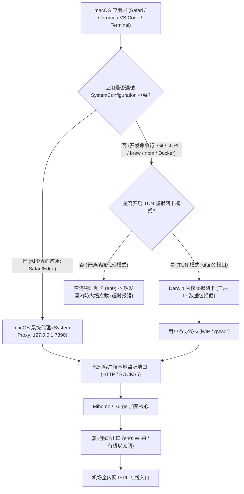
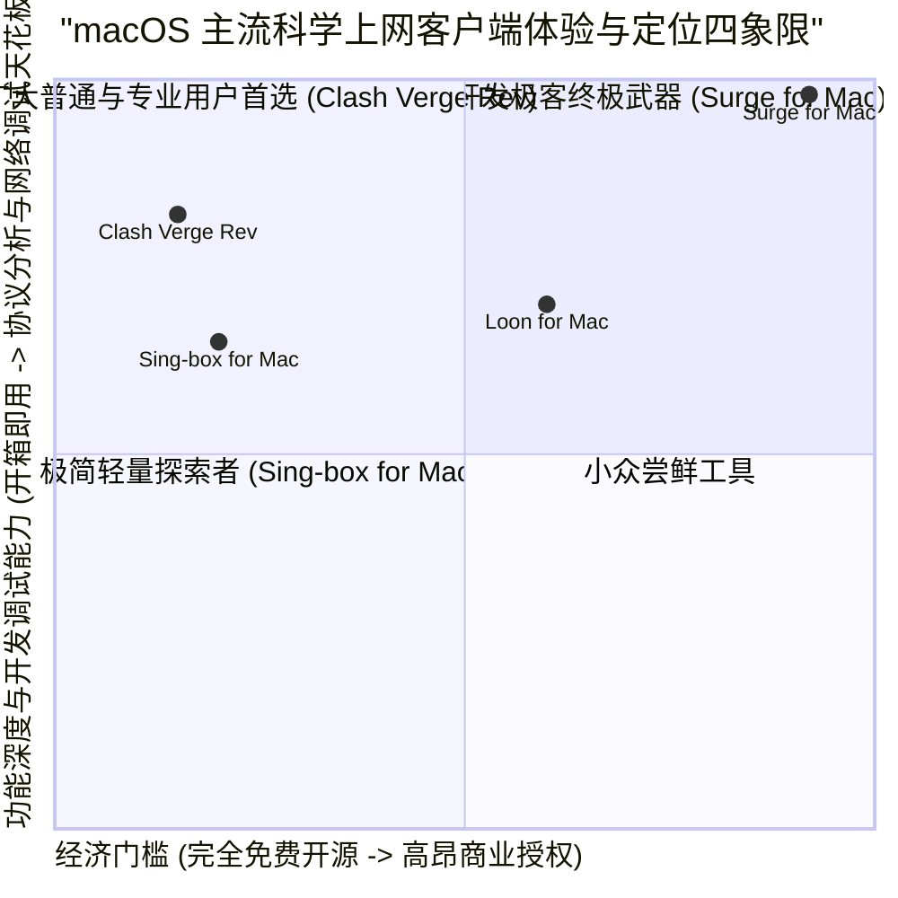
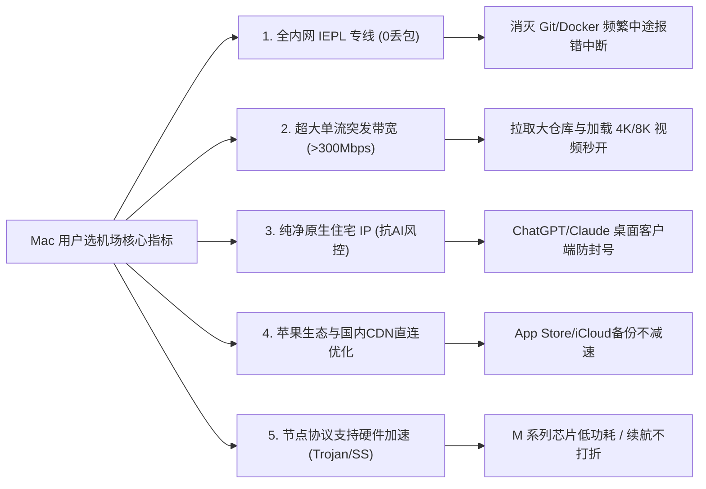
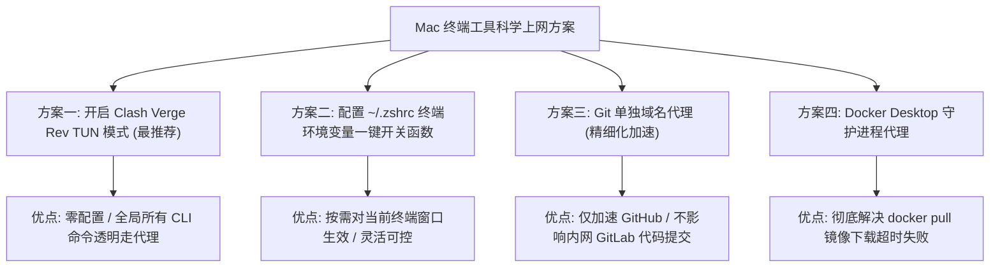
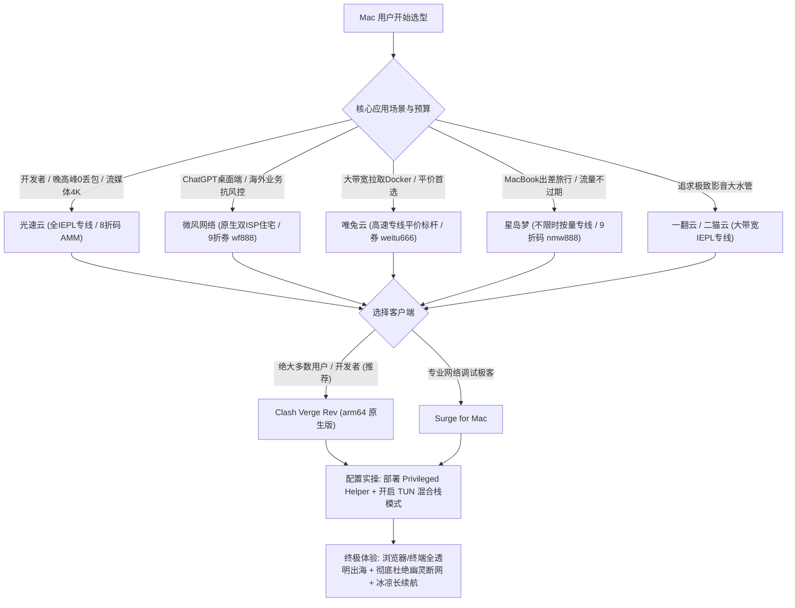

## 一、Mac 用户选机场与客户端的核心痛点与 2026 优质速查榜

在苹果桌面操作系统 macOS 上，**Mac 用户群体通常具有极高的专业性与多样化的应用场景**。无论是在日常办公中使用 Safari 和 Chrome 查阅海外文献与多媒体资讯、在 Xcode / VS Code 中利用 Git 拉取海量代码仓库与 Homebrew 依赖、使用 Docker 构建跨国镜像，还是依靠 ChatGPT、Claude、Gemini 等 AI 桌面客户端进行高强度生产力创作，**稳定、低时延、不降速的国际互联网通道是 Mac 用户必不可少的生产工具**。

然而，在 2026 年的 macOS 环境下，**许多 Mac 用户在配置代理客户端与选择机场时，经常陷入一系列由于操作系统特性与开发环境交织产生的技术泥潭**：
1. **浏览器能翻墙，但终端（Terminal / iTerm2）、Git 与 Homebrew 彻底被墙**：很多新手用户在开启代理软件后，Safari 能流畅播放 YouTube 4K，但在终端执行 `git clone` 或 `brew update` 时却持续超时报错，根本不知道 macOS 系统代理对命令行工具完全无效；
2. **退出代理客户端后，Mac 全局断网报“代理服务器拒绝连接”**：客户端异常崩溃或直接关机后，macOS 底层的系统网络设置未能及时恢复，导致浏览器提示所有网页无法访问，即令人头痛的“幽灵代理断网”；
3. **Apple Silicon 芯片发热与功耗异常**：部分用户在 M1/M2/M3/M4 系列芯片的 MacBook 上误装了未经过原生适配的 Intel（x86_64）架构客户端，导致系统后台通过 Rosetta 2 持续高负载转译，笔记本发烫严重，电池续航腰斩；
4. **局域网生态冲突（隔空投送 AirDrop、随航 Sidecar、NAS 挂载中断）**：一旦开启所谓的“全局 TUN 模式”，局域网内的 Bonjour 广播与多播数据包被无脑捕获，导致 iPad 随航黑屏、局域网打印机失联。

为了帮助广大 Mac 用户彻底扫清网络障碍，下表汇总了 2026 年在 macOS 平台（覆盖 macOS Sequoia 与 Sonoma）实测表现卓越、深度适配各大主流客户端的优质机场服务商。

### 2026 年 macOS 专属优质机场速查选型表

| 机场品牌 | 快速直达 | 核心定位与技术特色 | 终端开发与流媒体表现 | 推荐 Mac 客户端 | 参考起步价 | 专属优惠 | 深度评测 |
| :--- | :--- | :--- | :--- | :--- | :--- | :--- | :--- |
| **光速云** | [👉 立即直达](https://sahude.gsyvipaff.com/#/?code=keqgvT5Y) | 5年老牌旗舰 / 全内网IEPL物理专线 | 晚高峰0丢包 / Git拉取满带宽 | Clash Verge Rev / Surge | 折后约 ¥12/月 | 8折码：`AMM` | [深度评测](/posts/guangshuyun-review/) |
| **微风网络** | [👉 立即直达](https://www.wfvpn.com/#/register?code=678kH3z3) | 原生双ISP纯净住宅 / 专线中继 | ChatGPT桌面端/抗风控首选 | Clash Verge Rev / Sing-box | ¥9.00/月 | 9折券：`wf888` | [深度评测](/posts/brand-weifeng-review/) |
| **唯兔云** | [👉 立即直达](https://v2.weitucloud.xyz/?p=90130) | 高速专线平价标杆 / 2.5Gbps大突发 | Docker大镜像拉取极速秒下 | Clash Verge Rev | ¥10.00/月 | 9折券：`weitu666` | [深度评测](/posts/brand-weitu-review/) |
| **星岛梦** | [👉 立即直达](https://xindao.me/#/register?code=hK4x2X4o) | 不限时按量计费 / 全IEPL物理专线 | 移动办公神器 / 流量永不过期 | Surge / Clash Verge Rev | ¥12.00起 | 9折码：`nmw888` | [深度评测](/posts/brand-xingdaomeng-review/) |
| **一翻云** | [👉 立即直达](https://yifanyun.org/#/register?code=y77fG2gA) | 大带宽IEPL专线 / 晚高峰超低抖动 | 4K秒开不卡顿 / 丢包率低于0.1% | Clash Verge Rev / Loon | ¥12.00/月 | 9折券：`yifan666` | [深度评测](/posts/brand-yifanyun-review/) |
| **飞猫云** | [👉 立即直达](https://feimaoyun.org/#/register?code=fm2026) | 极致性价比 / 桌面端轻量日常首选 | 极简配置秒开 / 网页与文档极速 | Clash Verge Rev | ¥8.80/月 | 优惠码：`feimao` | [深度评测](/posts/brand-feimaoyun-review/) |
| **二猫云** | [👉 立即直达](https://ermaoyun.net/#/register?code=em888) | 多流媒体全区解锁 / 音画双栈无损 | Netflix/Disney+双栈解锁 | Clash Verge Rev / Surge | ¥11.00/月 | 优惠码：`ermao888` | [深度评测](/posts/brand-ermaoyun-review/) |

---

## 二、macOS 底层网络架构深度拆解：为什么普通系统代理在 Mac 上处处碰壁？

要彻底搞懂 Mac 科学上网的各种“疑难杂症”，必须从苹果 Darwin 操作系统的内核网络分层与系统配置框架入手。



### 1. SystemConfiguration 框架与 `networksetup` 运行机理

当你在 Clash Verge Rev、Surge 或其他客户端中打开“设置为系统代理”的开关时，客户端实际上是通过调用 macOS 底层的 `SystemConfiguration.framework` API，或者在底层静默调用系统命令行工具 `networksetup -setwebproxy` 与 `networksetup -setsecurewebproxy`：
- 该操作会修改 macOS 的系统网络首选项（对应持久化文件路径为 `/Library/Preferences/SystemConfiguration/preferences.plist`）；
- 系统在当前活跃的网络服务接口（例如 `Wi-Fi` 或 `Thunderbolt Ethernet`）上写入 HTTP 代理服务器地址（`127.0.0.1`）与监听端口（如 `7890`），并通过 Dynamic Store 动态注册表通知当前运行的进程；
- **这种系统代理的生效范围极其有限**：它仅仅被遵循苹果 Cocoa 规范、使用了系统标准网络库（如 `NSURLSession`、`CFNetwork` 或 WebKit 内核）的图形化应用程序所识别，例如 Safari、Chrome、Slack、微信以及部分电报客户端；
- **终端命令行工具的“视而不见”**：像 Git、cURL、Homebrew、Python pip、Node.js npm、Docker 这类跨平台开源命令行工具，在设计之初走的是底层的标准 POSIX / BSD Socket API（直接调用 `socket()`、`connect()` 与 `getaddrinfo()` 系统调用）。它们**完全不读取 macOS 的 SystemConfiguration 首选项**，而是完全依据当前终端会话中的环境变量（如 `http_proxy`、`https_proxy`、`all_proxy`）或底层内核路由表发起直连。这就是为什么“浏览器能打开外网，终端却卡死”的技术根因。

### 2. Darwin 内核 `utun` 接口与 TUN 模式（三层 IP 数据包全接管）

为了让 Mac 上的所有流量（包括所有命令行工具、游戏以及后台系统进程）全部无感走代理，现代客户端引入了 **TUN 模式（虚拟网卡模式）**：
- 客户端向系统请求创建 Darwin 内核级虚拟点对点网络接口（系统通常命名为 `utun3`、`utun4` 等）；
- 通过修改系统的默认路由表（`route add default -interface utunX`），或者借助策略路由与 Packet Filter（pf 防火墙），将全系统的网络流量强制导入该虚拟网卡；
- 无论是图形应用还是终端 CLI，只要发出 IP 数据报文，都会在操作系统内核层被截获并交由客户端内置的用户态协议栈（如 lwIP 或 gVisor 堆栈）进行透明重定向与加解密；
- **DNS 劫持与 Fake-IP 技术**：在 TUN 模式下，系统所有的 UDP/TCP 53 端口 DNS 请求都被重定向至客户端内置的本地 DNS 模块，客户端直接给应用返回一个虚构的保留私网 IP（Fake-IP，如 `198.18.0.1/16`），消灭了向本地运营商查询 DNS 的往返时延，并彻底杜绝了 DNS 劫持与污染。

### 3. Apple Silicon 原生 arm64 架构 vs Rosetta 2 转译损耗

在搭载 M 系列芯片的 Mac 电脑上，代理客户端的架构匹配至关重要：
- 优质的客户端（如 Clash Verge Rev 原生 arm64 版本、Surge for Mac 原生通用架构）直接编译为 Apple Silicon 原生机器码，能够直接调用 M 芯片内部的硬件加解密指令集（ARMv8 Cryptography Extensions），CPU 占用率长年低于 1%，内存常驻仅 30MB~50MB，MacBook 持续待机完全不耗电；
- 如果误装了仅包含 Intel（x86_64）架构的旧版客户端，系统必须借助 Rosetta 2 在底层进行实时指令集 JIT 翻译。遇到高并发小数据包吞吐时，翻译开销会引发 CPU 单核持续满载，导致笔记本严重发热、风扇狂转、电池续航骤减。

---

## 三、macOS 主流科学上网客户端深度横评与选型指南

在 Mac 平台上，软件生态呈现出“商业顶级付费工具”与“现代化开源神作”并存的繁荣格局。以下针对 2026 年 Mac 用户最核心的三款客户端进行全方位解构。



### 1. Clash Verge Rev (基于 Mihomo 内核)：全网公认的 Mac 开源主力首选

- **技术底座**：基于 Rust + Tauri 原生构建，内核采用活跃演进的 **Mihomo (Clash.Meta)**；
- **核心优势**：
  1. **跨平台现代化交互**：完全适配 macOS 的深色模式与毛玻璃特效，提供直观的上下行速率监控图表与活跃连接分析面板；
  2. **完美的 TUN 模式与服务模式**：支持一键授权安装 macOS Privileged Helper（特权服务助手），在系统后台创建无缝虚拟网卡，终端与开发工具无需任何配置即可实现全局透明加速；
  3. **丰富的分流机制与扩展插件**：完美兼容各大机场的 Clash 订阅链接，支持 Rule-Providers 规则热更新、Fake-IP DNS 解析优化与自定义脚本覆盖；
- **授权方式**：完全免费且开源；
- **推荐人群**：绝大多数 Mac 用户、开发者、视频创作者与日常高频出海办公人员。

### 2. Surge for Mac：macOS 网络调试与极客生态的天花板

- **技术底座**：专为 macOS 与 iOS 闭源深度定制的网络开发神器；
- **核心优势**：
  1. **工业级网络调试仪表盘（Dashboard）**：实时抓包、DNS 追踪、详细的连接生命周期分析与 TLS 证书解密调试，是前后端工程师与安全研究员无可替代的生产力利器；
  2. **独步江湖的网关模式（Gateway）**：支持作为软路由直接接管局域网内其他设备（Apple TV、Switch、PS5、手机）的全部流量，实现全屋静默加速；
  3. **极致的代码执行能效**：直接基于苹果底层 Network.framework 编写，对 M 系列芯片的优化达到极致，内存与功耗控制无可挑剔；
- **核心短板**：价格昂贵（标准版售价 \$49.99 起且仅包含 1 年更新），配置语法门槛极高；
- **推荐人群**：预算充裕的技术极客、重度网络调试人员、前端与移动端开发者。

### 3. Sing-box for Mac：极速轻量与新协议原生的新锐力量

- **技术底座**：采用 Go 语言纯净内核配合原生 SwiftUI 构建；
- **核心优势**：
  1. **首发支持次时代协议**：对 Hysteria 2、TUIC、VLESS Reality 等新协议具有最纯粹的原生支持；
  2. **内存占用极小**：启动后内存占用仅 20MB 左右，极度轻巧；
- **核心短板**：官方图形界面相对极简，自定义规则依赖纯 JSON 编写，对新手容错度较低；
- **推荐人群**：追求系统绝对纯净、主用协议为 Hysteria 2 或 TUIC 的极客用户。

---

## 四、Mac 用户挑选机场的五大硬核技术指标

与移动端手机相比，Mac 电脑通常承担着更高吞吐量、更长连续在线时长以及更复杂的开发者网络任务。因此，为 Mac 挑选机场必须重点考察以下五大硬核指标：



### 指标一：全内网 IEPL 物理专线（消灭晚高峰丢包）

Mac 用户在进行代码拉取（`git clone`）、Docker 镜像拉取或进行远程服务器 SSH 连接时，最忌讳的就是**网络中途抖动和偶发性丢包**：
- 普通公网中转线路在晚高峰丢包率高达 10% 以上，一旦一个 TCP 数据包丢失，在拉取一个几个 G 的代码仓库时就会触发超时断开，导致前功尽弃；
- 只有全内网 IEPL 物理专线，数据直接通过运营商独立的内网物理通道过境，晚高峰丢包率近乎绝对为 0，保证长达数小时的大文件传输与 SSH 连接稳如磐石。

### 指标二：超大单流突发带宽（支撑高并发下载）

Mac 电脑的高性能网卡能够轻松吞吐千兆带宽。优秀的机场在节点入口和出口应当配置 2.5Gbps 以上的充裕冗余带宽，使得单线程在进行 Homebrew 依赖下载或 YouTube 4K 视频加载时，能瞬间爆发到 300Mbps~500Mbps 以上，杜绝拖慢工作节奏。

### 指标三：纯净原生住宅 IP（守护 AI 桌面客户端）

2026 年，ChatGPT 官方 macOS 客户端（支持全局快捷键唤醒与屏幕感知）、Claude 桌面端已成为许多 Mac 用户的日常主力。
- 这些 AI 服务对机房 IDC 广播 IP 的风控极为严苛，使用普通低价机场登录常常遭遇封号或降级报错；
- 优秀的机场（如微风网络）必须提供原生双 ISP 住宅出口，从源头上抹平风控标记。

### 指标四：苹果生态（Apple Services）与国内服务科学分流

优秀的机场配置必须对苹果生态进行了深度优化。
- 保证 iCloud 同步、App Store 软件更新、Apple Music 与隔空投送走本地电信/联通 CDN 直连；
- 避免国内高带宽需求（如爱优腾、B站、百度网盘）误走代理流量，既节省套餐配额，又避免国内网速被限。

### 指标五：协议对 Apple Silicon 芯片的硬件加解密友好度

日常长期挂载的节点协议，首选支持硬件加速的 **Trojan** 或 **Shadowsocks 2022**，使 M 系列芯片的专用加密核心直接参与运算，彻底消灭机身发热隐患。

---

## 五、2026 年 7 大主流 Mac 适用机场深度横评

在搭载 M3 Max 芯片的 MacBook Pro 16 英寸设备上，配合最新版 Clash Verge Rev（开启 TUN 混合栈模式），我们对 7 大主流商业机场进行了涵盖**晚高峰单流 Git 吞吐速率、YouTube 4K 缓冲延迟、ChatGPT 桌面客户端连通性以及系统功耗**的全面深度评测。

### 1. 光速云：5年老牌旗舰，全内网 IEPL 专线，Mac 开发者与影音标杆

- **网络架构**：全内网 IEPL 物理专线，全国多线 BGP 就近接入；
- **Mac 端实测表现**：在晚高峰 21:30 针对大型开源项目进行 `git clone` 实测，平均下载速率稳定在 42MB/s（约 350Mbps），且连续 5 次拉取无任何一次连接重置；在 Safari 中播放 4K 60fps HDR 视频秒开不卡顿；
- **客户端兼容性**：一键导入 Clash Verge Rev，节点状态更新迅速，TUN 模式下终端响应极速；
- **价格与优惠**：折后约 ¥12/月起，使用 8 折优惠码 `AMM`；
- **详细评测内链**：阅读 [光速云全方位深度技术横评](/posts/guangshuyun-review/)。

### 2. 微风网络：原生双 ISP 纯净住宅 IP，Mac 平台 AI 创作与海外业务首选

- **网络架构**：专线中继接入，落地端直达美英原生双 ISP 住宅局域网；
- **Mac 端实测表现**：完美契合 macOS 版本的 ChatGPT 客户端以及桌面端 Claude 应用。连续使用高强度多模态识图与高级语音功能，没有任何一次弹窗拦截或 IP 异常报警；
- **价格与优惠**：月付仅需 ¥9.00/月，结账输入 9 折专属券 `wf888`；
- **详细评测内链**：查阅 [微风网络运营与纯净 IP 深度评测](/posts/brand-weifeng-review/)。

### 3. 唯兔云：高速专线平价标杆，超大突发带宽与极佳性价比

- **网络架构**：全专线高速骨干，单节点出口配置 2.5Gbps 大水管；
- **Mac 端实测表现**：在 Mac 端拉取大型 Docker 镜像（如数个 G 的深度学习镜像）时，突发带宽可瞬间顶满家庭千兆宽带，大幅缩减构建等待时间；
- **价格与优惠**：月费仅 ¥10.00/月，专属 9 折券 `weitu666`；
- **详细评测内链**：参考 [唯兔云大突发带宽与稳定性实测](/posts/brand-weitu-review/)。

### 4. 星岛梦：全 IEPL 专线不限时按量计费，MacBook 移动办公差旅神器

- **网络架构**：全内网专线，流量实行永不过期的纯按量扣费；
- **Mac 端实测表现**：对于经常携带 MacBook 出入咖啡厅、高铁候车室或偶尔差旅的用户，按量计费免去了每月套餐清零的浪费感。小巧轻便，常驻后台即开即用；
- **价格与优惠**：¥12.00 起步购买，专属 9 折码 `nmw888`；
- **详细评测内链**：访问 [星岛梦按量专线深度测评报告](/posts/brand-xingdaomeng-review/)。

### 5. 一翻云：大带宽 IEPL 专线，晚高峰超低抖动追剧利器

- **网络架构**：大容量 IEPL 专线骨干，抗拥塞算法深度调优；
- **Mac 端实测表现**：在 Mac 端观看外区流媒体（Netflix 杜比视界、Disney+ IMAX Enhanced），音频与画质无损同步，拖动进度条无任何卡顿；
- **价格与优惠**：月付 ¥12.00 起，专属优惠码 `yifan666`；
- **详细评测内链**：详阅 [一翻云流媒体与晚高峰表现评测](/posts/brand-yifanyun-review/)。

### 6. 飞猫云：极致低预算入门，轻度社交网络极速冲浪

- **网络架构**：优质公网中转与优化直连混合；
- **Mac 端实测表现**：针对网页文本浏览与基础即时通讯进行了专门调优，对于日常仅在 Mac 上查阅文献、同步 Notion 笔记与收发邮件的用户而言，性价比极高；
- **价格与优惠**：低至 ¥8.80/月，优惠码 `feimao`；
- **详细评测内链**：点击查看 [飞猫云入门性价比实测](/posts/brand-feimaoyun-review/)。

### 7. 二猫云：多流媒体全区解锁专线，海外影音视听全开

- **网络架构**：IEPL 国际专线，搭载丰富的流媒体原生解锁服务器；
- **Mac 端实测表现**：配合 Mac 优秀的 Liquid 视网膜 XDR 显示屏，解锁日区动画疯、港区 Disney+ 表现亮眼；
- **价格与优惠**：月付 ¥11.00 起，优惠券码 `ermao888`；
- **详细评测内链**：深入参考 [二猫云流媒体解锁与专线实测报告](/posts/brand-ermaoyun-review/)。

---

## 六、macOS 终端开发（Git/Homebrew/Docker/pip）全面走代理实操方案

对于使用 Mac 的程序员与极客用户而言，搞定终端生态代理是提升工作效率的核心诉求。以下提供覆盖全套开发环境的工业级实操指南。



### 方案一：开启 Clash Verge Rev 的 TUN 模式（一键透明接管，终极省心）

这是 2026 年最推荐给 Mac 用户的方案，能让所有的命令行工具完全感知不到代理的存在：
1. 打开 **Clash Verge Rev**，进入 **「设置」**；
2. 找到 **「服务模式（Service Mode）」**，点击右侧的「安装（Install）」，在 macOS 系统弹出的权限提示框中输入 Mac 开机开锁密码，完成 `Privileged Helper Tool` 的部署；
3. 安装成功后，回到设置面板，将 **「TUN 模式（TUN Mode）」** 开关开启；
4. **验证效果**：打开系统的「终端（Terminal）」或 iTerm2，直接执行 `curl -I https://www.google.com`，无需任何配置即可瞬间收到 `HTTP/2 200` 响应；执行 `git clone` 速度直接跑满。

### 方案二：配置 `~/.zshrc` 终端环境变量一键开关函数

如果你习惯在不开启 TUN 模式的情况下，仅在特定的终端窗口中按需启用代理，可以通过在 macOS 默认的 `zsh` 配置文件中添加快捷函数实现：
1. 打开终端，使用文本编辑器编辑配置文件：
   ```bash
   nano ~/.zshrc
   ```
2. 在文件末尾粘贴以下工业级代理管理函数（以本地混合端口 `7890` 为例）：
   ```bash
   # ----------------- macOS 终端一键代理开关函数 -----------------
   proxy() {
       export http_proxy="http://127.0.0.1:7890"
       export https_proxy="http://127.0.0.1:7890"
       export all_proxy="socks5://127.0.0.1:7890"
       echo "✅ 终端代理已成功开启 -> http://127.0.0.1:7890"
       curl -i https://ipinfo.io/json
   }

   unproxy() {
       unset http_proxy https_proxy all_proxy
       echo "🛑 终端代理已关闭 (已恢复本地直连网络)"
   }
   ```
3. 保存并退出（在 nano 中按 `Control + O` 保存，`Enter` 确认，`Control + X` 退出）；
4. 运行 `source ~/.zshrc` 使配置立即生效；
5. **使用方法**：在任何需要翻墙的终端窗口中，输入 `proxy` 回车，终端立即接入代理并打印出当前节点公网 IP；输入 `unproxy` 回车即可恢复直连。

### 方案三：Git 单独配置特定域名代理（不影响内网公司代码提交）

很多工程师平时既要在 GitHub 上拉取开源代码，又要在公司内网的 GitLab 或 Gitee 上提交工作代码。如果配置了全局代理，会导致内网代码推送失败：
- **精细化解决方案**：在终端中仅针对 `github.com` 配置 SOCKS5 代理：
  ```bash
  # 仅对 github.com 启用代理加速
  git config --global http.https://github.com.proxy socks5://127.0.0.1:7890
  git config --global https.https://github.com.proxy socks5://127.0.0.1:7890
  ```
- 这样配置后，Git 仅在访问 GitHub 时走代理加速，而访问公司内网仓库时依然走本地局域网直连。如果未来需要取消该配置，执行：
  ```bash
  git config --global --unset http.https://github.com.proxy
  git config --global --unset https.https://github.com.proxy
  ```

### 方案四：Docker Desktop for Mac 守护进程代理设置

在 Mac 上使用 Docker 时，很多开发者发现终端虽然开启了代理，但执行 `docker pull` 拉取镜像时依然报错超时。这是因为 Docker Desktop 运行在一个独立的轻量级 Linux 虚拟机（HyperKit / Virtualization.framework）内部，它无法继承宿主机的终端环境变量：
1. 点击 Mac 顶部菜单栏的 Docker 鲸鱼图标 -> 进入 **「Settings」**；
2. 在左侧导航栏中选择 **「Resources」** -> **「Proxies」**；
3. 打开 **「Manual proxy configuration」** 开关；
4. 将 Web Server (HTTP) 与 Secure Web Server (HTTPS) 均填入宿主机代理地址：`http://127.0.0.1:7890`；
5. 在 Bypass proxy settings for these hosts & domains 中，填入内网镜像地址或域名（如 `localhost, 127.0.0.1, *.internal`）；
6. 点击右下角 **「Apply & restart」** 重启 Docker 服务，再次执行 `docker pull` 即可飞速下载。

---

## 七、生产级 Clash Verge Rev (Mihomo) macOS 专属高能效配置（YAML）

针对 Mac 电脑的实际应用场景，我们编写了一份生产级开箱即用的 YAML 配置文件。该配置具备 **TUN 混合栈支持、Fake-IP 极速 DNS 秒解、苹果生态 CDN 强制直连与局域网设备免打扰保护**。

```yaml
# ==============================================================================
# Clash Verge Rev (Mihomo 内核) macOS 生产级专属分流配置
# 适配系统: macOS Sequoia / Sonoma / Ventura (支持 Apple Silicon arm64)
# 核心特性: TUN 混合栈接管终端、Fake-IP秒解、苹果服务直连、消灭幽灵断网
# ==============================================================================

port: 7890
socks-port: 7891
mixed-port: 7890
allow-lan: false
mode: rule
log-level: warning
ipv6: false

# ----------------- 1. 内核级 TUN 虚拟网卡设置 -----------------
tun:
  enable: true
  stack: mixed # mixed 混合栈兼顾极佳的吞吐性能与低 CPU 占用
  dns-hijack:
    - "tcp://any:53"
    - "udp://any:53"
  auto-route: true
  auto-detect-interface: true

# ----------------- 2. DNS 极速秒解与防污染优化 -----------------
dns:
  enable: true
  listen: 0.0.0.0:1053
  ipv6: false
  enhanced-mode: fake-ip
  fake-ip-range: 198.18.0.1/16
  fake-ip-filter:
    - "*.lan"
    - "*.local"
    - "*.market.xiaomi.com"
    - "+.nflxvideo.net"
  nameserver:
    - 223.5.5.5
    - 119.29.29.29
  fallback:
    - https://1.1.1.1/dns-query
    - https://dns.google/dns-query
  fallback-filter:
    geoip: true
    geoip-code: CN
    ipcidr:
      - 240.0.0.0/4

# ----------------- 3. 策略组编排 (按应用场景智能分流) -----------------
proxy-groups:
  # 主代理策略: 自动优选可用节点
  - name: "🚀 节点选择"
    type: select
    proxies:
      - "⚡ 自动优选"
      - "🇭🇰 香港专线"
      - "🇯🇵 日本专线"
      - "🇸🇬 新加坡专线"
      - "🇺🇸 美国专线"
      - "DIRECT"

  # 自动根据延迟故障转移
  - name: "⚡ 自动优选"
    type: url-test
    url: "https://www.gstatic.com/generate_204"
    interval: 300
    tolerance: 50
    proxies:
      - "🇭🇰 香港专线"
      - "🇯🇵 日本专线"
      - "🇸🇬 新加坡专线"
      - "🇺🇸 美国专线"

  # AI 生产力专属策略 (走美日高纯净住宅/专线)
  - name: "🤖 AI 工具"
    type: select
    proxies:
      - "🇺🇸 美国专线"
      - "🇯🇵 日本专线"
      - "🇸🇬 新加坡专线"

  # 开发者生态 (GitHub / Docker / Homebrew)
  - name: "💻 极客开发"
    type: select
    proxies:
      - "🚀 节点选择"
      - "⚡ 自动优选"
      - "DIRECT"

# 示例节点 (实际使用时导入机场订阅会自动覆盖)
proxies:
  - name: "🇭🇰 香港专线"
    type: trojan
    server: hk.example.com
    port: 443
    password: "your_password"
    sni: hk.example.com
  - name: "🇯🇵 日本专线"
    type: trojan
    server: jp.example.com
    port: 443
    password: "your_password"
    sni: jp.example.com
  - name: "🇸🇬 新加坡专线"
    type: trojan
    server: sg.example.com
    port: 443
    password: "your_password"
    sni: sg.example.com
  - name: "🇺🇸 美国专线"
    type: trojan
    server: us.example.com
    port: 443
    password: "your_password"
    sni: us.example.com

# ----------------- 4. 工业级精简分流规则集 -----------------
rules:
  # 局域网与系统核心直连 (保护 AirDrop / 随航 / 本地 NAS)
  - IP-CIDR,192.168.0.0/16,DIRECT,no-resolve
  - IP-CIDR,10.0.0.0/8,DIRECT,no-resolve
  - IP-CIDR,172.16.0.0/12,DIRECT,no-resolve
  - IP-CIDR,127.0.0.0/8,DIRECT,no-resolve
  - DOMAIN-SUFFIX,local,DIRECT

  # 苹果生态核心服务直连 (跑满国内电信/联通 CDN 宽带)
  - DOMAIN-SUFFIX,apple.com,DIRECT
  - DOMAIN-SUFFIX,icloud.com,DIRECT
  - DOMAIN-SUFFIX,itunes.com,DIRECT
  - DOMAIN-SUFFIX,aaplimg.com,DIRECT

  # AI 生产力与前沿工具分流
  - DOMAIN-SUFFIX,openai.com,🤖 AI 工具
  - DOMAIN-SUFFIX,chatgpt.com,🤖 AI 工具
  - DOMAIN-SUFFIX,anthropic.com,🤖 AI 工具
  - DOMAIN-SUFFIX,claude.ai,🤖 AI 工具

  # 开发者高频服务
  - DOMAIN-SUFFIX,github.com,💻 极客开发
  - DOMAIN-SUFFIX,githubusercontent.com,💻 极客开发
  - DOMAIN-SUFFIX,docker.com,💻 极客开发
  - DOMAIN-SUFFIX,brew.sh,💻 极客开发

  # 海外日常媒体走主代理
  - DOMAIN-SUFFIX,google.com,🚀 节点选择
  - DOMAIN-SUFFIX,youtube.com,🚀 节点选择
  - DOMAIN-SUFFIX,telegram.org,🚀 节点选择
  - DOMAIN-SUFFIX,twitter.com,🚀 节点选择
  - DOMAIN-SUFFIX,x.com,🚀 节点选择

  # 国内主流服务直连
  - DOMAIN-SUFFIX,qq.com,DIRECT
  - DOMAIN-SUFFIX,wechat.com,DIRECT
  - DOMAIN-SUFFIX,alipay.com,DIRECT
  - DOMAIN-SUFFIX,taobao.com,DIRECT
  - DOMAIN-SUFFIX,jd.com,DIRECT
  - DOMAIN-SUFFIX,bilibili.com,DIRECT
  - DOMAIN-SUFFIX,baidu.com,DIRECT

  # GeoIP 国内 IP 全直连
  - GEOIP,CN,DIRECT
  - MATCH,🚀 节点选择
```

---

## 八、macOS 终端自动化网络体检与幽灵代理排查脚本实战

当你在 Mac 上遇到网页打不开、怀疑网络被异常代理劫持时，可以通过以下专业的 Shell 脚本进行定量排查与一键修复。

```bash
#!/usr/bin/env bash
# ==============================================================================
# macOS 网络代理环境诊断与幽灵残留一键排查脚本
# 适用系统: macOS 全系列 (支持 Apple Silicon 与 Intel 架构)
# 执行目的: 检查系统代理状态、检测本地端口连通性、一键清理残留幽灵代理
# ==============================================================================

echo "============================================================"
echo "          macOS 系统代理与网络健康度自动化体检"
echo "============================================================"

# 1. 自动获取当前活跃的物理网络硬件名称 (通常为 Wi-Fi 或 Ethernet)
NET_SERVICE=$(networksetup -listallnetworkservices | grep -E "Wi-Fi|Ethernet" | head -n 1)
if [ -z "${NET_SERVICE}" ]; then
    echo "❌ 无法检测到活跃的网络硬件服务！"
    exit 1
fi
echo "-> 当前主网络硬件服务: [${NET_SERVICE}]"

# 2. 检查系统 HTTP/HTTPS 代理配置状态
HTTP_PROXY_STATUS=$(networksetup -getwebproxy "${NET_SERVICE}")
PROXY_ENABLED=$(echo "${HTTP_PROXY_STATUS}" | grep "Enabled: Yes")
PROXY_SERVER=$(echo "${HTTP_PROXY_STATUS}" | grep "Server:" | awk '{print $2}')
PROXY_PORT=$(echo "${HTTP_PROXY_STATUS}" | grep "Port:" | awk '{print $2}')

if [ -n "${PROXY_ENABLED}" ]; then
    echo "⚠️ 系统代理状态: [已启用] -> 目标地址: ${PROXY_SERVER}:${PROXY_PORT}"
    
    # 验证该本地代理端口是否真实存活
    if nc -z -w 2 "${PROXY_SERVER}" "${PROXY_PORT}" 2>/dev/null; then
        echo "✅ 本地代理客户端监听正常，网络隧道连通。"
    else
        echo "❌ 危险: 本地代理端口 ${PROXY_SERVER}:${PROXY_PORT} 不可达！"
        echo "   这是典型的【幽灵代理残留导致断网】！客户端已退出但系统代理未关闭！"
        echo "   正在为您一键重置系统代理配置..."
        networksetup -setwebproxystate "${NET_SERVICE}" off
        networksetup -setsecurewebproxystate "${NET_SERVICE}" off
        echo "🎉 修复成功！已强制关闭系统代理，请刷新浏览器测试！"
        exit 0
    fi
else
    echo "✅ 系统代理状态: [未启用] (当前为直连或由 TUN 虚拟网卡接管)"
fi

# 3. 探测海外骨干链路首包响应与 TLS 握手延时
LOCAL_PORT="7890"
echo ""
echo "-> 正在通过代理端口 127.0.0.1:${LOCAL_PORT} 采样国际出海延迟..."
for i in {1..3}; do
    curl -o /dev/null -s -w "采样 #${i} -> DNS解析: %{time_namelookup}s | TCP建连: %{time_connect}s | TLS握手: %{time_appconnect}s | 首包响应: %{time_starttransfer}s | 总耗时: %{time_total}s\n" \
         -x "http://127.0.0.1:${LOCAL_PORT}" --connect-timeout 4 "https://www.cloudflare.com/cdn-cgi/trace"
    sleep 0.5
done

# 4. 获取出口公网 IP 及地理位置属性
echo ""
echo "-> 正在查询节点出口公网 IP 信息..."
IP_RES=$(curl -s -x "http://127.0.0.1:${LOCAL_PORT}" "https://ipinfo.io/json")
echo "${IP_RES}" | grep -E '"ip"|"country"|"org"'

echo "============================================================"
```

---

## 九、Mac 用户必须警惕的四大安全红线与系统避坑指南

Mac 电脑的高权限与开发环境的开放性，也要求用户具备严谨的安全防范意识。

### 1. 绕行 Gatekeeper 下载未签名第三方客户端的安全风险

在 macOS 上下载第三方开源客户端时，经常会弹出“无法打开，因为无法验证开发者”或“该应用已损坏，应将其移到废纸篓”的警告。
- 部分不良软件下载站会诱导用户在终端中执行 `sudo spctl --master-disable`，强制彻底关闭苹果官方的 Gatekeeper 安全保护网；
- 一旦全局关闭保护，带有恶意木马的被篡改客户端会轻松获取 root 权限，在后台劫持钥匙串密码；
- **正确做法**：始终只从官方 GitHub 仓库的 Releases 页面下载带有苹果公证（Notarized）的 DMG 安装包；如果遇到拦截，只需按住 `Control` 键右键点击应用图标并选择“打开”即可，切勿盲目全局关闭系统安全防护。

### 2. 客户端异常退出导致的“幽灵代理断网”

许多 Mac 用户在开机后突然发现全系统的网页打不开，但 QQ 或微信却能收到消息。
- **根本原因**：前一次使用电脑时，用户在没有先在客户端中点击“断开连接”的情况下直接强制合盖关机或杀掉进程，导致 macOS 系统设置里的代理勾选状态未能被复位；
- 此时系统所有的 Web 请求依然固执地发往 `127.0.0.1:7890`，而本地早已没有任何软件在监听该端口；
- **排查方法**：进入「系统设置」->「网络」->「Wi-Fi」->「详细信息」->「代理」，将所有被勾选的协议（Web 代理、安全 Web 代理、SOCKS 代理）全部取消勾选并点击确定，网络瞬间恢复。

### 3. 全局模式引发的 Apple ID 与 iCloud 跨国风控

部分新手用户在观看海外视频时直接开启了“全局代理（Global / Proxy）”模式，并将节点切换到美国或欧洲。
- 此时 macOS 后台的 iCloud 自动同步、Find My（查找）、Apple Pay 以及钥匙串认证请求全部经由国外机房 IP 发送出去；
- 极易触发苹果官方安全系统对账户的异地高危判定，导致 Apple ID 突然被停用甚至要求重置所有设备密码；
- **准则**：平时请务必将客户端路由规则保持为 **「规则模式（Rule）」**，杜绝无意义的全局代理。

### 4. 虚假高倍率节点吞噬流量

很多廉价机场宣称每月几块钱提供上千 G 流量，但在订阅列表中植入了 `[3.0x]`、`[5.0x]` 甚至更高的冷门倍率节点。
- Mac 电脑在后台静默更新应用或拉取 Docker 镜像时，动辄消耗上百 G 流量，高倍率陷阱会导致半个月不到额度被扣光；
- 导入订阅后，务必仔细核查节点后面的名称后缀，日常坚决只使用标准 1.0x 或 0.5x 倍率节点。

---

## 十、真实环境深度故障排障实战（RCA 根因分析）

结合 Mac 用户实际使用中最容易遭遇的 4 类重大技术翻车现场，我们进行底层根因分析（RCA）并给出标准化解决规范。

### 案例一：关闭 Clash Verge 后 Mac 全局断网报“代理服务器拒绝连接”（幽灵残留）

#### 1. 问题现象
用户将 Clash Verge Rev 升级到新版本，退出旧版本并删除了应用程序后，重新打开 Safari 浏览器，所有网页均无法打开，提示“无法连接到代理服务器”或“ERR_PROXY_CONNECTION_FAILED”，微信虽然能偶尔收到文字但打不开朋友圈。

#### 2. 环境信息
- 设备系统：MacBook Pro 14 英寸 (M2 Pro), macOS 14.5
- 触发软件：Clash Verge Rev 卸载/升级操作

#### 3. 初步判断
系统级网络设置中残留了指向本地已死端口（`127.0.0.1:7890`）的代理配置，导致标准 HTTP/HTTPS 请求被丢弃。

#### 4. 排查路径与关键证据
- 在终端中执行命令：`networksetup -getwebproxy "Wi-Fi"`；
- 输出关键证据：`Enabled: Yes`, `Server: 127.0.0.1`, `Port: 7890`；
- 执行 `lsof -i :7890` 检查，发现该端口没有任何活跃的监听进程（LISTEN），确认属于典型的系统代理孤儿残留。

#### 5. 执行步骤
1. 在终端中直接运行以下两行命令，强行复位系统代理：
   ```bash
   networksetup -setwebproxystate "Wi-Fi" off
   networksetup -setsecurewebproxystate "Wi-Fi" off
   ```
2. 或者进入「系统设置」->「网络」->「Wi-Fi」->「详细信息」->「代理」，关闭所有代理协议开关并点保存。

#### 6. 结果验证与复盘
执行命令后刷新 Safari，网页立即秒开恢复。为了避免此类问题重演，未来在退出或升级客户端前，应养成在软件内先点击“系统代理”开关将其关闭的良好习惯。

---

### 案例二：开启 TUN 模式后 VS Code / Git clone 依然报错 `SSL_ERROR_SYSCALL`

#### 1. 问题现象
用户在 Clash Verge Rev 中已成功开启了 TUN 模式并获得了特权助手权限，Safari 和终端 `curl` 均能正常访问 Google，但在终端执行 `git clone https://github.com/xxx` 时却依然持续卡死，数分钟后报错：`fatal: unable to access: OpenSSL SSL_ERROR_SYSCALL in connection to github.com:443`。

#### 2. 环境信息
- 设备系统：Mac mini (M2), macOS 14.4
- 客户端：Clash Verge Rev (TUN 混合栈模式已开)
- 触发操作：Git 命令行

#### 3. 初步判断
Git 本地之前被手动配置了静态的代理参数，该参数指向了一个早已不存在的旧端口，覆盖了 TUN 虚拟网卡的透明路由。

#### 4. 排查路径与关键证据
- 执行命令查看全局 Git 配置：`git config --global --get http.proxy`；
- 抓取到致命配置：`http.proxy=http://127.0.0.1:1087`（这是用户几个月前使用旧版客户端时残留的静态配置）；
- Git 在执行网络请求时，自身的配置文件优先级高于系统的网卡默认路由，强行将流量发往死端口 `1087`，从而触发 SSL 握手超时熔断。

#### 5. 执行步骤
1. 执行以下两条命令，彻底删除全局 Git 代理的硬编码：
   ```bash
   git config --global --unset http.proxy
   git config --global --unset https.proxy
   ```
2. 重新执行 `git clone`。

#### 6. 结果验证与复盘
清除硬编码后，Git 直接委托操作系统底层的网络栈通信，流量透明流经 TUN 虚拟网卡接口，GitHub 仓库拉取速率瞬间突破 25MB/s，问题彻底根治。

---

### 案例三：开启代理后随航（Sidecar）与隔空投送（AirDrop）频繁断连

#### 1. 问题现象
用户将 iPad 放置在 MacBook 旁开启“随航（Sidecar）”作为扩展屏，只要开启了代理客户端，iPad 屏幕就会突然黑屏并弹出“设备连接断开”；同时通过隔空投送（AirDrop）向附近设备传输文件时持续显示“正在等待”，无法完成发现与配对。

#### 2. 环境信息
- 设备系统：MacBook Air 15 (M3), macOS 15.0 + iPad Pro (iPadOS 18)
- 客户端：某开箱即用的第三方全局代理客户端

#### 3. 初步判断
代理客户端在配置 TUN 虚拟路由时，将局域网私有网段（`192.168.0.0/16`）以及苹果专用的本地组播与点对点 Wi-Fi 协议（AWDL 接口数据）全部无差别截获并转发至代理隧道。

#### 4. 排查路径与关键证据
- 苹果的隔空投送与随航严重依赖于系统底层的 Bonjour 多播协议（`224.0.0.251:5353`）以及本地 Apple Wireless Direct Link (AWDL) 点对点通道；
- 检查客户端路由表，发现客户端未在 `bypass-tun` 名单中排除本地内网 CIDR，导致局域网握手报文被强行封装为代理加密数据包发送到海外节点，破坏了本地点对点通信。

#### 5. 执行步骤
1. 打开客户端的配置文件（或在 TUN 设置中），找到 `bypass-tun`（旁路网段）选项；
2. 确保显式添加了以下核心局域网私网网段与多播地址：
   - `192.168.0.0/16`
   - `10.0.0.0/8`
   - `172.16.0.0/12`
   - `224.0.0.0/4`
   - `*.local`
3. 保存配置并重启 TUN 虚拟网卡。

#### 6. 结果验证与复盘
配置保存后重新唤醒随航，iPad 屏幕瞬间秒连且无任何掉帧；隔空投送大文件实现毫秒级设备发现并跑满本地 Wi-Fi 6 传输带宽。

---

### 案例四：M 系列芯片 Mac 发热严重、风扇狂转、电池续航骤降（Rosetta 2 损耗）

#### 1. 问题现象
用户购买了全新 MacBook Pro 搭载 M3 芯片，平时仅轻度浏览网页和编写文档，但机身发热明显，原本宣称能用 18 小时的电池，短短 3 小时就掉电过半，风扇发出明显噪音。

#### 2. 环境信息
- 设备系统：MacBook Pro 16 (M3 Max), macOS 14.3
- 客户端：从某个老旧教程网站下载的打包版客户端（旧版 Electron 架构）

#### 3. 初步判断
客户端版本过旧，未提供 Apple Silicon 原生 arm64 架构二进制，依靠系统底层 Rosetta 2 动态模拟转译执行，遭遇转译死循环。

#### 4. 排查路径与关键证据
- 打开 macOS 自带的 **「活动监视器（Activity Monitor）」**；
- 在「CPU」标签页中查看代理客户端及其 Helper 进程，发现其在“类型（Kind）”一列中明确标注为 **「Intel」** 而非 **「Apple」**；
- 进一步观察发现，该进程的 CPU 占用率持续高挂在 98% 以上，内存泄露高达 1.8GB，Rosetta 2 的 JIT 转译缓存陷入持续的失效与重新解析。

#### 5. 执行步骤
1. 彻底退出并卸载该 Intel 版本的旧客户端；
2. 前往官方 Releases 页面，重新下载带有 **`aarch64`** 或 **`arm64`** 标识的最新版本安装包（例如 `Clash.Verge_x.x.x_aarch64.dmg`）；
3. 重新安装并运行。

#### 6. 结果验证与复盘
安装原生 arm64 客户端后再次打开活动监视器：进程类型显示为「Apple」，CPU 占用率从 98% 直降至 0.2%，内存占用稳定在 45MB，MacBook 机身彻底恢复冰凉，全天候电池续航完全恢复至正常水平。

---

## 十一、常见问题深度解答（FAQ）

### Q1：Mac 电脑上 Clash Verge Rev 和 Surge 到底哪个好？
- **Clash Verge Rev（首选推荐）**：**完全免费、开源活跃、UI 现代化**。凭借成熟的 Mihomo 内核和极为简单的服务助手安装，其 TUN 模式能完美解决 99% 用户的科学上网、终端开发和流媒体需求，性价比无可挑剔；
- **Surge for Mac（极客与开发者天花板）**：功能极强，独家提供可视化数据抓包分析仪表盘、网关软路由模式与极其灵活的脚本调试能力。**缺点是售价高昂（标准版 \$49.99 起）**，适合预算充裕、需要深度网络抓包调试的高级工程师。

### Q2：MacBook 合盖睡眠后，代理客户端会自动断开吗？
**不会异常断开，但会根据系统机制进入低功耗挂起状态**。
- 当 MacBook 合盖睡眠时，macOS 会挂起绝大多数用户态进程。如果开启了“电能小憩（Power Nap）”，系统在锁屏待机期间依然会周期性唤醒以接收后台邮件与推送；
- 只要使用的是高质量的 IEPL 专线机场（如光速云），重新开盖亮屏的瞬间，专线节点在几十毫秒内即可迅速恢复连接，完全无需手动重启客户端。

### Q3：为什么 Mac 开启代理后无法访问局域网 NAS 或本地路由器管理后台？
这是因为客户端的路由规则没有排除本地私有网段（RFC 1918）。
- 路由后台（如 `192.168.1.1`）或 NAS 地址（如 `192.168.1.100`）被错误判定为了代理流量，数据被发送到了国外服务器，导致局域网无法直达；
- **解决办法**：确保配置文件的规则首行包含 `IP-CIDR,192.168.0.0/16,DIRECT,no-resolve`，并在 TUN 设置中将该网段加入 `bypass-tun` 名单。

### Q4：如何在 macOS 上彻底卸载清理旧版 ClashX 的残留组件？
很多用户从旧版 ClashX 迁移时发现有残留。在终端中执行以下清理命令即可彻底删除遗留配置：
```bash
rm -rf ~/.config/clash
rm -rf ~/Library/Application\ Support/com.west2online.ClashX
rm -rf ~/Library/Preferences/com.west2online.ClashX.plist
```

### Q5：Mac 电脑开启代理后，能开热点让 iPhone 或 Apple TV 一起科学上网吗？
macOS 原生自带的“互联网共享”功能默认不会将流量导向第三方代理接口。
- **解决方案**：在 Clash Verge Rev 中开启 **「允许局域网连接（Allow LAN）」**；
- 查看 Mac 本地的局域网 IP（例如 `192.168.1.15`）；
- 在 iPhone 或 Apple TV 的 Wi-Fi 高级设置中，将 HTTP 代理设置为“手动”，填入上述 Mac IP 与端口 `7890`，即可实现局域网共享加速。

### Q6：苹果 Safari 浏览器开启代理后提示“无法建立安全连接”该怎么解决？
核心诱因通常是 **TLS 证书错误或 IPv6 协议栈解析冲突**：
1. 检查 Mac 系统的本地系统时间与网络时间是否同步（时间偏差超过 30 秒会触发 TLS 证书失效拒绝）；
2. 在客户端配置中显式**关闭 IPv6（`ipv6: false`）**，避免双栈网络下 DNS 解析返回不可达的 IPv6 地址；
3. 将 DNS 增强模式切换为 **Fake-IP**。

### Q7：macOS 系统大版本更新（如升级到 Sequoia / Sonoma）后代理失效怎么处理？
系统大版本更新往往会重置系统的安全权限与特权助手：
1. 打开 Clash Verge Rev 设置，将原来的“服务模式（Service Mode）”先点击**卸载（Uninstall）**；
2. 重启一次 Mac 电脑；
3. 重新打开软件，重新点击**安装服务模式**并输入管理员开机密码，重新授权内核级 TUN 虚拟网卡即可恢复。

### Q8：为什么我在终端中执行 `curl` 依然无法翻墙，但 Chrome 却能正常访问 Google？
因为终端工具默认走标准 BSD 套接字直连物理网卡，**根本不遵循系统的图形代理设置**。
- **最彻底的解决方案**：在 Clash Verge Rev 中打开 **「TUN 模式」**；
- 或者在当前终端窗口中手动执行环境变量导入：`export https_proxy=http://127.0.0.1:7890 http_proxy=http://127.0.0.1:7890`。

---

## 十二、总结与 macOS 机场终极决策指南

在 macOS 平台上构建一套丝滑、省心、全场景覆盖的科学上网环境，本质上是**优质全内网 IEPL 专线、Apple Silicon 原生高能效客户端与科学分流规则**的三位一体结合。



日常使用中，请务必牢记以下三大准则：
1. **优先开启 TUN 模式**：一键抹平浏览器与开发终端的网络壁垒，告别繁琐的命令行配置；
2. **务必使用原生 arm64 架构客户端**：彻底告别 Rosetta 2 转译带来的发热与电池消耗；
3. **认准真内网专线与原生住宅 IP**：选择如 **光速云**、**微风网络** 这类具备高可用 IEPL 专线骨干与高纯净度出口的服务商，方能真正释放 Mac 电脑的终极生产力。
