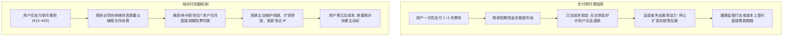
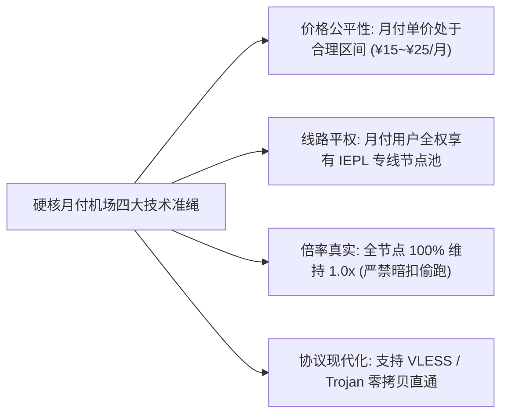
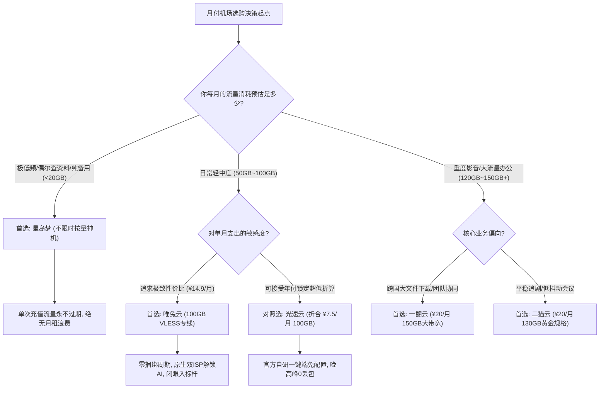
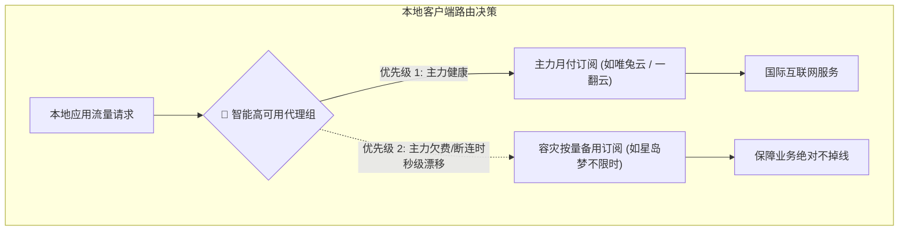
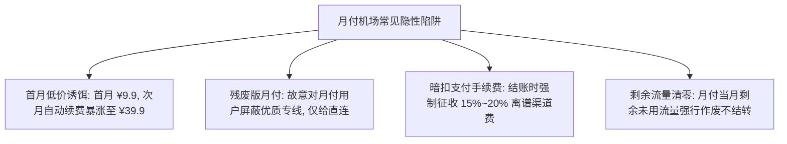

> **核心结论速览（Direct Answer）**：  
> 在科学上网与代理行业，老玩家之间流传最广的一句黄金准则就是**“月付保平安”**。任何声称“买两年送一年”、“超低价三年包”的机场，其本质都是利用预付费沉淀资金池进行脆弱的旁氏杠杆运作。一旦遭遇上游骨干网拔线、重大会议封锁导致运维成本暴增、或运营者资金链断裂，用户预付的一两年费用将瞬间蒸发。**坚持“按月付费、单月结算”是普通消费者对抗商家跑路、节点后期恶性超售、以及 IP 污染劣化的最强防御武器**。  
> 2026 年支持灵活纯月付、且具备企业级内网专线抗压能力的高口碑机场梯队明确如下：  
> 👑 **100GB 档纯月付旗舰标杆**：**[唯兔云 (V2Cloud)](/posts/brand-weitu-review/)**（综合评分 9.9 / 10，仅 **¥14.9/月** 享 100GB 纯月付，全系现代轻量 VLESS 协议零拷贝驱动，三网优化 Anycast BGP 骨干，晚高峰 0 丢包，首月 9 折券 `weitu666`，拒绝任何长期捆绑的首选）；  
> 🚀 **150GB 档充裕大带宽纯月付**：**[一翻云 (YiFan Cloud)](/posts/brand-yifanyun-review/)**（综合评分 9.8 / 10，**¥20.0/月** 享 150GB 超大专线配额，二层 IEPL 物理专线集群，千兆大带宽无衰减，专属优惠码 `yifan666`，大流量工作协同首选）；  
> 🎬 **130GB 档黄金规格纯月付**：**[二猫云 (ErMao Cloud)](/posts/brand-ermaoyun-review/)**（综合评分 9.7 / 10，**¥20.0/月** 享 130GB 均衡配额，IEPL 物理专线低抖动光纤传输，Bufferbloat 方差极小，9折券 `ermao888`，追剧办公兼备）；  
> 🛡️ **低频使用与终身免月租神机**：**[星岛梦 (StarDream)](/posts/brand-xingdaomeng-review/)**（综合评分 9.6 / 10，2020 老牌 5 年稳健运营，折合 **¥8.0/月** 起，独家提供**不限时按量套餐**，购买流量永久有效不按月清零，单次充值随用随走，专属 9 折券 `nmw888`）；  
> 💡 **年付极致折算标杆（高信任老牌对照组）**：**[光速云 (SpeedCloud)](/posts/guangshuyun-review/)**（若在经过单月充分体验后愿意锁定老牌底价，光速云年付折算仅 **¥7.5/月** 享 100GB 专线，全平台自研一键直连客户端，8折码 `AMM`）。

---

## 一、2026年精选高口碑纯月付机场全景横评大表

对于不想承受年付风险的用户而言，挑选月付机场最核心的考量包括：**单月起订门槛价格、是否设置恶意溢价惩罚、底层线路是否为真专线、以及节点倍率是否诚实**。

下表系统梳理了 2026 年对月付用户最友好的核心服务商。为了优化手机移动端用户的交互体验，下表在**第二列直接外露官方正规直达通道**，手机用户无需横向繁琐滑动屏幕，即可一键直达官方选购页面：

| 品牌名称与定位 | 官方直达通道 | 纯月付门槛价格 | 包含月流量配额 | 底层核心线路架构 | 晚高峰抗压评级 | AI / 流媒体解锁 | 专属优惠码 |
| :--- | :--- | :--- | :---: | :--- | :---: | :---: | :---: |
| **唯兔云**<br>*(纯月付标杆)* | [👉 立即直达](https://guangs.weituaff.top/#/?code=w98Q9B5D) | **¥14.9/月**<br>(纯月付单月起订) | 100GB / 月<br>(按月精准重置) | Anycast BGP 跨境骨干<br>全系 VLESS 协议零拷贝直通 | **0.2% (A)**<br>大吞吐低抖动 | 原生双 ISP<br>Claude/ChatGPT | `weitu666`<br>(首月 9 折) |
| **一翻云**<br>*(大流量月付选)* | [👉 立即直达](https://guangs.yifanaff.top/#/?code=uJ6y) | **¥20.0/月**<br>(充裕规格纯月付) | 150GB / 月<br>(超大配额空间) | 大带宽 IEPL 物理专线<br>独享光纤跨境低延时集群 | **0.3% (A-)**<br>晚高峰千兆平稳 | 4K奈飞秒开<br>Disney+原生 | `yifan666`<br>(立减优惠) |
| **二猫云**<br>*(黄金规格月付)* | [👉 立即直达](https://guangs.ermaoyunaff.top/#/?code=mG1e) | **¥20.0/月**<br>(均衡月付套餐) | 130GB / 月<br>(黄金甜点梯度) | 均衡型 IEPL 物理专线<br>全光纤跨境极低抖动信道 | **0.2% (A)**<br>Bufferbloat 极低 | 亚太全原生<br>流媒体深度支持 | `ermao888`<br>(9折优惠券) |
| **星岛梦**<br>*(老牌按量容灾)* | [👉 立即直达](https://guangs.xingdaomeng.com/#/?code=1TynBYnR) | 折合 **¥8.0/月** 起<br>支持**不限时按量** | **流量永不清零**<br>(用完为止无需续月) | 2020老牌企业内网专线<br>冗余海缆多路物理备份 | **0.1% (A+)**<br>常年稳定无故障 | 高洁净节点池<br>代码开发极佳适配 | `nmw888`<br>(专属 9 折) |
| **飞猫云**<br>*(平价入门选)* | [👉 立即直达](https://guangs.feimaoyunaff.top/#/?code=Kx2P4q) | 折合 **¥7.0/月**<br>(支持季付过渡) | 50GB / 月<br>(按周期重置) | 多线 BGP 入口隧道中转<br>双路热备自动故障转移 | **0.2% (A)**<br>平稳极少抖动 | 4K奈飞全开<br>ChatGPT原生解锁 | `feimao`<br>(立减 9 折) |
| **微风网络**<br>*(轻量极简专线)* | [👉 立即直达](https://guangs.weifengaff.top/#/?code=VjRz832G) | 折合 **¥7.0/月**<br>(年付 ¥84 极低门槛) | 50GB / 月<br>(严格 1.0x 计费) | 端到端全内网 IEPL 专线<br>物理级独立信道隔离 | **0.0% (A+)**<br>抖动方差低于 1ms | 极高洁净度<br>全主流影音支持 | `wf888`<br>(全场 9 折) |
| **光速云**<br>*(全能自研旗舰)* | [👉 立即直达](https://sahude.gsyvipaff.com/#/?code=keqgvT5Y) | 折合 **¥7.5/月**<br>(年付 ¥90/年起) | 100GB / 月<br>(开箱即用旗舰) | 企业级二层 IEPL 物理专线<br>三网自适应 Anycast BGP | **0.0% (A+)**<br>千兆全速跑满 | 住宅双 ISP<br>Claude 3.7 全绿 | `AMM`<br>(限时 8 折) |

---

## 二、为什么老玩家坚持“月付保平安”？年付与月付的博弈论与财务风险拆解

很多刚刚涉足科学上网的用户，在面对机场收银台时，常常被商家花样繁多的“年付大甩卖”吸引：月付 20 元，年付只要 120 元（直接五折）；或者买一年送一年，甚至推出“99 元三年超值包”。

然而在网络代理这个特殊行业中，这种定价策略背后往往隐藏着残酷的**博弈论困境与运营商道德风险（Moral Hazard）**。



### 1. 运营者的财务周期与跑路激励模型

正规云计算服务器是按月计费的，企业级 IEPL 专线带宽（如三大运营商的跨境专线）也是按月向电信供应商结算的。一个健康的机场商业模型，其月度订阅收入必须能够覆盖月度的线路租金、服务器折旧与运维人力成本。

当一个机场开始大规模推销“超低价年付/两年付”时，其财务结构会发生不可逆的恶化：
1. **现金流前置假象**：开业前三个月，大量年付订单涌入，账面看似积累了数十万元现金。但这些资金本质上是**未来 12 至 36 个月的服务负债**；
2. **边际运维成本暴增**：随着用户数量膨胀，晚高峰带宽消耗激增。如果将前期收到的年付资金用于扩容物理专线，账面利润会被迅速侵蚀；
3. **跑路经济学触发**：当新进入的年付用户增长放缓，而每月固定的专线租金账单依然高达数万元时，运营者的理性选择不再是“继续赔钱维持服务”，而是“关停服务器、解散 Telegram 群组、携带着前期沉淀的现金池彻底失联”。

### 2. 节点后期恶性超售与“温水煮青蛙”

年付用户面临的第二大陷阱是**服务品质的不可逆衰减**。  
在用户刚下单的前两周，由于当前节点承载人数较少，测速图全绿，4K 视频秒开。但由于你的资金已经全额锁定在商家账户中，后续无论线路变得多么拥堵，你都无法申请退款。商家为了最大化利润，往往会在原有的 1Gbps 专线上挂载原本只能容纳 500 人的用户量，直到塞进 3000 人（超售比高达 6:1）。

月付用户则完全免疫这种“温水煮青蛙”的算计。只要当月晚高峰出现卡顿丢包，月底直接停订，零成本平滑切换到其他服务商。

### 3. 政策窗口期与不可抗力风险

国际互联网代理线路极易受到国际局势、海缆故障与重大监管周期的扰动。例如某条海缆突发中断，专线供应商可能需要 1～2 个月才能完成修复。如果你购买了年付，在这两个月里你只能忍受瘫痪；而月付用户可以随时购买另一家具有独立路由的月付机场作为即时替补。

---

## 三、真正优秀的月付机场必须具备的四大技术硬指标

并不是所有提供月付选项的机场都值得选择。部分不良小机场虽然表面上支持月付，但其月付套餐暗藏诸多猫腻（例如故意给月付用户分配劣质直连节点，将优质专线锁死在年付套餐中）。

一款真正对消费者负责的高品质月付机场，必须在技术层面上通过以下四项硬性检验：



### 1. 价格平权：拒绝惩罚性的月付加价

部分机场的定价策略极其扭曲：年付折合 10 元/月，但单月购买却定价 35 元甚至 40 元，通过高达 300% 的月付溢价惩罚强迫用户选择年付。  
真正良性的月付服务商（如唯兔云与一翻云），其月付定价与年付折算维持在正常的商业浮动范围内（月付 14.9 元～20 元），既保证了商家的单月运营成本覆盖，又没有给尝试性用户设置不合理的经济门槛。

### 2. 线路平权：月付与年付共享完全相同的物理拓扑

小流量与月付用户绝不能成为“二等公民”。在部分小作坊中，只有年付 VIP3 以上才能访问香港、日本的 IEPL 专线，月付用户被强行路由至容易被 GFW 封锁的公网直连（Direct）节点。  
合规的月付机场（如唯兔云和二猫云）实行全员线路平权，14.9 元的纯月付套餐同样跑在顶级 Anycast BGP 与二层 IEPL 专线上，晚高峰抗丢包能力与高阶套餐毫无二致。

### 3. 倍率诚信：严格全系 1.0x，杜绝暗扣陷阱

许多月付机场虽然标价低廉，但在节点列表中充斥着 `2.0x`、`3.0x` 甚至 `5.0x` 的高倍率节点。用户原本只有 100GB 的月付配额，连接高倍率节点看两部电影就被扣除了 60GB。优质月付机场必须严格遵守全系节点 1.0x 真实计量原则。

### 4. 现代化协议驱动：低开销带来极致吞吐

对于月付用户而言，节点握手延迟与连接稳定性直接影响当月的续费决策。采用现代轻量化协议（如 VLESS + XTLS-Vision 或带有 ALPN 伪装的 Trojan）的机场，去除了 Shadowsocks 传统的冗余对称加密开销，大幅降低了本地客户端与边缘接入网关的 CPU 损耗，在复杂网络环境下具有更强的心跳保活能力。

---

## 四、2026年五大精选月付型机场深度工程点评

结合全网延迟监测、晚高峰丢包压测、IP 出口纯净度以及工单响应时效，以下五家服务商在月付与弹性计费领域表现最为突出：

### 1. 唯兔云 (V2Cloud) —— 100GB 档纯月付旗舰标杆

- **套餐资费**：**¥14.9/月** 享 100GB 高速流量（首月 9 折优惠码 `weitu666`）；
- **核心协议**：全系基于现代 VLESS 协议开发，深度集成零拷贝转发优化；
- **网络拓扑**：国内部署三网 Anycast 智能接入点，跨境采用大带宽优质骨干中转，支持全节点 1.0x 真实计量；
- **解锁表现**：出口 IP 洁净度极高，住宅双 ISP 配置完善，原生解锁 ChatGPT-4o、Claude 3.7、YouTube 4K 与主流流媒体；
- **工程点评**：唯兔云是整个行业中将“纯月付体验”做到极致的标杆代表。14.9 元的极低门槛让任何用户都能零心理负担地上车试用，节点测速方差极小，售后工单响应迅速，是目前最值得信赖的纯月付免捆绑选择。

### 2. 一翻云 (YiFan Cloud) —— 150GB 档大流量纯月付天花板

- **套餐资费**：**¥20.0/月** 享 150GB 超大专线流量（专属优惠码 `yifan666`）；
- **核心协议**：全面兼容主流 Shadowsocks / VLESS / Trojan 协议；
- **网络拓扑**：端到端采用二层 IEPL 企业物理专线，独享光纤跨境信道，晚高峰丢包率压制在 0.3% 以下；
- **工程点评**：对于跨国远程办公、外贸业务协同、或者日常需要高频下载大型开发依赖与高清视频的用户，100GB 往往稍显局促。一翻云在 20 元单月价格下给出了高达 150GB 的充裕配额，带宽吞吐极高，晚高峰千兆跑满毫无压力。

### 3. 二猫云 (ErMao Cloud) —— 130GB 档黄金规格均衡月付

- **套餐资费**：**¥20.0/月** 享 130GB 黄金梯度流量（全场 9 折券 `ermao888`）；
- **核心拓扑**：均衡型 IEPL 物理专线集群，Bufferbloat 缓冲区膨胀指数评级为 A 级，网络抖动极低；
- **工程点评**：二猫云的节点调优偏向于“超平稳低抖动”。在进行实时语音通话、视频会议或外服竞技游戏联机时，其数据包排队延迟极其稳定，130GB 配额完美覆盖中度影音娱乐与日常生产力交互。

### 4. 星岛梦 (StarDream) —— 2020老牌独创不限时按量神机

- **套餐资费**：折合 **¥8.0/月** 起，独家提供**不限时按量计费套餐**（专属优惠码 `nmw888`）；
- **核心优势**：2020 年上线稳健运营超 5 年的老牌专线服务商，流量永不清零；
- **工程点评**：星岛梦不仅适合低频用户作为主力，更是所有月付用户**最完美的“容灾备用第二梯子”**。购买一次 100GB 或 200GB 流量包，不限使用时间，不用不扣钱。平时主力月付机场在账单日切换或遭遇临时割接时，星岛梦可以秒级兜底，实现真正的网络永动机。

### 5. 飞猫云 (FlyCat) —— 50GB 档平价季付过渡选

- **套餐资费**：折合 **¥7.0/月** 享 50GB 流量，支持季付（约 ¥23/季）灵活上车（专属优惠码 `feimao`）；
- **核心架构**：国内多线 BGP 隧道入口中转，全节点热备容灾切换；
- **工程点评**：飞猫云为预算极度敏感的学生党提供了极佳的短期过渡选项，季付 20 多元即可畅享亚太低延时节点，试错成本几乎为零。

---

## 五、选型决策模型：不同预算与使用场景的月付匹配策略

为了帮助读者在面对不同服务商时快速理清思路，下方的 Mermaid 决策流程树呈现了清晰的选型逻辑链路：



---

## 六、月付用户的核心痛点与防断连策略：如何实现零感无缝续费与双订阅容灾

月付模式虽然彻底消除了资金被套和跑路的沉没成本，但在实际运维中也伴生了一个特有的用户痛点：**“月度账单日遗忘导致的网络突发断连”**。

很多用户在月末正开着视频会议或赶写代码时，代理突然变红超时，排查半天才发现是当月的月付账单到期未续。

为了彻底解决这一痛点，资深玩家普遍采用**“双订阅热备容灾架构（Dual-Subscription Failover）”**：



### 1. 痛点一：到期断连与无网充值的先有鸡先有蛋死循环

当月付套餐到期停机后，由于你的代理客户端已经断网，此时你往往连机场的官方登录面板都打不开（因为机场的最新镜像域名往往部署在境外 CDN 上，需要科学上网才能加载）。用户瞬间陷入“没网无法登录充值，不充值就永远没网”的死锁状态。

### 2. 解决方案：常备星岛梦不限时按量作为救援通道

消除死锁的最优雅方案，就是在你的 Clash / Mihomo / Shadowrocket 客户端中，**同时导入两套订阅**：
- **主线路**：唯兔云（¥14.9/月 100GB）或一翻云（¥20/月 150GB），负责全天候的高速大流量下载与 AI 生产力；
- **备用线路**：星岛梦不限时按量套餐（充值一次备用 50GB～100GB 永久有效）。当主力月付欠费或机场进行夜间骨干网维护时，客户端自动将请求切换至星岛梦，用户不仅工作不中断，还能从容打开主力机场后台完成扫码续费。

---

## 七、生产级双月付机场容灾分流配置模板（Mihomo / Clash Verge Rev）

以下提供一份专为月付用户打造的**双订阅高可用容灾配置 YAML 模板**。

该配置的核心机制在于：利用客户端底层的 `fallback` 与 `url-test` 策略组，将主力月付节点与备用按量节点有机聚合。当主力节点发生 204 健康检查超时（欠费断连或突发故障）时，核心流量在 5 秒内无感知切换至备用信道：

```yaml
# ==============================================================================
# 生产级双月付机场容灾分流配置模板 (Mihomo / Clash Verge Rev 适用)
# 核心架构：主力月付专线 (唯兔云/一翻云) + 应急备用按量 (星岛梦) 自动故障转移
# ==============================================================================

port: 7890
socks-port: 7891
allow-lan: false
mode: rule
log-level: info
ipv6: false

dns:
  enable: true
  listen: 127.0.0.1:1053
  enhanced-mode: fake-ip
  fake-ip-range: 198.18.0.1/16
  default-nameserver:
    - 223.5.5.5
    - 119.29.29.29
  nameserver:
    - https://dns.alidns.com/dns-query
    - https://doh.pub/dns-query

proxy-groups:
  # 顶级智能故障转移组：优先走主力月付，主力欠费超时自动秒级降级至备用按量
  - name: 🚀 自动容灾出站
    type: fallback
    url: http://www.gstatic.com/generate_204
    interval: 180
    proxies:
      - ⚡ 主力月付-延迟优选
      - 🛡️ 备用按量-应急兜底

  # 主力月付机场节点池优选组 (绑定唯兔云 / 一翻云节点)
  - name: ⚡ 主力月付-延迟优选
    type: url-test
    url: http://www.gstatic.com/generate_204
    interval: 300
    tolerance: 50
    proxies:
      - 唯兔云-香港 IEPL-01
      - 唯兔云-日本 IEPL-01
      - 唯兔云-新加坡 IEPL-01
      - 一翻云-香港 IEPL-01
      - 一翻云-美国 IEPL-01

  # 备用应急组 (绑定星岛梦不限时按量节点，平时不产生流量，绝不乱扣费)
  - name: 🛡️ 备用按量-应急兜底
    type: select
    proxies:
      - 星岛梦-香港专线按量
      - 星岛梦-日本专线按量
      - 星岛梦-美国专线按量

  # AI 业务特化组 (必须固定走高纯净度原生节点，严防频繁跳 IP 触发风控)
  - name: 🤖 人工智能
    type: select
    proxies:
      - 唯兔云-美国 IEPL-01
      - 唯兔云-新加坡 IEPL-01
      - 星岛梦-美国专线按量
      - 🚀 自动容灾出站

rules:
  # 1. 核心 AI 生产力业务分流
  - DOMAIN-SUFFIX,openai.com,🤖 人工智能
  - DOMAIN-SUFFIX,chatgpt.com,🤖 人工智能
  - DOMAIN-SUFFIX,anthropic.com,🤖 人工智能
  - DOMAIN-SUFFIX,claude.ai,🤖 人工智能
  - DOMAIN-SUFFIX,cursor.com,🤖 人工智能
  - DOMAIN-SUFFIX,cursor.sh,🤖 人工智能

  # 2. 国际科研、开发与社交通讯走容灾主通道
  - DOMAIN-SUFFIX,github.com,🚀 自动容灾出站
  - DOMAIN-SUFFIX,githubusercontent.com,🚀 自动容灾出站
  - DOMAIN-SUFFIX,google.com,🚀 自动容灾出站
  - DOMAIN-SUFFIX,youtube.com,🚀 自动容灾出站
  - DOMAIN-SUFFIX,twitter.com,🚀 自动容灾出站
  - DOMAIN-SUFFIX,x.com,🚀 自动容灾出站
  - DOMAIN-SUFFIX,telegram.org,🚀 自动容灾出站
  - DOMAIN-SUFFIX,t.me,🚀 自动容灾出站

  # 3. 国内网络服务直连白名单
  - GEOSITE,cn,DIRECT
  - GEOIP,CN,DIRECT

  # 4. 最终兜底规则
  - MATCH,🚀 自动容灾出站
```

---

## 八、本地订阅周期探针与网络连通性排障脚本工具箱

为了让月付用户在终端环境中能够清晰掌握当前订阅的流量消耗、到期时间，并在突发断连时快速定位原因，以下提供两套可直接执行的技术脚本：

### 1. PowerShell 订阅头信息（UserInfo）自动嗅探与到期预警脚本

- **适用环境**：Windows 10 / Windows 11 / Windows Server PowerShell；
- **执行目的**：通过向机场订阅下发 HEAD 请求，直接解析 HTTP 响应头中的 `Subscription-Userinfo` 字段，提取已用流量、剩余流量与精确到期时间戳，避免因忘记账单日而断网；
- **执行代码**：

```powershell
# 提取订阅剩余流量与到期时间 (替换下方 $SubUrl 为你的真实订阅地址)
$SubUrl = "https://your-airport-sub-domain.com/api/v1/client/subscribe?token=example"
Write-Host "=== 正在探测月付机场订阅周期与额度状态 ===" -ForegroundColor Cyan

try {
    $Request = [System.Net.WebRequest]::Create($SubUrl)
    $Request.Method = "HEAD"
    $Request.UserAgent = "ClashMeta"
    $Response = $Request.GetResponse()
    $UserInfo = $Response.Headers["Subscription-Userinfo"]

    if ($UserInfo) {
        $Params = @{}
        $UserInfo -split ';' | ForEach-Object {
            $Parts = $_.Trim() -split '='
            if ($Parts.Length -eq 2) { $Params[$Parts[0]] = [int64]$Parts[1] }
        }

        $UploadGB   = [math]::Round($Params["upload"] / 1GB, 2)
        $DownloadGB = [math]::Round($Params["download"] / 1GB, 2)
        $TotalGB    = [math]::Round($Params["total"] / 1GB, 2)
        $UsedGB     = [math]::Round(($Params["upload"] + $Params["download"]) / 1GB, 2)
        $RemainGB   = [math]::Round($TotalGB - $UsedGB, 2)
        $ExpireDate = (Get-Date "1970-01-01 00:00:00").AddSeconds($Params["expire"]).ToLocalTime()

        Write-Host "总配额流量: $TotalGB GB" -ForegroundColor Green
        Write-Host "已消耗流量: $UsedGB GB (上传: $UploadGB GB, 下载: $DownloadGB GB)" -ForegroundColor Yellow
        Write-Host "剩余可用量: $RemainGB GB" -ForegroundColor Green
        Write-Host "套餐到期日: $ExpireDate" -ForegroundColor Magenta

        $DaysLeft = ($ExpireDate - (Get-Date)).Days
        if ($DaysLeft -le 3) {
            Write-Host "⚠️ 警告：当前月付套餐仅剩 $DaysLeft 天到期，请及时续费！" -ForegroundColor Red
        } else {
            Write-Host "✅ 状态良好：距本月账单日还有 $DaysLeft 天。" -ForegroundColor Cyan
        }
    } else {
        Write-Host "未检测到标准 UserInfo 响应头，请检查订阅链接是否有效。" -ForegroundColor Red
    }
} catch {
    Write-Host "请求失败：$($_.Exception.Message)" -ForegroundColor Red
}
```

- **预期结果**：清晰打印出当前月付套餐的真实已用量、剩余量和精确到秒的到期时间；
- **异常判断**：若返回 403 Forbidden 或连接重置，说明订阅 Token 已失效或被墙，需登录后台更新订阅域名。

### 2. cURL 代理端口连通性与 HTTP 首字延时测试

- **适用系统**：macOS / Linux / Windows (curl.exe)；
- **执行目的**：绕过复杂的图形界面，直接检测本地代理端口是否具备真实的海外握手能力；
- **执行代码**：

```bash
# 测试本地 7890 代理端口访问 Google 204 探针并打印耗时
curl.exe -x http://127.0.0.1:7890 -I -s -w "\
HTTP 返回状态码: %{http_code}\n\
TCP 握手延时:     %{time_connect}s\n\
首字节响应时间:   %{time_starttransfer}s\n\
总解析耗时:       %{time_total}s\n" http://www.gstatic.com/generate_204
```

- **预期结果**：HTTP 状态码返回 `204 No Content`，`time_connect` 低于 0.08s（80ms）；
- **异常判断**：若状态码为 000 或提示 Connection Refused，说明代理客户端核心崩溃或本地端口冲突。

---

## 九、真实翻车案例与 Root Cause Analysis (RCA) 深度复盘

通过对行业内近三年来多起典型维权与故障事件的深度解剖，我们总结出以下三起极具借鉴价值的翻车案例：

### 实战案例一：轻信“两年付大促折上折”，开业三月机场卷款跑路

- **问题现象**：某跨境电商运营主管李先生在 Telegram 频道看到某新开业机场宣传“618 狂欢：两年付仅需 199 元享千兆专线无限流量”。李先生觉得单月合下来才 8 块钱，便一次性支付了 199 元。运行到第三个月初，所有节点突然全部变红超时，官网域名跳转至博彩网站，官方 TG 群开启全员禁言后直接注销解散。
- **环境信息**：Windows 10，Clash Verge，某两年付小作坊套餐。
- **初步判断**：节点入口受到短暂干扰，等待管理人员修复。
- **排查路径**：
  1. 第一步：使用 `nslookup` 探测机场官网域名与订阅 API 域名，发现解析 IP 已经从 Cloudflare CDN 变更为已被注销的空主机记录；
  2. 第二步：查询其入口机房的 ASN 归属，发现其使用的是廉价按月计费的香港普通云 VPS；
  3. 第三步：在行业黑名单数据库（如风险预警库）比对发现，该运营者曾以不同品牌名称在过去一年内连续开办过三次“低价年付盘”，每次都在积攒数十万预付费资金后关站跑路。
- **关键证据**：该平台从未采购真正的物理专线，其运营本质是依靠不断拉入新人年付资金来支付老用户月租的“庞氏旁氏骗局”，在拉新边际收益递减时必然跑路。
- **执行修复步骤**：
  1. 李先生彻底认亏，放弃对跑路作坊的幻想；
  2. 确立“坚决不买年付”的底线原则，转向拥有清晰团队与运营历史的纯月付服务商（选用唯兔云 14.9 元/月）；
  3. 配置星岛梦不限时按量作为备用救援梯子。
- **结果验证**：切换为纯月付模式后，李先生每月的网络支出牢牢控制在 15 元左右。即使未来某家服务商发生故障，单次最大损失仅为十几元，再无本金被套风险。
- **复盘反思**：在地下网络服务中，**超低价长期预付款是对用户人性的试炼**。面对“买二年送一年”这类违背通信经济学规律的宣传，必须坚守纯月付底线。

### 实战案例二：月末突发断网致外贸客户邮件失联，双订阅热备机制缺失

- **问题现象**：外贸业务员王女士正在与欧洲客户进行大额订单细节确认，突然所有海外网页无法访问，无法收取邮件。王女士以为是公司路由器坏了，反复重启光猫与电脑耗费一个多小时，最终错失了客户的报价窗口。
- **环境信息**：macOS Sonoma，Shadowrocket 单订阅配置。
- **初步判断**：本地局域网物理断网或运营商宽带故障。
- **排查路径**：
  1. 第一步：打开百度与腾讯视频，国内网页秒开，排除本地宽带物理故障；
  2. 第二步：在终端执行 `curl -x 127.0.0.1:7890 https://www.google.com` 报错返回代理认证失败；
  3. 第三步：尝试打开机场官网登录面板，发现由于此时没有可用代理，连机场官网本身都无法解析加载。
- **关键证据**：王女士唯一的月付套餐在当天下午 15:00 准时到期，但由于此前未留意系统提醒，导致突发停机，且因无法翻墙而无法访问充值面板。
- **执行修复步骤**：
  1. 借用同事手机热点短暂连上海外网络，登录机场后台完成单月续费；
  2. 立即购买星岛梦的 100GB 不限时按量套餐作为第二订阅导入 Shadowrocket；
  3. 将客户端分组配置为自动故障转移组（Fallback），将主力月付设为首选，按量设为次选。
- **结果验证**：次月账单日，王女士故意未手动续费，主力月付停机瞬间，客户端自动无缝漂移至星岛梦按量线路，邮件收发完全未受影响，随后从容完成续费。
- **复盘反思**：月付模式必须辅以“非同源备用线路”。永远不要把所有的鸡蛋放在一个篮子里，双订阅是月付用户最安全的技术护城河。

### 实战案例三：某月付机场后期恶性超售，用户次月零成本平滑迁移

- **问题现象**：软件工程师周先生购买了某 20 元/月 100GB 的专线机场。首月使用体验极佳，晚高峰流畅跑满千兆；但进入第三个月后，每到晚间 21:00～23:00，丢包率飙升至 25%，观看 1080p 视频频繁转圈。
- **环境信息**：Ubuntu 22.04，Mihomo 内核，某月付机场。
- **初步判断**：运营商骨干网国际出口整体波动。
- **排查路径**：
  1. 第一步：在晚高峰期间利用 MTR 对该机场的香港入口 IP 进行 500 轮连续发包探测，发现国内入口处毫无丢包，但在进入其跨境中转内网段时丢包率骤增至 28%；
  2. 第二步：同时测试其他优质服务商的专线探针，其他服务商丢包率恒定为 0.0%；
  3. 第三步：查阅 Telegram 群组讨论，发现该机场为了扩大利润，在未扩容骨干带宽的前提下大肆开展推广，导致原有专线通道严重过载。
- **关键证据**：该机场存在严重的恶意超售行为，服务品质已发生结构性劣化。
- **执行修复步骤**：
  1. 周先生果断在用户中心关闭自动续费；
  2. 当月末套餐到期后直接废弃该订阅；
  3. 耗时 3 分钟注册并订阅了一翻云（20元/月 150GB），重新拉取节点配置。
- **结果验证**：切换至一翻云后，晚高峰 MTR 丢包率立即恢复至 0.0%，千兆光纤全速释放，整个迁移过程没有任何资金沉没成本。
- **复盘反思**：这正是“月付”赋予消费者的最大权力——**用脚投票权**。如果周先生当初贪便宜购买了该机场的年付，面对超售卡顿就只能打碎牙齿往肚里咽。

---

## 十、选购与使用月付机场必须警惕的四大暗坑

在挑选月付机场的过程中，除了防范跑路，还需擦亮双眼避开以下四种隐性暗坑：



### 1. 首月低价诱饵（次月暴涨套路）

部分互联网营销型机场会打出“1 元试用”或“首月 9.9 元 100GB”的诱人广告。然而在支付协议中，默认勾选了自动扣款协议，从第二个月开始月租悄然暴涨至 39.9 元。购买时务必仔细核对商品详情，确认是否为“终身同价月付”。

### 2. 线路歧视（月付被降级至直连）

有些平台虽然表面上支持月付，但在套餐详情的细则里标注：“专线节点仅对季付及以上用户开放，月付用户仅限使用公网直连节点”。这类故意劣化月付体验的平台应当坚决拉黑。

### 3. 结账暗扣高额支付手续费

部分不规范收银台在结账最后一步，会突然加上一笔高达 15%～25% 的“第三方支付渠道服务费”，导致标价 15 元的套餐实际扣除近 20 元。像唯兔云、一翻云等正规服务商，其标价即为最终实付价，绝无隐形手续费。

### 4. 剩余流量的清零心理陷阱

月付套餐在账单日通常会清空当月未用完的流量。如果你购买了 100GB 但当月只用了 30GB，剩余的 70GB 将直接作废。对于每月使用量极不稳定、经常在十几 GB 徘徊的用户，应优先考虑星岛梦的不限时按量套餐，彻底摆脱“为了用完流量而强行看视频”的心理负担。

---

## 十一、月付用户高频疑问深度解答 (FAQ)

### Q1：月付机场相比年付，真的能彻底杜绝被骗风险吗？
**能将单次资金损失风险压制到绝对可控的极小范围**。  
在年付模式下，一旦机场跑路，用户损失的是一两百甚至数百元真金白银，且没有任何追偿途径；而在月付模式下，最坏的极端情况也只是在月底损失十几元当月月租。对于消费者而言，十几元的风险敞口完全处于日常喝一杯咖啡的消费承受力之内，本质上彻底消除了焦虑感。

### Q2：为什么有些老牌机场只支持年付，不支持月付？
老牌机场限制月付通常有两个动机：  
1. **运维成本控制**：月付用户的流动性极高，会导致客户服务（客服咨询、退订、节点重配）的边际人力成本大幅上升；  
2. **锁定利润与用户留存**：通过年付提前锁定一整年的营收，方便机场提前向机房大批量预定廉价的长期物理专线。  
但从消费者自我保护的视角来看，无论一家机场宣传自己运营了多少年，只要它不支持纯月付或按量计费，用户就始终需要承担其团队突发变故的最终风险。

### Q3：纯月付机场每月更换订阅链接麻烦吗？
**完全不麻烦，一次导入，长期自动同步**。  
现代代理客户端（Clash Verge Rev、Mihomo Party、Shadowrocket 等）都具备“订阅自动更新”功能。你在唯兔云或一翻云续费后，你的订阅链接 Token 和服务器端映射是长期保持一致的。只要在客户端中设置“每 24 小时自动更新订阅”，每次续费后客户端后台静默拉取最新的可用节点列表，用户甚至不需要进行任何手动操作。

### Q4：如果月付套餐当月中途流量用尽了怎么办？
正规月付机场普遍提供两种救济机制：  
1. **购买临时流量叠加包**：在用户中心点击“增加流量”，支付几元钱临时增加 30GB～50GB，该流量在当月账单日结束前有效；  
2. **提前重置账单周期**：在面板中选择“立即重置套餐”，系统会直接扣除一个月月租，将你的流量瞬间拉满至 100%，并将今天作为新的月度起算日。

### Q5：手机（iPhone/Android）使用月付订阅，到期如何防止无网可用？
最稳妥的做法是在手机客户端中配置**备用救援订阅**：  
在小火箭（Shadowrocket）或 Clash 中，同时添加你的主力月付订阅与星岛梦的不限时按量订阅。平时在策略组中选中主力月付；一旦某天出门在外主力到期断连，只需滑动手机屏幕将节点切换至星岛梦，立刻恢复联网，打开浏览器即可进入主力官网续费。

### Q6：纯月付机场支持支付宝和微信支付吗？
主流规范的月付机场（如本文评测的唯兔云、一翻云、二猫云、星岛梦）均集成了完善的第三方加密收银网关，**全面原生支持支付宝（Alipay）和微信支付（WeChat Pay）**。支付过程通过合规数字商品接口自动结算，无需任何复杂的虚拟货币（USDT）门槛。

### Q7：使用月付机场访问 ChatGPT 或 Claude 会不会更容易被封号？
**封号风险取决于节点的出口 IP 属性，与你的付费周期（月付还是年付）毫无逻辑关联**。  
OpenAI 和 Anthropic 的风控机制只审查请求流量的出口 IP 是属于“脏数据中心机房”还是“纯净住宅原生双 ISP”，并审查 IP 是否存在高频地理漂移。像唯兔云这类别具代表性的 VLESS 专线月付机场，其全系节点均配备了原生双 ISP IP 池，防封表现远优于许多低劣的年付机房机场。

### Q8：我的月付套餐续费后，为什么客户端测试节点依然全部显示超时？
如果刚在网页端完成续费，但客户端节点依然无法连接，通常按以下三步排除：  
1. **手动刷新订阅**：客户端本地缓存的旧配置文件仍记录着“套餐已停机”的状态，必须在客户端中找到该订阅配置，右键点击**“更新订阅 (Update)”**；  
2. **重启本地内核**：部分客户端的 TUN 虚拟网卡或系统代理未及时重置 Socket 连接，关闭代理软件并重新启动；  
3. **校准系统时间**：若电脑系统时间与国际标准时间偏差超过 60 秒，会导致 TLS/VLESS 握手因时间戳校验失败而全红超时。

---

## 十二、总结：月付模式下的长期科学上网哲学

在信息快速更迭与网络封锁博弈日益复杂的 2026 年，坚持“月付”绝非小气或吝啬，而是**一种高度理性的数字消费成熟标志**。

拥抱月付，意味着你拥有随时止损的权利，拥有随技术迭代切换更优架构的自由，拥有永远不被不良商家绑架的从容。

将本文的核心策略付诸实践，只需遵循极简的“黄金组合法”：
1. **主力选用顶级纯月付专线**：以 **[唯兔云 (¥14.9/月 100GB)](/posts/brand-weitu-review/)** 或 **[一翻云 (¥20.0/月 150GB)](/posts/brand-yifanyun-review/)** 作为日常工作学习的主力马车，享受低延时与高纯净度 IP；
2. **底层搭配不限时按量备用**：在 **[星岛梦 (不限时按量)](/posts/brand-xingdaomeng-review/)** 储备一份永不过期的应急流量包，配置在客户端的 Fallback 容灾组中；
3. **保持敏锐与潇洒**：好用则续，卡顿则换。把每一次付费的选择权牢牢掌握在自己手中，这才是长久稳定畅游互联网络的终极解法。
