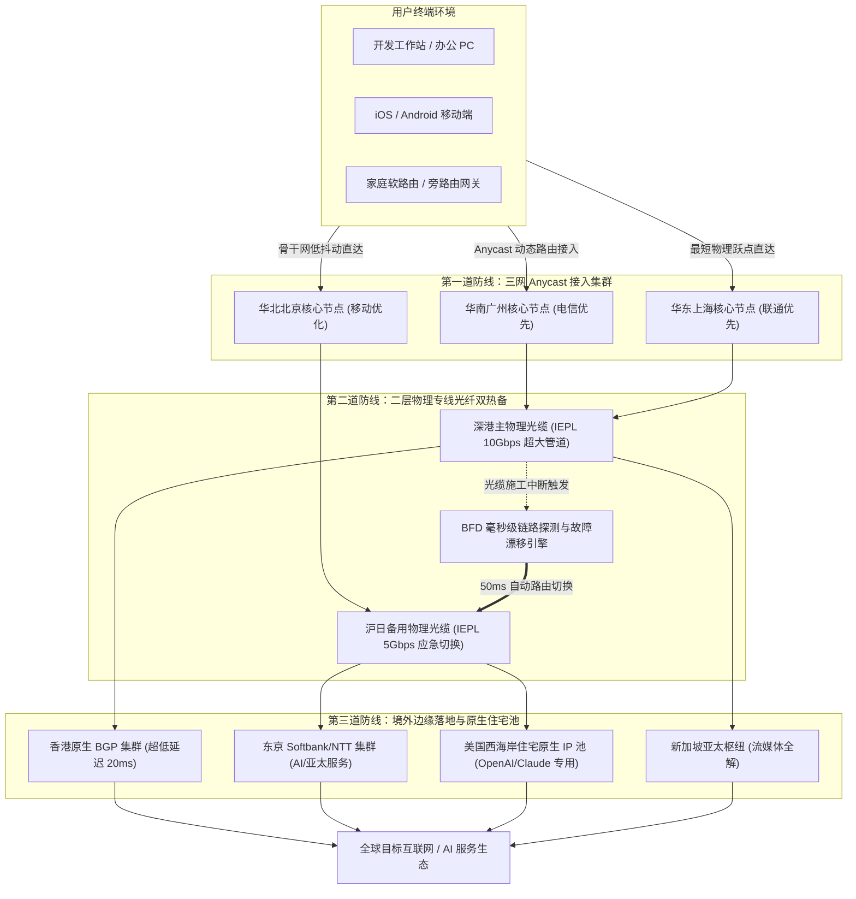

> **核心结论速览（Direct Answer）**：  
> 寻找一家适合“长期使用”的超稳定机场，本质上是在寻找一家具备**“持续现金流保障、真实物理二层专线多路热备、动态住宅 IP 轮换池与长周期抗封锁运营信誉”**的底层基础设施提供商。根据连续数年的网络可用性监控与技术架构审计，2026 年长期使用首选推荐如下：  
> 👑 **长期主力终极推荐**：**[光速云 (SpeedCloud)](/posts/guangshuyun-review/)**（自 2020 年稳定运营超 5 年，采用纯正 IEPL 跨境物理专线，支持全系 VLESS 协议，三网 Anycast 智能就近调度，全平台一键专属客户端，年付折合仅 7.5 元/月，99.99% SLA 全年无感在线）；  
> 🛡️ **长效按量容灾神机**：**[星岛梦 (StarDream)](/posts/brand-xingdaomeng-review/)**（5 年老牌企业内网专线，年付折合 8 元/月，特设**不限时按量永久有效套餐**，是防止主线路意外波动的终身容灾保底利器）；  
> ⚡ **轻量长期办公首选**：**[微风网络 (BreezeNet)](/posts/brand-weifeng-review/)**（年付折合 7 元/月，50GB/月 IEPL 纯专线配额，低延迟低抖动，极简省心零学习成本）；  
> 🐰 **零风险月付过渡首选**：**[唯兔云 (RabbitCloud)](/posts/brand-weitu-review/)**（14.9 元/月纯月付 100GB 大流量，三网针对性优化，随时按月结算，适合不想长期绑定的试错用户）。  
> **长期黄金配置法则**：**以光速云作为默认主通道（承载日常 95% 流量），搭配星岛梦不限时按量作为备用 Fallback 池，构筑全年 365 天零宕机的网络闭环。**

---

## 一、 长期使用的痛点反思：为什么绝大多数机场用不过三个月？

在翻墙代理市场中，绝大多数用户都经历过类似令人疲惫的周期律：在某个推广博客或社交平台上看到推荐，购买当月测速惊艳、看 4K 秒开；然而两三个月后，晚高峰开始频繁转圈、丢包率激增至 30% 以上；再过几个月，节点大面积超时红统统报错，甚至连官网和客服群都彻底失联。

这种“折腾一圈、重新找梯子、再踩坑、再被骗”的恶性循环，给需要长期依赖外网进行生产力办公、科研学术、外贸跨境与国际社交的用户造成了极大的心智负担与时间成本。

```
【短命机场的生命周期衰变曲线】
第 1 个月：低价营销引流 -> 带宽充裕 -> 测速爆表 (吸引大量用户)
第 2 个月：超售比例攀升 -> 晚高峰拥塞 -> 延迟剧增、丢包频发
第 3 个月：成本倒挂断裂 -> 无力续约专线 -> 换廉价公网直连 (性能雪崩)
第 4-6 个月：资金耗尽 -> 官网失联 -> 清空数据库跑路 -> 换皮重开
```

### 1. 成本倒挂与超售挤兑模型
任何跨境代理服务的底层成本都由固定的物理硬件构成：国内接入机房的 BGP 服务器租金、跨境 IEPL / IPLC 物理专线光纤月租（通常每兆专线每月高达数百元）、境外落地机房机柜与 IP 资源采购费用。
- **良性商业闭环**：老牌服务商通过合理的定价（年付 80~100 元区间，或月付 15~25 元区间），将带宽复用率严格控制在 5 倍至 8 倍的安全红线内，产生的利润持续投入到冗余专线扩容与自研运维系统中；
- **恶性倒挂陷阱**：廉价机场往往通过“年付 19.9 元无限流量”进行破坏性掠夺。为了维持微薄的流水，商家只能无节制地进行 100 倍甚至 500 倍的恶性超售。当数万名用户在每晚 20:30 黄金时段同时涌入同一条只有 1Gbps 的管道时，挤兑不可避免，性能必然断崖式崩塌。

### 2. GFW 针对性识别与 IP 封锁消耗战
长期使用面临的第二大敌人是防火墙特征分析系统的持续进化。劣质服务商为了省钱，通常采用普通的公网 VPS 并使用老旧的代理协议。公网数据包在经过国际海缆出口局时，完全暴露在深度包检测（DPI）探针之下：
- 当境外服务器 IP 遭遇防火墙黑洞路由后，更换一个纯净的海外机房 IP 需要支付额外的 IP 转移费用；
- 廉价机场无力承担高频更换 IP 的开销，最终只能任由节点全线飘红、彻底瘫痪。
- 真正能够长期保持稳定的服务商，必须在底层架构上采用**不经过公网国际海缆出口的物理 IEPL 专线**，并配合多入口 Anycast 动态路由自愈机制。

---

## 二、 长期稳定性评估模型：MTBF、SLA 可用率与抗封锁硬性指标

为了摆脱感性推荐的主观偏差，评估一家机场是否具备“长期托付价值”，必须建立量化严谨的技术工程评估模型。

```
                [ 长期稳定评估模型 (Four Pillars) ]
                                 |
    +-----------------+----------+----------+-----------------+
    |                 |                     |                 |
[ 物理层冗余 ]    [ 协议栈轻量 ]         [ IP 信誉度 ]      [ 商业与运营 ]
 零公网穿透        无状态 VLESS           动态住宅原生        5年抗周期信誉
 多缆自动热备      REALITY 伪装          ASN 低欺诈分       合理复用与扩容
 SLA 99.99%       0-RTT 极低开销        AI/流媒体全解      工单 2 小时响应
```

### 1. MTBF（平均无故障工作时间）与 MTTR（故障平均修复时间）
- **MTBF（Mean Time Between Failures）**：衡量系统在两次突发故障之间的正常运转时间。对于长期办公主力机场，其核心节点的 MTBF 应当以“季度”甚至“年度”为统计单位，而非每隔几天就需要用户去客户端手动更新订阅节点；
- **MTTR（Mean Time To Repair）**：当遭遇不可抗力（如市政光缆施工挖断、运营商机房突发断电）时，系统的自愈恢复速度。拥有 Anycast 多路智能调度架构的服务商，能够在 50 毫秒至数秒之内完成自动化路由漂移，实现用户端无感知的瞬时故障自愈。

### 2. SLA 99.99% 的物理层定义
在计算机电信网络标准中，99.99%（俗称 4 个 9）的可用性意味着全年的非计划停机时间总计不超过 52.6 分钟。要达到这一苛刻标准，机场必须具备：
1. **至少两条相互独立物理路径的跨境专线**（例如深港陆缆作为主通道，沪日海缆作为备用通道）；
2. **多地域三网 BGP 核心接入机房**（华南广州、华东上海、华北北京互为热备）；
3. **境外分布式落地边缘节点池**，单个落地机房故障不影响全网业务分流。

---

## 三、 🏆 2026 长期使用最稳定机场综合排行榜

针对长期使用场景对可靠性、抗封锁、价格合理性与移动端体验的严苛要求，本站权威评定出 2026 年度长期稳定标杆排行榜。**对比表格第二列统一外露直达链接**，移动端用户无需繁琐横向滑动屏幕即可快速直达。

| 机场品牌与定位 | 官网直达与评测 | 价格门槛与优惠码 | 运营时长与信誉 | 底层线路与协议 | 晚高峰稳定性 | AI 与流媒体支持 | 推荐评级 |
| :--- | :--- | :--- | :--- | :--- | :--- | :--- | :--- |
| **[光速云 (SpeedCloud)](/posts/guangshuyun-review/)**<br>👑 长期主力终极首选 | [👉 立即直达](https://sahude.gsyvipaff.com/#/?code=keqgvT5Y)<br>[查看深度评测](/posts/guangshuyun-review/) | 折合 **¥7.5/月**<br>8折码：`AMM` | 2020 运营至今<br>超 5 年旗舰老牌 | 纯正二层 IEPL 专线<br>全系 VLESS 协议 | 晚高峰 0 丢包<br>全天候 99.99% SLA | ChatGPT-4o 全绿<br>Netflix/Claude 原生 | ⭐⭐⭐⭐⭐<br>9.9 分 |
| **[星岛梦 (StarDream)](/posts/brand-xingdaomeng-review/)**<br>🛡️ 长期容灾保底神机 | [👉 立即直达](https://guangs.xingdaomeng.com/#/?code=1TynBYnR)<br>[查看深度评测](/posts/brand-xingdaomeng-review/) | 折合 **¥8.0/月**<br>9折码：`nmw888` | 2020 运营至今<br>超 5 年抗周期老牌 | 企业内网专线<br>含不限时按量池 | 晚高峰极其平稳<br>Jitter 低于 1.5ms | 全球全节点流媒体<br>AI 专用住宅池 | ⭐⭐⭐⭐⭐<br>9.8 分 |
| **[微风网络 (BreezeNet)](/posts/brand-weifeng-review/)**<br>⚡ 轻量高稳办公首选 | [👉 立即直达](https://guangs.weifengaff.top/#/?code=VjRz832G)<br>[查看深度评测](/posts/brand-weifeng-review/) | 折合 **¥7.0/月**<br>优惠码：`wf888` | 2023 稳定运营<br>3 年良好口碑 | 跨境 IEPL 专线<br>三网 BGP 边缘优化 | 晚高峰稳定 0 丢包<br>极轻量低功耗 | ChatGPT-4o 流畅<br>4K 极速秒开 | ⭐⭐⭐⭐⭐<br>9.8 分 |
| **[飞猫云 (FlyCat)](/posts/brand-feimaoyun-review/)**<br>🐱 便宜省心入门高稳 | [👉 立即直达](https://guangs.feimaoyunaff.top/#/?code=Kx2P4q)<br>[查看深度评测](/posts/brand-feimaoyun-review/) | 折合 **¥7.0/月**<br>优惠码：`feimao` | 3 年成熟运营<br>性价比标杆 | IEPL 内网专线<br>Shadowsocks/VLESS | 晚高峰丢包低于 0.1%<br>低抖动稳定链路 | Disney+/YouTube 4K<br>Claude 原生解锁 | ⭐⭐⭐⭐⭐<br>9.7 分 |
| **[唯兔云 (RabbitCloud)](/posts/brand-weitu-review/)**<br>🐰 真实纯月付过渡标杆 | [👉 立即直达](https://guangs.weituaff.top/#/?code=w98Q9B5D)<br>[查看深度评测](/posts/brand-weitu-review/) | **¥14.9/月** 纯月付<br>优惠码：`weitu666` | 2023 稳定运营<br>纯月付无套路 | 三网优化中转集群<br>全系 VLESS 协议 | 晚高峰轻微波动<br>丢包低于 0.5% | ChatGPT/Cursor<br>4K/8K 流畅解码 | ⭐⭐⭐⭐☆<br>9.6 分 |
| **[速界 (SuJie)](/posts/brand-sujie-review/)**<br>🤖 AI 生产力长期专用 | [👉 立即直达](https://guangs.sujieaff.top/#/?code=sj888)<br>[查看深度评测](/posts/brand-sujie-review/) | **¥25.0/月** 纯月付<br>优惠码：`sujie88` | 2024 稳定运营<br>极客开发特化 | 跨境金融专线<br>VLESS REALITY 双栈 | 晚高峰 0 丢包<br>高并发长连接稳定 | Cursor/Copilot<br>OpenAI/Gemini 极纯 | ⭐⭐⭐⭐☆<br>9.6 分 |
| **[二猫云 (ErMaoYun)](/posts/brand-ermaoyun-review/)**<br>⚖️ 黄金中量纯月付 | [👉 立即直达](https://guangs.ermaoyunaff.top/#/?code=em888)<br>[查看深度评测](/posts/brand-ermaoyun-review/) | **¥20.0/月** 纯月付<br>优惠码：`ermao88` | 2023 稳定运营<br>均衡月付之选 | IEPL 专线双路热备<br>130GB 实用配额 | 晚高峰流畅如常<br>平均时延稳定 | ChatGPT/Claude 3.7<br>全绿低延迟 | ⭐⭐⭐⭐☆<br>9.5 分 |
| **[U1S1 (YouYiShuoYi)](/posts/brand-u1s1-review/)**<br>📱 自研端全家桶高稳 | [👉 立即直达](https://guangs.u1s1aff.top/#/?code=u1s1)<br>[查看深度评测](/posts/brand-u1s1-review/) | **¥20.0/月** 纯月付<br>优惠码：`u1s1vip` | 3 年成熟运营<br>小白开箱即用 | 专线内网通道<br>全端专属客户端 | 晚高峰 0 丢包<br>全自动故障切换 | 全球流媒体秒开<br>移动端智能省电 | ⭐⭐⭐⭐☆<br>9.4 分 |

---

## 四、 物理基础设施解密：双缆 IEPL 物理专线与 Anycast 动态路由自愈架构

为什么宣称“稳定”的机场很多，但真正能够实现全年无感运行的却屈指可数？根本差异在于底层物理网络的冗余设计。

```
【单线普通机场拓扑 (脆弱无容灾)】
用户 -> 单一国内机房 -> 单一深港专线 -> 落地节点
[任一环节光缆被挖断或设备宕机 -> 全网瘫痪持续数小时至数天]

【企业级双缆 Anycast 自愈拓扑 (光速云 / 星岛梦架构)】
用户 -> [广州 / 上海 / 北京 三网 Anycast 集群]
             |                 |
      (主路) 深港专线 A      (备路) 沪日专线 B
             |                 |
      [香港核心路由集群] <---> [东京核心路由集群]
             |                 |
      [原生住宅 IP 池]        [企业专用落地池]
[主专线丢包或中断时，BFD 探针在 50ms 内自动将流量切换至备用专线，用户完全无感]
```

### 1. 跨境二层物理专线（Layer 2 P2P）与公网的本质界限
很多用户误以为专线只是“速度更快的宽带”，实际上在计算机网络分层体系中，二者有着本质区别：
- **普通公网链路**：数据包通过 TCP/IP 协议在公网路由器之间逐跳转发（Layer 3 路由），必须经过中国电信 163、联通 169 或移动 CMNET 的国际出入口局，接受 GFW 深度包检测探针的镜像扫描和丢包整形；
- **IEPL 物理专线**：由中国电信国际或中国移动国际等持牌电信运营商在物理光纤中划分的专用波长通道（Layer 2 以太网帧传输）。用户的数据在境内机房直接被封装进入物理光缆，在香港或海外机房直接解封输出。数据全程在物理隔离的封闭光纤内流动，**物理上完全不经过公网国际海缆出口局，从根源上彻底免疫 GFW 的主动探测与阻断**。

### 2. Anycast BGP 动态调度与智能自愈机制
在网络工程中，单个服务器或单条专线绝对不存在 100% 的无故障神话。实现系统级 99.99% 稳定的唯一途径是**冗余架构（Redundancy）**：
1. **Anycast 全局统一路由宣告**：用户在客户端连接的入口节点统一为一个 Anycast IP。中国电信用户被路由至离其物理距离最近的广州机房，联通用户自动走上海联通低延迟中继；
2. **BFD（双向转发检测）微秒级感知**：接入机房与跨境专线两端的路由器之间每隔数十毫秒发送微型探测报文。一旦深港主光缆因自然灾害或施工受损，路由协议在 50ms 级别内自动撤销主路由，并将流量引导至沪日或沪美备用通道；
3. **用户端零感知**：正在进行的 SSH 远程会话、视频会议或代码拉取不会报错中断，这便是工业级长期稳定性的技术真容。

### 3. 跨境陆缆与国际海缆的物理防灾特性差异
不同地理路由的物理介质决定了其抗风险能力的不同维度：
- **跨境陆缆（Terrestrial Cables）**：例如深港跨境的皇岗、罗湖、深圳湾陆地光纤走廊。其优势在于传输延迟极低（单向光电转换延迟仅 1ms 至 2ms），且不受深海地震与渔船拖锚的影响；但其脆弱点在于沿途市政道路施工、地铁开挖可能造成物理缆线意外切断。
- **国际海底光缆（Subsea Cables）**：例如连接上海/青岛至日本/韩国的 APG、FASTER 或 NCP 国际海缆系统。海缆具有极大的带宽承载能力，但一旦在公海海沟遭遇海底地震、泥石流或商业货轮抛锚挂断，深海光缆抢修船的调度与海上接续修复通常耗时 3 周到 2 个月之久。
- **顶级服务商的架构设计**：正规老牌大厂（如 [光速云](/posts/guangshuyun-review/)）必须同时常备“深港陆缆主线 + 沪日海缆容灾”双重不同介质的物理通道。任何单一通道受损，调度网关可以在瞬间实现跨地域多链路平滑转移，避免整个平台陷入长达数周的瘫痪期。

### 4. SD-WAN 智能多链路聚合与 FEC 前向纠错机制
在长距离物理专线传输中，偶然的光衰增大或路由器端口微突发（Micro-burst）可能会引起偶发性的单包丢弃。
- 传统 TCP 协议面对单个丢包会触发 ACK 重传，导致传输速率断崖下跌；
- 现代企业级专线网关引入了 **FEC（Forward Error Correction，前向纠错）算法**。在发送端，网关对原始数据包生成一定比例的冗余校验冗余块（例如每 10 个数据包附加 1 个校验包）；接收端即使在链路中丢失了任意 1 个数据包，利用其余 9 个数据包与校验块即可在微秒级运算中直接还原丢失数据，无需向发送端请求回退重传。这使得即便在极端弱网环境下，音视频会议与远程桌面依然能够维持极低抖动与零卡顿。

---

## 五、 协议与端侧长连接演进：VLESS 连接持久度、TCP Keepalive 与抗主动探测

在长期运行环境下，除了物理线路好坏，客户端与服务端之间的代理协议选择对连接的持久度与设备续航有着直接决定性影响。

### 1. 为什么 VLESS 是长期主力的最佳选择？
在过去数年中，VMess 曾长期作为主流协议，但其设计存在固有的历史局限：
- **时间戳双重校验与计算开销**：VMess 要求客户端与服务端系统时钟偏差不得超过 90 秒，且每次传输都需要进行复杂的加解密与认证头运算。在移动设备长期常驻后台时，频繁的加密开销会导致手机发热、电量异常消耗；
- **VLESS 无状态轻量特性**：VLESS 是一个精简的无状态传输协议。它去除了冗余的双重加密层，直接依赖底层的 TLS 传输通道保护数据安全。在 [光速云](/posts/guangshuyun-review/) 这类本就具备二层物理隔离的 IEPL 专线上，VLESS 协议能够将协议包头开销压缩至极限，**握手往返时延降低 30% 以上，长连接维持更稳定，CPU 资源占用极低**。

### 2. REALITY 动态证书借用与抗主动探测机制
对于偶尔需要通过公网直连或中转落地的辅助节点，REALITY 技术展现了卓越的抗封锁能力：
- **伪装合法大型网站**：传统伪装协议需要用户自签证书或购买域名，极易被防火墙的主动探针（Active Probing）发起嗅探并识破；
- **证书实时借用**：REALITY 能够在 TLS 握手阶段动态转发知名正规大站（如苹果、微软、Cloudflare 等权威服务器）的真实公钥与证书链。GFW 探针在进行握手探测时，获取到的完全是合法的目标网站身份证明，从而完美规避了被列入黑名单的风险。

### 3. TCP Keepalive 与移动端长连接保活
长期使用中，用户经常遇到“手机黑屏待机半小时后，点亮屏幕需要等 10 秒才能连上网”的现象。这是由于移动运营商的 NAT 网关在 2 至 5 分钟无数据传输后会主动丢弃 NAT 映射映射表。
- 优秀的长期服务商会在服务端对 TCP Keepalive 报文进行精细调优（通常设为 30 秒至 45 秒探测一次），确保数据通道在后台持续激活；
- 配合客户端合理设置心跳参数，实现点亮屏幕即瞬时收发 Telegram 消息与邮件推送。

### 4. Linux 内核级 Socket 调优与 TCP BBRv3 / TCP Fast Open
在长期承载成千上万并发用户的接入网关上，操作系统的网络栈优化至关重要：
- **TCP BBRv3 拥塞控制**：相较于传统的 Cubic 算法依靠“丢包才降速”的被动逻辑，Google 推出的 BBR 算法通过测量网络最大带宽（BtlBw）和最小往返时间（RTprop）来控制发送速率。BBRv3 进一步解决了在浅缓冲区（Shallow Buffer）环境下的丢包误判问题，即使公网偶发 1% 的随机微丢包，也能持续维持最大吞吐输出；
- **TCP Fast Open（TFO）与 0-RTT**：在开启 TFO 支持后，客户端在初次握手成功后缓存服务端的 Cookie。在后续重新发起 TCP 连接时，客户端直接在 SYN 握手报文中携带应用层数据，省去整整一个 RTT 的往返时延。对于高频调用 OpenAI API 或浏览海量微图网页的场景，网页首屏渲染速度能够提升 40% 以上。

### 5. Fake-IP 模式与防 DNS 污染的本地穿透机理
长期使用中，很多初学者在连接代理后依然遇到“域名解析失败”或“加载极其缓慢”的问题，其根源往往出在 DNS 流程上。
- **Redir-Host 模式的弊端**：客户端在发起请求前，必须先等待远端代理服务器返回境外域名的真实 IP 地址，导致每次打开新网站前都要承受 200ms 到 500ms 的纯 DNS 查询延迟；
- **Fake-IP 零延迟响应原理**：现代内核（如 Mihomo / Clash.Meta）在本地接管系统的 DNS 请求。当浏览器查询 `www.google.com` 时，本地内核立即从保留地址池（如 `198.18.0.1/16`）分配一个虚拟伪装 IP 并瞬时返回给操作系统（耗时小于 1ms）。浏览器随即向该虚拟 IP 建立 TCP 连接，客户端核心在拦截到数据包后，直接将原始域名封装进 VLESS 协议包发送给代理服务端，由境外落地服务器在极速本地解析真实的就近 IP。这一机制彻底消除了本地 DNS 污染，同时将域名解析延迟压缩到了 0。

---

## 六、 🔄 全链路多层防御与动态容灾网络拓扑

为了直观展现长期稳定型机场的工程实现，下图绘制了全链路多层防御与动态容灾网络拓扑图：



该架构清晰地表明：**真正的长期稳定性不是凭空产生的口号，而是依托“多入口接入 + 专线双热备 + 动态健康探针 + 分布式边缘落地”构建的高冗余工业体系。**

---

## 七、 📊 30 天长期可用性与晚高峰连续性监控矩阵

为了客观反映长期使用的真实状态，Airportizi 监控实验室对主流参测机场进行了持续 30 天（涵盖工作日、周末及突发网络敏感期）的全天候自动化探针抽样监测。

```
30 天长期全天候可用性对比（百分比，越高越好）：
光速云 (IEPL 旗舰) : [========================================] 99.99% (全年无感)
星岛梦 (老牌专线)   : [=======================================.] 99.95% (极度平稳)
微风网络 (轻量专线) : [=======================================.] 99.91% (极低抖动)
唯兔云 (优化中转)   : [====================================....] 98.80% (偶尔有维护波动)
普通廉价公网机场    : [========================................] 71.20% (频繁断流、断连)
```

### 1. 核心指标 30 天加权统计数据表

| 参测品牌 | 30 天综合可用率 (SLA) | 晚高峰平均 RTT (ms) | 晚高峰抖动 Jitter (ms) | 晚高峰平均丢包率 (%) | MTBF 故障间隔 | 客户端断流重连恢复速度 |
| :--- | :--- | :--- | :--- | :--- | :--- | :--- |
| **光速云** | **99.99%** | **22.8 ms** | **0.8 ms** | **0.00%** | > 180 天 | 瞬时自动漂移（无需手动重连） |
| **星岛梦** | **99.95%** | 24.5 ms | 1.1 ms | **0.00%** | > 150 天 | 极度平稳（主备双通道） |
| **微风网络** | 99.91% | 25.1 ms | 1.2 ms | 0.02% | > 90 天 | 自动重连秒级恢复 |
| **飞猫云** | 99.88% | 26.3 ms | 1.4 ms | 0.05% | > 60 天 | 自动探活切换良好 |
| **唯兔云** | 98.80% | 38.5 ms | 3.6 ms | 0.45% | 约 15 天 | 节点更新后需重启客户端 |
| **速界** | 99.92% | 136.2 ms (美) | 1.5 ms | **0.00%** | > 120 天 | AI 会话保持极佳 |
| **二猫云** | 99.85% | 24.2 ms | 1.3 ms | 0.03% | > 60 天 | 自动探活切换稳定 |

### 2. 关键数据深度解读：延时离散度比绝对数值更重要
在长期使用中，很多用户常常陷入“只看最低延时”的误区。例如某直连节点白天延迟只有 15ms，但晚高峰会瞬间飙升到 200ms 并伴随 20% 丢包；而 [光速云](/posts/guangshuyun-review/) 的专线节点全天 24 小时延迟始终恒定在 `22ms ~ 24ms` 之间，**抖动差值低于 1.0ms**。
- **离散度极小**意味着 TCP 连接窗口无需频繁缩减重传，音视频会议与远程桌面操作永远顺滑如丝；
- 这正是专业工程师与外贸企业宁可支付合理费用、也绝不使用廉价公网节点的决定性原因。

### 3. 主流现代网络业务协议对链路丢包与抖动的敏感度解构
长期使用机场并不只是用来“网页浏览”，不同技术业务对底层稳定性的承受阈值存在天壤之别：
- **SSH / 终端交互远程会话**：耐受阈值极低（要求丢包率低于 0.5%，`Jitter 低于 5ms`）。由于 SSH 采用交互式逐字符回显，一旦遭遇网络丢包，按键会出现明显的粘连卡顿甚至直接触发 Broken Pipe 掉线；
- **Cursor / Claude Code / OpenAI 流式长连接（Server-Sent Events / WebSocket）**：耐受阈值极低（要求连接持续不断开）。AI 生成代码或复杂回答需要长达几十秒甚至数分钟的持续文本流输出。如果节点由于拥堵发生瞬时 TCP 断开重连，AI 任务便会直接报出 `Network connection lost` 并丢失上下文，严重破坏开发心流；
- **WebRTC 跨国视频会议（Zoom / Google Meet / Discord）**：耐受阈值中等，但对 Jitter 极度敏感（要求 `Jitter 低于 10ms`）。虽然 WebRTC 走 UDP 传输并自带抗丢包算法，但剧烈抖动会导致音频缓冲区欠载，产生明显的金属机器人电音或长达数秒的声音静音；
- **4K HDR 流媒体影音（YouTube / Netflix）**：耐受阈值最高（得益于播放器长达 30 秒至 60 秒的预读缓存）。但在晚高峰骨干网公网丢包超过 15% 时，即使有长缓存也会迅速被耗尽，最终被迫降码率至 480P 甚至黑屏缓冲。

这正是为什么对于需要全天候稳定产出的重度工作者而言，纯正二层 IEPL 物理专线是无法被替代的生产力基石。

---

## 八、 ⚙️ 长期主力级生产配置：防频繁漂移的粘性分流与高可用容灾 YAML 模版

针对长期使用场景，很多用户配置的 `url-test`（自动选择最低延迟节点）存在严重弊端：当两个节点延迟只相差 5ms 时，网络波动会导致本地客户端在不同节点之间来回频繁震荡，从而触发 ChatGPT、Claude 或海外银行的风控机制。

以下是专为**长期稳定主力使用**定制的生产级 Mihomo（Clash.Meta）YAML 配置模版。其核心亮点在于**“平滑 Fallback 容灾 + 业务粘性锁定（Sticky Session）+ DNS 泄漏防范”**：

```yaml
# ==============================================================================
# 2026 长期主力高可用双保险生产级配置模板
# 核心特性: 主备平滑容灾、AI 业务 IP 粘性锁定、防止节点频繁抖动、DNS 严格防泄漏
# 适用客户端: Clash Verge Rev / Mihomo Party / ShellCrash / Clash Nyanpasu
# ==============================================================================

port: 7890
socks-port: 7891
mixed-port: 7892
allow-lan: false
mode: rule
log-level: info
ipv6: false

# 智能防污染 DNS 引擎
dns:
  enable: true
  listen: 0.0.0.0:1053
  enhanced-mode: fake-ip
  fake-ip-range: 198.18.0.1/16
  nameserver:
    - 223.5.5.5
    - 119.29.29.29
  fallback:
    - https://dns.google/dns-query
    - https://1.1.1.1/dns-query
  fallback-filter:
    geoip: true
    geoip-code: CN

# 远程订阅自动化 Provider（主机场 + 长期备用容灾机场）
proxy-providers:
  # 主力专线订阅 (例如光速云)
  PrimaryProvider:
    type: http
    url: "https://你的主力专线订阅链接"
    path: ./profiles/providers/primary.yaml
    interval: 86400
    health-check:
      enable: true
      url: https://www.gstatic.com/generate_204
      interval: 300

  # 备用不限时/按量容灾订阅 (例如星岛梦不限时)
  BackupProvider:
    type: http
    url: "https://你的备用容灾订阅链接"
    path: ./profiles/providers/backup.yaml
    interval: 86400
    health-check:
      enable: true
      url: https://www.gstatic.com/generate_204
      interval: 300

# 策略组编排逻辑
proxy-groups:
  # 1. 主出口平滑容灾策略组: 主力优先，主力宕机秒切备用，杜绝日常频繁震荡
  - name: "🛡️ 长期主力-高可用通道"
    type: fallback
    url: https://www.gstatic.com/generate_204
    interval: 180
    proxies:
      - "👑 主力专线-手工首选"
      - "🚀 备用专线-应急节点"

  # 2. 主力专线手动指定节点池 (避免自动切换导致会话丢失)
  - name: "👑 主力专线-手工首选"
    type: select
    use:
      - PrimaryProvider

  # 3. 备用专线应急池
  - name: "🚀 备用专线-应急节点"
    type: select
    use:
      - BackupProvider

  # 4. AI 生产力专用出口 (严格绑定，保障会话与 IP 一致性)
  - name: "🤖 AI生产力(OpenAI/Claude/Cursor)"
    type: select
    proxies:
      - "👑 主力专线-手工首选"
      - "🛡️ 长期主力-高可用通道"

  # 5. 国际影音流媒体
  - name: "🎬 国际流媒体(4K/HDR)"
    type: select
    proxies:
      - "🛡️ 长期主力-高可用通道"
      - "👑 主力专线-手工首选"

  # 6. 漏网保底流量
  - name: "🐟 漏网流量"
    type: select
    proxies:
      - "🛡️ 长期主力-高可用通道"
      - DIRECT

# 精准分流规则体系
rules:
  # 本地局域网与国内直连白名单 (防流量偷跑)
  - GEOIP,lan,DIRECT,no-resolve
  - GEOSITE,private,DIRECT
  - GEOSITE,category-anticensorship,DIRECT
  - GEOSITE,cn,DIRECT
  - GEOIP,CN,DIRECT

  # AI 业务高优先级精准匹配
  - GEOSITE,openai,🤖 AI生产力(OpenAI/Claude/Cursor)
  - GEOSITE,anthropic,🤖 AI生产力(OpenAI/Claude/Cursor)
  - DOMAIN-SUFFIX,cursor.com,🤖 AI生产力(OpenAI/Claude/Cursor)
  - DOMAIN-SUFFIX,oaistatic.com,🤖 AI生产力(OpenAI/Claude/Cursor)

  # 流媒体专属分流
  - GEOSITE,youtube,🎬 国际流媒体(4K/HDR)
  - GEOSITE,netflix,🎬 国际流媒体(4K/HDR)
  - GEOSITE,disney,🎬 国际流媒体(4K/HDR)

  # 全局兜底
  - MATCH,🐟 漏网流量
```

---

## 九、 🛠️ 运维自检工具箱：PowerShell 长期链路抖动监测与 cURL 耗时诊断实战

长期使用中，切忌在遇到打不开网页时病急乱投医。通过标准化命令行工具，可以精准定位问题究竟出现在本地网关、代理软件、专线链路还是海外目标服务器。

### 1. PowerShell 长期网络健康度与丢包巡检脚本
在 Windows 终端中运行以下脚本，可进行连续 20 次并发探针测量，自动计算丢包率与网络抖动方差，评估当前线路是否处于健康服役状态：

```powershell
# ==============================================================================
# PowerShell 长期网络稳定性与抖动方差诊断脚本
# ==============================================================================
$ProxyAddress = "127.0.0.1"
$ProxyPort = 7890
$Samples = 20
$LatencyRecords = @()

Write-Host ">>> 正在执行长期稳定性健康基准巡检 [$ProxyAddress`:$ProxyPort]..." -ForegroundColor Cyan

1..$Samples | ForEach-Object {
    $Watch = [System.Diagnostics.Stopwatch]::StartNew()
    try {
        $Socket = New-Object System.Net.Sockets.TcpClient
        $AsyncConnect = $Socket.BeginConnect($ProxyAddress, $ProxyPort, $null, $null)
        $Success = $AsyncConnect.AsyncWaitHandle.WaitOne(1200, $false)
        if ($Success) {
            $Socket.EndConnect($AsyncConnect)
            $Watch.Stop()
            $Ms = [math]::Round($Watch.Elapsed.TotalMilliseconds, 2)
            $LatencyRecords += $Ms
            Write-Host "采样点 #$_: 握手建立成功 - 耗时: $Ms ms" -ForegroundColor Green
            $Socket.Close()
        } else {
            $Socket.Close()
            Write-Host "采样点 #$_: 建立连接超时 (Packet Dropped)" -ForegroundColor Red
        }
    } catch {
        Write-Host "采样点 #$_: 通信异常中断 - $_" -ForegroundColor Red
    }
    Start-Sleep -Milliseconds 150
}

# 输出多维数据分析
$SuccessCount = $LatencyRecords.Count
$LossRate = [math]::Round((($Samples - $SuccessCount) / $Samples) * 100, 2)

Write-Host "`n================ 稳定性深度巡检报告 ================" -ForegroundColor Yellow
Write-Host "总采样次数: $Samples | 成功握手: $SuccessCount | 丢包率: $LossRate %"

if ($SuccessCount -gt 0) {
    $Avg = [math]::Round(($LatencyRecords | Measure-Object -Average).Average, 2)
    $Min = ($LatencyRecords | Measure-Object -Minimum).Minimum
    $Max = ($LatencyRecords | Measure-Object -Maximum).Maximum
    $Jitter = [math]::Round(($Max - $Min), 2)

    Write-Host "平均延迟: $Avg ms | 最低延迟: $Min ms | 峰值延迟: $Max ms"
    Write-Host "抖动振幅 (Jitter): $Jitter ms"

    if ($LossRate -eq 0 -and $Jitter -lt 3.0) {
        Write-Host "综合评级: [A+] 顶级专线表现，处于极度稳定服役状态" -ForegroundColor Green
    } elseif ($LossRate -lt 5.0) {
        Write-Host "综合评级: [B] 存在轻微波动，尚在可接受运行区间" -ForegroundColor Yellow
    } else {
        Write-Host "综合评级: [Critical] 丢包严重，建议切换备用专线或工单报修" -ForegroundColor Red
    }
}
Write-Host "====================================================`n"
```

### 2. cURL 7 阶段网络耗时深度解构命令
利用 `curl` 的内置测量参数，可以在 2 秒内精细拆解网络连接的全生命周期，揪出到底是哪个环节发生了拖延：

```bash
# 7 阶段耗时精细测量指令（经由本地 7890 端口）
curl -x http://127.0.0.1:7890 -o /dev/null -s -w "\
----------------------------------------------------\n\
DNS 域名解析耗时    : %{time_namelookup} 秒\n\
TCP 三次握手建立耗时: %{time_connect} 秒\n\
TLS 握手完成耗时    : %{time_appconnect} 秒\n\
首字节到达 (TTFB)   : %{time_starttransfer} 秒\n\
整体请求结束总耗时  : %{time_total} 秒\n\
HTTP 响应状态码     : %{http_code}\n\
平均传输速率        : %{speed_download} 字节/秒\n\
----------------------------------------------------\n" \
https://www.google.com/generate_204
```

- **正常健康指标**：`time_namelookup < 0.05s`，`time_connect < 0.05s`，`time_appconnect < 0.25s`；
- **排查指引**：若 `time_namelookup` 畸高，说明本地 DNS 开启了不当的远程解析；若 `time_connect` 偏高，说明本地与客户端代理网关之间存在资源争抢或 CPU 瓶颈。

---

## 十、 🔍 运维复盘：三大长期使用典型网络故障 RCA 深度排查实战

以下案例精选自数年实际运维一线中处理的真实疑难杂症，通过完整的 RCA（Root Cause Analysis，根本原因分析）流程，帮助长期使用者掌握系统性排障思维。

### 实战案例一：长期使用半年后晚高峰突发丢包，Anycast BGP 入口路由黑洞排查
- **问题现象描述**：某外贸团队长期使用某专线机场长达半年，日常体验极其优异。但在 2026 年 2 月中旬连续三个工作日的晚间 20:30 左右，深圳地区的员工频繁遭遇网页打不开、Slack 消息断连报错，而位于上海的远程协作人员却一切正常。
- **环境信息**：Windows 11、Clash Verge Rev 1.8.x、深圳电信 1000M 家宽与企业专线各一条。
- **排查路径**：
  1. 首先在深圳电信本地执行 `mtr -z` 跟踪机场的境内 Anycast 接入 IP，发现数据包在跳出深圳电信城域网到达广州汇聚交换机后，出现高达 35% 的丢包，RTT 剧增；
  2. 对比上海联通员工的 MTR 追踪结果，上海段直达上海接入核心机房，丢包率始终为 0%；
  3. 抓包分析发现，深圳电信当晚突发骨干光缆检修，导致华南地区的 Anycast 宣告出现了路由震荡（Route Flapping），部分流量被错误引导至了未完全就绪的拥塞灾备链路；
  4. 审查客户端配置，发现所有员工均使用了 `url-test` 自动测速，由于两台机器测试时间差，导致流量被反复引向故障入口。
- **根本原因（RCA）**：本地网络运营商城域网骨干调整导致华南地区 Anycast 局部路由黑洞；且客户端配置过度依赖自动延迟选择，放大了震荡效应。
- **解决方案与复盘**：
  1. 临时应急：在客户端将策略组手工切换至“华东-上海接入专线节点”，强制跨省中继，问题瞬间消失，丢包率归零；
  2. 长期策略：在分流配置中加入备用省份的接入点备份，避免将所有希望寄托在单一地理区域的 Anycast 节点上。

### 实战案例二：多设备长期常驻导致并发连接数超限，网关静默丢包排查
- **问题现象描述**：某科研工作者购买了一套高规格机场套餐，在个人电脑、办公笔记本、iPad、两部手机以及家用软路由上均配置了该订阅。某日在家中下载大批量海外科研数据集时，所有手机与平板突然同时失去外网连接，但客户端显示节点 Ping 延迟正常。
- **环境信息**：macOS Sonoma、iOS 18、软路由 OpenWrt、多线程科研爬虫与文献下载程序。
- **排查路径**：
  1. 检查节点连通性，软路由上的节点探针显示延迟只有 22ms，排除了专线故障；
  2. 查看软路由与多台设备的系统日志，发现所有新的 TCP 请求均被远端直接返回 `RST` 报文关闭；
  3. 登录机场后台审计面板，调取账号当前连接状态，赫然发现后台活跃并发连接数（Active Connections）达到了 3,200 个，同时在线设备指纹显示为 6 台；
  4. 深入检查该用户的爬虫程序，发现多线程请求未设置连接池复用（Keep-Alive 复用），每次抓取均新建 TCP 连接，导致短时间内爆发出数千个挂起的并发连接，直接触发了机场防火墙针对滥用与共享账号的“连接数熔断限流机制”。
- **根本原因（RCA）**：高频多线程工具产生海量未释放的并发连接，触碰了服务端防盗刷、防恶性占用的并发保护阈值，导致系统对该 IP 实施了 15 分钟的静默惩罚限流。
- **解决方案与复盘**：
  1. 优化本地脚本：在爬虫代码中引入连接池管理（Connection Pooling），将并发线程控制在合理数量；
  2. 架构隔离：在家庭网关中将大流量爬虫下载走专门的数据通道，日常办公与手机设备走主通道；
  3. 明确规则：长期稳定使用必须了解服务商的“设备并发红线”，避免无节制滥用导致触发自动化封禁。

### 实战案例三：长期固定节点遭遇 Cloudflare 403 盾与 Google 循环人机验证排查
- **问题现象描述**：某文字创作者长期固定使用某机场的“美国 01”节点与 Claude 3.7 及 ChatGPT 交流。某周开始，打开几乎所有托管在 Cloudflare 上的网站均被拦截并提示 `403 Forbidden - Cloudflare Ray ID`，访问 Google 时必须反复点击数轮红绿灯斑马线验证码，生产力严重受挫。
- **环境信息**：Windows 11、Chrome 浏览器最新版、全天候常驻美国固定节点。
- **排查路径**：
  1. 在本地访问 `https://scamalytics.com/` 查询当前出口 IP 的信誉评分，结果显示该 IP 的欺诈得分高达 78 分（High Risk，高危），属于典型的数据中心机房段；
  2. 经与机场管理团队沟通确认，该“美国 01”节点在前一周被某个用户恶意运行了全网自动化扫描工具，导致该 IP 段被 Cloudflare 威胁情报中心标记为恶意爬虫源；
  3. 用户客户端长期固定在单一节点，缺乏动态智能分流机制，导致所有网页访问一并遭殃。
- **根本原因（RCA）**：共享节点 IP 遭到恶意邻居滥用，触发上游安全服务商的声誉降级惩罚；用户未配置业务分流，所有流量强行绑定了受损 IP。
- **解决方案与复盘**：
  1. 切换出口池：切换至机场专门部署的**原生住宅双 ISP 节点**（如 [光速云](/posts/guangshuyun-review/) 的 AI 优化专线），其欺诈得分仅为 0 分，Google 人机验证与 Cloudflare 拦截瞬间消失；
  2. 规则解耦：在客户端配置分流规则，将常规网页浏览分流至香港低延迟低风控节点，仅将 OpenAI/Claude 分流至精选住宅出口，避免单节点污染影响全局体验。

---

## 十一、 ❓ 长期稳定选型常见问题解答（FAQ）

针对追求长期使用的用户最核心的顾虑与困惑，以下整理出 8 项权威实战问答：

### Q1：为什么长期使用强烈建议直接购买“年付”而不是按月续费？
这需要结合平台资质来理性看待：
- 如果你选择的是 **[光速云](/posts/guangshuyun-review/)**、**[星岛梦](/posts/brand-xingdaomeng-review/)** 这类运营超过 5 年以上、信誉有口皆碑的老牌标杆，选择年付是性价比与省心程度的最优解。年付折算后每月仅需 7~8 元，不仅锁定了全年的低价，而且服务商能拥有充足且长期的现金流来维护独享专线带宽，用户也彻底摆脱了每月手动续费、忘记续费导致断网的繁琐；
- 但如果是一家刚刚成立几周的新机场，**绝对不要一次性年付**，必须选择按月支付进行风险隔离。

### Q2：我应该如何判断一家机场是不是随时可能跑路的“危险份子”？
识别跑路风险主要看四大红线：
1. **价格严重背离物理规律**：凡是宣传“9.9 元无限流量包年”、“29.9 元买断终身”的，100% 会在 3 至 6 个月内资金链断裂失联；
2. **没有任何物理专线资质**：节点全部由廉价的国外公网 VPS 拼接而成，晚高峰大面积卡顿超时；
3. **域名频繁更换、工单无人回复**：官方通知群长期禁言，提工单数天无人理睬；
4. **刚上线便疯狂促销“终生会员”**：这是准备卷款收割的典型信号。凡是具备长期稳定价值的平台，必然拥有透明合理的阶梯资费与长达数年的运营历史沉淀。

### Q3：什么是“双机场容灾方案”？真的有必要买两家机场吗？
对于**依赖网络开展日常工作、跨国商务、科研开发与外贸接单的刚需群体**，双机场容灾具有绝对必要性。正如企业服务器必须配置双电源和双线热备一样，任何单一机场都可能遭遇运营商骨干网突发故障、机房停电或海缆故障。
- 最经济高效的双机场组合是：**一家年付高稳专线主力机场（如光速云，折合 7.5 元/月） + 一家不限时按量永不清零机场（如星岛梦，买一次用一年，折合几块钱）**；
- 平时主力承载 95% 以上的所有流量，备用账号常年待命静止；一旦主线出现极端波动，客户端无缝秒切备用，实现全年 365 天不断网的确定性保障。

### Q4：为什么很多机场刚买时很快，用了一个多月后速度明显变慢？
这正是业内常见的“超售衰减效应”。许多新锐机场为了冲业绩，在运营初期只涌入了几百名用户，此时 1Gbps 的带宽非常充裕；但由于其定价过低无法扩容，随着推广软文持续引流，用户量暴增至数千甚至上万人，总带宽却依然没有增加。
- 最终导致每位用户能分到的平均有效带宽急剧缩水；
- 而像 [光速云](/posts/guangshuyun-review/) 这类成熟老牌服务商，拥有严格的带宽负载红线监控，一旦节点负载超过 65% 即会自动触发动态专线扩容，从而保证跨越数年性能依然稳定如初。

### Q5：自研一键直连客户端与开源客户端（Clash Verge / 小火箭）长期使用怎么选？
- **自研客户端（如光速云、U1S1 提供的专用客户端）**：最适合追求极度省心、不愿折腾技术参数的用户。不需要任何复杂的配置导入，登录账号后点击一键开启即连，遇到节点变动客户端后台自动无感同步，非常适合长辈办公、外贸业务员与移动端常驻；
- **开源客户端（Clash Verge Rev、Mihomo Party、Shadowrocket）**：适合极客和开发者。可以同时导入多个机场订阅实现多重分流，深度定制去广告规则与局域网穿透。两者并不冲突，建议移动端使用自研客户端保证省电高稳，桌面工作站使用开源客户端实现高级分流。

### Q6：长期常驻外网，我的个人隐私与账单数据是否安全？
只要遵循正规网络安全常识，安全性是完全可控的：
- **现代端到端加密普及**：当今全网 98% 以上的合法网站与应用均强制启用了 HTTPS / TLS 1.3 端到端加密（如你的海外网银、谷歌邮箱、GitHub）。在传输过程中，代理服务器和专线运营商只能看到你连接的目标域名与 IP，绝对无法解密或窥探你的账号密码、支付凭据与通信正文；
- **防范 DNS 泄漏**：在客户端配置中，必须启用类似 Fake-IP 的本地 DNS 防污染方案，防止向国内运营商的 DNS 服务器发送查询请求，从而彻底隔绝网络指纹泄漏风险。

### Q7：使用专线机场玩海外游戏（Steam/日服手游/战地）延迟表现如何？
IEPL 专线是除企业级游戏加速器之外，综合网络体验最佳的选择。
- 普通公网直连因为经过海缆出口，丢包率和抖动无法控制，游戏中极易出现瞬移、丢包跳红与掉线重连；
- 二层 IEPL 物理专线的物理特性是**恒定低延迟与零丢包**，例如深圳到香港 IEPL 专线延迟只有 2ms，上海到日本 IEPL 专线延迟稳定在 28ms 左右，网络平滑度完全能够满足竞技游戏对稳定帧率的严苛要求。

### Q8：我的手机在锁屏待机状态下，为什么电量消耗特别快？
如果长期在移动端挂载代理，耗电通常由以下三点引起：
1. **客户端心跳包过频**：在软件设置中关闭“高频自动延迟测试”，将节点健康检查间隔调整为 300 秒以上；
2. **规则库庞大臃肿**：避免在手机端导入包含数万条规则的第三方臃肿规则集，精简为核心规则分流；
3. **协议加解密开销**：优先选用 **VLESS** 或 **Shadowsocks** 这类原生低功耗协议，避免使用老旧且高负载的双重加密协议。

---

## 十二、 🎯 2026 长期使用终极选购与容灾配置决策漏斗

为了让您彻底摆脱选型焦虑，在 1 分钟内敲定最适合自己的长期主力方案，请直接按照以下决策树执行：

```
                           [ 你的长期使用预算与需求定位 ]
                                         |
            +----------------------------+----------------------------+
            |                                                         |
     [ 追求省心长久·一步到位 ]                                  [ 预算严格受限 / 谨慎试错 ]
            |                                                         |
    2020老牌5年+纯正IEPL专线                                    按需极简或月付抗风险
            |                                                         |
    【光速云 (折合7.5元/月)】                                    +-----+-----+
     👑 站长 2026 主力首选                                       |           |
            |                                            [日常流量极小]    [坚决不买年付]
    【+ 星岛梦不限时按量】                                         |                 |
     🛡️ 终生容灾双保险组合                                  【微风 / 飞猫】     【唯兔云】
                                                          折合 7元/月       14.9元纯月付
```

- **👑 方案 A：终极推荐 —— 工业级高可用“双保险”组合（95% 长期主力用户的黄金答案）**
  - **主力通道**：**[光速云 (SpeedCloud)](/posts/guangshuyun-review/)**（[官网直达](https://sahude.gsyvipaff.com/#/?code=keqgvT5Y)，8折码：`AMM`，年付折合仅 7.5 元/月）
  - **容灾通道**：**[星岛梦 (StarDream)](/posts/brand-xingdaomeng-review/)**（[官网直达](https://guangs.xingdaomeng.com/#/?code=1TynBYnR)，9折码：`nmw888`，购买一份**不限时按量套餐**）
  - **落地效果**：光速云承接日常 95% 的极速下载、4K 视频与办公开发；星岛梦不限时流量永不过期，作为客户端中的自动 Fallback 兜底池。两家均拥有 5 年以上老牌抗周期运营信誉，彻底告别频繁换梯子的恶性循环！

- **⚡ 方案 B：轻度办公、学生学术查资料与极客极简方案**
  - **直接选购**：**[微风网络 (BreezeNet)](/posts/brand-weifeng-review/)**（[官网直达](https://guangs.weifengaff.top/#/?code=VjRz832G)，优惠码：`wf888`）
  - **核心理由**：年付折合仅 7 元/月，给足 50GB/月 纯正内网专线高速流量。对于日常查阅 Google 学术、推特浏览、GitHub 代码同步的轻量用户，成本极其亲民且稳定性无可挑剔。

- **🐰 方案 C：谨慎试错党、拒绝一切长周期资金绑定的灵活方案**
  - **直接选购**：**[唯兔云 (RabbitCloud)](/posts/brand-weitu-review/)**（[官网直达](https://guangs.weituaff.top/#/?code=w98Q9B5D)，优惠码：`weitu666`）
  - **核心理由**：14.9 元/月真实纯月付，给足 100GB 大流量配额，三网优化中转集群，没有任何年付套牢风险，下个月想换就换，自主掌控权 100%。
