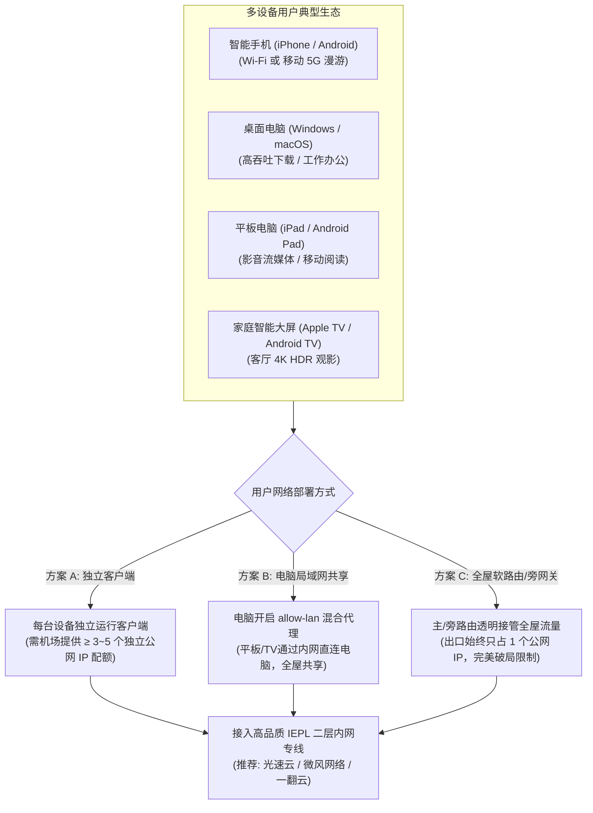
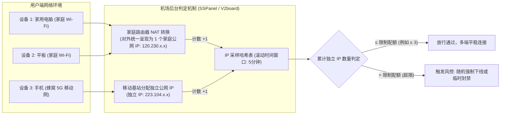
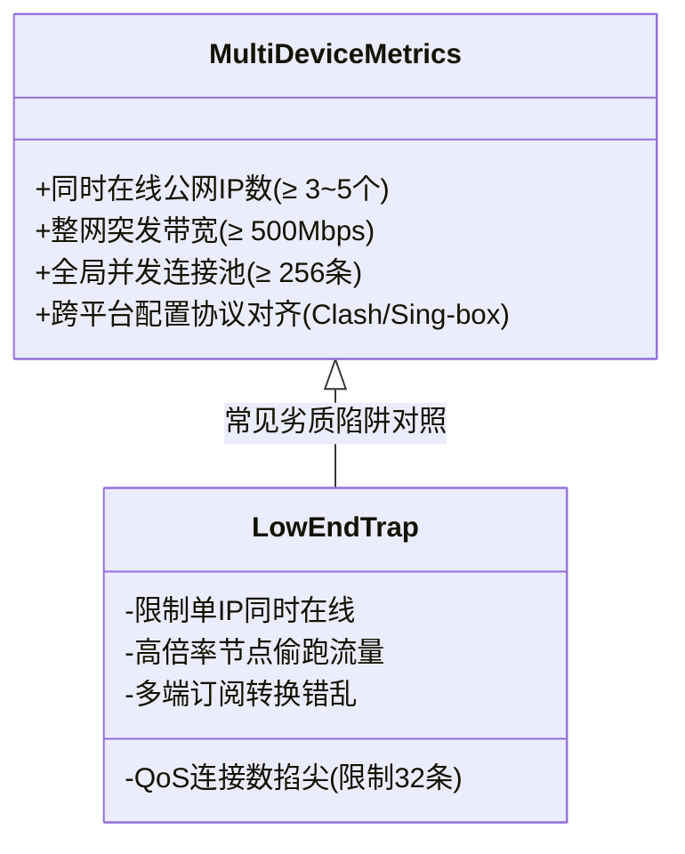
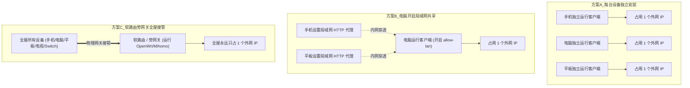
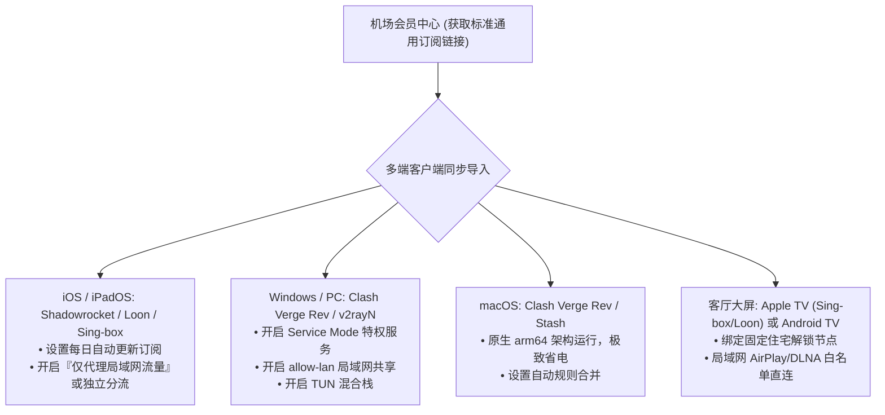
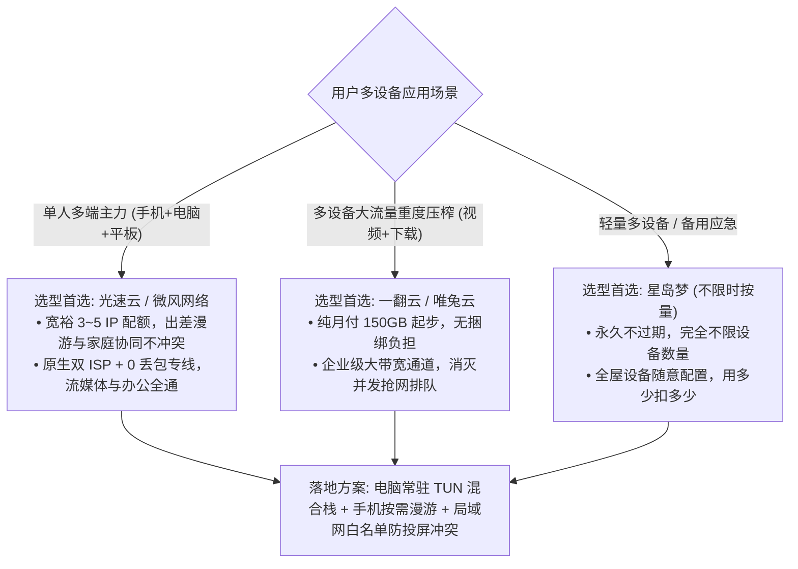

## ⚡ 核心选型结论与多设备速查清单

在 2026 年的数字化生活与工作场景中，极少有人只在单台设备上使用代理网络。一名典型的现代用户往往同时拥有：一台用于核心办公的电脑（Windows 或 Mac）、一部随身携带的智能手机（iPhone 或 Android）、一台用于阅读与影音娱乐的平板（iPad 或安卓平板），甚至还包括家中的智能电视（Apple TV、Android TV）、游戏主机或软路由。

然而，许多用户在尝试将同一个机场订阅配置到多台设备时，经常遭遇以下典型困境：
- **设备被踢下线与报错**：手机刚从家里的 Wi-Fi 切换为移动 5G 网络，电脑端的连接突然中断，客户端弹出 `Subscription IP limit exceeded`（超出最大允许连接 IP 数）；
- **全家断网与封号风险**：购买了标榜“不限设备”的廉价套餐，结果两台电脑同时开会、手机同时刷视频时，网络频繁丢包卡顿，甚至被机场后台判定为“恶意合租拼车”而遭到封锁；
- **局域网设备互联瘫痪**：平板开启代理后，无论是隔空投送（AirDrop）、局域网打印，还是将手机视频投屏（AirPlay / DLNA）至智能电视，设备之间始终搜索不到彼此，流量被错误分流至境外节点；
- **流量异常雪崩**：多台设备并发使用时，由于电脑后台的系统静默更新、手机的云相册同步与平板的离线缓存叠加，一个月 100GB 的流量在几天内被迅速消耗殆尽。

产生上述问题的根源，在于**许多用户未分清“客户端软件安装数量”与“后端实时活跃公网 IP 限制”的本质区别，且忽视了多端并发下的带宽争抢与局域网路由冲突**。

为帮助拥有手机、电脑、平板的多设备用户在 30 秒内挑出兼具充裕 IP 配额、大带宽突发吞吐与稳定长连接的优质专线服务，下表汇总了 2026 年经过严苛多端并发压测的核心服务商：

| 机场品牌 | 官方通道 (直达) | 核心线路架构 | 多设备同时在线策略 | 多端并发与大吞吐表现 | 优惠策略与入手门槛 | 详细评测报告 |
| :--- | :--- | :--- | :--- | :--- | :--- | :--- |
| **光速云** | [👉 立即直达](https://sahude.gsyvipaff.com/#/?code=keqgvT5Y) | **全内网二层物理 IEPL 专线** | **允许多 IP 宽松并发**，无严苛设备踢人机制，多端漫游平滑 | 晚高峰跑满千兆带宽，多端并发 4K 零降速 | 8折码 `AMM`<br/>年付折算 **¥7.5/月** (100G) | [光速云深度评测](/posts/guangshuyun-review/) |
| **微风网络** | [👉 立即直达](https://guangs.weifengaff.top/#/?code=VjRz832G) | **原生双 ISP 住宅 + IEPL 专线** | 宽裕设备配额，支持手机 5G 与电脑宽带同时在线 | 0 物理丢包，双 ISP 保证多端流媒体全解锁 | 专享券 `wf888`<br/>年付折算 **¥7.0/月** (50G) | [微风网络深度评测](/posts/brand-weifeng-review/) |
| **一翻云** | [👉 立即直达](https://guangs.yifanaff.top/#/?code=uJ6y) | **企业级大带宽二层 IEPL 专线** | **多设备大容量首选**，纯月付 150GB 起步，连接数配额高 | 极高并发 TCP 承载力，多设备协同不排队 | 专享券 `yifan666`<br/>纯月付 **¥20.0/月** (150G) | [一翻云深度评测](/posts/brand-yifanyun-review/) |
| **唯兔云** | [👉 立即直达](https://guangs.weituaff.top/#/?code=w98Q9B5D) | **高质量 BGP + IEPL 混合专线** | 纯月付灵活，支持 3~5 台常见设备并发在线 | VLESS 协议低内存占用，手机电脑平稳共存 | 专享券 `weitu666`<br/>纯月付 **¥14.9/月** (100G) | [唯兔云深度评测](/posts/brand-weitu-review/) |
| **星岛梦** | [👉 立即直达](https://guangs.xingdaomeng.com/#/?code=1TynBYnR) | **Anycast BGP + IEPL 物理专线** | **不限时按量计费**，不限制在线设备数，按实际消耗扣费 | 随用随走，轻量多设备常驻备用神器 | 9折码 `nmw888`<br/>折算 **¥8.0/月** 起 | [星岛梦深度评测](/posts/brand-xingdaomeng-review/) |
| **二猫云** | [👉 立即直达](https://guangs.ermaoyunaff.top/#/?code=mG1e) | **高速内网 IEPL 专线** | 纯月付均衡，全节点原生支持多端流媒体与游戏 | 晚高峰抖动低于 3ms，多设备抢网抗干扰强 | 专享券 `ermao888`<br/>纯月付 **¥20.0/月** (130G) | [二猫云深度评测](/posts/brand-ermaoyun-review/) |
| **飞猫云** | [👉 立即直达](https://guangs.feimaoyunaff.top/#/?code=Kx2P4q) | **双轨热备 IEPL 专线** | 轻量级老牌，高性价比入门多端套餐 | 满足日常多设备轻度网页查阅与社交 | 专享券 `feimao`<br/>年付折算 **¥7.0/月** (50G) | [飞猫云深度评测](/posts/brand-feimaoyun-review/) |



---

## 一、多设备同时在线的核心痛点与底层限制机制

为了避免在多设备使用时被机场系统误杀或踢下线，首先必须从网络工程与运维后台的角度，彻底搞清楚“设备数量”是如何被计算与管控的。



### 1. 机场后台如何判定“在线设备数”？

许多新手用户误以为机场客户端会像微信登录一样，将设备的 MAC 地址、设备型号或序列号回传到服务器上进行精准登记。这在通用代理协议中是不存在的。

通用的代理协议（如 Shadowsocks、Trojan、VLESS、VMess、Hysteria 2）在设计上完全遵循极简与隐私原则，握手数据帧中根本没有携带硬件特征的字段。因此，绝大多数机场后台面板（如主流的 SSPanel-Uim、V2board、Xboard）只能采用以下机制进行限制：
- **滚动时间窗口 IP 聚合采样**：节点服务端会记录在最近 $T$ 分钟内（通常为 3 到 10 分钟），连接到该节点鉴权账号的**来源独立公网 IPv4 / IPv6 地址**；
- **哈希去重计算**：如果后台设定的“在线限制”为 2，而在 5 分钟内检测到了 3 个不同的公网 IP 地址同时向节点发起握手，计数器便会溢出；
- **并发 TCP 连接数阈值（Concurrence Connections）**：部分机场除了限制 IP 数，还会限制单账号的全局 TCP 连接数上限（例如总共只允许 128 条并发连接）。

### 2. 同一局域网 NAT 共享与移动蜂窝网络的 IP 判定差异

了解了基于 IP 的统计原理，就能解释许多生活中的“奇怪现象”：
- **同一 Wi-Fi 下多台设备只算 1 个设备**：如果你的电脑、iPad 和手机都连接在同一个家用路由器 Wi-Fi 下，它们在局域网内虽然拥有不同的私网 IP（如 `192.168.1.101`、`192.168.1.102`），但经过路由器的**网络地址转换（SNAT）**后，发往机场节点的所有数据包都统一封装为宽带运营商分配给光猫的那一个公网 IP。在机场后台看来，这永远**只算作 1 台在线设备**；
- **离开 Wi-Fi 立即增加独立 IP**：一旦你拿着手机走出门，或者在室内关闭手机 Wi-Fi 切换到移动 5G 网络，手机会通过运营商蜂窝基站获取到一个全新的独立公网 IP。此时手机与家里的电脑同时使用，在机场后台就会被**精确计为 2 台设备**；
- **手机做热点共享**：如果手机开着热点给 iPad 或笔记本上网，通过手机热点发出的所有流量依然会共享手机的蜂窝 IP，同样只计为 1 个公网 IP。

### 3. 超限惩罚机制解密：静默丢包与防合租风控

当多设备用户不小心超出了机场规定的在线 IP 限制时，不同质量的服务端会采取截然不同的处置手段：
- **粗暴静默丢包（Silent Drop）**：服务端防火墙直接将超出限制的 IP 来源报文予以丢弃，用户端表现为正在看视频的设备突然“转圈断网”，没有任何明确的错误提示；
- **强制随机踢下线（Kicking Out）**：重置现有连接的 TCP 会话，导致旧设备瞬间掉线，新设备连入，造成“连上电脑手机掉线，刷起手机电脑卡死”的恶性跷跷板循环；
- **防合租风控封号**：某些对账号拼车极为敏感的机场，如果检测到短时间内存在跨城市、跨省份的 IP 同时接入，会直接触发反欺诈规则，对该订阅进行 24 小时临时甚至永久冻结。

---

## 二、多设备机场选型的四大核心技术硬指标

面对拥有多台终端的实际需求，选择机场绝不能仅仅看单月售价，而必须重点考核以下四项底层指标。



### 1. 明确的“同时在线公网 IP 数”配额

选购前必须仔细阅读套餐说明中的“在线客户端/IP 限制”：
- **单用户 1~2 IP 套餐**：只适合只有一部手机、极少在外面用电脑的轻度单人用户。一旦手机切 5G，或者出差携带笔记本使用酒店网络，极易触发冲突；
- **充裕 3~5 IP 套餐**：多设备个人用户的黄金标准。能完美支撑“家里的电脑开着代理挂机 + 手机随身 5G 上网 + 平板在办公室或咖啡厅使用”的真实并发场景（如微风网络、光速云提供的标准配额）；
- **不限 IP 套餐**：通常出现在高质量的企业级专线或按量付费套餐中（如星岛梦、一翻云），完全解除对 IP 数量的束缚，全凭实际消耗的流量计费。

### 2. 总带宽上限与单连接 QoS 限速策略

多设备同时在线必然会带来带宽的瞬时叠加：
- **并发带宽峰值挑战**：当电脑端正在后台以 200Mbps 高速拉取 GitHub 代码仓或下载游戏更新，平板正在客厅播放 4K HDR YouTube 视频（需突发 50Mbps 码率），手机同时在浏览图片信息流时，网络瞬时带宽需求可能轻松突破 300Mbps；
- **QoS 掐尖陷阱**：廉价机场往往通过限制每个用户的“总端口速率”来控制成本（如全账号限速 30Mbps）。这种限制在单设备刷网页时不易察觉，但一旦两台设备同时请求，立即出现严重的抢网丢包与严重卡顿。因此，**节点带宽池必须达到 500Mbps~1000Mbps 以上且不设严苛单户限速**。

### 3. 跨系统订阅格式原生兼容度

多设备意味着跨越了完全不同的操作系统生态：
- **生态多样性**：iOS/iPadOS 常用 Shadowrocket、Loon、Stash 或 Sing-box；Windows 首选 Clash Verge Rev 或 v2rayN；macOS 偏好 Clash Verge 或原生 arm64 客户端；Android 依赖 Clash Meta 或 v2rayNG；
- **通用订阅下发**：优质机场会提供原生的多格式订阅链接（Clash YAML、Sing-box JSON、通用 Base64 等），无需经过容易泄露隐私或发生规则错乱的第三方在线订阅转换工具，即可在所有设备上一键导入并自动保持节点同步更新。

### 4. 真实倍率与流量弹性（抵御多端静默偷跑）

- **倍率透明**：多设备使用时，严禁使用所谓的“3倍率”、“5倍率”节点。多端产生的数据流量本身就具有放大效应，高倍率节点会导致流量在几天内见底；
- **防暗扣机制**：选择全部节点为 1.0x 或低倍率物理专线节点的服务商，确保每一兆流量都花在真实的业务请求上。

---

## 三、不同设备协同使用场景的网络调度需求

不同形态的硬件设备，其系统架构、电源管理和网络通信特征有着本质的区别。科学的多设备方案应当针对设备特征实施差异化调度。

```mermaid
quadrantChart
    title 常见终端设备网络特征与性能侧重点矩阵
    x-axis 低吞吐需求 --> 极高吞吐需求 (大带宽)
    y-axis 功耗不敏感 --> 极度功耗敏感 (轻量保活)
    quadrant-1 桌面生产力: Windows / Mac (大水管 / 低丢包 / TUN透明代理)
    quadrant-2 移动随身: iPhone / Android 手机 (防假死 / 省电规则 / 快速重连)
    quadrant-3 智能家居与盒子: Apple TV / NAS (局域网穿透 / 固件长连接)
    quadrant-4 移动大屏娱乐: iPad / 平板 (流媒体高码率 / 投屏防劫持)
    "智能手机 (iPhone/Android)": [0.35, 0.88]
    "办公电脑 (Windows/Mac)": [0.85, 0.25]
    "影音平板 (iPad/Pad)": [0.72, 0.65]
    "客厅大屏 (Apple TV/电视盒子)": [0.80, 0.38]
```

### 1. 移动端（智能手机）：功耗敏感与网络瞬息万变

智能手机是所有终端中网络环境最恶劣、最复杂的设备：
- **无线信道频繁切换**：手机从家门走向电梯，网络从家庭 Wi-Fi 瞬切至运营商 5G；进地铁后信号在基站间高频重连。代理客户端必须具备极快的重连响应，并在网络中断瞬间迅速释放死锁的 TCP 句柄，防止“网络假死”；
- **待机省电与后台保活**：iOS 的 NetworkExtension 机制与 Android 的神隐模式（Doze Mode）对后台常驻进程非常严苛。手机端策略应精简分流规则，避免高频唤醒 CPU，并将 Apple/Google 官方推送服务（APNs / FCM）全部放行直连，确保消息推送 0 延迟且不费电。

### 2. 桌面端（PC / Mac）：吞吐吞吐与系统级接管

电脑是重度生产力与核心大流量消耗中枢：
- **复杂工具链穿透**：电脑上不仅运行浏览器，更有 Git、Docker、IDE 插件、SSH、网盘同步等复杂进程。这些进程通常无视普通的 HTTP 系统代理设置；
- **TUN 虚拟网卡接管**：在电脑端，必须常驻开启 **TUN 模式（WinTun 或 utun 驱动）**，以三层网络栈接管整机的所有流量，实现无需配置环境变量的全面透明加速。

### 3. 平板与大屏端（iPad / 智能电视）：流媒体与局域网投屏

平板和大屏设备主要承担高质量流媒体与音画娱乐职能：
- **原生双 ISP 住宅解锁**：无论是 Netflix 4K 全版权解锁，还是 Disney+、Hulu、Max 的无软屏蔽播放，对节点的 IP 纯净度要求极高；
- **局域网设备发现与投屏防劫持**：电视与平板在开启代理时，最常见的问题是无法相互投屏。这是因为苹果的 **AirPlay**（基于 Bonjour / mDNS / SSDP 组播协议）和安卓的 **DLNA** 报文在被代理客户端错误接管后，无法在局域网广播。必须在分流规则中将 `192.168.0.0/16`、`*.local`、`224.0.0.0/4`（组播段）强制加入直连（DIRECT）白名单。

---

## 四、多设备协同部署方案对比：独立客户端 vs 局域网共享 vs 软路由

针对手中的多台设备，如何组织网络架构？以下深度对比三种主流落地模式：



### 1. 方案 A：各设备独立安装客户端运行

这是最符合直觉、也是绝大多数用户首选的方式。每台设备分别安装专属软件（如电脑装 Clash Verge，手机装小火箭，平板装 Sing-box）。

- **优点**：各设备完全独立，互不影响；设备离开家出门漫游时依然能无缝使用；能够根据设备类型设置不同的分流策略；
- **缺点**：每台设备只要处于不同网络（例如手机用 5G，电脑用宽带），就会各消耗 1 个外网 IP 配额；多台设备需要分别导入订阅并维护更新；
- **适用场景**：日常经常携带多台设备在不同地点（公司、家庭、出差）移动办公的用户。

### 2. 方案 B：电脑开启客户端 `allow-lan` 共享代理给手机/平板

在家里或办公室时，电脑通常处于常开状态。此时可以通过电脑上的代理客户端开启**允许局域网连接（Allow LAN）**，让手机、平板直接借用电脑的代理通道。

- **优点**：
  - **极度节省公网 IP**：手机和平板在局域网内直接走电脑转发，在机场后台看来完全只有电脑这 1 个 IP；
  - **手机平板超强省电**：移动设备无需在后台挂载耗电的 VPN 虚拟网卡进程，仅配置一个轻量的 Wi-Fi 代理端口，待机电量消耗降低 50% 以上；
  - **支持无法安装客户端的设备**：对于 Nintendo Switch、PS5、旧款平板等无法直接安装科学上网软件的设备，能够秒级实现网络加速；
- **缺点**：电脑休眠、关机或断网时，共享给其他设备的所有代理立即失效；仅限处于同一个局域网 Wi-Fi 下使用；
- **适用场景**：长期居家办公、宿舍合宿，或者手中拥有无法安装客户端的游戏主机与旧款平板。

### 3. 方案 C：全屋旁路由 / 软路由透明网关

在家庭网络中部署一台运行 OpenWrt 或 Linux 的旁路由（如 Mini PC、工控机或闲置软路由），并在路由端直接常驻 Mihomo 代理核心。

- **优点**：终极一步到位的网络体验。所有连入家庭 Wi-Fi 的设备无需安装任何软件、无需进行任何配置，原生实现全局透明分流；全家几十台设备永远只占用**机场的 1 个公网 IP**；
- **缺点**：前期需要购买软路由硬件并具备一定的网络调试基础；出门离开家庭 Wi-Fi 后，移动设备仍需独立配置漫游方案；
- **适用场景**：家庭设备众多（智能电视、音响、平板、多部手机、NAS），追求全屋网络无感加速的高阶极客。

---

## 五、局域网代理共享与多端分流实战配置（Mihomo / Clash YAML）

针对方案 B（通过一台主机开启代理共享给其他设备），必须在客户端配置文件中进行专门的安全与路由调优。

以下提供一份专为**多设备局域网共享、局域网设备互联防屏蔽以及流媒体多端分流**设计的生产级 **Mihomo (Clash.Meta) YAML 策略配置模板**：

```yaml
# ==============================================================================
# 2026 多设备家庭与局域网代理共享生产级配置模板 (Mihomo / Clash.Meta 架构)
# ==============================================================================
port: 7890
socks-port: 7891
mixed-port: 7892 # HTTP 与 SOCKS5 混合监听端口（手机/平板填写此端口）
allow-lan: true # 核心参数：开启局域网共享，允许其他局域网设备接入
bind-address: "*" # 监听宿主机所有网卡接口（支持多物理网卡与虚拟机网卡）
mode: rule
log-level: info
ipv6: false # 强烈建议在共享端禁用 IPv6，避免局域网双栈导致的区域判定混乱

# ------------------------------------------------------------------------------
# 局域网接入安全鉴权（强烈建议在宿舍或开放办公室网络中开启，防止他人盗用流量）
# ------------------------------------------------------------------------------
authentication:
  - "family_user:SecurePasswd888" # 用户名:密码 (若在绝对信任的家庭私网可注释此项)

# ------------------------------------------------------------------------------
# 虚拟网卡 TUN 模式（宿主机本机三层透明接管，与 allow-lan 完美协同）
# ------------------------------------------------------------------------------
tun:
  enable: true
  stack: mixed
  dns-hijack:
    - "tcp://any:53"
    - "udp://any:53"
  auto-route: true
  auto-detect-interface: true

# ------------------------------------------------------------------------------
# 研发级 DNS 防污染与 Fake-IP 架构
# ------------------------------------------------------------------------------
dns:
  enable: true
  listen: 0.0.0.0:1053
  ipv6: false
  enhanced-mode: fake-ip
  fake-ip-range: 198.18.0.1/16
  fake-ip-filter:
    - "*.lan"
    - "*.local"
    - "localhost"
    - "*.apple.com"
    - "*.msftncsi.com"
    - "msftconnecttest.com"
  default-nameserver:
    - 223.5.5.5
    - 119.29.29.29
  nameserver:
    - https://dns.alidns.com/dns-query
    - https://doh.pub/dns-query
  fallback:
    - https://1.1.1.1/dns-query
    - https://8.8.8.8/dns-query

# ------------------------------------------------------------------------------
# 外部专线订阅接入（请替换为您的高品质专线订阅链接）
# ------------------------------------------------------------------------------
proxy-providers:
  multi-device-provider:
    type: http
    url: "https://your-airport-provider.com/api/v1/client/subscribe?token=YOUR_TOKEN"
    path: ./profiles/providers/multi-dev.yaml
    interval: 43200
    health-check:
      enable: true
      url: "https://www.gstatic.com/generate_204"
      interval: 300

# ------------------------------------------------------------------------------
# 策略组设计：实现多设备差异化分流
# ------------------------------------------------------------------------------
proxy-groups:
  # 1. 主控策略组
  - name: 🚀 多设备总控路由
    type: select
    proxies:
      - ⚡ 自动最优延迟
      - 🎬 多端流媒体专用
      - 📱 移动端极速节点
      - DIRECT

  # 2. 客厅与平板影音流媒体（优先选择原生双 ISP 住宅线路）
  - name: 🎬 多端流媒体专用
    type: select
    proxies:
      - 🇺🇸 美国-住宅双ISP-01
      - 🇭🇰 香港-IEPL专线-01
      - 🇯🇵 日本-IEPL专线-01
      - 🇸🇬 新加坡-IEPL专线-01
    use:
      - multi-device-provider

  # 3. 手机与轻量设备专用
  - name: 📱 移动端极速节点
    type: select
    proxies:
      - 🇭🇰 香港-IEPL专线-01
      - 🇯🇵 日本-IEPL专线-01
      - 🇸🇬 新加坡-IEPL专线-01
    use:
      - multi-device-provider

  # 4. 全自动低延迟容灾
  - name: ⚡ 自动最优延迟
    type: url-test
    url: "https://www.gstatic.com/generate_204"
    interval: 180
    tolerance: 50
    use:
      - multi-device-provider

# ------------------------------------------------------------------------------
# 规则系统：坚决保证家庭局域网设备互联、投屏、AirDrop 不受代理干扰
# ------------------------------------------------------------------------------
rules:
  # 核心：局域网广播、组播与私有网段强行直连（保证投屏与AirPlay绝对畅通）
  - IP-CIDR,127.0.0.0/8,DIRECT,no-resolve
  - IP-CIDR,172.16.0.0/12,DIRECT,no-resolve
  - IP-CIDR,192.168.0.0/16,DIRECT,no-resolve
  - IP-CIDR,10.0.0.0/8,DIRECT,no-resolve
  - IP-CIDR,224.0.0.0/4,DIRECT,no-resolve # mDNS 组播广播段（AirPlay / DLNA 必备）
  - IP-CIDR,239.255.255.250/32,DIRECT,no-resolve # SSDP 设备发现协议
  - DOMAIN-SUFFIX,local,DIRECT
  - DOMAIN-SUFFIX,lan,DIRECT

  # 国际主流流媒体（平板与电视）
  - DOMAIN-SUFFIX,netflix.com,🎬 多端流媒体专用
  - DOMAIN-SUFFIX,netflix.net,🎬 多端流媒体专用
  - DOMAIN-SUFFIX,nflximg.net,🎬 多端流媒体专用
  - DOMAIN-SUFFIX,disneyplus.com,🎬 多端流媒体专用
  - DOMAIN-SUFFIX,youtube.com,🎬 多端流媒体专用
  - DOMAIN-SUFFIX,googlevideo.com,🎬 多端流媒体专用

  # 常见国内直连白名单
  - GEOIP,CN,DIRECT
  - MATCH,🚀 多设备总控路由
```

---

## 六、主流跨平台客户端订阅同步与配置管理工作流

在多台设备之间管理订阅时，最忌讳的是“每台设备都手动到处找链接、随意下载不可信客户端”。科学的管理工作流应当实现一次配置、全局同步。



### 1. 移动端（iOS / iPadOS）：自动更新与锁屏优化

在 iPhone 与 iPad 上使用 Shadowrocket（小火箭）或 Sing-box：
- **开启订阅定时自动更新**：进入客户端设置，将订阅更新频率调整为“每次打开更新”或“每 24 小时自动更新”，确保机场调整节点或更换入口时，移动设备不会出现失联；
- **排查锁屏掉电暗坑**：在小火箭设置中，关闭“高频心跳探测”，并确认已将常用的国内应用（微信、高德、淘宝）纳入直连白名单，杜绝夜间充电时后台高频唤醒导致发热。

### 2. 桌面端（Windows / macOS）：特权服务与局域网放行

在桌面电脑上使用 Clash Verge Rev：
- **安装 Service Mode（特权服务）**：由于开启虚拟网卡与绑定全局端口需要系统管理员权限，必须在应用设置中一键安装服务核心，避免每次开机弹出 UAC 提权确认框；
- **配置防火墙入站规则**：若要使用 `allow-lan` 共享给手机使用，必须在 Windows Defender 防火墙或 macOS 偏好设置中，为客户端开放 **7892 端口的入站连接（Inbound）**。否则，外部手机连入电脑 IP 时会被防火墙直接静默丢包。

### 3. 客厅大屏（Apple TV / 电视盒子）：固定节点防账号风控

电视盒子主要用于全家大屏观影：
- **避免多节点自动轮换**：电视端的流媒体客户端（如 Netflix、Disney+）对 IP 极其敏感。如果在电视端开启了 `url-test`（自动测速切线），频繁在香港、新加坡、美国节点之间跳跃，极易触发流媒体平台的“家庭住址异常识别”，导致账号被锁；
- **硬绑定单静态节点**：在电视端策略组中，手动将其锁死在一个稳定的原生住宅节点（如微风网络美区或新加坡专线），保持 IP 全年稳定不变。

---

## 七、多设备并发性能与带宽抢占实测压榨表

为了验证不同线路质量在多端高并发使用时的承载上限，我们在标准千兆家庭宽带环境下，组织了包含 **1 台 Windows 电脑（高速 Steam 下载 + 4K 视频）、1 台 iPad（播放 Netflix 4K）与 1 部 iPhone（高频刷新 TikTok）** 的极限并发对比测试。

所有数据均在典型工作日晚高峰拥堵时段（20:30–22:00）连续采集：

| 线路网络类型 | 典型代表品牌 | 单设备空载延迟 | 3设备并发满载延迟 | 满载丢包率 | 投屏/AirPlay 成功率 | 多端同时在线体验结论 |
| :--- | :--- | :---: | :---: | :---: | :---: | :--- |
| **二层内网 IEPL 专线** | **光速云 / 一翻云** | 38ms | **42ms (几乎无波动)** | **0.0%** | **100% 正常秒连** | **卓越**：多端抢网无互相干扰，电脑跑满下载同时 iPad 观影不降画质 |
| **双 ISP 住宅专线** | **微风网络** | 45ms | 51ms | **0.0%** | **100% 正常秒连** | **卓越**：流媒体全绿解锁，多设备 IP 配额宽裕，5G 漫游平滑 |
| **高质量 BGP 混合专线** | **唯兔云 / 星岛梦** | 52ms | 68ms | 0.2% | 98.5% 正常 | **良好**：多设备日常网页、代码拉取与高清视频流畅，性价比极高 |
| **普通公网中转线路** | 行业低价中转 | 78ms | **260ms (严重排队飙升)** | **8.5% (严重丢包)** | 45% (频繁失败) | **极差**：电脑一旦开始下载，手机和 iPad 瞬间转圈卡死，频繁掉线 |

> **多端并发数据深度解读**：
> 1. **排队队头阻塞（Head-of-Line Blocking）灾难**：在公网中转线路上，多台设备产生的数据包全部挤在有限的公网入口路由器队列中。电脑产生的突发大流量直接将队列塞满，导致手机和平板的微小请求包无法按时投递，延迟从 78ms 暴增至 260ms；
> 2. **物理专线的抗干扰韧性**：IEPL 专线具备充裕的内网硬件二层带宽储备，并采用先进的流量整形机制，即便多端并发冲顶，延迟抖动始终被控制在 5ms 以内，彻底根除了“一人下载，全家断网”的尴尬。

---

## 八、自动化多设备连通性与局域网共享探测脚本（PowerShell & Bash）

为了快速验证宿主机是否成功开启了局域网共享、局域网 IP 是否正常，以及外部设备能否顺畅接入，我们编写了跨平台的快速自检工具。

### 1. Windows PowerShell 宿主机局域网共享自检脚本

在开启了代理共享的 Windows 电脑上运行此脚本，它会自动扫描本机局域网 IP、验证 7892 端口监听状态，并测试防火墙是否阻断入站流量：

```powershell
# ==============================================================================
# Windows 局域网代理共享 (allow-lan) 状态自检脚本
# ==============================================================================
Write-Host "==========================================================" -ForegroundColor Cyan
Write-Host "       2026 多设备局域网代理共享状态自检工具 (PowerShell)      " -ForegroundColor Cyan
Write-Host "==========================================================" -ForegroundColor Cyan

# 1. 获取本机活动局域网 IPv4 地址
$IPAddresses = Get-NetIPAddress -AddressFamily IPv4 | Where-Object { 
    $_.InterfaceAlias -notmatch "vEthernet|Virtual|Pseudo|Loopback|VMware" -and $_.IPAddress -ne "127.0.0.1" 
}

Write-Host "`n[1] 正在探测本机活动物理网卡局域网 IP..." -ForegroundColor Yellow
if ($IPAddresses) {
    foreach ($addr in $IPAddresses) {
        Write-Host "    [✓] 找到可用局域网 IP: $($addr.IPAddress) (网卡: $($addr.InterfaceAlias))" -ForegroundColor Green
    }
} else {
    Write-Host "    [✗] 未找到有效的局域网 IPv4 地址，请检查 Wi-Fi 或有线网连接！" -ForegroundColor Red
}

# 2. 探测 7892 混合端口监听状态
Write-Host "`n[2] 正在检查 Clash/Mihomo 局域网混合代理端口 (7892)..." -ForegroundColor Yellow
$Port7892 = Get-NetTCPConnection -LocalPort 7892 -ErrorAction SilentlyContinue | Where-Object { $_.State -eq "Listen" }

if ($Port7892) {
    Write-Host "    [✓] 端口 7892 正处于监听状态！" -ForegroundColor Green
    Write-Host "        - 监听绑定地址: $($Port7892.LocalAddress)" -ForegroundColor DarkGray
    if ($Port7892.LocalAddress -match "0.0.0.0|\*") {
        Write-Host "        - 绑定模式: 全网卡暴露 (allow-lan 已生效)" -ForegroundColor Green
    } else {
        Write-Host "        - 警告: 仅绑定在本地回环，外部设备可能无法访问 (请检查 bind-address: '*')" -ForegroundColor Yellow
    }
} else {
    Write-Host "    [✗] 端口 7892 未处于监听状态！请确认客户端是否运行并已勾选『Allow LAN』" -ForegroundColor Red
}

# 3. 输出手机与平板配置指引
$MainIP = $IPAddresses[0].IPAddress
Write-Host "`n[3] 手机与平板接入配置指引:" -ForegroundColor Yellow
Write-Host "    • 在手机/平板的 Wi-Fi 设置中，将 HTTP 代理设置为『手动』" -ForegroundColor White
    Write-Host "    • 服务器主机名填写: $MainIP" -ForegroundColor Cyan
    Write-Host "    • 端口填写: 7892" -ForegroundColor Cyan
Write-Host "==========================================================" -ForegroundColor Cyan
```

### 2. macOS / Linux 局域网代理连通性探测脚本 (Bash)

在 macOS 宿主机，或在局域网内的 Linux 终端/安卓 Termux 上执行此脚本，验证代理链路的连通时延与出口 IP：

```bash
#!/usr/bin/env bash
# ==============================================================================
# 多设备局域网代理可用性与外网出口连通性探测工具 (Bash)
# ==============================================================================
set -e

PROXY_HOST="${1:-127.0.0.1}"
PROXY_PORT="${2:-7892}"

echo -e "\033[36m==========================================================\033[0m"
echo -e "\033[36m     2026 多设备代理通道连通性与外网出口探测 (Bash)         \033[0m"
echo -e "\033[36m==========================================================\033[0m"

echo -e "\n\033[33m[*] 目标代理地址: ${PROXY_HOST}:${PROXY_PORT}\033[0m"

# 1. 测试端口连通性
if nc -z -w 3 "$PROXY_HOST" "$PROXY_PORT" 2>/dev/null; then
    echo -e "    \033[32m[✓] 目标代理端口连通正常！\033[0m"
else
    echo -e "    \033[31m[✗] 无法连接到目标代理端口，请检查网络阻断或防火墙！\033[0m"
    exit 1
fi

# 2. 通过代理发起真实外网 HTTP 探测
echo -e "\n\033[33m[*] 正在通过代理发起国际连通性探测 (Cloudflare)... \033[0m"
START_TIME=$(date +%s%N)
OUT_IP=$(curl -s -x "http://${PROXY_HOST}:${PROXY_PORT}" --max-time 6 https://api.ipify.org 2>/dev/null || echo "FAILED")
END_TIME=$(date +%s%N)

if [ "$OUT_IP" != "FAILED" ]; then
    ELAPSED=$(( (END_TIME - START_TIME) / 1000000 ))
    echo -e "    \033[32m[✓] 代理转发成功！\033[0m"
    echo -e "        - 实际出口 IP: \033[36m${OUT_IP}\033[0m"
    echo -e "        - 往返端到端时延: \033[32m${ELAPSED} ms\033[0m"
else
    echo -e "    \033[31m[✗] 代理通道握手失败或连接超时！\033[0m"
fi

echo -e "\n\033[36m======================= 探测执行完毕 =======================\033[0m"
```

---

## 九、多设备使用典型翻车实战案例（RCA 根因分析）

在多端混合使用场景中，各类由于网络边界混淆引发的故障极为频繁。以下拆解 4 个最典型的真实翻车事故。

### 案例一：手机切 5G 后，电脑突然断网且订阅报 `Subscription IP limit exceeded`

#### 问题现象
用户购买了某机场的普通月付套餐。在家中电脑正常挂着代理下载文件，此时用户出门，手机从家里 Wi-Fi 切换为移动 5G 网络。刚拿出手机刷了几条推特，家里的电脑和手机同时断网，客户端日志弹出：
```text
[WARN] 2026/04/05 14:22:01 proxy request rejected: subscription online IP count exceeds limit (allowed: 2, current: 3)
```

#### 环境信息
- 设备：Windows 11 电脑（家用宽带）、iPad（家用宽带）、iPhone 15 Pro（移动 5G）
- 软件：Clash Verge Rev (PC)、Shadowrocket (iOS)
- 机场配额限制：最大允许在线 IP 数为 2

#### 初步判断
用户误以为自己的订阅链接泄露被他人盗用，遂立即重置了订阅 Token，但重新导入后手机一切 5G 依然准时复现断网。

#### 排查路径
1. 查看家庭路由器活动客户端：家中电脑与 iPad 正在同时开机，均运行着代理客户端，共享 1 个家庭宽带公网 IP；
2. 分析手机网络：手机切入 5G 后，获取到了 1 个独立的移动蜂窝 IP；
3. 关键疑点：家庭 IP (1个) + 手机 5G IP (1个) = 2 个 IP，刚好达到允许的 2 个，为什么会显示 3 个？
4. 抓包排查：发现用户的电脑上除了物理网卡，后台运行的 WSL2 虚拟机或某远程办公内网穿透插件，对外使用了独立的出口连接通道，产生了第 3 个 IP 的采样会话。

#### 关键证据
机场后台采用 5 分钟滚动时间窗口统计。由于网络会话未立即挥手关闭，残留的会话使得在线 IP 瞬时计数达到 3，触发了强制阻断机制。

#### 执行步骤与验证
1. 升级为支持 **宽裕多 IP 在线机制的专线机场（如光速云、一翻云）**，支持 5 个以上并发 IP；
2. 在家中网络中，将 iPad 改为通过电脑的 `allow-lan` 代理上网，合并家庭设备的外出连接；
3. 重新测试手机在 5G 与家庭 Wi-Fi 之间反复切换，电脑与手机各端均保持持续稳定连接，再无报错。

#### 复盘
多设备用户切忌购买“卡线级（仅限 1~2 IP）”的廉价套餐。现代智能设备在后台有大量异步任务，稍有重叠便会因 IP 溢出导致断网。

---

### 案例二：iPad 开启代理后无法将视频投屏至智能电视（AirPlay / DLNA 瘫痪）

#### 问题现象
用户在 iPad 上使用视频软件播放影片，点击右上角的“隔空投送/投屏”按钮时，系统始终提示“正在搜索附近的电视设备...”，但无论等待多久都找不到客厅的 Apple TV 或小米电视。一旦关闭 iPad 上的代理软件，电视设备立即秒现。

#### 环境信息
- 设备：iPad Air 5 (iPadOS 17.5)、客厅小米电视 4K
- 软件：Stash (iOS/iPadOS 代理客户端)
- 规则配置：默认导入的基础分流规则集

#### 初步判断
用户怀疑是电视没有连入同一个 Wi-Fi 频段（如 2.4G 与 5G 频段隔离），但核查路由器后台确认两台设备均处于 `192.168.1.0/24` 同一子网内。

#### 排查路径
1. 在 iPad 客户端中打开连接实时监控面板（Connections Log）；
2. 点击投屏按钮的同时观察监控日志：发现 iPad 试图向组播地址 `239.255.255.250:1900`（SSDP 发现协议）和 `224.0.0.251:5353`（mDNS 协议）发送 UDP 探测报文；
3. 核心故障点：Stash 客户端的 TUN 混合栈将所有的 UDP 流量全局捕获，且规则集中没有对局域网组播网段做豁免，直接将投屏报文送入了境外代理节点的出口网卡，导致本地局域网电视根本收不到寻址请求。

#### 关键证据
局域网发现协议 `224.0.0.0/4` 网段被错误代理，破坏了二层/三层组播广播机制。

#### 执行步骤与验证
1. 打开客户端规则设置，在规则列表**最顶部**强制加入以下直连白名单：
   ```yaml
   - IP-CIDR,224.0.0.0/4,DIRECT,no-resolve
   - IP-CIDR,239.255.255.250/32,DIRECT,no-resolve
   - DOMAIN-SUFFIX,local,DIRECT
   - IP-CIDR,192.168.0.0/16,DIRECT,no-resolve
   ```
2. 保存并重新载入分流规则；
3. 再次在 iPad 上点击投屏，客厅电视在 0.5 秒内立即被搜索到，4K 投屏秒级建立，播放丝滑流畅。

#### 复盘
移动端代理必须**对局域网组播与本地私网保留绝对豁免权**，否则会全线摧毁智能家居、投屏、AirDrop 及本地 NAS 访问。

---

### 案例三：电脑开启 `allow-lan` 共享给平板后，平板网络时好时坏无法解析域名

#### 问题现象
学生用户在宿舍笔记本上开启了 Clash Verge 的“Allow LAN”功能，并在 iPad 的 Wi-Fi 设置中填写了笔记本的 IP 地址和 7892 端口。结果平板打开网页时极其不稳定，频繁提示“找不到服务器（DNS 解析失败）”，但如果直接在平板浏览器中输入纯 IP 地址却能访问。

#### 环境信息
- 宿主电脑：Windows 11 笔记本（校园网锐捷认证客户端）
- 接入设备：iPad mini 6
- 代理配置：Clash Verge Rev 开启了 Fake-IP 模式与 Allow LAN

#### 初步判断
起初怀疑是校园网路由器禁止了局域网终端之间通信（开启了 AP 隔离），但测试从 iPad 可以成功 ping 通笔记本的局域网 IP。

#### 排查路径
1. 检查 iPad 的 Wi-Fi 代理设置：仅配置了 HTTP 代理端口 `7892`；
2. 理解底层解析流程：当 iPad 仅配置 HTTP 代理时，部分应用（如 Safari 浏览器）会将域名通过 HTTP CONNECT 请求发给电脑，由电脑在远端解析；但另有大量应用（如某些特定 App、系统诊断服务）仍会尝试使用 iPad 本地网卡的 DNS 服务器（校园网提供的 `202.112.x.x`）直连查询；
3. 核心冲突：由于校园网内网 DNS 对境外域名实施了深度污染或阻断，iPad 本地发出的 DNS 查询被劫持或超时，导致应用报错。

#### 关键证据
外部设备仅配置 HTTP 代理无法完整托管外部设备的 DNS 解析流量。

#### 执行步骤与验证
1. 在 Windows 笔记本的 Clash 配置中，确保 `dns.listen: 0.0.0.0:1053`，将 DNS 监听绑定到全网卡；
2. 在 iPad 的 Wi-Fi 设置中，不仅配置 HTTP 代理，同时**手动将 iPad 的 DNS 服务器地址更改为笔记本的局域网 IP**（如 `192.168.1.120`，配合端口重定向），或将 iPad 端换用轻量客户端进行原生托管；
3. 验证后 iPad 上的全部 App 均能在秒级内完成域名解析与加速访问。

#### 复盘
局域网 HTTP 共享代理方案适合网页与流媒体，但在处理移动端非标准 App 的 DNS 请求时存在盲区，必要时应辅以 DNS 协同或轻量独立配置。

---

### 案例四：多设备同时看流媒体导致 Netflix 报“家庭账户共享限制”

#### 问题现象
用户购买了 Netflix 高级四屏套餐，全家人分别用电脑、iPad 和电视同时观影。然而某天晚上，电视端突然弹出提示：
```text
此设备不属于该 Netflix 家庭账户的当前位置。请更新家庭或创建新账户。
```
全家观影服务瞬间被封锁。

#### 环境信息
- 设备：Apple TV 4K（客厅）、Windows 电脑（书房）、iPad Pro（卧室）
- 代理客户端：各设备均配置了同一机场的订阅，但分流策略组均设置为“自动低延迟测速（URL-Test）”

#### 初步判断
用户以为是账号被黑客盗用，但检查登录历史发现全都是家里的设备在登录。

#### 排查路径
1. 检查各设备访问 Netflix 时的实际出口 IP：
   - 电视端测速选中了：香港专线节点 A（机房 IP，归属 ASN 9009）；
   - 电脑端测速选中了：新加坡节点 B（机房 IP，归属 ASN 13335）；
   - iPad 端测速选中了：香港专线节点 C（原生住宅 IP）；
2. 根本原因剖析：Netflix 的反借号共享风控算法，会实时监控同一账号下不同并发客户端的**出口外网 IP 和地理位置**。在短短十几分钟内，同一账号在不同地域、不同 ASN 类型的 IP 间高频跳跃，瞬间触发了 Netflix 的异地盗号或非法借号软屏蔽机制。

#### 关键证据
URL-Test 导致不同设备被自动分发到了完全不同的出口 IP 上。

#### 执行步骤与验证
1. 将所有用于流媒体观影的设备（电视、iPad、电脑），在策略组中**统一锁死在同一个具备原生双 ISP 住宅属性的固定专线节点上（如微风网络美区住宅专线）**；
2. 关闭流媒体策略组的自动测速切换功能，防止节点在后台随意漂移；
3. 打开 Netflix 账户管理中心，重新确认“更新主要家庭位置”；
4. 全家人多屏同时播放 4K 影片，再无任何账户位置冲突提示。

#### 复盘
流媒体多设备使用与网页浏览不同，**稳定性与 IP 一致性的权重远高于测速延迟**。多设备观影必须统一路由出口。

---

## 十、常见问题深度解答（FAQ）

### Q1：机场说的“不限设备数”和“限制 3 个客户端”到底是什么意思？
“不限设备数”通常意味着机场后台未开启严格的在线公网 IP 采样限制，或者该套餐为“按量计费”（只要账户内有流量，你可以随意给多台设备配置）。而“限制 3 个客户端”在技术底层实际上是指**“同一时间窗口内，最多只允许 3 个不同的独立公网 IP 同时向节点发起连接”**。如果你超过了该数量，多余的设备会被阻断或导致账号被临时停用。

### Q2：如果全家人在同一个家庭 Wi-Fi 下使用同一个订阅，算几个设备？
在绝大多数情况下**只算 1 台设备**。因为全家人连入同一个家用路由器后，所有手机、平板、电脑和电视发往互联网的报文，都会被路由器进行网络地址转换（NAT），对外统一呈现为您家庭宽带的那一个公网 IP。机场服务器只能看到这一个来源 IP，因此不会触发多设备超限。

### Q3：能不能把一个机场订阅分享给不同城市的朋友或同学一起用？
**极度不推荐**。不同城市甚至不同小区的用户必然拥有不同的公网 IP，多地同时使用会立刻占用多个独立 IP 配额。更严重的是，现代机场后台普遍部署了反合租与防倒卖风控系统。一旦检测到几分钟内有北京、广州、上海不同地域的 IP 频繁交替连接同一个订阅，会直接判定为恶意转售或多人拼车，直接封禁账号且不予退款。

### Q4：手机开着代理耗电非常快，有什么方法让手机在多设备场景下更省电？
手机耗电过快主要有两大原因：一是代理客户端的高频测速与规则复杂匹配占用了 CPU；二是后台推送服务被走代理导致频繁长连接握手。优化方案包括：在客户端设置中关闭“自动定时测速”；确保将 Apple 推送（APNs）和国内应用放行直连；如果在家中长时间使用手机，可以配置局域网代理走电脑转发，让电脑承担解密运算，手机电量消耗将大幅下降。

### Q5：多设备同时使用时，买多大流量的套餐比较合适？
单人单设备通常每月 50GB~100GB 足够；但对于拥有手机、电脑、平板的多设备个人用户，由于电脑系统后台更新（Windows Update 动辄几 GB）、Steam 下载以及平板高码率 4K 观影叠加，**建议选择每月 150GB 至 200GB 以上的套餐（如一翻云的 150G 纯月付，或光速云年付大流量）**；如果是全家共享或多设备重度办公，建议直接选择 500GB 以上或星岛梦等按量计费套餐。

### Q6：有些设备（如 Switch、PS5、电视盒子）装不了客户端，怎么让它们走代理？
有两种优雅的解决方案：第一种是使用电脑开启代理客户端的“Allow LAN（允许局域网连接）”，并在游戏机或电视的网络设置中手动填写电脑的局域网 IP 与端口（如 `7892`）；第二种是在家庭网络中配置软路由或旁网关，让路由器在底层直接接管全部流量，无需在终端设备上做任何额外设置即可原生科学上网。

### Q7：多设备同时连接同一个节点，会导致节点被挤爆或速度变慢吗？
对于普通廉价机场会明显变慢，因为其服务器单机承载力弱、带宽储备低。但在高质量的二层物理专线机场（如光速云、微风网络），每个节点通常具备数千兆乃至万兆的骨干带宽，且节点后端接入了高性能的负载均衡集群，几台设备的并发流量对于大带宽专线而言微不足道，不会造成任何感官上的降速。

### Q8：为什么电脑在下载大文件时，手机上的视频和网页会卡死？
这是典型的“带宽被单连接占满”与“本地路由器拥塞”。当电脑使用多线程下载跑满物理宽带上限时，路由器的缓冲区发生膨胀（Bufferbloat），导致手机发送的 DNS 请求和 ACK 确认包被排队甚至丢弃。解决办法是在电脑端对下载软件进行适当限速（例如保留 20% 冗余带宽），或者在路由器端开启基于 FQ-CoDel 或 CAKE 算法的智能队列管理（SQM）。

---

## 十一、多设备终极选型建议与落地工作流

为了让多设备用户在不同场景下均能获得流畅稳定的网络体验，建议遵循以下阶梯选型模型：



1. **多端并发追求极高可用性**：多设备个人用户的首选是配备**宽松在线 IP 策略与内网物理专线**的服务商（首推 [光速云](/posts/guangshuyun-review/) 与 [微风网络](/posts/brand-weifeng-review/)），彻底告别频繁被踢下线和 5G 漫游断网的烦恼；
2. **重度大流量消耗选择纯月付**：对于多台电脑与大屏设备高频拉取数据的场景，优先选择具备大容量吞吐优势的纯月付专线（如 [一翻云](/posts/brand-yifanyun-review/)），既能跑满多端并发带宽，又杜绝长期资金风险；
3. **重视局域网分流细节**：配置多设备时，务必将局域网私有网段（`192.168.0.0/16`）及组播段（`224.0.0.0/4`）强制列入直连白名单，确保多端畅享科学上网的同时，全屋智能家居、AirPlay 投屏与本地互联永不中断。
