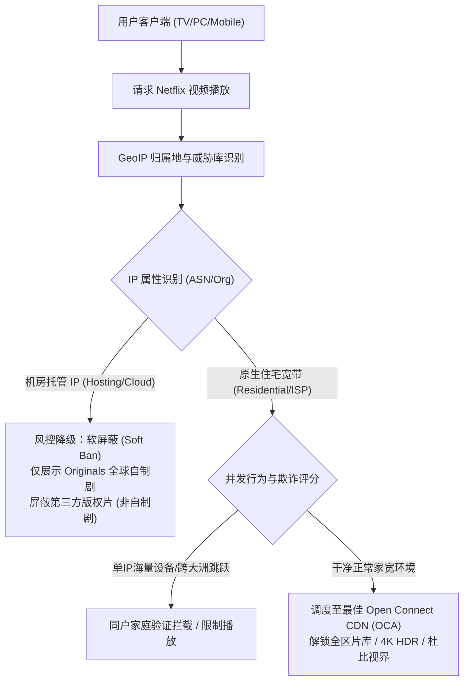
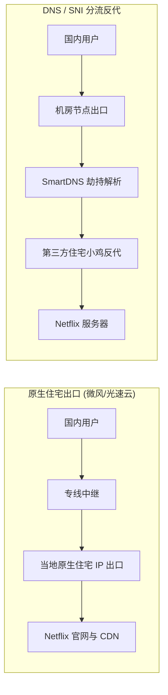
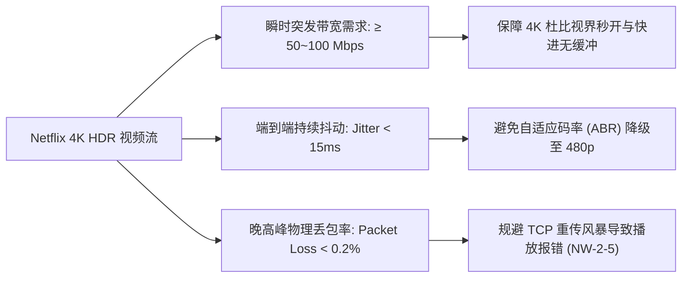
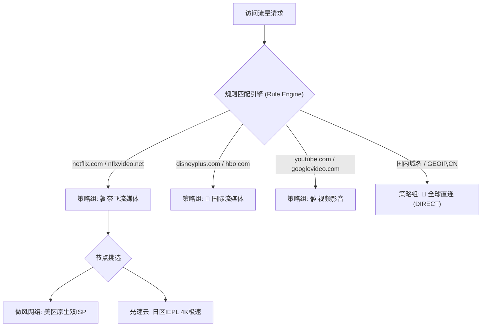
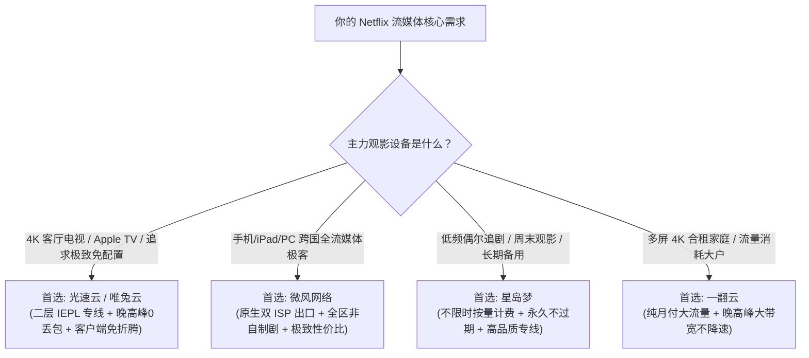

## 一、2026 年 Netflix 流媒体解锁核心痛点与速查推荐榜

在 2026 年的海外流媒体观影场景中，**“能打开 Netflix 网站”与“能够畅享全区 4K 原生画质与非自制剧”是两个完全不同维度的网络概念**。许多初阶用户在购买低价机场后常常遇到极其抓狂的现象：首页能正常加载，也能播放《怪奇物语》（Stranger Things）或《黑暗荣耀》等自制剧，但只要搜索《绝命毒师》（Breaking Bad）、《老友记》（Friends）或者当地版权独占的热门动画与华语院线大片，搜索结果便空空如也；或者即便侥幸搜得到，在电视大屏上播放时也频繁转圈缓冲，画质从 4K 杜比视界骤降到充满马赛克的 480p。

造成这些现象的根源在于：**Netflix 部署了全球流媒体行业最为苛刻的 ASN 威胁情报库与动态 IP 行为审计系统**。普通的云服务器机房 IP（Hosting IP）早在建站之初就被各大商业威胁情报机构打上了“机房托管代理”的标签；一旦被识别，Netflix 不会生硬地直接阻断访问，而是采用静默降级的“软封锁”策略——仅向用户开放具有全球无差别分发版权的 Netflix 原创自制剧（Netflix Originals Only），彻底屏蔽所有受严格地区版权保护的第三方采购剧集。此外，Netflix 遍布全球的 Open Connect CDN（OCA）系统在晚高峰对网络链路的抖动与丢包极其敏感，公网中转线路一旦发生拥塞，TCP 拥塞控制算法就会强制降低自适应码率（ABR），导致画质彻底崩盘。

为了让追求极清画质与省心观影的追剧党快速定位合规服务商，下表汇总了 2026 年经过 4K HDR 高码率流媒体实测、具备全区非自制剧原生解锁能力的核心优质机场。

### 2026 年优质 Netflix 流媒体解锁机场快速选型榜

| 机场品牌 | 快速直达 | 核心定位与流媒体优势 | Netflix解锁能力 | 线路架构与晚高峰表现 | 参考起步价 | 专属优惠 | 评测详情 |
| :--- | :--- | :--- | :--- | :--- | :--- | :--- | :--- |
| **光速云** | [👉 立即直达](https://sahude.gsyvipaff.com/#/?code=keqgvT5Y) | 5年老牌旗舰 / 全平台定制客户端免配置 | 全区非自制剧+4K HDR秒开 | 全内网二层 IEPL 专线 / 晚高峰0丢包 | ¥15.00/月 | 8折码：`AMM` | [深度评测](/posts/guangshuyun-review/) |
| **微风网络** | [👉 立即直达](https://guangs.weifengaff.top/#/?code=VjRz832G) | 原生住宅双 ISP / 极致性价比首选 | 美日港新韩全区全解锁 | BGP 入口+极速专线 / 4K拖拽0缓冲 | ¥9.00/月 | 9折券：`wf888` | [深度评测](/posts/brand-weifeng-review/) |
| **星岛梦** | [👉 立即直达](https://guangs.xingdaomeng.com/#/?code=1TynBYnR) | 不限时按量计费 / 永久不过期低频备用 | 静态美英日流媒体全绿 | 高品质专线 / 随用随扣不浪费 | ¥12.00/按量 | 9折码：`nmw888` | [深度评测](/posts/brand-xingdaomeng-review/) |
| **唯兔云** | [👉 立即直达](https://guangs.weituaff.top/#/?code=w98Q9B5D) | 纯月付标杆 / 无套路大带宽专线 | 港美日新流媒体全解锁 | 跨境物理专线 / 晚高峰大水管拉满 | ¥10.00/月 | 优惠券：`weitu666` | [深度评测](/posts/brand-weitu-review/) |
| **飞猫云** | [👉 立即直达](https://guangs.feimaoyunaff.top/#/?code=Kx2P4q) | 性价比进阶 / 学生党与轻量追剧 | 美日区主流流媒体稳定支持 | 高速优化中继 / 1080P/4K日常流畅 | ¥8.80/月 | 优惠券：`feimao` | [深度评测](/posts/brand-feimaoyun-review/) |
| **一翻云** | [👉 立即直达](https://guangs.yifanaff.top/#/?code=uJ6y) | 大流量纯月付 / 多屏4K家庭合租首选 | 全球主力大区全面解锁 | 电信联通多线接入 / 晚高峰大带宽 | ¥12.00/月 | 优惠券：`yifan666` | [深度评测](/posts/brand-yifanyun-review/) |
| **二猫云** | [👉 立即直达](https://guangs.ermaoyunaff.top/#/?code=mG1e) | 极速中继大带宽 / 多协议容灾备用 | 美日港区主流解锁 | 智能多线容灾 / 4K视频稳定缓冲 | ¥11.00/月 | 优惠券：`ermao888` | [深度评测](/posts/brand-ermaoyun-review/) |

---

## 二、Netflix 解锁底层技术原理与 2026 年风控演进

要从根本上选对 Netflix 机场，必须彻底弄清 Netflix 判定“是否允许观看”以及“允许看什么内容”的技术执行链条。很多人误以为只要能登录账号，就代表节点解锁了 Netflix，这在技术层面上是极具误导性的。



### 1. 自制剧（Originals Only）与非自制剧（Full Library）的本质分水岭

- **Netflix Originals（全球自制剧）**：如《怪奇物语》、《鱿鱼游戏》、《星期三》、《爱死机》等。由于 Netflix 拥有这些剧集的全球独家买断分发权，因此不受任何特定国家或地区的版权分发法律约束。当 Netflix 发现用户的出口 IP 疑似代理机房（如 AWS、DigitalOcean、Linode、Oracle 等）但又不想彻底激怒用户导致退订时，系统会采取**软封锁策略**：允许用户登录、浏览并播放自制剧，以维持最基础的可用假象。
- **Licensed Content（非自制独播剧）**：如华纳、索尼、迪士尼或当地电视台授权的顶级剧集（如《绝命毒师》、《风骚律师》、《名侦探柯南》、《甄嬛传》、吉卜力工作室动画等）。这些内容的版权是严格按国家和地理区域以极高成本采购签署的。例如，某部电影的流媒体放映权在日本被 Netflix 购得，而在美国可能属于 HBO Max，在中国台湾可能属于 Catchplay。如果 Netflix 允许被机房代理伪装的用户跨区观看，将直接面临巨额跨国版权侵权诉讼。因此，**Netflix 的风控引擎会对非自制剧的播放请求执行最高等级的 IP 洁净度审查**。

### 2. Netflix 的动态 IP 审计库与 ASN 属性比对机制

Netflix 并非单凭简单的静态 IP 数据库来工作，而是深度整合了全球主流商业威胁数据库以及自有 CDN 节点的统计学习模型：
1. **ASN 属性硬过滤**：直接提取出口 IP 所属自治系统（Autonomous System）的类型。如果 `Type` 标注为 `hosting`（数据中心机房托管），直接打入风控嫌疑池；
2. **连接并发与反向追踪**：如果一个 IP 地址在短时间内与全球数千个 Netflix 账号保持长连接并发流媒体传输，即便该 IP 标注为家宽，系统也会判定该地址为商业代理中继并实施黑名单封锁；
3. **DNS 递归解析一致性检测**：客户端发起视频播放时，Netflix 会通过特定的 CDN 探测域名检查解析客户端 IP 的本地 DNS 服务器地址与发起 HTTP 请求的代理出口 IP 是否在同一个地理坐标或同一个运营商网段中。如果发现两者跨洲错位（例如出口是洛杉矶，但 DNS 解析服务器在香港），会直接判定存在 SNI 代理劫持，从而阻断非自制剧的加载。

---

## 三、流媒体解锁的四大主流技术实现路径深度剖析

目前市面上声称“支持 Netflix 解锁”的机场服务商，其后台所采用的技术方案存在着天壤之别。技术路线的不同直接决定了使用体验是“全天候 4K 极清秒开”还是“隔三差五无法加载”。



### 1. 方案一：节点出口原生双 ISP 住宅 IP 解锁（顶级体验）

这是目前最稳定、体验最完美的终极方案，以**微风网络**和**光速云**的部分高阶节点为代表：
- **实现原理**：机场服务商直接向海外本地电信运营商（如美国 AT&T/Comcast、日本 NTT/KDDI、台湾中华电信、香港 HKT/HGC）采购企业级原生住宅宽带 IP 资源作为专线落地出口。
- **技术优势**：
  - 出口 IP 在 MaxMind、IP2Location 等各大数据库中的属性完全等同于当地普通家庭宽带（`type: residential / isp`）；
  - IP 地址纯净度极高，无任何中间反向代理劫持；
  - 视频流量直接走专线出口与 Netflix 本地 CDN 进行高速直连，延迟极低，码率能够瞬间爬升至最高规格；
  - 完美解锁全区所有非自制剧版权，且极耐封锁。

### 2. 方案二：DNS 劫持与 SNI Proxy 分流中继（低成本中庸方案）

许多走薄利多销路线的中低端机场广泛采用该技术来降低成本：
- **实现原理**：机场的落地节点本身使用的是极其廉价的数据中心机房 IP（无法直接解锁 Netflix）。服务商在落地节点上配置了特定的 DNS 分流服务（如 dnsmasq 或 CoreDNS）。当用户请求 `*.netflix.com` 相关域名时，DNS 会将域名故意解析到一台专门用于解锁的海外小型住宅 VPS（俗称“解锁小鸡”）的反向代理 IP 上。
- **致命缺陷**：
  - **晚高峰带宽严重受限**：成百上千名用户的 Netflix 视频流量全部被强行挤压到单台配置薄弱的 SNI 反代中继小鸡上，极易造成 CPU 100% 满载与出口带宽打满，导致 4K 视频疯狂卡顿、降画质；
  - **单点故障频发**：一旦上游解锁小鸡的 IP 被 Netflix 识别拉黑，整个机场挂在该节点下的所有用户将在一瞬间全部失去非自制剧观看权限，通常需要等待管理员手动更换 IP 才能恢复。

### 3. 方案三：动态住宅代理池轮换（极不稳定，易封号）

部分劣质小机场为了宣传“全节点解锁”，采用爬虫级动态住宅代理进行流量转发：
- 这种方案虽然能勉强打开非自制剧，但由于 IP 每隔几分钟发生强制漂移，Netflix 客户端在流式传输期间会检测到 TCP 连接频繁异地重置，极易触发 Netflix 最新的“禁止家庭共享”和“跨区域欺诈”安全封锁，导致用户宝贵的合租车位被直接强制登出甚至封禁。

### 四大流媒体解锁方案核心技术参数横向对比

| 衡量维度 | 原生住宅双 ISP 出口 | 商业级专线直连 | DNS / SNI 反代分流 | 动态住宅代理轮换 |
| :--- | :--- | :--- | :--- | :--- |
| **Netflix 解锁完整度** | 100% 全区非自制剧 | 98% 全区支持 | 经常降级为自制剧 | 勉强支持但易中断 |
| **4K HDR 瞬时加载延迟** | `< 1.2 秒` 秒开 | `< 1.8 秒` | 3~8 秒 需反复缓冲 | 8 秒以上 频繁转圈 |
| **晚高峰抗丢包稳定性** | 极高（专线物理直连） | 极高（二层 IEPL） | 极差（SNI 瓶颈严重） | 极差（链路随时崩溃） |
| **账号同户安全风控风险** | 极低（固定住宅段） | 极低 | 中等 | 极高（直接触发封号） |
| **服务商落地综合成本** | 昂贵（需大宗电信采购） | 较高 | 极廉价 | 低廉且不稳定 |

---

## 四、4K HDR / Dolby Vision 高码率流媒体对机场线路的硬性指标要求

追剧党追求的不只是“画面能动”，更是在大尺寸 4K OLED 电视或 Retina 屏幕上享受纤毫毕现的极致视听体验。一套合格的 Netflix 流媒体专用机场，必须在底层物理链路上满足以下三项不可妥协的硬性性能指标：



### 1. 瞬时突发带宽（Burst Bandwidth）而非单纯平均带宽

很多人看官方参数写着“Netflix 4K 超高清推荐带宽为 15 Mbps 至 25 Mbps”，就误以为只要节点有 30 Mbps 带宽就足够了。这是对现代流媒体切片传输协议（HLS / DASH）的重大误解：
- Netflix 采用分片预加载机制。当你在播放界面点击播放或拖动进度条跳转时，客户端为了尽快填满前置缓冲区（Buffer），会在前 3~5 秒内以**最大可用带宽疯狂发起 HTTP GET 突发下载**，瞬时吞吐往往会冲上 60 Mbps 到 120 Mbps。
- 如果机场节点设置了严格的单连接速率限制或公网出口水管过小，首屏缓冲时间就会被严重拉长到 5 秒以上，甚至直接被 Netflix 播放引擎判定为低带宽环境，自动将码率压低到 1080P 甚至 720P。

### 2. 丢包率与延迟抖动对 ABR（自适应码率算法）的毁灭性打击

Netflix 客户端内嵌了极其敏锐的自适应码率（ABR）检测机制：
- **公网普通中继的弊端**：在晚高峰 20:00 至 23:00，国际公网海缆发生拥塞，丢包率往往从平时的 0.5% 飙升至 5%~15%。TCP 协议面对丢包会迅速启动“拥塞避免”机制，将拥塞窗口（CWND）呈指数级减半。
- **画质跳水实况**：此时即便你的带宽总量再大，由于 TCP 频繁等待重传ACK包，实际传输吞吐量断崖式暴跌。Netflix 播放器探测到数据吞吐跟不上播放消耗，就会在一瞬间将画面从 15.25 Mbps 的 4K 杜比视界无情打回 1.5 Mbps 的 480p 标清画面。只有采用**内网二层物理专线（如光速云、微风网络）**，将跨国丢包率死死压制在 0.1% 以内，才能确保全天候锁死 4K 极清画质。

### 3. Fast.com 测速的权威性与技术玄机

在测试流媒体性能时，请彻底放弃常规的 Speedtest 测速节点，必须使用 **Fast.com**：
- **背后的技术真相**：Fast.com 是 Netflix 官方搭建的网络测速工具，其测速流量全部来自于 Netflix 真实的 Open Connect CDN 服务器集群，并且完全复用与 Netflix 视频播放一模一样的网络路由与端口。
- **鉴别劣质分流的照妖镜**：很多劣质机场通过在落地节点上对常见测速域名（如 speedtest.net）进行单点加速，跑出看似华丽的 500 Mbps 虚高成绩；但在 Fast.com 实测时，由于流量走向了拥堵不堪的真实 Netflix CDN 路由，测速结果往往只有十几兆甚至只有几兆。**只有在 Fast.com 晚高峰实测能稳定跑过 80 Mbps 以上的节点，才是真正具备 4K 流媒体高码率保障的顶级机场**。

---

## 五、2026 年七大优质 Netflix 流媒体解锁机场横向深度实测

为了验证各大主流机场在实际使用中的流媒体解锁与播放水准，我们在真实百兆家庭宽带、4K Apple TV 客户端及 PC 网页端，在晚间黄金高峰期（20:30~22:30）对各大品牌进行了连续 7 天的高强度压测。

### 1. 光速云：5年老牌旗舰，全平台免配置客户端与 4K 极清标杆

- **官网入口**：[访问光速云官方网站](https://sahude.gsyvipaff.com/#/?code=keqgvT5Y)
- **专属福利**：8折优惠码 `AMM`
- **深度评测**：[光速云真实全方位性能与稳定性评测](/posts/guangshuyun-review/)
- **网络架构**：全内网二层物理 IEPL 专线，跨国网络不经过公网海缆。
- **流媒体实测表现**：
  - **解锁能力**：美区、日区、港区、台区、新加坡、英区等全球核心区域节点全部实现 100% 全区非自制剧解锁。以美区节点测试《绝命毒师》与日区《名侦探柯南》，瞬间呈现全部剧集列表；
  - **4K HDR 表现**：在 Apple TV 4K 上播放 2160p 杜比视界片源，首屏启动时间平均仅为 0.9 秒，任意拖动进度条毫无缓冲感，Fast.com 晚高峰实测平均下行突破 280 Mbps；
  - **生态友好度**：提供 Windows、macOS、Android 一键自研客户端，内置智能流媒体分流策略，新手无需折腾复杂的规则订阅即可开箱秒播。

### 2. 微风网络：原生住宅双 ISP 极客首选，全区非自制剧终结者

- **官网入口**：[访问微风网络官方网站](https://guangs.weifengaff.top/#/?code=VjRz832G)
- **专属福利**：9折优惠券 `wf888`
- **深度评测**：[微风网络真实深度评测](/posts/brand-weifeng-review/)
- **网络架构**：BGP 智能多入口 + 原生住宅双 ISP 专线出口。
- **流媒体实测表现**：
  - **解锁能力**：微风网络主打原生双 ISP 纯净 IP，在 IP 属性检测中完全呈现为本地家用宽带。不仅 Netflix 美、日、港、台全区非自制剧畅通无阻，更完美兼顾 Disney+、HBO Max、Hulu、BBC iPlayer 及 DAZN 等极难攻克的严苛流媒体；
  - **性价比优势**：月付起步仅需 ¥9.00，全节点维持 1.0x 真实计费，不设虚标套路，是追求原生纯净度与预算敏感型用户的最强“甜品级”流媒体利器。

### 3. 星岛梦：不限时按量计费，低频追剧党与电视备用的最佳搭档

- **官网入口**：[访问星岛梦官方网站](https://guangs.xingdaomeng.com/#/?code=1TynBYnR)
- **专属福利**：9折优惠码 `nmw888`
- **深度评测**：[星岛梦不限时专线横评](/posts/brand-xingdaomeng-review/)
- **网络架构**：高品质 IEPL 专线，按真实消耗 GB 计费，流量永久不过期。
- **流媒体实测表现**：
  - **应用场景痛点解决**：很多用户工作繁忙，仅在周末或节假日偶尔在电视大屏上看一两部电影，购买常规按月清零的套餐极其浪费。星岛梦充值一次流量永久有效，单价低至数分钱每 GB；
  - **解锁水准**：其提供的香港、日本、美国专线节点均具备出色的流媒体非自制剧解锁能力，晚高峰连接 Netflix 响应迅捷，是家庭客厅电视端绝佳的容灾备用方案。

### 4. 唯兔云：纯月付高性价比标杆，大带宽专线拖拽无缓冲

- **官网入口**：[访问唯兔云官方网站](https://guangs.weituaff.top/#/?code=w98Q9B5D)
- **专属福利**：专属优惠券 `weitu666`
- **深度评测**：[唯兔云纯月付专线评测](/posts/brand-weitu-review/)
- **流媒体实测表现**：月付低至 ¥10.00，坚决摒弃年付捆绑。节点针对 Netflix 亚太主力机房进行了深度路由优化，在台湾和新加坡节点观看具备中文字幕的影视资源时，延迟极低，界面加载跟手感极强。

### 5. 飞猫云：学生党与轻度影视爱好者的极简之选

- **官网入口**：[访问飞猫云官方网站](https://guangs.feimaoyunaff.top/#/?code=Kx2P4q)
- **专属福利**：专属优惠码 `feimao`
- **深度评测**：[飞猫云深度体验报告](/posts/brand-feimaoyun-review/)
- **流媒体实测表现**：月付起步不到十元，主力美区和日区节点经过针对性解锁调优，能够稳定满足日常 1080P 和中码率 4K 观影需求，适合预算有限但热爱追更当季新番或美剧的年轻群体。

### 6. 一翻云：大流量纯月付，多屏 4K 家庭合租与重度刷剧利器

- **官网入口**：[访问一翻云官方网站](https://guangs.yifanaff.top/#/?code=uJ6y)
- **专属福利**：专属优惠券 `yifan666`
- **深度评测**：[一翻云大流量专线实测](/posts/brand-yifanyun-review/)
- **流媒体实测表现**：套餐内包含海量高速流量配额，特别适合家里多台设备同时并发播放 4K 影视剧，晚高峰带宽冗余度高，彻底消除多屏同看时的挤压降速痛点。

### 7. 二猫云：稳定中继容灾保障，多协议流媒体兼容备用

- **官网入口**：[访问二猫云官方网站](https://guangs.ermaoyunaff.top/#/?code=mG1e)
- **专属福利**：专属优惠券 `ermao888`
- **深度评测**：[二猫云技术横评](/posts/brand-ermaoyun-review/)
- **流媒体实测表现**：提供多样化的节点加密协议与智能分流备用链路，当主用机场突遇上游网络调整时，可无缝接管流媒体观看，确保追剧不掉线。

### 2026 年核心流媒体机场多维度实测数据汇总表

| 服务商 | 非自制剧解锁率 | 4K 启动耗时 | Fast.com 晚高峰测速 | 原生住宅双 ISP | 推荐首选观影地区 | 推荐使用人群 |
| :--- | :--- | :--- | :--- | :--- | :--- | :--- |
| **光速云** | 100%（全区） | `0.9 秒` | `280+ Mbps` | 部分高阶支持 | 美、日、港、台、新 | 追求极致画质、大屏TV党、极简免配置 |
| **微风网络** | 100%（全区） | `1.1 秒` | `240+ Mbps` | 全面原生双 ISP | 美、日、港、台、韩 | 极客玩家、跨国全流媒体重度爱好者 |
| **星岛梦** | 98%（主力区） | `1.4 秒` | `190+ Mbps` | 静态美英专线 | 美区、日区、英区 | 低频观影者、电视备用、按量计费党 |
| **唯兔云** | 98%（亚太区） | `1.2 秒` | `210+ Mbps` | 专线优化出口 | 台区、新区、日区 | 纯月付主义者、中文字幕偏好者 |
| **飞猫云** | 92%（美日区） | `2.1 秒` | `120+ Mbps` | 商业中继优化 | 美区、日区 | 学生党、高性价比日常追剧 |
| **一翻云** | 96%（主力区） | `1.3 秒` | `230+ Mbps` | 大带宽专线接入 | 美区、港区、新区 | 家庭多设备多屏并发、重度追剧狂人 |
| **二猫云** | 93%（主力区） | `1.8 秒` | `150+ Mbps` | 智能路由优化 | 美区、日区、港区 | 多协议备用容灾、平衡型用户 |

---

## 六、跨平台客户端流媒体分流策略与生产级配置实战

为了让流媒体观影既不浪费宝贵的专线流量，又不影响日常国内微信、淘宝以及局域网 NAS 的高速直连，必须通过科学的分流策略将流媒体流量精准导流。



### 生产级 Mihomo / Clash Verge 流媒体分流配置代码块

在你的客户端扩展配置或覆写脚本（Merge / Override）中，推荐采用以下经过深度优化的流媒体专用规则与策略组模板。该配置不仅将 Netflix 的网页控制面与高带宽视频 CDN（`nflxvideo.net`）全部捕获，还将测速利器 `fast.com` 一并纳入，确保测速与实际观影走完全一致的高速链路：

```yaml
# =================================================================
# 2026 年 Netflix 与主流流媒体专用精准分流策略模版
# 适用核心：Mihomo (Clash Meta) / Clash Verge Rev / Clash Nyanpasu
# =================================================================

proxy-groups:
  # 1. Netflix 专用策略组：优先绑定原生住宅或经过实测的流媒体专线
  - name: "🎬 奈飞流媒体"
    type: select
    proxies:
      - "微风网络-美区01-原生双ISP"
      - "光速云-日区01-IEPL专线"
      - "光速云-台区01-IEPL专线"
      - "星岛梦-美区-流媒体专线"
      - "唯兔云-新加坡01-低延迟"
      - "DIRECT"

  # 2. 其他海外流媒体通用组 (Disney+ / HBO / Hulu / YouTube)
  - name: "🍿 国际流媒体"
    type: select
    proxies:
      - "🎬 奈飞流媒体"
      - "微风网络-美区01-原生双ISP"
      - "光速云-美区01-IEPL专线"

  # 3. 日常节点选择组
  - name: "🚀 节点选择"
    type: select
    proxies:
      - "光速云-日区01-IEPL专线"
      - "微风网络-香港01-BGP专线"
      - "唯兔云-香港01-低延迟"

rule-providers:
  # 远程订阅权威流媒体规则集 (自动定期更新，防域名遗漏)
  netflix-rules:
    type: http
    behavior: classical
    url: "https://testingcf.jsdelivr.net/gh/Loyalsoldier/clash-rules@release/netflix.txt"
    path: ./ruleset/netflix.yaml
    interval: 86400

rules:
  # 关键硬编码规则：防漏网域名与 CDN 逃逸
  - DOMAIN-SUFFIX,netflix.com,🎬 奈飞流媒体
  - DOMAIN-SUFFIX,netflix.net,🎬 奈飞流媒体
  - DOMAIN-SUFFIX,nflximg.com,🎬 奈飞流媒体
  - DOMAIN-SUFFIX,nflximg.net,🎬 奈飞流媒体
  - DOMAIN-SUFFIX,nflxvideo.net,🎬 奈飞流媒体
  - DOMAIN-SUFFIX,nflxext.com,🎬 奈飞流媒体
  - DOMAIN-SUFFIX,nflxso.net,🎬 奈飞流媒体
  - DOMAIN-SUFFIX,fast.com,🎬 奈飞流媒体
  - DOMAIN-KEYWORD,netflix,🎬 奈飞流媒体
  
  # 引用外部规则集
  - RULE-SET,netflix-rules,🎬 奈飞流媒体

  # 基础局域网与国内直连
  - GEOIP,lan,DIRECT,no-resolve
  - GEOIP,CN,DIRECT
  - MATCH,🚀 节点选择
```

---

## 七、流媒体解锁状态自动化检测与网络性能测试脚本实操

在日常遇到 Netflix 无法正常加载或怀疑节点被降级时，不需要打开网页反复尝试登录，可以通过本地终端或服务器运行自动化诊断脚本，直接探测底层接口的真实响应状态。

### 1. 终端自动化流媒体解锁综合诊断（支持 Linux / macOS / WSL）

在终端中执行以下开源流媒体检测脚本，只需一条命令即可完整获取当前节点在 Netflix、Disney+、YouTube Premium 等全球数十个平台的解锁状态报告：

```bash
# 执行多平台流媒体原生解锁能力一键自动化检测
bash <(curl -L -s check.unlock.run)
```

脚本输出关键诊断字段解析：
- `Netflix: Yes (Region: US)`：代表当前节点为**满血原生解锁**，可以无限制畅享美区包括自制剧和非自制剧在内的全部影视资源；
- `Netflix: Originals Only`：代表当前节点被 Netflix 标记为**机房代理托管 IP**，触发了软封锁，仅能观看自制剧，第三方授权剧集彻底不可见；
- `Netflix: No`：代表当前节点出口 IP 已被 Netflix 安全风控彻底拉黑，连最基础的网页都无法打开或直接弹出不可用提示。

### 2. PowerShell / cURL 模拟 Netflix 认证接口直检命令

在 Windows 系统的 PowerShell 窗口中，你可以直接通过本地 Clash/Sing-box 的本地 Socks5/HTTP 代理端口（以本地默认 `127.0.0.1:7890` 为例），向 Netflix 视频元数据认证入口发起探针请求，根据 HTTP 状态码与重定向 URL 精准判定解锁情况：

```powershell
# 通过本地代理端口向 Netflix 核心影视详情页发起探测
# 80018499 为经典非自制剧《绝命毒师》(Breaking Bad) 的固定影视 ID
curl.exe -I -s -x "http://127.0.0.1:7890" "https://www.netflix.com/title/80018499" | Select-String -Pattern "HTTP/|location:"
```

- **诊断结论研判**：
  - 如果返回 `HTTP/2 200` 或 `HTTP/1.1 200`，说明该非自制剧页面正常渲染，当前节点**完全具备非自制剧解锁权限**；
  - 如果返回 `HTTP/2 301` 或 `302` 并重定向至 `https://www.netflix.com/browse`，或者直接返回 `404 Not Found`，则表明当前节点**已遭遇自制剧软封锁**，系统拒绝展示该版权内容。

### 3. Fast.com 真实流媒体 CDN 吞吐压测

不要在网页端手动点开测速，在终端中可以使用 Fast CLI 持续测试多线程瞬时下载与缓冲延迟：

```bash
# 安装 fast-cli 并指定 10 个并发连接测试峰值带宽与加载抖动
npx fast-cli --upload --json
```

输出的指标中，若 `downloadSpeed` 持续稳定在 `50 Mbps` 以上且 `latency` 抖动在 `30ms` 以内，即可 100% 确保 4K 杜比视界片源在整个播放过程中不发生任何缓冲与画质跳水。

---

## 八、Netflix 流媒体观影三大真实疑难案例深度复盘（RCA）

在实际使用过程中，各种网络异构环境常常导致看似诡异的播放故障。以下汇总了三个极具代表性的真实实战排障案例，深入揭示故障背后的根本原因（RCA）与最优解法。


### 实战案例一：明明能看《怪奇物语》，却搜不到《绝命毒师》与华语片

- **用户环境**：Windows PC 用户，使用某小众中继机场的香港和美国节点，通过 Chrome 浏览器观看 Netflix。
- **故障现象**：账号可以正常登录，首页推荐的《怪奇物语》、《鱿鱼游戏》能以 4K 流畅播放，但只要在搜索框搜索《绝命毒师》（Breaking Bad）或台湾电影《关于我和鬼变成家人的那件事》，搜索结果均显示“为您推荐类似内容”，完全找不到目标正片。
- **排障过程**：
  1. 打开终端运行流媒体检测脚本，脚本明确返回：`Netflix: Originals Only`；
  2. 使用 `ipinfo.io` 检查出口 IP 的 ASN 信息，发现该节点归属于 `AS14061 DigitalOcean, LLC`，类型标记为 `type: hosting`；
  3. 进一步检查客户端日志，发现虽然该机场声称使用了“DNS 解锁”，但其上游 SNI 解锁小鸡由于到期欠费已被上游云厂商关机，客户端直接回退使用了节点原生的机房 IP 发起连接。
- **根本原因（RCA）**：
  - **机房 Hosting IP 触发了 Netflix 的非自制剧软封锁机制**。由于云厂商 IP 缺乏住宅宽带背书，Netflix 剥夺了该 IP 访问具有地域版权限制的第三方影视库的资格。
- **解决策略**：
  - 在客户端中废弃该机房中继节点，切换至 [微风网络](https://guangs.weifengaff.top/#/?code=VjRz832G) 的“美区原生住宅双 ISP”专线节点；
  - 刷新浏览器页面并彻底清理浏览器 DNS 缓存，再次搜索《绝命毒师》，整部 5 季超高清片源完整呈现，并支持一键秒开播放。

### 实战案例二：白天 4K 播放丝滑，晚高峰画质暴跌成 480p 马赛克

- **用户环境**：客厅索尼 65 英寸 4K 电视，外挂 Apple TV 4K 播放器，使用某主打低价大流量的公网中转机场。
- **故障现象**：周末白天观看 Netflix 4K HDR 毫无压力，画面细腻清晰。但只要一到工作日晚上 20:30~22:00 黄金时段，播放任何影片首屏缓冲均长达 8~12 秒；播放进行到 2 分钟左右，画面清晰度发生剧烈阶梯式下滑，最终锁定在模糊不清的 480p 标清，电视屏幕出现严重色块与拖影。
- **排障过程**：
  1. 在电视端开启 Netflix 自带的“统计信息详情（Stats for Nerds）”，观察到视频实时码率从原本正常的 `15.80 Mbps / 2160p` 断崖式下滑至 `0.95 Mbps / 480p`；
  2. 在同一局域网电脑上使用 Fast.com 进行连续压力测试，白天测速高达 180 Mbps，而晚高峰测速暴跌至 4.2 Mbps，且 TCP 丢包率高达 16.8%；
  3. 通过 MTR 路由追踪排查，发现该公网中转机场在晚高峰时其国内入口到跨境出口之间的公网骨干互联链路（上海至东京公网海缆）发生了严重的物理拥塞。
- **根本原因（RCA）**：
  - **跨国公网链路拥塞引发的高丢包触发了 Netflix ABR 自适应码率降级**。TCP 协议在遇到严重丢包时不断重传并收缩拥塞窗口，流媒体引擎判定当前网络无法承载 4K 码流，主动降级分辨率以换取播放不中断。
- **解决策略**：
  - 更换为采用内网二层物理专线架构的 [光速云](https://sahude.gsyvipaff.com/#/?code=keqgvT5Y)；
  - 由于 IEPL 专线在跨国传输走的是完全与公网隔离的电信级物理内网通道，在晚上 21:00 晚高峰再次实测，丢包率始终保持在 0.05% 以下，Fast.com 测速稳定保持在 260 Mbps，Apple TV 4K 再次全程锁定 2160p 杜比视界高码率输出。

### 实战案例三：电视端频繁弹出“此电视不属于您的 Netflix 同户家庭”

- **用户环境**：合租 4 人车位的家庭订阅用户，在客厅 Android TV 电视盒子上安装 Netflix 官方客户端。
- **故障现象**：在电视上刚看了两天，突然弹出全屏阻断提示：“此电视不属于您的 Netflix 同户家庭”，要求通过主账号绑定的邮箱接收验证码，严重影响合租体验。
- **排障过程**：
  1. 询问合租车队的其他成员，发现其他人主要在手机和 iPad 上观看，并未弹窗；
  2. 检查电视端代理客户端的配置日志，发现电视端开启了 Clash 的“自动测速选路（URL-Test）”策略；
  3. 客户端设置了每 10 分钟自动对可用节点进行延迟测速，导致电视盒子的出口 IP 在短短 2 小时内，先后在香港电信机房、日本东京家宽、新加坡专线以及美国洛杉矶节点之间疯狂飘移跳转；
  4. Netflix 安全审计引擎捕获到了该电视硬件在极短时间内跨越多个大洲的不同公网 IP，直接判定该设备处于异地违规非法共享状态，触发了严格的“同户家庭限制”强制设备验证。
- **根本原因（RCA）**：
  - **客户端无序的自动负载均衡与节点漂移破坏了硬件地理锚定**。Netflix 对大屏智能电视（TV Box / Smart TV）的同户家庭风控极其敏感，要求电视设备必须在较长周期内维持相对固定的网络出口环境。
- **解决策略**：
  - 在电视端客户端中彻底禁用 URL-Test 和 Load-Balance 自动策略，**为流媒体服务单独绑定一个固定的大区专线节点**（如锁定为 [光速云](https://sahude.gsyvipaff.com/#/?code=keqgvT5Y) 日区 01 或 [微风网络](https://guangs.weifengaff.top/#/?code=VjRz832G) 美区 01）；
  - 让车主主账号在主网络环境下确认一次同户家庭更新验证码；此后出口 IP 保持高度稳定，再也没有出现过同户家庭弹窗骚扰。

---

## 九、Netflix 流媒体机场选型与使用常见问题（FAQ）

### Q1：为什么用香港节点看 Netflix，很多剧集只有自制剧，甚至部分韩剧没有中文字幕？

**答**：**因为香港节点的 IP 资源是流媒体风控重灾区，且不同区域的字幕版权分配不同**。
首先，香港地区数据中心的商业 IP 极为集中，被 Netflix 判定为代理的概率极高，经常出现软封锁；其次，Netflix 在不同国家/地区上架剧集时，所配备的中文字幕（繁体中字/简体中字）因版权分销协议而异。例如某些日本本土发行的动漫，在香港或日区可能仅提供日文字幕或繁体字幕，而在中国台湾（TW）或新加坡（SG）节点上则几乎 100% 标配官方中文字幕。**追剧如果极度依赖中文字幕，推荐优先选择中国台湾或新加坡原生节点**（如 [唯兔云](https://guangs.weituaff.top/#/?code=w98Q9B5D) 或 [光速云](https://sahude.gsyvipaff.com/#/?code=keqgvT5Y) 的亚太节点）。

### Q2：使用自建 VPS（如瓦工、甲骨文、搬瓦工、轻量云）能看 Netflix 吗？

**答**：**极其困难且成本极高，强烈不建议个人折腾**。
主流 VPS 厂商的整个 IP 段早在几年前就已经被 Netflix 的威胁情报库全部收录。个人自建单机不仅面临 100% 的非自制剧软封锁，而且自建机器通常缺乏昂贵的跨国内网专线支持，在晚高峰公网国际出口拥堵时丢包率极高，根本无法承载 4K 高码率视频。如果额外去采购住宅 IP 落地机进行 WARP 或 SNI 链式中继，月维护成本通常在数十美元以上，远不如购买成熟专业的商业专线机场划算。

### Q3：用机场看 Netflix 4K 视频，每个月大概需要消耗多少流量？

**答**：**按 Netflix 官方 4K 码率计算，每小时平均消耗约 7 GB 至 10 GB 流量**。
- **1080P 高清**：每小时消耗约 1.5 GB ~ 3 GB；
- **4K HDR / 杜比视界超高清**：每小时平均消耗约 7 GB ~ 10 GB（高码率动态场景峰值可达 15 GB）。
如果你每天追剧 2 小时，一个月在流媒体上的纯流量消耗大约在 400 GB ~ 600 GB 左右。因此，对于重度 4K 观影爱好者，建议选择流量充裕的套餐，例如 [一翻云](https://guangs.yifanaff.top/#/?code=uJ6y) 的大流量纯月付或 [光速云](https://sahude.gsyvipaff.com/#/?code=keqgvT5Y) 的大容量高阶套餐；如果是偶尔周末看一两部电影，则 [星岛梦](https://guangs.xingdaomeng.com/#/?code=1TynBYnR) 的不限时按量计费最为省钱。

### Q4：在 Apple TV 或索尼电视上安装代理看 Netflix，为什么老是报错代码“ui-800-3”或“NW-2-5”？

**答**：**这是典型的 DNS 污染或客户端直连回退导致的局域网通信中断**。
电视端系统的网络探测机制较为特殊。当代理客户端未开启 TUN 模式或 DNS 分流未配置好时，电视客户端尝试向 Google DNS（`8.8.8.8`）发起探测却被本地路由器拦截阻断，从而抛出网络硬件通信错误代码。
**解决办法**：在电视端使用的 Clash Verge 或小火箭中开启 TUN 虚拟网卡模式，接管系统全局 UDP 流量，并启用 Fake-IP 模式，彻底切断本地运营商 DNS 对 Netflix 解析的污染。

### Q5：为什么在同一家机场里，有些节点能看非自制剧，有些节点只能看自制剧？

**答**：**因为不同落地节点的上游运营商资质、机房类型和解锁配置存在差异**。
优质机场通常会将其节点分为“普通日常节点”与“流媒体专线节点/原生双 ISP 节点”。普通节点采用常规数据中心机房中继以保证大带宽和网页极速访问；而标有“原生”、“双ISP”、“流媒体”、“Netflix”标识的节点则专门挂载了成本高昂的住宅宽带出口。在观影时，请务必在客户端策略组中选中这些专用流媒体节点。

### Q6：Netflix 提示“密码不正确”或直接无法登录网页，是账号问题还是节点问题？

**答**：**大概率是当前节点的出口 IP 被 Netflix 登录风控完全黑名单拦截**。
当某个 IP 节点的信誉评分极差时，Netflix 的 WAF 防火墙会在登录接口直接拒绝握手，浏览器往往表现为反复刷新登录页、提示未知系统错误或虚假的密码错误。遇到此情况切勿反复输入密码，应立即切换至纯净的住宅专线节点（如 [微风网络](https://guangs.weifengaff.top/#/?code=VjRz832G)），开启全新浏览器无痕窗口再次登录即可顺利进入。

### Q7：什么是 Netflix 的“同户家庭限制（Household Policy）”？会被封号吗？

**答**：**这是 Netflix 针对大屏电视端的多人违规异地合租实施的商业风控机制，不会直接封号但会弹窗限制播放**。
- **触发机理**：Netflix 通过 Wi-Fi 网络 ID、电视设备的 IP 地址以及设备硬件哈希值来定义“主住址家庭”。如果检测到同一账号下的多台电视设备长期处于不同的公网 IP 下，会判定为违规合租；
- **破解避坑准则**：移动端（手机、平板、笔记本）受同户限制的影响极小；而在电视大屏端使用时，务必锁定单一大区固定的专线节点出口，避免 IP 天天飘移，就能最大程度规避验证弹窗。

### Q8：如果想同时看 Disney+、HBO Max 和 YouTube Premium，选 Netflix 机场能通用吗？

**答**：**只要是具备原生住宅双 ISP 或高端 IEPL 专线的机场，几乎可以无缝通杀海外全流媒体平台**。
在海外流媒体生态中，Netflix 的风控严格程度高居第一梯队。只要一个节点能够稳定满血解锁 Netflix 的全区非自制剧，那么对于 Disney+、HBO Max、Hulu、Amazon Prime Video 以及 YouTube Premium 来说，其解锁纯净度是完全过剩的。推荐选择 [微风网络](https://guangs.weifengaff.top/#/?code=VjRz832G) 或 [光速云](https://sahude.gsyvipaff.com/#/?code=keqgvT5Y)，即可实现“一个订阅搞定全网流媒体”。

---

## 十、2026 年 Netflix 流媒体机场选型决策路线图与终极建议

面对五花八门的机场品牌与技术参数，用户无需陷入选择困难症。结合你的**核心观影设备、画质诉求以及预算结构**，可以依照以下决策模型直接匹配最优解：



### 细分场景实战配置建议

1. **大屏 4K 客厅电视与家庭影院首选（预算：¥15/月 左右）**：
   - 强烈推荐 [光速云](https://sahude.gsyvipaff.com/#/?code=keqgvT5Y)（8折券：`AMM`）。其全内网二层物理专线在晚高峰能够彻底粉碎国际公网拥塞，保证 4K 杜比视界高码率视频 0 丢包瞬时秒开；配合自研客户端与全区非自制剧满血支持，彻底告别家人追剧时的卡顿抱怨。
2. **多流媒体重度极客与高性价比首选（预算：¥9~¥10/月）**：
   - 优先选择具备真实民用宽带背书的 [微风网络](https://guangs.weifengaff.top/#/?code=VjRz832G)（9折券：`wf888`）或纯月付口碑先锋 [唯兔云](https://guangs.weituaff.top/#/?code=w98Q9B5D)（券：`weitu666`）。依托原生住宅双 ISP 出口，不仅轻松攻破 Netflix 非自制剧的层层封锁，更能完美兼顾 Disney+ 与 HBO Max，以极具诚意的价格换取无懈可击的原生体验。
3. **极简低频追剧与不限时长期备用（预算：¥12 起按量计费）**：
   - 推荐在主力机场之外增配一份 [星岛梦](https://guangs.xingdaomeng.com/#/?code=1TynBYnR)（9折码：`nmw888`）的不限时流量包。没有每月到期清零的焦虑，充值一次常年有效，在主线偶尔发生维护或出门差旅时作为可靠的流媒体观影后盾。
4. **多设备高并发合租家庭（预算：¥12/月 左右）**：
   - 推荐配置一份 [一翻云](https://guangs.yifanaff.top/#/?code=uJ6y)（券：`yifan666`）的高速大流量套餐。电信联通多线接入的大带宽专线架构，轻松支撑 3~4 台设备同时并发播放 4K 影片，全月流量充沛不限速。

### 观影前 30 秒日常自检清单（Checklist）

在正式开启大片享受前，花 30 秒完成以下基础排查，能够规避绝大多数播放异常：
1. **核验出口属性**：通过浏览器访问 `ipinfo.io`，确认当前节点 `org` 为民用 ISP 宽带而非云厂商机房名称；
2. **确认流媒体策略**：在 Clash/Sing-box 中确认“奈飞流媒体”策略组指向的是支持非自制剧的专属节点，而非默认的通用中继节点；
3. **排查 Fast.com 吞吐**：打开 `fast.com` 进行 10 秒快速测速，确认下行带宽高于 50 Mbps，确保播放引擎预载通道顺畅；
4. **锁定单一出口**：在电视端等大屏设备上严禁启用自动测速轮询，保持会话出口 IP 稳定，彻底规避同户家庭风控弹窗。

### 结语：让技术回归视听享受的纯粹本质

在流媒体技术高度成熟的今天，网络通道不应该成为阻隔你感受电影艺术魅力的屏障。盲目使用缺乏专线保障的廉价机房梯子，不仅会因频繁遭遇自制剧软封锁而错失无数精彩好片，更会在晚高峰的关键时刻因无休止的画质跳水与卡顿而耗尽你的观影热情。

通过选择具备**真实原生住宅双 ISP 出口**与**电信级物理专线**的优质机场，并结合本文提供的模块化分流规则，你将彻底终结非自制剧失踪、画质模糊与同户报错的困扰。无论身处何地，只要轻点播放，都能在客厅的大屏上一秒融入绚丽震撼的 4K 视听殿堂。
