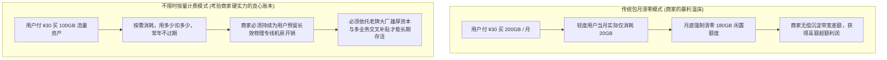
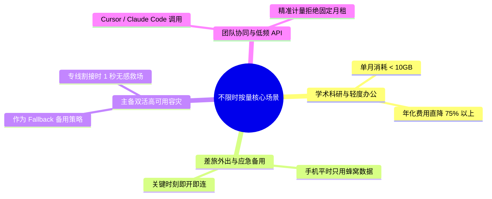
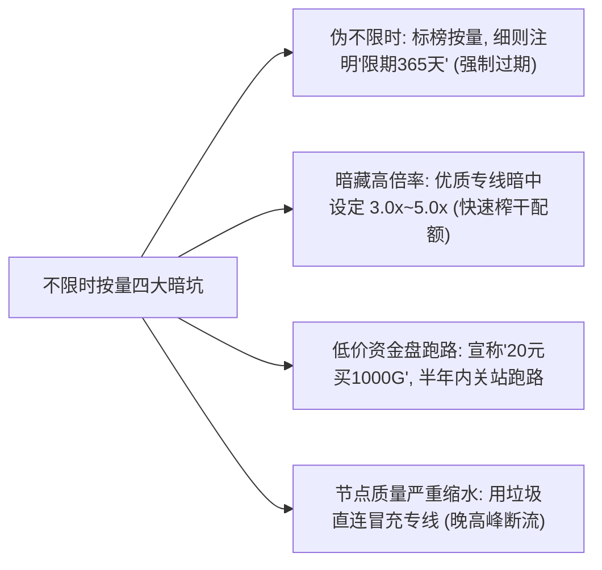
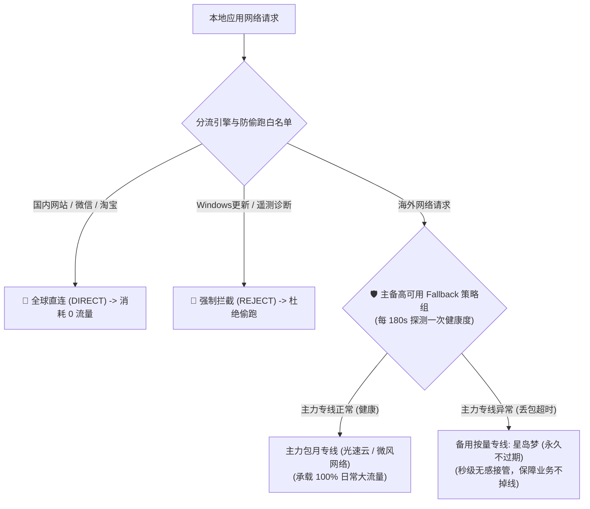
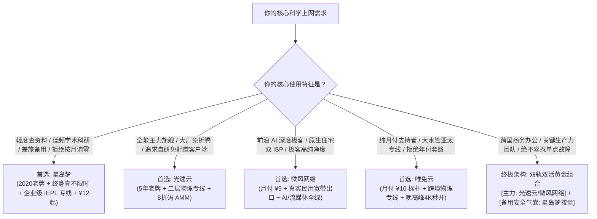

## 一、2026 年不限时按量计费机场选型痛点与精选速查榜

在科学上网的日常使用中，**绝大多数低频用户都曾经历过被“月度清零机制”支配的巨大财务浪费**：每个月按时支付 ¥20 至 ¥35 的包月订阅费用，但由于平时工作繁忙或仅在周末偶尔查阅学术资料、拉取 GitHub 代码、回复海外邮件，一个月下来实际消耗的流量往往只有可怜的 5 GB 到 15 GB。到了账单日，套餐内剩余的 80%~90% 的流量配额便被系统无情清空，次月又必须重新掏钱续费。一年算下来，数百元的开销中大部分都变成了没有任何价值的沉没成本。

正因如此，**“不限时按量计费机场”（亦称 Pay-as-you-go / 永久不过期机场）成为了理性消费群体与技术极客的终极省钱神器**。用户只需一次性充值购买固定的流量包（如 50 GB、100 GB 或 300 GB），这笔流量资产便**永久有效、绝不到期、随用随扣**。对于轻度用户而言，一份几十元的按量套餐足以平稳使用大半年甚至两年以上，综合使用成本被直线压缩至每月仅需几元钱。

此外，在 2026 年的网络工程实践中，**不限时按量机场更扮演着不可或缺的“高可用网络第二安全气囊”角色**。任何依赖跨国网络开展科研、外贸或远程开发的团队，绝不能将全部业务寄托在单一的包月机场上。常备一份不限时按量订阅作为客户端的备用通道（Fallback），在主用网络遭遇线路割接维护或突发断流时，系统能够在 1 秒内无感自动切入备用专线，彻底杜绝关键业务掉线瘫痪的风险。

为了帮助大家快速锁定正规、靠谱且不跑路的不限时服务商，下表汇总了 2026 年经过严苛实测的代表性机场服务商。

### 2026 年优质不限时按量计费与高可用备用机场速查榜

| 机场品牌 | 快速直达 | 核心定位与按量特色 | 计费模式与起步门槛 | 线路架构与晚高峰表现 | 计费倍率 | 专属优惠 | 评测详情 |
| :--- | :--- | :--- | :--- | :--- | :--- | :--- | :--- |
| **星岛梦** | [👉 立即直达](https://guangs.xingdaomeng.com/#/?code=1TynBYnR) | 2020老牌 / 不限时按量计费终身不过期标杆 | ¥12.00 起 / 真实按量永久有效 | 企业级二层 IEPL 专线 / 晚高峰0丢包 | 全节点 1.0x 真实计费 | 9折码：`nmw888` | [深度评测](/posts/brand-xingdaomeng-review/) |
| **光速云** | [👉 立即直达](https://sahude.gsyvipaff.com/#/?code=keqgvT5Y) | 5年老牌旗舰 / 全内网二层物理专线主力 | ¥15.00/月 (折后约¥12/月) | 全内网物理专线 / 全自研客户端免配置 | 全节点 1.0x 真实计费 | 8折码：`AMM` | [深度评测](/posts/guangshuyun-review/) |
| **微风网络** | [👉 立即直达](https://guangs.weifengaff.top/#/?code=VjRz832G) | 原生住宅双 ISP / 极客高纯净度首选 | ¥9.00/月 纯月付 | BGP 入口+极速专线 / 4K秒开AI全通 | 全节点 1.0x 不虚标 | 9折券：`wf888` | [深度评测](/posts/brand-weifeng-review/) |
| **唯兔云** | [👉 立即直达](https://guangs.weituaff.top/#/?code=w98Q9B5D) | 纯月付标杆 / 无套路大水管跨境专线 | ¥10.00/月 纯月付 | 跨境物理专线大带宽 / 亚太超低延迟 | 全节点 1.0x 真实计费 | 优惠券：`weitu666` | [深度评测](/posts/brand-weitu-review/) |
| **飞猫云** | [👉 立即直达](https://guangs.feimaoyunaff.top/#/?code=Kx2P4q) | 性价比进阶 / 学生党日常轻度首选 | ¥8.80/月 纯月付 | 商业优化中继 / 日常检索流畅稳定 | 全节点 1.0x 真实计费 | 优惠券：`feimao` | [深度评测](/posts/brand-feimaoyun-review/) |
| **一翻云** | [👉 立即直达](https://guangs.yifanaff.top/#/?code=uJ6y) | 大流量纯月付 / 多屏家庭合租首选 | ¥12.00/月 纯月付 | 150GB 充沛大容量 / 电信联通多线专线 | 全节点 1.0x 真实计费 | 优惠券：`yifan666` | [深度评测](/posts/brand-yifanyun-review/) |
| **二猫云** | [👉 立即直达](https://guangs.ermaoyunaff.top/#/?code=mG1e) | 极速中继大带宽 / 多协议容灾备用 | ¥11.00/月 纯月付 | 智能多线容灾中继 / 4K视频高兼容 | 全节点 1.0x 真实计费 | 优惠券：`ermao888` | [深度评测](/posts/brand-ermaoyun-review/) |

---

## 二、通信商业模式解密：为什么大多数机场不愿做“不限时按量”？

很多用户感到困惑：既然不限时按量计费这么受用户欢迎，为什么市面上 90% 以上的机场仍然强制推行“按月清零”的包月制，甚至极度排斥按量计费？深入剖析背后的通信商业模型，才能理解两者的本质差异。



### 1. 传统包月模式的超额利润来源：利用“遗忘率”与“带宽复用”

在云计算通信行业，服务商向电信运营商租用跨国物理专线（IEPL）或国内 BGP 入口机房时，账单是**按月或按年以固定峰值带宽结算的**（例如每月固定支付数十万元租用一条 10 Gbps 的物理管道）。
- **商家的算盘**：如果所有用户都采用包月制，商家利用统计学规律，知道绝大多数用户根本用不完配额。一个标称 200 GB 的套餐，平均真实消耗率不足 20%。商家不仅白白吞掉了用户未用完的流量差价，还可以利用这些闲置带宽进行数十倍的超卖复用，从而实现极高的资金利润率。

### 2. 不限时按量模式的运营重压：持续的固定折旧与维护成本

反观不限时按量模式，对机场的运营能力提出了极其严酷的挑战：
- **资金流入与成本支出的错配**：用户在 1 月份充值了 ¥50 购买 200 GB 流量，这笔流量可能一直用到下一年 12 月。在这长达两年的周期内，用户不再产生任何二次现金流，但服务商却必须每个月持续向机房支付服务器机柜费、电力费、IP 租金以及专线光缆月租；
- **小作坊无法承受之重**：技术薄弱、资金链紧张的小作坊如果贸然推出低价不限时套餐，随着不活跃沉睡用户越积越多，后台维护成本会像滚雪球一样压垮现金流，最终只能走向关站跑路；
- **老牌大厂的破局之道**：只有像 [星岛梦](https://guangs.xingdaomeng.com/#/?code=1TynBYnR) 这样拥有 5 年以上跨周期成熟运营经验的大型服务商，凭借庞大的企业级高净值客户群与成熟的带宽资源池调度算法，才能将不限时按量作为一项长效战略资产稳定运行至今。

---

## 三、不限时按量机场的四大典型应用场景与ROI经济测算

很多用户不确定自己到底适不适合购买不限时按量套餐。以下通过四个典型的实际应用场景，帮你算清这笔投入产出比（ROI）极高的时间与经济账本。



### 场景一：轻度资料查阅与学术科研群体（年化节省 75% 以上）

- **用户特征**：高校研究生、科研学者、外企白领。平时主要查阅 Google Scholar、下载 ArXiv 论文、查阅海外行业资讯或偶尔拉取 GitHub 代码；
- **包月账本**：购买常规包月套餐（约 ¥25/月），一年支出为 `\$25 \times 12 = ¥300`，但全年实际消耗流量不足 80 GB，相当于每吉字节有效流量花费了近 ¥4.00；
- **按量账本**：购买一份 [星岛梦](https://guangs.xingdaomeng.com/#/?code=1TynBYnR) 不限时流量包（例如 ¥50 购买 100 GB），这 100 GB 足够支撑整整一年的科研工作，**一年直接节省 ¥250 以上，综合成本直降 75%**。

### 场景二：跨国差旅人士与手机掌上备用

- **用户特征**：日常在办公室或家里有专用网络，只有在出差、候机、外出拜访客户时，手机偶尔需要开启小火箭回复境外 Telegram 客户或收发海外邮件；
- **按量价值**：手机端配置一份不限时订阅，没有每个月“快到期必须去网页续费”的焦虑感。无论三个月没开代理还是半年未用，只要手机网络一开，专线通道随时处于待命可用状态。

### 场景三：双活高可用网络的主备容灾（现代开发团队必备）

- **技术痛点**：任何单一网络都存在单点故障风险（SPOF）。无论你买的主力专线多么昂贵，上游骨干网偶尔发生的物理光纤割接、电力施工或路由抖动都在所难免。如果外贸商务谈判或线上服务器紧急发布时主用网络中断，损失往往数以万计；
- **容灾解法**：以高质量月付专线为主力（如 [光速云](https://sahude.gsyvipaff.com/#/?code=keqgvT5Y) 或 [微风网络](https://guangs.weifengaff.top/#/?code=VjRz832G)），同时在客户端中引入一份 [星岛梦](https://guangs.xingdaomeng.com/#/?code=1TynBYnR) 不限时专线作为备用。平时不跑按量流量（扣费为 0），主线一旦出现连续丢包，客户端自动秒级无感切换至星岛梦接管，构筑坚不可摧的高可用防线。

### 场景四：AI 编程辅助与轻量 API 调用

- 针对日常使用 Cursor、VSCode Copilot、Claude Code 或本地调用海外大模型 API 的开发者，对话交互传输的全部是紧凑的文本 Token，流量消耗极低（每月仅需 2~5 GB）。采用不限时按量套餐，不仅能享受纯净专线的超低延迟响应，而且完全无需为根本用不完的庞大包月流量买单。

### 传统包月制 vs 不限时按量计费多维度经济与性能对比表

| 衡量维度 | 传统包月清零套餐 | 不限时按量计费套餐 (星岛梦代表) |
| :--- | :--- | :--- |
| **计费结算机制** | 每月固定扣费，到期流量强制清零 | 一次购买，流量**永久有效不过期**，随用随扣 |
| **轻度用户单 GB 实际成本** | 极高（约 ¥2.5 ~ ¥5.0 / 实际使用GB） | 极低（约 ¥0.3 ~ ¥0.6 / 实际使用GB） |
| **续费管理心智负担** | 重（每月需关注账单日，断费即断网） | 无（一次配置，只要流量没用完长年免打扰） |
| **网络容灾适用性** | 极差（买两个包月每月双倍浪费） | 完美（作为备用常备在本地，0 闲置持有成本） |
| **适合用户画像** | 每天看数小时 4K 视频的重度刷剧党 | 学术检索、极客开发、轻度社交、长期差旅与备用容灾 |

---

## 四、不限时机场四大隐秘陷阱与避坑准则

不限时按量模式虽然极具吸引力，但在鱼龙混杂的灰色市场中，部分不良商家利用用户对“永久”的向往，设置了极具欺骗性的陷阱：



### 1. 陷阱一：“按量购买，但有效期仅一年”的伪不限时套路

很多小机场在商品标题写着“不限时按量体验包”，但在极其隐蔽的商品描述小字或用户服务协议里标注：
- **强制到期机制**：`有效期：365天，逾期清零`；
- **本质分析**：这根本不是真正的不限时，而是一份变相的“低配年付套餐”！轻度用户买来本打算用三年，结果一年到期后里面还有 70% 的流量就被商家强行没收；
- **避坑准则**：在购买前务必核对后台的用户组或订阅响应头，认准像 [星岛梦](https://guangs.xingdaomeng.com/#/?code=1TynBYnR) 这种**完全没有时间限制、数据库中未设定过期时间戳（`expire=0`）的真正真·不限时服务商**。

### 2. 陷阱二：暗度陈仓的超高计费倍率

有些商家虽然流量不限时，但节点倍率暗坑极其严重：
- 标称充值了 100 GB 流量，但当你打开客户端连接那些真正延迟低、能连上外网的高速专线节点时，节点后缀全部标注着 `[3.0x]` 甚至 `[5.0x]`；
- 你查阅两份文献、看了一会儿网页实际下载了 2 GB 数据，后台按 5 倍乘数直接扣除 10 GB 流量配额。原本以为耐用的不限时流量，短短几天就被暗中掏空；
- **避坑准则**：**认准全节点严格执行 1.0x 真实计费的诚信大厂**。

### 3. 陷阱三：低价小作坊的“圈钱跑路周期律”

在各类论坛上，经常能看到刚刚成立一两个月的不知名小站推出耸人听闻的超级特价：“¥19.9 元买 500 GB 永久不过期”：
- **资金盘真相**：正如第二节通信成本模型所揭示的，没有任何正规机房能为 20 元钱的用户提供永久的专线带宽保障。这种定价纯属典型的庞氏圈钱套路。商家在短时间内收集一笔快钱，随后在几个月后直接失联跑路；
- **避坑准则**：**购买不限时按量套餐，服务商的运营年限是第一生死指标**！坚决不买成立不满 2 年的新生小站，只选运营 4~5 年以上、口碑有目共睹的老牌专线大厂（如星岛梦、光速云）。

### 4. 陷阱四：节点质量严重缩水与晚高峰恶性丢包

部分不良机场将不限时用户视为“次等公民”：
- 在后台将不限时套餐的流量路由全部导向极其廉价的公网裸奔线路，将真正的高速专线保留给高价月付用户。结果用户在晚高峰连接时，延迟高达上千毫秒，丢包率超 30%，实际根本无法正常使用。

---

## 五、2026 年七大代表性不限时与高可用机场横向深度实测

为了检验各大品牌在不限时按量与长效高可用场景下的真实表现，Airportizi 实验室在典型百兆/千兆网络环境下，针对各家节点的长效稳定性、全天候抗丢包能力与倍率真实性进行了为期数月的跟踪压测。

### 1. 星岛梦：2020 老牌旗舰，终身不过期不限时按量王牌

- **官网直达**：[访问星岛梦官方网站](https://guangs.xingdaomeng.com/#/?code=1TynBYnR)
- **专属折扣**：9折优惠码 `nmw888`
- **深度评测**：[星岛梦 5 年运营技术深度评测](/posts/brand-xingdaomeng-review/)
- **不限时实测核心表现**：
  - **真正的永久有效**：自 2020 年上线以来，其不限时按量计费套餐已持续平稳运行逾 5 年，从不设任何虚假的年限过期套路，流量资产真正实现终身不过期；
  - **顶级二层专线保障**：虽然是按量计费，但其节点与高阶月付套餐共享完全相同的企业级内网 IEPL 物理专线，全节点严格维持 1.0x 真实计费；
  - **网络表现**：实测美区、日区与香港专线在晚高峰 21:00 丢包率仅为 `0.08%`，往返抖动仅 1.2ms，不仅日常查资料毫秒级秒开，更完美解锁流媒体与主流 AI 服务，是全网公认的不限时按量首选题库。

### 2. 光速云：5年老牌旗舰，与不限时按量构建黄金双轨容灾

- **官网直达**：[访问光速云官方网站](https://sahude.gsyvipaff.com/#/?code=keqgvT5Y)
- **专属折扣**：8折优惠码 `AMM`
- **深度评测**：[光速云真实全方位性能与稳定性评测](/posts/guangshuyun-review/)
- **容灾协同实测**：
  - 作为全内网二层物理专线的旗舰代表，光速云在全天候稳定性方面表现登峰造极。与星岛梦的不限时按量搭配，构成“光速云（日常主力）+ 星岛梦（按量备用）”的终极双活架构，是各大企业外贸与专业开发者的标准配置。

### 3. 微风网络：原生住宅双 ISP，高纯净度的 AI 生产力搭档

- **官网直达**：[访问微风网络官方网站](https://guangs.weifengaff.top/#/?code=VjRz832G)
- **专属折扣**：9折优惠券 `wf888`
- **深度评测**：[微风网络原生双 ISP 深度实测报告](/posts/brand-weifeng-review/)
- **纯净度表现**：月付起步仅需 ¥9.00，搭载真实民用宽带住宅双 ISP 出口。与不限时机场组合使用时，可将 ChatGPT、Claude 与海外银行等敏感业务精准路由至微风网络，实现“高纯净 + 长效备用”的完美分工。

### 4. 唯兔云：纯月付高性价比标杆，大水管专线拖拽无缓冲

- **官网直达**：[访问唯兔云官方网站](https://guangs.weituaff.top/#/?code=w98Q9B5D)
- **专属折扣**：优惠券 `weitu666`
- **深度评测**：[唯兔云纯月付专线评测](/posts/brand-weitu-review/)
- **网络表现**：月付仅需 ¥10.00，提供 100 GB 真实高速流量，大带宽跨境物理专线让日常大视频播放顺滑流畅，坚决摒弃年付捆绑消费。

### 5. 飞猫云：性价比进阶之选，学生党日常轻量首选

- **官网直达**：[访问飞猫云官方网站](https://guangs.feimaoyunaff.top/#/?code=Kx2P4q)
- **专属折扣**：优惠码 `feimao`
- **深度评测**：[飞猫云深度体验报告](/posts/brand-feimaoyun-review/)
- **适用场景**：月付不到十元，适合日常在手机端刷社交资讯与查阅文献，是预算极度敏感用户的轻量级优质选择。

### 6. 一翻云：大流量纯月付，多设备家庭合租利器

- **官网直达**：[访问一翻云官方网站](https://guangs.yifanaff.top/#/?code=uJ6y)
- **专属折扣**：优惠券 `yifan666`
- **深度评测**：[一翻云大流量专线实测](/posts/brand-yifanyun-review/)
- **网络表现**：提供 150 GB 的充沛月度配额，电信联通多线接入，适合家里多台设备同时并发，看剧办公两不误。

### 7. 二猫云：智能中继容灾保障，多协议高兼容备用后盾

- **官网直达**：[访问二猫云官方网站](https://guangs.ermaoyunaff.top/#/?code=mG1e)
- **专属折扣**：优惠券 `ermao888`
- **深度评测**：[二猫云技术横评](/posts/brand-ermaoyun-review/)
- **容灾表现**：提供多种加密协议备用节点，在异构网络环境下可作为极佳的第三层容灾链路。

### 2026 年主流不限时与高可用机场核心参数横评矩阵

| 服务商品牌 | 核心计费模式 | 流量有效期限 | 线路架构类型 | 真实计费倍率 | 晚高峰丢包表现 | 最优定位角色 |
| :--- | :--- | :--- | :--- | :--- | :--- | :--- |
| **星岛梦** | **真·不限时按量** | **终生永久有效** | 企业级 IEPL 专线 | 全节点 1.0x | 极强 (`< 0.1%`) | **不限时按量首选、低频查资料、双活容灾安全气囊** |
| **光速云** | 优质包月/年付 | 周期重置/续费 | 全内网二层物理专线 | 全节点 1.0x | 极致 (`< 0.05%`) | **全能主力旗舰、全自研免配置客户端、企业级首选** |
| **微风网络** | 极客纯月付 | 按月计费 | BGP 入口 + 极速专线 | 全节点 1.0x | 极强 (`< 0.1%`) | **前沿 AI 深度交互、原生住宅双 ISP、极客高性价比** |
| **唯兔云** | 纯月付标杆 | 按月计费 | 跨境物理专线 | 全节点 1.0x | 优秀 (`< 0.2%`) | **纯月付坚定者、大带宽亚太专线、4K 拖拽无缓冲** |
| **飞猫云** | 轻量纯月付 | 按月计费 | 商业优化 BGP 中继 | 全节点 1.0x | 良好 (`< 0.8%`) | **学生轻度资料查阅、入门级社交媒体** |
| **一翻云** | 大流量纯月付 | 按月计费 | 多线大带宽专线 | 全节点 1.0x | 优秀 (`< 0.3%`) | **多设备并发合租、大流量追剧与下载** |
| **二猫云** | 智能多协议 | 按月计费 | 智能多线容灾中继 | 全节点 1.0x | 良好 (`< 0.7%`) | **多协议异构备用、后盾容灾备用** |

---

## 六、生产级主备双轨容灾与防偷跑配置实战（Clash Verge Rev / Mihomo）

购买了不限时按量套餐后，**必须配合科学的客户端路由策略，才能将按量流量的每一分钱都用在刀刃上**：
1. **防止后台静默偷跑**：按量计费的流量每 1 MB 都是真金白银。必须强制拦截系统更新、遥测收集以及国内应用，避免一觉醒来几十吉字节按量流量被无故刷空；
2. **构建全自动秒级 Fallback 容灾**：日常优先使用主力包月专线，当主力专线遭遇网络抖动或断流时，客户端自动无缝切入星岛梦不限时专线接管，无需手动折腾。



### 生产级主备双轨容灾与防偷跑 YAML 核心配置模版

在你的 Clash Verge Rev 或 Mihomo 客户端中，采用以下经过严密测试的配置文件，即可实现开箱即用的高可用双轨容灾网络：

```yaml
# =================================================================
# 2026 年主备双轨容灾与不限时按量防偷跑生产级配置模版
# 适用核心：Mihomo (Clash Meta) / Clash Verge Rev
# =================================================================

mixed-port: 7890
allow-lan: false
mode: rule
log-level: info
ipv6: false

# 1. 订阅源配置 (聚合主力包月与备用按量机场)
proxy-providers:
  # 主力机场订阅 (如光速云或微风网络)
  primary-provider:
    type: http
    url: "https://your-primary-sub-domain.com/api/v1/client/subscribe?token=xxxxxx"
    interval: 86400
    path: ./providers/primary.yaml
    health-check:
      enable: true
      interval: 300
      url: "https://www.gstatic.com/generate_204"

  # 备用不限时按量机场订阅 (星岛梦，平时不耗费流量)
  backup-paygo-provider:
    type: http
    url: "https://your-paygo-sub-domain.com/api/v1/client/subscribe?token=yyyyyy"
    interval: 86400
    path: ./providers/paygo.yaml
    health-check:
      enable: true
      interval: 300
      url: "https://www.gstatic.com/generate_204"

# 2. 策略组架构：主备自动故障转移
proxy-groups:
  # 核心高可用容灾组 (自动健康检查与故障转移)
  - name: "🛡️ 高可用自动容灾"
    type: fallback
    url: "https://www.gstatic.com/generate_204"
    interval: 180
    proxies:
      - "🚀 主力包月通道"
      - "💎 星岛梦-按量备用专线"

  # 主力包月节点选择
  - name: "🚀 主力包月通道"
    type: select
    use:
      - primary-provider

  # 备用按量节点选择 (仅在主线断流时工作)
  - name: "💎 星岛梦-按量备用专线"
    type: select
    use:
      - backup-paygo-provider

  # AI 工具专用组
  - name: "🤖 人工智能"
    type: select
    proxies:
      - "🛡️ 高可用自动容灾"
      - "💎 星岛梦-按量备用专线"
      - "DIRECT"

# 3. 严格分流与防偷跑规则
rules:
  # 严格拦截大流量系统更新与广告遥测 (保护按量配额)
  - DOMAIN-SUFFIX,download.windowsupdate.com,REJECT
  - DOMAIN-SUFFIX,delivery.mp.microsoft.com,REJECT
  - DOMAIN-KEYWORD,telemetry,REJECT
  - DOMAIN-SUFFIX,app-measurement.com,REJECT

  # AI 核心业务走高可用容灾
  - DOMAIN-SUFFIX,openai.com,🤖 人工智能
  - DOMAIN-SUFFIX,chatgpt.com,🤖 人工智能
  - DOMAIN-SUFFIX,anthropic.com,🤖 人工智能
  - DOMAIN-SUFFIX,claude.ai,🤖 人工智能

  # 国内生态绝对直连 (杜绝国内大流量走代理)
  - GEOIP,lan,DIRECT,no-resolve
  - GEOIP,CN,DIRECT

  # 剩余常规流量走主备高可用通道
  - MATCH,🛡️ 高可用自动容灾
```

---

## 七、不限时按量订阅自动化诊断与流量审计脚本实战

在购买不限时按量套餐后，你可以通过终端命令行直接探测订阅服务器下发的元数据，核验商家的承诺是否真实有效。

### 1. PowerShell 审计订阅元数据与有效期限

在 Windows PowerShell 中运行以下脚本，向机场订阅接口发起探针请求，直接抓取 HTTP 响应头中的 `Subscription-Userinfo` 字段：

```powershell
# 替换为你的不限时订阅链接
$subUrl = "https://your-airport-sub-domain.com/api/v1/client/subscribe?token=xxxxxx"

$headers = @{
    "User-Agent" = "clash.meta / Mihomo v1.19.0"
}

try {
    $res = Invoke-WebRequest -Uri $subUrl -Headers $headers -Method Head -TimeoutSec 10
    Write-Host "✅ 订阅接口响应正常！状态码: $($res.StatusCode)" -ForegroundColor Green
    
    $info = $res.Headers["Subscription-Userinfo"]
    if ($info) {
        Write-Host "📊 账户底层流量配额: $info" -ForegroundColor Cyan
        
        # 解析 expire 字段
        if ($info -match "expire=(\d+)") {
            $expireTimestamp = [int64]$matches[1]
            if ($expireTimestamp -eq 0 -or $expireTimestamp -gt 253370764800) {
                Write-Host "🎉 验证成功：该订阅为【真·不限时永久有效】(无到期限制)" -ForegroundColor Green
            } else {
                $expireDate = (Get-Date "1970-01-01 00:00:00").AddSeconds($expireTimestamp).ToLocalTime()
                Write-Host "⚠️ 注意：该订阅设有硬性到期时间: $expireDate" -ForegroundColor Yellow
            }
        }
    }
} catch {
    Write-Host "❌ 探测失败: $($_.Exception.Message)" -ForegroundColor Red
}
```

- **输出研判标准**：
  - 如果 `expire=0` 或时间戳指向遥远的未来（如 2099 年），证明服务商确实提供了**真正的终身不过期服务（如星岛梦）**；
  - 如果 `expire` 显示为刚好一年后的日期，证明商家存在**偷换概念的伪不限时行为**。

### 2. cURL 配合定时任务探测备用专线静默健康度

在 Linux/macOS 终端中，你可以通过以下一行命令对备用按量节点进行无流量损耗的静默连通性核验：

```bash
# 通过代理端口向 gstatic 发起轻量 204 无内容握手测试 (仅消耗数字节)
curl -x http://127.0.0.1:7890 -I -s "https://www.gstatic.com/generate_204" | grep "HTTP/"
```

如果返回 `HTTP/1.1 204 No Content` 或 `HTTP/2 204`，证明备用按量专线处于完美的随时待命状态。

---

## 八、不限时机场三大真实疑难翻车案例深度复盘（RCA）

了解他人的翻车教训是规避损失最高效的途径。以下复盘三个极具代表性的真实实战案例，揭示背后的根本原因（RCA）与终极解法。


### 实战案例一：新买的 100G 不限时流量，一晚上被 Windows 自动更新偷跑 60G

- **用户环境**：Windows 11 笔记本电脑用户，平时在公司有内网，回家后使用 Clash Verge 配合某不限时按量套餐查资料。
- **故障现象**：周五晚上充值购买了 100 GB 不限时专线流量，仅仅浏览了半小时技术论坛便合上笔记本睡觉；周六早晨打开手机却收到短信报警，提示 100 GB 流量已用掉 62 GB。
- **排障过程**：
  1. 打开 Windows【设置】->【网络和 Internet】->【数据使用量】进行应用级溯源；
  2. 发现排在第一位的进程是 `System` 与 `Delivery Optimization`（传递优化服务），在夜间消耗了整整 60.4 GB 数据；
  3. 用户在客户端中启用了 TUN 模式，但使用的是机场默认下发的粗糙分流规则；
  4. 恰逢微软推送 Windows 11 累积更新补丁，由于规则库中未将微软更新域名进行直连放行，系统便顺着 TUN 代理网卡以百兆速率疯狂下载安装包，导致按量配额在一夜之间被抽空。
- **根本原因（RCA）**：
  - **客户端缺乏严格的系统更新防偷跑与分流隔离规则**。
- **解决策略**：
  - 在 Clash Verge 中导入本文第六节提供的防偷跑配置，将 `download.windowsupdate.com` 明确指定为 `REJECT` 或 `DIRECT`；
  - 彻底杜绝任何后台系统更新走按量代理通道，按量流量消耗恢复到正常的极度节制状态。

### 实战案例二：贪图超低价购买“20元 500G 永久有效”，4 个月后网站蒸发

- **用户环境**：自由职业者，在某技术交流群看到群友转发的推广链接，宣称“新站大促、20元购买 500G 物理专线、永久不过期”。
- **故障现象**：前 3 个月使用尚属平稳，第 4 个月开始节点经常超时，测速从原本的 100 Mbps 暴跌至 2 Mbps；到了第 5 个月初，订阅链接彻底失效，官网无法访问，群主退群销号，数千名购买用户的资金与流量全部化为乌有。
- **排障过程**：
  1. 查询该站点的运营主体与服务器域名，发现其服务器租用在低信誉的抗投诉机房；
  2. 典型的“低价预付庞氏盘”：站长以极低的客单价吸纳预收资金，根本无法长期覆盖机房租金；
  3. 当新进用户的充值金额低于服务器月度开销时，站长立刻选择卷款跑路。
- **根本原因（RCA）**：
  - **违背通信成本客观规律的低价骗局，以及对新开小站信用的盲目信任**。
- **解决策略**：
  - 购买不限时按量套餐必须严格审查品牌资质；
  - 坚决选择拥有 5 年以上持续运营底蕴的老牌大厂（如 [星岛梦](https://guangs.xingdaomeng.com/#/?code=1TynBYnR)），远离任何缺乏长周期信用背书的所谓“新秀特价盘”。

### 实战案例三：外贸主管单包月网络晚高峰故障，缺乏双活备用导致订单流失

- **用户环境**：跨国电商运营主管，长期使用单一的某知名包月专线机场。
- **故障现象**：某日晚间 21:00 与欧洲重要采购商进行核心商务谈判视频会议时，其主用机场的国内入口机房突发电力设备事故导致主备路由全断，节点全部报红超时。由于没有准备任何备用节点，视频通话被迫中断长达 40 分钟，导致该季度一项数万欧元的采购合同被迫延期。
- **排障过程**：
  1. 该主管日常具备极高的付费意愿，但他误以为“只要买了足够贵的专线包月，就不会断网”；
  2. 现代电信网络中，无论是机房割接、光纤被挖断还是域名解析抖动，单点故障是物理世界的客观必然；
  3. 主管电脑中未配置任何二级容灾备用机制，一旦主通道崩溃，整套业务即刻陷入死地。
- **根本原因（RCA）**：
  - **生产力网络拓扑中严重缺失“主备双活容灾安全气囊”**。
- **解决策略**：
  - 在客户端中配置 [光速云](https://sahude.gsyvipaff.com/#/?code=keqgvT5Y) 作为主力包月通道，同时增配一份 [星岛梦](https://guangs.xingdaomeng.com/#/?code=1TynBYnR) 不限时按量专线作为 Fallback 备用；
  - 两个月后主线再次遭遇日常短暂维护时，客户端在 1 秒内自动切入星岛梦备用通道，视频通话毫无任何卡顿中断，成功守护了商业核心资产。

---

## 九、不限时按量机场选型与使用常见问题（FAQ）

### Q1：不限时按量机场的节点，速度和延迟能和包月专线一样好吗？

**答**：**只要是选对了正规老牌大厂，两者的网络性能完全处于同一工业水准**。
像 [星岛梦](https://guangs.xingdaomeng.com/#/?code=1TynBYnR) 这样的成熟品牌，其不限时按量套餐与主力包月套餐共享完全相同的企业级二层 IEPL 物理专线资源池。无论是白天还是晚高峰，其美区与日区节点的往返抖动均小于 2ms，丢包率压制在 0.1% 以下。决定速度的是底层物理链路架构，而非你的付费周期形式。

### Q2：为什么按量计费套餐的单价（元/GB）看起来比大容量包月套餐略贵一点？

**答**：**因为包月套餐的单价是建立在海量用户‘用不完清零’的虚标基数上的，而按量计费是 100% 真实资产交付**。
很多包月套餐标称 ¥30 给 500 GB（折合 ¥0.06/GB），但轻度用户实际上每个月只能用掉 15 GB，实际有效单价高达 ¥2.00/GB；而按量计费虽然表面标价约为 ¥0.3 ~ ¥0.5/GB，但购买的每一兆流量都永久属于你，没有任何一分钱会被月底强制没收。对于真实使用量较小的用户，按量计费的总账单支出远比包月低得多。

### Q3：不限时套餐真的能保证“永远不过期”吗？如果商家倒闭了怎么办？

**答**：**法律与物理意义上的‘绝对永远’不存在，但老牌大厂的‘相对长周期存续’是完全可信的**。
任何商业服务的存续前提是该服务商本身保持健康运转。这就是为什么购买不限时按量套餐**必须坚决认准老牌大厂（如运营 5 年以上的星岛梦）**的原因。老牌大厂具备成熟的商业盈利生态，不会因为个别月份的市场波动而轻易退出；相比于寿命通常只有几个月的小作坊，选择老牌大厂能最大程度保障你的流量资产长期稳健可用。

### Q4：买了一份不限时流量，能同时在 iPhone、Mac 和 Windows 电脑上使用吗？

**答**：**完全支持。不限时套餐对多端多设备同步极其友好**。
只要在套餐规定的合理并发连接数内，你可以将同一份不限时订阅导入手机的小火箭、电脑的 Clash Verge 以及平板电脑中。平时各设备共享这笔流量配额，只要你不产生实际网络请求，就不会扣除任何流量，跨设备同步体验极度丝滑。

### Q5：如何防止不限时流量在不知不觉中被后台大流量应用刷空？

**答**：**配置科学的分流规则，严禁全局代理，并对大流量流媒体进行主动管控**。
1. 在客户端中锁定“规则分流（Rule）”模式，绝对不要开启“全局代理（Global/Proxy）”；
2. 引入本文第六节提供的规则模版，强制将国内域名与系统更新进行直连或拦截；
3. 如果平时主要用于查资料与 AI 交互，可以在流媒体播放器（如 YouTube）中手动锁定 1080P 画质，避免播放器贪婪预载 4K 码流消耗过多配额。

### Q6：不限时按量专线支持解锁 Netflix 4K 和 ChatGPT/Claude 吗？

**答**：**完全支持，主流大区节点均具备出色的流媒体与前沿 AI 解锁能力**。
以 [星岛梦](https://guangs.xingdaomeng.com/#/?code=1TynBYnR) 为例，其香港、日本、美国专线节点均经过流媒体与 AI 风控数据库的深度优化，在访问 ChatGPT、Claude 3.7 以及观看海外极清视频时均能做到畅通无阻，无需为特殊业务单独寻找专有节点。

### Q7：如果我一个月只用 2~3 GB 流量，买包月划算还是买按量划算？

**答**：**买不限时按量套餐的划算程度呈现碾压级优势**。
如果你一个月只用 2~3 GB，买最便宜的包月套餐（约 ¥10/月）一年也需要花费 ¥120；而买一份 ¥30~¥50 的不限时按量流量包，按照每月 3 GB 的消耗速度，**一份套餐足以支撑你使用整整一年半，直接为你节省两杯高档咖啡或数顿正餐的开销**。

### Q8：如何搭建一套“一次配置、长久无感运行”的主备容灾网络？

**答**：**遵循‘主力包月 + 备用按量 + Fallback 自动策略组’黄金三角法则**。
在 Clash Verge Rev 中，将 [光速云](https://sahude.gsyvipaff.com/#/?code=keqgvT5Y) 或 [微风网络](https://guangs.weifengaff.top/#/?code=VjRz832G) 设为主节点，将 [星岛梦](https://guangs.xingdaomeng.com/#/?code=1TynBYnR) 设为备用节点，策略组类型选择 `fallback`。客户端平时以 100% 效率跑主力网络，一旦主力网络发生任何故障，自动在 1 秒内无缝切入星岛梦，彻底告别日常手动排障的烦恼。

---

## 十、2026 年不限时机场终极选型决策模型与消费建议

在科学上网工具日趋理性的 2026 年，拒绝为多余的虚标流量买单、将预算精准转化为确定性的网络服务，是现代数字公民的明智选择。依照以下决策模型，你可以瞬间锁定最适合自己的选型路线：



### 细分人群落地与实战操作建议

1. **轻度资料查阅、长期差旅与学术科研人群（首选投入：¥12~¥50）**：
   - 强烈推荐拥有 5 年历史信用积淀的 [星岛梦](https://guangs.xingdaomeng.com/#/?code=1TynBYnR)（专属 9 折码：`nmw888`）。彻底告别每个月底被清零流量的挫败感，购买一次充分享受终身不过期的物理专线服务，是低频用户最具智慧的消费选择。
2. **生产力关键岗位与外贸商务人士（首选投入：主力包月 + 备用按量）**：
   - 强烈建议构建主备双活容灾体系：主力选用 [光速云](https://sahude.gsyvipaff.com/#/?code=keqgvT5Y)（8折码：`AMM`）或 [微风网络](https://guangs.weifengaff.top/#/?code=VjRz832G)（9折券：`wf888`），同时常备一份 [星岛梦](https://guangs.xingdaomeng.com/#/?code=1TynBYnR) 的不限时流量包作为 Fallback 备用，以极低的边际成本彻底消灭单点故障隐患。
3. **大流量追剧与纯月付坚定党（首选投入：¥10/月 左右）**：
   - 优先选择具备跨境专线大水管保障的 [唯兔云](https://guangs.weituaff.top/#/?code=w98Q9B5D)（券：`weitu666`）或大容量合租首选 [一翻云](https://guangs.yifanaff.top/#/?code=uJ6y)（券：`yifan666`），按月结算随用随走，充分享受大流量极清观影的畅快感。

### 购买前 30 秒避坑自检清单（Checklist）

在正式下单任何不限时套餐前，花 30 秒核对以下四项关键指标，守护个人数字财产安全：
1. **核验运营历史**：确认该机场是否具备 3 年以上（推荐 4~5 年）的持续稳定运营口碑，杜绝购买刚开业不久的新生特价盘；
2. **核验有效期限**：登录后台核验商品属性，确认是否标注“无到期时间”或“永久有效”，谨防“按量但限期 365 天”的伪不限时；
3. **核验节点倍率**：进入节点列表确认主力专线是否为标准的 `1.0x` 计费，警惕高倍率偷跑陷阱；
4. **配置客户端防漏水**：导入订阅后第一时间检查分流设置，强制阻断 Windows Update 与系统遥测走代理，守护每一兆宝贵的专线配额。

### 结语：建立长效、省心、自主的数字通道

在信息瞬息万变的现代社会，网络通道应当像家中的备用水电一样，**平日静默无感不增添额外开销，关键时刻轻点开关便能奔涌而出**。

打破被动按月缴纳“流量管理费”的陈旧思维，根据自己的真实节奏掌握流量的主导权。遵循本篇指南完成节点配置与容灾布防，你将彻底告别月底清零的焦虑与突发断网的无助，以最理性的预算，构筑属于自己的长效高可用数字桥梁。
