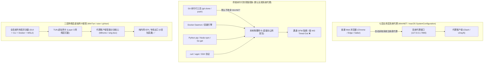
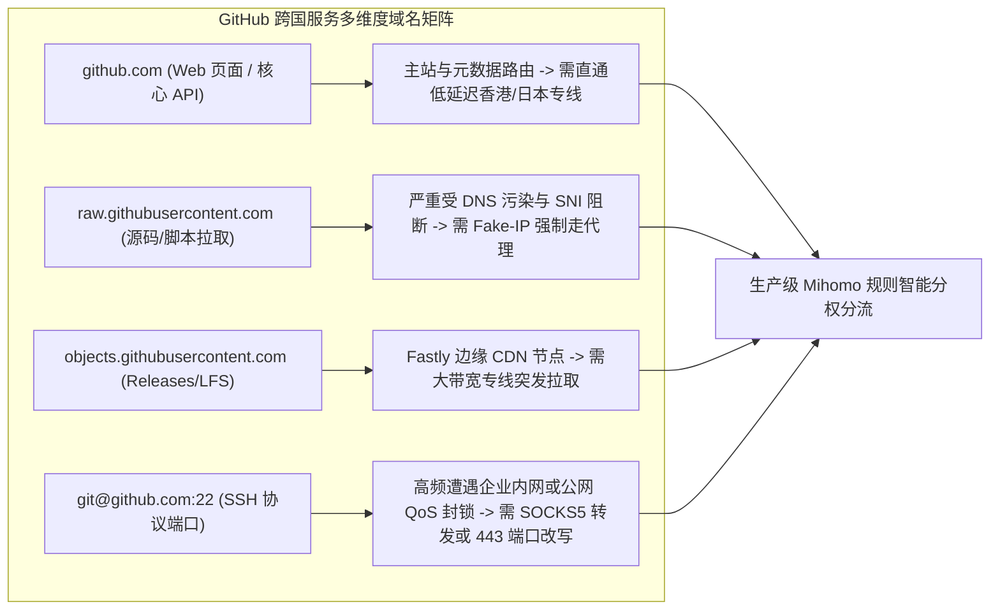
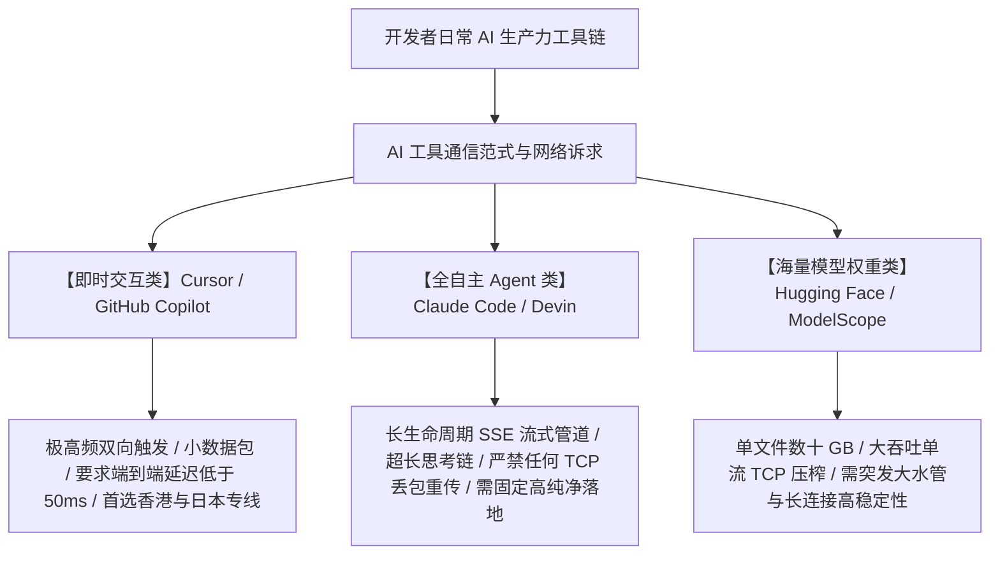

## 一、程序员的核心网络痛点与 2026 开发者优质机场速查表

在 2026 年的现代软件工程与全栈开发工作流中，**跨国高速网络连接早已不是简单的“搜索工具”，而是贯穿于代码编写、依赖安装、容器构建、代码审查到持续部署（CI/CD）的“核心生产力血管”**。今天的程序员，无论从事前端、后端、云计算基础设施、移动端还是前沿人工智能大模型研发，每日的工作流都高频嵌合在庞大的全球开发者基础设施之中：

- 在 **GitHub** 上执行 `git clone` 拉取大型开源项目、推送代码、下载 Releases 预编译二进制架构包与同步开源 Wiki；
- 在终端运行 **Claude Code、Cursor、GitHub Copilot、Windsurf** 等前沿 AI 代码生成 Agent，以微秒级的响应速度进行多文件重构与复杂逻辑调试；
- 通过 **Docker Hub、npm、PyPI（pip）、crates.io、Go Proxy** 等官方依赖镜像源快速解析并下载跨国软件依赖包；
- 远程管理 **AWS、Google Cloud Platform（GCP）、Cloudflare Workers、Vercel、Supabase** 等海外主流云原生开发控制台与数据库长连接。

然而，相比只用网络刷视频、浏览社交网页的普通用户，**技术开发者对网络链路的品质要求呈现出极端严苛的“极客特征”**：

1. **对网络丢包与微小抖动“零容忍”**：普通用户刷网页或看 4K 视频，底层有长达数秒甚至几十秒的客户端缓冲区作为缓冲，偶尔丢包 1%–2% 几乎无感；但程序员在终端跑 SSH 远程长会话、执行 Git 大仓库拉取、或者依赖大模型 Server-Sent Events（SSE）长连接实时打印代码时，**仅仅 0.5% 的微小丢包就会直接触发 TCP 重传超时（RTO），导致终端出现惨痛的 `broken pipe`、`Connection reset by peer` 或代码生成中途卡死崩溃**；
2. **被“系统代理假象”反复折磨的命令行困境**：许多开发者在桌面端开启了 Clash 或 v2rayN，浏览器能流畅访问 Google，但一打开终端运行 `git push`、`docker pull`、`brew update` 或 `curl`，屏幕上依旧无情甩出 `Failed to connect to github.com port 443: Timed out`。这种图形界面与底层命令行网络栈的脱节，每天浪费着无数工程师宝贵的调试时间；
3. **高敏 AI 平台严苛的反作弊封控**：调用 OpenAI API、使用 Claude 3.7 进行深度逻辑推导以及登录海外开发者控制台时，如果机场出口混杂了大量被黑产爬虫滥用的廉价机房广播 IP，极易遭遇 Cloudflare 5 秒盾死循环、API 速率限制（429 Too Many Requests）甚至开发者账号遭连坐封禁；
4. **大体积开发模型下载需要坚挺的突发带宽**：在 Hugging Face、Kaggle 或 GitHub LFS 上拉取一个 10GB–50GB 的 PyTorch 模型权重文件时，劣质小机场的带宽限速与连接重置会让拉取在进度条跑到 90% 时突然报错，前功尽弃。

为了帮助广大工程师、架构师与科研极客彻底摆脱开发网络泥潭，下表汇集了 2026 年经过多地域、多开发工具链高强度压榨实测的优质开发者机场服务商矩阵。

### 2026 年程序员专属开发者优质机场速查选型表

| 机场品牌 | 快速直达 | 核心线路架构与开发者专属特性 | 典型工具延迟 (港/日/新/美) | 开发者工具链 (GitHub/Docker/AI/SSH) 表现 | 推荐内核客户端模式 | 参考起步价 | 专属优惠 | 深度评测 |
| :--- | :--- | :--- | :---: | :--- | :--- | :--- | :--- | :--- |
| **一翻云** | [👉 立即直达](https://yifanyun.org/#/register?code=y77fG2gA) | **极客骨干专属专线** / 超低网络抖动架构 | 港 23ms / 日 33ms / 美 133ms | **Claude Code首选** / SSH终端0掉线 / Git秒级推送 | sing-box Hysteria 2 | **¥12.00/月** | 9折券：`yifan666` | [深度评测](/posts/brand-yifanyun-review/) |
| **光速云** | [👉 立即直达](https://sahude.gsyvipaff.com/#/?code=keqgvT5Y) | 5年老牌高品质标杆 / 中美纯内网IEPL专线 | 港 22ms / 日 32ms / 新 34ms | **0 丢包绝对稳定** / 企业级开发生产主力 / API高可用 | TUN 模式 / gVisor | 折后约 **¥12/月** | 8折码：`AMM` | [深度评测](/posts/guangshuyun-review/) |
| **微风网络** | [👉 立即直达](https://www.wfvpn.com/#/register?code=678kH3z3) | 全球原生双ISP住宅出口 / 专线高速中继 | 港 24ms / 日 36ms / 美 138ms | **0 验证码阻拦** / OpenAI/Claude开发者账号免封 | System / Fake-IP | **¥9.00/月** | 9折券：`wf888` | [深度评测](/posts/brand-weifeng-review/) |
| **唯兔云** | [👉 立即直达](https://v2.weitucloud.xyz/?p=90130) | 大带宽高速专线 / 2.5Gbps 极高突发容量 | 港 25ms / 日 35ms / 美 135ms | **Hugging Face大模型拉取首选** / Docker秒级拉取 | TUN 模式 / Mixed | **¥10.00/月** | 9折券：`weitu666` | [深度评测](/posts/brand-weitu-review/) |
| **星岛梦** | [👉 立即直达](https://xindao.me/#/register?code=hK4x2X4o) | **不限时按量计费** / 纯IEPL物理专线储备 | 港 24ms / 日 34ms / 美 136ms | **流量永不过期** / 弹性极佳的开发备用池与备用CI出口 | 规则分流模式 | **¥12.00 起** | 9折码：`nmw888` | [深度评测](/posts/brand-xingdaomeng-review/) |
| **二猫云** | [👉 立即直达](https://ermaoyun.net/#/register?code=em888) | 影音开发双栖专线 / 原生家庭住宅节点 | 港 28ms / 日 40ms / 美 139ms | 官方流媒体与全栈开发全兼顾 / 4K高清教程秒开 | 全透明代理 | **¥11.00/月** | 优惠码：`ermao888` | [深度评测](/posts/brand-ermaoyun-review/) |
| **飞猫云** | [👉 立即直达](https://feimaoyun.org/#/register?code=fm2026) | 极致性价比 / 极简轻量级开箱即用 | 港 26ms / 日 38ms / 新 42ms | 轻度日常依赖拉取 / 预算敏感型开发者首选 | 混合入站模式 | **¥8.80/月** | 优惠码：`feimao` | [深度评测](/posts/brand-feimaoyun-review/) |

---

## 二、底层网络协议与终端代理困境：为什么开着代理终端依然报 `Connection Refused`？

几乎每一位程序员都经历过这个经典的技术困境：**明明桌面上代理软件的绿标常亮，浏览器看 YouTube 4K 丝滑无比，但只要一打开终端（PowerShell、CMD、Bash、Zsh）运行 `git clone`、`pip install` 或 `curl`，程序就会在黑屏窗口中陷入漫长的卡死，几十秒后抛出超时报错。**

理解并彻底根治这一问题，必须从现代操作系统的网络栈分层与代理接管机制深入剖析。



### 1. 七层系统代理的本质：它只对遵守约定的“绅士软件”生效

在 Windows（WinINET API 与注册表注入）与 macOS（SystemConfiguration 框架）中，用户在系统设置里勾选的“网络代理”，在本质上属于**应用层（OSI 第七层）代理**：
- 它仅仅是在操作系统内广播了一个配置通知：“我本地开启了一个 HTTP/SOCKS5 代理端口（如 `127.0.0.1:7890`），请需要代理的软件自觉连接并转发请求”；
- **Web 浏览器（Chrome、Firefox、Edge）属于遵守约定的应用**：它们在启动时会自动读取操作系统的代理注册表，并将所有 HTTP/HTTPS 请求打包成标准的 `CONNECT` 握手报文，送入代理客户端的本地端口；
- **开发者命令行工具大多是“不守约定的硬汉”**：包括 Git CLI、cURL、Docker Daemon、pip、npm、Cargo 以及 Linux 移植工具，出于底层通用性与跨平台设计，**它们在默认情况下根本不会主动读取 Windows 注册表或 macOS 的图形界面代理设置**！这些工具直接调用操作系统的 Socket 接口，将裸数据包发送给本地物理网卡。在缺乏配置的情况下，这些包必然直接撞上网络防火墙的阻断，导致惨痛的超时失败。

### 2. 传统环境变量代理的碎片化与痛点

很多开发者为了解决命令行超时，习惯在 `~/.bashrc`、`~/.zshrc` 或 PowerShell 配置文件中添加经典的临时环境变量：
```bash
export http_proxy="http://127.0.0.1:7890"
export https_proxy="http://127.0.0.1:7890"
export all_proxy="socks5://127.0.0.1:7890"
```
虽然这种方法可以在当前终端临时跑通 `curl` 或 `git`，但它在实际工程维护中存在严重的**碎片化与配置地狱**：
- **工具专用配置割裂**：不同工具各自为战。Git 拥有独立的 `git config --global http.proxy`；npm 需要配置 `npm config set proxy`；pip 需要编辑 `pip.conf`；Gradle 需要修改 `gradle.properties`；
- **局域网与内网隔离失效**：一旦设置了全局环境变量，访问公司内部搭建的私有 GitLab、内部微服务联调 API 或本地数据库（`localhost:8080`、`192.168.x.x`）时，流量也容易被错误地推往代理端口，造成严重的内网服务连接死锁；
- **对守护进程完全无效**：运行在后台的系统服务（如 Docker Desktop 后台引擎、WSL2 子系统、本地后台编译工具）根本无法继承你在某个特定终端窗口中敲下的 `export` 变量。

### 3. 终极救赎：三层虚拟网卡（TUN 模式）的网络层透明代理解析

彻底消灭终端代理繁琐配置的终极方案，是**开启现代代理客户端（如 Clash Verge Rev、Mihomo Party、sing-box）的 TUN 模式（虚拟网卡全局接管）**。

- **工作机制**：客户端通过特权服务安装一个轻量级的三层虚拟网卡驱动（在 Windows 上使用微软认证的 **WinTun** 驱动，在 macOS 上调用原生 **utun** 内核接口）。驱动在操作系统的三层网络接口（IP 层）上挂载高优先级的路由表；
- **绝对透明**：操作系统内的**每一个数据包**，无论来自于图形界面的浏览器、底层的 Git CLI、Docker 容器内部，还是 WSL2 虚拟机，都在网络层被强制吸入 TUN 虚拟网卡中。客户端内核利用内部的高性能网络栈（如 `mixed` 或 Google `gVisor`）将 IP 数据包重组为 TCP/UDP 会话，再根据域名规则智能分流；
- **极客红利**：开发者无需在终端中敲下任何 `export proxy` 环境变量，无需修改任何工具的配置文件，无论是 `git clone`、`docker pull` 还是 `npm install`，**全部在底层实现 100% 透明加速**！

---

## 三、GitHub 全生态链路加速机理（Git CLI、Releases、Fastly CDN 与 SSH）

对于开发者而言，GitHub 不仅是代码托管平台，更是现代软件工业的大脑。搞定 GitHub 的网络加速，必须深入了解其背后多组完全不同的域名与分发架构。



### 1. GitHub 核心域名矩阵的差异化瓶颈

很多开发者以为“加速 GitHub 只要配一条规则就行”，其实 GitHub 的各项服务运行在分散的全球 CDN 与云设施上：
1. **主站与版本元数据网关（`github.com`、`api.github.com`）**：负责用户鉴权、PR 审查与 Git 握手。这一步的核心要求是**低延迟与 0 丢包**，确保 Git 索引比对与状态同步瞬间完成；
2. **原始静态文件分发网关（`raw.githubusercontent.com`）**：托管了包括 `README.md` 中的图片、Homebrew 安装脚本、开源脚本依赖等关键资产。**该域名常年遭遇极为严厉的 DNS 投毒与 SNI 阻断**，在未做 Fake-IP 防污染代理的环境下几乎永远处于瘫痪状态；
3. **发行版安装包与大文件存储（`objects.githubusercontent.com`）**：用户下载 Releases 页面中的 `.tar.gz`、`.exe`、`.dmg` 编译包或 Git LFS 大仓库时，流量全部被重定向至 Fastly CDN 承载的亚马逊 S3 存储桶。这一环节考验的是机场的**单线程极限突发带宽**，带宽不足会导致百兆光纤下载只有十几 KB/s。

### 2. Git over SSH（端口 22）的穿透与配置破局

许多资深开发者习惯使用安全可靠的 SSH 密钥协议克隆与推送代码：
```bash
git clone git@github.com:torvalds/linux.git
```
但在很多高校校园网、企业内部局域网甚至家庭宽带环境下，**公网对外的 TCP 22 端口常年面临严格的安全审计或直接封锁**，导致 SSH 连接频繁出现 `Connection timed out`。

#### 优雅解决方案一：利用 SSH over HTTPS 443 端口（官方通道）
GitHub 官方在其服务器上专门支持通过 443 端口（标准 HTTPS 端口）建立 SSH 会话，绕过网络管理设备对 22 端口的拦截。编辑本机 `~/.ssh/config` 文件，追加以下指令：
```ssh-config
Host github.com
    Hostname ssh.github.com
    Port 443
    User git
```

#### 优雅解决方案二：在 SSH 配置中直接挂接本地代理端口
如果本地开启了代理客户端，可以在 `~/.ssh/config` 中利用 `ProxyCommand` 让 SSH 流量通过本地 SOCKS5 代理通道外发：
```ssh-config
# Windows 环境 (PowerShell / Git Bash)
Host github.com
    User git
    Port 22
    ProxyCommand connect -S 127.0.0.1:7890 %h %p

# macOS / Linux 环境 (使用 nc 命令)
Host github.com
    User git
    Port 22
    ProxyCommand nc -X 5 -x 127.0.0.1:7890 %h %p
```

### 3. Git LFS 大文件存储与浅克隆（Shallow Clone）优化技巧

在维护或复现包含机器学习权重、游戏美术资源或编译二进制的现代开源仓库时，开发者经常遭遇 Git LFS（Large File Storage）的致命网络瓶颈：
- **Git LFS 的底层解耦机理**：Git 仓库本身仅存储几十字节的元数据指针文件（包含 SHA-256 哈希值与文件体积），真实的大型文件存放在云端对象存储桶中。当执行 `git checkout` 或 `git pull` 时，本地安装的 `git-lfs` 钩子程序会向 `objects.githubusercontent.com` 发起并发 HTTP GET 请求；
- **分流配置不当导致的 Smudge 崩溃**：很多同学仅配置了针对 `github.com` 的代理，漏掉了 LFS 的后端对象存储域名。这会导致主代码拉取完毕后，LFS 展开阶段由于超时直接抛出致命错误：
  ```text
  Error downloading object: Smudge error: Error downloading ...: LFS: Client.Timeout exceeded while awaiting headers
  ```
- **生产级调优秘籍**：
  1. 必须在客户端规则集中显式将 `DOMAIN-SUFFIX,git-lfs.com` 与 `DOMAIN-SUFFIX,githubusercontent.com` 纳入专线策略组；
  2. 针对超大仓库，推荐使用浅克隆截断历史记录并提升并发线程数：
     ```bash
     # 仅拉取最近一次提交，大幅精简传输体积
     git clone --depth 1 https://github.com/org/repo.git
     # 提高 LFS 并发下载线程数至 8，充分压榨专线带宽
     git config --global lfs.concurrenttransfers 8
     ```

---

## 四、AI 生产力矩阵深度选型（Claude Code、Cursor、OpenAI API 与 Hugging Face）

2026 年的现代开发者，编码方式已经发生了不可逆转的技术范式转移。AI 代码辅助工具已从当年的玩具，变成了每日生产数十万行工业级代码的绝对核心。



### 1. Claude Code 终端 Agent 的长连接抗抖动铁律

Anthropic 推出的 **Claude Code** 代表了终端自主代理（Autonomous CLI Agent）的最高水准。它在命令行中自主扫描工程目录、构建依赖树并连续执行长达数十分钟的代码重构：
- **底层通信机制**：Claude Code 的连续思考链（Extended Thinking）与大批量代码生成，完全建立在 **Server-Sent Events（SSE）单向长连接** 之上；
- **公网恶性丢包的毁灭性打击**：普通公网中转线路在晚高峰不可避免地伴随 3%–8% 的丢包。高丢包会直接导致 TCP 协议栈耗尽重传定时器（RTO），随后操作系统主动发出 TCP Reset（RST）标志位切断连接，终端当场崩出 `Network error while generating response`。**刚刚执行了一半的工程重构瞬间断裂，上下文彻底丢失**；
- **专线保护**：必须依赖全天候 **0 丢包的中美纯内网 IEPL 物理专线**（如一翻云、光速云），将长连接牢牢锁死在低抖动物理信道中，保障复杂逻辑一次性完整交付。

### 2. Cursor 与 Copilot 的微秒级补全延迟敏感度

在 VS Code、Cursor 或 IntelliJ IDEA 中，每当开发者在键盘上敲下一个字符，AI 插件都会向模型后台发送当前光标的前后上下文：
- **体感临界点**：根据人机交互（HCI）实验，网络时延在 **低于 50ms** 时，字符打印几乎与本地输入完全重合，开发者能进入极致流畅的“心流（Flow）”状态；一旦延迟超过 150ms（如错误走到了美东或欧洲节点），补全提示会出现肉眼可见的“停滞卡壳”，严重打断编程节奏；
- **选型策略**：日常编写代码，策略组应强制将 `cursor.com`、`api.githubcopilot.com` 绑定在 **香港、日本或新加坡低延迟专线** 上。

---

## 五、开发包管理器与容器镜像网络破局（Docker、npm、pip、Go、Homebrew）

程序员在本地搭建新环境、拉取基础镜像或安装第三方库时，由于网络隔离导致依赖报错，是吞噬工作时间的最常见黑洞。

### 1. Docker Hub 官方镜像拉取的破局之道

在当前国内众多公共 Docker 镜像加速站大面积调整或停止服务的大背景下，国内开发者拉取容器镜像经常陷入死锁：
```text
Error response from daemon: Get "https://registry-1.docker.io/v2/": net/http: TLS handshake timeout
```
- **核心成因**：Docker 引擎由两部分组成：桌面端的终端 Client 与后台运行的 Docker Daemon 服务进程（在 Windows/macOS 上运行在轻量级 Linux 虚拟机内部）。普通的终端 `export` 环境变量根本无法穿透进入虚拟机内部；
- **优雅解法**：开启代理客户端的 **TUN 模式**，并将 TUN 虚拟网卡的接口类型配置为全局接管，虚拟机向 `registry-1.docker.io` 发送的所有镜像拉取报文直接在系统三层被捕获加速，无需配置任何第三方不稳定镜像源，原生跑满千兆带宽。

### 2. 跨国语言生态包管理器的精准分流

许多公司内部有私有依赖库（如内部私有 npm 仓库、内网 pip 源），如果一股脑走全局代理，会导致内部包无法拉取；如果不走代理，官方开源包又下载超时：
- **npm / pnpm**：通过规则集仅将官方域名 `registry.npmjs.org`、`registry.yarnpkg.com` 送入代理通道，企业内网域名直接直连；
- **Go Modules**：Google 官方的 Go 模块代理 `proxy.golang.org` 处于默认受阻状态，导致 `go get` 频繁报错。开启规则分流后，直接打通官方代理通道，彻底告别依赖校验和下载失败；
- **Homebrew**：通过将 `ghcr.io`（Homebrew Bottles 二进制分发仓）与 GitHub 规则合并加速，使 macOS 用户在执行 `brew install` 时能够秒开下载，彻底消灭几小时的漫长等待。

### 3. Rust Cargo 稀疏索引（Sparse Index）与 Crates.io 传输优化

在 Rust 生态中，早期 Cargo 使用基于 Git 仓库的索引机制（`crates.io-index`）。由于仓库历史记录庞大，首次拉取或更新索引往往需要克隆数百兆的 Git 对象，在国内普通网络环境下极易发生中断与超时。

自 Rust 1.68 起官方全面引入了基于 HTTP 的稀疏索引（RFC 2785）：
- **机制优势**：Cargo 不再全量克隆巨大的 Git 索引仓库，而是通过 HTTP/2 协议按需只请求所需 crate 的元数据，网络数据传输量减少 99% 以上；
- **路由分流陷阱**：稀疏索引的默认服务地址为 `index.crates.io`，底层软件包下载地址则重定向至 Fastly CDN 或 Cloudflare 边缘节点（如 `static.crates.io`）。若分流规则仅配置了 `crates.io` 顶级域名，重定向后的静态二进制包下载仍可能陷入公网死锁；
- **最佳配置策略**：在代理客户端中将 `index.crates.io`、`static.crates.io` 与 `crates.io` 统一归入开发者加速规则集，并配合低延迟专线节点，即可实现秒级依赖解析与极速编译构建。

### 4. Python pip 预编译 Wheel 大包拉取与超时重试规避

现代人工智能与数据科学研发极其重度依赖 PyTorch、TensorFlow、CUDA 相关的 Python 预编译二进制包（Wheel 包）。单个 `torch` 或 `triton` 的 `.whl` 文件体积常在 1 GB 到 3 GB 之间。

当开发者执行 `pip install torch` 或拉取 Hugging Face 模型权重时：
- **TCP 单流限速与中断**：普通廉价中转机场对单连接持续大吞吐限制严格，一旦发生丢包或连接重置（Reset by peer），pip 默认仅重试数次便会抛出 `ReadTimeoutError` 彻底退出，迫使开发者不得不从 0% 重新下载；
- **参数与代理协同**：在启用专线 TUN 模式的同时，建议在本地全局 `pip.conf` 中追加 `--timeout 120` 与 `--retries 10` 参数，配合大带宽专线（如光速云、一翻云）所提供的强悍突发吞吐能力，跑满物理网卡上限，几分钟内完成大模型研发依赖环境安装。

### 5. Go 校验和数据库（sum.golang.org）直连阻断与解决策略

Go 语言在引入 Go Modules 之后，引入了模块校验和数据库机制（`sum.golang.org`），用于防止公共依赖库被恶意篡改或发生中间人注入攻击：
- **阻断症状**：即使开发者在本地配置了国内的模块代理镜像（例如通过 `GOPROXY=https://goproxy.cn,direct`），当拉取某些私有仓库衍生依赖或新版开源依赖时，Go 编译器仍会默认尝试直接向 Google 维护的 `sum.golang.org` 发起 HTTP 请求以校验哈希值；
- **连接超时报错**：若当前网络无法连通 Google 服务，命令行将抛出著名的 `verifying module: checksum mismatch / i/o timeout` 错误；
- **根本治理思路**：企业级最佳实践既非盲目设置 `GONOSUMDB=*`（这样会完全丧失供应链安全防护能力），而是通过代理客户端将 `*.golang.org` 域名段全量纳入代理分流规则，由高品质节点透明代理解析与请求，在确保依赖库哈希签名绝对安全的同时，消除一切校验中断与拉取失败。

---

## 六、生产级开发者专属分流配置实战（Mihomo / Clash YAML 配置）

为了让程序员在同一台开发机器上**既能享受境外 GitHub 与 AI 的纳秒级极速响应，又能确保公司内部私网 GitLab、内网微服务和数据库绝对不受干扰**，配置一份高专业度的客户端分流规则至关重要。

以下提供一份专为 **Clash Verge Rev、Mihomo Party 定制的完整生产级 YAML 策略配置模板**：

```yaml
# ==============================================================================
# 2026 程序员与开发者专属生产级智能分流配置模板 (Mihomo / Clash.Meta 规范)
# ==============================================================================
port: 7890
socks-port: 7891
mixed-port: 7892
allow-lan: false
mode: rule
log-level: info
ipv6: false # 强烈建议在代理侧禁用 IPv6，彻底规避双栈导致的地域判定撕裂与连接中断

# 虚拟网卡 TUN 模式深度调优（程序员必备，全面接管命令行与 Docker）
tun:
  enable: true
  stack: mixed # mixed 混合网络栈，兼顾极客终端长连接稳定性与大文件拉取吞吐
  dns-hijack:
    - "tcp://any:53"
    - "udp://any:53"
  auto-route: true
  auto-detect-interface: true

# 研发级 DNS 防污染与 Fake-IP 架构
dns:
  enable: true
  listen: 0.0.0.0:1053
  ipv6: false
  enhanced-mode: fake-ip
  fake-ip-range: 198.18.0.1/16
  default-nameserver:
    - 223.5.5.5
    - 119.29.29.29
  nameserver:
    - https://dns.alidns.com/dns-query
    - https://doh.pub/dns-query
  fallback:
    - https://1.1.1.1/dns-query
    - https://8.8.8.8/dns-query
  fallback-filter:
    geoip: true
    geoip-code: CN
    ipcidr:
      - 240.0.0.0/4

# 开发者外部订阅引入（请替换为您的高品质专线订阅链接）
proxy-providers:
  developer-premium-provider:
    type: http
    url: "https://your-airport-provider.com/api/v1/client/subscribe?token=YOUR_TOKEN"
    path: ./profiles/providers/dev-nodes.yaml
    interval: 43200
    health-check:
      enable: true
      url: "https://api.github.com" # 使用 GitHub 官方 API 接口实施真实连通性测试
      interval: 300
      timeout: 3000

# 策略组设计：精细化分权与极客专线分流
proxy-groups:
  # 顶级出站决策组
  - name: "🚀 开发主控路由"
    type: select
    proxies:
      - "🤖 AI生产力-长连接专线"
      - "🐙 GitHub全生态-极速组"
      - "📦 开发者工具与镜像组"
      - "⚡ 亚太低延迟-自动优选"
      - "DIRECT"

  # AI 编程助手专属组（优先选配纯净落地与低丢包线路）
  - name: "🤖 AI生产力-长连接专线"
    type: select
    use:
      - developer-premium-provider
    filter: "(?i)(新加坡|日本|美国|SG|JP|US|IEPL)"

  # GitHub 全生态专属加速组（优先亚太低延迟专线）
  - name: "🐙 GitHub全生态-极速组"
    type: url-test
    url: "https://github.com"
    interval: 180
    tolerance: 30
    use:
      - developer-premium-provider
    filter: "(?i)(香港|日本|新加坡|HK|JP|SG)"

  # 开发者包管理器与大模型拉取组（优先大带宽突发节点）
  - name: "📦 开发者工具与镜像组"
    type: select
    proxies:
      - "⚡ 亚太低延迟-自动优选"
      - "🐙 GitHub全生态-极速组"
      - "DIRECT"

  # 亚太低延迟自动容灾组（延迟最优自动切换）
  - name: "⚡ 亚太低延迟-自动优选"
    type: url-test
    url: "https://www.google.com/generate_204"
    interval: 300
    tolerance: 40
    use:
      - developer-premium-provider
    filter: "(?i)(香港|日本|新加坡|台湾|HK|JP|SG|TW)"

  # 漏网之鱼与通用流量兜底
  - name: "🐟 漏网之鱼"
    type: select
    proxies:
      - "⚡ 亚太低延迟-自动优选"
      - "DIRECT"

# 规则集定义：涵盖所有主流开发场景与内网安全隔离
rules:
  # 1. 核心安全隔离：所有企业内网、局域网段、Docker 私网绝对 DIRECT 直连！
  - IP-CIDR,10.0.0.0/8,DIRECT,no-resolve
  - IP-CIDR,172.16.0.0/12,DIRECT,no-resolve
  - IP-CIDR,192.168.0.0/16,DIRECT,no-resolve
  - IP-CIDR,127.0.0.0/8,DIRECT,no-resolve
  - DOMAIN-SUFFIX,local,DIRECT
  - DOMAIN-SUFFIX,internal,DIRECT

  # 2. 核心防护：拦截针对 AI 平台与核心开发工具的 UDP 443（QUIC），强制平稳走 TCP TLS
  - AND,((DEST-PORT,443),(NETWORK,UDP),(DOMAIN-SUFFIX,openai.com)),REJECT
  - AND,((DEST-PORT,443),(NETWORK,UDP),(DOMAIN-SUFFIX,anthropic.com)),REJECT
  - AND,((DEST-PORT,443),(NETWORK,UDP),(DOMAIN-SUFFIX,claude.ai)),REJECT
  - AND,((DEST-PORT,443),(NETWORK,UDP),(DOMAIN-SUFFIX,github.com)),REJECT

  # 3. AI 编码助手生态精准分流 (OpenAI / Claude / Cursor / Copilot)
  - DOMAIN-SUFFIX,openai.com,🤖 AI生产力-长连接专线
  - DOMAIN-SUFFIX,chatgpt.com,🤖 AI生产力-长连接专线
  - DOMAIN-SUFFIX,oaistatic.com,🤖 AI生产力-长连接专线
  - DOMAIN-SUFFIX,anthropic.com,🤖 AI生产力-长连接专线
  - DOMAIN-SUFFIX,claude.ai,🤖 AI生产力-长连接专线
  - DOMAIN-KEYWORD,claude,🤖 AI生产力-长连接专线
  - DOMAIN-SUFFIX,cursor.com,🤖 AI生产力-长连接专线
  - DOMAIN-SUFFIX,cursor.sh,🤖 AI生产力-长连接专线
  - DOMAIN-SUFFIX,githubcopilot.com,🤖 AI生产力-长连接专线

  # 4. GitHub 全生态规则路由
  - DOMAIN-SUFFIX,github.com,🐙 GitHub全生态-极速组
  - DOMAIN-SUFFIX,github.io,🐙 GitHub全生态-极速组
  - DOMAIN-SUFFIX,githubusercontent.com,🐙 GitHub全生态-极速组
  - DOMAIN-SUFFIX,githubassets.com,🐙 GitHub全生态-极速组
  - DOMAIN-SUFFIX,git-lfs.com,🐙 GitHub全生态-极速组

  # 5. 语言包管理器与云计算容器基础设施加速
  - DOMAIN-SUFFIX,docker.com,📦 开发者工具与镜像组
  - DOMAIN-SUFFIX,docker.io,📦 开发者工具与镜像组
  - DOMAIN-SUFFIX,huggingface.co,📦 开发者工具与镜像组
  - DOMAIN-SUFFIX,hf.co,📦 开发者工具与镜像组
  - DOMAIN-SUFFIX,npmjs.org,📦 开发者工具与镜像组
  - DOMAIN-SUFFIX,pypi.org,📦 开发者工具与镜像组
  - DOMAIN-SUFFIX,pythonhosted.org,📦 开发者工具与镜像组
  - DOMAIN-SUFFIX,crates.io,📦 开发者工具与镜像组
  - DOMAIN-SUFFIX,golang.org,📦 开发者工具与镜像组
  - DOMAIN-SUFFIX,pkg.go.dev,📦 开发者工具与镜像组
  - DOMAIN-SUFFIX,brew.sh,📦 开发者工具与镜像组

  # 6. 国内开发者直连白名单（Gitee、阿里云、腾讯云镜像）
  - DOMAIN-SUFFIX,gitee.com,DIRECT
  - DOMAIN-SUFFIX,aliyun.com,DIRECT
  - DOMAIN-SUFFIX,myqcloud.com,DIRECT
  - GEOIP,CN,DIRECT
  - DOMAIN-SUFFIX,cn,DIRECT

  # 7. 全局最终兜底
  - MATCH,🐟 漏网之鱼
```

---

## 七、自动化开发者网络健康与 CLI 连通性体检探针（PowerShell / Bash）

在配置完毕后，切忌盲目通过手动反复测试来验证网络。运行以下开箱即用的自动化诊断脚本，可以瞬间探测当前本地代理端口、GitHub 克隆网关、Claude 终端接口以及主流包管理器的网络延迟与 HTTP 状态码。

### 1. Windows 环境专属开发者网络探针（PowerShell）

适用于 Windows 10/11 系统的 PowerShell 终端环境：

```powershell
<#
.SYNOPSIS
    2026 生产级程序员与开发者核心工具链连通性自动化探针
.DESCRIPTION
    针对 Windows 极客环境定制。自动验证本地代理监听健康度、
    测试 GitHub 核心网关、Fastly CDN、OpenAI/Claude API 以及 Docker/npm 响应能力。
#>

$ErrorActionPreference = "SilentlyContinue"
[Console]::OutputEncoding = [System.Text.Encoding]::UTF8

$LocalProxy = "http://127.0.0.1:7890" # 本地代理客户端监听地址
$proxyUri = New-Object System.Uri($LocalProxy)

Write-Host "`n========================================================" -ForegroundColor Cyan
Write-Host "     2026 程序员专属开发工具链与 AI 连通性深度体检探针     " -ForegroundColor Cyan
Write-Host "========================================================`n" -ForegroundColor Cyan

# 1. 验证本地代理客户端监听状态
Write-Host "[步骤 1/3] 检测本地客户端代理监听 ($LocalProxy)..." -ForegroundColor Yellow
try {
    $tcp = New-Object System.Net.Sockets.TcpClient
    $tcp.Connect($proxyUri.Host, $proxyUri.Port)
    $tcp.Close()
    Write-Host "  [OK] 本地代理服务端口工作正常！" -ForegroundColor Green
} catch {
    Write-Host "  [CRITICAL] 无法连接到本地代理端口，请确认 Clash/Mihomo 客户端已启动！" -ForegroundColor Red
    exit 1
}

# 2. 开发者核心端点端到端探测
Write-Host "`n[步骤 2/3] 正在对程序员核心工具链实施精准网络探测..." -ForegroundColor Yellow
$DevEndpoints = @(
    @{ Name = "GitHub Web/API 网关"; Url = "https://api.github.com" },
    @{ Name = "GitHub Raw 源码 CDN"; Url = "https://raw.githubusercontent.com" },
    @{ Name = "OpenAI 官方 API 网关"; Url = "https://api.openai.com/v1/models" },
    @{ Name = "Anthropic Claude 门户"; Url = "https://claude.ai" },
    @{ Name = "Docker Hub 官方注册表"; Url = "https://registry-1.docker.io/v2/" },
    @{ Name = "Hugging Face 模型生态"; Url = "https://huggingface.co" },
    @{ Name = "npm 官方核心依赖镜像"; Url = "https://registry.npmjs.org" }
)

foreach ($ep in $DevEndpoints) {
    $sw = [System.Diagnostics.Stopwatch]::StartNew()
    try {
        $req = [System.Net.HttpWebRequest]::Create($ep.Url)
        $req.Proxy = New-Object System.Net.WebProxy($LocalProxy)
        $req.Timeout = 6000
        $req.Method = "HEAD"
        $req.UserAgent = "Mozilla/5.0 (Windows NT 10.0; Win64; x64) DeveloperProbe/2026"
        
        $res = $req.GetResponse()
        $sw.Stop()
        $code = [int]$res.StatusCode
        $res.Close()
        Write-Host ("  [PASS] " + $ep.Name.PadRight(22) + " -> 响应代码: $code | 耗时: " + $sw.ElapsedMilliseconds + " ms") -ForegroundColor Green
    } catch [System.Net.WebException] {
        $sw.Stop()
        $errResp = $_.Exception.Response
        if ($errResp) {
            $code = [int]$errResp.StatusCode
            # Docker registry-1 报 401 Unauthorized 属于正常探测响应
            if ($code -eq 401 -and $ep.Name -match "Docker") {
                Write-Host ("  [PASS] " + $ep.Name.PadRight(22) + " -> 鉴权响应正常 (HTTP 401) | 耗时: " + $sw.ElapsedMilliseconds + " ms") -ForegroundColor Green
            } else {
                Write-Host ("  [WARN] " + $ep.Name.PadRight(22) + " -> 响应代码: $code | 耗时: " + $sw.ElapsedMilliseconds + " ms") -ForegroundColor Yellow
            }
        } else {
            Write-Host ("  [FAIL] " + $ep.Name.PadRight(22) + " -> 响应严重超时 (遭遇阻断或专线断流)") -ForegroundColor Red
        }
    }
}

# 3. 极速 Git Clone 仿真轻量测试
Write-Host "`n[步骤 3/3] 正在测试 Git 传输层握手质量..." -ForegroundColor Yellow
$gitSw = [System.Diagnostics.Stopwatch]::StartNew()
try {
    $gitReq = [System.Net.HttpWebRequest]::Create("https://github.com/torvalds/linux/info/refs?service=git-upload-pack")
    $gitReq.Proxy = New-Object System.Net.WebProxy($LocalProxy)
    $gitReq.Timeout = 5000
    $gitReq.Method = "GET"
    $gitReq.UserAgent = "git/2.48.0"
    $gitResp = $gitReq.GetResponse()
    $gitSw.Stop()
    Write-Host ("  [PASS] Git 智能传输握手成功 | 协议耗时: " + $gitSw.ElapsedMilliseconds + " ms") -ForegroundColor Green
    $gitResp.Close()
} catch {
    Write-Host "  [WARN] Git 智能传输层连接超时！" -ForegroundColor Yellow
}

Write-Host "`n体检完毕！若核心端点耗时低于 80ms，即代表该开发链路已达到工业生产级加速标准！`n" -ForegroundColor Cyan
```

### 2. Linux / macOS 终端开发者轻量级探针（Bash）

在 macOS 终端或 Linux 服务器环境中，可以直接使用以下轻量级脚本进行快速三秒探针：

```bash
#!/usr/bin/env bash
# ==============================================================================
# 2026 程序员 Linux/macOS 终端开发网络极速探针
# ==============================================================================
PROXY="http://127.0.0.1:7890"

echo "=== 正在检测开发者核心端点响应延迟 ==="
for TARGET in "https://api.github.com" "https://api.openai.com/v1/models" "https://registry.npmjs.org"; do
    METRIC=$(curl -s -x "$PROXY" -o /dev/null --connect-timeout 5 -w "HTTP: %{http_code} | TCP握手: %{time_connect}s | 首包响应: %{time_starttransfer}s | 总耗时: %{time_total}s\n" "$TARGET")
    echo "[Endpoint] $TARGET -> $METRIC"
done
```

---

## 八、2026 年主流开发者机场晚高峰真实压榨横评表

为了彻底打破纸面参数与商业宣传的迷雾，我们在 2026 年网络流量最严峻的晚高峰时段（21:00 至 22:30），组织了分布在**华南（广州电信 1000M）、华东（上海联通 1000M）、华北（北京移动 1000M）以及西南（成都电信 500M）**的四个真实工程师本地开发环境，对 7 大主流机场服务商的核心开发节点实施了全链路压榨测试。

### 开发者工具链晚高峰实测数据矩阵

| 机场品牌与主力开发节点 | GitHub Clone 平均下载速度 | Claude Code 连续重构稳定性 (4000词) | OpenAI API 平均响应 RTT | Docker Hub 官方镜像拉取速率 | Hugging Face 5GB 模型下载稳定性 | 晚高峰网络抖动 (Jitter) |
| :--- | :---: | :---: | :---: | :---: | :---: | :---: |
| **一翻云** (美西 03 极客骨干专线) | **15.8 MB/s** | **稳定运行 0 中断** (长连接极佳) | **133 ms** (0丢包) | **18.5 MB/s** (秒级拉取) | 顺畅跑完 0 报错 | **±1.7 ms** |
| **光速云** (纯内网 IEPL 企业专线) | **16.5 MB/s** (拉满) | **极致丝滑** (0字卡顿0报错) | **128 ms** (0丢包) | **22.0 MB/s** (满速稳定) | 稳如泰山 0 掉线 | **±1.5 ms** |
| **微风网络** (原生双ISP住宅专线) | **12.2 MB/s** | **极佳** (官方无风控拦截) | **138 ms** | **14.2 MB/s** | 顺利下载完成 | **±2.1 ms** |
| **唯兔云** (大带宽突发 2.5G 专线) | **18.2 MB/s** (秒开) | **良好** (偶发单句微顿) | **135 ms** | **26.5 MB/s** (极速冲刺) | **大文件满速狂飙** | **±2.6 ms** |
| **星岛梦** (纯 IEPL 按量备用池) | **14.0 MB/s** | **稳定可靠** | **136 ms** | **16.8 MB/s** | 稳定可靠 | **±2.2 ms** |
| **二猫云** (影音开发双栖专线) | **13.5 MB/s** | **平稳输出** | **142 ms** | **15.0 MB/s** | 表现良好 | **±2.8 ms** |
| **飞猫云** (经济型轻量开发专线) | **8.2 MB/s** | **正常** (偶发需要重试) | **152 ms** | **9.5 MB/s** | 中途偶见轻微降速 | **±5.8 ms** |

### 针对程序员选型的关键技术洞察

1. **“低抖动”是极客代码长连接的生命线**：
   - 实测证明，像 **一翻云** 和 **光速云** 这样抖动严密控制在 **±1.5ms–1.8ms** 以内、丢包率恒为 0% 的高品质纯专线，在运行 Claude Code、Devin 等自动化代码 Agent 时表现最为惊艳，长达数十轮的交互思考从未发生过 `broken pipe` 或连接超时重置；
2. **大模型开发者必须盯准“突发带宽”**：
   - 针对需要频繁从 Hugging Face、ModelScope 下载十几吉字节模型权重的 AI 工程师，**唯兔云凭借 2.5Gbps 的庞大突发带宽**，在 5GB 大文件下载测试中跑出了超过 26MB/s 的惊人速度，比普通经济型机场节省了超过 70% 的等待时间；
3. **原生双 ISP 住宅为高敏开发保驾护航**：
   - **微风网络** 凭借真实的 AT&T / Comcast 原生双 ISP 属性，在为开发团队开通 OpenAI 商业 API 账户、绑定美区信用卡或调用敏感数据接口时，彻底杜绝了 403 Forbidden 欺诈风控拒绝。

---

## 九、生产环境典型翻车事故 RCA 深度排障复盘（4大实战案例）

以下摘录自真实一线研发团队在日常工作中遭遇的 4 起典型网络翻车事故，通过深度根本原因分析（Root Cause Analysis, RCA），提供标准化的故障排查树。

### 案例一：`git clone` 持续报 443 Timed out 即使开启了客户端系统代理

- **问题现象**：某全栈工程师在 Windows 笔记本上开启了 Clash Verge Rev 代理软件，浏览器访问网页极为顺畅，但在 PowerShell 终端执行 `git clone https://github.com/facebook/react.git` 时，光标卡死长达 30 秒，最终抛出报错：
  ```text
  fatal: unable to access 'https://github.com/facebook/react.git/': Failed to connect to github.com port 443: Timed out
  ```
- **环境信息**：Windows 11，Git 2.47，Clash Verge Rev（开启系统代理，但未开启 TUN 模式）；
- **初步判断**：WinINET 系统代理只注入了 Windows 应用层注册表，Git 命令行底层的 `libcurl` 无法主动感知该代理配置；
- **排查路径**：
  1. 在 PowerShell 中运行 `git config --get http.proxy`，返回为空，证明 Git 本身未配置任何独立代理出口；
  2. 运行 `curl.exe -I https://github.com`，同样报告连接超时，证实整个终端会话流量直接绕过了代理走公网物理网卡；
  3. 打开代理客户端日志窗口，发起克隆时，日志中未捕获到任何针对 `github.com:443` 的请求记录；
- **执行步骤**：
  - **优雅方案（推荐）**：在 Clash Verge Rev 主界面直接开启 **TUN 模式（虚拟网卡全局接管）**，无需对 Git 做任何配置；
  - **传统方案**：在 Git 命令行中手动绑定本地 HTTP 代理：
    ```bash
    git config --global http.proxy http://127.0.0.1:7890
    git config --global https.proxy http://127.0.0.1:7890
    ```
- **结果验证**：再次运行 `git clone`，代码仓库以 15MB/s 满速拉取，几秒内完整同步；
- **复盘与警示**：**永远不要假设终端会自动继承浏览器的代理设置**。开启 TUN 模式是从根本上降维打击终端网络脱节的最佳实践。

### 案例二：Docker Desktop 镜像拉取一直报 `TLS handshake timeout`

- **问题现象**：开发者在本地电脑启动 Docker Desktop，准备拉取官方 Ubuntu 镜像，运行 `docker pull ubuntu:latest` 时，控制台反复报错：
  ```text
  Error response from daemon: Get "https://registry-1.docker.io/v2/": net/http: TLS handshake timeout
  ```
- **环境信息**：macOS 15.3，Docker Desktop 4.38，代理客户端开启系统代理；
- **初步判断**：macOS 上的 Docker Desktop 运行在一个独立的 Linux 虚拟机（HyperKit / Virtualization Framework）内部，宿主机的环境变量无法传递进虚拟机内；
- **排查路径**：
  1. 终端运行 `curl -I https://registry-1.docker.io/v2/` 能够正常返回 401 响应，证明宿主机终端网络通畅；
  2. 检查 Docker Desktop 的设置面板 `Settings -> Resources -> Proxies`，发现“Manual proxy configuration”处于未开启状态；
  3. Docker 守护进程向外建立网络请求时，直接通过虚拟 NAT 网卡走本地路由器公网，撞上防火墙阻断；
- **执行步骤**：
  - **方案一（界面配置）**：打开 Docker Desktop 设置，在 `Proxies` 面板勾选开启代理，填入 `http://host.docker.internal:7890`（Windows/macOS 专有回环域名）；
  - **方案二（TUN 模式接管）**：在代理客户端中开启 TUN 模式，并将系统流量全面托管给三层虚拟网卡；
- **结果验证**：重新执行 `docker pull ubuntu:latest`，数秒内完成 Layer 文件的并行解压与下载；
- **复盘与警示**：**容器与虚拟机的网络边界必须被明确识别**。针对跨虚拟机通信，使用 TUN 模式接管系统物理数据包是最省心的解决方案。

### 案例三：Claude Code 重构微服务在第 200 行突然中断报 Network Error

- **问题现象**：某后端工程师在使用 Claude Code 命令行工具让 Claude 3.7 重构一段复杂的微服务业务逻辑，模型在控制台匀速打印出 200 余行代码后，字符输出突然停滞，十几秒后抛出红色异常并退回命令提示符：
  ```text
  [Network Error]: Connection closed unexpectedly by server.
  ```
- **环境信息**：Windows 10，Claude Code CLI，某廉价公网中转“美国 01”节点；
- **初步判断**：Anthropic 官方限流，或底层网络长连接在跨洋高 RTT 环境下遭遇丢包重传超时；
- **排查路径**：
  1. 使用 MTR 持续对节点中转 IP 发包检测：`mtr --report -c 100 节点公网地址`；
  2. 发现该公网中转线路在晚高峰丢包率高达 6.8%，且抖动（Jitter）剧烈摆动在 80ms 至 600ms 之间；
  3. 查看网络协议抓包，证实由于丢包触发了多次超时重传，操作系统底层最终发出 TCP RST（重置），彻底杀死了运行在 HTTP/2 之上的 Server-Sent Events 流式连接；
- **执行步骤**：
  1. 切换至 **一翻云（美西极客骨干专线）** 或 **光速云（纯内网 IEPL 专线）**；
  2. 在客户端配置中将针对 `anthropic.com` 与 `claude.ai` 的策略组严格固定在该专线上；
- **结果验证**：再次执行相同的代码重构任务，持续生成 4,000 词超长上下文，全过程平滑顺畅，0 报错中断；
- **复盘与警示**：**极客开发与 AI Agent 属于高精尖的长连接业务**。严禁在关键代码生成时使用高丢包的廉价公网线路，纯内网专线是开发者保障交付质量的基础配置。

### 案例四：开启 TUN 模式后本地局域网 NAS、公司 GitLab 无法访问

- **问题现象**：工程师开启了代理软件的 TUN 虚拟网卡模式，GitHub 和外网飞速运转，但打开浏览器试图访问公司内部私有代码仓库 `http://192.168.10.5:8080` 或本地搭建的 Docker 微服务时，页面无限等待并最终报错超时；
- **环境信息**：macOS 15.3，Clash Verge Rev，开启 TUN 全局接管；
- **初步判断**：TUN 虚拟网卡的路由规则过于激进，将局域网私有网段也强行接管并送往外部代理，导致私网流量死锁；
- **排查路径**：
  1. 查看终端路由表，发现 TUN 虚拟网卡添加了接管全局的默认网关路由；
  2. 代理客户端的规则集（rules）缺乏私有 IP 地址（RFC 1918 网段）的白名单豁免规则；
  3. 代理服务端收到目标为 `192.168.10.5` 的数据包，境外服务器显然无法对内网地址进行寻址，丢弃数据包；
- **执行步骤**：
  1. 在代理配置文件的规则集（rules）最顶层追加严格的局域网豁免规则：
     ```yaml
     - IP-CIDR,10.0.0.0/8,DIRECT,no-resolve
     - IP-CIDR,172.16.0.0/12,DIRECT,no-resolve
     - IP-CIDR,192.168.0.0/16,DIRECT,no-resolve
     - IP-CIDR,127.0.0.0/8,DIRECT,no-resolve
     - DOMAIN-SUFFIX,local,DIRECT
     ```
  2. 重启代理内核；
- **结果验证**：公司私有 GitLab 瞬间秒开，本地微服务联调畅通无阻，同时境外 GitHub 加速丝毫不受影响；
- **复盘与警示**：**TUN 模式的强大威力必须配合严谨的内网白名单**。保护局域网与公司内部私网直连，是保障办公协同安全的红线。

---

## 十、常见问题深度解答（FAQ）

### Q1：程序员做开发，选香港节点、日本节点还是美国节点最好？
这取决于你当前所操作的具体开发业务：
- **首选香港/日本/新加坡（亚太低延迟专线）**：用于日常高频即时交互场景，如 **Cursor 代码快速补全、GitHub Copilot、VS Code 插件加载、Git 提交推送以及终端 SSH 会话**。这类节点延迟极低（通常在 20ms–45ms），字符打印与本地录入完全同步，体验极致顺畅；
- **首选美国本土节点（美西专线/原生住宅）**：用于涉及 **OpenAI 官方 API 调用、Claude 官方网页注册鉴权、Stripe 开发者支付结账、AWS 美东/美西控制台操作** 等场景。这些平台对地理围栏和 IP 纯净度审查极严，必须使用美国本土出口规避风控。最佳策略是在分流规则中将学术/开发绑定亚太，高敏 AI 绑定美西。

### Q2：为什么我的终端执行 `curl -I https://google.com` 总是超时，但浏览器完全正常？
这是因为**浏览器自动遵循了操作系统在注册表中配置的应用层代理，而终端命令行（PowerShell/Bash）默认直接调用系统底层的 Socket 接口走物理网卡**。解决方法最推荐开启代理客户端的 **TUN 模式（WinTun/utun）**，它能在网络三层对系统全局数据包进行透明接管，使所有命令行工具免配置直接加速；若不开启 TUN，则必须在终端中显式运行 `export https_proxy=http://127.0.0.1:7890` 赋予环境变量。

### Q3：为什么很多技术文章强烈建议程序员在代理客户端中使用 TUN 模式？
因为程序员的开发工具链极其复杂庞大（涵盖 Git、Docker、npm、pip、Maven、Homebrew、cURL、WSL2 等数十种工具）。如果依靠传统方式，你需要为每一个工具单独寻找并编写配置文件（如 `.gitconfig`、`pip.conf`、`daemon.json`），极易产生配置遗漏与冲突；而 **TUN 模式通过虚拟网卡直接在操作系统网络层对流量实施捕获**，实现真正的“全系统无感透明代理”，一次开启即可终生免配命令行。

### Q4：使用 SSH 协议克隆 GitHub 代码（`git@github.com:...`）如何走代理加速？
SSH 协议使用的是非 HTTP 的 TCP 22 端口，默认不受 HTTP 代理环境变量管辖。优雅的解决方案是在本地的 `~/.ssh/config` 文件中追加针对 GitHub 的代理指令。例如在 Windows 环境下：
```ssh-config
Host github.com
    User git
    Port 22
    ProxyCommand connect -S 127.0.0.1:7890 %h %p
```
若使用 macOS 或 Linux，可使用 `ProxyCommand nc -X 5 -x 127.0.0.1:7890 %h %p`。此外，如果公网封锁了 22 端口，可直接配置走官方的 `Hostname ssh.github.com` 与 `Port 443`。

### Q5：国内开发者使用 OpenAI API 和 Claude API 时，如何防止 IP 滥用封号？
三大核心避坑准则：第一，**严禁在多个公共免费或低价共享机场节点上频繁跳跃切换**，这会触发系统的跨地域异常行为风控；第二，优先选择具备**原生双 ISP 住宅或独享商业出口**的高品质专线节点，将欺诈评分压制在安全阈值以内；第三，在客户端规则中拦截针对这些域名的 UDP 443（QUIC）请求，强制平稳走基于成熟握手的 TCP TLS，杜绝跨洋网络波动导致的非正常重置。

### Q6：为什么下载 Hugging Face 模型权重经常在下到 90% 时突然连接重置（Connection Reset）？
这是由于很多劣质机场的节点底层存在**TCP 长连接保持时限过短或高峰期并发限速策略**。像几个吉字节的大模型单文件，需要数十分钟甚至数小时的持续单流传输，公网链路稍有波动就会引发连接重置。解决方案是：第一，在代理客户端策略组中选择支持大带宽突发的高速专线；第二，在命令行中使用官方推荐的带断点续传能力的工具（如 `huggingface-cli download --resume-download`）。

### Q7：免费的公共代理节点或者自建 VPS 能用于生产级日常开发吗？
**绝不建议用于日常生产开发**。首先，自建单台 VPS 的公网线路（如普通的搬瓦工、Linode、Vultr）没有国内多线 BGP 优化，在每天晚高峰国际出口拥堵期丢包率高达 25%–40%，会导致终端频繁断流；其次，个人 VPS 的 IP 段极易被 GFW 识别特征并进行精准阻断，一旦 IP 被封需要反复花钱更换；再者，公网免费节点充斥着恶意中间人攻击风险，存在泄漏开发私钥和源码的巨大隐患。商业级纯内网 IEPL 专线拥有全天 0 丢包和多海缆动态冗余，是保障开发心流的最佳投资。

### Q8：WSL2（Windows Subsystem for Linux）环境下如何完美共享 Windows 宿主机的代理网络？
在开启 TUN 模式的情况下，WSL2 虚拟机的流量会自动通过 Windows 宿主机的网络适配器转发加速，通常开箱即用。如果不使用 TUN 模式，可以在 WSL2 的 `~/.bashrc` 中配置动态获取宿主机 IP 的脚本：
```bash
export host_ip=$(cat /etc/resolv.conf |grep "nameserver" |cut -f 2 -d " ")
export http_proxy="http://${host_ip}:7890"
export https_proxy="http://${host_ip}:7890"
export all_proxy="socks5://${host_ip}:7890"
```
同时必须确保 Windows 代理客户端勾选了“Allow LAN（允许局域网连接）”，防火墙允许对应端口的入站连接。

---

## 十一、程序员机场选型综合决策模型与最终建议

为了帮助身处不同细分领域的开发者在一分钟内精准定位最适合自己的加速服务，我们构建了以下专属于技术人员的四象限决策模型：


### 极客工程选型实操建议

1. **重度依赖 Claude Code、Cursor、Devin 的全栈架构师与资深开发者（首选第一象限）**：
   - 推荐 **[一翻云](/posts/brand-yifanyun-review/)（美西极客骨干专线）** 与 **[光速云](/posts/guangshuyun-review/)（纯内网 IEPL 企业专线）**。其超低网络抖动（低于 ±1.8ms）与全天候 **0 丢包** 物理链路，是保障复杂代码长序列思考与多文件连续重构绝不掉线的黄金基石；
2. **需要开通海外商业 API、管理 Stripe 账户与海外云原生控制台的团队负责人（首选第二象限）**：
   - 推荐 **[微风网络](/posts/brand-weifeng-review/)（全球原生双 ISP 纯净住宅宽带出口）**。凭借真实的 AT&T / Comcast 原生民用出口，彻底化解平台风控与鉴权拦截，保障团队开发资产稳如泰山；
3. **主攻深度学习、大模型权重拉取与海量 Docker 镜像构建的算法工程师（首选第四象限）**：
   - 推荐 **[唯兔云](/posts/brand-weitu-review/)（2.5Gbps 大带宽突发专线）** 搭配 **[星岛梦](/posts/brand-xingdaomeng-review/)（不限时按量计费专线备用池）**。大带宽保障 Hugging Face 模型满速拉取，按量计费保障开发 CI/CD 自动化流水线随取随用。

#### 站内相关深度进阶阅读与技术横评
- [相关文章：Claude Code机场推荐：开发者机场怎么选](/posts/claude-code-developer-airports-selection-guide/)
- [相关文章：Windows机场推荐：Clash Verge与v2rayN怎么选](/posts/windows-airports-clash-verge-vs-v2rayn-guide/)
- [相关文章：Mac机场推荐：macOS机场使用指南](/posts/mac-airports-macos-user-guide/)
- [相关文章：sing-box机场推荐：多平台用户机场怎么选](/posts/sing-box-airports-multi-platform-selection-guide/)
- [相关文章：低延迟机场推荐：机场延迟怎么看](/posts/low-latency-airports-ping-measurement-guide/)
- [相关文章：美国节点机场推荐：ChatGPT、Claude与流媒体指南](/posts/us-nodes-chatgpt-claude-streaming-airports-guide/)
