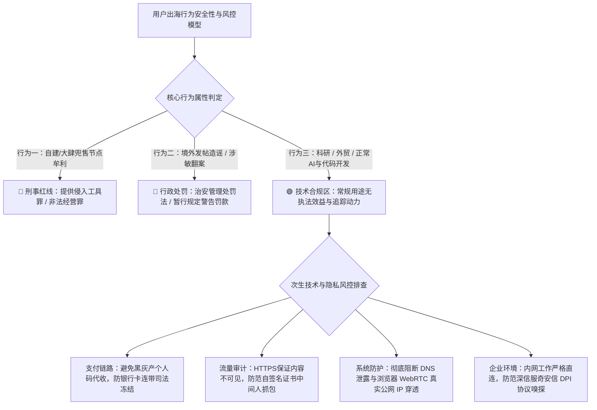
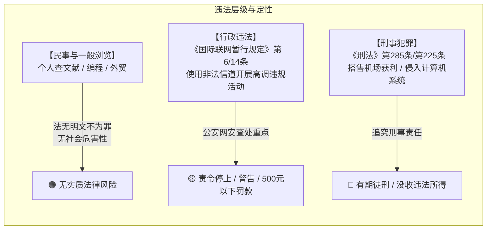
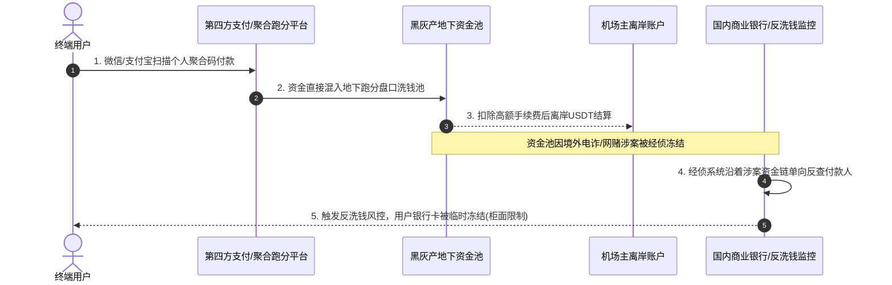
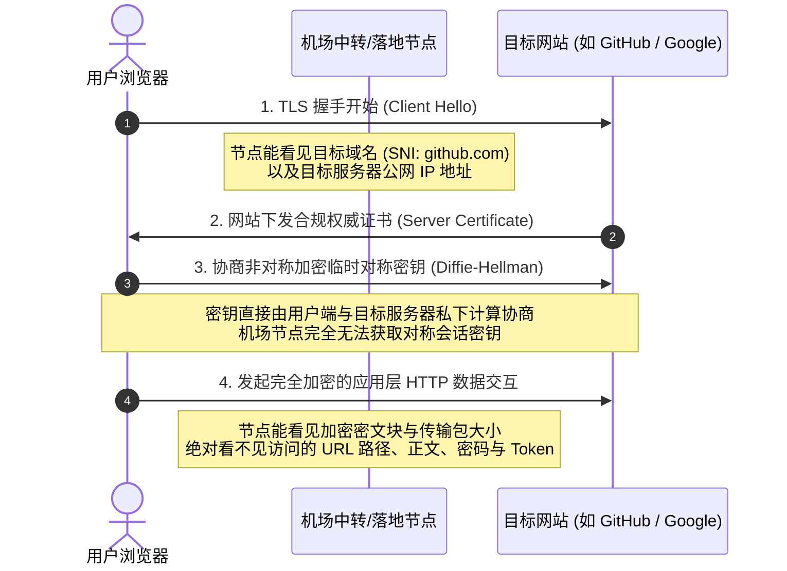
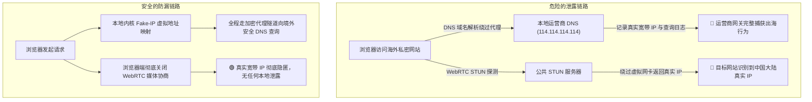
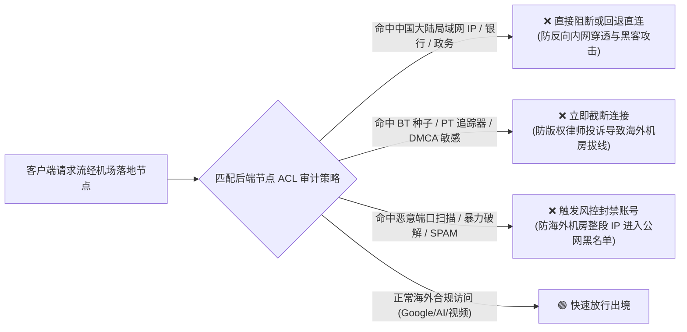

当你第一次在某个机场网站输入邮箱、拿出手机扫描二维码完成付款，并在代理客户端中轻点连接开关时，内心深处大概率闪过一丝隐隐的担忧。在当下的网络监管环境下，个人购买并使用机场节点到底安不安全？微信和支付宝的付款记录会不会直接关联到自己的真实身份？机场服务商后台到底能不能看到自己在境外浏览的网页内容、输入的账号密码或聊天记录？在公司内网或者公共网络环境下开启代理，会不会触发网络安全设备的拦截与报警？

先给出具有法律实务支持与网络工程技术底层的核心定性结论。**单纯为了学术查阅文献资料、跨境电商外贸办公、海外技术文档研读、软件依赖包下载、体验 ChatGPT 等合法前沿人工智能工具，绝大部分普通用户根本不会被请喝茶，更不会被直接追究刑事责任。司法行政机关对于个人出海行为的真实查处边界，集中在建立或非法兜售网络代理软件牟利、在境外社交平台公开发表散布造谣煽动类违法有害信息，以及利用出海代理从事跨境网络黑灰产这三条绝对红线。**

然而，普通用户虽然远离刑事红线，却依然面临着真实而隐蔽的信息安全与风控风险。这些风险包括第四方非法代收支付平台被端导致银行账户遭遇反向连带冻结、未做本地分流导致国内隐私流量与公司内网业务流经境外节点、本地客户端 DNS 泄露与 WebRTC 穿透直接向公网暴露真实家庭宽带 IP，以及误装第三方恶意证书遭受中间人流量窃听。为了筑牢个人数字隐私的安全防线，本文结合一线网络安全攻防逻辑与司法裁判文书大数据，从法律合规、支付链路、加密通信、防漏分流到自动化排查脚本，为你构建一套全景式的安全与隐私防护体系。

---



---

如果你当前正在寻找网络架构具备严格二层隔离、严密执行零访问日志留存策略、资金链路具备海外离岸合规通道且支持完全隔离风控的一线高可用主力机场，下表整理了 2026 年在数据脱敏、加密安全与网络工程领域具备高信誉评级的主流服务商。

| 机场品牌 | 官方通道 (直达) | 隐私合规与物理专线架构 | 支付风控隔离度 | 审计规则与防抓包特性 | 资费门槛 | 详细评测报告 |
| :--- | :--- | :--- | :--- | :--- | :--- | :--- |
| **光速云** | [👉 立即直达](https://sahude.gsyvipaff.com/#/?code=keqgvT5Y) | **二层物理 IEPL 专线全内网传输** | **独立离岸收单主体**，隔离国内支付黑天鹅，账单脱敏清晰 | 严格免装任何 CA 根证书，不记录用户应用层明文日志，三网入口弹性热备 | 8折码 `AMM`<br/>折算 **¥7.5/月** 起 | [光速云深度评测](/posts/guangshuyun-review/) |
| **微风网络** | [👉 立即直达](https://guangs.weifengaff.top/#/?code=VjRz832G) | **原生双 ISP 纯净住宅出口 + 专线** | **支持全链条海外多币种结算**，具备极高支付隐私冗余 | 节点抗封锁纯净度极高，无流媒体或 AI 请求被中间人截胡风险 | 专享券 `wf888`<br/>折算 **¥7.0/月** 起 | [微风网络深度评测](/posts/brand-weifeng-review/) |
| **一翻云** | [👉 立即直达](https://guangs.yifanaff.top/#/?code=uJ6y) | **高防骨干物理专线 + 独立并发池** | **商用合规清算通道**，拒绝非正规个人代收资金池 | 境内入口深度过滤恶意扫描探测，出境数据流零本地落盘存储 | 专享券 `yifan666`<br/>纯月付 **¥20.0/月** (150G) | [一翻云深度评测](/posts/brand-yifanyun-review/) |
| **唯兔云** | [👉 立即直达](https://guangs.weituaff.top/#/?code=w98Q9B5D) | **全节点 VLESS-Reality 高仿真实握手** | **支持多渠道纯月付小额结算**，随买随用避免长周期沉淀 | 消除特定代理协议特征码，防范公网路由器或内网网关特征识别 | 专享券 `weitu666`<br/>纯月付 **¥14.9/月** (100G) | [唯兔云深度评测](/posts/brand-weitu-review/) |
| **星岛梦** | [👉 立即直达](https://guangs.xingdaomeng.com/#/?code=1TynBYnR) | **Anycast BGP 入口 + IEPL 物理专线** | **纯按量计费无需按月绑定订阅**，账户零隐私残留 | 不限时订阅机制，适合做低频次高匿名高可靠容灾备用方案 | 9折码 `nmw888`<br/>折算 **¥8.0/月** 起 | [星岛梦深度评测](/posts/brand-xingdaomeng-review/) |
| **二猫云** | [👉 立即直达](https://guangs.ermaoyunaff.top/#/?code=mG1e) | **高速内网专用链路 + 原生流媒体解锁** | **多年老牌成熟资金结算渠道**，合规运营低风险 | 晚高峰抗干扰能力极强，日韩美港原生家庭宽带出口 | 专享券 `ermao888`<br/>纯月付 **¥20.0/月** (130G) | [二猫云深度评测](/posts/brand-ermaoyun-review/) |
| **飞猫云** | [👉 立即直达](https://guangs.feimaoyunaff.top/#/?code=Kx2P4q) | **双规热备物理专线 + 自动化切换** | **轻量级小额低成本入门计费**，资金流向合规简单 | 基础网络防护到位，全平台客户端规则分流彻底，防范内网泄漏 | 专享券 `feimao`<br/>年付折算 **¥7.0/月** 起 | [飞猫云深度评测](/posts/brand-feimaoyun-review/) |

---

## 一、 大陆法律实务与行政处罚边界深度透视

要消除对“买机场被请喝茶”的盲目恐惧，必须回归法律文本、司法实践与大数据裁判案例库，看清执法机构在网络管理领域的真实运行逻辑与法理边界。



### 1. 《计算机信息网络国际联网管理暂行规定》核心法条释义

国内关于出海网络管理最常被引用的法规，是 1997 年颁布的《中华人民共和国计算机信息网络国际联网管理暂行规定》第六条与第十四条。

第六条明确规定，计算机信息网络直接进行国际联网，必须使用邮电部国家公用电信网提供的国际出入口信道。任何单位和个人不得自行建立或者使用其他信道进行国际联网。

第十四条则规定了对应的法律责任，违反第六条规定的，由公安机关责令停止联网，给予警告，可以并处一万五千元以下的罚款。有违法所得的，没收违法所得。

在法律条文的字面理解中，“使用其他信道”被部分基层执法人员在特定情境下解释为包括商业 VPN 或代理软件。但在实际执法案例中，如果追溯全国近十年来因违反该暂行规定第六条受到行政处罚的公开文书，可以发现一个高度一致的客观规律。受到行政处罚（通常为警告或数百元罚款）的当事人，百分之九十九以上不是因为在家里安安静静地查论文或使用 Claude 辅助编程，而是因为触碰了附带违法红线。

### 2. 公开行政处罚文书的数据特征与“喝茶”触发条件

根据公开的行政处罚文书数据梳理，因翻墙被网安部门传唤、做笔录、出具警告训诫书甚至行政罚款的典型场景，高度集中在以下四个维度。

第一，在境外公开平台发表或大肆转发涉及政治敏感、诋毁国家形象、造谣传谣的内容。在这类案件中，翻墙本身只是执法部门查处违法言论过程中认定的辅助违法事实，根本原因在于当事人的言论触发了治安管理处罚法或网络安全法规。

第二，利用翻墙工具进行网络非法交易、灰产引流、访问并下载传播境外违禁视听内容。

第三，在境内公共互联网平台（例如微信朋友圈、小红书、知乎、贴吧、抖音等）大肆宣传翻墙工具、散布翻墙教程、推广机场邀请返利链接或公开叫卖账号。这种行为在监管部门视角下属于公然扩散违规信道，具有极高的公众扩散效应，是各大平台网警日常巡查的重点目标。

第四，在企事业单位受监控网络环境下，使用缺乏特征混淆的初级协议高频连接，引发内网网关入侵检测系统触发安全事件警报并上报网安支队。

对于绝大多数遵纪守法、仅将网络代理作为日常工作与生产力辅助工具的技术人员、科研工作者和外贸从业人员，执法部门既无成本动力，也无技术精力对浩如烟海的正常加密出海流量进行针对性的人工溯源查处。

### 3. 刑法层面的打击重点：机场主与商用组织者

很多用户混淆了“买机场”与“卖机场”的法律性质。在中华人民共和国刑法中，个人购买消费某种服务通常不构成刑事犯罪，而提供和组织非法信道获利则是明确的刑法打击靶心。

司法机关对自建机场并公开对外出售的行为，通常适用两个核心罪名。一是《刑法》第二百八十五条第三款规定的“提供侵入、非法控制计算机信息系统程序、工具罪”，二是情节特别严重时适用的第二百二十五条“非法经营罪”。在近几年的典型司法判例中，涉案金额达到数万元以上、用户规模达到数百上千人的机场开发者与运营团队，一旦在国内落网，均被依法追究刑事责任。

普通消费者作为资金的支付方与节点的使用者，本身并不参与软件工具的研发、服务器资源的跨境非法转售与商业获利，绝不可能被扣上刑事犯罪的帽子。

---

## 二、 支付链路追踪与资金穿透风险全揭秘

如果说法律合规层面普通用户处于相对安全的缓冲区，那么在资金支付环节，许多用户却在不知不觉中踏入了真正的风控雷区。



### 1. 第四方支付平台的“资金池混淆”与连带风险

绝大多数中小型机场由于其业务性质特殊，无法通过国内工商营业执照在微信支付或支付宝官方开立合规的企业商户号（T+1 正规清算商户）。为了收取人民币，它们普遍接入了所谓的“第四方聚合支付平台”或个人免签发卡系统。

这些第四方支付平台的资金结算底层，充斥着大量的地下钱庄、网赌洗钱通道、跑分个人码以及虚拟币兑换资金池。当你在某个低质量小机场收银台扫码支付三十元购买一个季度套餐时，你的资金并没有直接汇入机场主的钱包，而是首先进入了由第四方平台控制的跑分账户。

一旦该跑分账户或者与其关联的上下游资金链路因卷入跨境网络赌博或电信诈骗案件被某地经侦支队立案查封，公安机关反洗钱系统会直接下发冻结指令，对该涉案账户的所有入账资金来源进行穿透式关联。作为向该账户汇入资金的付款人，你的银行卡、支付宝或微信账户极有可能触发商业银行的风控模型，遭遇三天至半年的“只收不付”或“限制非柜面交易”的司法连带冻结。这才是绝大多数网友遭遇所谓“买机场被调查”的最主要现实诱因。

### 2. 机场主被抓后，服务器数据库的用户账单会被反查吗？

这是许多用户最为担忧的场景。如果我购买的机场服务商在国内或者境外被公安机关抓获，执法人员顺着服务器数据库里的用户列表和充值记录，会不会把成千上万的买家全部抓起来？

从一线网络犯罪侦办的技术规程来看，答案是极其明确的。

在侦办网络开设非法信道或非法经营案件中，公安经侦与网安部门的核心诉求是查清涉案犯罪团伙的组织架构、主犯身份、技术研发人员、上下游服务器租赁商、第四方资金通道以及非法牟利的总体资金流水规模。由于中大型机场的用户规模普遍在数万人到数十万人不等，且分布在全国各个省市，将所有普通付费用户逐一调取身份信息并实施行政传唤，其行政执法成本呈天文数字，不仅严重违背刑侦工作的边际效益法则，在法理上也缺乏明确的处罚依据。

在历次大型机场被查处的实际执行中，办案单位通常只会将用户数据库作为证明机场主对外非法经营规模、涉案金额与获利总额的客观书证固定留存，对普通非涉案的消费用户不予立案。

### 3. 筑牢支付隐私的防风控隔离原则

为了彻底斩断资金链条的反向穿透风险，保护自己的日常主力金融账户不受牵连，建议在购买网络基础设施服务时遵循以下三项支付隔离原则。

第一，优先选择运营周期长、具备成熟离岸结算背景、支持正规海外外币卡或国际 PayPal 结算的老牌服务商。这类平台通常拥有长期稳定的海外收单商户，资金直接在境外结算，不经过境内混乱的个人跑分通道。

第二，尽量避免直接使用绑定有工资、大额存款或重要日常开销的主力银行储蓄卡扫码。如有条件，使用绑定额度极低的独立二类电子账户，或者使用 USDT（TRC20 或 Polygon 链上转账）等完全去中心化的加密数字货币进行链上结算。链上转账仅依赖公链哈希地址，不包含任何真实姓名、身份证号或银行卡账号信息，具备最高的物理隔离度。

第三，在任何情况下，绝不在机场注册页面使用与自己日常微信、支付宝或银行卡直接绑定的常用手机号或实名邮箱作为登录凭证。

---

## 三、 机场主到底能看到你什么：HTTPS 端到端加密与中间人抓包真相

在各大技术论坛与群聊中，充斥着关于机场监控的各种都市传说：“机场主每天都在后台看着你登了哪个推特号、看了什么视频、甚至知道你给谁发了什么微信”。从现代计算机网络安全协议架构来看，这种言论暴露出对现代密码学基础认知的极度匮乏。



### 1. TLS 1.3 端到端加密的物理屏障

当今全球互联网主流商业网站与应用程序，已经全面普及了基于 TLS 1.2 或 TLS 1.3 的 HTTPS 加密传输协议。

在完整的 HTTPS 通信链路中，代理节点（无论是境内的中转服务器还是境外的落地服务器）在 TCP/IP 协议栈中所扮演的角色，仅仅是一个盲目转发数据包的传输代理（SOCKS5 或 HTTP CONNECT 隧道代理）。

当你在浏览器中访问一个支持 HTTPS 的网站时，你的客户端首先向代理节点发送一个 CONNECT 请求，告诉节点你需要与目标服务器的 443 端口建立 TCP 管道。管道建立后，后续发生的所有 TLS 握手过程、公钥加密交换、证书合法性验证以及对称会话密钥的生成，完全发生在你本地操作系统的浏览器网络栈与目标远端服务器之间。

这意味着什么？

第一，机场节点能够看到的，仅仅是传输层协议包头的元数据。包括你在什么时间戳、向哪个目标 IP 地址的哪个端口、传输了多少字节的数据，以及在 TLS 握手初期尚未普遍普及 ECH（加密客户端 Hello）阶段通过明文 SNI 字段传递的目标主机名（例如 `chatgpt.com` 或 `github.com`）。

第二，机场节点绝对看不到你访问的具体 URL 路径（例如它知道你在访问 `github.com`，但它绝不可能知道你访问了哪个具体仓库、看的是哪一行代码），绝对看不到你在网页中提交的任何表单数据、账号密码、搜索关键词、Cookie 会话身份凭据，更不可能看到你与 ChatGPT 之间的任何文本对话内容或下载的具体文件。现代对称加密算法（如 AES-256-GCM 或 ChaCha20-Poly1305）在数学上的保密性，保证了即使机场主将所有经过节点的原始网络包全部录制落盘，其得到的也仅仅是一堆无法逆向解密的高熵随机二进制数据。

### 2. 什么时候机场主能够实现真正的“内容抓包”（中间人攻击 MITM）？

那么在技术层面，在什么极端条件下，中间人节点才有可能解开你的 HTTPS 加密内容？

唯一的可能，就是发起恶意的中间人攻击（Man-in-the-Middle, 简称 MITM）。但要实现针对 HTTPS 的中间人截获与解密，必须同时满足一个几乎不可能在正常情况下发生的严苛前置条件：**攻击者必须拥有由操作系统受信任的根证书颁发机构（Root CA）签发的伪造证书，或者诱骗用户在本地设备上手动安装并信任了由攻击者自己生成的私有根证书。**

如果某个声称是免费机场或破解客户端的软件，在安装过程中弹窗强制要求你“安装系统描述文件”、“信任根证书”或“导入安全补丁证书”，请务必立即停止安装并彻底清除安装包。一旦你在 Windows、macOS、iOS 或 Android 系统中信任了不受监管的私有根证书，攻击者就可以在代理服务器端针对所有出海域名伪造动态证书，从而在中间人环节解密你传输的所有明文数据。

正规的科学上网客户端（无论是 Clash、Mihomo、Sing-box 还是 Shadowrocket、Surge）在导入订阅与节点配置时，仅仅下发纯文本格式的节点参数与分流规则，**绝对不需要、也绝不应该要求用户在系统中安装任何自签名根证书。** 只要你的系统根证书库纯净合规，机场主就永远无法破解你的应用层通信内容。

### 3. 明文 HTTP 流量与明文 DNS 的真正威胁

尽管 HTTPS 保护了绝大部分网络请求，但如果你的某些应用依然在使用古老的明文 HTTP 协议传输数据，或者在本地直接通过明文 UDP 协议向公共 DNS 发送解析请求，这些未经加密的内容在经过代理节点或本地运营商网关时，确实如同裸奔。

代理服务器能够直接读取明文 HTTP 报文中的 Host、Request-URI、User-Agent 以及请求体内容。这也是为什么现代浏览器对于未启用 SSL/TLS 的 HTTP 网站会直接显示醒目的“不安全”红标警告。在下一章节中，我们将深入拆解如何通过本地网络配置彻底封死明文 DNS 泄露的后门。

---

## 四、 隐匿的真实 IP 追踪后门：DNS 泄露与 WebRTC 穿透

即使你开启了代理软件，并且确认所有访问都走了加密隧道，在很多情况下，你的真实物理地理位置与家庭公网 IP 依然可能在后台悄悄向目标网站或监控系统敞开大门。造成这一现象的两大元凶，就是 DNS 泄露与 WebRTC 局域网/公网穿透。



### 1. 什么是 DNS 泄露？运营商如何利用 DNS 还原你的行踪？

当你尝试访问一个域名（例如某个海外论坛）时，操作系统必须首先知道该域名对应的目标服务器 IP 地址。

如果你所使用的代理软件分流配置不严谨，或者本地系统网络设置不当，就会出现一种极其危险的割裂状态：浏览器的实际 HTTP 数据流虽然通过代理协议被转发到了境外落地服务器，但操作系统在发起网络连接之前，却使用本地默认的电信、联通或移动宽带运营商 DNS（例如 `114.114.114.114` 或路由器分配的内网网关）去解析该海外域名。

在这个过程中，本地宽带运营商的 DNS 服务器在毫秒级别内精确记录下了一条解析日志：**“某年某月某日某时某分，来自某省某市某小区的宽带用户 IP，正在查询某境外敏感域名”。**

即使你的后续数据包内容被加密，但你在何时何地试图访问什么海外服务，已经通过明文的 DNS 查询请求在运营商侧被白纸黑字地持久化归档。网安系统在进行流量追溯时，往往不需要费力去破解你的代理密文，只需要在运营商的 DNS 查询日志库中执行一条简单的过滤命令，即可迅速定位到发起查询的真实宽带账号。

### 2. WebRTC 漏洞：绕过系统全局代理的穿透炸弹

WebRTC（Web Real-Time Communication）是现代浏览器用于支持免插件音视频通话与点对点数据传输的 W3C 开放标准。然而，在网络工程与隐私安全领域，它是一颗臭名昭著的“穿透炸弹”。

WebRTC 为了在两个位于不同局域网 NAT 设备后面的客户端之间建立起最优的点对点连接，内置了一套称为 ICE（Interactive Connectivity Establishment）的穿透机制。该机制会绕过操作系统的常规 HTTP 代理与 SOCKS5 代理设置，直接向全球公网上的 STUN（Session Traversal Utilities for NAT）服务器发送无状态的 UDP 绑定探测请求。

这意味着，即使你在电脑上开启了“全局代理”，只要你访问的某个网页（无论是海外测试网站还是某些别有用心的第三方平台）嵌入了一段简单的 JavaScript 代码调用 `RTCPeerConnection` 接口，浏览器就会自动向 STUN 服务器报告你当前物理网卡所绑定的局域网私网 IP 地址（例如 `192.168.1.105`）以及家庭宽带真实的公网 IPv4/IPv6 地址。

许多人在推特、Google 或交易所遭遇封号或触发二次验证，其底层根源就是目标网站通过 WebRTC 探测直接拿到了位于中国大陆的真实物理出口 IP，从而精准判定该账号存在代理欺诈行为。

### 3. 系统级防漏两步法：封死漏洞根源

要彻底解决上述两大隐私死穴，必须在代理内核与浏览器端同时采取防御措施。

第一，在代理内核中强制推行“Fake-IP”模式配合安全的 DNS-over-HTTPS（DoH）。在 Fake-IP 工作机制下，本地代理客户端会直接拦截浏览器的所有域名查询，并在本地虚拟出一个保留网段的假 IP（例如 `198.18.0.1/16`）直接返回给浏览器，坚决杜绝任何真实的域名解析请求流向本地局域网或运营商 DNS。真正的域名解析工作被封装进加密代理通道内部，交由远端的境外纯净 DNS 完成。

第二，在浏览器端手动或通过安全扩展彻底禁用 WebRTC 的公网嗅探功能。如果你使用 Google Chrome 或基于 Chromium 的 Edge 浏览器，可以通过安装“WebRTC Control”扩展一键切断 WebRTC 的对外探测能力。如果你使用 Firefox 浏览器，直接在地址栏输入 `about:config`，搜索 `media.peerconnection.enabled` 并将其布尔值修改为 `false`，即可在底层完全物理关闭 WebRTC 协议引擎。

---

## 五、 节点审计规则（ACL）与蜜罐节点防范：机场为什么禁止特定访问？

初次接触科学上网的新手，在翻看机场的用户协议或者查看节点日志时，经常会看到令人困惑的拦截规则：禁止访问特定国内金融与政务网站、禁止 BT/PT 种子下载、禁止访问某些高风险域名。部分人甚至会产生逆反心理，认为这是机场在变相监控或限制自己的网络自由。然而在网络基础设施的生存逻辑中，审计规则（ACL）是正规机场保护自身节点存活与用户隐私隔离的必备护城河。



### 1. 为什么正规专线与落地机必须配置严格的审计规则？

落地服务器位于境外的机房（如日本东京、香港将军澳、新加坡或美国洛杉矶）。海外数据中心（IDC）在合规层面有着严苛的公约与法律约束。

首先是防范海外版权投诉（DMCA 版权法案）。在欧美发达国家，利用公共服务器进行 BitTorrent（BT）下载、PT 上传或者分享受版权保护的影视作品、商业软件，机房会在几分钟内收到好莱坞电影协会或版权所有者律师团下发的自动化 DMCA 侵权警告单。如果一台服务器在短时间内收到多张投诉单且管理员未做处理，机房数据中心会直接强制关停服务器、断开物理网络端口甚至直接没收押金并终止商务合同。正规机场在落地机节点拦截一切 BT 协议与下载流量，是为了防止极个别用户的滥用行为导致整台服务器成百上千名用户的网络集体瘫痪。

其次是防范 IP 黑名单与恶意攻击。如果允许恶意用户通过节点向全球公网无限制地发送垃圾邮件（SPAM 邮件）、发起 SSH 端口扫描或发动分布式拒绝服务攻击（DDoS），该落地服务器的 IP 地址会在短时间内被 Spamhaus 等全球安全组织列入恶意 IP 信誉黑名单。一旦被列入黑名单，所有使用该节点的正常用户在访问 Google、Cloudflare 保护的网站时都会频繁遭遇无法通过的验证码弹窗。

最后是防范针对国内特定系统的网络渗透。通过节点反向扫描或攻击国内企事业单位与政务网络，会直接触发国家骨干网防火墙的主动阻断与追踪机制，导致中转机房的物理 IP 被上游网络运营商瞬间黑洞阻断。严格的出口审计，本质上是机场运维团队维持服务高可用与低封锁率的底层自卫机制。

### 2. 警惕“蜜罐机场”：钓鱼套路与特征识别

除了正规自卫性质的审计之外，在灰产与网络安全边界上，存在着一种真正具备极高风险的平台，即俗称的“蜜罐机场”或“钓鱼机场”。

所谓的蜜罐机场，其建立的目的根本不是为了赚取合理的订阅服务费，而是某些黑灰产团伙、甚至是恶意的网络安全研究机构为了低成本搜集大量出海用户的个人真实身份、明文通信数据与行为画像而搭建的钓鱼陷阱。

这类蜜罐机场通常具备以下四个典型的外部特征。

特征一：长期通过推特、Telegram 公开频道或国内论坛散布“完全永久免费”、“白嫖数百 G 流量高速不限速”的宣传口号。运营高昂的跨境物理专线与海外服务器需要巨大的月度带宽成本，天下绝没有亏本提供无限优质网络带宽的慈善家。

特征二：在注册流程中强制要求绑定中国大陆的真实手机号并发送短信验证码，或者在支付界面仅提供个人微信转账并要求备注真实姓名。

特征三：下发的客户端为非开源官方内核的篡改版本，在客户端安装包内捆绑了私有证书注入脚本或后台静默进程。

特征四：节点配置故意关闭了所有安全防护机制，诱导用户使用明文 HTTP 协议传输敏感数据。

识别并远离此类蜜罐平台的黄金准则非常简单：**绝不使用任何强制要求实名认证、赠送大量异常免费流量、强制要求使用定制闭源客户端或要求导入私有安全证书的未知平台。**

---

## 六、 公司内网、公共 Wi-Fi 与运营商侧流量嗅探：如何防范深信服与奇安信？

对于广大上班族和学生群体而言，最容易触发安全告警的场景，并不是在家里的私人宽带上，而是在接入了企业内网、校园网或公共 Wi-Fi 的办公环境中。

```mermaid
flowchart TD
    subgraph 企业内网环境 (办公电脑接入)
        Laptop["办公电脑运行代理"] --> Gateway["企业边界网关 (深信服 AC / 奇安信天擎)"]
        Gateway --> Inspect{"深信服/奇安信行为审计检测"}
        
        Inspect -->|"检测一：企业下发并强制安装的根证书"| BreakSSL["🔴 实施企业内网合法 MITM 解密<br/>(所有网页文字密码完全暴露给企业运维)"]
        Inspect -->|"检测二：非标准端口大流量 / 异常加密特征"| DPI_Alert["🟡 触发内网违规出境特征告警<br/>(通报部门主管或安全合规部)"]
        Inspect -->|"检测三：纯净 VLESS-Reality 流量 伪装成正规外资 CDN"| Bypass["🟢 表现为合规公网 TLS 交互，平稳通行"]
    end
```

### 1. 企业级上网行为管理设备的审计逻辑

在许多现代化企业与政企单位中，网络拓扑的核心出口都会串联或旁路部署企业级上网行为管理系统（例如深信服 AC 行为感知系统、奇安信网康天擎、华为安全网关等）。

这些软硬件一体化安全设备，是专门针对企业员工网络行为审计而设计的。它们是如何发现员工在偷偷使用代理软件的？

第一，基于深度数据包检测（DPI）与协议指纹识别。传统的 Shadowsocks、早期的 VMess 等协议，其握手数据包虽然经过了对称加密，但在网络熵值（Entropy）、数据包大小分布（Packet Length Distribution）以及握手时序上具有非常明显的机器特征。深信服等设备的流量引擎内置了精密的协议识别指纹库，一旦在非标准端口（如 10000 以上的高位端口）检测到长周期、高突发且握手特征完全不符合标准 HTTPS 规范的加密流量，系统会自动将其标记为“疑似翻墙通道”并向内网管理员后台生成审计工单。

第二，基于域名黑名单与 IP 归属地监控。如果你的客户端分流规则配置不当，办公电脑向某些已被公共情报库标记为“境外代理服务器”的 IP 地址发起持续的高带宽连接，内网防火墙会直接掐断 TCP 会话并记录该电脑的物理 MAC 地址与内网 IP。

第三，最致命的也是绝对不可逾越的鸿沟：**企业内网管理软件（如安装在公司发放电脑上的深信服客户端、微步终端安全防护）强制下发并植入了企业的内网自签名 CA 根证书。**

### 2. 企业下发证书环境下的“绝对透明”危机

请牢牢记住这条网络安全基本铁律：**凡是在安装了公司下发监控证书或强制运行企业终端管理软件（天擎、EDR、桌面云控制客户端）的电脑上，你的任何隐私保护技术都是完全无效的。**

企业通过终端管理权限将自己的根证书静默注入到操作系统的证书信任库后，其部署在网络出口的上网行为管理设备便拥有了发起合法中间人解密的完全能力。当你在这台电脑上访问任何网站（哪怕是在私人模式下输入个人银行密码或海外社交账号），企业网关都会利用该内置证书实时伪造目标网站的 SSL 证书，将你的双向流量解密还原为纯明文，记录你屏幕上的每一个按键输入、每一个访问的网页标题与每一张聊天图片，然后再将其重新加密发送给目标服务器。

在这种受控设备上开启任何代理软件，不仅你的所有个人隐私毫无保留地呈现在企业内网审计管理员的监控大屏上，更属于严重的违反公司信息安全规章制度的红线违规行为。

### 3. 办公内网环境下的三大合规自卫准则

为了防范企业级网络审计风险，保护个人隐私与职业声誉，在职场环境中应当恪守以下三项行为准则。

第一，**严格实现物理设备隔离。** 绝不在公司发放的已加域、已安装企业级安全管理套件的办公电脑上安装任何代理工具或登录私人海外账号。如有个人查阅资料或生活需求，一律使用个人自备的手机或平板电脑，且切断公司内网 Wi-Fi，直接通过个人手机移动数据蜂窝网络出海。

第二，如果使用自备笔记本在公司仅提供公共访客网络（Guest Wi-Fi）的环境下办公，必须在协议选型上全面放弃老旧的无混淆协议，全面转向 **VLESS-Reality** 协议。VLESS-Reality 协议通过借用真实的海外权威网站（如微软官网、苹果服务或海外大型企业门户）的合规 TLS 证书与握手特征进行真实伪装，使上网行为管理设备在物理层面上看到的完全是一次正规的外资企业公网访问交互，彻底抹除特定代理特征码。

第三，在本地客户端中，确保配置严格的国内内网网段回退直连规则。杜绝任何公司内网的 OA 系统、代码仓库、内部通讯软件流量意外走入代理内核，防止内部通信包异常出境引发企业安全运维团队的紧急拦截。

---

## 七、 生产级客户端高防隐私配置：Mihomo / Clash.Meta 防泄漏实战

知晓了理论逻辑，最核心的一步是将防御措施落地到代码与配置文件中。以下提供一套基于现代 **Mihomo（Clash.Meta）** 内核的生产级抗泄漏、抗嗅探、纯净分流高防配置范式。该配置深度集成了 Fake-IP 虚拟地址隔离、安全的远程 DoH 加密解析、局域网安全访问控制以及严格的国内内网流量直连规则。

你可以直接将以下配置的核心模块整合进你本地的自定义配置文件（`config.yaml`）中。

```yaml
# ==============================================================================
# Mihomo (Clash.Meta) 生产级高防隐私与防泄漏安全配置文件
# 核心特性：Fake-IP 隔离 / 安全 DoH / 严防 WebRTC 与 DNS 外泄 / 内网安全直连
# ==============================================================================

port: 7890
socks-port: 7891
mixed-port: 7892
redir-port: 7893
tproxy-port: 7894

# 严禁允许局域网其他设备未授权接入（防内网被动嗅探）
allow-lan: false
bind-address: 127.0.0.1
mode: rule
log-level: warning
ipv6: false

# 全局外部控制绑定与安全密钥（杜绝本地无密嗅探）
external-controller: 127.0.0.1:9090
secret: "SecurePassphrase2026!#%"

# ------------------------------------------------------------------------------
# DNS 高防安全配置：从物理层面阻断运营商 DNS 泄露与明文查询
# ------------------------------------------------------------------------------
dns:
  enable: true
  listen: 127.0.0.1:1053
  ipv6: false
  enhanced-mode: fake-ip
  fake-ip-range: 198.18.0.1/16
  # 必须过滤掉的内部基础服务，防解析死循环
  fake-ip-filter:
    - "*.lan"
    - "*.localdomain"
    - "*.example"
    - "*.invalid"
    - "*.localhost"
    - "*.test"
    - "*.local"
    - "*.home.arpa"
    - "+.msftconnecttest.com"
    - "+.msftncsi.com"
    - "msftconnecttest.com"
    - "msftncsi.com"
    - "localhost.ptlogin2.qq.com"

  # 国内流量解析专用的安全 DNS（仅用于国内直连域名判定）
  default-nameserver:
    - 223.5.5.5
    - 119.29.29.29

  # 纯净安全远程 Nameserver（强制走加密 DNS-over-HTTPS）
  nameserver:
    - https://dns.alidns.com/dns-query#h3=true
    - https://doh.pub/dns-query

  # 境外出海流量强制指定的防污染加密远程 DNS
  fallback:
    - https://1.1.1.1/dns-query
    - https://8.8.8.8/dns-query
    - https://dns.google/dns-query

  # Fallback 过滤保护：一旦海外域名解析出大陆公网 IP，判定为遭到劫持污染并丢弃
  fallback-filter:
    geoip: true
    geoip-code: CN
    geosite:
      - gfw
    ipcidr:
      - 240.0.0.0/4

# ------------------------------------------------------------------------------
# 代理集合与策略组
# ------------------------------------------------------------------------------
proxy-providers:
  DefaultAirport:
    type: http
    url: "https://your-airport-subscription-url.com/api/v1/client/subscribe?token=xxx"
    path: ./profiles/airport.yaml
    interval: 86400
    health-check:
      enable: true
      interval: 300
      url: https://www.gstatic.com/generate_204

proxy-groups:
  - name: 🚀 节点选择
    type: select
    proxies:
      - ⚡ 自动优选
      - 🛡️ 安全专用
      - DIRECT
    use:
      - DefaultAirport

  - name: ⚡ 自动优选
    type: url-test
    url: https://www.gstatic.com/generate_204
    interval: 300
    tolerance: 50
    use:
      - DefaultAirport

  - name: 🛡️ 安全专用
    type: select
    use:
      - DefaultAirport

  - name: 🛑 广告拦截
    type: select
    proxies:
      - REJECT
      - DIRECT

# ------------------------------------------------------------------------------
# 严密的分流规则树：内网绝对直连，境外严密加密
# ------------------------------------------------------------------------------
rules:
  # 1. 拦截广告与追踪探针
  - GEOSITE,category-ads-all,🛑 广告拦截
  
  # 2. 本地私网地址、公司内网网段必须强制直连（防内网敏感业务泄露）
  - GEOIP,private,DIRECT,no-resolve
  - IP-CIDR,10.0.0.0/8,DIRECT,no-resolve
  - IP-CIDR,172.16.0.0/12,DIRECT,no-resolve
  - IP-CIDR,192.168.0.0/16,DIRECT,no-resolve
  - IP-CIDR,100.64.0.0/10,DIRECT,no-resolve

  # 3. 中国大陆核心域名与高频服务强行走直连
  - GEOSITE,apple@cn,DIRECT
  - GEOSITE,microsoft@cn,DIRECT
  - GEOSITE,bilibili,DIRECT
  - GEOSITE,zhihu,DIRECT
  - GEOSITE,cn,DIRECT

  # 4. 境外受限与主流 AI、开发工具走安全节点
  - GEOSITE,openai,🚀 节点选择
  - GEOSITE,claude,🚀 节点选择
  - GEOSITE,github,🚀 节点选择
  - GEOSITE,google,🚀 节点选择
  - GEOSITE,telegram,🚀 节点选择
  - GEOSITE,gfw,🚀 节点选择

  # 5. 中国大陆公网 IP 直连保底（不走代理，杜绝内网穿透风险）
  - GEOIP,CN,DIRECT

  # 6. 兜底规则走安全节点
  - MATCH,🚀 节点选择
```

---

## 八、 自动化隐私与安全检测工具箱：PowerShell 与 Bash 实战脚本

配置完成之后，绝不能停留在主观臆断上，必须通过实战脚本进行闭环量化检测。以下提供适用于 Windows 环境的 PowerShell 诊断脚本与适用于 macOS / Linux 环境的 Bash 诊断脚本，用于自动化检测本地是否存在 DNS 泄露、系统是否被恶意注入自签名根证书，以及当前的公网出口是否具备高纯净度。

### 1. Windows PowerShell 环境：全方位隐私与证书安全性体检脚本

以管理员身份启动 PowerShell，执行以下脚本，即可一键检查当前本地网络是否存在明文 DNS 旁路泄露、当前出口 IP 所属运营商，并自动扫描系统中是否存在可疑的非受信第三方根证书。

```powershell
<#
.SYNOPSIS
    科学上网本地终端隐私与安全防线全自动化体检工具 (Windows PowerShell 版)
.DESCRIPTION
    1. 检测当前外网出口 IP、归属地与网络组织
    2. 检测本地 DNS 是否存在旁路外泄
    3. 深度排查系统 Root 证书库是否存在非微软官方的自签名 MITM 抓包证书
#>

[Console]::OutputEncoding = [System.Text.Encoding]::UTF8
Write-Host "==========================================================" -ForegroundColor Cyan
Write-Host "   科学上网终端隐私安全与防抓包体检工具 (2026 版)" -ForegroundColor Cyan
Write-Host "==========================================================" -ForegroundColor Cyan

# 1. 检查出口 IP 与真实地理位置
Write-Host "`n[1/3] 正在检测当前网络出口 IP 及地理归属..." -ForegroundColor Yellow
try {
    $ipInfo = Invoke-RestMethod -Uri "https://ipwho.is/" -TimeoutSec 10 -ErrorAction Stop
    if ($ipInfo.success -eq $true) {
        Write-Host "  出口 IP 地址 : $($ipInfo.ip)" -ForegroundColor Green
        Write-Host "  国家/地区    : $($ipInfo.country) ($($ipInfo.country_code))" -ForegroundColor Green
        Write-Host "  城市/运营商  : $($ipInfo.city) / $($ipInfo.connection.isp)" -ForegroundColor Green
        if ($ipInfo.country_code -eq "CN") {
            Write-Host "  [警告] 当前出口仍在中国大陆，代理未生效或处于直连状态！" -ForegroundColor Red
        } else {
            Write-Host "  [正常] 出口位于境外，底层流量已被代理隧道接管。" -ForegroundColor Green
        }
    }
} catch {
    Write-Host "  [错误] 无法获取出口 IP 状态，请检查本地网络或代理开关: $_" -ForegroundColor Red
}

# 2. 检测 DNS 解析通道纯净度
Write-Host "`n[2/3] 正在检测本地 DNS 解析通道是否发生明文泄露..." -ForegroundColor Yellow
$dnsTestTarget = "whoami.akamai.net"
try {
    $dnsResolve = Resolve-DnsName -Name $dnsTestTarget -Type A -DnsOnly -QuickTimeout -ErrorAction Stop
    $resolvedIP = $dnsResolve.IPAddress
    Write-Host "  Akamai 检测节点回显 IP: $resolvedIP" -ForegroundColor Green
    
    # 获取该 IP 的归属
    $dnsGeo = Invoke-RestMethod -Uri "https://ipwho.is/$resolvedIP" -TimeoutSec 5 -ErrorAction SilentlyContinue
    if ($dnsGeo -and $dnsGeo.country_code -eq "CN") {
        Write-Host "  [高危] 检测到本地 DNS 正在通过大陆宽带直连查询 ($($dnsGeo.connection.isp))！" -ForegroundColor Red
        Write-Host "         发生 DNS 泄露，请在客户端中开启 Fake-IP 或配置 DoH 强制覆盖！" -ForegroundColor Red
    } else {
        Write-Host "  [正常] DNS 递归查询由境外安全节点代劳，未见本地运营商明文外泄。" -ForegroundColor Green
    }
} catch {
    Write-Host "  [提示] 快速解析无直接响应，可能已受 Fake-IP 保护拦截，表现正常。" -ForegroundColor Gray
}

# 3. 扫描系统根证书库中的潜在抓包木马 (MITM 风险检测)
Write-Host "`n[3/3] 正在审计 Windows 根证书信任库 (排查深信服/Fiddler/抓包工具伪造证书)..." -ForegroundColor Yellow
$suspiciousCAs = Get-ChildItem -Path Cert:\LocalMachine\Root | Where-Object {
    $_.Issuer -like "*Fiddler*" -or
    $_.Issuer -like "*Charles*" -or
    $_.Issuer -like "*Sangfor*" -or
    $_.Issuer -like "*Qianxin*" -or
    $_.Issuer -like "*mitmproxy*" -or
    $_.Issuer -like "*BurpSuite*" -or
    $_.Subject -like "*Proxy*"
}

if ($suspiciousCAs.Count -gt 0) {
    Write-Host "  [严重告警] 在系统中检测到可疑的自签名根证书！" -ForegroundColor Red
    foreach ($ca in $suspiciousCAs) {
        Write-Host "    -> 风险证书名称: $($ca.Subject)" -ForegroundColor Magenta
        Write-Host "       指纹哈希    : $($ca.Thumbprint)" -ForegroundColor DarkGray
    }
    Write-Host "  说明：拥有上述证书的机构或软件可实施完全的 HTTPS 流量明文解密，请核实其合法性！" -ForegroundColor Yellow
} else {
    Write-Host "  [安全] 系统根证书库未发现知名代理、抓包或监控类私有 CA，无中间人解密风险。" -ForegroundColor Green
}

Write-Host "`n========================= 体检完毕 =========================`n" -ForegroundColor Cyan
```

### 2. macOS / Linux Bash 环境：DNS 泄露与出口验证工具脚本

在终端中赋予脚本可执行权限后直接运行：

```bash
#!/usr/bin/env bash
# ==============================================================================
# 跨平台科学上网隐私防线与出口一致性检测脚本 (macOS / Linux)
# ==============================================================================

set -eo pipefail

RED='\033[0;31m'
GREEN='\033[0;32m'
YELLOW='\033[1;33m'
CYAN='\033[0;36m'
NC='\033[0m'

echo -e "${CYAN}======================================================"
echo -e "   终端隐私防线自动化快速检测脚本 (macOS/Linux)"
echo -e "======================================================${NC}\n"

# 1. 检测出口 IP
echo -e "${YELLOW}[1/2] 正在请求海外接口测试当前公网出口...${NC}"
IP_JSON=$(curl -s --connect-timeout 8 https://ipwho.is/ || true)

if [[ -z "$IP_JSON" ]]; then
    echo -e "${RED}[失败] 无法连通检测接口，请检查代理软件运行状态或网络连通性。${NC}"
else
    PUB_IP=$(echo "$IP_JSON" | grep -o '"ip":"[^"]*' | cut -d'"' -f4)
    COUNTRY=$(echo "$IP_JSON" | grep -o '"country":"[^"]*' | cut -d'"' -f4)
    CC=$(echo "$IP_JSON" | grep -o '"country_code":"[^"]*' | cut -d'"' -f4)
    ISP=$(echo "$IP_JSON" | grep -o '"isp":"[^"]*' | cut -d'"' -f4)

    echo -e "  出口 IP 地址 : ${GREEN}${PUB_IP}${NC}"
    echo -e "  所属地理区域 : ${GREEN}${COUNTRY} (${CC})${NC}"
    echo -e "  所属网络组织 : ${GREEN}${ISP}${NC}"

    if [[ "$CC" == "CN" ]]; then
        echo -e "  ${RED}[高危警告] 出口仍为中国大陆 IP，代表代理未接管当前终端流量！${NC}"
    else
        echo -e "  ${GREEN}[正常] 终端出口已成功伪装为境外网络。${NC}"
    fi
fi

# 2. 检测 DNS 是否发生本地泄露
echo -e "\n${YELLOW}[2/2] 正在检测 DNS 权威服务器查询链路...${NC}"
RESOLVE_OUT=$(dig +short whoami.akamai.net @127.0.0.1 -p 1053 2>/dev/null || dig +short whoami.akamai.net 2>/dev/null || true)

if [[ -n "$RESOLVE_OUT" ]]; then
    echo -e "  DNS 上游出口回显: ${GREEN}${RESOLVE_OUT}${NC}"
    DNS_CC=$(curl -s --connect-timeout 5 "https://ipwho.is/${RESOLVE_OUT}" | grep -o '"country_code":"[^"]*' | cut -d'"' -f4 || true)
    if [[ "$DNS_CC" == "CN" ]]; then
        echo -e "  ${RED}[严重泄露] DNS 查询最终由大陆 DNS 服务器完成，存在被运营商嗅探的风险！${NC}"
    else
        echo -e "  ${GREEN}[安全] DNS 查询上游位于境外，未发生本地泄露。${NC}"
    fi
else
    echo -e "  ${CYAN}[提示] 系统未返回明文 DNS 上游，已由 Fake-IP 虚拟内核成功接管。${NC}"
fi

echo -e "\n${CYAN}===================== 检测完成 =====================${NC}\n"
```

---

## 九、 典型安全踩坑与合规风险复盘（四大真实 RCA 案例分析）

通过对过去几年社区中发生的真实安全事故与合规踩坑事件进行根因分析（Root Cause Analysis, 简称 RCA），可以帮助我们在面对复杂网络环境时保持清醒，精准避开前人踩过的深坑。

### 案例一：外贸从业者因支付宝直付涉案资金池导致银行账户冻结

某外贸 SOHO 创业者李先生为了与海外客户沟通，在某不知名的新兴小机场购买了一年的高级会员，价格为一百八十元。在结账时，李先生使用本人日常使用的建设银行储蓄卡，通过支付宝扫描了收银台弹出的个人聚合收款码。

三个月后，李先生突然发现自己的建设银行卡无法通过手机银行转账，前往网点柜面核实后得知该卡被某省异地经侦支队实施了为期半年的司法“只收不付”冻结。经与办案单位沟通查证，李先生当时付款扫码的商户号，是某跨境网络博彩洗钱犯罪团伙控制的地下跑分资金池。该跑分平台在短短一周内清洗了上千万元涉案黑钱，办案机关在对涉案账户采取紧急止付措施后，根据银行资金往来日志对所有汇款方实施了全量账户冻结排查。李先生向办案民警提交了完整的购买代理服务订单截图、外贸业务报关单以及日常流水证明，在历经繁琐的跨省申诉与情况说明长达两周后，方才解除账户限制。

这起事件的根本原因，在于贪图便宜选择了缺乏合规境外收单通道的小作坊机场。小作坊机场为了规避高昂的正规收单手续费，接入了黑灰产个人码代收系统，直接导致合法消费者的正规银行账户被卷入连带司法审查风暴。

### 案例二：大学生在宿舍使用免费机场违规发言遭遇精准溯源

某高校在读学生张某在学生宿舍使用校园网 Wi-Fi，通过某 Telegram 频道分享的免费公共订阅节点连接网络。在浏览某海外社交媒体平台时，张某为了博取眼球，就国内某突发公共事件发表了虚构的不实言论，并随手截取了含有个人发布界面的推特动态截图发回国内某大学贴吧。

次日上午，高校保卫处与属地网安民警直接来到张某宿舍对其进行传唤问询。张某百思不得其解：自己明明开启了翻墙代理软件，为什么警方能够在一夜之间精准锁定他在宿舍的具体床位？

复盘该案件的溯源链条可以清晰发现三大致命漏洞。首先，张某所使用的免费公共节点实际上是已被安全机构严密布控监控的“高频特征节点”。其次，张某在高校宿舍使用的校园网必须通过学号实名认证上网，本地代理软件不仅未配置 Fake-IP，且所有 DNS 查询全部直接发往校园网内网 DNS 服务器（`202.112.x.x`）。当他在境外发帖时，校园网网关在同一秒内记录下了其学号对应的电脑向境外目标 IP 发送数据包以及向内网 DNS 查询海外域名的完整行为对齐日志。最后，也是最直接的原因，他在国内贴吧发布的推特截图未作任何除水印处理，贴吧账号绑定了其实名手机号。在多维情报交叉碰撞下，哪怕存在十层代理，溯源也仅仅需要几分钟。该案例深刻印证了单纯依靠技术工具无法对抗主动散布有害言论与网络实名暴露的法理铁律。

### 案例三：程序员在办公电脑开启全局代理导致内网敏感通信越界

某互联网大厂资深后端开发工程师赵某，在公司配发的工作笔记本电脑上安装了某开源客户端。某天下午，赵某为了加速拉取 GitHub 上一个庞大的开源模型代码仓库，在客户端中随手将模式从“Rule（规则分流）”切换为了“Global（全局代理）”，并且忘记了切回。

在此期间，赵某通过浏览器访问了公司内部自研的代码评审系统（Gitlab）以及人事考勤系统。半小时后，公司信息安全监控运营中心（SOC）的自动化告警平台直接触发了严重级别红色事件。深信服与堡垒机审计日志显示，某工位员工的主机正尝试将公司核心私有代码仓库的访问请求与身份 Token，通过高位加密隧道发送至位于境外的未知云主机。

虽然赵某本意仅仅是拉取公开代码，但由于粗心开启全局模式，导致原本绝密的公司内网业务流量被强行路由到了第三方商业境外节点。尽管由于公司内部系统具备严格的双向证书校验未造成代码实质泄漏，但赵某依然因严重违反公司网络安全管理规章被通报批评并扣除季度绩效。此案例警示所有从业人员，在企业内网中必须在分流规则中将私网网段与内部域名写死为 DIRECT 直连，严防内网流量意外穿透至外部代理。

### 案例四：轻信“定制优化版客户端”遭遇第三方证书中间人盗号

网络爱好者刘某为了追求所谓的“一键智能翻墙”，从某不可信的软件搬运网站下载了一款声称“完全免费且解除所有限制”的定制版代理客户端。在安装引导界面中，该安装程序弹出系统 UAC 提示，要求用户确认“安装网络加速根证书”，刘某未假思索直接点击了同意。

安装后使用该软件访问海外服务不到三天，刘某便收到 Google 账户安全中心的紧急邮件通知，提示其绑定的 Gmail 邮箱已在未知设备上登录，随后其关联的推特账号、GitHub 账号密码被全数篡改，甚至绑定的海外虚拟卡资金也被盗刷。

经过专业安全人员提取该定制客户端安装包反编译分析，该软件底层被攻击者恶意注入了一个名为“AccelerateRootCA”的自签名公钥证书，并劫持了系统的全局代理流量。每当刘某发起 HTTPS 访问时，恶意程序在本地通过该证书实施中间人劫持，直接截获了其在浏览器中输入的明文密码与保存在本地的 Session Cookie，并将其静默打包上传至黑客位于境外的控制服务器。这起极其恶劣的盗号事件充分说明，破坏系统底层证书安全链条，等于将自身所有隐私拱手奉送给黑客。

---

## 十、 常见安全与隐私疑难问答（FAQ）

### Q1: 普通人只用来看 YouTube、玩外服游戏、查学术资料，到底会不会被公安上门请喝茶？

不会。在实际司法实践中，警方的执法资源是极其有限且讲求法理效益与社会危害性评估的。中国大陆每天有数以千万计的高校师生、外贸从业人员、技术研发人员、跨国企业员工通过各种合规与非官方信道访问海外互联网。只要你在出海过程中不主动发表涉及违法的政治有害言论、不涉足网络赌博洗钱等黑灰产、不在国内公开网络平台大肆贩卖推广翻墙软件，普通人的正当学习、娱乐与工作行为完全在安全防线之内，不存在任何被主动上门执法的现实风险。

### Q2: 很多机场支持微信和支付宝直接转账，买这种机场真的安全吗？

存在一定的支付连带风控风险。正如第二章所剖析的，如果机场使用的是正规境外离岸注册的合规商户号收款，那么你仅仅是一次普通的网络消费。但如果收银台弹出的是个人微信转账二维码、或者频繁更换收款人姓名的代收聚合码，这说明该机场接入的是高风险的第四方洗钱或跑分资金池。虽然经侦部门不会因三十元的消费认定你违法，但一旦该收款码被立案查封，你的付款银行卡可能面临数天至数月的连带司法冻结。建议优先使用具备长期运营信誉的成熟平台，或者使用虚拟卡与加密货币进行支付隔离。

### Q3: 为什么有的机场一定要用邮箱注册，用QQ邮箱注册会有风险吗？

对于正规机场而言，要求邮箱注册主要是为了管理用户的订阅节点、下发密码重置邮件以及在域名被封锁时发送最新的紧急备用官网地址。但是，**强烈不建议在任何机场平台使用 QQ 邮箱或 163 等绑定了本人真实手机号的大陆实名邮箱进行注册。** 一旦机场后台服务器遭遇黑客攻击导致数据库拖库泄漏，或者机场主在离线状态下数据泄露，你的 QQ 邮箱地址（前缀通常是你的真实 QQ 号码）将直接把你的数字虚拟身份与该机场产生关联。建议注册并专门使用完全脱敏的海外隐私邮箱（例如 ProtonMail、Tuta 或专门的 Gmail 小号）来进行账号注册。

### Q4: 机场主如果不幸跑路甚至被查，公安会顺着机场的数据库抓所有的订阅用户吗？

不会。在历年来公开的网络开设非法信道与非法经营裁判文书中，没有任何一起案件将普通订阅用户全量列为行政或刑事处罚对象。办案机关的核心目标是固定涉案金额、追缴非法所得、打击提供工具的源头组织者。面对动辄数万人的庞大消费群体，既没有全量传唤的法理依据，也没有跨省执法的现实可能性。数据库中的用户信息仅仅作为证明涉案金额与经营规模的物证留存。

### Q5: 开启全局代理（Global）和规则分流（Rule）在安全性上有什么本质区别？

规则分流（Rule 模式）在安全性上显著优于全局代理（Global 模式）。在规则分流模式下，本地客户端会通过规则树严格判断：访问百度、微信、网银、公司内网等中国大陆服务时，数据包直接走本地宽带物理网卡直连，根本不经过机场中转服务器；仅当访问 Google、GitHub 等海外域名时，流量才被注入加密代理通道。而如果开启全局模式，你的所有国内访问请求、内网工作通信全部会被打包发送到境外节点，不仅会导致国内应用访问极其缓慢，更会将本应保密的国内上网数据暴露给境外服务器，同时极易触发公司内网安全监控设备的跨界出境报警。

### Q6: 手机上的 Clash、Shadowrocket 等软件会在后台偷偷上传我相册里的照片吗？

不会。正规官方开源的客户端核心（如 Clash Verge、Mihomo Party、Sing-box）以及 iOS App Store 经过苹果官方严格沙盒安全审核上架的知名应用（如 Shadowrocket、Surge、Loon），其本身是网络代理与路由分流工具。在 iOS 与 Android 现代操作系统的沙盒安全机制下，网络代理组件运行在独立的 Network Extension 虚拟网卡进程中，根本没有权限越权读取系统的相册、通讯录或短信数据。只要确保你的客户端是从官方 GitHub Releases 仓库或官方 App Store 下载的正版纯净安装包，就无需担心设备本地隐私外泄。

### Q7: 为什么绝对不要在公共 Wi-Fi（如商场、咖啡厅、酒店）下直接使用未经混淆的代理？

公共 Wi-Fi 环境属于开放式的二层无线局域网，缺乏足够的物理隔离。在同一个 Wi-Fi 网络下，任何攻击者都可以通过开启无线网卡混杂模式、或者发起 ARP 欺骗攻击（ARP Spoofing）将整间咖啡厅的流量重定向到自己的黑客主机上。如果你在公共 Wi-Fi 下使用没有经过现代高强混淆的弱协议，或者尝试访问未经加密的 HTTP 网页，攻击者可以极其轻易地实施中间人嗅探与重放攻击。在公共场所上网，必须确保本地客户端开启 Fake-IP，且核心流量均包裹在强加密的 TLS 隧道内部。

### Q8: 怎么判断自己使用的机场有没有记录我的访问日志（Access Logs）？

在技术层面，普通用户无法直接登录机场后台的物理服务器去检查其 Nginx 或代理内核的配置文件。但你可以通过以下三个侧面维度进行工程化推断。首先，查看该机场的隐私政策公约，是否明确承诺遵循“Zero-Log Policy（零日志留存原则）”。其次，成熟的大型专线机场由于日均数据吞吐量极其惊人（每天数 TB 甚至数十 TB），在经济成本与存储物理 I/O 上根本不可能长期将全量用户的网络访问明细全部写入磁盘，通常仅对节点的实时瞬时在线人数与带宽占用做内存级统计。最后，只要你始终坚持访问 HTTPS 网站并配置了 Fake-IP 与 DoH，哪怕机场在后端开启了日志记录，它所能记录下的也仅仅是一串冰冷的无意义密文与域名解析记录，无法对你的实际核心数据构成任何实质侵害。

---

## 结语：建立理性、清醒的个人网络安全防线

在浩瀚的数字网络海洋中，安全感从来不是来自于盲目的无知与恐惧，而是来自于对计算机底层协议逻辑的透彻理解与严谨的技术防御实践。

不必为了虚无缥缈的谣言而终日惶惶不安，只要你恪守不做违法之事、不涉足黑灰产、不在公共网络高调违规的基本红线，你的出海行为在法律实务上拥有坚实的缓冲区。与此同时，在技术实践中时刻保持警惕：不使用来历不明的私有证书、不轻信异常免费的钓鱼陷阱、在本地固化 Fake-IP 与 DNS 防漏配置、将企业办公环境与私人出海严格进行物理隔离。

将网络工具真正还原为开拓视野、提升生产力与探索科技前沿的纯粹管道，筑牢属于你自己的数字隐私与安全长城。
