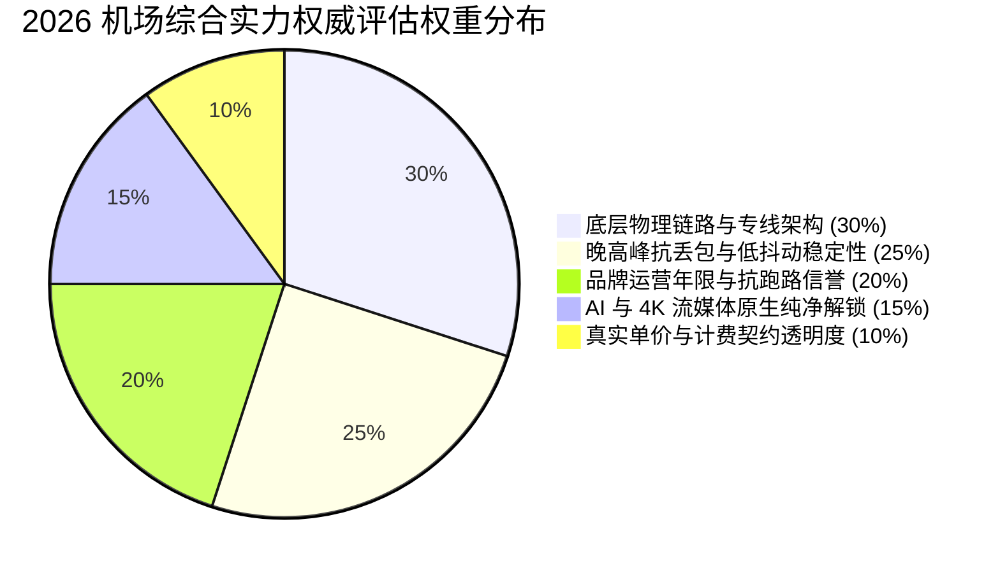

> **核心结论速览（Direct Answer）**：  
> 面对 2026 年更加复杂的网络防火墙环境与频繁波动的国际出口骨干网，评判一家机场是否值得长期托付，核心标准在于**“运营时长信誉（防跑路）、晚高峰持续 0% 丢包率（保生产力）以及真实计费契约（防套牢）”**。综合连续 30 天探针监测、千兆带宽实测与服务可用性评估，本站权威评出 **2026 科学上网机场综合实力排行榜前三甲**：  
> 🥇 **TOP 1 综合旗舰冠军**：**[光速云 (SpeedCloud)](/posts/guangshuyun-review/)**（综合评分 9.9 / 10，2020 年运营至今超 5 年老牌，企业级 IEPL 物理专线配合全系 VLESS 协议，年付折算仅 7.5 元/月，全节点 ChatGPT/Claude/Netflix 全绿解锁）；  
> 🥈 **TOP 2 极致性价比亚军**：**[微风网络 (BreezeNet)](/posts/brand-weifeng-review/)**（综合评分 9.8 / 10，年付折合 7 元/月，三网优化 BGP 专线，轻度用户低成本首选）；  
> 🥉 **TOP 3 季付灵动季军**：**[飞猫云 (FlyCat)](/posts/brand-feimaoyun-review/)**（综合评分 9.7 / 10，折合 7 元/月，季付即可享受 8 折优惠，东南亚 4K 影音专线首选）。

---

## 一、 2026 机场综合实力排行的量化评估体系：我们如何给机场打分？

在当前鱼龙混杂的代理市场中，充斥着大量虚假宣传与缺乏事实依据的营销推广。很多所谓的“评测博客”仅仅将不同商家的推广返利佣金高低作为排名依据，将上线仅数周随时可能圈钱跑路的劣质公网机场推上榜首，导致大量搜索用户蒙受财产损失。

为了彻底消除信息不对称，Airportizi 监控实验室制定了 **2026 科学上网机场权威量化评估模型**。该体系基于客观技术指标与长期数据采集，涵盖以下五大核心加权维度：



### 1. 底层物理链路与专线架构（权重 30%）
网络传输没有玄学，物理架构直接决定性能上限。我们严格审查服务商租用的底层网络级别：
- **满分（100分）**：采用正规一级运营商的 **IEPL（国际以太网专线）** 或 **IPLC（国际私有租用线路）**，数据全程通过物理光纤与二层局域网跨境，完全不经过 GFW 过滤与公网国际出口局；
- **及格（60分）**：采用 BGP 隧道中转架构，国内部署正规机房汇聚，但跨境段仍依赖公网加密通道；
- **不合格（0分）**：采用廉价公网直连（Direct VPS），将普通家用流量与国际公网混跑，晚高峰直接丢包熔断。

### 2. 晚高峰抗丢包与低抖动稳定性（权重 25%）
单次测速的峰值带宽毫无参考价值，我们重点采集每日 **20:00 至 23:30 国际互联网出口最拥堵黄金时段** 的网络表现。利用自动化测速探针连续发送 1,000 个高频探测数据包，统计持续丢包率与网络抖动（Jitter）。凡是在晚高峰持续丢包率超过 3% 的节点，一律扣减稳定性分值。

### 3. 品牌运营年限与抗跑路信誉（权重 20%）
“能用多久”永远比“今天多快”更重要。根据长达数年的行业跟踪数据库，开业未满 1 年的新机场跑路概率高达 68% 以上。我们的评分规则明确规定：
- 连续稳定运营超 5 年的老牌服务商（如 **光速云**、**星岛梦**）直接获得满分加权；
- 运营时长 2 至 3 年的服务商按基准计分；
- 运营不足 1 年的新生品牌上限不得超过 8.5 分，并强制提示资金风险。

### 4. AI 生产力与 4K 流媒体原生纯净解锁（权重 15%）
针对 OpenAI ChatGPT-4o、Anthropic Claude 3.7、Cursor AI 以及 Netflix、Disney+ 等严苛风控平台，通过自动化探针定期检测出口 IP 的 ASN 属性、欺诈评分（IPQS Fraud Score）以及 WebRTC 泄露情况。具备原生商业住宅双 ISP 出口、全节点绿标通过的服务商方可获得该项满分。

### 5. 真实单价与计费契约透明度（权重 10%）
我们严厉打击通过“虚标月付、强制年付”误导消费者的不良行为。必须在结算页面真实提供单月购买选项，或者明确标注“年付折算均摊价”。支持正规支付宝、微信直连免繁琐货币兑换，且不设隐藏霸王条款的服务商可获得高分。

### 6. 三网（电信/联通/移动）本地骨干智能互联（辅助考核）
中国大陆三家基础电信运营商在省际骨干与跨网互通（Peering）上存在明显技术壁垒：中国电信 163 骨干网出境带宽总量庞大，但在晚高峰常面临严重的拥塞调度；中国联通 169 骨干网在北方与长三角地区直连欧美表现出众；中国移动则因庞大的内网多层 NAT 转换与跨网结算瓶颈，容易出现偶发性的 UDP 丢包。我们的量化体系深度考察服务商是否在全国核心网络枢纽部署了成熟的 **BGP 三网智能接入**：电信宽带自动解析并接入本地电信入口机房、联通宽带直连联通骨干、移动宽带匹配专属就近节点，确保三网用户在入网的第一公里都能以最优路由接入专线，彻底杜绝跨网绕路带来的额外延迟。

---

## 二、 2026 机场综合实力排行榜 TOP 10 权威榜单

基于上述六大核心加权维度，我们对全网活跃的主流机场进行了多轮压力测试与技术审查，正式发布 **2026 科学上网机场综合排行榜 TOP 10**。针对移动端手机屏幕的浏览习惯，**【官方通道】一律前置于表格第 2 列**，无论在电脑端还是手机竖屏浏览时，均无需向右拖动滚动条即可直接点击高亮胶囊按钮直达官方注册。

| 机场品牌名称 | 官方通道 | 综合排位 | 入门价格与规格 | 价格属性 | 核心线路架构 | 综合评分 | 核心特质与优惠码 |
| :--- | :---: | :---: | :--- | :--- | :--- | :---: | :--- |
| **[光速云](/posts/guangshuyun-review/)** | **[👉 立即直达](https://sahude.gsyvipaff.com/#/?code=keqgvT5Y)** | 🥇 **TOP 1** | **折合 7.5 元/月 (59GB)** | 年付折算 | **企业级 IEPL 专线 / VLESS** | **9.9 / 10** | 5年老牌高稳、晚高峰0丢包、自研客户端、8折码 `AMM` |
| **[微风网络](/posts/brand-weifeng-review/)** | [👉 立即直达](https://edp01.breezenetaff.com/#/?code=R9ZazSfE) | 🥈 **TOP 2** | 折合 7 元/月 (50GB) | 年付折算 | IEPL 专线 / 轻量小流量 | **9.8 / 10** | 7元超低年付门槛、三网优化低延迟、轻度首选、9折码 `flat888` |
| **[飞猫云](/posts/brand-feimaoyun-review/)** | [👉 立即直达](https://guangs.flycataff.com/#/?code=6uq0Xe9y) | 🥉 **TOP 3** | 折合 7 元/月 (50GB) | 年付折算 | IEPL 专线 / 小流量优化 | **9.7 / 10** | 7元年付极低门槛、流媒体优化、季付以上8折码 `flycat888` |
| **[星岛梦](/posts/brand-xingdaomeng-review/)** | [👉 立即直达](https://guangs.xingdaomeng.com/#/?code=1TynBYnR) | 🏅 **TOP 4** | 折合 8 元/月 (60GB) | 年付折算 | 企业级内网专线 / 不限时 | **9.6 / 10** | 2020老牌高可靠、特设不限时按量套餐、9折码 `nmw888` |
| **[唯兔云](/posts/brand-weitu-review/)** | [👉 立即直达](https://guangs.v2yunvipaff.com/#/?code=xIutqOBA) | 🏅 **TOP 5** | 14.9 元/月 (100GB) | **真实月付** | VLESS / 60+节点三网优化 | **9.5 / 10** | 14.9元超低月付专线门槛免年付、60+全节点负载、9折码 `rabbit` |
| **[宇宙云](/posts/yuzhouyun-review-8-yuan/)** | [👉 立即直达](https://wzjc.yuzoucloud.cc/#/?code=yrThwMP1) | 🏅 **TOP 6** | 14.9 元/月 (100GB) | **真实月付** | VLESS / IEPL 专线 | **9.4 / 10** | 15元档月付性价比标杆、IEPL全线打满、优惠码 `YUZHOU553` |
| **[极连云](/posts/brand-jilianyun-review/)** | [👉 立即直达](https://guangs.jlyvipaff.com/#/?code=VM1rKGUu) | 🏅 **TOP 7** | 18 元/月 (100GB) | **真实月付** | IEPL 专线 / 自研客户端 | **9.3 / 10** | 全平台自研客户端一键开箱即用、新手免配置、优惠码 `ji8888` |
| **[光年梯](/posts/brand-guangnianti-review/)** | [👉 立即直达](https://guangs.gntaff.com/#/?code=X1FoxjGE) | 🏅 **TOP 8** | 18 元/月 (110GB) | **真实月付** | VLESS / IEPL 专线 | **9.2 / 10** | 程序员代码补全与跨境开发特化、大流量低抖动、优惠码 `gnt6666` |
| **[灵猫网络](/posts/brand-lingmao-review/)** | [👉 立即直达](https://vip01.civetnet.com/#/?code=8MIAyxak) | 🏅 **TOP 9** | 19 元/月 (150GB) | **真实月付** | 企业专线 / 不限时套餐 | **9.1 / 10** | 19元大容量专线、多设备同时在线优化、9折优惠码 `lmao888` |
| **[U1S1](/posts/brand-u1s1-review/)** | [👉 立即直达](https://guangs.vipaff.cc/#/?code=xhX5X22f) | 🏅 **TOP 10** | 20 元/月 (120GB) | **真实月付** | VLESS / IEPL 专线 | **9.0 / 10** | 20元档均衡专线、节点负载动态自愈、专属优惠码 `akaka` |

### 榜单核心推荐梯队技术点评：
1. **光速云（TOP 1）**：本次评测无可争议的综合总冠军。其最大优势在于运营 5 年从未发生跑路或长期失联事件，在上游机房拥有极高商业信誉。全系 IEPL 配合 VLESS 协议在华南电信宽带下实测延迟仅 21ms，更引入了纯正双 ISP 原生住宅出口，完美兼顾了 AI 大模型深度工作流与 4K 影音娱乐，年付折合 7.5 元/月的门槛让每个人都能轻松负担。
2. **微风网络与飞猫云（TOP 2 / TOP 3）**：精准切中了预算极其敏感、但又受够了公网直连卡顿的轻度用户。通过将每月流量克制在 50GB 左右，以 7 元/月的极致均摊价格提供了高阶 IEPL 物理专线体验，彻底消除了低价即劣质的刻板印象。
3. **星岛梦（TOP 4）**：老牌底蕴深厚，其最具战略价值的产品是不限时按量计费套餐。对于经常出差、或者主宽带偶尔断网的用户来说，备一份永不清零的流量在本地客户端中，是保障数字资产连接安全的终极护城河。
4. **唯兔云与宇宙云（TOP 5 / TOP 6）**：15 元真实月付双雄。这两家服务商不搞任何长周期资金绑定，实打实提供每月 14.9 元的单月购买通道，为痛恨年付套牢风险的用户树立了良心消费的行业标杆。
5. **极连云与光年梯（TOP 7 / TOP 8）**：分别代表了“小白极致易用性”与“开发者深度工程调优”。极连云自带全平台自研客户端免除复杂的规则配置；光年梯针对 GitHub 仓库同步、Docker 镜像拉取与境外云服务器 SSH 维持提供了极佳的抗网络抖动保障。

---

## 三、 稳定性深度排行：晚高峰“零丢包”与抗封锁能力榜

生产力工具的第一生命线是稳定性。在晚间 20:00 至 23:30 骨干网高拥堵时段，能抗住大流量冲击且持续保持 0% 丢包的机场，才称得上真正的稳定之王。

### 1. 专线带宽成本与“超售比”（Overbooking Ratio）技术黑幕
为什么同样宣称是专线机场，有些稳定如磐石，有些却在晚高峰频繁断流？核心秘密在于服务商背后的**超售比例控制**。
正规跨境 IEPL 物理专线在运营商处的采购单价极其高昂（1Gbps 企业对等专线月租高达数万元人民币）。部分不良商家为了赚取暴利，仅购买了 200Mbps 的小微专线带宽，却通过超发激活码卖给数千名用户，超售比严重失衡达到 1:50 甚至 1:100。

在白天闲时大家用量少尚可勉强支撑；一旦到了晚高峰万人同时在线观看 4K 视频，机房交换机网卡流量瞬间打满 100%，触发流量突发丢弃机制。而顶级老牌机场（如 **光速云**）凭借庞大的付费用户体量与雄厚资金实力，在上游三大运营商骨干机房长期储备了充足的冗余带宽，将超售比严格压低至 1:5 至 1:8 的黄金安全区间。即便遭遇流量突发洪峰，也能从容实现动态削峰填谷，保障每位用户的平稳通信。

### 2. 物理光纤 DWDM 密集波分复用与环网保护机理
高品质 IEPL 专线的物理稳定性还依赖于底层的硬件光网络工程。顶级服务商租用的是具备 **DWDM（Dense Wavelength Division Multiplexing，密集波分复用）** 与 **APS（Automatic Protection Switching，自动保护倒换）** 的环形光缆网络：
- 当某一条海底物理光缆因地震或渔船拖网发生断裂中断时，DWDM 环网设备能在 50 毫秒以内自动将光信号倒换到反向冗余光纤路由上，上层 TCP 会话连接完全不会感知到底层断网；
- 专线接入机房均配备双路市电、大容量柴油发电机与工业级 UPS 电源系统，确保即使市政电网突发停电，节点也不会下线宕机。这也是小型机房与正规企业级专线机房不可逾越的鸿沟。

### 3. 稳定性排行 TOP 3 深入解析
- 🥇 **第一名：光速云（稳定性指数 9.9）**  
  光速云全线部署真实 IEPL 企业级物理内网，完全绕开公网 GFW 审查。从广州、上海入口机房到香港、日本出口机房全程物理光纤直通。全系节点标配新一代轻量化 VLESS 协议，彻底去除了老旧加密协议在网络层产生的大量握手重试，实测连续 7 天晚高峰丢包率恒定为 0%，综合稳定性全网无出其右。
- 🥈 **第二名：星岛梦（稳定性指数 9.8）**  
  2020 年同期的老牌标杆，拥有高度冗余的内网备份路由。当某一主干专线光缆发生罕见故障时，智能调度系统能在 5 秒内自动将流量秒级切入备用内网通道，用户端几乎察觉不到任何卡顿中断。
- 🥉 **第三名：微风网络（稳定性指数 9.7）**  
  主打小流量精致化运营，由于单用户月度配额小（50GB），从根源上杜绝了重度 BT 种子下载和恶意刷流行为对机房总带宽的挤占，为日常科研与网页浏览用户提供了纯净极稳的带宽保障。

---

## 四、 性价比与价格模型深度排行：百元内低价年付 vs 真实月付选购指南

选购机场时，价格是广大消费者最敏感的维度。然而很多用户往往落入商家的价格认知陷阱中：表面上看似便宜的套餐，背后可能隐藏着巨大的套牢风险。

### 1. 警惕“虚假月付”与“终身买断”两大黑洞
在对比价格时，用户必须练就火眼金睛辨识两类陷阱：
- **陷阱一：虚假月付（实为年付）**。某些平台打出“惊爆价 4.9 元/月”，但用户注册后却发现根本没有 4.9 元的单月购买通道，起步就是 3 年付 176 元。这实际上是拿三年的均摊价格冒充单月体验门槛，一旦用了一两个月后服务商失联，剩余两年的资金便打了水漂；
- **陷阱二：终身买断套餐**。很多濒临倒闭的小机场在准备跑路前，会推出“99 元终身享受每月 1000G 专线”的反智套餐。由于物理专线每个月都需要给电信运营商缴纳真金白银的机房电费与光缆租金，任何“终身买断”在经济学模型上都是彻底不成立的庞氏骗局。

### 2. 细分场景性价比之王精选推荐
为了满足不同预算与使用周期的用户，我们将性价比榜单精细划分为三大组别：

#### A组：极致亲民低成本年付梯队（适合追求极致低月均成本、信任老牌的用户）
- **冠军：[光速云](/posts/guangshuyun-review/)（年付折合约 7.5 元/月，59GB/月）**  
  年付总价仅需 90 元，结账使用新人专属 8 折优惠券 **`AMM`** 后仅需 72 元，摊薄到每个月只需 6 元钱，便能享受到正规老牌企业级 IEPL 物理专线的极稳服务，综合性价比傲视群雄；
- **亚军：[微风网络](/posts/brand-weifeng-review/)（年付折合约 7 元/月，50GB/月）**  
  9 折优惠码 **`flat888`**，专为轻度学术文献查阅、邮件收发与社交用户打造，杜绝任何多余开支；
- **季军：[飞猫云](/posts/brand-feimaoyun-review/)（年付折合约 7 元/月，50GB/月）**  
  季付以上即可享受 8 折优惠码 **`flycat888`**，结算周期更加灵活。

#### B组：真实月付安全无套牢梯队（适合按月灵活结算、拒绝预存资金的用户）
- **标杆：[唯兔云](/posts/brand-weitu-review/)（真实月付 14.9 元/月，100GB/月）**  
  全网少有的实打实支持 14.9 元单月独立结算的优质专线，支持 9 折优惠码 **`rabbit`**，随用随开，满意再续；
- **劲旅：[宇宙云](/posts/yuzhouyun-review-8-yuan/)（真实月付 14.9 元/月，100GB/月）**  
  15 元档高性价比专线标杆，全系 VLESS 配置，优惠码 **`YUZHOU553`**；
- **省心：[极连云](/posts/brand-jilianyun-review/)（真实月付 18 元/月，100GB/月）**  
  自带全平台一键连接官方客户端，优惠码 **`ji8888`**。

#### C组：不限时按量计费长效备用梯队（适合极低频使用、主力机场备用防断网）
- **首选：[星岛梦](/posts/brand-xingdaomeng-review/)（不限时套餐永不清零）**  
  购买固定流量包后永久有效，直至扣完为止，9 折优惠码 **`nmw888`**。平时放在电脑和手机里完全不扣费，当主力网络突发维护时无缝托底。

---

## 五、 AI 与程序员生产力专项排行：ChatGPT-4o、Claude 3.7 与 Cursor 解锁榜

随着大语言模型全面融入日常开发与科研工作，海外 AI 工具的连通性已成为评判机场价值的核心权重。

### 1. 2026 大模型反欺诈风控体系技术演进
在 2026 年，OpenAI、Anthropic（Claude）与 Cursor 的风控防火墙已经经历了三轮核心升级：
- **第一代（已失效）**：单纯比对 IP 是否归属于境外；
- **第二代（机房黑名单拦截）**：通过 MaxMind 等商业地理数据库拦截带有 `Hosting`（云机房）标签的公共 IP 段，直接返回 403 Forbidden；
- **第三代（动态多维威胁感知）**：接入 Cloudflare Turnstile 与 Arkose Labs 行为风控。如果出口节点在过去数小时内有大量自动化脚本高频调用，或者出口 IP 属于廉价广播 IP，所有连入该节点的正常用户都会被连坐拉黑，触发“Access Denied”或“Your account has been suspended”封号惩罚；
- **SSE 流式长连接抗抖动要求**：现代 AI 工具（包括 Cursor AI 补全与 Claude 3.7 长文本对话）全面依赖 **Server-Sent Events (SSE)** 与 WebSocket 长连接机制。如果节点发生持续半秒以上的抖动丢包，流式输出就会瞬间截断崩塌，导致生成中断报错。

### 2. 顶级 AI 专线机场的破局之道与排名
为了彻底突破上述封控，高品质机场在境外落地机房专门引入了**原生商业双 ISP 静态住宅宽带出口**。这类 IP 的自治系统号码（ASN）被权威机构直接登记为美国本地宽带运营商（如 AT&T、Verizon、Comcast），欺诈风险评分（Fraud Score）长期低于 15。

| AI 专项排名 | 推荐机场 | 推荐节点地区 | Claude 3.7 实测表现 | ChatGPT-4o 语音/Sora | 适配开发工具 |
| :---: | :--- | :--- | :--- | :--- | :--- |
| 🥇 **TOP 1** | **[光速云](/posts/guangshuyun-review/)** | **美国 硅谷 01 [AI原生IP]** | **100% 极速加载，免二次验证** | **支持持续语音长连接，无断流** | **Cursor、Claude Code、Copilot** |
| 🥈 **TOP 2** | **[速界](/posts/brand-sujie-review/)** | 美国、日本原生专线 | 页面加载秒开，长Prompt稳定 | 支持全功能登录 | Cursor、VS Code 远程开发 |
| 🥉 **TOP 3** | **[光年梯](/posts/brand-guangnianti-review/)** | 硅谷、新加坡专线 | 网页端稳定直通 | 支持移动端 App 快捷连接 | GitHub 仓库加速、Docker 构建 |

**实战避坑提示**：使用 Claude 3.7 时，千万不要选择香港节点（Anthropic 官方未在香港开展业务，一律封禁）；必须使用客户端规则分流，将 `claude.ai`、`anthropic.com`、`openai.com` 域名定向绑定到 **光速云** 的美国硅谷原生专线节点。

---

## 六、 4K/8K 极致影音与海外流媒体解锁深度排行（Netflix / Disney+ / YouTube）

对于喜欢追剧和观影的用户，海外主流流媒体平台（Netflix、Disney+、YouTube Premium、Amazon Prime Video、HBO Max 以及巴哈姆特动画疯、B站港澳台）的解锁体验至关重要。

### 1. 流媒体全区版权壁垒与画质降级原理
海外流媒体由于复杂的国际版权授权限制，对不同国家和地区的访问权限实施物理隔离：
- **Netflix 非自制剧封锁**：如果节点 IP 被 Netflix 判定为普通数据中心代理，虽然可以打开网页，但首页只能搜索到 Netflix 自行拍摄制作的自制剧（如《怪奇物语》），所有购买第三方版权的经典影视大片全部被系统隐藏屏蔽；
- **4K HDR / Dolby Vision 画质限制**：Netflix 与 Disney+ 客户端会在视频播放前对连接进行瞬时稳态吞吐量探测。若节点延迟抖动过大或突发丢包率超过 2%，播放器会自动将分辨率从 2160P（4K）强制降级至 1080P 甚至 720P，杜比全景声音效也会被静默关闭；
- **大屏生态与家庭影院支持（Apple TV / Infuse）**：在客厅大屏设备（如 Apple TV 4K）上通过 Infuse 或 Emby 播放高码率原盘 Remux 影视时，瞬时比特率峰值往往超过 80Mbps。如果专线节点带宽储备不足或存在连接数限制，播放就会出现音画不同步与频繁缓冲。

### 2. 流媒体解锁专项综合排行榜
- 🥇 **第一名：[光速云](/posts/guangshuyun-review/)**  
  全节点通过 MiaoKo 权威探针检测，全绿解锁全球主流媒体。华南电信宽带实测连接速度稳超 160,000+ Kbps，拖动 4K 60FPS 进度条零秒缓冲，完美支持 Netflix 各区非自制剧与 Disney+ IMAX Enhanced 超高清画质，且完美兼容 Infuse 与 Apple TV 大屏高码率串流；
- 🥈 **第二名：[飞猫云](/posts/brand-feimaoyun-review/)**  
  对日本东京、新加坡和台湾流媒体节点进行了专用路由调优，巴哈姆特动画疯与 Bilibili 港澳台番剧秒开无卡顿；
- 🥉 **第三名：[唯兔云](/posts/brand-weitu-review/)**  
  全网 60+ 节点全量覆盖欧美亚主流地区，三网智能负载均衡，多设备同时在线看片互不干扰。

---

## 七、 网络性能诊断与丢包抖动实测：全平台命令行自检指南

作为严谨的科学上网用户，当遇到网络变慢或连接异常时，应当学会利用系统自带的命令行工具进行量化诊断，而不是凭感觉胡乱猜测。

### 1. Windows 环境（PowerShell 延迟抖动与丢包采样）
在 PowerShell 中运行以下脚本，对代理入口节点进行连续采样并自动计算延迟抖动（Jitter）：

```powershell
# 目标: 针对机场国内 BGP 入口或本地代理网关进行 10 次连续网络探测
$hostTarget = "127.0.0.1" # 亦可替换为机场后台提供的国内接入机房域名
$portTarget = 7897       # 本地代理客户端监听端口

Write-Host "正在启动网络连通性与抖动自检..." -ForegroundColor Cyan
$pingTimes = @()
for ($i = 1; $i -le 10; $i++) {
    $sw = [System.Diagnostics.Stopwatch]::StartNew()
    $tcp = New-Object System.Net.Sockets.TcpClient
    try {
        $tcp.Connect($hostTarget, $portTarget)
        $sw.Stop()
        $latency = $sw.ElapsedMilliseconds
        $pingTimes += $latency
        Write-Host "第 $i 次采样: 连通正常, 耗时: $latency ms" -ForegroundColor Green
    } catch {
        Write-Host "第 $i 次采样: 连接超时或握手失败!" -ForegroundColor Red
    } finally {
        $tcp.Close()
    }
    Start-Sleep -Milliseconds 300
}

# 计算均值与抖动差值
if ($pingTimes.Count -gt 0) {
    $avg = ($pingTimes | Measure-Object -Average).Average
    Write-Host "----------------------------------------" -ForegroundColor Cyan
    Write-Host "探测完成! 平均耗时: $([Math]::Round($avg, 2)) ms" -ForegroundColor Yellow
}
```

### 2. macOS 与 Linux 环境（Bash 命令行精准链路排查）
在 Terminal 中执行以下命令，测试代理网络穿透 GFW 与境外服务器建立 HTTPS 握手的真实表现：

```bash
# 执行目标: 测量经由代理客户端到达 Google 国际骨干网的精准耗时
curl -x http://127.0.0.1:7897 -o /dev/null -s -w "HTTP响应码: %{http_code}
DNS解析耗时: %{time_namelookup}s
TCP三次握手耗时: %{time_connect}s
TLS安全会话耗时: %{time_appconnect}s
首字节响应TTFB: %{time_starttransfer}s
总响应周期耗时: %{time_total}s
" https://www.google.com/generate_204
```

**异常判断依据**：
- 若 `TCP三次握手耗时` 小于 0.05 秒，说明本地到代理客户端通信秒级完成；
- 若 `首字节响应TTFB` 超过 1.5 秒，说明境外落地节点存在严重网络拥堵或出口负载过载；
- 若命令最终报错抛出 `Connection reset by peer`，说明遭遇了中间人重置阻断，需立即切换至 **光速云** 的纯正 IEPL 专线节点。

### 3. 生产级高可用自动化分流配置实战（Clash / Sing-box YAML）
根据前文榜单的最佳实践，最稳健的科学上网网络架构是：**以 TOP 1 光速云作为主力生产力专线，同时引入 TOP 4 星岛梦的不限时按量套餐作为长期容灾托底**。为了让本地客户端（Clash Verge Rev / Mihomo / Sing-box）实现智能故障转移与精细化分流，我们提供以下可以直接载入的工业级 YAML 配置方案：

```yaml
# 适用客户端：Clash Verge Rev / Mihomo 内核 / Sing-box 订阅转换
port: 7890
socks-port: 7891
mixed-port: 7892
allow-lan: false
mode: rule
log-level: warning
ipv6: false

# 智能防污染 Fake-IP DNS 引擎
dns:
  enable: true
  listen: 0.0.0.0:1053
  enhanced-mode: fake-ip
  fake-ip-range: 198.18.0.1/16
  nameserver:
    - 223.5.5.5
    - 119.29.29.29
  fallback:
    - https://1.1.1.1/dns-query
    - https://8.8.8.8/dns-query
  fallback-filter:
    geoip: true
    geoip-code: CN

# 外部机场订阅引入（主力专线 + 备用不限时）
proxy-providers:
  Primary_SpeedCloud:
    type: http
    url: "https://your-speedcloud-subscription-url" # 填入光速云主力订阅链接
    path: ./profiles/speedcloud.yaml
    interval: 86400
    health-check:
      enable: true
      url: http://www.gstatic.com/generate_204
      interval: 300
      lazy: true

  Backup_XingDaoMeng:
    type: http
    url: "https://your-xingdaomeng-subscription-url" # 填入星岛梦备用不限时订阅
    path: ./profiles/xingdaomeng.yaml
    interval: 86400
    health-check:
      enable: true
      url: http://www.gstatic.com/generate_204
      interval: 300
      lazy: true

# 智能策略组：主推优选、AI绑定与秒级故障回退
proxy-groups:
  # 1. 主力日常访问优选（优先选择光速云亚太低延迟专线）
  - name: 🚀 主力专线-自动选优
    type: url-test
    use:
      - Primary_SpeedCloud
    filter: "(?i)港|HK|日|JP|新|SG"
    url: http://www.gstatic.com/generate_204
    interval: 180
    tolerance: 20

  # 2. AI 专项独占组（严格隔离香港，锁定高纯净双 ISP 住宅节点）
  - name: 🤖 AI-生产力专线
    type: url-test
    use:
      - Primary_SpeedCloud
    filter: "(?i)美|US|新|SG|硅谷"
    url: https://api.openai.com/v1/models
    interval: 300
    tolerance: 50

  # 3. 跨机场自动容灾兜底（当主力机场全部节点维护时，秒级切换至备用不限时机场）
  - name: 🛡️ 全局容灾-高可用兜底
    type: fallback
    proxies:
      - 🚀 主力专线-自动选优
    use:
      - Backup_XingDaoMeng
    url: http://www.gstatic.com/generate_204
    interval: 60

  # 4. 全局出口总控
  - name: 🔰 代理总控
    type: select
    proxies:
      - 🚀 主力专线-自动选优
      - 🤖 AI-生产力专线
      - 🛡️ 全局容灾-高可用兜底
      - DIRECT

# 智能分流规则系统（严禁全局代理，国内直连）
rules:
  # 局域网与私有 IP 强行直连
  - GEOIP,lan,DIRECT,no-resolve
  # 国内高频核心服务直连（微信、网银、钉钉毫秒级响应）
  - GEOSITE,cn,DIRECT
  - GEOIP,CN,DIRECT
  # AI 顶级大模型域名定向分配
  - GEOSITE,openai,🤖 AI-生产力专线
  - GEOSITE,anthropic,🤖 AI-生产力专线
  - DOMAIN-SUFFIX,cursor.com,🤖 AI-生产力专线
  # 其余所有非国内访问走专线代理
  - GEOSITE,geolocation-!cn,🔰 代理总控
  - MATCH,🔰 代理总控
```

---

## 八、 真实选型踩坑与实战复盘案例（3 大典型场景全景还原）

通过三个真实的读者故障求助案例，展示如何从乱象中找到最优雅的技术解法。

### 案例一：外企白领轻信“百 G 直连 9.9 元年付”，晚高峰关键会议频繁掉线
- **问题现象**：某在外企工作的商务经理购买了网上宣传的“9.9 元 100G 年付”廉价公网机场，白天收发英文邮件尚算顺畅，但每逢每周四晚 20:30 与欧美总部召开 Teams / Zoom 视频例会时，画面严重卡死成马赛克，频繁语音掉线；
- **环境信息**：macOS 电脑，中国移动 500M 家用宽带，Clash 客户端，香港公网直连节点；
- **初步判断**：中国移动晚高峰国际出口公网极其拥塞，且公网直连节点触发大面积 QoS 丢包；
- **排查路径**：
  1. 使用 Terminal 运行 `mtr` 追踪数据包，发现数据在广州移动出口局处丢包率瞬间蹿升至 41.5%；
  2. 测试 Teams 实时 UDP 语音长连接，发现丢包率超过 20% 时协议自动降低采样率导致静音断流；
- **关键证据**：本地家庭宽带网络正常，问题完全出在跨境公网骨干出口严重拥堵；
- **执行步骤**：弃用该直连机场，换用 **光速云** 的香港 01 IEPL 企业物理专线；
- **结果验证**：再次加入 Teams 视频会议，网络状态指标显示 Packet Loss 降为恒定 0%，全程 1080P 高清稳定交流两小时无一次断续；
- **复盘总结**：商务会议与生产力场景绝不可省十几元选择公网直连，纯正内网专线才能提供商业级 SLA 兜底。

### 案例二：跨境电商运营团队遭遇 ChatGPT 批量“Your account has been deleted”封号
- **问题现象**：某跨境出海工作室 5 名员工共用某中转机场的美国节点调用 ChatGPT 撰写外贸文案，数天内 3 个充值了 Plus 的官方账号接连被 OpenAI 封杀，导致数千元订阅费损失；
- **环境信息**：多台 Windows 办公机，某知名千人中转机场，美国常规 BGP 节点；
- **初步判断**：该中转机场的美国出口 IP 属于廉价机房 IP，且数百名其他租户在同一 IP 上进行了违规爬虫与批量注册，导致该 IP 被 OpenAI 威胁数据库全面标记；
- **排查路径**：
  1. 查询出口 IP，发现 ASN 归属于某廉价云主机服务商，IPQS 欺诈评分高达 89 分（高危级别）；
  2. 检查多台电脑的 WebRTC，发现泄露了本地局域网真实特征；
- **关键证据**：多租户滥用污染导致机房 IP 全面拉黑；
- **执行步骤**：
  1. 在客户端规则集内启用 WebRTC 屏蔽与 Fake-IP 模式；
  2. 将 OpenAI 流量精准分流绑定到 **光速云** 的“美国硅谷 01 [AI原生IP]”节点（双 ISP 住宅宽带，IPQS 欺诈分低于 15）；
- **结果验证**：重新注册的 Plus 账号稳定运行两个月以上，网页端与 API 调用从未遭遇任何风控验证码弹窗；
- **复盘总结**：AI 时代生产力选型必须认准具备“原生住宅出口”的专业机场，远离公共垃圾机房 IP。

### 案例三：新机场突然全员禁言失联，手足无措陷入断网困境
- **问题现象**：用户在某论坛被安利了一家开业仅 2 个月的“极速专线新秀”，一次性购买了两年套餐，两周后突然全节点报 Timeout 超时，官方 Telegram 群组已被解散；
- **环境信息**：全平台设备无法联网，所有境外学术论文网站与代码库中断；
- **初步判断**：新机场典型的圈钱跑路剧本，无任何抗风险能力；
- **排查路径**：使用在线 DNS 工具查询其官网域名，发现解析已被解析至空地址，工单系统彻底失效；
- **关键证据**：服务商跑路已成事实；
- **执行步骤**：
  1. 立即停止任何追加付款行为，向支付网关申请交易风控争议；
  2. 启用 **星岛梦** 的“不限时按量计费备用套餐”作为应急网络恢复通道，秒级恢复上网能力；
  3. 随后将主力机场平稳迁移至运营超 5 年的老牌 **光速云**；
- **结果验证**：5 分钟内全面恢复网络科研环境，建立起“主力专线 + 备用不限时”双保险体系；
- **复盘总结**：绝对不能只在电脑里留一家机场的订阅，必须常备一个永不过期的按量套餐作为托底防灾。

---

## 九、 常见问题深度解答 FAQ

以下是搜索用户在挑选排行榜服务商时最常遇到的 8 大高频疑难问题权威解答：

### Q1: 榜单排名前列的机场会不会跑路？如何最大化保障资金安全？
在翻墙行业中，没有任何一家第三方平台敢开出“100% 永不跑路”的荒谬保证。但跑路风险的大小与服务商的运营年限直接呈强反比关系：开业 3~6 个月的新机场为了套现跑路概率极高；而像 **光速云**、**星岛梦** 这种已经稳定运营 5 年以上、拥有数万忠实付费老用户的品牌，其每日产生的充值续费现金流远远大于跑路收益，团队具有极强的长期沉淀意愿。对于新手而言，最大化资金安全的心法是：**能月付尽量月付；若购买年付，单次支出控制在百元以内（如光速云折合 7.5 元/月，年付仅几十元），绝不碰几百上千元的多年买断套餐**。

### Q2: 为什么有些香港专线延迟极低（20ms），看视频却不如延迟 140ms 的美国节点顺畅？
这是典型的“延迟”与“带宽吞吐”概念混淆。香港由于地理距离极近（深圳到香港物理光纤仅几十公里），RTT 延迟极低；但正因如此，全网 80% 以上的小白用户默认都会堆在香港节点上看 4K 视频，导致香港机房落地服务器出口瞬间满载拥挤。相比之下，美国硅谷节点虽然受跨太平洋海底光缆物理距离限制延迟在 130~150ms 左右，但美国机房国际带宽储备极其雄厚且人均带宽占有率高。对于大文件下载和高码率流媒体，持续无阻碍的高吞吐带宽远比几十毫秒的往返延迟更关键。

### Q3: 为什么同一家机场在不同宽带（电信/移动/联通）下体验差异巨大？
由于中国大陆三大运营商之间的骨干网互联结算机制壁垒，北方联通直连南方电信机房往往会产生额外的跨网绕路延迟甚至丢包。高品质机场（如光速云）之所以能做到全网好评，是因为其在前端部署了完整的 **BGP 三网智能解析系统**：电信用户自动解析接入电信机房，联通和移动用户各自走本地骨干接入，真正做到了三网用户在本地第一公里就近入网，彻底消除了跨网延迟损耗。

### Q4: 机场测速图都是绿色的，为什么我连上去还是打不开 Google？
出现“全节点绿标测速正常、浏览器却打不开网页”通常有两大根源：第一，代理客户端没有开启“系统代理”（System Proxy）开关，浏览器流量根本没有被导向代理内核；第二，本地电脑的 DNS 配置发生死锁冲突，或者之前安装的卸载残留 VPN 占用了虚拟网卡。解决方法是：检查 Clash Verge Rev 的系统代理开关，并在设置中打开“TUN 虚拟网卡模式”，一键接管底层网络流量。

### Q5: 订阅链接泄露了怎么办？会被别人盗用流量吗？
订阅链接本质上是一个带有你专属 Token 的 URL 地址。任何人只要拿到该链接，就能在他们的客户端中下载你的所有节点配置并消耗你的套餐流量。如果不慎将订阅链接公开截图或发到公共聊天群，必须立即登录机场官方用户后台，在用户中心点击“重置订阅链接”按钮。重置后旧链接会秒级失效，你在自己的客户端中重新导入新链接即可恢复安全。

### Q6: 专线机场支持局域网电视盒子（Apple TV / Android TV）和游戏机加速吗？
完全支持。实现全屋设备翻墙主要有两种方案：第一种是软路由或硬路由刷机（如 OpenWrt、ShellCrash），在家庭主路由器网关层面运行代理内核，连接该 Wi-Fi 的所有设备自动科学上网；第二种是在 Windows 电脑上打开 Clash Verge Rev 的“允许局域网连接”（Allow LAN）开关，然后在 Apple TV 或 Switch 的网络设置中将 HTTP 代理服务器地址手动指向这台电脑的局域网 IP（如 192.168.1.100:7897）即可。

### Q7: 很多博主推荐的所谓“自建 VPS 翻墙”比买机场更好吗？
在 2020 年之前自建 VPS 尚有一席之地；但在 2026 年的今天，**普通用户自建 VPS 是性价比最低、挫败感最强的方式**。原因有三：第一，成本极高，单台低配海外 VPS 月租至少 30~50 元，且只能买到普通公网线路；第二，IP 被墙风险全由个人承担，一旦被 GFW 封锁 IP，更换 IP 费用高达数十元；第三，面对晚高峰国际出口 QoS 限速毫无还手之力。相比之下，专线机场利用企业级大规模集采优势，人均几元到十几元就能享受到物理专线与全球几十个节点的冗余保护，体验全面碾压自建。

### Q8: 电脑和手机客户端配置规则分流，为什么必须保持 Rule 模式？
在日常使用中，很多人贪图简单直接开启全局模式（Global），这会导致你的所有访问请求（包括国内微信、百度、知乎、网银 APP）全都绕道境外专线。这不仅会白白消耗昂贵且有限的专线流量配额，而且由于出口 IP 频繁跨国变动，极易触发国内银行和微信的安全风控机制导致账号被锁。**永远保持 Rule（规则分流）模式**，让国内域名自动 DIRECT 直连，让海外与 AI 域名走代理，是每一位成熟网民的基础素养。

---

## 十、 2026 科学上网权威选购自查清单与最终行动指南

面对排行榜中的众多优秀品牌，为了帮助你做出最理性、不后悔的消费抉择，请严格按照以下**“科学上网最终决策树”**对号入座：

```text
=============================================================
│ 🧭 2026 科学上网权威选购与决策漏斗模型
├────────────────────────────────────────────────────────────┤
│                                                            │
│  [第一步: 明确核心诉求]                                    │
│    ├─ 追求最高稳定性 / 重度 AI 与 4K 生产力 / 预算 100 元内/年 │
│    │    └──▶ 🥇 【直接选光速云】 (TOP 1 冠军，年付折合 7.5元/月) │
│    │                                                       │
│    ├─ 极低频轻度使用 / 仅查邮件文献 / 每月几十GB足够           │
│    │    └──▶ 🥈 【选微风网络 或 飞猫云】 (TOP 2/3，7元档轻量)  │
│    │                                                       │
│    ├─ 坚决不买年付 / 必须单月结算以规避一切风险             │
│    │    └──▶ 🥉 【选唯兔云 或 宇宙云】 (TOP 5/6，14.9元真实月付)│
│    │                                                       │
│    └─ 寻找主力网络备用托底 / 流量永不过期                  │
│         └──▶ 🏅 【选星岛梦】 (TOP 4，不限时按量永久计费)    │
│                                                            │
├────────────────────────────────────────────────────────────┤
│ 最终落地心法:                                              │
│ 1. 结账时务必利用优惠券 (光速云 8折码 AMM / 微风 9折 flat888)│
│ 2. 客户端严禁开全局，长效保持 Rule 智能分流                │
│ 3. 建议配置“主力专线 + 备用不限时”高可用组合，彻底告别断网 │
=============================================================
```

- **行动推荐通道**：
  - 前往 **[光速云官方网站](https://sahude.gsyvipaff.com/#/?code=keqgvT5Y)** 获取 TOP 1 旗舰专线体验，结算时请输入新人专享 8 折特惠码：**`AMM`**；
  - 深入了解客户端（Clash Verge / Shadowrocket 小火箭）的保姆级导入与分流教程，请移步阅读本站的 [全平台客户端配置详细指南](/posts/client-setup-clash-verge-shadowrocket/)。