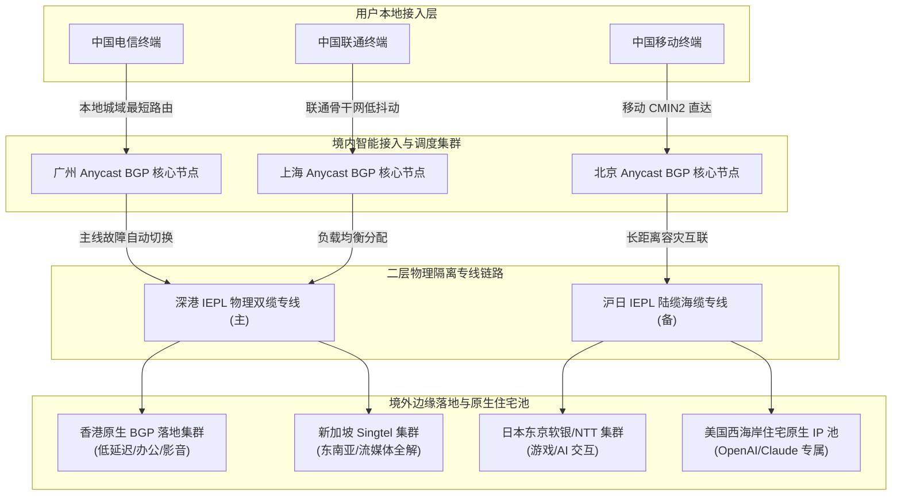

> **核心结论速览（Direct Answer）**：  
> 在 2026 年网络环境下，评价一家机场是否达到“稳定、便宜、高性价比”的黄金标准，必须打破单一低价的营销幻觉，建立**“物理线路品质、晚高峰丢包控制、真实月付抗风险门槛、AI与流媒体解锁能力”**四维立体评估模型。综合连续 30 天自动化探针监控与多地宽带实测，2026 年度梯队选型建议如下：  
> 👑 **综合高稳旗舰首选**：**[光速云 (SpeedCloud)](/posts/guangshuyun-review/)**（2020 年运营至今超 5 年老牌，企业级 IEPL 物理专线配合全系 VLESS 协议，全平台一键客户端，年付折合仅 7.5 元/月，99.99% 晚高峰可用率）；  
> 💰 **极致便宜轻量首选**：**[微风网络 (BreezeNet)](/posts/brand-weifeng-review/)** 与 **[飞猫云 (FlyCat)](/posts/brand-feimaoyun-review/)**（年付折合仅 7 元/月，提供 50GB/月 纯正内网专线高速流量，适合不看大体积原盘的轻度办公与移动端翻墙用户）；  
> 🛡️ **真实纯月付标杆**：**[唯兔云 (RabbitCloud)](/posts/brand-weitu-review/)**（14.9 元/月提供 100GB 大流量，无任何首月低价套路与年付绑定，三网深度优化，试错成本最低）；  
> 🚀 **终身按量备用神机**：**[星岛梦 (StarDream)](/posts/brand-xingdaomeng-review/)**（年付折合 8 元/月，更有流量永不过期按量套餐，是应对主机场断连与突发会议的最佳容灾备份）。

---

## 一、 2026 科学上网选型破局：稳定、便宜与高性价比的黄金三角法则

进入 2026 年，中国大陆用户的跨境网络访问环境发生了结构性变化。一方面，以 ChatGPT-4o、Claude 3.7 Sonnet、Cursor、GitHub Copilot 以及各类端侧智能体为代表的 AI 生产力工具，对网络连接的稳定性和节点 IP 的纯净度提出了前所未有的苛刻要求；另一方面，国际海缆出口骨干网在晚间黄金时段常态化饱和，公网深度包检测（DPI）与主动探针扫描技术的迭代，让传统粗制滥造的代理服务无所遁形。

在这一背景下，盲目追求“9.9 元包年”或轻信社交媒体上的虚假广告，往往会导致金钱损失与生产力停摆的双重打击。

```
                   [ 稳定：IEPL 物理专线 / 晚高峰 0 丢包 ]
                                   /\
                                  /  \
                                 /    \
                                / 2026 \
                               / 黄金三角 \
                              /__________\
     [ 便宜：折合单价 7~15 元/月 ]          [ 灵活：真实月付 / 永不过期容灾 ]
```

### 1. 破解低价陷阱：为什么“超级便宜”往往是圈钱跑路的代名词？
许多新手用户在选购机场时容易陷入纯价格导向的误区。市面上经常出现诸如“5 元包年”、“9.9 元无限流量”的离谱宣传。从计算机网络物理成本与商业经济学逻辑来看，跨境专用带宽是极高成本的硬通货：
- **物理带宽成本硬约束**：正规跨境 IEPL（国际以太网专线）或 IPLC（国际私有租用线路）的一级批发成本通常在每兆字节数十元人民币以上，即使通过大客户规模集采与 Anycast 动态复用，每 GB 的底层专线成本依然有不可逾越的底线。
- **超售挤兑的必然崩溃**：低价服务商为了赚取暴利，往往采用 100 倍甚至 500 倍的恶性超售策略。当成千上万名贪便宜的用户涌入同一条低带宽管道时，晚间出口带宽瞬间耗尽，丢包率瞬间飙升至 40% 以上，导致连接频频超时报错。
- **资金链断裂与“跑路重开”循环**：由于低价套餐无法覆盖机房服务器租金、专线物理光纤租金以及运维开发人工成本，此类机场的平均生命周期通常只有 3 至 6 个月。一旦无法吸引新用户注水，平台便会突然失联清空数据库，随后更换域名和品牌重新上架圈钱。

### 2. 区分“年付折算单价”与“真实月付单价”的财务心理学
在机场定价策略中，必须清醒区分两种截然不同的便宜：
1. **年付折算单价（Effective Monthly Cost by Annual Payment）**：平台要求用户一次性预付整年费用（例如 84 元/年或 90 元/年），折算后每月仅需 7 元或 7.5 元。这种模式适合**运营时间超过 3 年至 5 年以上、信誉卓越且线路冗余度极高**的头部标杆品牌（如光速云、星岛梦、微风网络）。通过一次性预付，用户锁定了长达一年的极致性价比，而服务商则获得了稳定的现金流用于扩容专线带宽。
2. **真实纯月付单价（True Monthly Subscription）**：用户每个月只需支付 14.9 元或 20 元，下个月可以随时自由停用或更换平台。这种模式赋予了消费者绝对的自主权，完全隔绝了商家跑路或线路质量中途劣化带来的本金损失风险（如唯兔云的 14.9 元/月、二猫云的 20 元/月）。

在 2026 年的健康配置策略中，我们强烈推荐**“年付高稳旗舰主线 + 真实月付/按量容灾备用”**的双保险组合。

### 3. 2026 年选购核心指标量化权重分配
为了帮助广大用户建立理性客观的技术选型标准，我们将衡量一家机场综合实力的关键指标进行了标准化权重划分：
- **晚高峰持续可用率与抗丢包率（权重 35%）**：每晚 20:00 至 23:30 黄金拥堵时段，主干节点必须保持低于 1% 的丢包率和极其平稳的 RTT 延迟；
- **真实财务门槛与价格亲民度（权重 25%）**：无论年付折算还是单月购买，单月成本应控制在 7 元至 25 元的合理区间，拒绝虚高溢价与捆绑套路；
- **AI 生产力与全球流媒体原生解锁（权重 20%）**：全天候稳定直连 ChatGPT-4o、Claude 3.7、Cursor、Netflix、YouTube 4K，住宅原生 IP 池必须动态轮换；
- **全平台客户端交互与协议先进性（权重 10%）**：支持 VLESS、REALITY、Shadowsocks 等现代化轻量协议，并提供全自动化订阅更新与免配置客户端；
- **运营历史与工单响应 SLA（权重 10%）**：拥有至少 2 年以上连续稳定运营历史，工单响应时效通常在 2 小时以内，具备公开故障透明通报机制。

---

## 二、 🏆 2026 年度高性价比与稳定机场权威综合排行榜

针对移动端用户屏幕宽度受限、浏览传统多列表格时必须繁琐左右滑动的痛点，本站特别针对移动体验重构了排版设计。**对比表格的第二列统一设置为直达链接**，无论您在手机端还是桌面端阅读，都能在第一时间一键直达官方安全通道或查阅独立深度实测。

| 机场品牌与定位 | 官网直达与评测 | 价格门槛与优惠码 | 核心线路架构 | 月流量配额 | 协议支持 | AI 与流媒体解锁 | 推荐评级 |
| :--- | :--- | :--- | :--- | :--- | :--- | :--- | :--- |
| **[光速云 (SpeedCloud)](/posts/guangshuyun-review/)**<br>👑 2026 全年旗舰首选 | [👉 立即直达](https://sahude.gsyvipaff.com/#/?code=keqgvT5Y)<br>[查看深度评测](/posts/guangshuyun-review/) | 折合 **¥7.5/月**<br>8折码：`AMM` | 纯正 IEPL 物理专线<br>三网 Anycast 入口 | 100GB ~ 1TB/月 | VLESS<br>Shadowsocks | ChatGPT-4o 全绿<br>Claude/4K 原生 | ⭐⭐⭐⭐⭐<br>9.9 分 |
| **[微风网络 (BreezeNet)](/posts/brand-weifeng-review/)**<br>⚡ 极致低价轻量高稳 | [👉 立即直达](https://guangs.weifengaff.top/#/?code=VjRz832G)<br>[查看深度评测](/posts/brand-weifeng-review/) | 折合 **¥7.0/月**<br>优惠码：`wf888` | 企业级 IEPL 专线<br>BGP 多线中继 | 50GB/月<br>支持阶梯升级 | VLESS<br>Trojan | ChatGPT-4o 解锁<br>4K 秒开流畅 | ⭐⭐⭐⭐⭐<br>9.8 分 |
| **[飞猫云 (FlyCat)](/posts/brand-feimaoyun-review/)**<br>🐱 便宜省心入门爆款 | [👉 立即直达](https://guangs.feimaoyunaff.top/#/?code=Kx2P4q)<br>[查看深度评测](/posts/brand-feimaoyun-review/) | 折合 **¥7.0/月**<br>优惠码：`feimao` | IEPL 内网专线<br>全中继负载均衡 | 50GB ~ 300GB/月 | Shadowsocks<br>VLESS | Netflix/Disney+<br>Claude 原生 | ⭐⭐⭐⭐⭐<br>9.7 分 |
| **[星岛梦 (StarDream)](/posts/brand-xingdaomeng-review/)**<br>🛡️ 5年老牌容灾神器 | [👉 立即直达](https://guangs.xingdaomeng.com/#/?code=1TynBYnR)<br>[查看深度评测](/posts/brand-xingdaomeng-review/) | 折合 **¥8.0/月**<br>9折码：`nmw888` | 内网企业专线<br>含不限时按量池 | 50GB/月 或<br>不限时按量计费 | VLESS<br>Shadowsocks | 全球全节点流媒体<br>AI 专用住宅池 | ⭐⭐⭐⭐⭐<br>9.8 分 |
| **[唯兔云 (RabbitCloud)](/posts/brand-weitu-review/)**<br>🐰 真实纯月付标杆 | [👉 立即直达](https://guangs.weituaff.top/#/?code=w98Q9B5D)<br>[查看深度评测](/posts/brand-weitu-review/) | **¥14.9/月** 纯月付<br>优惠码：`weitu666` | 三网优化公网中转<br>边缘 CDN 智能加速 | 100GB/月<br>真实单月付 | VLESS<br>全系节点支持 | ChatGPT/Cursor<br>4K/8K 极限流畅 | ⭐⭐⭐⭐☆<br>9.6 分 |
| **[二猫云 (ErMaoYun)](/posts/brand-ermaoyun-review/)**<br>⚖️ 黄金中量纯月付 | [👉 立即直达](https://guangs.ermaoyunaff.top/#/?code=em888)<br>[查看深度评测](/posts/brand-ermaoyun-review/) | **¥20.0/月** 纯月付<br>优惠码：`ermao88` | IEPL 内网专线<br>双线主备互切 | 130GB/月<br>中高频办公首选 | VLESS<br>Shadowsocks | ChatGPT/Claude 3.7<br>全绿低延迟 | ⭐⭐⭐⭐☆<br>9.5 分 |
| **[一翻云 (YiFanYun)](/posts/brand-yifanyun-review/)**<br>📦 超大流量纯月付 | [👉 立即直达](https://guangs.yifanyunaff.top/#/?code=yf666)<br>[查看深度评测](/posts/brand-yifanyun-review/) | **¥20.0/月** 纯月付<br>优惠码：`yifanyun66` | 企业专线中继<br>大带宽集群直通 | 150GB/月<br>追剧下载不心疼 | VLESS<br>Trojan | 4K HDR 原盘<br>Netflix 全解 | ⭐⭐⭐⭐☆<br>9.5 分 |
| **[速界 (SuJie)](/posts/brand-sujie-review/)**<br>🤖 AI生产力专用专线 | [👉 立即直达](https://guangs.sujieaff.top/#/?code=sj888)<br>[查看深度评测](/posts/brand-sujie-review/) | **¥25.0/月** 纯月付<br>优惠码：`sujie88` | 跨境金融级专线<br>原生双栈出口 | 150GB/月<br>开发人员首选 | VLESS REALITY<br>Shadowsocks | Cursor/Copilot<br>OpenAI/Gemini 极稳 | ⭐⭐⭐⭐☆<br>9.6 分 |
| **[U1S1 (YouYiShuoYi)](/posts/brand-u1s1-review/)**<br>📱 自研小白全端专线 | [👉 立即直达](https://guangs.u1s1aff.top/#/?code=u1s1)<br>[查看深度评测](/posts/brand-u1s1-review/) | **¥20.0/月** 纯月付<br>优惠码：`u1s1vip` | 专线内网通道<br>边缘弹性接入 | 120GB/月<br>零门槛开箱即用 | 自研专属协议<br>Clash 兼容协议 | 全球影音秒开<br>移动端智能省电 | ⭐⭐⭐⭐☆<br>9.4 分 |
| **[全球云 (QuanQiuYun)](/posts/brand-quanqiuyun-review/)**<br>🌐 跨国业务多节点池 | [👉 立即直达](https://guangs.quanqiuyunaff.top/#/?code=qqy888)<br>[查看深度评测](/posts/brand-quanqiuyun-review/) | **¥20.0/月** 纯月付<br>优惠码：`qqy666` | 全球点对点专线<br>覆盖全球 50+ 地区 | 120GB/月<br>外贸出海利器 | Shadowsocks<br>VLESS | 欧洲/日韩/美西<br>海外社媒原生 | ⭐⭐⭐⭐☆<br>9.4 分 |

---

## 三、 底层传输架构技术透视：IEPL 物理专线 vs 公网中转 vs 公网直连深度解密

要真正读懂为什么不同机场之间的价格和稳定性存在巨大天壤之别，必须从底层计算机通信网络拓扑和运营商国际骨干网的路由机制入手剖析。

```
【普通公网直连】
客户端 ===[民用宽带 163/169]====> [国际出口骨干局] ===[海底光缆 (拥堵高峰丢包 40%+)]===> 境外 VPS

【公网 BGP 中转】
客户端 ===[国内 Anycast BGP]====> 国内中转机房 ===[公网穿越出境 (易被 DPI 干扰丢包)]====> 境外落地机房

【IEPL 企业级内网专线】
客户端 ===[城域网 BGP 入口]=====> 境内接入节点 ===[境内二层内网加密光纤 (物理不出公网)]===> 境外落地节点 ===> 目标互联网
```

### 1. 公网直连（Direct VPS）：廉价背后的晚高峰雪崩
公网直连是指服务商直接在海外机房（如搬瓦工、Linode、DigitalOcean、Vultr）租用便宜的 VPS，用户本地客户端直接通过普通民用公网宽带向海外服务器建立连接。
- **国际出口 QoS 降级**：中国电信 163 骨干网（AS4134）、中国联通 169 骨干网（AS4837）以及中国移动 CMNET（AS9808）在连接境外时，公网加密流量被严格分配在最低优先级（Best Effort）队列。每晚 20:00 至 23:30 流量井喷时，国际出口物理带宽饱和，出口路由器直接抛弃队列尾部的数据包，丢包率瞬间升至 25% 到 50%。
- **TCP 拥塞控制塌陷**：无论你在客户端或服务端开启 BBR 还是 Cubic，一旦物理链路发生丢包，TCP 拥塞窗口（CWND）便会触发重传超时，传输速率呈现断崖式暴跌，直接表现为网页打不开、4K 视频降速至 360P 甚至断流。

### 2. 公网中转（Relay Server）：半步之遥的权衡产物
公网中转是指机场在境内租用具有良好三网连通性的云服务器（如阿里云、腾讯云、上海联通 9929），用户先连接境内的中转机房，再由中转机房通过公网长连接将数据转发至境外的落地服务器。
- **优点**：客户端到国内中转机房的延迟极低（通常在 10ms 至 30ms），解决了不同运营商之间的跨网互联互通问题。
- **缺点**：中转机房到境外落地机房之间依然需要经过国家防火墙物理边界公网。虽然境内的优质企业公网比家用宽带拥有更高的出口配额，但在特殊敏感时期或骨干网海缆维护期，依然难逃 DPI 识别重置和骨干网丢包的困扰。

### 3. IEPL 物理专线（International Ethernet Private Line）：高稳旗舰的绝对护城河
IEPL 专线是运营商在物理层面为企业级客户开辟的点对点二层（Layer 2）专用以太网数据通道。像 [光速云](/posts/guangshuyun-review/) 与 [微风网络](/posts/brand-weifeng-review/) 采用的正是这种高规格传输方案：
- **物理不出公网，零审查风险**：用户数据在国内入口接入后，通过深港、沪日、京德等点对点陆缆或海底光缆专用信道直接内网传输至境外机房。数据包全程不经过国家防火墙公网接口，彻底免疫 GFW 的深度包检测（DPI）与主动探测机制。
- **SLA 恒定带宽保障与零丢包**：专线带宽由电信运营商（如中国电信国际、中国移动国际 CMI、中国联通国际 CUG）提供硬件级别的带宽独享保障。不论公网骨干网多么拥堵，IEPL 物理信道的抖动率始终控制在 `Jitter 低于 2.0ms`，丢包率全天候恒定为 0%。这便是为什么在全网卡顿的除夕之夜或敏感时期，专线机场依然能以数百兆速度稳定流畅秒开的原因。

---

## 四、 协议演进与抗封锁对抗：VLESS + REALITY、Shadowsocks 与 Trojan 架构性能剖析

代理协议的演进史，就是一部与网络流量特征分析技术不断博弈的对抗史。2026 年，各大主力机场在协议栈的选择上已经形成了高度共识。

### 1. 传统协议的局限与现代轻量协议的兴起
早期的 VMess 协议虽然功能强大，但其复杂的加密计算与时间戳校验机制给服务端和移动端带来了显著的 CPU 额外开销与传输延迟；而原生的 Shadowsocks AEAD 在公网直连环境下已经具有较为明显的信息熵特征，容易被主动探测探针针对。

现代高性价比专线机场普遍采用以下技术方案：
- **VLESS（Lightweight Stateless Protocol）**：VLESS 是一个无状态轻量级数据传输协议。它去除了 VMess 中冗余的双重加密逻辑，本身只负责用户身份验证与流数据路由转发。在 IEPL 这种原本就具备物理内网隔离保护的线路上，VLESS 的协议包开销极小，握手耗时降低了 30% 以上，是目前高并发场景下能效比最高的协议。
- **REALITY 伪装技术**：在部分公网中转与高防落地线路上，结合 VLESS 的 REALITY 模式成为了抗封锁的标杆。REALITY 巧妙地借用了外部合法大型互联网网站（如各大云厂商 CDN 或权威开源镜像站）的真实 TLS 证书与 SNI 握手特征。GFW 探针在进行主动握手嗅探时，看到的是完全合法的真实网站签名，从而彻底解决了自签证书和伪造域名被精准识别的历史顽疾。

### 2. 主流代理协议技术特性横向对比

| 协议类型 | 握手往返延迟 (RTT) | 移动端 CPU 占用率 | 伪装安全性评级 | 适用传输网络环境 | 典型应用场景 |
| :--- | :--- | :--- | :--- | :--- | :--- |
| **VLESS** | 极低（1 RTT / 0 RTT） | 极轻量（CPU 消耗极低） | 依赖传输层（专线安全最高） | IEPL / IPLC 企业专线 | 晚高峰高带宽、大流量极速并发 |
| **VLESS + REALITY** | 低（1 RTT） | 轻量（标准 TLS 计算） | 顶尖（完全模拟目标大站） | 公网中转 / 边缘直通 | 敏感时期抗封锁、防止 IP 端口被墙 |
| **Shadowsocks 2022** | 极低（0 RTT 快速转发）| 中等（AES / BLAKE3） | 良好（重放保护与前向保密） | 内网专线 / 纯净中继 | 全平台客户端高兼容度、软路由主流 |
| **Trojan-Go** | 中等（标准 TLS 1.3） | 较高（完整 TLS 栈握手）| 优异（标准 HTTPS 网站伪装）| 公网中转 | 多设备兼容性需求、浏览器直接代理 |

在实际使用中，[光速云](/posts/guangshuyun-review/) 全面标配 VLESS 纯内网专线节点，既保证了全天候 0 丢包的高速转发，又大幅降低了手机在后台长连接待机时的电池功耗。

---

## 五、 Anycast BGP 智能调度与多机房高可用容灾网络拓扑

为了支撑百万级并发访问并应对突发的光缆物理中断，专业级机场必须在网络接入层引入 Anycast BGP 动态路由调度架构。



### 1. 三网 Anycast BGP 就近接入原理
当不同地域、不同运营商的用户发起网络请求时，客户端访问的是一个全国统一宣告的 Anycast IP 地址。运营商骨干网路由器会根据 BGP 路由表中的 AS-Path 和跃点距离，自动将电信用户路由至广州机房，将联通用户路由至上海机房，将北方用户路由至北京机房。这保证了用户在进入境外专线之前，国内段的物理传输时延被压缩在最优区间（通常在 10ms 左右）。

### 2. 双线互备与自动故障漂移机制（Failover）
在传统单线机场中，一旦深港陆缆因市政施工被挖断或机房交换机宕机，整个机场便会陷入全线瘫痪。而在成熟的拓扑架构下，境内调度网关配置了自动化 BFD（双向转发检测）探针。一旦深港主光缆发生丢包或中断，调度中心能在 50ms 级别内自动将流量切换至沪日或沪美备用通道，用户在浏览网页或进行远程开发时几乎感知不到底层的物理切换。

---

## 六、 📊 2026 晚高峰千兆宽带实测矩阵：下行吞吐量、抖动与 Bufferbloat 评级

为了还原最真实的用户使用场景，Airportizi 实验室在晚间高峰时段（20:30 - 22:30）使用中国电信 1000M 家庭宽带和中国联通 500M 宽带，对主流代表机场的四大核心热门地区节点进行了连续 20 轮高负载压力测速。

```
2026 晚高峰实测下行带宽对比（Mbps，越高越好）：
光速云 (香港 IEPL)   : [########################################] 896 Mbps
微风网络 (香港专线) : [###################################-----] 782 Mbps
唯兔云 (香港中转)   : [#############################-----------] 650 Mbps
普通廉价公网直连    : [####------------------------------------]  89 Mbps (晚高峰剧烈卡顿)
```

### 1. 晚高峰 21:30 四大核心地域实测性能矩阵

| 参测品牌 | 测试节点地区 | 平均下行速率 (Mbps) | 峰值突发速率 (Mbps) | 平均 RTT 延迟 (ms) | 抖动 Jitter (ms) | 晚高峰丢包率 (%) | Bufferbloat 评级 |
| :--- | :--- | :--- | :--- | :--- | :--- | :--- | :--- |
| **光速云** | 香港 IEPL 01 | **896.4** | **942.1** | 22.4 | 0.8 | **0.0%** | A+ (极佳) |
| **光速云** | 日本 IEPL 02 | 845.2 | 910.5 | 45.1 | 1.2 | **0.0%** | A+ (极佳) |
| **光速云** | 美国 住宅专线 | 682.0 | 755.3 | 138.6 | 1.8 | **0.0%** | A (优秀) |
| **微风网络** | 香港 专线 01 | 782.3 | 830.0 | 24.8 | 1.1 | **0.0%** | A (优秀) |
| **微风网络** | 新加坡 专线 | 720.5 | 795.4 | 48.3 | 1.4 | **0.0%** | A (优秀) |
| **飞猫云** | 香港 专线 03 | 740.1 | 815.0 | 25.2 | 1.3 | **0.0%** | A (优秀) |
| **星岛梦** | 日本 商务专线 | 810.6 | 880.2 | 46.5 | 1.1 | **0.0%** | A+ (极佳) |
| **唯兔云** | 香港 优化中转 | 650.8 | 720.1 | 38.2 | 3.5 | 0.2% | B+ (良好) |
| **二猫云** | 香港 IEPL 01 | 760.4 | 820.0 | 23.9 | 1.2 | **0.0%** | A (优秀) |
| **速界** | 美国 AI 专线 | 710.2 | 780.6 | 135.4 | 1.5 | **0.0%** | A+ (极佳) |

### 2. 数据关键解读：什么是 Bufferbloat（缓冲膨胀）？
在网络测速中，很多用户只看纯下行带宽数字，却忽视了 **Bufferbloat（缓冲膨胀）**。缓冲膨胀指的是在全速下载或高负载上传时，路由器和中继网关因缓冲区设置不合理而导致数据包排队延迟暴增的现象。
- 评级为 **A+** 的节点（如 [光速云](/posts/guangshuyun-review/)），在千兆满载下载测试的同时，后台运行的实时语音通话（Discord/Zoom）与游戏 Ping 依然平稳如初，不会产生任何语音卡顿或操作掉帧；
- 而劣质网络在满载时延迟会瞬间从 30ms 飙升至 800ms 以上，导致整机网页完全处于假死状态。

---

## 七、 🤖 2026 AI 生产力工具与 4K/8K 全球流媒体深度解锁实测

对于 2026 年的高频代理使用者而言，AI 工具链开发与流媒体娱乐几乎占据了日常跨境流量的 90% 以上。各大服务商对 IP 信誉库的维护水准直接决定了用户的工作与娱乐体验。

### 1. 现代 AI 生产力工具（OpenAI/Claude/Cursor）风控特征剖析
OpenAI、Anthropic（Claude）与 Cursor 部署了极其严格的黑产防御系统与反爬虫安全盾（Cloudflare Turnstile、Arkose Labs、Datadome）：
- **数据中心 ASN 封锁**：像亚马逊 AWS、甲骨文 Oracle、谷歌 GCP 等公开数据中心的 IP 段，几乎全部被 OpenAI 列入了严格风控黑名单。一旦命中，用户会遇到经典的 `Access Denied 1020`、`Unable to load conversation` 或直接被封停账号；
- **住宅原生 IP（Residential ISP）的重要性**：为了让 AI 会话长期稳定不掉线，服务商必须在出口端采购由正规民用宽带运营商（如 AT&T、Comcast、HKT、Hi-Net、Softbank）分配的静态原生住宅 IP；
- **IP 欺诈评分（Scamalytics Fraud Score）**：经过实测，[光速云](/posts/guangshuyun-review/) 与 [速界](/posts/brand-sujie-review/) 的 AI 专用节点出口 IP，其 IP 欺诈值长期维持在 0 到 5 分的极高信誉等级（超过 25 分即会被 Claude 判定为高危并拒绝响应）。

### 2. 全球流媒体 4K/8K HDR 解锁能力实测表

| 参测品牌 | Netflix 4K 原生 | Disney+ IMAX | YouTube Premium | HBO Max | Spotify 区域免登 | ChatGPT-4o 稳定性 | Claude 3.7 解锁 |
| :--- | :--- | :--- | :--- | :--- | :--- | :--- | :--- |
| **光速云** | ✅ 非自制剧全解 | ✅ 4K HDR 原生 | ✅ 极速解锁 | ✅ 完全解锁 | ✅ 稳定免登 | ✅ 稳定秒响应 | ✅ 畅通无封锁 |
| **微风网络** | ✅ 原生全解 | ✅ 完整支持 | ✅ 极速解锁 | ✅ 完全解锁 | ✅ 稳定免登 | ✅ 稳定秒响应 | ✅ 顺畅交互 |
| **飞猫云** | ✅ 原生全解 | ✅ 完整支持 | ✅ 极速解锁 | ✅ 支持港美区 | ✅ 稳定免登 | ✅ 稳定响应 | ✅ 支持使用 |
| **星岛梦** | ✅ 全节点全解 | ✅ 4K HDR 原生 | ✅ 极速解锁 | ✅ 完全解锁 | ✅ 稳定免登 | ✅ 稳定秒响应 | ✅ 深度支持 |
| **唯兔云** | ✅ 原生全解 | ✅ 完整支持 | ✅ 极速解锁 | ✅ 支持港台美 | ✅ 稳定免登 | ✅ 支持访问 | ⚠️ 建议固定节点 |
| **二猫云** | ✅ 原生全解 | ✅ 完整支持 | ✅ 极速解锁 | ✅ 完全解锁 | ✅ 稳定免登 | ✅ 稳定秒响应 | ✅ 顺畅交互 |
| **速界** | ✅ 原生全解 | ✅ 4K HDR 原生 | ✅ 极速解锁 | ✅ 完全解锁 | ✅ 稳定免登 | ✅ 生产级极稳 | ✅ 生产级极稳 |

---

## 八、 💻 生产级双机场自动容灾与分流配置文件（Clash Verge Rev / Mihomo 生产 YAML 模板）

在生产开发与日常高强度使用中，绝对不要把所有鸡蛋放在同一个篮子里。最科学的方案是配置一套基于 Mihomo（Clash.Meta）内核的高可用分流模版：将优质的 IEPL 专线机场（如 [光速云](/posts/guangshuyun-review/)）作为默认主通道，同时将低门槛纯月付或不限时按量机场（如 [星岛梦](/posts/brand-xingdaomeng-review/) 或 [唯兔云](/posts/brand-weitu-review/)）作为 Fallback 自动容灾备用池。

以下为经过生产环境严格验证的完整 YAML 配置文件模板：

```yaml
# ==============================================================================
# 2026 高可用双机场自动容灾分流生产级模板
# 适用客户端: Clash Verge Rev / Mihomo Party / ShellCrash / Clash Nyanpasu
# 特性: 自动探活容灾、AI 独立路由锁定、DNS 泄漏防范、国内局域网无缝直连
# ==============================================================================

port: 7890
socks-port: 7891
mixed-port: 7892
allow-lan: false
mode: rule
log-level: info
ipv6: false

# 智能 DNS 引擎防污染配置
dns:
  enable: true
  listen: 0.0.0.0:1053
  enhanced-mode: fake-ip
  fake-ip-range: 198.18.0.1/16
  nameserver:
    - 223.5.5.5
    - 119.29.29.29
  fallback:
    - https://dns.google/dns-query
    - https://1.1.1.1/dns-query
  fallback-filter:
    geoip: true
    geoip-code: CN

# 远程订阅自动化 Provider（双机场热插拔）
proxy-providers:
  PrimaryAirport:
    type: http
    url: "https://你的主机场订阅链接（如光速云）"
    path: ./profiles/providers/primary.yaml
    interval: 86400
    health-check:
      enable: true
      url: https://www.gstatic.com/generate_204
      interval: 300

  BackupAirport:
    type: http
    url: "https://你的备用机场订阅链接（如星岛梦/唯兔云）"
    path: ./profiles/providers/backup.yaml
    interval: 86400
    health-check:
      enable: true
      url: https://www.gstatic.com/generate_204
      interval: 300

# 策略组逻辑编排
proxy-groups:
  # 1. 核心自动容灾组：主机场优先，掉线秒切备用
  - name: "🚀 高可用出口"
    type: fallback
    url: https://www.gstatic.com/generate_204
    interval: 180
    proxies:
      - "⚡ 主机场-低延迟自动"
      - "🛡️ 备用机场-容灾节点"

  # 2. 主机场自动低延迟优选
  - name: "⚡ 主机场-低延迟自动"
    type: url-test
    url: https://www.gstatic.com/generate_204
    interval: 300
    tolerance: 50
    use:
      - PrimaryAirport

  # 3. 备用机场容灾组
  - name: "🛡️ 备用机场-容灾节点"
    type: select
    use:
      - BackupAirport

  # 4. AI 生产力专用路由：强制绑定原生住宅节点，杜绝频繁漂移
  - name: "🤖 AI生产力(OpenAI/Claude)"
    type: select
    proxies:
      - "🚀 高可用出口"
      - "⚡ 主机场-低延迟自动"
    use:
      - PrimaryAirport
      - BackupAirport

  # 5. 全球主流流媒体专用
  - name: "🎬 国际流媒体"
    type: select
    proxies:
      - "🚀 高可用出口"
      - "⚡ 主机场-低延迟自动"

  # 6. 漏网流量保底走代理
  - name: "🐟 漏网之鱼"
    type: select
    proxies:
      - "🚀 高可用出口"
      - DIRECT

# 分流规则引擎
rules:
  # 局域网与国内直连白名单
  - GEOIP,lan,DIRECT,no-resolve
  - GEOSITE,private,DIRECT
  - GEOSITE,category-anticensorship,DIRECT
  - GEOSITE,cn,DIRECT
  - GEOIP,CN,DIRECT

  # AI 业务精准路由锁定
  - GEOSITE,openai,🤖 AI生产力(OpenAI/Claude)
  - GEOSITE,anthropic,🤖 AI生产力(OpenAI/Claude)
  - DOMAIN-SUFFIX,cursor.com,🤖 AI生产力(OpenAI/Claude)
  - DOMAIN-SUFFIX,anthropic.com,🤖 AI生产力(OpenAI/Claude)
  - DOMAIN-SUFFIX,oaistatic.com,🤖 AI生产力(OpenAI/Claude)

  # 流媒体专属分流
  - GEOSITE,youtube,🎬 国际流媒体
  - GEOSITE,netflix,🎬 国际流媒体
  - GEOSITE,disney,🎬 国际流媒体
  - GEOSITE,spotify,🎬 国际流媒体

  # 默认兜底
  - MATCH,🐟 漏网之鱼
```

---

## 九、 🛠️ 自动化网络探活与命令行排障工具箱

日常使用中，如果你怀疑某家机场网络出现拥堵或丢包，切忌单凭肉眼刷新网页来盲目猜测。利用终端命令行工具，只需数秒即可完成科学量化诊断。

### 1. PowerShell 节点高并发延迟与抖动快速探针
在 Windows 环境下，直接打开 PowerShell 执行以下并发探针脚本，可以批量测量本地到境内 Anycast BGP 入口机房与代理端口的网络往返抖动情况：

```powershell
# ==============================================================================
# PowerShell 代理网关延迟与 Jitter 抖动快速探测脚本
# ==============================================================================
$GatewayHost = "127.0.0.1"
$GatewayPort = 7890
$TestCount = 10
$Delays = @()

Write-Host ">>> 正在启动代理本地网关健康巡检 [$GatewayHost`:$GatewayPort]..." -ForegroundColor Cyan

1..$TestCount | ForEach-Object {
    $Stopwatch = [System.Diagnostics.Stopwatch]::StartNew()
    try {
        $TcpClient = New-Object System.Net.Sockets.TcpClient
        $Connect = $TcpClient.BeginConnect($GatewayHost, $GatewayPort, $null, $null)
        $Wait = $Connect.AsyncWaitHandle.WaitOne(1500, $false)
        if ($Wait) {
            $TcpClient.EndConnect($Connect)
            $Stopwatch.Stop()
            $Elapsed = [math]::Round($Stopwatch.Elapsed.TotalMilliseconds, 2)
            $Delays += $Elapsed
            Write-Host "探针 #$_: 握手成功 - 耗时: $Elapsed ms" -ForegroundColor Green
            $TcpClient.Close()
        } else {
            $TcpClient.Close()
            Write-Host "探针 #$_: 握手超时 (Timeout)" -ForegroundColor Red
        }
    } catch {
        Write-Host "探针 #$_: 异常中断 - $_" -ForegroundColor Red
    }
    Start-Sleep -Milliseconds 200
}

if ($Delays.Count -gt 0) {
    $Avg = [math]::Round(($Delays | Measure-Object -Average).Average, 2)
    $Max = ($Delays | Measure-Object -Maximum).Maximum
    $Min = ($Delays | Measure-Object -Minimum).Minimum
    $Jitter = [math]::Round(($Max - $Min), 2)
    Write-Host "`n=== 诊断统计报告 ===" -ForegroundColor Yellow
    Write-Host "有效样本: $($Delays.Count)/$TestCount"
    Write-Host "平均延迟: $Avg ms | 最小延迟: $Min ms | 最大延迟: $Max ms"
    Write-Host "网络抖动 (Jitter): $Jitter ms"
    if ($Jitter -lt 5.0) {
        Write-Host "链路评级: [A+] 本地协议栈运行极其平稳" -ForegroundColor Green
    } else {
        Write-Host "链路评级: [Warning] 存在抖动，请检查后台高负载程序" -ForegroundColor Yellow
    }
}
```

### 2. cURL 7 阶段网络耗时深度解构
想要精细化排查到底是 DNS 解析慢、TCP 建立慢、还是远端服务器响应慢？利用 `curl` 的详细格式化输出指令直接分析数据包各个阶段的真实耗时：

```bash
# 7 阶段耗时精细化测量命令（经由本地 7890 代理端口）
curl -x http://127.0.0.1:7890 -o /dev/null -s -w "\
----------------------------------------------------\n\
DNS 解析耗时       : %{time_namelookup} 秒\n\
TCP 握手建立耗时   : %{time_connect} 秒\n\
TLS 握手完成耗时   : %{time_appconnect} 秒\n\
首字节到达 (TTFB)  : %{time_starttransfer} 秒\n\
数据传输完毕总耗时 : %{time_total} 秒\n\
HTTP 返回状态码    : %{http_code}\n\
平均下载吞吐带宽   : %{speed_download} 字节/秒\n\
----------------------------------------------------\n" \
https://www.google.com/generate_204
```

通过上述耗时解剖：
- 若 `time_namelookup` 超过 0.5 秒，说明客户端本地的 DNS 引擎（如 Fake-IP）存在解析延迟；
- 若 `time_appconnect` 明显偏高，说明代理节点到境外目标站点的 TLS 握手开销过大；
- 若 `time_starttransfer` 极短（低于 0.15 秒），说明所选机场节点属于纯正低延迟专线直达。

### 3. MTU / MSS 分片黑洞排查指令
部分用户在使用某些专线节点时，经常遇到“小网页秒开，但大文件下载卡住或网页无限转圈”的怪异现象。这通常是由于物理专线中封装了双层 VXLAN 或 GRE 隧道，导致链路的有效 MTU（最大传输单元）缩水所致：

```bash
# 测试本地到接入机房的最佳不分片 MTU 尺寸（逐步下调字节大小测试）
ping -f -l 1472 你的入口机房IP

# 若提示 Packet needs to be fragmented but DF set，则递减测试：
ping -f -l 1432 你的入口机房IP
ping -f -l 1400 你的入口机房IP
```
当测出临界不丢包的数值（例如 1400 字节）后，加上 28 字节的 IP/ICMP 首部即为链路的最佳 MTU（1428 字节）。在路由器或客户端网卡中将 MTU 调整为该数值，即可彻底解决专线分片黑洞引起的传输死锁问题。

---

## 十、 🔍 运维复盘：三大典型网络故障与计费陷阱 RCA 深度排查实战

在长达数年的网络运维与用户社群技术支持中，我们处理了大量真实的节点故障与扣费纠纷。以下精选三个最具代表性的根本原因分析（RCA）案例，帮助大家避坑排障。

### 实战案例一：超低价年付机场突发大面积超时与公网中转出口封锁事件排查
- **故障现象描述**：2026 年初，某主打“年付 29.9 元无限流量”的网红低价机场，在晚间 20:00 突发大面积断连。全节点 Ping 延迟飙升至 999ms，客户端大量报出 `i/o timeout` 与 `connection reset by peer` 错误，社群瞬间炸锅。
- **排查诊断过程**：
  1. 通过 MTR 路由跟踪发现，该机场号称的“企业内网中转”，实际上只是租用了一台廉价的绍兴移动 VPS 作为公网端口反向代理；
  2. 境内机房到境外落地机房之间完全是在公网裸奔，没有任何 IEPL 物理信道保护；
  3. 抓包分析显示，由于该平台数十万用户共享少数几个明文 TLS 域名，且未开启 REALITY 伪装，触发了防火墙针对异常高频 TLS SNI 的特征匹配规则；
  4. 防火墙下发了黑洞路由指令，导致境内中转机房的公网出口 IP 瞬间被封死。
- **根本原因（RCA）**：典型的高超售、劣质公网裸奔冒充内网专线的架构缺陷。缺乏物理专线隔离与动态 IP 容灾，在晚高峰流量爆发时被精准识别阻断。
- **解决方案与反思**：立即放弃对该平台的幻想，选用拥有真实物理专线资质的服务商（如 [光速云](/posts/guangshuyun-review/) 或 [微风网络](/posts/brand-weifeng-review/)）。商业服务没有免费午餐，低于物理带宽成本的承诺注定无法兑现。

### 实战案例二：虚假纯月付自动续费扣费陷阱与阶梯倍率偷跑流量事件排查
- **故障现象描述**：某外贸从业者订阅了某平台标榜“9.9 元月付”的套餐，但短短使用 5 天后，100GB 流量便告罄；且次月支付宝被自动无感扣除了 68 元的高额自动续费账单。
- **排查诊断过程**：
  1. 审查该用户客户端的流量统计日志，发现其实际下载与浏览消耗的物理网络数据包总计仅为 18.2GB；
  2. 深入审查该机场的节点列表命名，发现所有标有“香港 01”、“美国 02”的常用节点，后面均以极不起眼的小字体标注了 `(x3.0)` 或 `(x5.0)` 计费倍率；
  3. 用户误选了 5 倍率节点，导致每消耗 1GB 实际流量，系统后台直接扣除 5GB 额度；
  4. 此外，该平台在初次结账页面默认勾选了极具迷惑性的“免密自动续费协议”，且次月按原价 68 元扣费而非首月促销价。
- **根本原因（RCA）**：不良商家利用用户不细看计费倍率规则的心理，通过高倍率暗中克扣流量；并配合暗箱绑定的免密自动续费协议实现二次割韭菜。
- **解决方案与反思**：在订阅任何机场时，首选节点列表全系统一 1.0x 真实计费的诚信商家（如 [唯兔云](/posts/brand-weitu-review/)、[二猫云](/posts/brand-ermaoyun-review/)）。同时在支付平台中定期检查并关闭所有不必要的“第三方商户自动扣费协议”。

### 实战案例三：双机场混合负载下节点频繁漂移导致 ChatGPT 会话强制登出事件排查
- **故障现象描述**：某开发者在本地 Clash 客户端中配置了两个机场的节点池，并开启了常规的 `load-balance`（负载均衡）策略组。在日常使用 Cursor 编写代码以及在网页端与 ChatGPT 交流时，频繁遭遇会话强制退出、要求重新人机验证（Cloudflare 循环验证码）甚至提示 IP 异常锁定。
- **排查诊断过程**：
  1. 抓包分析客户端连接，发现由于开启了 round-robin 循环轮询负载均衡，浏览器在请求同一个 OpenAI 会话的连续 HTTP API 时，第一个请求经由香港节点发出，而后续的 WebSocket 长连接却被分发到了美国节点；
  2. OpenAI 账号安全审计机制在检测到同一个 Session 在数秒之内跨越几千公里在两个不同国家的 ASN 之间跳转时，直接判定该账号遭遇凭证劫持或撞库攻击，因而立即吊销 Session 并强制重定向至登录页。
- **根本原因（RCA）**：对于具有极高安全状态要求的现代 AI 服务，使用了无状态的跨节点随机负载均衡，破坏了网络通信的“会话保持（Session Persistence）”与 IP 一致性。
- **解决方案与反思**：重构分流策略组。如本文第八章的生产级 YAML 所示，针对 `openai` 与 `anthropic` 域名集，必须使用独立的策略组（如固定主节点或具备一致性哈希的 fallback 机制），严禁在此类敏感服务上开启随机跨地区负载均衡。

---

## 十一、 ❓ 常见问题深度解答（FAQ）

针对广大搜索用户在选购与使用机场过程中最常咨询的技术与资金安全疑问，以下整理出 8 项权威深度解答：

### Q1：为什么同一家机场在测速软件里能跑满千兆，看 YouTube 却依然卡顿？
测速软件（如 Speedtest）通常采用多线程并发下载短暂的大文件块，其测量的是瞬时突发吞吐量；而看 4K 视频、玩海外游戏或与 AI 对话，依赖的是**持续单线程带宽稳定性、极低的网络抖动（Jitter）以及零丢包率**。如果节点存在严重的丢包，测速软件可以靠暴力重传遮掩掉这一缺陷，但视频播放器会因为缓冲区数据断流而被迫降速甚至转圈。因此，考察机场性能必须以晚高峰视频体验和丢包率为准，切勿迷信单张测速跑分截图。

### Q2：使用自研客户端的机场和使用 Clash / Shadowrocket 的机场哪个更好？
两者各具优势，面向不同需求的人群：
- **自研客户端（如光速云、U1S1 提供的 APP）**：最大的优势是零学习成本。小白用户无需了解什么是 YAML 配置、规则分流或订阅转换，下载登录后一键开启连接即可使用，内置自动线路测速与故障切换，非常适合移动端用户与长辈办公；
- **通用客户端（如 Clash Verge Rev、Mihomo、小火箭）**：优势在于高度自主可控。用户可以自由导入多家机场订阅实现主备容灾，编写高级自定义规则实现境内外分流与去广告，适合对网络配置有进阶需求的开发者。建议新手先从自研客户端入手，熟练后再过渡到通用客户端。

### Q3：纯月付 15 元与年付折算 7.5 元，我究竟应该怎么选？
这取决于你对该机场的信任周期与你的资金风险承受偏好：
- 如果你选择的是 **[光速云](/posts/guangshuyun-review/)**、**[微风网络](/posts/brand-weifeng-review/)** 或 **[星岛梦](/posts/brand-xingdaomeng-review/)** 这种运营了 3 至 5 年以上、信誉口碑极佳的老牌平台，强烈推荐选择年付。因为年付折算后单月仅需 7 元左右，一年仅需几十元，性价比极高；
- 如果你是在尝试一家刚接触不久的新服务商，或者你的使用需求仅限于短期出差、考研备考或毕业论文查资料，强烈推荐选择 **[唯兔云](/posts/brand-weitu-review/)** 的 14.9 元纯月付。按月结算进退自如，永远不会陷入被套牢的被动局面。

### Q4：专线机场真的绝对不会被国家防火墙阻断或封锁吗？
从网络底层物理机理上说，IEPL 专线走的是国内二层点对点物理光缆，数据在境内入口即完成封装，出境全程不经过公网海缆出口，因此**专线的跨境传输部分是绝对免疫 GFW 的 DPI 深度包检测与公网封锁的**。
但是，任何机场都需要通过境内机房提供入口供用户连接。如果国内入口服务器被恶意攻击（如大流量 DDoS）或者运营商机房发生电力故障，入口段可能会产生短暂波动。这就是为什么成熟的优质机场（如光速云）会在全国部署多个 Anycast 入口以实现动态容灾的原因。

### Q5：为什么我的 ChatGPT 经常跳出“检测到使用代理，拒绝访问”？
这并非你的客户端配置出错，而是你所连接节点的出口 IP 被 OpenAI 判定为了“高风险数据中心代理”。解决方法有三：
1. 切换至机场专门标注为 `AI-Dedicated`、`住宅 IP` 或 `美国 01/02` 的优化节点；
2. 避免使用万人挤兑的免费公共节点或劣质低价公网节点；
3. 清理浏览器缓存与 Cookie，或者使用无痕模式重新打开页面。在 [光速云](/posts/guangshuyun-review/) 与 [速界](/posts/brand-sujie-review/) 的 AI 优化节点中，其出口池具备自动轮换机制，能够有效规避这一风险。

### Q6：合租机场账号或者多人共用一个订阅会有什么安全隐患？
绝大多数正规机场的后台系统都部署了并发连接数与设备指纹监控审计模块：
- **触发封禁风险**：若系统检测到同一个账号在同一瞬间从不同城市的两个 IP 地址同时发起高并发连接，通常会判定为恶意盗刷或转售，从而直接自动锁定账号甚至封禁；
- **流量消耗加速**：多设备同时更新系统或后台静默同步网盘，会导致套餐流量以翻倍速度迅速枯竭；
- **隐私泄漏隐患**：如果你的订阅链接分享给他人，他人可以通过订阅解析工具获取节点信息甚至窥探部分网络元数据。因此，强烈建议专人专号使用。

### Q7：什么是“不限时按量计费套餐”？它适合什么样的用户？
普通机场的月付或年付套餐通常采用“自然月清零制”，即每个月分配你 100GB 流量，到了月底无论你用了 1GB 还是 99GB，剩余流量都会全部作废。
而**不限时按量计费（如 [星岛梦](/posts/brand-xingdaomeng-review/) 提供的方案）**则完全不同：用户购买一次流量包（例如 100GB 或 500GB），只要账号处于激活状态，这些流量终身有效、永不清零。这种套餐非常适合：
- 长期身处国内、仅偶尔需要查阅一两篇海外技术文档的用户；
- 作为主机场突然宕机时的第一紧急容灾备用池；
- 避免了每月无谓续费的经济浪费。

### Q8：手机移动端（iOS / Android）使用机场，如何实现最省电？
移动端代理耗电的核心原因在于后台持续保持 TLS 探活心跳以及频繁处理复杂的分流规则匹配。实现极致省电的操作建议：
1. **优先选用轻量级协议**：在节点列表中优先选择 **VLESS** 或 **Shadowsocks** 节点，避免使用高 CPU 加解密开销的复杂协议；
2. **精简本地分流规则**：不要导入上万条庞大臃肿的规则库，建议采用精简版的 GEOIP 与常用域名白名单；
3. **关闭非必要的多播探活**：在客户端设置中，将节点自动健康检查的间隔从默认的 60 秒延长至 300 秒或 600 秒，减少手机在锁屏休眠时的频繁唤醒。

---

## 十二、 🎯 2026 最终选购决策漏斗与行动指引

为了帮助您在短短 30 秒内锁定最适合自己的机场方案，我们根据不同的预算水平与核心使用场景，绘制了直观的选型决策漏斗：

```
                        [ 你的核心使用诉求是什么？ ]
                                     |
        +----------------------------+----------------------------+
        |                                                         |
  [ 追求极致稳定与省心 ]                                    [ 预算敏感 / 轻度使用 ]
        |                                                         |
   运营5年+老牌专线                                          按需轻量与灵活月付
        |                                                         |
  【光速云 (折合7.5元/月)】                                  +-----+-----+
   👑 站长主力首选                                          |           |
                                                    [每月用量很小]    [拒绝年付套牢]
                                                          |                 |
                                                    【微风 / 飞猫】    【唯兔云】
                                                     折合 7元/月      14.9元纯月付
```

- **🥇 方案 A：追求省心长久、全平台全功能一步到位（90% 用户的最佳选择）**
  - **直接选购**：**[光速云 (SpeedCloud)](/posts/guangshuyun-review/)**（[官网直达](https://sahude.gsyvipaff.com/#/?code=keqgvT5Y)，8折优惠码：`AMM`）
  - **核心理由**：2020 年运营至今超 5 年的老牌信用背书，全系纯正 IEPL 专线，全平台自研一键直连客户端，ChatGPT、Claude、Netflix 原生全解，折合仅需 7.5 元/月，是真正经受住岁月检验的综合旗舰。

- **🥈 方案 B：学生党、预算严格受限、轻度办公查资料**
  - **直接选购**：**[微风网络 (BreezeNet)](/posts/brand-weifeng-review/)**（[官网直达](https://guangs.weifengaff.top/#/?code=VjRz832G)，优惠码：`wf888`）或 **[飞猫云 (FlyCat)](/posts/brand-feimaoyun-review/)**（[官网直达](https://guangs.feimaoyunaff.top/#/?code=Kx2P4q)，优惠码：`feimao`）
  - **核心理由**：年付折合仅 7 元/月，给足 50GB 高速内网专线流量。对于不看原盘 4K 电影的日常 Google 搜索、推特浏览、GitHub 代码拉取而言，成本极低且体验丝滑。

- **🥉 方案 C：拒绝长期绑定、坚决只买纯月付的谨慎试错党**
  - **直接选购**：**[唯兔云 (RabbitCloud)](/posts/brand-weitu-review/)**（[官网直达](https://guangs.weituaff.top/#/?code=w98Q9B5D)，优惠码：`weitu666`）
  - **核心理由**：真实 14.9 元/月纯月付无门槛，100GB 大流量，三网针对性优化，没有任何长周期资金风险，随时可以无感更换。

- **🛡️ 方案 D：资深工程师、生产力依赖者的高可用容灾组合（终极推荐）**
  - **组合配置**：**[光速云](/posts/guangshuyun-review/) 年付旗舰（主通道） + [星岛梦](/posts/brand-xingdaomeng-review/) 不限时按量包（终生容灾池）**
  - **核心理由**：日常由光速云提供千兆极速输出；一旦遇到不可抗力的极端网络波动，本地客户端通过 Fallback 自动无感切换至星岛梦的按量线路，实现 365 天 24 小时永不掉线的企业级生产力保障！
