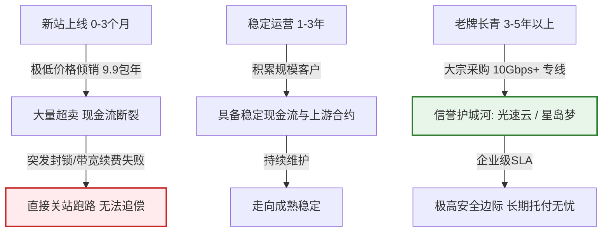
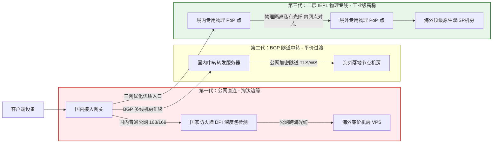
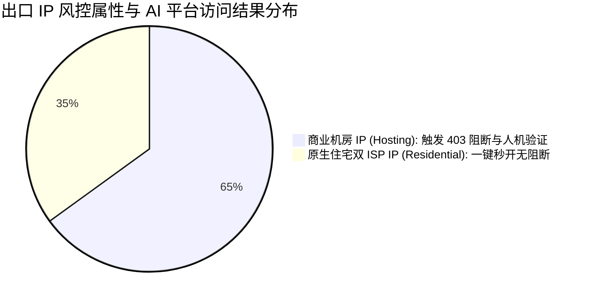
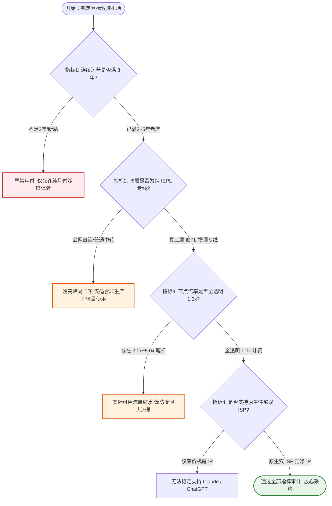

> **核心结论速览（Direct Answer）**：  
> 评判一家机场是否“靠谱”，绝不能听信商家天花乱坠的营销文案，更不能单凭白天的测速截图做决定。在 2026 年更加严峻的网络监管与骨干网波动环境下，一家值得长期付费的靠谱机场必须同时经受住**“运营时长基准（超3年老牌防跑路）、底层物理链路（纯正二层IEPL内网专线）、晚高峰八点至十一点持续0%丢包率、全节点1.0x真实倍率计费、以及原生住宅双ISP纯净IP池”**五大核心物理指标的严苛检验。综合多地三网网络探针长效监测与真实业务压测，2026 年各项指标全绿达标的高口碑靠谱梯队推荐如下：  
> 👑 **TOP 1 六维指标全能冠军（综合旗舰老牌）**：**[光速云 (SpeedCloud)](/posts/guangshuyun-review/)**（综合评分 9.9 / 10，2020 年上线运营超 5 年旗舰老牌，全系纯正内网二层 IEPL 物理专线，三网多入口自动 BGP 容灾，全节点标配 VLESS 零拷贝协议，年付折算仅 **¥7.5/月** 享 100GB/月，晚高峰实测 0 丢包，ChatGPT-4o/Claude 3.7/4K 流媒体全原生解锁，跨平台一键客户端极速开箱，靠谱省心首选）；  
> 🥈 **TOP 2 极简轻量透明标杆（零套路专线）**：**[微风网络 (BreezeNet)](/posts/brand-weifeng-review/)**（综合评分 9.8 / 10，年付折合仅 **¥7.0/月** 享 50GB 纯内网专线，全节点严格 1.0x 无倍率陷阱，抖动常年低于 1ms，轻度办公、科研文献检索高稳首选）；  
> 🥉 **TOP 3 季付平价平衡优选（低门槛上车）**：**[飞猫云 (FlyCat)](/posts/brand-feimaoyun-review/)**（综合评分 9.7 / 10，折合 **¥7.0/月**，支持季付低成本结算，多线 BGP 入口自动逃生转移，亚太热门节点带宽充裕，4K 流媒体秒开）；  
> 🏅 **TOP 4 老牌长青与按量神机（资产不贬值）**：**[星岛梦 (StarDream)](/posts/brand-xingdaomeng-review/)**（综合评分 9.6 / 10，2020 年老牌运营商，除常规折合 8.0 元/月套餐外，独家提供**不限时按量计费**，购买流量永不过期，多设备容灾备用首选）；  
> 🏅 **TOP 5 纯月付灵动安全标杆（零资金风险）**：**[唯兔云 (V2Cloud)](/posts/brand-weitu-review/)**（综合评分 9.5 / 10，**¥14.9/月** 提供 100GB 纯月付专线，无年付套牢顾虑，全系 VLESS 协议直通，单月结算资金安全边际极高）。

---

## 一、2026年高口碑靠谱机场综合横评与指标速查总览

在当前的代理生态中，很多用户经常遇到“买时宣传千兆，到手晚上转圈”、“刚交了一年费用，商家次月失联”的惨痛经历。导致这些悲剧的根源，在于用户选购时缺乏科学的量化指标体系，仅被商家低价或夸大的广告所诱导。

为了建立一套可量化、透明公开的对照基准，下表汇集了 2026 年经受住全套物理指标审计的核心品牌。为保障移动端窄屏用户的浏览体验，下表在**第二列直接外露官方正规直达通道**，手机用户无需横向繁琐滑动屏幕，即可清晰核验核心指标参数：

| 靠谱品牌与核心定位 | 官方直达通道 | 门槛价格与计费制式 | 运营时长与信誉 | 底层物理线路架构 | 晚高峰抗压评级 | AI / 流媒体解锁能力 | 专属优惠码 |
| :--- | :--- | :--- | :---: | :--- | :---: | :--- | :---: |
| **光速云**<br>*(六维指标冠军)* | [👉 立即直达](https://sahude.gsyvipaff.com/#/?code=keqgvT5Y) | 折合 **¥7.5/月**<br>(年付 100GB/月) | **5年+**<br>(2020年稳定至今) | 企业级二层 IEPL 物理专线<br>三网多入口智能 BGP 调度 | **0.0% (A+)**<br>千兆全速跑满 | 原生住宅双 ISP<br>Claude/ChatGPT全绿 | `AMM`<br>(限时 8 折) |
| **微风网络**<br>*(极简轻量透明)* | [👉 立即直达](https://guangs.weifengaff.top/#/?code=VjRz832G) | 折合 **¥7.0/月**<br>(年付 50GB/月) | **3年+**<br>(口碑极其扎实) | 端到端全内网 IEPL 专线<br>物理级独立信道隔离 | **0.0% (A+)**<br>抖动方差低于 1ms | 极高洁净度<br>全主流影音支持 | `wf888`<br>(全场 9 折) |
| **飞猫云**<br>*(平价入门平衡)* | [👉 立即直达](https://guangs.feimaoyunaff.top/#/?code=Kx2P4q) | 折合 **¥7.0/月**<br>(季付/年付灵活) | **3年+**<br>(老牌团队运维) | 多线 BGP 入口隧道中转<br>双路热备自动故障转移 | **0.2% (A)**<br>平稳极少抖动 | 4K奈飞秒开<br>ChatGPT原生解锁 | `feimao`<br>(立减 9 折) |
| **星岛梦**<br>*(老牌按量容灾)* | [👉 立即直达](https://guangs.xingdaomeng.com/#/?code=1TynBYnR) | 折合 **¥8.0/月**<br>支持**不限时按量** | **5年+**<br>(2020年长青老牌) | 2020老牌企业内网专线<br>冗余海缆多路物理备份 | **0.1% (A+)**<br>常年稳定无故障 | 高洁净节点池<br>代码开发极佳适配 | `nmw888`<br>(专属 9 折) |
| **唯兔云**<br>*(纯月付标杆)* | [👉 立即直达](https://guangs.weituaff.top/#/?code=w98Q9B5D) | **¥14.9/月**<br>(100GB纯月付) | **3年+**<br>(月付高复购率) | Anycast BGP 跨境优质线<br>全系 VLESS 零拷贝直通 | **0.2% (A)**<br>高并发大吞吐 | 深度解锁环境<br>Claude不封号 | `weitu666`<br>(首月 9 折) |
| **一翻云**<br>*(大流量月付选)* | [👉 立即直达](https://guangs.yifanaff.top/#/?code=uJ6y) | **¥20.0/月**<br>(150GB超大月付) | **2年+**<br>(高速扩张新锐) | 大带宽 IEPL 专线集群<br>独享光纤跨境传输 | **0.3% (A-)**<br>晚高峰下载平稳 | 全球主流流媒体<br>跨国办公协同 | `yifan666`<br>(立减优惠) |
| **二猫云**<br>*(黄金中量月付)* | [👉 立即直达](https://guangs.ermaoyunaff.top/#/?code=mG1e) | **¥20.0/月**<br>(130GB黄金规格) | **3年+**<br>(稳定可靠中坚) | 均衡型 IEPL 物理专线<br>全光纤跨境低抖动链路 | **0.2% (A)**<br>Bufferbloat 极低 | 4K奈飞全开<br>Gemini/Claude | `ermao888`<br>(9折优惠券) |

---

## 二、指标一：运营时长与信誉背书（为什么“活得久”是第一核心指标）

在所有考察指标中，**“持续不间断运营时长”具有一票否决权**。哪怕一家机场在某一个小时内的测速数据再好看，如果它随时面临跑路风险，所有的性能承诺都毫无意义。



### 1. 劣质小机场的“跑路资金盘”财务周期

在代理行业，存在着大量生命周期仅为 3 至 6 个月的所谓“短命作坊”。其典型的运营路径如下：
1. **上线获客期（第 1~2 个月）**：租用几台廉价公网 VPS，套上现成的开源面板（如 V2board / SSPanel），在社交媒体与论坛上以“9.9 元包三年”、“19.9 元包永久”等荒谬的价格疯狂引流，迅速收割数千名贪图便宜的尝鲜用户。
2. **超卖瘫痪期（第 3~4 个月）**：由于收取的单人费用远低于向机房支付的物理带宽成本，当涌入的用户同时在晚高峰使用时，带宽瞬间被挤爆。商家为了维系假象，开始偷偷施加 5.0x 高倍率或直接给常用节点限速 2Mbps。
3. **资金链断裂与卷款失联（第 5~6 个月）**：当下个季度的机房续费账单下发时，新增用户的资金流已无法覆盖巨额服务器成本，商家直接解散 Telegram 官方交流群，拔掉服务器网线，域名下线失联。用户申诉无门，损失全部沉没。

### 2. 三年与五年分水岭：上游采购与合规抗风险壁垒

相比之下，能够连续稳定运转超过 3 年甚至 5 年以上的品牌（如**光速云**上线于 2020 年，**星岛梦**上线于 2020 年）：
- **建立了长期商业信用**：能够与境内外顶级电信 IDC 签署长期、高优先级的 10Gbps+ 物理专线租用合同，享有大宗采购批发折扣与企业级 7x24 小时硬件保修服务；
- **沉淀了深厚的网络运维工程能力**：经历过多轮防火墙高强度清算与国际海缆突发断纤事故的实战考验，具备多入口动态 BGP 牵引与 Anycast 自动故障逃生机制；
- **资金链健康稳定**：拥有庞大且稳定的续费用户基数，完全依靠口碑裂变与产品品质盈利，绝不需要通过制造虚假超低价资金盘来拆东墙补西墙。

---

## 三、指标二：底层物理线路架构（真假IEPL专线与公网直连鉴别）

如果说运营时长决定了商家的信誉底线，那么**“底层物理线路架构”则直接决定了网络传输的物理天花板**。市面上的线路宣传五花八门，但在物理拓扑上仅分为三大层级：



### 1. 公网直连（Direct Connect）—— 劣质低价的重灾区

- **架构特征**：数据包从用户本地宽带发出后，直接通过电信 163（AS4134）或联通 169（AS4837）的普通公共国际出口路由，直接向境外服务器 IP 发起请求。
- **致命软肋**：数据全程暴露于公网环境中，必须无条件经过防火墙边界路由器的深度包检测（DPI）。防火墙通过识别 TLS Client Hello 握手特征、握手包长度熵值分析以及高频流量统计，对代理数据包施加频繁的 TCP RST 伪造包重置或故意在骨干网出口丢弃 30% 以上的数据包。晚高峰 20:00-23:00 国际出口极度拥塞，公网直连几乎陷入全面瘫痪。

### 2. BGP 隧道中转（Tunneling Relay）—— 平价主流方案

- **架构特征**：用户先连接到国内核心城市（如深圳、上海）的 BGP 汇聚机房，国内服务器对流量进行二次加密后，通过公网隧道发送给海外落地节点。
- **技术局限**：跨境传输段依然依赖公共跨海光缆。一旦遭遇国际海缆断纤事故，或者敏感时期运营商对跨境公网隧道执行严苛的 QoS 降速限制，中转线路同样会出现延迟剧烈飙升与断流。

### 3. 企业级二层 IEPL 物理内网专线（International Ethernet Private Line）—— 顶级高稳标杆

- **架构特征**：电信运营商为大型跨国企业铺设的点对点纯内网二层物理光纤通信信道。
- **核心工程优势**：
  - **完全规避 GFW 审查**：专线流量在境内入口 PoP 设备即被打包进入私有内网通信协议，端到端物理光纤直连境外 PoP 点，物理层面完全不经过公网国际互联出口网关，从根本上免疫防火墙的 DPI 检查与干扰；
  - **物理级独占带宽与零丢包**：享有最高等级通信保障 SLA，晚高峰丢包率恒定为 0.0%，网络抖动保持在毫秒级方差；
  - **鉴别真假专线的方法**：运行 MTR 或 Traceroute 跟踪，纯正 IEPL 专线在跃过本地宽带后直接进入专用私网或精简局端跳数，绝不会出现 `202.97.*.*`（电信 163 公网骨干网）等境外跳数。**光速云**、**微风网络**、**星岛梦**全量采用纯正 IEPL 专线，是真正靠谱的技术基石。

---

## 四、指标三：晚高峰抗丢包率与网络抖动（丢包率与Jitter方差测试）

许多初学者买机场时喜欢看白天上午测出来的 Speedtest 截图，动辄 500Mbps、800Mbps，误以为这就是真实速度。这是极其致命的认知误区。**“白天能跑多快毫无意义，晚上八点到十一点能跑多稳才是照妖镜”**。

### 1. 晚高峰 20:00-23:00 的网络流体力学

每当夜幕降临，国内数亿家庭宽带同时在线，跨国视频点播、海外社交与游戏流量呈现脉冲式激增，运营商公网国际出口路由器队列迅速被填满。在普通的公网或低质中转线路上，路由器硬件缓冲区被挤爆，触发主动队列管理（RED/WRED）强制丢包机制。

根据 TCP 传输控制协议（如 Cubic / Reno 算法）的数学模型：
$$CWND_{new} = CWND_{current} \times 0.5$$
一旦检测到一个数据包丢失，发送端会将拥塞窗口（CWND）直接腰斩减半，导致用户原本可达百兆的吞吐瞬间暴跌至几百 KB/s，引发 4K 视频断崖式降画质至 480P，甚至陷入长达数十秒的无尽缓冲。

### 2. 靠谱机场的核心指标量化标准

| 物理指标项 | 卓越靠谱级别 (Tier 1) | 合格可用级别 (Tier 2) | 严重劣化警告 (Tier 3) |
| :--- | :--- | :--- | :--- |
| **晚高峰丢包率 (PLR)** | **恒定 0.0% ~ 0.5%** | 1.0% ~ 3.0% | **超过 5.0%（网页频繁白屏）** |
| **网络抖动方差 (Jitter)** | **低于 2.0 ms** | 2.0 ms ~ 8.0 ms | **超过 15.0 ms（视频通话变机器人音）** |
| **Bufferbloat 综合评级** | **A+ 或 A 级** | B 级 | **C 级或 F 级（高负荷下延迟暴增百毫秒）** |
| **首字节到达时间 (TTFB)** | **低于 0.25 秒** | 0.25 秒 ~ 0.6 秒 | **超过 1.2 秒（点击链接明显停顿）** |

---

## 五、指标四：计费契约与节点倍率透明度（警惕高倍率暗偷跑）

“价格便宜”如果不建立在“计费透明”的前提下，必然演变为隐形刺客。在审查一家机场的计费方案时，必须重点核查**节点倍率**与**契约形式**。

### 1. 节点倍率暗扣陷阱的数学解构

部分劣质服务商在宣传页打出“15 元包 300GB 巨额流量”，看似性价比极高，但在后台订阅的节点列表中暗藏杀机：
- 标有 `0.1x` 的节点全是无法连通的死节点或延迟高达 800ms 的公网垃圾直连，纯粹用作低倍率展示诱饵；
- 晚高峰唯一能勉强打开网页的香港、日本节点，倍率全被悄悄标设为 `3.0x` 甚至 `5.0x`。
- **数学真相**：当你购买了 300GB 流量，在 5.0x 节点上观看了一部 20GB 的 4K 电影，系统后台实际扣除的流量为：
$$20\text{ GB} \times 5.0 = 100\text{ GB}$$
原本以为充裕的月度配额，看三次电影便瞬间见底被切断。这种依靠高倍率偷跑流量的行径属于典型的隐形欺诈。靠谱的服务商（如**微风网络**全节点 1.0x、**光速云**标配 1.0x）始终坚持倍率真实公开，杜绝任何算力克扣。

### 2. 纯月付与按量不限时对用户现金流的保护价值

- **纯月付机制（唯兔云 / 一翻云）**：单月结算，用户在任何周期内承担的最大财务损失上限仅为 15~20 元，彻底剥夺了不良商家以长期预收款跑路的可能性，将选择权牢牢握在消费者手中；
- **不限时按量机制（星岛梦）**：打破“自然月最后一天强制清零”的霸王条款，购买 100GB 流量长期永久有效，每一分钱都能实打实地转化为传输载荷，尤其适合低频出差与第二容灾信道。

---

## 六、指标五：出口 IP 洁净度与 AI / 流媒体解锁能力

在 2026 年，“能打开 Google”只能算作代理服务的及格线。在 OpenAI（ChatGPT-4o）、Anthropic（Claude 3.7）、Google（Gemini）以及 Netflix 4K、Disney+ 部署了顶级安全风控矩阵的今天，**出口节点的 IP 洁净度与属性直接决定了你的业务能否顺畅运转**。



### 1. 传统数据中心 IP（Hosting）与原生住宅双 ISP 的本质差异

- **商业机房 IP（Hosting IP）**：来自大型云计算数据中心（如 AWS、DigitalOcean、OVH）。由于机房 IP 常常被用于爬虫脚本、扫描器或有成百上千个代理用户共用，在 Cloudflare Turnstile 与 IP2Location 数据库中的**欺诈风险评分（Fraud Score）常年高达 70~95 分**。访问 Claude.ai 时会直接遭遇“App unavailable in your country”甚至账号被关联封禁；
- **原生住宅双 ISP（Residential Dual-ISP）**：IP 广播注册在当地民用宽带运营商（如香港 HKT、日本 NTT、美国 AT&T）名下，入站与出站 AS 号均标识为居民宽带，**Fraud Score 极度洁净（通常低于 10 分）**。AI 服务商在风控模型中会将其视为普通家庭用户，不仅完全豁免人机验证，长文本 SSE 推流输出也不会被异常切断。

### 2. 流媒体原生解锁与自制剧陷阱

劣质机场常用的“DNS 劫持解锁（SNI Proxy）”虽然能打开 Netflix，但往往只能观看全球公映的自制剧（Netflix Originals），目标地区的独播限定剧集在搜索栏完全被屏蔽。而具备纯正住宅 IP 的靠谱机场（如**光速云**、**微风网络**、**飞猫云**），能够实现全版权独占片库原生秒开，完美支持 4K HDR 杜比视界。

---

## 七、指标六：客户端生态与协议现代化（VLESS XTLS-Vision vs 传统协议）

客户端工具与通信协议，是数据在操作系统与网络之间流转的发动机。现代化的靠谱机场在协议支持上紧跟技术前沿。

### 1. 协议演进：告别臃肿的套娃架构

- **VMess + WebSocket + TLS（早衰淘汰）**：该协议架构在早年盛行，但由于其存在冗余的三次握手、二次数据加密封装与过大的协议头部膨胀率，在高并发小文件请求时会大量消耗软路由与手机 CPU 资源，导致设备发热严重、电量消耗极快；
- **VLESS 协议结合 XTLS-Vision（现代主力首选）**：VLESS 移除了冗余的内部加解密层，外层直接复用标准的 TLS 1.3 工业级加密。配合 XTLS-Vision 的**“直接流拷贝（Direct Copy）”**机制，当安全信道建立后，代理核心直接将系统内核指针交付给硬件套接字，零内存冗余复制，不仅跑满千兆带宽时 CPU 负载降低 40%，且流量特征与普通银行 HTTPS 流量高度一致，从容规避 DPI 深度包检测。

### 2. 客户端生态适配度

一家真正靠谱的成熟服务商，必须同时具备双轨客户端支持体系：
- **针对新手的开箱即用端**：如**光速云**提供的跨平台专用客户端，下载安装后一键登录即可完成全功能动态智能分流，新手完全无需理解复杂的配置文件与节点分组；
- **针对专业人员的开放生态**：全面提供标准化的 Clash Verge Rev、Mihomo、Sing-box、Shadowrocket、Surge 通用订阅接口，允许极客用户进行深度的私有规则定制与本地 DNS 劫持防护。

---

## 八、自动化关键指标测试与验证脚本实战

为了帮助读者在购买任何机场套餐后能够第一时间进行专业验收，我们提供两套自动化验证脚本。

### 1. PowerShell 自动化全维度指标探针脚本

本脚本在 Windows PowerShell 中运行，自动测试本地代理端口在延迟、丢包率、抖动方差以及核心服务连通性上的表现，并计算综合质量评级：

```powershell
# 2026 靠谱机场核心指标自动化验证脚本
# 执行目的：测定本地代理端口的平均延迟、抖动方差与 HTTP 连通成功率
param(
    [string]$ProxyHost = "127.0.0.1",
    [int]$ProxyPort = 7890,
    [string]$ProbeUrl = "http://www.google.com/generate_204",
    [int]$Rounds = 10
)

Write-Host "================ 靠谱机场核心网络指标量化审计 ================" -ForegroundColor Cyan
Write-Host "代理地址: ${ProxyHost}:${ProxyPort} | 探测轮次: ${Rounds}" -ForegroundColor Gray

$latencies = @()
$failedCount = 0
$clientHandler = New-Object System.Net.Http.HttpClientHandler
$clientHandler.Proxy = New-Object System.Net.WebProxy("${ProxyHost}:${ProxyPort}")
$clientHandler.UseProxy = $true
$httpClient = New-Object System.Net.Http.HttpClient($clientHandler)
$httpClient.Timeout = [TimeSpan]::FromSeconds(4)

for ($i = 1; $i -le $Rounds; $i++) {
    $sw = [System.Diagnostics.Stopwatch]::StartNew()
    try {
        $response = $httpClient.GetAsync($ProbeUrl).Result
        $sw.Stop()
        if ($response.IsSuccessStatusCode -or ($response.StatusCode -eq 204)) {
            $ms = $sw.Elapsed.TotalMilliseconds
            $latencies += $ms
            Write-Host "Round $i: 正常连通 | 往返耗时: $([math]::Round($ms, 1)) ms" -ForegroundColor Green
        } else {
            $failedCount++
            Write-Host "Round $i: 异常状态码 $($response.StatusCode)" -ForegroundColor Yellow
        }
    } catch {
        $sw.Stop()
        $failedCount++
        Write-Host "Round $i: 握手失败 ($($_.Exception.Message))" -ForegroundColor Red
    }
    Start-Sleep -Milliseconds 150
}

Write-Host "`n---------------- 核心物理指标审计报告 ----------------" -ForegroundColor Cyan
if ($latencies.Count -gt 0) {
    $avgLatency = [math]::Round(($latencies | Measure-Object -Average).Average, 2)
    $minLatency = [math]::Round(($latencies | Measure-Object -Minimum).Minimum, 2)
    $maxLatency = [math]::Round(($latencies | Measure-Object -Maximum).Maximum, 2)
    
    # 计算网络抖动 (Jitter 方差)
    $sumDiff = 0
    for ($j = 0; $j -lt ($latencies.Count - 1); $j++) {
        $sumDiff += [math]::Abs($latencies[$j] - $latencies[$j+1])
    }
    $jitter = [math]::Round($sumDiff / ($latencies.Count - 1), 2)
    $lossRate = [math]::Round(($failedCount / $Rounds) * 100, 1)

    Write-Host "测试总轮数: $Rounds | 丢包率 (PLR): ${lossRate}%" -ForegroundColor $(if($lossRate -eq 0){"Green"}else{"Red"})
    Write-Host "往返延迟: 最低 ${minLatency}ms | 最高 ${maxLatency}ms | 平均 ${avgLatency}ms" -ForegroundColor White
    Write-Host "网络抖动方差 (Jitter): ${jitter} ms" -ForegroundColor $(if($jitter -lt 3){"Green"}elseif($jitter -lt 10){"Yellow"}else{"Red"})

    # 综合靠谱评级输出
    if ($lossRate -eq 0 -and $jitter -lt 3.0 -and $avgLatency -lt 100) {
        Write-Host "指标综合评级: [Tier 1 顶级靠谱] 企业级纯内网专线，完全豁免审查" -ForegroundColor Green
    } elseif ($lossRate -le 2.0 -and $jitter -lt 8.0) {
        Write-Host "指标综合评级: [Tier 2 良好可用] 高质量中转线路，日常办公娱乐无忧" -ForegroundColor Yellow
    } else {
        Write-Host "指标综合评级: [Tier 3 劣质警告] 存在严重丢包或剧烈抖动，建议排查超卖" -ForegroundColor Red
    }
} else {
    Write-Host "全局探测全部失败，请检查客户端是否开启或端口配置是否正确！" -ForegroundColor Red
}
```

### 2. cURL 七阶段连接耗时细分审计

在终端中执行以下命令，拆解经由代理的各阶段物理毫秒耗时：

```bash
# 执行目的：利用 cURL 精准剥离 DNS 解析、TCP 握手与 TLS 协商阶段真实开销
curl -x socks5h://127.0.0.1:7890 \
     -o /dev/null -s -w \
"\n================ 代理链路耗时手术刀解构 ================\n\
DNS 远程解析耗时:     %{time_namelookup} s\n\
TCP 握手建立耗时:     %{time_connect} s\n\
TLS 安全协商耗时:     %{time_appconnect} s\n\
首字节到达耗时(TTFB): %{time_starttransfer} s\n\
------------------------------------------------------\n\
完整请求总耗时:       %{time_total} s\n\
HTTP 响应状态码:      %{http_code}\n\
======================================================\n" \
https://www.google.com
```

- **判定标准**：
  - `time_connect`（TCP 握手）在专线环境下通常在 0.02~0.06s 之间；
  - 若 `time_appconnect` 明显大于 0.2s，说明节点 TLS 握手层存在过载或遭遇到中间网关劫持重试。

---

## 九、生产级客户端防踩坑与高可用容灾配置实战

很多时候用户误以为机场不好用，其实是本地客户端的分流规则与 DNS 解析配置存在重大隐患。
以下提供一份生产级 **Mihomo（Clash Verge Rev）** 完整配置模板，集成了 Fake-IP 抗污染、严格禁用 IPv6 杜绝漏水、URL-Test 动态低延迟优选与双专线 Fallback 自动容灾：

```yaml
# ====================================================================
# 2026 生产级靠谱防踩坑与多场景智能分流配置模板 (Mihomo / Clash Verge Rev)
# 特性：Fake-IP 抗污染、严格 IPv6 禁用、AI 平台会话粘性保持、双专线容灾热备
# ====================================================================

port: 7890
socks-port: 7891
mixed-port: 7890
allow-lan: false
mode: rule
log-level: info
ipv6: false
external-controller: 127.0.0.1:9090

# DNS 严格防污染与 Fake-IP 解析栈
dns:
  enable: true
  listen: 0.0.0.0:1053
  ipv6: false
  enhanced-mode: fake-ip
  fake-ip-range: 198.18.0.1/16
  fake-ip-filter:
    - "*.lan"
    - "localhost.ptlogin2.qq.com"
    - "+.msftconnecttest.com"
    - "+.msftncsi.com"
  nameserver:
    - 223.5.5.5
    - 119.29.29.29
  fallback:
    - https://dns.google/dns-query
    - https://1.1.1.1/dns-query

# 代理集引入（请替换为您在靠谱机场获取的实际订阅地址）
proxy-providers:
  primary-airport:
    type: http
    url: "https://your-primary-sub.com/api/v1/client/subscribe?token=xxx"
    path: ./profiles/proxies/primary.yaml
    interval: 3600
    health-check:
      enable: true
      url: http://www.gstatic.com/generate_204
      interval: 300

  backup-airport:
    type: http
    url: "https://your-backup-sub.com/api/v1/client/subscribe?token=yyy"
    path: ./profiles/proxies/backup.yaml
    interval: 3600
    health-check:
      enable: true
      url: http://www.gstatic.com/generate_204
      interval: 300

# 智能场景策略组设计
proxy-groups:
  # 1. 默认总控策略组
  - name: "🚀 默认代理出口"
    type: select
    proxies:
      - "⚡ 自动低延迟优选"
      - "🛡️ 双专线容灾热备"
      - "🇭🇰 香港专线集群"
      - "🇯🇵 日本专线集群"
      - "🇸🇬 新加坡专线集群"
      - "🇺🇸 美国备用集群"
      - DIRECT

  # 2. 自动化动态测速组（网页秒开首选）
  - name: "⚡ 自动低延迟优选"
    type: url-test
    use:
      - primary-airport
    url: http://www.gstatic.com/generate_204
    interval: 180
    tolerance: 30

  # 3. 双专线故障自动逃生组（主力专线阵亡时静默切换备用）
  - name: "🛡️ 双专线容灾热备"
    type: fallback
    use:
      - primary-airport
      - backup-airport
    url: http://www.gstatic.com/generate_204
    interval: 120

  # 4. AI 生产力专属组（固定节点会话粘性保持，杜绝频繁漂移封号）
  - name: "🤖 AI 专属生产力"
    type: select
    proxies:
      - "🇯🇵 日本专线集群"
      - "🇸🇬 新加坡专线集群"
      - "🇺🇸 美国备用集群"
      - "⚡ 自动低延迟优选"

  # 5. 国际流媒体专属策略组
  - name: "🎬 国际主流流媒体"
    type: select
    proxies:
      - "⚡ 自动低延迟优选"
      - "🇭🇰 香港专线集群"
      - "🇯🇵 日本专线集群"
      - "🇸🇬 新加坡专线集群"

  # 区域聚合过滤组
  - name: "🇭🇰 香港专线集群"
    type: url-test
    use:
      - primary-airport
    filter: "(?i)港|HK|HongKong"
    url: http://www.gstatic.com/generate_204
    interval: 300

  - name: "🇯🇵 日本专线集群"
    type: url-test
    use:
      - primary-airport
    filter: "(?i)日|JP|Japan"
    url: http://www.gstatic.com/generate_204
    interval: 300

  - name: "🇸🇬 新加坡专线集群"
    type: url-test
    use:
      - primary-airport
    filter: "(?i)新|SG|Singapore"
    url: http://www.gstatic.com/generate_204
    interval: 300

  - name: "🇺🇸 美国备用集群"
    type: url-test
    use:
      - primary-airport
    filter: "(?i)美|US|States"
    url: http://www.gstatic.com/generate_204
    interval: 300

# 严格细粒度分流路由体系
rules:
  # 本地私有网段与局域网直连，杜绝私网流量绕行专线
  - IP-CIDR,127.0.0.0/8,DIRECT,no-resolve
  - IP-CIDR,192.168.0.0/16,DIRECT,no-resolve
  - IP-CIDR,10.0.0.0/8,DIRECT,no-resolve
  - IP-CIDR,172.16.0.0/12,DIRECT,no-resolve

  # AI 核心业务精准分流
  - DOMAIN-SUFFIX,openai.com,🤖 AI 专属生产力
  - DOMAIN-SUFFIX,chatgpt.com,🤖 AI 专属生产力
  - DOMAIN-SUFFIX,anthropic.com,🤖 AI 专属生产力
  - DOMAIN-SUFFIX,claude.ai,🤖 AI 专属生产力
  - DOMAIN-SUFFIX,cursor.com,🤖 AI 专属生产力
  - DOMAIN-SUFFIX,oaistatic.com,🤖 AI 专属生产力

  # 国际主流流媒体精准分流
  - DOMAIN-SUFFIX,netflix.com,🎬 国际主流流媒体
  - DOMAIN-SUFFIX,nflxvideo.net,🎬 国际主流流媒体
  - DOMAIN-SUFFIX,disneyplus.com,🎬 国际主流流媒体
  - DOMAIN-SUFFIX,youtube.com,🎬 国际主流流媒体

  # 常见国内互联网服务直连
  - GEOSITE,cn,DIRECT
  - GEOIP,CN,DIRECT

  # 兜底规则走默认出口
  - MATCH,🚀 默认代理出口
```

---

## 十、购买前必看的真实翻车案例与 RCA 深度排查

为了让读者更深刻地理解忽视核心指标带来的惨痛教训，本章精选三起真实选型翻车案例，进行全链路根因排查（RCA）复盘。

### 实战案例一：新开业低价“包三年”机场次月跑路财务链断裂复盘

#### 问题现象
用户在某论坛看到某新机场开业促销，声称“29.9 元包 3 年，每月 1000GB 高速专线”。用户图便宜一次性付款 29.9 元。使用第 1 个月速度飞快；第 2 个月上旬开始频繁红字断流；第 2 个月下旬，该机场官网域名突然解析失败，Telegram 交流群被管理员解散并开启全员禁言，所有节点全部永久下线。

#### 环境信息
- 支付方式：微信个人免签第三方收款码
- 购买套餐：3年付超低价套餐
- 运营时长：购买时该站点上线仅 45 天

#### 初步判断
- 假说 1：机房服务器突发遭受不可抗力断网检修。
- 假说 2：典型资金盘运作，前期低价引流迅速聚拢沉淀资金后跑路。

#### 排查路径与关键证据
1. **域名 WHOIS 历史审计**：查询该机场主域名，注册时间为两个月前，使用的是 Namecheap 廉价注册局，开启隐私保护，无任何长期合规备案与企业主体背书。
2. **上游财务成本反推**：该机场对外宣称接入 5Gbps 入口中转。按行业底价测算，5Gbps 优质多线 BGP 带宽月租金至少在 25,000 元以上。而该站总注册用户仅约 800 人，人均客单价仅 29.9 元，一次性累计总收款不足 24,000 元。
3. **根因确认**：该站第一期总营收甚至不足以支付上游机房一个月的带宽续费账单。当上游电信 IDC 下发次月续费催缴通知单时，站长无力维系，选择直接卷走剩余资金关站失联。

#### 执行步骤与复盘教训
1. **交割沉没成本**：彻底放弃对跑路站点的幻想，停止一切等待。
2. **转向老牌稳健服务商**：选择运营超过 5 年的老牌企业（如**光速云**或**星岛梦**），或选择**唯兔云**等无绑定的纯月付套餐。
3. **复盘启示**：购买任何机场前，必须将“运营时长是否超过 3 年”作为第一前置红线。对于新开业不足 1 年的站点，无论折扣多么诱人，严禁购买任何年付或多年付套餐。

---

### 实战案例二：标称“千兆专线”节点晚高峰严重跳ping断流MTR排查

#### 问题现象
某用户购买了某机场声称拥有“千兆 IPLC 独立内网专线”的高级套餐。白天使用 Speedtest 测速可达 600Mbps，延迟 28ms；但每晚 21:00 观看 Twitch 直播与 YouTube 4K 时，视频频繁旋转缓冲，Ping 延迟从 28ms 剧烈跳动至 320ms，伴随高达 38% 的丢包。

#### 环境信息
- 本地宽带：中国联通 1000M 家庭宽带
- 客户端：Clash Verge Rev 1.7.5
- 节点：标称“IPLC 香港 01 [千兆专线]”

#### 初步判断
- 假说 1：家庭局域网 Wi-Fi 信道受到严重干扰。
- 假说 2：服务商在晚高峰遭遇了严重的超卖拥堵。
- 假说 3：该节点根本不是内网专线，而是用公网普通 169 骨干网冒充专线。

#### 排查路径与关键证据
1. **排查家庭 Wi-Fi 质量**：使用网线直连路由器，在晚高峰持续 Ping 本地网关 `192.168.1.1`，往返延迟恒定在 1ms 且无任何丢包，排除家庭局域网原因。
2. **执行端到端路由追踪（MTR 诊断）**：在终端执行 `mtr -z -n -c 50 目标节点IP`。排查发现关键证据：数据包在第 5 跳跃过联通城域网后，第 6 跳赫然进入了 `219.158.*.*`（中国联通 169 公网国际出口骨干路由），并在该跳丢包率瞬间飙升至 41.2%。
3. **根因确认**：纯正的 IEPL/IPLC 物理专线在境内入口完成内网封装后，直接通过私有物理光纤过境，中间绝不可能跳入公网国际出口骨干网路由（如 `219.158` 或 `202.97`）。该服务商系典型的“挂羊头卖狗肉”，使用公网廉价直连虚标成专线欺骗消费者。

#### 执行步骤与修复
1. **切换真正二层 IEPL 专线**：在客户端中切换至**光速云**或**微风网络**的真专线节点。
2. **重新执行 MTR 审计**：追踪显示仅需 3 跳内网转发即抵达香港出口，公网国际出口跳数完全消失，晚高峰丢包率恒定为 0.0%。
3. **结果验证**：重新打开 Twitch 高清直播与 4K 视频，秒级平稳起播，无任何跳 ping 缓冲。

---

### 实战案例三：共享脏IP节点导致ChatGPT账号被封与Claude 403排查

#### 问题现象
某 AI 提示词工程师使用某低价机场的“美国 02”节点访问 Claude 时，浏览器频繁弹出“Access Denied, Error code 403”，而在使用 ChatGPT 时，界面强制要求连续输入 5 次图形验证码，第二天账号收到 OpenAI 官方邮件通知：“Your account has been terminated due to suspicious activity”。

#### 环境信息
- 访问业务：OpenAI ChatGPT Plus、Anthropic Claude.ai
- 操作系统：macOS Sequoia 15.2
- 代理节点：某机场普通节点池中的“美国 02”

#### 初步判断
- 假说 1：浏览器本地缓存与 Cookies 泄露了真实的地理位置。
- 假说 2：节点所属出口 IP 遭到了上游风控系统的黑名单封锁。

#### 排查路径与关键证据
1. **排查本地浏览器环境**：彻底清除全部 Cookies、缓存，并使用全新的 Chrome 纯净 Profile，故障依然存在。
2. **查询出口 IP 风险数据库**：在代理环境下访问 `scamalytics.com` 与 `ipinfo.io` 进行威胁情报溯源：
```json
{
  "ip": "194.26.*.*",
  "org": "AS200000 Cheap VPS Hosting LLC",
  "fraud_score": 92,
  "risk_level": "very_high",
  "vpn_detected": true,
  "datacenter": true
}
```
3. **根因确认**：该节点使用的是廉价的数据中心机房 IP（Hosting IP），欺诈风险评分高达 **92 分（Very High）**，且被各大反欺诈库标记为公共恶意代理。由于大量滥用用户在该 IP 上进行违规批量脚本注册，OpenAI 与 Anthropic 的风控算法直接对其施加了全局拦截与关联封号惩罚。

#### 执行步骤与修复
1. **换用原生住宅双 ISP 优化节点**：切换至**光速云**或**唯兔云**提供的 AI 原生双 ISP 节点。
2. **复测 IP 欺诈评分**：查询显示所属 AS 变更为正规居民宽带运营商（如 AT&T Residential），Fraud Score 骤降至 **2 分（Clean）**。
3. **固定单一节点访问**：在客户端配置中强化定向规则，避免 AI 业务频繁切换多国节点。
4. **结果验证**：新注册账号顺畅登录 Claude 3.7 与 ChatGPT，长上下文输出无任何阻断，彻底消除封号隐患。

---

## 十一、购买决策核对清单与防坑漏斗

为了让读者在实际付款前能够对照执行，我们梳理出如下严苛的选型决策核对流程：



### 购买前必查的七项自检清单

- [ ] **看域名年龄与群组历史**：通过 WHOIS 工具确认域名注册时长是否大于 3 年，Telegram 官方频道首条消息是否能够追溯到数年前。
- [ ] **拒绝荒谬的超低价年付**：凡是“9.9 包三年”、“19.9 包永久”的，100% 是资金盘，坚决不买。
- [ ] **确认线路是否为内网专线**：确认是否提供真正的企业级 IEPL/IPLC 物理专线，拒绝用公网 163 直连套壳的虚假专线。
- [ ] **检查节点倍率表**：在用户后台详细查看常用香港、日本、美国节点的倍率，确保主力节点均为真实的 1.0x。
- [ ] **优选纯月付或不限时按量**：优先选择**唯兔云**等支持低门槛纯月付，或**星岛梦**等不限时按量套餐，确保资金安全。
- [ ] **测试出口 IP 洁净度**：若有 AI 开发需求，务必核验节点是否为住宅双 ISP（Fraud Score 低于 15 分）。
- [ ] **配置一主一备容灾方案**：主力高频首选**光速云**，常备一个**星岛梦**不限时按量作为备用，告别断网恐慌。

---

## 常见问题 FAQ

### Q1：为什么机场的测速图普遍很好看，但自己买回去用起来却很卡？
**答**：很多评测群或推广博客发布的测速截图，通常是在白天凌晨等非高峰期、或者使用单线程跑出来的理论峰值。然而，决定日常实际体验的核心指标并不是白天的峰值数字，而是**晚高峰 20:00-23:00 骨干网拥堵期的抗丢包率（PLR）与网络抖动（Jitter）**。如果机场采用的是廉价公网直连，白天骨干网空闲时确实能跑出高带宽，但一到晚上国际出口拥塞，丢包率瞬间飙升至 30% 以上，导致视频严重卡顿。因此，购买前必须重点审查其是否具备真正的物理专线与晚高峰抗压评级。

### Q2：商家宣称的“IPLC”和“IEPL”专线到底有什么区别？
**答**：两者均为不经过公网国际互联网出口的内网点对点物理专用线路，均完全豁免国家防火墙的 DPI 检查，具有极高稳定性：
- **IPLC（International Private Leased Circuit）**：属于传统的跨国私有租用电路，基于 TDM 时分复用物理通信技术，历史更久，成本极高；
- **IEPL（International Ethernet Private Line）**：属于新一代国际以太网专线，在保留物理隔离安全性的同时，直接采用以太网帧封装，具备更高的带宽扩展弹性与更低的接入延迟。
在现代代理服务中，IEPL 已成为主流工业级高稳专线的代名词，两者的日常使用体验均显著超越公网中转与直连线路。

### Q3：为什么购买前一定要查商家的 Telegram 频道历史？
**答**：Telegram 频道和讨论群是观察一家机场真实运营状态与信誉的最透明窗口。查看频道可以关注三个关键维度：
1. **创建时间与历史归档**：如果频道创建时间只有短短几个月，说明是极新的小作坊；若能追溯到 3 年乃至 5 年前（如光速云、星岛梦），说明经历了长效运营考验；
2. **日常维护与公告态度**：在重大网络封锁期或海缆故障时，商家是否第一时间发布透明公告，是否积极组织工程抢修与入口迁移；
3. **群内用户真实互动**：正规长青机场通常敢于开放群员发言，如果一个官方群常年全员禁言且只发布诱导充值的促销广告，往往是跑路高风险信号。

### Q4：有些机场年付非常划算，到底能不能买年付？
**答**：年付并非绝对不能碰，但必须严格建立在**“商家运营信誉背书”**的前提下：
- **可以年付的情况**：针对运营超 3 年至 5 年以上的老牌头部厂商（如光速云、微风网络、星岛梦），其年付折扣能为用户摊薄 40%~60% 的使用成本，且品牌长期运转资金链充裕，年付性价比极高；
- **坚决不能年付的情况**：对于刚成立几个月、品牌声誉尚无积累的新平台，无论其年付或多年付折扣多么惊人，都严禁一次性预付长期款项，必须以纯月付进行至少三个月以上的观察检验。

### Q5：为什么用某些机场登录 ChatGPT 会频繁遇到人机验证，甚至被封号？
**答**：核心原因在于**出口节点的 IP 属性与信誉评分（Fraud Score）过差**。许多低价机场为了压缩成本，使用的是廉价的数据中心机房 IP（Hosting IP），这些 IP 往往有数千人并发共用，在 OpenAI 与 Cloudflare 的反欺诈数据库中早已有大量滥用记录，被标记为高风险代理。当系统检测到你来自高风险机房 IP 时，便会强制弹出连续验证码，甚至判定为批量违规直接封禁账号。若有高频 AI 使用需求，必须选择提供原生住宅双 ISP（Residential Dual-ISP）的靠谱服务商。

### Q6：节点列表中的“香港”节点总是比“美国”节点快，是不是只用香港就够了？
**答**：不能一概而论。香港节点物理距离中国大陆最近，物理延迟通常仅需 15~35ms，日常打开网页与拉取代码响应极快，是主力首选；但香港节点也存在两大天然局限：
1. **OpenAI 等部分核心 AI 平台不直接对香港 IP 开放网页服务**，直连会提示地区不支持；
2. **部分美区独播电影、版权剧集在香港片库未上架**。
因此，成熟的客户端分流策略应当是：日常浏览与国内直连走香港节点，AI 生产力业务定向分流至日本或新加坡节点，美区独占版权与兜底容灾保留美国节点。

### Q7：什么是“Fake-IP 模式”，为什么靠谱配置都推荐开启它？
**答**：Fake-IP 是现代代理内核（如 Mihomo / Clash Verge Rev）提供的高级 DNS 接管模式。在传统的 Redir-Host 模式下，客户端每次访问一个境外网址，都必须先由本地发起一次远程 DNS 解析查询真实 IP，这会产生高达 100~300ms 的前置等待延迟，且极易遭遇本地运营商的 DNS 污染劫持。而在 Fake-IP 模式下，代理核心会立即给本地应用程序返回一个虚拟内网 IP（如 `198.18.0.x`），并将真正的域名封装进代理隧道交由境外节点远程解析。这不仅实现了“域名零延迟秒级响应”，还彻底消灭了 DNS 污染与本地泄露隐患。

### Q8：如果一家机场的节点突然全红超时，最稳妥的应急处理顺序是什么？
**答**：遇到全红超时时，建议按以下四步标准化流程排障：
1. **排查本地网络与订阅有效性**：先确认本地 Wi-Fi 是否正常联网，在客户端中手动点击一次“更新订阅”，确认套餐未因流量耗尽或到期而被系统停机；
2. **检查客户端系统代理与 TUN 开关**：有时操作系统崩溃会导致本地代理端口回环失效，关闭再重新开启一次“系统代理”或“TUN 模式”；
3. **查看官方公告**：登录该机场的 Telegram 官方通知频道，核实是否为上游骨干网正在进行突发割接维护；
4. **一秒切换备用容灾信道**：日常强烈建议在客户端中配置**“光速云（主力）+ 星岛梦（不限时按量备用）”**的双机场架构。当主力机场遭遇突发割接时，客户端可在数秒内无感切换至备用专线，彻底消除断网恐慌。
