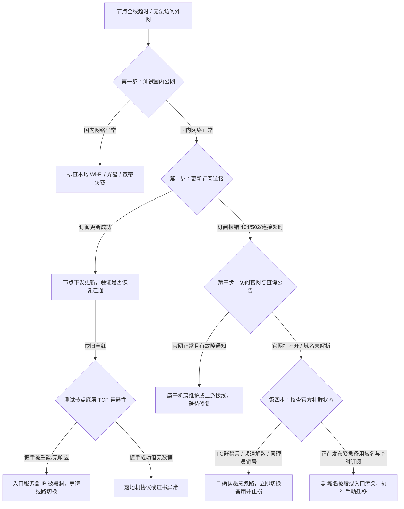

当你打开电脑或手机，发现代理客户端里所有节点集体亮起红叉、延迟测试全线超时、网页彻底打不开时，很多人的第一反应往往是焦虑与困惑：究竟是自家路由器断网、本地运营商抽风、骨干网突发封锁，还是服务商已经卷款跑路？

给出核心定性结论：**不要在节点失联的第一分钟就判定机场跑路，但如果在订阅链接解析失败、官网更换域名无公告、官方社群全员禁言且工单超过四十八小时未回复四项中命中两项以上，该平台发生恶性跑路或不可逆技术故障的概率超过百分之九十。**

机场失联绝非单一维度的黑天鹅事件，它背后交织着跨境虚拟网络服务天然存在的匿名性、境外机房结算账期、国内中转机房合规审查以及恶意击鼓传花式资金盘运作。为了让中国大陆用户在面对网络突发阻断时拥有清晰的判断力，本文结合社区长期追踪的近百起经典跑路与失联案例，系统拆解从底层网络探测、跑路前兆识别、多机场客户端高可用容灾配置，到域名变更防钓鱼的完整技术防坑指南。

---



---

## 一、 2020–2026 行业跑路与风险预警历史档案全景复盘

在无准入门槛、无需主体实名登记的跨境网络代理领域，“跑路”几乎伴随着整个行业的演进史。根据知名安全极客社区 `@limbopro` 开源项目以及行业观察频道持续跟踪的公开数据，自 2020 年至 2026 年，业内记录在案的知名跑路、失联、倒闭及严重恶意欺诈事件已累计超过九十九起。

从早期的单兵运维小型站点，到后期坐拥数万付费用户的大型平台，没有哪一种规模能够成为绝对的免死金牌。回顾这几年的典型跑路案例，行业呈现出非常显著的周期性与结构性特征：

### 📋 社区公开 99+ 机场跑路、失联与高风险历史预警数据库 (全量归档)

> **数据来源说明**：本数据权威聚合自安全极客社区 **@limbopro** 与开源预警索引库及 Telegram 行业公开曝光记录，完整收录 2020 年至 2026 年间 99 家发生跑路失联、恶意减半、恶性断流或重大风险事件的服务商清单。所有条目保留记录时间与定性级别，供广大用户在续费、选择机场或排查故障时提供最全面的历史比对参考。

| 序号 | 涉事服务商/机场名称 | 风险分类 | 警告级别与定性依据 | 记录时间 | 当前风险建议 |
| :---: | :--- | :---: | :--- | :---: | :--- |
| 1 | **万达云** | 2026年记录 | 🔴 确认跑路（官网无法访问/社群全员禁言，已彻底失联） | 09.03.2026 | 官网持续 48h 无法打开，TG 群解散禁言，确认跑路失联 |
| 2 | **龙猫云机场** | 2026年记录 | 🟠 高风险预警（服务异常/续费风险） | 08.18.2026 | 客诉激增/节点大面积超时，建议立即启用备用方案 |
| 3 | **奈云机场** | 2026年记录 | 🟡 观察中（高风险/部分恢复） | 07.01.2026 | 服务发生重大波动或部分恢复，暂缓续费长周期 |
| 4 | **快帆云** | 2025年记录 | 🔴 跑路（跑路） | 02.26.2024 | 判定彻底失联，严禁充值与续费，建议清除设备订阅 |
| 5 | **fccloud** | 2025年记录 | 🔴 跑路（跑路） | 02.09.2025 | 判定彻底失联，严禁充值与续费，建议清除设备订阅 |
| 6 | **spcloud** | 2025年记录 | 🔴 跑路（跑路） | 02.06.2025 | 判定彻底失联，严禁充值与续费，建议清除设备订阅 |
| 7 | **efcloud** | 2025年记录 | ⚠️ 商业/信誉违规（机场转让/用户套餐时长减半） | 01.21.2025 | 单方面篡改套餐时长或客服失联，信誉严重破产 |
| 8 | **aca** | 2025年记录 | 🔴 跑路（跑路） | 01.14.2025 | 判定彻底失联，严禁充值与续费，建议清除设备订阅 |
| 9 | **十元一年** | 2025年记录 | 🔴 跑路（客服态度及其恶劣） | 10.30.2024 | 判定彻底失联，严禁充值与续费，建议清除设备订阅 |
| 10 | **duangcloud** | 2024年记录 | 🔴 跑路（跑路） | 09.01.2024 | 判定彻底失联，严禁充值与续费，建议清除设备订阅 |
| 11 | **leensa** | 2024年记录 | 🟠 高风险预警（跑路预警） | 08.23.2024 | 客诉激增/节点大面积超时，建议立即启用备用方案 |
| 12 | **六尺巷** | 2024年记录 | 🔴 跑路（跑路） | 08.15.2024 | 判定彻底失联，严禁充值与续费，建议清除设备订阅 |
| 13 | **bhcloud/蜂巢** | 2024年记录 | 🟠 高风险预警（跑路预警） | 07.11.2024 | 客诉激增/节点大面积超时，建议立即启用备用方案 |
| 14 | **流量光** | 2024年记录 | 🔴 跑路（跑路） | 06.27.2024 | 判定彻底失联，严禁充值与续费，建议清除设备订阅 |
| 15 | **v2club/蓝岸（boomcloud子机场）** | 2024年记录 | 🔴 跑路（跑路） | 06.09.2024 | 判定彻底失联，严禁充值与续费，建议清除设备订阅 |
| 16 | **新云机场** | 2024年记录 | 🟠 高风险预警（跑路预警） | 06.03.2024 | 客诉激增/节点大面积超时，建议立即启用备用方案 |
| 17 | **xlm cloud** | 2024年记录 | 🟠 高风险预警（跑路预警） | 06.03.2024 | 客诉激增/节点大面积超时，建议立即启用备用方案 |
| 18 | **fastlink** | 2024年记录 | 🟠 高风险预警（跑路预警） | 06.03.2024 | 客诉激增/节点大面积超时，建议立即启用备用方案 |
| 19 | **萌喵** | 2024年记录 | 🔴 跑路（跑路） | 05.13.2024 | 判定彻底失联，严禁充值与续费，建议清除设备订阅 |
| 20 | **boomcloud** | 2024年记录 | 🟠 高风险预警（跑路预警） | 05.09.2024 | 客诉激增/节点大面积超时，建议立即启用备用方案 |
| 21 | **冲浪猫/clm** | 2024年记录 | 🔴 跑路（已跑路） | 05.07.2024 | 判定彻底失联，严禁充值与续费，建议清除设备订阅 |
| 22 | **~~creamdata（奶油机场）~~** | 2024年记录 | 🔴 跑路（~~已跑路~~） | 04.27.2024 | 判定彻底失联，严禁充值与续费，建议清除设备订阅 |
| 23 | **tly机场(特洛伊/baacloud)** | 2024年记录 | 🔴 跑路（已跑路） | 04.25.2024 | 判定彻底失联，严禁充值与续费，建议清除设备订阅 |
| 24 | **skicat/catree** | 2024年记录 | 🔴 跑路（已跑路） | 04.25.2024 | 判定彻底失联，严禁充值与续费，建议清除设备订阅 |
| 25 | **自由鲸（原心阶云）** | 2024年记录 | 🔴 跑路（已跑路） | 04.25.2024 | 判定彻底失联，严禁充值与续费，建议清除设备订阅 |
| 26 | **影界网络** | 2024年记录 | 🔴 跑路（已跑路） | 04.25.2024 | 判定彻底失联，严禁充值与续费，建议清除设备订阅 |
| 27 | **naiunet** | 2024年记录 | 🟠 高风险预警（预警） | 03.11.2024 | 客诉激增/节点大面积超时，建议立即启用备用方案 |
| 28 | **chiselwall** | 2024年记录 | 🔴 跑路（已跑路） | 03.11.2024 | 判定彻底失联，严禁充值与续费，建议清除设备订阅 |
| 29 | **sockboom** | 2024年记录 | 🔴 跑路（已跑路） | 02.01.2024 | 判定彻底失联，严禁充值与续费，建议清除设备订阅 |
| 30 | **牛牛很牛** | 2024年记录 | 🟠 高风险预警（跑路预警） | 01.23.2024 | 客诉激增/节点大面积超时，建议立即启用备用方案 |
| 31 | **tpap** | 2024年记录 | 🔴 跑路（已跑路） | 02.04.2024 | 判定彻底失联，严禁充值与续费，建议清除设备订阅 |
| 32 | **mesl** | 2023年记录 | ⚠️ 商业/信誉违规（因电报环境恶劣，经常被恶意攻击，宣布退出TG/关闭频道/群组） | 09.19.2023 | 单方面篡改套餐时长或客服失联，信誉严重破产 |
| 33 | **tag** | 2023年记录 | 🔴 跑路（线路被攻击/群组禁言/信息清空） | 09.28.2023 | 判定彻底失联，严禁充值与续费，建议清除设备订阅 |
| 34 | **菜市场** | 2023年记录 | ⚠️ 商业/信誉违规（线路被攻击/摆烂足月） | 09.28.2023 | 单方面篡改套餐时长或客服失联，信誉严重破产 |
| 35 | **一元机场** | 2023年记录 | ⚠️ 商业/信誉违规（摆烂王者） | 09.28.2023 | 单方面篡改套餐时长或客服失联，信誉严重破产 |
| 36 | **33云** | 2023年记录 | 🔴 跑路（跑路） | 12.29.2023 | 判定彻底失联，严禁充值与续费，建议清除设备订阅 |
| 37 | **爱合租(ihezu)/奈菲小铺** | 2023年记录 | 🟠 高风险预警（跑路/高风险） | 10.04.2023 | 客诉激增/节点大面积超时，建议立即启用备用方案 |
| 38 | **大机场** | 2023年记录 | 🟠 高风险预警（预警） | 10.09.2023 | 客诉激增/节点大面积超时，建议立即启用备用方案 |
| 39 | **泡泡狗** | 2023年记录 | 🟠 高风险预警（预警/高风险） | 09.24.2023 | 客诉激增/节点大面积超时，建议立即启用备用方案 |
| 40 | **魔法学院** | 2023年记录 | 🟠 高风险预警（已跑路/高风险） | 08.07.2023 | 客诉激增/节点大面积超时，建议立即启用备用方案 |
| 41 | **赔钱机场** | 2023年记录 | 🟠 高风险预警（已跑路/高风险） | 06.18.2023 | 客诉激增/节点大面积超时，建议立即启用备用方案 |
| 42 | **七七云** | 2023年记录 | 🟠 高风险预警（预警） | 06.02.2023 | 客诉激增/节点大面积超时，建议立即启用备用方案 |
| 43 | **泡泡云/paopaocloud** | 2023年记录 | 🟠 高风险预警（已跑路/高风险） | 08.09.2023 | 客诉激增/节点大面积超时，建议立即启用备用方案 |
| 44 | **八方云** | 2023年记录 | 🟠 高风险预警（预警） | 05.12.2023 | 客诉激增/节点大面积超时，建议立即启用备用方案 |
| 45 | **云云云** | 2023年记录 | 🔴 跑路（已跑路） | 03.27.2023 | 判定彻底失联，严禁充值与续费，建议清除设备订阅 |
| 46 | **超级跑车** | 2023年记录 | 🔴 跑路（已跑路） | 03.23.2023 | 判定彻底失联，严禁充值与续费，建议清除设备订阅 |
| 47 | **guguex** | 2023年记录 | 🔴 跑路（已跑路） | 02.18.2023 | 判定彻底失联，严禁充值与续费，建议清除设备订阅 |
| 48 | **数云** | 2023年记录 | 🔴 跑路（官网已离线） | 01.21.2023 | 判定彻底失联，严禁充值与续费，建议清除设备订阅 |
| 49 | **极光加速** | 2023年记录 | 🟠 高风险预警（预警） | 12.22.2022 | 客诉激增/节点大面积超时，建议立即启用备用方案 |
| 50 | **古茗机场** | 2023年记录 | 🔴 跑路（跑路） | 11.20.2023 | 判定彻底失联，严禁充值与续费，建议清除设备订阅 |
| 51 | **奈菲小铺（ihezu）** | 2023年记录 | 🔴 跑路（删号/不作为 [参阅](https://t.me/airportbbq/23093)） | — | 判定彻底失联，严禁充值与续费，建议清除设备订阅 |
| 52 | **blinkload机场** | 2022年记录 | 🔴 跑路（不可抗力/服务下线/尽力退款 [参阅](https://t.me/airportbbq/19096)） | — | 判定彻底失联，严禁充值与续费，建议清除设备订阅 |
| 53 | **nexitally** | 2022年记录 | 🔴 跑路（公开群组禁言/创建用户专属群组 [参阅](https://t.me/airportbbq/18528)） | — | 判定彻底失联，严禁充值与续费，建议清除设备订阅 |
| 54 | **猫猫云** | 2022年记录 | 🔴 跑路（12.19.2022） | 12.19.2022 | 判定彻底失联，严禁充值与续费，建议清除设备订阅 |
| 55 | **腾龙加速器** | 2022年记录 | 🔴 跑路（11.08.2022） | 11.08.2022 | 判定彻底失联，严禁充值与续费，建议清除设备订阅 |
| 56 | **mosucloud** | 2022年记录 | 🔴 跑路（09.21.2022） | 09.21.2022 | 判定彻底失联，严禁充值与续费，建议清除设备订阅 |
| 57 | **ecloud（移动云）** | 2022年记录 | 🔴 跑路（已跑路） | 09.21.2022 | 判定彻底失联，严禁充值与续费，建议清除设备订阅 |
| 58 | **blinkload** | 2022年记录 | 🔴 跑路（已跑路） | 09.18.2022 | 判定彻底失联，严禁充值与续费，建议清除设备订阅 |
| 59 | **世外桃源** | 2022年记录 | 🔴 跑路（已跑路） | 09.03.2022 | 判定彻底失联，严禁充值与续费，建议清除设备订阅 |
| 60 | **速蛙云** | 2022年记录 | 🔴 跑路（已跑路） | 07.30.2022 | 判定彻底失联，严禁充值与续费，建议清除设备订阅 |
| 61 | **aaex** | 2022年记录 | 🔴 跑路（已跑路） | 06.30.2022 | 判定彻底失联，严禁充值与续费，建议清除设备订阅 |
| 62 | **修罗云** | 2022年记录 | 🔴 跑路（已跑路） | 03.18.2022 | 判定彻底失联，严禁充值与续费，建议清除设备订阅 |
| 63 | **樱花云** | 2022年记录 | 🔴 跑路（跑路） | 05.14.2022 | 判定彻底失联，严禁充值与续费，建议清除设备订阅 |
| 64 | **nathosts (部分机场iepl专线上游)** | 2022年记录 | 🔴 跑路（失联） | — | 判定彻底失联，严禁充值与续费，建议清除设备订阅 |
| 65 | **ttnet cloud (机场)** | 2022年记录 | 🔴 跑路（跑路） | 05.23.2022 | 判定彻底失联，严禁充值与续费，建议清除设备订阅 |
| 66 | **bywave机场** | 2022年记录 | 🔴 跑路（跑路） | 11.20.2022 | 判定彻底失联，严禁充值与续费，建议清除设备订阅 |
| 67 | **腾龙加速器** | 2022年记录 | 🔴 跑路（跑路） | 11.12.2022 | 判定彻底失联，严禁充值与续费，建议清除设备订阅 |
| 68 | **猫猫云** | 2022年记录 | 🔴 跑路（跑路） | 11.11.2022 | 判定彻底失联，严禁充值与续费，建议清除设备订阅 |
| 69 | **魔晶云** | 2022年记录 | 🔴 跑路（跑路） | 10.30.2022 | 判定彻底失联，严禁充值与续费，建议清除设备订阅 |
| 70 | **miru** | 2022年记录 | 🔴 跑路（跑路） | 10.30.2022 | 判定彻底失联，严禁充值与续费，建议清除设备订阅 |
| 71 | **blinkload** | 2022年记录 | 🔴 跑路（跑路） | 09.17.2022 | 判定彻底失联，严禁充值与续费，建议清除设备订阅 |
| 72 | **纸飞机** | 2022年记录 | 🔴 跑路（跑路） | 08.22.2022 | 判定彻底失联，严禁充值与续费，建议清除设备订阅 |
| 73 | **~~泡芙云~~** | 2022年记录 | 🔴 跑路（跑路） | 08.08.2022 | 判定彻底失联，严禁充值与续费，建议清除设备订阅 |
| 74 | **vechain** | 2022年记录 | 🔴 跑路（跑路） | 07.30.2022 | 判定彻底失联，严禁充值与续费，建议清除设备订阅 |
| 75 | **chainlink** | 2022年记录 | 🔴 跑路（跑路） | 07.30.2022 | 判定彻底失联，严禁充值与续费，建议清除设备订阅 |
| 76 | **socketpro** | 2022年记录 | 🔴 跑路（跑路） | 06.21.2022 | 判定彻底失联，严禁充值与续费，建议清除设备订阅 |
| 77 | **4kxray机场** | 2022年记录 | 🔴 跑路（跑路） | 02.18.2022 | 判定彻底失联，严禁充值与续费，建议清除设备订阅 |
| 78 | **速鹰666** | 2022年记录 | 🔴 跑路（跑路） | 06.09.2022 | 判定彻底失联，严禁充值与续费，建议清除设备订阅 |
| 79 | **aaex机场** | 2022年记录 | 🔴 跑路（跑路） | 06.13.2022 | 判定彻底失联，严禁充值与续费，建议清除设备订阅 |
| 80 | **airixcloud** | 2021年记录 | 🔴 跑路（跑路） | 虚无 | 判定彻底失联，严禁充值与续费，建议清除设备订阅 |
| 81 | **快狸猫机场** | 2021年记录 | 🔴 跑路（跑路） | 2018 | 判定彻底失联，严禁充值与续费，建议清除设备订阅 |
| 82 | **垃圾云** | 2021年记录 | 🔴 跑路（跑路） | 无 | 判定彻底失联，严禁充值与续费，建议清除设备订阅 |
| 83 | **piyou** | 2021年记录 | 🔴 跑路（跑路） | 无 | 判定彻底失联，严禁充值与续费，建议清除设备订阅 |
| 84 | **p++机场** | 2021年记录 | 🔴 跑路（跑路） | 无 | 判定彻底失联，严禁充值与续费，建议清除设备订阅 |
| 85 | **w8ves（原yoyu）** | 2021年记录 | 🔴 跑路（跑路） | 无 | 判定彻底失联，严禁充值与续费，建议清除设备订阅 |
| 86 | **conair** | 2021年记录 | 🔴 跑路（跑路） | 无 | 判定彻底失联，严禁充值与续费，建议清除设备订阅 |
| 87 | **~~路飞船长~~** | 2021年记录 | 🔴 跑路（跑路） | 无 | 判定彻底失联，严禁充值与续费，建议清除设备订阅 |
| 88 | **云梯** | 2021年记录 | 🔴 跑路（跑路） | 无 | 判定彻底失联，严禁充值与续费，建议清除设备订阅 |
| 89 | **x-ssr** | 2021年记录 | 🔴 跑路（跑路） | 3年 | 判定彻底失联，严禁充值与续费，建议清除设备订阅 |
| 90 | **tempest（rixcloud）** | 2020年记录 | 🔴 跑路（跑路） | 2020.12.02 | 判定彻底失联，严禁充值与续费，建议清除设备订阅 |
| 91 | **1ms/衫缇网络/世葵** | 2020年记录 | 🔴 跑路（跑路） | — | 判定彻底失联，严禁充值与续费，建议清除设备订阅 |
| 92 | **讯云** | 2020年记录 | 🔴 跑路（跑路） | 2020.10 | 判定彻底失联，严禁充值与续费，建议清除设备订阅 |
| 93 | **安慕希网络加速/布丁** | 2020年记录 | 🔴 跑路（跑路） | 2020.09 | 判定彻底失联，严禁充值与续费，建议清除设备订阅 |
| 94 | **纯甄** | 2020年记录 | 🔴 跑路（跑路） | 2020.09 | 判定彻底失联，严禁充值与续费，建议清除设备订阅 |
| 95 | **云际互联** | 2020年记录 | 🔴 跑路（跑路） | 2020.07 | 判定彻底失联，严禁充值与续费，建议清除设备订阅 |
| 96 | **928net** | 2020年记录 | 🔴 跑路（跑路） | 2020.07 | 判定彻底失联，严禁充值与续费，建议清除设备订阅 |
| 97 | **喵帕斯** | 2020年记录 | 🔴 跑路（跑路） | 2020.07 | 判定彻底失联，严禁充值与续费，建议清除设备订阅 |
| 98 | **贼船** | 2020年记录 | 🔴 跑路（跑路） | 2020.6 | 判定彻底失联，严禁充值与续费，建议清除设备订阅 |
| 99 | **极游** | 2020年记录 | 🔴 跑路（跑路） | 2020.03 | 判定彻底失联，严禁充值与续费，建议清除设备订阅 |


深入剖析这些历史案例，可以归纳出机场服务商走向灭亡的三大底层商业诱因：

第一，**现金流剪刀差与资金盘庞氏破裂**。很多新入局的从业者缺乏网络工程精算能力，在建站初期为了迅速聚集人气，推出十元一年甚至几元一个月的超低价套餐。早期凭借源源不断涌入的新用户预付款，尚能勉强支撑几台低配 VPS 的月租。然而，随着老用户对 4K 视频、高并发大流量下载需求的爆发，服务器网络带宽成本呈线性甚至指数级上升。当新用户增速放缓，当月收取的资金已不足以支付下个月昂贵的企业级专线账单时，资金链瞬间断裂，闭店跑路便成了经营者唯一的算术选择。

第二，**多层转售（二道贩子）架构的脆弱性**。市面上至少有百分之六十的中小型机场并不拥有自建的物理专线入口或直连机房，他们仅仅是通过 Telegram 或境外论坛，从极少数几家大型线路批发商手中采购所谓的“流量转发包”或“共享专线端口”。这种依附模式极其脆弱，一旦处于顶端的批发商因为合规风险被拔线或者卷款失踪，下游依托其建立的数十家贴牌小机场将在同一时间瞬间瘫痪。而底层小站长既无技术力量自建恢复，也无资金储备垫付新机房，最终只能集体选择摆烂装死。

第三，**匿名犯罪成本极低**。绝大多数机场运营者隐匿于境外匿名聊天工具之后，收款大多借助第四方免签支付接口或虚拟货币。用户在注册付款时，根本不知道对方的真实姓名、办公地点或所属司法管辖区。由于单人受损金额通常在几十元至数百元之间，未达到公安机关普遍立案侦查的标准，这种法律维权盲区极大地放纵了不良从业者的道德风险。

---

## 二、 机场失联的技术机理剖析：是跑路、被墙还是节点故障？

当客户端提示网络连接失败时，普通用户极易陷入非黑即白的误区，要么误以为自家设备损坏，要么立即在群里高呼商家跑路。事实上，从你的设备发出一个数据包，到最终抵达目标网站，中间横跨五个关键的技术节点。任何一个节点出现故障，在用户端呈现出的表象几乎完全一样，都是超时与断网。

要准确识别风险，必须理解科学上网链路的技术解剖结构：

```
【用户客户端】
    │
    ▼ (1. 本地 DNS 解析与虚拟网卡转发)
【国内运营商公网】
    │
    ▼ (2. 境内 BGP 入口机房 / 中转服务器)
【跨境传输链路】
    │  ├─ A. 公网加密直连 (容易受 SNI 重置与 QoS 压制)
    │  ├─ B. 境内多线 BGP 中转隧道
    │  └─ C. 物理隔离的 IEPL / IPLC 企业内网专线
    ▼ 
【境外落地服务器】
    │
    ▼ (3. 目标网络住宅/原生 IP 出口)
【目标互联网资源】(Google / ChatGPT / Netflix)
```

基于上述拓扑结构，导致网络失联的根本技术诱因通常落在以下五个层面：

### 1. 订阅分发接口与官网域名遭受 DNS 污染

这是最普遍但也最容易被误判为跑路的故障。机场通常会将节点配置列表打包成一个订阅链接托管在特定域名下。当防火墙针对该域名下发伪造的 DNS 响应包（即 DNS 投毒）时，客户端本地解析出的 IP 地址会变成不可达的虚假地址，导致节点更新失败、显示空白。在这种情况下，虽然订阅接口被切断，但如果用户此前已经成功导入过节点，且节点本身的入口 IP 尚未被封锁，代理服务往往依然能够正常转发流量。

### 2. TLS 握手阻断与 SNI 重置

在使用主流协议（如 Trojan、VLESS-Reality、Shadowsocks）时，客户端与境内入口或境外节点建立连接的第一步必须完成 TLS 握手。监管设备通过深度包检测技术监测到 Client Hello 中的特定域名标识（SNI）或未知的强加密流量特征时，会主动向两端发送 TCP RST 重置数据包，强行掐断传输通道。此时，客户端会报错连接被重置，而从服务器端视角看，仅仅是客户端突然异常掉线。

### 3. 境内 BGP 入口服务器遭遇 IP 黑洞

为了降低延迟并规避公网抖动，优质机场会采购广州移动、上海联通或常州电信等国内多线 BGP 服务器作为接入点。如果某个入口服务器长期承载未备案的跨境代理流量，极易被防火墙系统感知，并在省骨干网层面对该 IP 实施黑洞路由。此时，全国范围内的用户将无法与该入口建立任何 TCP 或 UDP 握手，所有依赖该入口转发的节点瞬间全盘瘫痪。良性服务商会迅速切换至备用热备入口恢复连通，而劣质服务商往往因缺乏冗余机器陷入长达数天的瘫痪。

### 4. 跨境 IEPL 物理专线光纤中断或 IDC 财务切断

正规企业级 IEPL 专线通过陆缆或海缆实现点对点物理内网传输，具备免审查、低延迟的天然优势。但这种物理链路极度依赖上游 IDC 运营商的服务支撑。在实际运营中，物理专线可能因海底地震、市政施工被挖断，更常见的是机场经营者未能按期支付数十万元的高昂专线月租，导致机房供应商直接执行物理关口拔线。物理专线一旦被拔，所有下游流量瞬间归零，这类事故修复周期极长，也是诱发伪装维护型跑路的高发温床。

### 5. 境外落地机被第三方反爬虫策略全网拉黑

有时用户会发现一个奇异现象：Google 搜索能打开，YouTube 视频也能跑满带宽，但 ChatGPT 报错拒绝访问、Netflix 提示使用代理被封锁。这并不属于网络层失联，而是落地节点的 ASN 广播信息或数据中心 IP 纯净度被目标服务商的风控数据库评定为高风险欺诈流量。此种情况只需服务商更换高质量的原生出口 IP 即可解决，无需过度恐慌。

---

## 三、 机场跑路前夕的“七大异常信号”与风险特征矩阵

经验丰富的老玩家往往能在平台彻底关门前两到四周就察觉到危险的气息。根据对数十家失联平台的行径轨迹复盘，恶意跑路绝大多数遵循一套固定的行为范式。只要观察到当前使用的服务商命中以下两项以上特征，就应立即提高警惕，停止任何追加充值并做好迁移准备。

### 信号一：逆周期开启违背商业常理的“骨折级长期大促销”

在没有任何重大节庆的时间节点，服务商突然推送诸如“三年付仅需九十九元”、“二百元终身不限流量永久 VIP”的促销邮件或群公告。请务必记住一条铁律：**网络带宽是不可回收的持续性消耗成本，世界上不存在零边际成本的终身专线网络**。推出永久买断套餐，百分之百是运营者在资金链即将断裂或面临法律风险前，针对平台剩余价值进行的最后一轮疯狂套现。

### 信号二：官方社群突然开启全员禁言或频道被全面注销

官方 Telegram 交流群是反映平台运营健康度的晴雨表。如果群组平时讨论热烈，而在某次大规模节点超时后，管理员不仅没有发布故障通报与工修进度，反而开启了全局禁言，甚至开始批量封禁提出质疑的用户，删除工单历史记录，这往往意味着管理团队已经进入防御姿态，正在内部处理跑路前夕的撤资与分赃事宜。

### 信号三：客服支持系统长期静默，工单响应时间突破临界点

健康运营的平台通常会在两到六小时内对用户工单作出实质性回应。如果你提交的关于节点大面积失效的工单超过七十二小时处于待处理状态，且系统连最基本的排队提醒或自动回复都未触发，说明技术运维团队要么已经弃坑解散，要么该平台的客服人员早已停止领薪并罢工。

### 信号四：核心线路悄无声息地“偷梁换柱”

购买时承诺全线采用企业级 IEPL 专线传输，但在日常使用中，用户通过路由追踪工具发现，节点的延迟从原本稳定的三十毫秒骤增至一百八十毫秒以上，丢包率从零直线上升至百分之四十以上。这表明经营者为了削减支出，已经偷偷停掉了昂贵的内网专线，换成了廉价的公网多重加密隧道甚至直连 VPS。当服务商开始用劣化线路糊弄付费用户时，离全面崩塌往往仅有一步之遥。

### 信号五：官网频繁更换顶级域名且未通过订阅系统同步分发

由于监管拦截，机场更换备用域名属于正常维护操作。但正常的域名更换会有完整的自动化重定向策略，并通过用户预留的邮件、Telegram 动态频道或者直接写入订阅更新头信息进行无缝分发。如果官网打不开，搜索出来的新网址界面粗糙、充斥着错误的排版甚至诱导重复购买，而原本配置的订阅链接持续返回 HTTP 404 Not Found，说明原域名的 DNS 托管权限已被放弃，系统已失去维护。

### 信号六：支付通道突然收窄为个人私下转账或仅支持虚拟货币

原本支持支付宝、微信扫码等正规第四方代收网关，突然无预警变更成“联系管理员微信私发红包”、“向特定 TRX 钱包地址转账 USDT 手动开通”。正规支付接口的突然下线，说明该平台的银行流水过大被风控清退，或者其签约的聚合支付商因投诉率飙升直接冻结了其商户资金。无法使用常规可追溯支付手段，是平台资金链面临崩盘的显著信号。

### 信号七：经典的“甩锅式公关模板”轮番上演

翻看各类跑路平台的最后通牒，话术往往如出一辙：“机房遭遇前所未有的超大流量 DDOS 勒索攻击”、“技术总监正在协助有关部门调查”、“上游跑路导致我们也是受害者”、“系统正在进行长达一个月的跨时代架构重组”。只要看到这种无限期推迟恢复、缺乏具体工单进展的悲情公关声明，基本可以盖棺定论。

为了让读者更直观地区分真实网络故障与恶性跑路，下表列出了核心维度的特征对照矩阵：

| 观察维度 | 恶性跑路典型特征 | 敏感期正常维护特征 | 骨干网突发故障特征 |
| :--- | :--- | :--- | :--- |
| **官方公告发布时效** | 长期无公告，或发布假大空的长期维护借口后失联 | 故障发生后三十分钟内发布通知，说明受影响线路与修复预估 | 官方通常同步通报国内跨洋海缆或省网出口故障 |
| **Telegram 社群状态** | 开启全员禁言，大量踢人，注销管理员账号 | 正常开放讨论，设置慢速模式引导用户提供测试日志 | 群内正常交流，不同地区用户相互印证运营商断网情况 |
| **订阅链接连通状态** | 服务器彻底宕机，返回 502/404 或解析到死循环错误页 | 订阅域名自动解析至 Cloudflare 备用防护页，依然可拉取配置 | 订阅解析完全正常，仅因部分国际入口被墙导致更新稍慢 |
| **节点底层端口表现** | 入口服务器直接关机，TCP 端口无法建立任何 SYN 握手 | 入口服务器在线，但由于中转规则变动导致 TLS 握手断开 | 沿途路由追踪显示进入骨干网节点后丢包激增，随后恢复 |
| **促销与套餐动向** | 疯狂兜售终身套餐、超低价三年付以聚集最后一波现金 | 暂停新用户注册，关闭大容量促销，防止机房负载过载 | 维持原有套餐策略不变，不借机搞反常炒作 |

---

## 四、 自动化失联监控与健康检测实战：命令行工具与脚本排查

面对节点超时，最科学的做法不是在聊天群内盲目询问，而是利用本地终端工具，通过确定性的网络探测命令层层剥开故障真相。以下整理了分别适用于 Windows PowerShell 与 macOS / Linux Terminal 的实战诊断命令，帮助用户以工程师思维精准定位网络阻断点。

### 1. 验证订阅服务器的域名解析与 DNS 真实性

**适用系统**：Windows PowerShell / CMD  
**执行目的**：核查机场订阅域名是否遭受国内本地运营商的 DNS 劫持与投毒污染。  
**执行命令**：
```powershell
Resolve-DnsName -Name "your-sub-domain.com" -Server "223.5.5.5"
Resolve-DnsName -Name "your-sub-domain.com" -Server "8.8.8.8"
```
**结果研判**：
若使用阿里云公共 DNS（223.5.5.5）解析出的 IP 地址与使用 Google DNS（8.8.8.8）解析出的结果完全不同，且前者指向了回环地址（如 127.0.0.1）或境外无效垃圾 IP，说明你的订阅域名在国内已经被实施了 DNS 污染。此时服务商后端服务器可能并未关机，只是域名无法在国内正常解析。

**适用系统**：macOS / Linux Shell  
**执行目的**：追踪订阅域名在根服务器与权威 DNS 节点上的逐级授权情况。  
**执行命令**：
```bash
dig +trace your-sub-domain.com @1.1.1.1
```
**结果研判**：
如果权威 DNS 节点明确返回 `NXDOMAIN`（域名不存在），说明该域名已被域名注册局强制注销，或者服务商已经停止续费该域名所有权，此时发生恶性失联的概率极大。

### 2. 探测中转入口服务器的 TCP 端口握手延迟

**适用系统**：Windows PowerShell  
**执行目的**：绕过客户端软件复杂的路由策略，直接测试你的设备到机场接入点机房的物理传输通路。  
**执行命令**：
```powershell
Test-NetConnection -ComputerName "node-entry.example.com" -Port 443 -InformationLevel "Detailed"
```
**结果研判**：
观察输出结果中的 `TcpTestSucceeded` 字段。如果该值为 `True`，说明从你家电脑到机场入口机房的网络连接畅通无阻，问题必然出在节点后端的协议认证或境外落地机上；如果输出 `False` 并伴随长时间连接超时，说明该入口 IP 已经被国内防火墙精准拦截，或机房服务器已直接拉闸断电。

**适用系统**：macOS / Linux Shell  
**执行目的**：连续追踪入口服务器的 TCP 丢包率与网络抖动。  
**执行命令**：
```bash
# 若未安装可使用系统原生 nc 命令替代
nc -zv -w 3 node-entry.example.com 443
```
**结果研判**：
若能在数十毫秒内返回 `Connection to ... port 443 [tcp/https] succeeded!`，表示底层物理链路完好，绝非物理断线。

### 3. 深度检测订阅接口的 HTTP 状态码与 TLS 证书健康度

**适用系统**：通用终端（Windows PowerShell / macOS / Linux）  
**执行目的**：模拟客户端向订阅后台发送真实请求，观察 Web 服务的实际响应行为。  
**执行命令**：
```bash
curl -Iv -L --connect-timeout 10 "https://your-sub-domain.com/api/v1/client/subscribe?token=your_token_here"
```
**结果研判与异常标准**：
- **HTTP 200 OK**：订阅服务完全正常，请检查客户端配置是否导入损坏；
- **HTTP 404 Not Found**：订阅路径已失效，说明后台程序被迁移或旧接口已被废弃；
- **HTTP 502 Bad Gateway / 504 Gateway Timeout**：前端反向代理（如 Nginx）尚在工作，但后端的数据库或机场面板程序崩溃或已被关闭，常见于欠费断服初期；
- **SSL certificate problem: certificate has expired**：服务器 TLS 证书已经过期但无人续期，这是管理团队放弃日常运维的铁证；
- **curl: (28) Failed to connect to ... timed out**：整机离线，毫无响应。

---

## 五、 客户端防失联容灾策略配置实战（Clash / sing-box 配置示范）

在网络工具的日常维护中，最致命的习惯是将所有设备的访问完全寄托在一个订阅源上。一旦该服务商遭遇网络清洗或域名封锁，你的所有生产力工作都将被迫中断。成熟的网络高可用架构要求我们在客户端层面部署**自动化健康检查与故障转移（Fallback）机制**。

即使你同时购买了两家或三家互为备用的机场服务，手动在软件界面里频繁切换节点不仅效率低下，且在无人值守的自动化任务（如服务器海外拉取代码、跨国 API 轮询、实时量化监控）中根本无法实施。

以下提供一份经过实战验证的 Clash 配置文件进阶片段，通过声明健康探测探针，实现当主用专线机场发生失联时，系统在五秒内无感切换至备用节点的自动化容灾集群：

```yaml
# ==============================================================================
# Airportizi 高可用防失联容灾策略配置示范
# 说明：基于健康检查（health-check）实现主用专线与备用按量机场的无感故障切换
# ==============================================================================

proxy-providers:
  # 1. 主推第一旗舰：光速云 (2020老牌 / IEPL企业专线 / 晚高峰主力通道)
  provider-primary:
    type: http
    url: "https://sub.airportizi.com/api/v1/client/subscribe?token=PRIMARY_SPEEDCLOUD_TOKEN"
    path: ./providers/primary-speedcloud.yaml
    interval: 86400
    health-check:
      enable: true
      url: "http://www.gstatic.com/generate_204"
      interval: 300
      timeout: 3000
      lazy: true

  # 2. 防失联备用方案：星岛梦不限时套餐 / 唯兔云月付 (物理机房完全隔离的备用节点池)
  provider-backup:
    type: http
    url: "https://backup-sub.airportizi.com/api/v1/client/subscribe?token=BACKUP_STARDREAM_TOKEN"
    path: ./providers/backup-stardream.yaml
    interval: 86400
    health-check:
      enable: true
      url: "http://www.gstatic.com/generate_204"
      interval: 300
      timeout: 3000
      lazy: true

proxy-groups:
  # 核心容灾策略组：自动化故障转移集群
  - name: "🛡️ 自动防失联故障转移"
    type: fallback
    # 当排在第一位的节点或提供商探活失败时，自动瞬时跌落至第二顺位
    use:
      - provider-primary
      - provider-backup
    url: "http://www.gstatic.com/generate_204"
    interval: 15
    timeout: 2500
    tolerance: 50
    lazy: false

  # 主流 AI 生产力专属调度组 (保障 ChatGPT / Claude 不掉线)
  - name: "🤖 AI 生产力服务调度"
    type: select
    proxies:
      - "🛡️ 自动防失联故障转移"
      - "DIRECT"

rules:
  # 规则层分流：强制 AI 流量走容灾集群
  - DOMAIN-SUFFIX,openai.com,🤖 AI 生产力服务调度
  - DOMAIN-SUFFIX,anthropic.com,🤖 AI 生产力服务调度
  - DOMAIN-SUFFIX,cursor.sh,🤖 AI 生产力服务调度
  - GEOIP,CN,DIRECT
  - MATCH,🛡️ 自动防失联故障转移
```

### 关键配置参数技术深度解析：

1. **`type: fallback` 的底层运行机制**：与常见的 `url-test`（自动选择最低延迟节点）不同，`fallback` 具有强烈的优先级倾斜。它会永远优先使用列表最前方的节点，只有当第一顺位节点的健康检查探针连续在指定时间内无法收到 HTTP 204 无内容响应包时，内核才会强制触发状态机迁移，将流量秒级引导至备用节点。一旦主用专线恢复连通，流量又会平稳回切。这种设计彻底避免了因为网络偶发抖动导致的频繁 IP 漂移问题。

2. **`interval: 15` 与 `timeout: 2500` 的平衡艺术**：探针检测间隔（interval）设为十五秒，单次超时（timeout）设为两千五百毫秒。这意味着当主用服务商发生拔线或突发跑路时，客户端最慢将在十七点五秒内彻底完成自愈，用户在观看视频或编写代码时几乎感知不到断网。

3. **`tolerance: 50` 容差机制**：防止节点间微小的延迟波动引发不必要的状态震荡，保证代理连接的稳定性。

---

## 六、 域名变更、防劫持与订阅迁移避坑全指南

在严苛的网络对抗环境下，任何一家合法存续的海外代理平台，其对外暴露的展示官网、用户注册入口以及订阅分发 API，都不可避免地面临被国内防火墙封锁（SNI 拦截与 DNS 劫持）的宿命。

优质的老牌服务商之所以能够长期稳定运营五年以上（如本站重点追踪的 **[光速云](/posts/guangshuyun-review/)** 与 **[星岛梦](/posts/brand-xingdaomeng-review/)**），并非因为它们拥有免疫防火墙的魔法，而是在于其拥有完善的**动态域名轮转与多通道灾备系统**。然而，恰恰是在“域名变更”这一特定时间窗口期，潜藏着大量的黑产诈骗与资金被盗陷阱。

### 域名变更期间的三大高危黑产陷阱

1. **仿冒钓鱼站拦截搜索引擎流量**：当某家知名机场原主域名被墙，普通用户往往会习惯性地在百度、必应甚至谷歌中搜索该机场名称加上“最新官网”或“备用地址”。黑客团伙专门针对热门机场品牌批量抢注形似域名（例如将原域名的字母 `l` 改为数字 `1`，或将后缀 `.com` 换为 `.top`、`.cc`），并一比一完整克隆官方前端界面。如果用户在假网站输入账号密码并扫码付款，充值的资金不仅直接打入了骗子的钱包，原本的账号信息与密码也会遭遇撞库泄露。

2. **Telegram 搜索栏中的伪造官方机器人**：在 Telegram 全局搜索某机场名称时，排在最前列的往往不是官方客服，而是利用 SEO 算法刷量排名的虚假机器人（如 `@xxx_official_bot`）。此类机器人会以“官网更换新域名，需通过机器人重新开通订阅”为由，向用户索要私聊转账，骗取钱财后直接将用户拉黑。

3. **高仿假公告群二次收割残余价值**：某些机场在濒临跑路时，其官方公开群组的链接可能被注销。黑产团伙会立即抢注该公开群链接，建立同名假群，谎称“原平台技术团队重组归来，老用户缴纳五十元数据恢复费即可重新激活剩余年付套餐”，利用用户急于挽回损失的侥幸心理实施二次收割。

### 规范的安全订阅迁移四步法

为了彻底规避域名轮转期间的各类安全隐患，用户必须建立标准的操作规程：

- **第一步：锁定永不失联的官方权威沟通管道**：在首次注册服务时，切勿仅仅保存一个临时网页书签。必须将服务商在用户后台明确标示的官方 Telegram 频道、官方备份邮件列表（通常为 ProtonMail 等海外安全邮箱）或全站权威品牌库收录通道妥善归档至个人密码管理器中。

- **第二步：核验 SSL 证书颁发机构与指纹特征**：访问任何所谓的新官网前，点击浏览器地址栏左侧的挂锁图标，检查其 TLS 证书的颁发对象与指纹信息。老牌服务商通常会采用统一的证书自动化签发流程，若突然发现新网址的证书机构变成未知小众机构或证书签发时间不足二十四小时，切勿在此输入支付信息。

- **第三步：善用本地订阅缓存防范瞬间断网**：在 Clash Verge、v2rayN 或 Shadowrocket 等主流客户端中，务必确认开启了“本地配置持久化保存”功能。即使云端订阅域名遭遇严重污染导致无法更新，只要本地配置文件不被手动删除，已缓存的成百上千个节点依然可以在较长时间内正常提供代理服务，为寻找官方新域名争取宝贵的时间。

- **第四步：通过官方订阅转换或私有分发规避直连依赖**：高级用户可借助 Cloudflare Workers 搭建属于自己的私有订阅转发代理，将真实的机场订阅地址包裹在一层受密码保护的自定义域名背后。这样即使机场对外公开的订阅接口在国内被封锁，通过你自己的私有反代通道依然可以畅通无阻地拉取最新节点。

---

## 七、 真实风险案例深度剖析与排查复盘

为了让读者掌握面对突发状况时的实战处置能力，本章深度剖析近期真实发生的三起具有高度代表性的网络故障与跑路事件，完整还原从异常表象、侦探式排查到止损复盘的全过程。

### 案例一：某千人中型机场突发“全节点集体超时”，系入口遭遇 DNS 污染而非恶意跑路

#### 问题现象
2025 年 11 月的一个周一上午九点，某大型外贸企业的十余名员工突然反映所有工作电脑无法访问海外客户网站。查看 Clash Verge 客户端，订阅列表中所有的香港、日本、美国节点全部标红，延迟显示为 `Timeout`，无法建立任何连接。员工内部开始流传“老板买的机场跑路了”的言论。

#### 环境信息
- **操作系统**：Windows 11 企业版；
- **客户端版本**：Clash Verge Rev v1.7.5；
- **本地网络**：电信企业千兆专线，内网自建 Windows Server DNS 转发器；
- **服务商架构**：标称为 BGP 入口隧道中转。

#### 初步判断
节点全红通常有三种可能：其一，本地局域网限制了特定端口；其二，机场国内入口 IP 被骨干网阻断；其三，服务商确实关闭了后端节点服务器。

#### 排查路径
1. 第一步：打开终端，对该机场的官网执行 `ping` 测试，发现能正常解析且返回响应，说明服务商并未完全失联；
2. 第二步：在 Clash 界面查看节点的详细连接日志，发现报错信息统一为 `dial tcp: lookup entry-node.example.com: no such host`，这意味着客户端在尝试建立代理的第一步，连入口服务器的域名都无法解析；
3. 第三步：绕过本地内网 DNS，强制指定海外纯净 DNS 重新发起解析：
   ```powershell
   Resolve-DnsName -Name "entry-node.example.com" -Server "1.1.1.1"
   ```
   发现海外 DNS 能正常返回位于上海机房的真实 IP 地址，而本地默认的电信 DNS 则直接返回查询失败。

#### 关键证据
通过证据链确认：服务商后端没有任何故障，而是国内入口域名遭遇了省级运营商的 DNS 局部污染，导致内网 DNS 无法解析出正确 IP。

#### 执行步骤与验证
运维人员在本地客户端的配置中开启了加密 DNS（DoH）模式，强制让节点域名的解析走 Cloudflare 或阿里加密通道：
```yaml
dns:
  enable: true
  enhanced-mode: fake-ip
  nameserver:
    - https://223.5.5.5/dns-query
    - https://1.1.1.1/dns-query
```
保存配置并重新载入核心后，所有节点延迟瞬间恢复至三十五毫秒以内，网页恢复秒开，故障彻底解除。

#### 复盘教训
面对全红故障，先看日志报错是 `lookup`（DNS解析阶段）、`connect`（握手阶段）还是 `read`（数据传输阶段）。DNS 阶段报错绝大多数可通过本地配置加密 DNS 快速自愈，切忌轻率判定跑路。

---

### 案例二：某主打“终身买断套餐”机场的标准化割韭菜跑路全流程

#### 问题现象
2024 年 8 月中旬，市场上某家曾大量在科技博主视频下投放广告的“新锐”机场，在推出所谓的“开业两周年特惠：128元终身永久使用 1000GB/月”活动仅仅三周后，用户发现所有节点断流，官网跳转至赌博网站。

#### 环境信息
- **涉及用户群体**：超过八千名购买了终身或两年付套餐的个人用户；
- **支付方式**：主要为第三方免签聚合支付；
- **宣传渠道**：各社交平台软文推广。

#### 证据链梳理与骗局演进
1. **第一阶段（潜伏吸金）**：平台在前期提供极高性价比的服务，吸引对价格敏感的学生和普通用户入局，并在各类社交平台积攒大量正面好评；
2. **第二阶段（收网大促）**：2024 年 7 月底，无预警在全网各渠道发起“限时三天”的终身买断优惠活动。通过设置虚假的倒计时器，制造紧迫感，据受害者统计，短时间内吸纳预付款超过百万元；
3. **第三阶段（性能劣化）**：大促结束后一周，由于机房带宽严重超载，晚高峰期间几乎无法加载网页。面对用户的投诉，管理团队发布首份公告称“线路正在遭受同行恶意敲诈性 DDOS 攻击，正与黑客周旋”；
4. **第四阶段（关门清场）**：8 月 10 日，Telegram 交流群被管理员转为全员禁言，随后管理成员集体将头像换为默认并注销账号。8 月 12 日，官方域名的 DNS 解析被直接撤下，随后域名被转手倒卖。

#### 结果与维权现状
多位受害用户向支付网关对应的空壳公司所在地公安报案，但由于资金早已通过虚拟货币多次混币洗出境外，追偿难度极大，最终均无法挽回损失。

#### 复盘教训
此案例是典型的预谋型跑路。必须深刻认识到：**在科学上网领域，“终身套餐”是毒性最强的诱饵**。真正的良性服务商绝不会承诺终身履约，因为专线与服务器的计费周期永远是以月和年为维度的。对于此类反商业常识的产品，不看、不买、不抱侥幸心理是唯一的防坑守则。

---

### 案例三：跨境专线上游 IDC 暴雷引发的“技术性突发中断”与良性复活

#### 问题现象
2025 年 4 月，某稳定运营四年的老牌机场突然在凌晨全线节点断网，客户端显示所有节点返回连接拒绝，官网虽然正常运行，但充值与开通接口全部报错。

#### 环境信息
- **服务商属性**：客单价中等偏上的老牌专线机场；
- **故障范围**：全网所有付费等级的用户均受影响。

#### 调查路径与证据发现
与恶意跑路不同，在故障发生后十五分钟内，该平台运维团队立即在备用公告频道发布了真实的技术排查日志：
1. 故障根源在于该机场采购的某大型跨境数据中心供应商因自身电力故障与上游合规整顿，其跨海物理专线被直接物理切断；
2. 平台展示了与 IDC 机房工程师的即时沟通工单截图，并公开承诺若二十四小时内无法修复，将启动全额备用金采购备用中转机房；
3. 期间，Telegram 交流群不仅没有禁言，管理员反而全天在线协助用户临时调试应急方案。

#### 恢复与验证
在事发后第十八个小时，该平台通过从另一家独立云服务商处紧急采购的一批广港与深港 IPLC 专线，完成全网节点后端的无缝热替换，并通过订阅下发更新。所有用户无需手动更改任何本地规则，节点重新全线泛绿。同时，平台主动向所有受影响用户的账户内追加了一个月的有效使用时长作为技术故障补偿。

#### 复盘启示
正常的突发技术事故与恶意跑路有着本质区别：
- 良性平台敢于透明化沟通，敢于保持社群开放，且具备跨供应商的资金储备与容灾切换能力；
- 这也从反面印证了为什么必须挑选有长期运营沉淀的老牌服务商。小作坊遇到此类上游断网事故，除了跑路别无选择；而老牌企业具备抗风险资产与技术梯队，能把重大故障化险为夷。

---

## 八、 科学上网防跑路全景防御体系：资产安全与选购避坑法则

构建一套坚不可摧的个人科学上网方案，不能寄希望于某一个具体服务商的“良心与道德”，而必须建立在**合理的资产配置、严格的预算控制与规范的身份隔离**之上。以下为每一位长期依赖海外网络的用户提供一套系统性的防身法则：

### 1. 资金防御：坚守“月付为王，老牌年付”原则

对于任何开业时间在三年以内的新兴机场、小众个性化机场，无论其宣传的线路多么豪华、测速图跑得多么赏心悦目，**付款周期严守一个月一结**。单月付即便发生突发跑路，损失也仅仅限制在一顿快餐的费用，完全在可承受范围之内。

如果你因为嫌每月续费繁琐，或者为了享受年付折扣而考虑长期订阅，**必须严格限制在运营时间超过三年、拥有良好社区口碑背书的老牌服务商**。例如本站重点收录的 **[光速云](/posts/guangshuyun-review/)**（自 2020 年运营至今已超五年，企业级 IEPL 物理专线，年付折合仅约 7.5 元/月，专属新人优惠码 `AMM`，综合稳健指数名列前茅）或 **[星岛梦](/posts/brand-xingdaomeng-review/)**（2020 年建立的老牌平台，提供稳定内网专线与备受推崇的不限时按量套餐）。只有经过漫长时间考验、经历过多轮网络封锁周期依然屹立不倒的服务商，才具备承托年付资金的商誉基石。

### 2. 架构防御：严格落实“一主一备一按量”的标准配置

网络生产力的安全感来自冗余设计，专业工程师的工作流中绝对不允许存在单点故障（SPOF）。科学的个人网络基础设施应当由以下三层构成：

- **主力层（日常使用）**：选择一家速度极快、延迟极低、支持新一代 VLESS 协议的 IEPL 企业专线机场（如全站第一主推的 [光速云](/posts/guangshuyun-review/)），承担 90% 以上的日常超清视频串流、AI 工具高频对话以及大文件代码拉取任务；
- **备用层（应急切换）**：选择一家在机房入口、上游线路提供商与主力机场完全错开的服务商（例如纯月付低门槛的 [唯兔云](/posts/brand-weitu-review/) 14.9元/月 100GB，或 [微风网络](/posts/brand-weifeng-review/) 7元轻量专线），当主力线路因不可抗力短暂维护时无缝承接；
- **兜底层（防失联保底）**：常备一个**不限时、按使用流量扣费且永不清零的按量套餐**（如 [星岛梦不限时套餐](/posts/brand-xingdaomeng-review/)）。这类套餐平时不产生任何月租费用，哪怕放置半年不用也不会过期。当遇到重大网络波动导致主备机场均无法即时续费时，它就是你重新连接世界、查找官方最新域名的关键钥匙。

### 3. 隐私与账户防御：执行严格的信息安全隔离

许多用户习惯在所有网站使用同一套邮箱与通用密码，这在面对灰色地带的机场行业时具有极大安全隐患。某些不良从业者在跑路关站之前，会将数据库内的数万条用户账号密码打包转卖至暗网黑客论坛进行撞库。

- 严禁使用与你的日常主力邮箱（如 QQ 邮箱、常用网易邮箱）相同的密码；
- 建议使用独立的海外安全邮箱（如 Outlook、ProtonMail）进行专用注册；
- 如果平台支持，优先开启基于 Authenticator 的两步验证（2FA）；
- 严禁在任何机场官方客户端内授权过高的系统底层管理权限，优先使用开源、受社区安全审计的第三方客户端（如 Clash Verge Rev、Mihomo Party、sing-box、Shadowrocket）。

---

## 九、 常见问题解答 FAQ

### 1. 机场所有节点突然显示不可用，怎么判断是跑路还是维护？

答：不要慌张，遵循四步定性流程：首先，访问国内常用网站（如百度、哔哩哔哩），排除本地 Wi-Fi 或家庭宽带欠费；其次，在客户端中点击“更新订阅”，若订阅能正常拉取且节点更新，说明后台完好，大概率是机房中转入口遭受临时流量清洗或本地 DNS 出现故障；第三，通过保存的官方 Telegram 备用频道或第三方品牌库查看是否有故障公告；最后，只有当订阅无法更新、官网彻底打不开、社群开启全员禁言且超过四十八小时没有任何官方回应时，才能确认为跑路。

### 2. 已经买了年付甚至多年付的机场跑路了，还有可能追回损失或退款吗？

答：现实中追回损失的概率极低。绝大多数跑路机场使用的是虚假身份开设的海外公司账户，或者通过免签第四方支付平台进行资金洗白与即时结汇，甚至直接采用虚拟货币交易。即使向发卡银行申请争议拒付（Chargeback），由于虚拟代理服务本身的合规争议性，银行往往难以支持用户的主张。因此，事前通过“拒绝多年付、严守月付与选择五年老牌”来控制风险敞口，是保护资金安全的唯一有效途径。

### 3. 为什么很多小机场喜欢在 Telegram 群发“三年付仅需99元”的超级特惠？

答：这是黑心小机场在跑路前最惯用的资金盘吸金手段。正常运营一条千兆优质 IEPL 物理专线，单月的机房租金与出口成本高达数万元。一百元根本不够支撑一个重度用户三年的实际网络消耗。之所以开出这种荒谬的价格，是因为运营者的目标根本不是提供长久服务，而是为了在关门前的最后几天内制造虚假繁荣，诱骗尽可能多贪便宜的新手用户转账，随后彻底卷款跑路。

### 4. 机场官网打不开了，但是客户端里的节点还能正常使用，这是怎么回事？

答：这种情况非常普遍，属于典型的“官网域名遭遇防火墙阻断，但后端节点转发仍然存活”。因为机场官网用于日常展示与支付，域名容易受到监管系统的主动扫描而被下发 DNS 污染或 SNI 封锁；而实际承担流量转发的节点入口往往隐藏在多层反向代理之后，并不与官网共用同一套域名解析。遇到这种情况，切勿在客户端内删除现有节点，保持正常使用即可，同时耐心等待官方通过其他备用渠道公布新的官网入口。

### 5. 什么是“不限时按量套餐”？为什么它是防止失联的最佳备用方案？

答：常规机场套餐通常为包月制（例如二十元每月包含 100GB，月底未用完的流量自动清零并重新计费）；而“不限时按量套餐”是指用户按固定价格购买一定额度的流量包（例如五十元包含 200GB），只要账户余额不为零，这部分流量将永久有效，绝不清零。它是最佳的防失联工具，因为你无需每月为备用网络支付沉没成本，只需将其静默配置在客户端的 Fallback 容灾策略中，便能在主力机场故障的极端情况下自动接管网络。

### 6. 怎样从技术角度鉴别一家新开的机场是否有长期运营实力？

答：可以从三个硬性技术指标进行核验：第一，看客户端生态，有技术底蕴的服务商通常会投入研发基于 Electron 或 Flutter 的自研一键连接客户端，并拥有完备的知识库文档，而非简单套用公版开源模板；第二，看网络架构，通过测速工具与路由跟踪软件观察其晚高峰的真实丢包率，真正的企业级内网专线全天丢包率无限接近于零，而劣质二道贩子在晚高峰会出现高达 30% 以上的严重断流；第三，看域名与基础设施资产，查询其域名的注册年限、SSL 证书配置以及后台系统的防 DDOS 防护等级，仓促上线的骗局站点往往使用的是注册不足三个月的廉价免费二级域名。

---

## 十、 总结与用户自查决策清单

面对日益复杂的网络环境与难以预料的服务商风险，恐惧和盲从解决不了问题，唯有掌握系统化的排查技能与科学的配置策略，才能在任何突发变故面前从容不迫。

在日常使用与选购过程中，请牢记以下四条黄金法则：

1. **绝对不买任何宣传“终身买断”、“多年超低价”的跑路预备役套餐**；
2. **新开小平台一律按月付费，只有经过五年以上市场洗礼的老牌专线（如 [光速云](/posts/guangshuyun-review/)、[星岛梦](/posts/brand-xingdaomeng-review/)）才可考虑年付优惠**；
3. **在客户端中常驻配置 Fallback 故障自动转移集群，将鸡蛋分散在物理机房隔离的不同篮子里**；
4. **妥善保管官方独立备用联络通道，在任何情况下均通过官方指纹核验登录，坚决远离任何第三方高仿钓鱼网站**。

网络通达是开启全球知识宝库与现代生产力的阶梯，做好风险防范，方能行稳致远。
