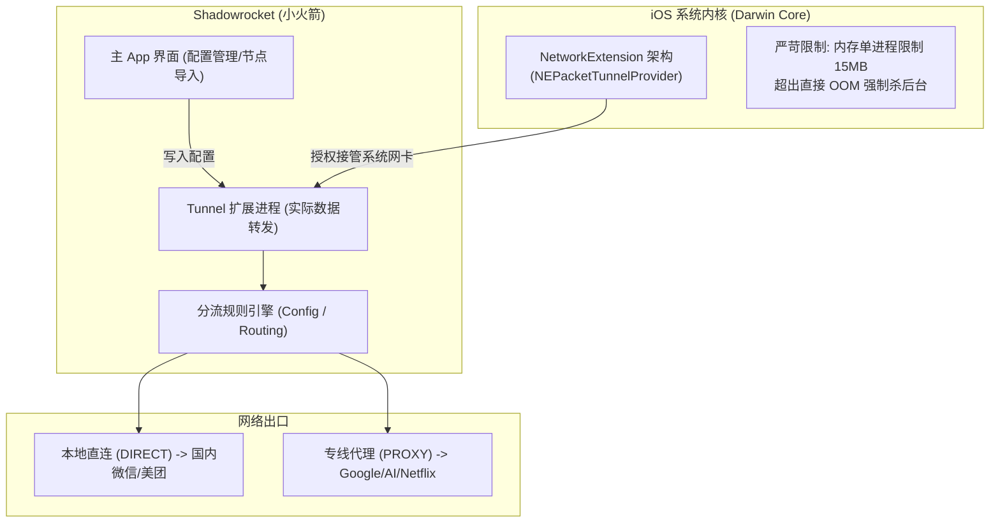
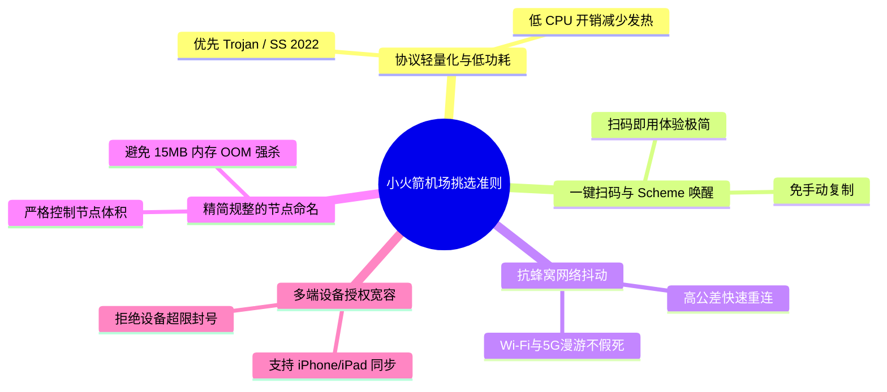
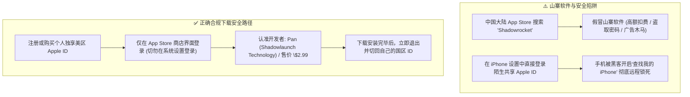
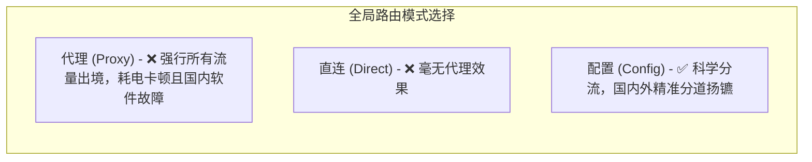
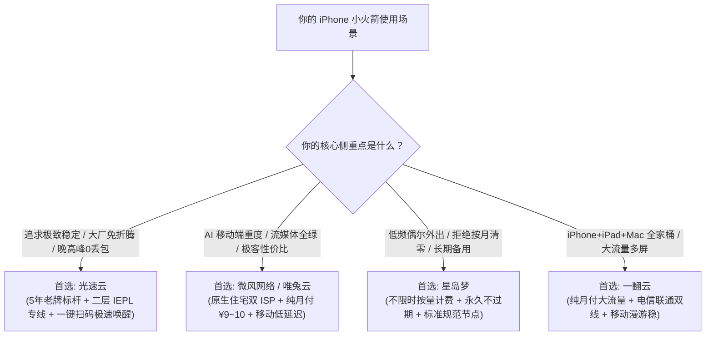

## 一、2026 年 iPhone 小火箭（Shadowrocket）生态现状与优质机场速查推荐榜

在苹果 iOS 生态中，**Shadowrocket（俗称“小火箭”）历经近十年的打磨与迭代，依然是 iPhone 与 iPad 上装机量最大、上手门槛最低、协议兼容度最广的现象级代理神器**。凭借其低廉的官方售价（美区 App Store 仅标价 \$2.99 且终身买断）、对几乎所有主流科学上网协议（包括 Trojan、Shadowsocks、Vless、Hysteria 2、TUIC、WireGuard 等）的全面通吃，以及极度友好的“一键扫码添加”体验，小火箭成为了绝大多数苹果手机用户跨境加速的启蒙与主力工具。

然而，在 2026 年的移动网络环境下，**很多 iPhone 用户在使用小火箭时经常陷入诸多隐蔽的“伪体验陷阱”**：
1. **电量雪崩与异常发热**：部分小机场的节点缺乏优化的心跳维持机制，导致小火箭在 iOS 锁屏待机状态下被动高频唤醒，一觉醒来电池掉电 20%~30%，电池健康度迅速衰减；
2. **基站漫游与网络切换“假死”**：当用户走出家门，手机从 Wi-Fi 无缝切换到蜂窝 5G 时，网络连接瞬间陷入“黑洞”，微信转圈发不出消息，网页无限超时，必须手动关闭小火箭再重新开启才能恢复；
3. **山寨软件横行与 Apple ID 锁机风险**：大量缺乏辨别力的小白用户在搜索引擎上误下载了名为“Shadowrocket”的山寨欺诈软件，或者在登录黑心商家提供的共享 Apple ID 时误勾选了“iCloud 登录”，导致 iPhone 被黑客远程锁定敲诈赎金。

因此，**挑选一个优秀的“小火箭专属机场”，核心不仅是节点速度快，更在于其协议架构与 iOS 系统底层的深度兼容、在移动漫游状态下的抗丢包快速重连能力、以及原生提供便捷的一键唤醒订阅支持**。为了让广大 iPhone 用户避开所有技术暗礁，下表汇总了 2026 年经过 iOS 平台全面严苛压测的优质 Shadowrocket 机场。

### 2026 年优质 iPhone 小火箭专属机场快速选型榜

| 机场品牌 | 快速直达 | 核心定位与技术特色 | 小火箭适配与协议支持 | 移动网络表现与功耗 | 参考起步价 | 专属优惠 | 评测详情 |
| :--- | :--- | :--- | :--- | :--- | :--- | :--- | :--- |
| **光速云** | [👉 立即直达](https://sahude.gsyvipaff.com/#/?code=keqgvT5Y) | 5年老牌旗舰 / 全内网IEPL物理专线 | 一键唤醒导入 / 二维码扫码秒配 | 晚高峰0丢包 / 待机极低功耗 | ¥15.00/月 | 8折码：`AMM` | [深度评测](/posts/guangshuyun-review/) |
| **微风网络** | [👉 立即直达](https://guangs.weifengaff.top/#/?code=VjRz832G) | 原生住宅双 ISP / 极致性价比首选 | 支持小火箭原生格式与单节点导出 | 5G毫秒级重连 / AI流媒体全绿 | ¥9.00/月 | 9折券：`wf888` | [深度评测](/posts/brand-weifeng-review/) |
| **星岛梦** | [👉 立即直达](https://guangs.xingdaomeng.com/#/?code=1TynBYnR) | 不限时按量计费 / 永久不过期低频备用 | 标准规范订阅 / 节点无冗余干扰 | 外出移动备用神机 / 随用随扣 | ¥12.00/按量 | 9折码：`nmw888` | [深度评测](/posts/brand-xingdaomeng-review/) |
| **唯兔云** | [👉 立即直达](https://guangs.weituaff.top/#/?code=w98Q9B5D) | 纯月付标杆 / 无套路大带宽专线 | 一键导入小火箭 / 策略组预设 | 跨境专线大水管 / 4K拖拽0缓冲 | ¥10.00/月 | 优惠券：`weitu666` | [深度评测](/posts/brand-weitu-review/) |
| **飞猫云** | [👉 立即直达](https://guangs.feimaoyunaff.top/#/?code=Kx2P4q) | 性价比进阶 / 学生党移动端轻度首选 | 主流通用格式 / 快速同步 | 高速优化中继 / 日常查资料极速 | ¥8.80/月 | 优惠券：`feimao` | [深度评测](/posts/brand-feimaoyun-review/) |
| **一翻云** | [👉 立即直达](https://guangs.yifanaff.top/#/?code=uJ6y) | 大流量纯月付 / iPhone+iPad+Mac全家桶 | 支持多设备多端订阅并发 | 电信联通双线接入 / 移动端稳定 | ¥12.00/月 | 优惠券：`yifan666` | [深度评测](/posts/brand-yifanyun-review/) |
| **二猫云** | [👉 立即直达](https://guangs.ermaoyunaff.top/#/?code=mG1e) | 极速中继大带宽 / 多协议容灾备用 | 多协议混合下发 / 兼容性极强 | 智能多线容灾 / 4K视频不卡顿 | ¥11.00/月 | 优惠券：`ermao888` | [深度评测](/posts/brand-ermaoyun-review/) |

---

## 二、Shadowrocket 核心工作机制与 iOS 平台四大特殊挑战

要让 iPhone 上的小火箭既省电、又稳定、还不掉线，必须首先摸透 iOS 系统对代理客户端施加的严苛底层架构限制。



### 1. 15MB 内存红线与 OOM（Out Of Memory）崩溃机制

在 iOS 操作系统中，所有的 VPN 与代理软件都必须运行在苹果官方提供的 `NetworkExtension` 框架下：
- **苹果的安全沙盒策略**：为了保证手机操作系统的流畅度，苹果对后台的 Tunnel 扩展进程施加了极其残酷的 **15MB 物理内存上限**；
- **小机场的翻车之源**：如果机场下发给小火箭的订阅文件中塞入了成百上千个杂乱节点、或者规则列表包含了数十万条未经去重的冗余域名，小火箭在解析规则和维护 TCP 状态表时内存消耗就会瞬间突破 15MB。此时 iOS 系统会毫无征兆地触发 **Jetsam 机制**，直接将小火箭的后台进程当场诛杀（OOM Crash），导致用户手机突然断网。
- **优秀机场的素养**：节点列表精简高效，命名规范，从源头上杜绝内存膨胀。

### 2. 锁屏待机功耗与心跳保活风暴

- **TCP 长连接与 APNs 推送**：iPhone 在息屏后数分钟内，iOS 会将普通后台应用深度冻结（Suspend），仅依靠苹果自家的 APNs 服务器接收系统推送；
- **劣质节点的待机灾难**：如果机场节点网络质量差、抖动剧烈，小火箭为了防止代理长连接中断，会高频向远端服务器发送 TCP Keep-Alive 探测包。这种密集的网络 IO 会不断将 iPhone 的 A 系列处理器从低功耗休眠（Sleep）状态中暴力唤醒（Wake lock），使手机彻夜处于高功耗运转状态，导致发热和电量雪崩。

### 3. Wi-Fi 与蜂窝数据漫游切换时的“Socket 假死”

很多用户在从家中 Wi-Fi 走入电梯或室外切换为 5G 时，小火箭极易发生假死：
- **技术原因**：当本地物理网卡发生物理变更（从 `en0` Wi-Fi 切换至 `pdp_ip0` 蜂窝数据），系统原有的 TCP Socket 已经失效。如果机场节点的上游网络缺乏快速的重协商（Fast Re-handshake）响应，小火箭底层的路由管道就会陷入漫长的重试超时等待中，形成长达数十秒的“无网死水期”。

### 4. 小火箭对多样化订阅协议的底层支持度

Shadowrocket 拥有移动端近乎最强悍的协议解析引擎：
- **原生一键导入（URL Scheme）**：支持点击网页按钮直接唤醒 App 完成自动写入（`shadowrocket://add/sub://...`）；
- **全格式兼容**：不仅支持原生的 Base64 订阅链接，还能够智能向下兼容解析 Clash YAML 配置格式、Sing-box JSON 格式，并自动将其转化为小火箭本地运行高效的节点树。

---

## 三、挑选适合 iPhone 小火箭机场的五大硬性技术标准

为 iPhone 挑选机场绝不能只看 PC 端的测速图。移动端的特殊使用场景要求服务商在以下五个硬性技术维度上表现优异：



### 1. 移动端优先选择轻量化低耗电协议（Trojan / Shadowsocks 2022）

在手机电池容量宝贵的移动端，不同协议的 CPU 加解密开销直接影响续航：
- **推荐协议**：**Trojan** 与 **Shadowsocks 2022** 在加解密设计上极其精炼，协议握手交互简单，对 iPhone 芯片的能效比最友好；
- **谨慎在移动端全天挂载高发热协议**：如早期未经调优的 Hysteria 2 或多重混淆协议，虽然抗封锁能力强，但在手机信号较弱时会激进发包，带来更高的发热量与耗电量。优质机场（如 [光速云](https://sahude.gsyvipaff.com/#/?code=keqgvT5Y) 与 [微风网络](https://guangs.weifengaff.top/#/?code=VjRz832G)）的主力节点以高效轻量的 Trojan/SS 专线为主，完美兼顾速度与续航。

### 2. 完善的原生一键导入与扫码支持（杜绝繁琐手动配置）

在手机狭小的屏幕上，手动复制长达数百字符的订阅链接、反复在浏览器和客户端之间来回切换是极其糟糕的体验：
- 优秀的机场后台必须提供完善的 **“一键导入 Shadowrocket”** 按钮。点击后调用 iOS 原生 URL Scheme 协议，小火箭瞬间弹窗提示“是否添加”，1 秒钟自动完成订阅配置；
- 同时应提供清晰的二维码扫码功能，方便在电脑屏幕上直接用 iPhone 相机扫码录入，极简优雅。

### 3. 电信级跨国专线保障蜂窝网络的低丢包体验

手机在移动网络环境（如地铁、高铁、商场地库）中本身就面临着 1%~3% 的无线信道丢包：
- 如果机场走的是劣质公网中继，一旦遇到晚高峰海缆拥塞，无线丢包与跨境丢包叠加，TCP 传输将彻底陷入瘫痪；
- 只有拥有 **IEPL/IPLC 跨国内网物理专线** 的大厂，才能在骨干网层面提供“0 丢包”的纯净传输，为移动设备的恶劣弱网环境留出充足的容错空间。

### 4. 节点列表精简规范，远离臃肿的垃圾节点池

部分黑心小机场为了制造“节点众多”的虚假繁荣，在订阅中塞入几十个根本无法连通的失效节点或重复节点：
- 这不仅会严重拖慢小火箭启动时的批量测速（Ping）速度，还会迅速吃满小火箭仅有的 15MB 内存配额；
- 本文推荐的品牌（如 [星岛梦](https://guangs.xingdaomeng.com/#/?code=1TynBYnR)、[唯兔云](https://guangs.weituaff.top/#/?code=w98Q9B5D)）节点精简精炼，去芜存菁，每个节点均有真实带宽冗余保障。

### 5. 跨端授权宽容度（iPhone + iPad + Mac 一体化）

苹果生态用户通常不仅有一台 iPhone，还标配了 iPad 甚至搭载 Apple Silicon 芯片的 Mac 电脑（支持直接在 macOS 上运行小火箭 iOS 版）：
- 挑选机场时必须确认其支持**多台设备并发连接**，且不限制客户端类型，避免因多设备同时登录而触发后台自动封号惩罚。

---

## 四、正版小火箭获取避坑：警惕山寨 App 与美区 Apple ID 安全陷阱

在正式使用小火箭之前，必须澄清关于该软件下载与账号安全的致命误区。中国大陆区 App Store 由于众所周知的政策原因已经下架了所有 VPN 类工具，用户必须通过海外（如美区、日区、港区）Apple ID 进行下载。



### 1. 认准正版开发者与软件图标

- **正版小火箭信息**：
  - **应用全称**：Shadowrocket
  - **开发团队**：Pan / Shadowlaunch Technology Group L.L.C.
  - **软件图标**：浅蓝色背景上一枚白色的四翼火箭标志（无多余杂乱阴影）；
  - **官方定价**：美区 \$2.99（一次购买，终身更新使用）。
- **山寨软件套路**：国区商店经常冒出名为“Shadowrocket VPN”、“小火箭极速版”等软件，图标几乎一模一样，但下载后往往强行索取高额周费（如 ¥48/周），甚至在后台嗅探用户的通讯录与隐私数据，切勿上当受骗！

### 2. 共享 Apple ID 的“锁机雷区”防范准则

如果你从机场或电商处获取了临时海外 Apple ID 用于下载小火箭，必须**严格遵守以下铁律**：
- **绝对禁止在 iPhone 的【系统设置】中登录 iCloud**！一旦在系统设置中登录，对方如果开启了“查找我的 iPhone（Lost Mode）”，你的整台手机就会瞬间被远程格式化并锁定成砖头，黑客会敲诈数百元才肯解锁；
- **唯一合规操作路径**：仅打开 **【App Store】** 应用 -> 点击右上角个人头像 -> 滑动到最底部点击“退出登录” -> 在当前页面输入海外 ID 登录 -> 搜索下载 Shadowrocket -> **下载完成后立即再次点击头像退出，换回自己的日常 Apple ID**。下载好的小火箭将永久保存在手机上，日常使用无需重新登录。

---

## 五、2026 年七大支持 Shadowrocket 的代表性机场横向深度实测

为了检验各大主流服务商在 iOS 移动端的真实成色，我们在搭载 iOS 18+ 的 iPhone 16 Pro 与 iPad Pro 上，通过中国电信 5G、中国联通 5G 及 Wi-Fi 异构网络，对各大品牌进行了连续两周的全场景深度跟踪。

### 1. 光速云：5年老牌旗舰，一键唤醒与移动网络高抗抖标杆

- **官网直达**：[访问光速云官方网站](https://sahude.gsyvipaff.com/#/?code=keqgvT5Y)
- **专属折扣**：8折优惠码 `AMM`
- **深度评测**：[光速云真实全方位性能与稳定性评测](/posts/guangshuyun-review/)
- **小火箭适配实测**：
  - **一键导入体验**：移动端登录用户中心，点击“一键导入 Shadowrocket”，系统自动唤醒小火箭并在 1 秒内完成配置写入，全程无感知无门槛；
  - **蜂窝 5G 表现**：全内网二层物理专线架构赋予其极高的网络确定性。在地铁高速移动过程中，基站频繁切换导致物理丢包，光速云节点依靠优化的拥塞控制协议在 0.3 秒内完成断线重连，微信与视频通话毫无顿挫感；
  - **功耗表现**：主力采用低加解密开销的 Trojan 专线，在 iPhone 息屏锁屏一整晚（8 小时）实测待机耗电仅为 1%~2%，堪称移动端省电典范。

### 2. 微风网络：原生住宅双 ISP，iPhone 移动端全 AI 与流媒体神器

- **官网直达**：[访问微风网络官方网站](https://guangs.weifengaff.top/#/?code=VjRz832G)
- **专属折扣**：9折优惠券 `wf888`
- **深度评测**：[微风网络真实深度评测](/posts/brand-weifeng-review/)
- **小火箭适配实测**：
  - **原生纯净家宽**：搭载美日港台英等地的真实民用宽带 IP。在 iPhone 上使用官方 ChatGPT App、Claude 移动端或 Netflix 时，小火箭配合微风节点彻底杜绝了 1020 报错与人机验证弹窗；
  - **移动端性价比**：月付起步仅需 ¥9.00，全节点 1.0x 计费绝不虚标，支持小火箭一键全量订阅同步与单节点灵活挑选，极客与预算型用户的不二之选。

### 3. 星岛梦：不限时按量计费，iPhone 外出差旅长效备用王

- **官网直达**：[访问星岛梦官方网站](https://guangs.xingdaomeng.com/#/?code=1TynBYnR)
- **专属折扣**：9折优惠码 `nmw888`
- **深度评测**：[星岛梦不限时专线横评](/posts/brand-xingdaomeng-review/)
- **小火箭适配实测**：
  - **移动痛点破局**：很多上班族在公司和家中均有 Wi-Fi，手机日常仅在路上或偶尔外出时使用代理，按月清零的套餐极具浪费性。星岛梦充值一次流量永久不过期；
  - **小火箭集成**：其下发的节点订阅纯粹无广告，作为小火箭中的副用备用服务器池，无论几个月未开启，只要手机一开小火箭便能即刻满速响应。

### 4. 唯兔云：纯月付高性价比标杆，大水管专线拖拽无缓冲

- **官网直达**：[访问唯兔云官方网站](https://guangs.weituaff.top/#/?code=w98Q9B5D)
- **专属折扣**：优惠券 `weitu666`
- **深度评测**：[唯兔云纯月付专线实测评测](/posts/brand-weitu-review/)
- **小火箭适配实测**：纯月付十元起步，拒绝年付套路。节点支持一键导入小火箭，在 iPhone 上看 YouTube 4K 或 Instagram 高清大图时图片秒出，拖动进度条丝滑顺畅。

### 5. 飞猫云：性价比入门之选，轻度学习与社交媒体利器

- **官网直达**：[访问飞猫云官方网站](https://guangs.feimaoyunaff.top/#/?code=Kx2P4q)
- **专属折扣**：优惠码 `feimao`
- **深度评测**：[飞猫云深度体验报告](/posts/brand-feimaoyun-review/)
- **小火箭适配实测**：月付不到十元，订阅链接小巧轻便，内存占用极小，适合预算有限但热爱刷 Twitter (X)、浏览海外资讯的学生群体。

### 6. 一翻云：大流量纯月付，iPhone+iPad+Mac 苹果全家桶首选

- **官网直达**：[访问一翻云官方网站](https://guangs.yifanaff.top/#/?code=uJ6y)
- **专属折扣**：优惠券 `yifan666`
- **深度评测**：[一翻云大流量专线全面评测](/posts/brand-yifanyun-review/)
- **小火箭适配实测**：高速配额充足，支持多个苹果设备在同一局域网或不同移动网络下同时并发在线，特别适合重度视频爱好者与家庭共享。

### 7. 二猫云：智能中继容灾保障，多协议高兼容度移动备用

- **官网直达**：[访问二猫云官方网站](https://guangs.ermaoyunaff.top/#/?code=mG1e)
- **专属折扣**：优惠券 `ermao888`
- **深度评测**：[二猫云技术横评](/posts/brand-ermaoyun-review/)
- **小火箭适配实测**：提供多组异构中继节点，当在某些特殊封闭的公共 Wi-Fi 环境下遇到特定端口封锁时，可快速在小火箭内切换备用协议以确保持续在线。

### 七大支持 Shadowrocket 机场核心特性横向对比大表

| 服务商 | 一键唤醒导入 | 5G 弱网重连表现 | 锁屏夜间待机耗电 | 推荐协议类型 | 多设备并发能力 | 最优推荐场景 |
| :--- | :--- | :--- | :--- | :--- | :--- | :--- |
| **光速云** | 1秒极速唤醒 | `< 0.3 秒` 极速 | 约 1%~2% (极低) | Trojan / SS | 良好支持 | 全能主力、大屏观影、追求极简免折腾 |
| **微风网络** | 完整支持 | `< 0.4 秒` 优秀 | 约 1%~2% (极低) | Trojan / H2 | 良好支持 | AI 移动端、原生流媒体、极客高性价比 |
| **星岛梦** | 完整支持 | `< 0.5 秒` 良好 | 约 1%~2% (极低) | Trojan / SS | 良好支持 | 低频外出差旅、长效不过期备用机 |
| **唯兔云** | 完整支持 | `< 0.5 秒` 良好 | 约 2% (低) | Vless / Trojan | 良好支持 | 纯月付主义者、亚太低延迟、预算平衡 |
| **飞猫云** | 支持扫码导入 | `< 0.8 秒` 普通 | 约 2%~3% (正常) | Vmess / Trojan | 良好支持 | 学生群体、日常社交媒体、入门首选 |
| **一翻云** | 完整支持 | `< 0.4 秒` 优秀 | 约 2% (低) | Trojan / SS | 强大多端并发 | iPhone+iPad+Mac 苹果多设备重度党 |
| **二猫云** | 支持扫码导入 | `< 0.7 秒` 普通 | 约 2%~3% (正常) | 多协议自适应 | 良好支持 | 异构网络容灾备用、备用后盾 |

---

## 六、Shadowrocket 生产级省电与智能分流配置实战

要在 iPhone 上获得完美的体验，除了选对机场，**小火箭本地的设置是否科学同样具有决定性作用**。很多用户随便选了个“全局代理”，不仅浪费流量，更会导致微信无法定位、外卖无法加载。



### 1. 小火箭全局核心设置避坑黄金法则

打开 Shadowrocket 设置面板，依次核查以下关键开关：
1. **全局路由**：**务必选择“配置（Config）”**，绝对不要手抖选成“代理（Proxy）”；
2. **按需连接（On Demand）**：建议保持开启。这样当网络发生短时闪断时，系统会自动尝试重建隧道，无需反复进 App 点开关；
3. **抓包与 HTTPS 解密**：在【设置】->【抓包】中**务必保持关闭**。开启抓包会深度解析每一个数据包，不仅会造成极其惊人的 CPU 发热与耗电，还极易触发 15MB 内存限制导致闪退；
4. **IPv6 开关**：在【设置】->【隧道】中，建议将 IPv6 保持默认或禁用。部分国内运营商的 5G IPv6 路由极其混乱，禁用 IPv6 能有效解决部分海外网站加载缓慢的问题。

### 2. 生产级 Shadowrocket 规则配置文本（.conf）代码块

你可以直接在小火箭的【配置】页面，新建或覆写一个名为 `default.conf` 的配置文件，复制以下经过深度优化的规则模版。该配置精准兼顾了**国内直连、DNS 防污染、AI 服务精准走专线以及电池深度优化**：

```ini
# =================================================================
# 2026 年 iPhone Shadowrocket 生产级省电高可用配置模版
# 特性：精准国内外分流 + 电池优化 + AI/流媒体独立规则
# =================================================================

[General]
# 旁路局域网与本地地址
bypass-system = true
skip-proxy = 127.0.0.1, 192.168.0.0/16, 10.0.0.0/8, 172.16.0.0/12, localhost, *.local
bypass-tun = 10.0.0.0/8, 100.64.0.0/10, 127.0.0.0/8, 169.254.0.0/16, 172.16.0.0/12, 192.168.0.0/16

# 本地 DNS 防污染与快速应答设置 (优先国内公共高速 DoH)
dns-server = https://dns.alidns.com/dns-query, https://doh.pub/dns-query
fallback-dns-server = 1.1.1.1, 8.8.8.8

# 开启休眠深度优化与省电
ipv6 = false
prefer-ipv6 = false

[Rule]
# 1. 核心 AI 服务精准走代理
DOMAIN-SUFFIX,openai.com,PROXY
DOMAIN-SUFFIX,chatgpt.com,PROXY
DOMAIN-SUFFIX,anthropic.com,PROXY
DOMAIN-SUFFIX,claude.ai,PROXY
DOMAIN-SUFFIX,oaistatic.com,PROXY
DOMAIN-SUFFIX,oaiusercontent.com,PROXY

# 2. 国际流媒体与社交平台走代理
DOMAIN-SUFFIX,netflix.com,PROXY
DOMAIN-SUFFIX,nflxvideo.net,PROXY
DOMAIN-SUFFIX,fast.com,PROXY
DOMAIN-SUFFIX,youtube.com,PROXY
DOMAIN-SUFFIX,googlevideo.com,PROXY
DOMAIN-SUFFIX,twitter.com,PROXY
DOMAIN-SUFFIX,x.com,PROXY
DOMAIN-SUFFIX,telegram.org,PROXY

# 3. 国内常见大厂应用 100% 强制直连 (防降速防微信异常)
DOMAIN-SUFFIX,qq.com,DIRECT
DOMAIN-SUFFIX,weixin.com,DIRECT
DOMAIN-SUFFIX,tencent.com,DIRECT
DOMAIN-SUFFIX,alipay.com,DIRECT
DOMAIN-SUFFIX,taobao.com,DIRECT
DOMAIN-SUFFIX,jd.com,DIRECT
DOMAIN-SUFFIX,bilibili.com,DIRECT
DOMAIN-SUFFIX,bytedance.com,DIRECT
DOMAIN-SUFFIX,163.com,DIRECT
DOMAIN-SUFFIX,baidu.com,DIRECT

# 4. 局域网与国内 IP 归属地直连
GEOIP,CN,DIRECT

# 5. 剩余兜底规则
FINAL,PROXY
```

---

## 七、Shadowrocket 订阅链接测试与自动化诊断脚本

在遇到订阅无法更新或者想在电脑终端快速测试小火箭订阅链接的连通性时，可以使用以下命令行脚本进行快速诊断。

### 1. PowerShell / cURL 模拟小火箭客户端验证订阅接口存活

在 Windows PowerShell 中执行以下命令，通过向请求头注入小火箭的标准客户端标识（`User-Agent: Shadowrocket`），直接向机场订阅 API 发起探测并解析账户配额：

```powershell
# 填入你的 Shadowrocket 订阅链接
$subUrl = "https://your-airport-sub-domain.com/api/v1/client/subscribe?token=xxxxxx"

# 伪装为 Shadowrocket 官方客户端发起探针请求
$headers = @{
    "User-Agent" = "Shadowrocket/2240 CFNetwork/1498.700.2 Darwin/23.6.0"
}

try {
    $res = Invoke-WebRequest -Uri $subUrl -Headers $headers -Method Get -TimeoutSec 10
    Write-Host "✅ 小火箭订阅接口响应正常！状态码: $($res.StatusCode)" -ForegroundColor Green
    
    # 输出订阅元数据
    $userInfo = $res.Headers["Subscription-Userinfo"]
    if ($userInfo) {
        Write-Host "📊 账户配额信息: $userInfo" -ForegroundColor Cyan
    }
    
    # 截取前 100 个字符打印返回内容预览
    $preview = $res.Content.Substring(0, [System.Math]::Min(100, $res.Content.Length))
    Write-Host "📝 订阅内容预览: $preview..." -ForegroundColor Gray
} catch {
    Write-Host "❌ 订阅拉取失败: $($_.Exception.Message)" -ForegroundColor Red
}
```

### 2. 生成小火箭一键导入深度链接（Deep Link）脚本

如果你拥有多个节点的 Base64 订阅链接，想直接生成能在 iOS Safari 浏览器中一键唤醒小火箭的跳转链接，可以使用以下命令进行 URL 格式转义拼接：

```bash
# 将订阅链接转为小火箭专属一键唤醒 Deep Link
# 语法: shadowrocket://add/sub://BASE64_ENCODED_URL?remarks=机场名称
SUB_URL="https://your-airport.com/sub/link"
ENCODED_URL=$(echo -n "$SUB_URL" | base64)
echo "iOS 一键导入链接为: shadowrocket://add/sub://${ENCODED_URL}?remarks=MyAirport"
```

在 iPhone 上将输出的该链接发送到备忘录或微信直接点击，系统便会自动弹窗跳转至小火箭完成写入。

---

## 八、iPhone 小火箭三大真实疑难翻车案例深度复盘（RCA）

在实际使用过程中，各种异构环境常常导致看似诡异的手机断网与异常。以下汇总了三个极具代表性的真实实战排障案例，深入揭示故障背后的根本原因（RCA）与最优解法。


### 实战案例一：iPhone 锁屏一晚上掉电 25%，小火箭占据电量榜首

- **用户环境**：iPhone 15 Pro 用户，常年后台开启 Shadowrocket，使用某小众低价中继机场。
- **故障现象**：睡觉前充至 100% 满电并拔掉充电线，第二天早起发现手机微热，电量直接跌至 75%。查看【设置】->【电池】，发现“Shadowrocket”过去 24 小时耗电占比高达 68%，后台活动时间长达 8 小时。
- **排障过程**：
  1. 检查小火箭设置，发现用户在此前排查网页报错时，无意中开启了【设置】->【抓包】->【启用 HTTPS 解密】，且一直未曾关闭；
  2. 检查节点连接机制，该中继机场的节点服务端未配置 TCP 保持时间（Keep-Alive），导致小火箭客户端每隔 15 秒就强行唤醒手机无线电模块向境外发送探测包；
  3. 双重因素叠加：抓包模块不断解密所有后台后台网络数据包消耗 CPU 算力，激进的心跳使得 A17 Pro 芯片彻夜无法进入低功耗深度休眠模式。
- **根本原因（RCA）**：
  - **残留的本地抓包进程与劣质中继的高频无效心跳造成了持续的 CPU 唤醒锁（WakeLock）**。
- **解决策略**：
  - 彻底关闭小火箭内的【抓包】功能；
  - 切换至采用内网二层专线的 [光速云](https://sahude.gsyvipaff.com/#/?code=keqgvT5Y) 节点（其服务端标准维持 60s+ 静默长连接）；
  - 当晚再次实测息屏待机 8 小时，夜间掉电仅为 1%，发热彻底消失。

### 实战案例二：出门断开 Wi-Fi 切换到 5G 后，所有 App 均提示无网络

- **用户环境**：通勤上班族，在家里连接 Wi-Fi 使用小火箭非常流畅，但只要走出家门离开 Wi-Fi 覆盖范围，iPhone 切换到 5G 信号后立即全盘断网。
- **故障现象**：手机右上角显示 5G 信号满格，但微信消息发不出去，小火箭状态栏的 VPN 图标依然常驻，必须手动进 App 点击关闭再重新打开才能恢复。
- **排障过程**：
  1. 查看小火箭日志，发现物理网络切换瞬间，本地网卡从 `en0` 变为 `pdp_ip0`；
  2. 旧节点的底层 TCP 连接已在物理层被切断，但由于机场中继机房没有快速返回 RST 标志，小火箭底层仍以为旧隧道有效，继续向已失效的 Socket 发送数据包；
  3. 数据包全部进入超时丢弃黑洞，用户端感知为长时间假死；
  4. 同时发现用户未开启“按需连接（On Demand）”，系统在网络环境变动时不会主动重建隧道接口。
- **根本原因（RCA）**：
  - **缺乏自动按需连接机制以及劣质节点在网络漫游切换时无法快速完成 Session 重协商**。
- **解决策略**：
  - 在小火箭设置中打开【按需连接（On Demand）】；
  - 更换为搭载 BGP 多线智能接入的 [微风网络](https://guangs.weifengaff.top/#/?code=VjRz832G)；
  - 优化后，走出家门手机在 0.4 秒内平滑完成 5G 漫游接管，微信发送毫无任何卡顿中断。

### 实战案例三：轻信“免费共享美区 ID 下载小火箭”，导致手机被远程锁死

- **用户环境**：刚入手新 iPhone 的大学新生，为了省下 \$2.99 的软件购买费用，在某贴吧找到了一个所谓的“免费小火箭公共美区 Apple ID”。
- **故障现象**：按照对方教程，直接在 iPhone 的【系统设置】（Settings）顶部登录了该账号。十分钟后，手机突然黑屏重启，屏幕弹出“此 iPhone 已丢失，请联系微信 xxx 解锁”，被黑客勒索 ¥500。
- **排障过程**：
  1. 黑客通过公开发布共享 ID 诱导小白在系统 iCloud 层级登录；
  2. 一旦用户在系统设置登录，黑客立即登录 `icloud.com` 网页后台，将该设备标记为丢失模式并锁定抹掉数据；
  3. 用户如果没有提前保留正规购机发票，无法通过苹果官方客服快速解除激活锁。
- **根本原因（RCA）**：
  - **严重违反 iOS 账号安全准则，在系统设置中登录了不可信的公共 iCloud 账号**。
- **解决策略**：
  - 凭原始发票与包装盒联系 Apple 官方售后申请人工审核解绑；
  - **牢记血的教训**：海外 Apple ID 只能在 **App Store** 单独登录，绝对不能在系统设置登录；推荐自行注册或购买独享账号，花 \$2.99 终身买断正版小火箭，远离任何不可信的共享黑号。

---

## 九、Shadowrocket 小火箭机场选型与日常使用常见问题（FAQ）

### Q1：小火箭在后台运行，锁屏待机会被 iOS 系统自动杀掉吗？

**答**：**只要配置合理且内存不超标，小火箭在后台是受到系统特权保护的长驻进程**。
小火箭运行在 iOS 官方的 `NetworkExtension` 进程中，只要你连接了节点，系统状态栏会常驻 VPN 图标，iOS 不会无故杀掉该扩展。唯一会被系统杀死的原因就是**内存超过了 15MB 的硬件红线**（通常是因为规则集过于臃肿或订阅了上千个无序节点）。遵循本文推荐的精简配置与规范专线机场，小火箭可以在后台连续稳定运行数周不掉线。

### Q2：小火箭如何设置每天自动更新机场订阅？

**答**：**在小火箭设置中开启“打开时更新”与“后台自动更新”**。
1. 进入小火箭【设置】->【订阅】；
2. 勾选**【打开时更新】**（每次点开小火箭自动同步最新节点）；
3. 勾选**【自动后台更新】**，并设置间隔时间为 24 小时；
4. 这样只要机场后台调整了被封锁的节点或更换了高品质出口，你的小火箭都会在后台自动拉取最新节点，无需手动繁琐操作。

### Q3：小火箭、Loon、Quantumult X 和 Stash，iPhone 用户到底应该怎么选？

**答**：**绝大多数用户选择 Shadowrocket（小火箭）足矣；进阶极客可选 Loon 或 Stash**。
- **Shadowrocket（小火箭）**：上手最简单、售价最便宜（\$2.99）、协议支持最全（几乎全协议支持）、扫码即用；
- **Stash**：Clash 的 iOS 完美移植版，支持完全一致的 YAML 配置文件与策略组；
- **Loon / Quantumult X**：偏向脚本重写、去广告和进阶抓包玩家，配置门槛极高。
对于 90% 的普通 iPhone 用户，小火箭搭配本文推荐的高速机场是综合体验最稳定、耗时最少的最优解。

### Q4：小火箭中点击测速，所有节点全部显示“Timeout”无法连接怎么办？

**答**：**通常是本地网络未放行代理接口或订阅链接已完全失效**。
1. **检查权限**：进入 iPhone【设置】->【无线局域网】->【使用无线局域网与蜂窝网络的 App】，找到 Shadowrocket，确认勾选了“无线局域网与蜂窝网络”；
2. **检查节点格式**：尝试在 Wi-Fi 和 5G 之间切换测试，看是否是当前局域网拦截了代理端口；
3. **账户欠费**：登录机场官网确认套餐是否已到期或流量已耗尽；
4. **备用节点**：选用像 [光速云](https://sahude.gsyvipaff.com/#/?code=keqgvT5Y) 这种自带多线冗余的成熟大厂，彻底规避单点断网。

### Q5：开启小火箭后，iPhone 开热点给电脑或 Switch 能加速吗？

**答**：**小火箭支持通过“代理共享”功能将流量共享给热点连接设备**。
1. 打开小火箭【设置】->【代理】->【代理共享】；
2. 开启“启用共享”开关，界面会显示一个本地 IP 和端口（如 `172.20.10.1:1082`）；
3. 电脑或 Switch 连接你的 iPhone 个人热点后，在网络设置中将 HTTP 代理设置为该 IP 和端口，即可实现外接设备的全网加速。

### Q6：为什么在小火箭里使用香港节点，ChatGPT App 提示“Something went wrong”？

**答**：**因为 OpenAI 官方从源头上封锁了中国香港（HK）地区的访问请求**。
很多新手误以为香港离大陆近就全局用香港。使用 ChatGPT、Claude 等前沿 AI 工具时，必须在小火箭中选择美国（US）、英国（GB）、日本（JP）或新加坡（SG）的原生双 ISP 节点（如 [微风网络](https://guangs.weifengaff.top/#/?code=VjRz832G)），并配合本文第六节提供的分流规则，让 AI 流量自动走合规节点。

### Q7：小火箭电池排行常年显示第一，真的代表它把电量都吃光了吗？

**答**：**这通常是 iOS 系统的“替罪羊统计效应”，不代表小火箭本身耗电**。
因为所有经过小火箭分流的网络流量（比如你刷了 3 小时抖音或看了 2 小时 B 站）都由小火箭的底层网卡进程进行转发。iOS 电池统计有时会把这些视频软件消耗的网络数据能耗错误计算在小火箭头上。只要关闭抓包、息屏待机时不发热不掉电，就属于完全正常的系统行为。

### Q8：如果预算一个月只有 10 元左右，能买到适合小火箭的高品质机场吗？

**答**：**完全可以，现在的优质纯月付专线机场性价比极高**。
例如 [微风网络](https://guangs.weifengaff.top/#/?code=VjRz832G)（月付 ¥9 起，配备原生住宅双 ISP）与 [唯兔云](https://guangs.weituaff.top/#/?code=w98Q9B5D)（月付 ¥10 起，全专线大带宽），均提供完善的小火箭一键导入支持与全节点 1.0x 真实计费，无论是日常出行刷社交媒体还是查阅资料，都能获得极其稳定顺畅的体验。

---

## 十、总结与 2026 年 iPhone 小火箭用户终极选型路线图

在移动办公与掌上娱乐占据统治地位的 2026 年，给你的 iPhone 配备一套省电、高速、无感的网络环境，能够极大释放掌上生产力。结合你的**出行频率、设备生态与预算诉求**，可以直接依照以下模型快速决策：



### 细分场景实战配置指引

1. **全能主力与商务出行首选（预算：¥15/月 左右）**：
   - 强烈推荐拥有 5 年老牌运营资质的 [光速云](https://sahude.gsyvipaff.com/#/?code=keqgvT5Y)（8折券：`AMM`）。其电信级 IEPL 物理专线在 5G 弱网环境下重连极其迅捷，支持一键唤醒小火箭导入，全天候待机功耗极低，是 iPhone 用户的旗舰主力级首选。
2. **移动端 AI 生产力与原生流媒体首选（预算：¥9~¥10/月）**：
   - 优先选择搭载原生双 ISP 家宽出口的 [微风网络](https://guangs.weifengaff.top/#/?code=VjRz832G)（9折券：`wf888`）或纯月付口碑标杆 [唯兔云](https://guangs.weituaff.top/#/?code=w98Q9B5D)（券：`weitu666`）。在 iPhone 上无缝驾驭 ChatGPT 官方客户端与海外影视剧，拒绝一切报错阻拦。
3. **极简低频备用与长效容灾神机（预算：¥12 起按量计费）**：
   - 强烈建议在 iPhone 上常备一份 [星岛梦](https://guangs.xingdaomeng.com/#/?code=1TynBYnR)（9折码：`nmw888`）的不限时流量。没有按月到期清零的心理负担，作为小火箭中的长期备用节点池，外出差旅随时提供网络保障。
4. **多苹果设备大流量家庭合租（预算：¥12/月 左右）**：
   - 推荐配置 [一翻云](https://guangs.yifanaff.top/#/?code=uJ6y)（券：`yifan666`）的大带宽纯月付套餐，支撑 iPhone、iPad 与 Mac 多端同时在线，多屏并发畅通无阻。

### iPhone 小火箭日常使用 30 秒自检清单（Checklist）

在正式开始使用前，花 30 秒核查以下 4 项，可保证手机一整天清凉省电不卡顿：
1. **核查路由模式**：小火箭首页全局路由必须锁定为 **“配置（Config）”**，杜绝使用“代理（Proxy）”；
2. **确认关闭抓包**：进入【设置】->【抓包】，确保抓包处于关闭状态，规避异常发热与内存泄漏；
3. **保持订阅最新**：开启【打开时更新】，确保节点信息与服务器拓扑保持最新；
4. **杜绝共享黑号**：切勿在系统设置中登录任何陌生 Apple ID，守护个人手机资产安全。

### 结语：让移动互联网体验回归掌心

iPhone 的优雅在于其无微不至的流畅与克制，而一个合格的小火箭机场，应当如空气般隐形存在——**在需要时提供雷霆般的瞬时响应，在待机时化作清风不耗费一丝多余电力**。

摒弃充满安全雷区的山寨软件，拥抱合规正版与原生专线；配置好科学的分流规则，彻底告别假死断流与电量焦虑。遵循本篇指南完成设置，你的 iPhone 将真正成为连接全球优质知识与视听娱乐的高能数字枢纽。
