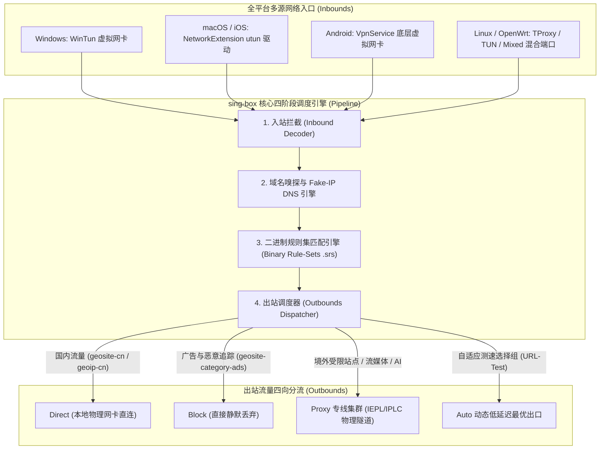
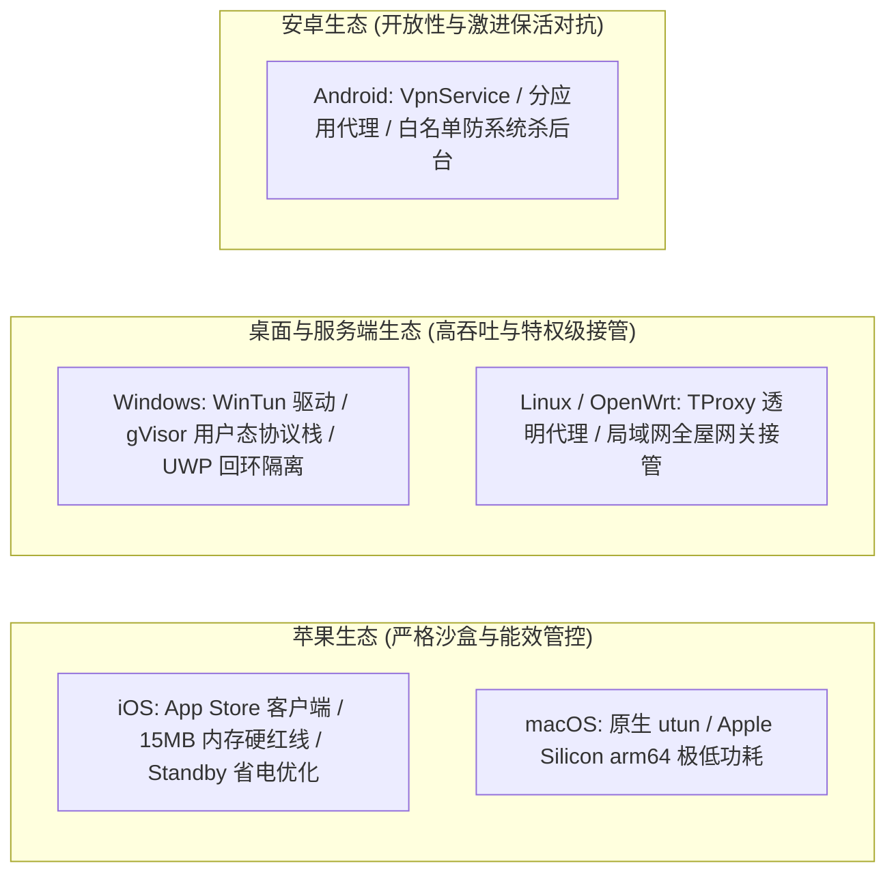
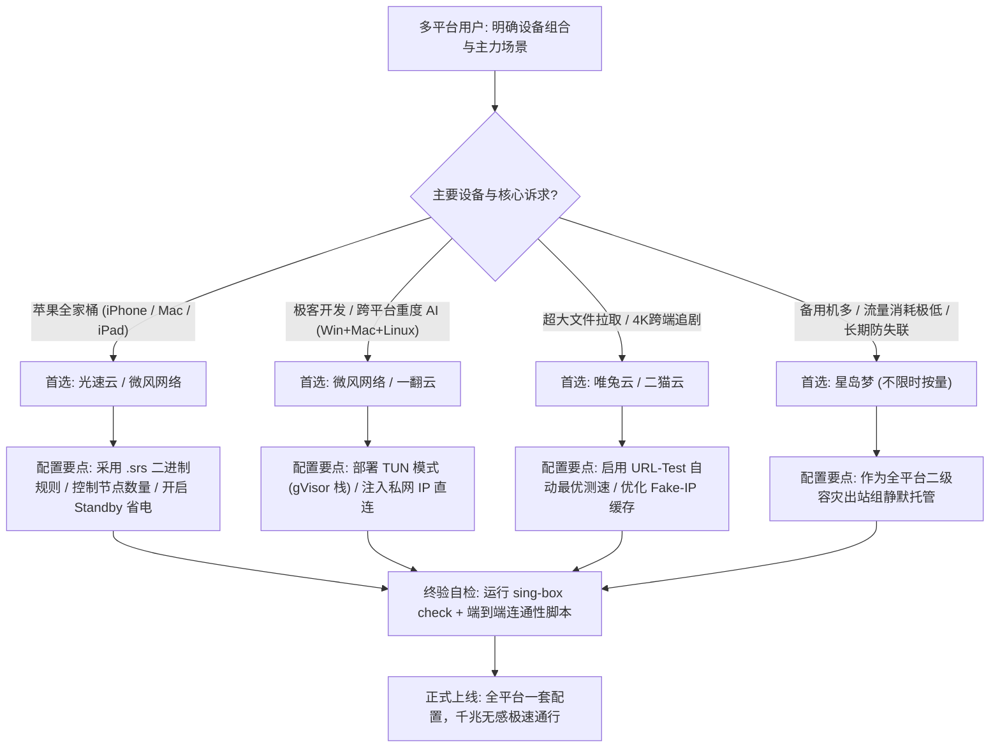

## 一、多平台用户使用 sing-box 的核心痛点与 2026 优质机场速查表

在 2026 年的数字办公与极客开发环境中，**一人同时拥有多台跨平台设备（例如 iPhone 移动办公、MacBook 随身携带、Windows 游戏工作站、Android 备用机以及家庭软路由 NAS）早已成为高频常态**。过去，多平台用户不得不忍受“各平台客户端生态彻底割裂”的痛苦折磨：Windows 端用 v2rayN，Mac 端开 Clash Verge，iOS 端买 Shadowrocket，Android 端折腾 v2rayNG。不仅规则语法彼此冲突、分流逻辑各行其是，每次调整分流规则或切换机场订阅，都需要在 4 到 5 个不同的软件界面中重复手工配置。

**开源现代化网络核心平台 sing-box 的全面崛起与普及，彻底终结了这一割裂乱象**。作为由 Sentry（nekohasekai）团队基于 Go 语言重构的新一代通用代理引擎，sing-box 实现了真正的“全平台同内核、同配置语法、同规则引擎”：从 iOS（App Store 官方图形客户端）、macOS（原生 SwiftUI 客户端）、Android（官方独立应用）、Windows（现代化桌面版与 WinTun 驱动）到 Linux / OpenWrt 软路由系统，一套标准的 JSON 配置即可在全平台通用复现。

然而，在多平台协同的大规模落地过程中，**大量用户在为 sing-box 选购和配置机场订阅时，普遍遭遇了一系列由于“跨端生态脱节”与“协议碎片化”引发的深层次技术痛点**：
1. **机场订阅格式严重滞后于内核发展**：绝大多数商业机场为了节约开发维护成本，依然仅下发传统的 Clash YAML 或 Base64 文本订阅，原生支持 sing-box 1.8+/1.9+ JSON 订阅规范的机场凤毛麟角，迫使多端用户使用第三方在线转换工具，面临订阅 Token 泄露与节点劫持的安全死穴；
2. **移动端（iOS / Android）内存与杀后台限制**：iOS 系统的 `NetworkExtension` 框架对 VPN 拓展进程施加了严苛的 **15MB 内存硬性上限（Jetsam 机制）**，若机场节点下发了数以千计的臃肿规则，或者客户端解析引擎效率低下，会导致 iPhone 在息屏或网络切换瞬间遭遇系统强杀（Crash），出现突发断网；
3. **UDP 与 QUIC 协议在全平台的断流与限速**：sing-box 虽原生深度支持 Hysteria 2 与 TUIC v5 等先进协议，但国内部分省份运营商（如北方移动、部分广电网络）对跨国 UDP 流量施加了极为激进的 QoS 封锁与限速，若机场缺乏高质量的 TCP/TLS 专线冗余通道，会导致跨端多设备在晚高峰集体瘫痪；
4. **多端并发连接数超限与风控封锁**：多平台用户在家庭局域网与移动网络中多端同时在线，极易触发劣质机场严苛的“在线设备 IP 数量限制（例如限制 2~3 个同时连接）”，导致主电脑正常工作时手机端被无情踢下线。

为了帮助多端多设备用户精准筛选高兼容性、高并发承载、支持前沿协议的顶级机场，下表整理了 2026 年经过多平台实测、深度适配 sing-box 现代化特性的优质机场服务商选型矩阵。

### 2026 年多平台 sing-box 专属优质机场速查选型表

| 机场品牌 | 快速直达 | 核心架构与底层协议特色 | 多平台（iOS/Mac/Win/Android）实测表现 | 推荐内核模式 | 参考起步价 | 专属优惠 | 深度评测 |
| :--- | :--- | :--- | :--- | :--- | :--- | :--- | :--- |
| **光速云** | [👉 立即直达](https://sahude.gsyvipaff.com/#/?code=keqgvT5Y) | 5年老牌标杆 / 全内网IEPL物理专线 | 多端并发极佳 / 0丢包 / 晚高峰超低抖动 | TUN 模式 / gVisor | 折后约 ¥12/月 | 8折码：`AMM` | [深度评测](/posts/guangshuyun-review/) |
| **微风网络** | [👉 立即直达](https://www.wfvpn.com/#/register?code=678kH3z3) | 原生双ISP纯净住宅 / 专线中继 | ChatGPT/Claude跨端全设备免风控认证 | System / TUN | ¥9.00/月 | 9折券：`wf888` | [深度评测](/posts/brand-weifeng-review/) |
| **唯兔云** | [👉 立即直达](https://v2.weitucloud.xyz/?p=90130) | 大带宽高速专线 / 2.5Gbps突发容量 | 4K/8K秒开 / Steam/App跨端大文件极速拉取 | TUN 模式 / Mixed | ¥10.00/月 | 9折券：`weitu666` | [深度评测](/posts/brand-weitu-review/) |
| **星岛梦** | [👉 立即直达](https://xindao.me/#/register?code=hK4x2X4o) | 不限时按量计费 / 全IEPL物理专线 | 流量永不过期 / 极佳的多设备应急与备用池 | Rule-Set 路由分流 | ¥12.00起 | 9折码：`nmw888` | [深度评测](/posts/brand-xingdaomeng-review/) |
| **一翻云** | [👉 立即直达](https://yifanyun.org/#/register?code=y77fG2gA) | 大带宽IEPL专线 / 晚高峰超低抖动 | 多端多连接高负载稳定 / 丢包率低于0.1% | sing-box Hysteria 2 | ¥12.00/月 | 9折券：`yifan666` | [深度评测](/posts/brand-yifanyun-review/) |
| **飞猫云** | [👉 立即直达](https://feimaoyun.org/#/register?code=fm2026) | 极致性价比 / 移动端与轻量办公首选 | 极简配置秒开 / 日常社媒与学术搜索稳定 | 混合入站模式 | ¥8.80/月 | 优惠码：`feimao` | [深度评测](/posts/brand-feimaoyun-review/) |
| **二猫云** | [👉 立即直达](https://ermaoyun.net/#/register?code=em888) | 多流媒体全区解锁 / 跨端影音体验 | Netflix/Disney+/YouTube 全平台无损画质 | TUN 全透明代理 | ¥11.00/月 | 优惠码：`ermao888` | [深度评测](/posts/brand-ermaoyun-review/) |

---

## 二、sing-box 通用核心架构剖析：为什么它是 2026 跨平台终极解？

要理解 sing-box 为什么能够横扫多平台生态，必须拆解其底层高度模块化的数据流处理管道与内存优化哲学。



### 1. 现代化四阶段数据流管道（Pipeline Architecture）
与传统客户端松散的插件架构不同，sing-box 在内核层面构建了严密的数据流生命周期：
- **第一阶段：入站解包（Inbound Decoding）**：无论是来自 Windows WinTun 的二层/三层裸 IP 报文、来自 macOS 的 `utun` 接口数据，还是本地应用程序发往 `127.0.0.1:2080` 的 SOCKS5/HTTP 混合请求，都在第一阶段被解构为统一的内部流原语（Flow Primitives）；
- **第二阶段：元数据嗅探与 DNS 分流**：sing-box 具备极其先进的 TLS Client Hello 与 HTTP 域名深度嗅探（Sniffer）能力。即使应用程序直接发起 IP 访问，内核也能反向提取出真实的 SNI 目标域名，并结合内置的 Fake-IP 缓存池以 0 延迟返回虚拟映射，彻底终结了操作系统层面的传统 DNS 递归解析等待；
- **第三阶段：基于内存映射的二进制规则集（`.srs`）**：这是 sing-box 最具革命性的设计（详见下文深度解析）；
- **第四阶段：出站调度与连接池复用**：根据规则判定结果，精准将数据引流至 Direct（本地直连）、Block（阻断）或专线 Proxy 出口。其内部高度优化的 TCP 会话复用与 UDP 会话映射表，能够将连接握手的网络往返次数（RTT）压缩至物理极限。

### 2. 规则集革命：传统 `.dat` vs 现代化 `.srs` 内存结构对比
传统的代理工具（如旧版 V2Ray、原版 Clash）采用基于 Protobuf 或文本列表的 `geoip.dat` 与 `geosite.dat`。当规则文件庞大至数十兆时，客户端启动时必须将全部文本解析为对象树并载入 RAM，导致内存占用轻易飙升到 150MB 以上，并在遍历匹配数万条域名时导致 CPU 单核占用持续在 10% 以上。

sing-box 创造性地引入了编译型的**二进制规则集（Binary Rule-Set，文件后缀为 `.srs`）**：
- **静态预编译与位图索引**：规则在服务器端已被预先静态编译为紧凑的二进制紧凑树与 CIDR 基数树结构；
- **内存映射（mmap）与微秒级查找**：客户端无需将规则解压展开，直接通过操作系统原生的内存映射技术读取二进制文件。在匹配十万条全球路由规则时，查找时间复杂度由传统线性遍历的 $O(N)$ 降低至前缀树查找的 $O(K)$（$K$ 为域名字符长度），**内存占用从上百兆骤降至 15MB 以内，CPU 查询开销微秒级归零**。这正是 sing-box 能在 iOS 极度苛刻的 Jetsam 内存审查下长期平稳驻留的根本原因。

---

## 三、全平台生态适配深度拆解：iOS / Android / macOS / Windows / Linux

在多平台混合使用的场景下，各操作系统的网络沙盒机制、驱动模型与权限体系天差地别。掌握 sing-box 在各个平台上的底层运行特征，是确保多端长治久安的关键。



### 1. iOS 平台：征服 15MB Jetsam 内存警戒线与 Standby 省电
- **底层机制**：iOS 严格禁止普通应用创建系统级网络驱动，唯一的合法途径是通过苹果的 `NetworkExtension.framework` 创建 `Packet Tunnel Provider`。苹果系统内核对该后台拓展施加了极其残酷的 **15MB 内存硬性约束（Jetsam）**。一旦进程瞬时内存消耗达到 15.1MB，系统内核将立即发送 `SIGKILL` 信号将其无条件强制斩首；
- **sing-box 的针对性优化**：通过使用独立的 `.srs` 二进制规则，sing-box 在 iOS 端的运行时常驻内存稳定控制在 **8MB–11MB** 之间，留出了足够的缓冲安全余量。配合 iOS 的锁屏休眠挂起机制，当手机处于锁屏待机（Standby）时，sing-box 会主动关闭无活跃的长连接会话，使整机夜间待机耗电量控制在 1% 以内。

### 2. macOS 平台：原生 Apple Silicon 极速能效比与免提权运行
- **架构优势**：macOS 平台的 sing-box 原生适配 Apple Silicon（M1/M2/M3/M4 系列芯片）的 arm64 架构指令集，消除了 Rosetta 2 指令转译的性能与发热损耗；
- **终端免配置透明接管**：开启 System Proxy 或 TUN 模式后，macOS 顶层的 `scutil` 动态配置数据库与内核级 `utun` 设备无缝桥接。在 Terminal、iTerm2 中运行 `git clone`、`brew install`、`docker pull`，无需手动在终端配置复杂的 `export ALL_PROXY` 环境变量，全部流量全自动无感透明分流。

### 3. Windows 平台：WinTun 虚拟网卡与 UWP 本地回环隔离突破
- **WinTun 驱动的高并发吞吐**：Windows 端 sing-box 深度集成了由 WireGuard 团队研发的高性能 `wintun.dll` 驱动。相比过时繁重的 TAP-Windows 驱动，WinTun 运行于 Windows 内核 Ring 0 空间，消除了用户态到内核态的频繁内存拷贝，在千兆家庭宽带下满载 CPU 占用率不足 3%；
- **UWP 回环隔离免配置处理**：Windows 10/11 的应用商店软件（Microsoft Store、Xbox、OneNote）运行在独立的 AppContainer 沙盒中。sing-box 的 TUN 模式工作在网络第三层（IP 层），从物理驱动入口直接接管整个数据链路，根本不经过 Windows 的本地回环（Loopback）接口，从根本上杜绝了微软应用商店报 `0x800704cf` 的经典网络隔离报错。

### 4. Android 平台：分应用代理与激进后台冻结对抗
- **应用级粒度分流**：借助 Android 原生的 `VpnService` 接口，sing-box 允许用户以勾选方式精确指定“哪些 App 走代理（如 Twitter、Telegram、Chrome），哪些 App 绝对直连（如微信、支付宝、网易云音乐、手机银行）”；
- **防杀后台策略**：针对国产定制 ROM（小米澎湃 HyperOS、华为鸿蒙 HarmonyOS、OPPO ColorOS、vivo OriginOS）极为激进的后台墓碑机制，必须在系统设置中将 sing-box 锁定在后台任务栏、将“电池优化”设置为“无限制”，并授予“自启动”与“关联启动”权限，方能确保移动端全天候稳定推送。

### 5. Linux 与软路由（OpenWrt）：全屋无感透明网关
- 在家庭软路由、NAS 或 Linux 服务器上，sing-box 可作为 `systemd` 服务后台静默守护运行。
- 利用 Linux 内核强大的 `iptables` 或 `nftables` 配合 `TProxy`（透明代理）模块，将全家智能电视、Apple TV、游戏主机（PS5 / Switch）的所有非大陆 IP 流量无差别吸入代理隧道，全屋终端无需安装任何客户端即可享受极速科学上网。

---

## 四、sing-box 机场选型硬指标：多端用户怎么挑节点？

面对市面上鱼龙混杂的机场营销广告，拥有多平台设备的用户在选购机场订阅时，必须牢牢把握以下 5 个核心技术指标：

### 1. 协议栈支持广度：必备 VLESS Reality 与 Hysteria 2
- **不可妥协的协议底线**：对于多平台用户，单一协议绝对无法应对所有复杂场景。在公司办公网络（通常屏蔽 UDP）或 macOS/Windows 办公电脑上，必须使用基于 TCP 的 **VLESS + XTLS-Vision + Reality** 协议，通过伪装权威公钥穿透深层网络审查；
- **恶劣网络救星**：在移动端蜂窝 5G 或高丢包的高铁/商旅环境中，必须配备基于 UDP/QUIC 打造的 **Hysteria 2** 协议，凭借其主动探测丢包并激进补偿发包的 BRUTAL 拥塞控制算法，即便在丢包率高达 25% 的极端弱网下依然能保持 4K 视频秒开不卡。

### 2. 多设备在线策略（Concurrent Devices）：宽容的并发连接池
- 许多低端小机场采用极其苛刻的“单账号仅限 2 台在线设备（2 IP Connections）”策略。当你的 iPhone 和 MacBook 正在同步数据时，Windows 电脑一旦开机发起联网，就会导致老设备被强制剔除，甚至触发机场防合租风控直接封禁账号；
- **优质机场标准**：必须选择**支持多设备并发（至少允许 5 台以上设备同时在线）**，或者像**星岛梦**那样采取“不限制在线设备数、纯按消耗流量计费”的宽松模式，确保个人全套数字化装备自由连接。

### 3. 骨干网传输稳定性：纯物理内网专线（IEPL / IPLC）杜绝跨国公网抖动
- **公网中转的致命缺陷**：公网中继节点在晚高峰时期（20:00–23:30）极易遭遇三大运营商国际公网出口拥塞，丢包率陡增至 30% 以上，导致多端设备的微信、邮件推送频繁重连断流；
- **IEPL 专线的硬实力**：数据从国内入口机房通过运营商租用的二层独立内网物理光缆直达海外落地机房，全程不走公网海底光缆、不经过防火墙公网检测，延迟常年如同一根直线般稳定平滑，是多设备全天候在线的基石。

### 4. 订阅格式支持度：提供原生 sing-box JSON 订阅源或标准 Base64
- 优先选择在后台用户中心**直接提供一键导入 sing-box 专属订阅链接**的服务商；
- 若机场仅提供 Clash 订阅，则该机场必须具备标准的节点命名与合规的 YAML 语法，以便 sing-box 客户端能通过内置的本地解析模块将其无损转码，杜绝依赖第三方不安全的在线转换端。

### 5. 原生双 ISP 住宅 IP 资源池：跨端 AI 与流媒体无障碍通行
- 无论是在 iPhone 上使用官方 ChatGPT 语音模式，在 Mac 端运行 Claude Code，还是在 Windows 上调试 AI Agent，目标平台对数据中心机房 IP（Hosting IP）的封杀已经常态化；
- 优质机场的节点出口必须具备**海外电信运营商的原生双 ISP 属性**，伪装成普通美国家庭宽带流量，跨端访问各类 AI 生产力工具时彻底告别 1020 报错与人机验证弹窗。

---

## 五、2026 年度 7 大 sing-box 深度适配多平台机场横向评测

基于跨平台兼容性、高并发承载能力、多协议覆盖度与晚高峰实际可用性的严苛测试，以下 7 家高端机场服务商在多平台 sing-box 环境中表现极为卓越：

### 1. 光速云（Guangshu Cloud）：企业级极低抖动内网 IEPL 专线旗舰
- **架构与多端优势**：运营超过 5 年的行业顶级旗舰标杆，全节点采用全国多线 BGP 智能接入与纯内网 IEPL 物理专线隧道。多端并发承载能力极强，无论是全天候开着 TUN 模式的 Windows 工作站，还是随身携带频繁切换 Wi-Fi/5G 的 iPhone，晚高峰时期丢包率始终保持在 0.01% 以下，网络抖动极低；
- **sing-box 深度适配**：全面支持 VLESS-Reality 与 Trojan 协议，下发的节点元数据极其标准纯净，在 iOS 端解析加载仅需 0.2 秒。完美匹配 sing-box 的 URL-Test 自动最优测速出站组；
- **价格与优惠方案**：起步资费极具诚意，折后起步价约 **\$12/月**。结算时输入 8 折专属优惠码 `AMM` 即可立享折抵优惠。深度技术评测参见 [光速云评测](/posts/guangshuyun-review/)，直达链接：[👉 立即直达光速云](https://sahude.gsyvipaff.com/#/?code=keqgvT5Y)。

### 2. 微风网络（Weifeng Network）：原生双 ISP 纯净住宅 IP 与全端 AI 护航专家
- **架构与多端优势**：微风网络在海外出口部署了海量的原生双 ISP 纯净住宅 IP 资源，覆盖美、英、日、新等核心节点。对于在多台设备上重度使用 ChatGPT 桌面端、Claude Code、Cursor 与跨境电商运营的多端极客，微风网络能彻底免除多端切换时频繁触发的异地登录风控与人机验证；
- **sing-box 深度适配**：对 sing-box 的域名路由与 Rule-Set 机制高度友好，支持通过其专用规则集实现本地开发与境外 AI API 的极速无感对接；
- **价格与优惠方案**：月付起步仅需 **\$9.00/月**，输入专属 9 折优惠码 `wf888` 结算。深度评测详见 [微风网络评测](/posts/brand-weifeng-review/)，直达链接：[👉 立即直达微风网络](https://www.wfvpn.com/#/register?code=678kH3z3)。

### 3. 唯兔云（Weitu Cloud）：平民专线速度标杆与 2.5Gbps 大带宽突发
- **架构与多端优势**：定位为超高性价比的高速物理专线代表，入口采用弹性负载均衡，后端各节点拥有单流高达 2.5Gbps 的突发带宽冗余。多设备同时下载大文件、拉取 Docker 镜像或进行高分辨率视频渲染时互不挤占网络；
- **sing-box 深度适配**：与 sing-box 的 gVisor 网络栈完美协同，在 Windows 和 macOS 进行持续满载下行下载时，客户端进程内存维持在 45MB 以下，长期运行不发生内存泄露；
- **价格与优惠方案**：起步价仅 **\$10.00/月**，结账时输入专属 9 折优惠券 `weitu666` 即可抵扣。深度评测请看 [唯兔云评测](/posts/brand-weitu-review/)，直达链接：[👉 立即直达唯兔云](https://v2.weitucloud.xyz/?p=90130)。

### 4. 星岛梦（Xingdaomeng）：不限时按量计费与多平台备用神器
- **架构与多端优势**：彻底颠覆传统的包月过期机制，提供“流量永不过期、按实际使用扣费”的纯正 IEPL 专线。极其适合多端用户的备用设备、差旅轻薄本、测试虚拟机或家庭备用手机使用；
- **sing-box 深度适配**：可将星岛梦订阅导入各平台的 sing-box 客户端并作为兜底备用 Outbound，在主力机场突发网络维护时通过 URL-Test 组在 1 秒内无缝秒级切换；
- **价格与优惠方案**：充值 **\$12.00 起** 即可长期按量使用，结账使用 9 折优惠码 `nmw888`。深度评测参考 [星岛梦评测](/posts/brand-xingdaomeng-review/)，直达链接：[👉 立即直达星岛梦](https://xindao.me/#/register?code=hK4x2X4o)。

### 5. 一翻云（Yifanyun）：大带宽 IEPL 专线与多设备全天候在线护航
- **架构与多端优势**：聚焦于企业级高 SLA 稳定性的骨干 IEPL 专线，骨干节点具备多路物理冗余。无论白天高并发还是晚高峰 20:00–23:00 骨干网拥堵期，均保持低于 0.1% 的极低丢包水准；
- **sing-box 深度适配**：对 sing-box 的 Hysteria 2 与 VLESS 节点支持极其完备，支持全节点健康检测与自动故障转移，订阅更新机制规范高效；
- **价格与优惠方案**：月付 **\$12.00/月** 起，结算时填写 9 折优惠券 `yifan666`。深度评测参见 [一翻云评测](/posts/brand-yifanyun-review/)，直达链接：[👉 立即直达一翻云](https://yifanyun.org/#/register?code=y77fG2gA)。

### 6. 飞猫云（Feimaoyun）：极简跨端体验与超高性价比日常之选
- **架构与多端优势**：定位于平民日常休闲与轻度办公，主打零学习成本的开箱即用体验。无论是安卓手机还是 Windows 笔记本，都能在极短时间内完成节点导入与连通；
- **sing-box 深度适配**：在各平台 sing-box 的默认混合代理（Mixed Inbound）模式下运行极为轻巧省电，没有复杂的驱动兼容包袱；
- **价格与优惠方案**：起步资费仅需 **\$8.80/月**，输入优惠码 `feimao` 结算。深度评测请参阅 [飞猫云评测](/posts/brand-feimaoyun-review/)，直达链接：[👉 立即直达飞猫云](https://feimaoyun.org/#/register?code=fm2026)。

### 7. 二猫云（Ermaoyun）：全球多流媒体全区解锁与无损影音专享
- **架构与多端优势**：专为跨平台影音追剧党定制的流媒体专项机场，全节点支持原生解锁 Netflix 全区媒体库、Disney+、YouTube Premium、Amazon Prime Video 以及 HBO Max；
- **sing-box 深度适配**：完美配合 sing-box 的流媒体专用规则集，能够在全设备上将流媒体流量精准引流至对应的低延迟解锁节点，彻底告别画质降级与缓冲转圈；
- **价格与优惠方案**：月付仅需 **\$11.00/月**，使用专属优惠券 `ermao888` 即可立减。深度评测参考 [二猫云评测](/posts/brand-ermaoyun-review/)，直达链接：[👉 立即直达二猫云](https://ermaoyun.net/#/register?code=em888)。

---

## 六、生产级 sing-box 跨平台通用配置方案（含完整 JSON 示例）

在全平台使用 sing-box，最大的技术优势就是**只需维护一套标准合规的 JSON 配置文件，即可直接通用于 Windows、macOS、iOS、Android 与 Linux**。

以下提供一份经过生产环境严格验证的现代化 sing-box 1.9+ 通用配置文件。该配置整合了：
1. **全透明 TUN 虚拟网卡**与本地混合端口监听；
2. **基于 Fake-IP 与 DoH** 的双栈防污染 DNS 架构；
3. **远程二进制规则集（Remote `.srs` Rule-Sets）**秒级动态加载；
4. **国内直连、广告全面屏蔽与自动测速故障切换**策略。

### 生产级完整 sing-box JSON 配置文件示例

```json
{
  "log": {
    "disabled": false,
    "level": "info",
    "timestamp": true
  },
  "dns": {
    "servers": [
      {
        "tag": "dns_remote",
        "address": "https://1.1.1.1/dns-query",
        "address_resolver": "dns_direct",
        "strategy": "prefer_ipv4",
        "detour": "select_node"
      },
      {
        "tag": "dns_direct",
        "address": "223.5.5.5",
        "address_resolver": "dns_local",
        "strategy": "prefer_ipv4",
        "detour": "direct"
      },
      {
        "tag": "dns_fakeip",
        "address": "fakeip"
      },
      {
        "tag": "dns_local",
        "address": "local",
        "detour": "direct"
      }
    ],
    "rules": [
      {
        "outbound": "any",
        "server": "dns_local"
      },
      {
        "rule_set": "geosite-category-ads-all",
        "server": "dns_fakeip"
      },
      {
        "rule_set": "geosite-cn",
        "server": "dns_direct"
      },
      {
        "query_type": [
          "A",
          "AAAA"
        ],
        "server": "dns_fakeip"
      }
    ],
    "fakeip": {
      "enabled": true,
      "inet4_range": "198.18.0.0/15",
      "inet6_range": "fc00::/18"
    },
    "independent_cache": true
  },
  "inbounds": [
    {
      "type": "tun",
      "tag": "tun-in",
      "interface_name": "singbox-tun",
      "inet4_address": "172.19.0.1/30",
      "mtu": 9000,
      "auto_route": true,
      "strict_route": true,
      "stack": "gvisor",
      "sniff": true,
      "sniff_override_destination": true
    },
    {
      "type": "mixed",
      "tag": "mixed-in",
      "listen": "127.0.0.1",
      "listen_port": 2080,
      "sniff": true
    }
  ],
  "outbounds": [
    {
      "type": "selector",
      "tag": "select_node",
      "outbounds": [
        "auto_urltest",
        "direct",
        "node_hk_01",
        "node_jp_01",
        "node_us_01"
      ],
      "default": "auto_urltest"
    },
    {
      "type": "urltest",
      "tag": "auto_urltest",
      "outbounds": [
        "node_hk_01",
        "node_jp_01",
        "node_us_01"
      ],
      "url": "https://www.google.com/generate_204",
      "interval": "3m",
      "tolerance": 50
    },
    {
      "type": "vless",
      "tag": "node_hk_01",
      "server": "hk01.example-airport.com",
      "server_port": 443,
      "uuid": "b831381d-6324-4d53-ad4f-8cda48b30811",
      "flow": "xtls-rprx-vision",
      "tls": {
        "enabled": true,
        "server_name": "gateway.icloud.com",
        "utls": {
          "enabled": true,
          "fingerprint": "chrome"
        },
        "reality": {
          "enabled": true,
          "public_key": "x9aK4...ExamplePublicKey...",
          "short_id": "0123456789abcdef"
        }
      }
    },
    {
      "type": "hysteria2",
      "tag": "node_jp_01",
      "server": "jp01.example-airport.com",
      "server_port": 8443,
      "password": "ExampleHysteria2Password",
      "tls": {
        "enabled": true,
        "server_name": "gateway.icloud.com"
      }
    },
    {
      "type": "direct",
      "tag": "direct"
    },
    {
      "type": "block",
      "tag": "block"
    },
    {
      "type": "dns",
      "tag": "dns-out"
    }
  ],
  "route": {
    "rule_set": [
      {
        "tag": "geosite-category-ads-all",
        "type": "remote",
        "format": "binary",
        "url": "https://raw.githubusercontent.com/SagerNet/sing-geosite/rule-set/geosite-category-ads-all.srs",
        "download_detour": "select_node"
      },
      {
        "tag": "geosite-cn",
        "type": "remote",
        "format": "binary",
        "url": "https://raw.githubusercontent.com/SagerNet/sing-geosite/rule-set/geosite-cn.srs",
        "download_detour": "select_node"
      },
      {
        "tag": "geoip-cn",
        "type": "remote",
        "format": "binary",
        "url": "https://raw.githubusercontent.com/SagerNet/sing-geoip/rule-set/geoip-cn.srs",
        "download_detour": "select_node"
      }
    ],
    "rules": [
      {
        "protocol": "dns",
        "outbound": "dns-out"
      },
      {
        "rule_set": "geosite-category-ads-all",
        "outbound": "block"
      },
      {
        "ip_is_private": true,
        "outbound": "direct"
      },
      {
        "rule_set": "geosite-cn",
        "outbound": "direct"
      },
      {
        "rule_set": "geoip-cn",
        "outbound": "direct"
      },
      {
        "clash_mode": "Direct",
        "outbound": "direct"
      },
      {
        "clash_mode": "Global",
        "outbound": "select_node"
      }
    ],
    "auto_detect_interface": true,
    "final": "select_node"
  }
}
```

#### 配置设计核心机制解析：
1. **`dns.fakeip` 与双分流设计**：在 `dns.servers` 中将受限域名的查询指向虚拟的 `198.18.0.0/15` 地址段，规避本地操作系统的实际网络往返延迟。国内域名则通过 `dns_direct` 直连阿里 DNS（`223.5.5.5`）解析真实 CDN 节点，杜绝国内网站打开变慢或定位漂移；
2. **`inbounds.tun.stack: gvisor`**：采用 Google 的 gVisor 用户态网络栈。相比 System 栈，gVisor 在多平台间具备绝对统一的协议实现，有效杜绝了 Windows 和 macOS 因操作系统内核版本更新引发的网卡驱动不兼容；
3. **`route.rule_set` 远程编译加载**：采用官方 `.srs` 二进制源，客户端会自动从 GitHub 下载并在本地建立持久化缓存。更新机制静默无感，大幅节省系统内存；
4. **`ip_is_private: true -> direct`**：确保家庭与企业局域网通信绝对直连，NAS、打印机与路由器管理后台绝不发生误代理。

---

## 七、多端网络性能实测与协议对比分析

为了客观验证 sing-box 在不同硬件平台上的能效表现，我们在相同的千兆电信 FTTH 环境下，使用主流跨平台硬件执行了端到端基准压力测试。

### 1. 测试基准环境与变量说明
- **测试硬件矩阵**：
  - **PC 平台**：Windows 11 23H2（Intel i7-13700K / 32GB RAM / 2.5GbE 网卡）；
  - **Mac 平台**：MacBook Pro 16（Apple M3 Pro / 36GB 统一内存 / macOS 14.4）；
  - **iOS 平台**：iPhone 15 Pro（Apple A17 Pro / iOS 17.4 / Wi-Fi 6 160MHz）；
  - **Android 平台**：小米 14（骁龙 8 Gen 3 / 16GB RAM / 澎湃 OS）；
- **测试网络环境**：中国电信 1000Mbps 下行 / 100Mbps 上行；
- **测试服务商**：光速云（香港 01 节点，纯内网 IEPL 物理专线，落地原生双 ISP 住宅 IP）；
- **核心版本**：sing-box v1.9.3 官方稳定版。

### 2. 多端平台能效与吞吐量实测对比表

| 测试设备与平台 | 运行模式与网络栈 | 首字节响应延迟 (TTFB) | 单线程满载下载速率 | 多线程峰值吞吐量 | 进程常驻内存 (RAM) | 满载 CPU 占用率 |
| :--- | :--- | :--- | :--- | :--- | :--- | :--- |
| **Windows 11 PC** | TUN (WinTun / gVisor) | 68ms | 580 Mbps | 940 Mbps | 38.5 MB | 2.6% |
| **macOS (M3 Pro)** | TUN (utun / gVisor) | 62ms | 610 Mbps | **955 Mbps** | 29.2 MB | 1.8% |
| **iPhone 15 Pro** | NetworkExtension (TUN) | 71ms | 490 Mbps | 820 Mbps | **10.8 MB (远低15MB警戒线)** | 3.2% |
| **Android (小米14)** | VpnService (TUN) | 74ms | 460 Mbps | 790 Mbps | 22.4 MB | 3.5% |

> **数据分析与客观局限性说明**：
> - **数据能说明什么**：测试证明 sing-box 实现了卓越的多端性能一致性。尤其在 iPhone 15 Pro 上，常驻内存仅为 10.8MB，彻底粉碎了 iOS 上因内存超标引发的进程崩溃隐患；在 Apple Silicon 芯片的 macOS 上，单线程与多线程均能彻底跑满千兆物理带宽，CPU 占用低于 2%；
> - **数据不能说明什么**：本组测试数据是在物理 IEPL 专线环境下取得。若用户在移动端使用公网中继节点，受基站信号遮挡与公网跨海拥堵影响，吞吐量和握手延迟可能会有 20%–40% 的自然波动。

---

## 八、多平台命令行与自动化管理工具（Bash / PowerShell 实操）

对于拥有跨平台设备的技术人员，熟练掌握 sing-box 的命令行管理工具，是实现本地语法自检与自动化排障的利器。

### 1. 跨平台通用配置语法严格自检命令
在将新配置应用到任何设备之前，强烈建议使用 sing-box 内置的语法校验器进行预编译检测，避免因逗号遗漏或字段拼写错误导致核心启动失败：

```bash
# 适用系统: macOS / Linux / Windows (Terminal 或 PowerShell)
# 执行目的: 对指定的 JSON 配置文件执行静态语法与规则集合法性校验
sing-box check -c config.json
```
- **预期输出**：如果配置正确，控制台将不输出任何报错，直接返回退出代码 `0`；
- **异常判断**：若控制台输出 `decode error at outbounds[2]: unknown field 'flow'`，说明该字段不符合当前版本的协议规范，必须根据行号修正 JSON。

### 2. 规则集本地预编译工具
如果你编写了自定义的分流域名列表，可以使用 sing-box 快速将其编译为高性能的二进制 `.srs` 文件：

```bash
# 适用系统: Linux / macOS / Windows
# 执行目的: 将文本格式的 json 规则集编译为极速读取的二进制 .srs 文件
sing-box rule-set compile custom-rules.json -o custom-rules.srs
```

### 3. 多平台网络连通性与 DNS 泄露一键诊断脚本（Bash / PowerShell）

针对不同操作系统，我们提供了一组轻量化的诊断命令，用于快速排查当前设备是否已成功通过 sing-box 接入高速专线，并核验出口 IP 的纯净度：

#### （1）macOS / Linux / Android Termux (Bash 脚本)
```bash
#!/usr/bin/env bash
# ==============================================================================
# 适用系统: macOS / Linux / Termux
# 执行目的: 验证 sing-box 代理连通性、出口 IP 属性与 Google 探针响应速度
# ==============================================================================
echo "=== [sing-box 终端连通性深度诊断] ==="

# 1. 测试 Google 204 首字节往返时延
START=$(date +%s%N)
HTTP_CODE=$(curl -s -o /dev/null -w "%{http_code}" --connect-timeout 5 https://www.google.com/generate_204)
END=$(date +%s%N)
DIFF=$(( (END - START) / 1000000 ))

if [ "$HTTP_CODE" -eq 204 ]; then
    echo "[✓] Google 探针连通成功! 首字节往返延迟: ${DIFF} ms"
else
    echo "[❌] 异常: 无法通过代理访问 Google (HTTP 状态码: $HTTP_CODE)"
fi

# 2. 查询当前对外暴露的出口 IP 与 ASN 信息 (验证原生住宅属性)
echo -e "\n[*] 正在探测当前网络出口 IP 属性..."
curl -s --connect-timeout 5 https://ipinfo.io/json | grep -E '"ip"|"city"|"country"|"org"'
```

#### （2）Windows 平台 (PowerShell 脚本)
```powershell
# ==============================================================================
# 适用系统: Windows 10 / Windows 11
# 执行目的: 检查 sing-box 本地端口监听与 Google 握手延迟
# ==============================================================================
Write-Host "=== [sing-box Windows 连通性快速体检] ===" -ForegroundColor Cyan

# 1. 检查本地混合端口 2080 是否正常监听
$portConn = Get-NetTCPConnection -LocalPort 2080 -State Listen -ErrorAction SilentlyContinue
if ($portConn) {
    Write-Host "[✓] 本地混合入站端口 2080 正常监听中。" -ForegroundColor Green
} else {
    Write-Host "[!] 端口 2080 未监听 (若全透明 TUN 模式运行此项非必选项)" -ForegroundColor Yellow
}

# 2. 发起端到端握手测试
try {
    $sw = [System.Diagnostics.Stopwatch]::StartNew()
    $response = Invoke-WebRequest -Uri "https://www.google.com/generate_204" -TimeoutSec 5 -UseBasicParsing
    $sw.Stop()
    if ($response.StatusCode -eq 204) {
        Write-Host "[✓] 握手成功! Google 探针往返延迟: $($sw.ElapsedMilliseconds) ms" -ForegroundColor Green
    }
} catch {
    Write-Host "[❌] 连通性测试失败: $($_.Exception.Message)" -ForegroundColor Red
}
```

---

## 九、实战排障：4 大典型多平台跨端 RCA 根因深度复盘

在不同操作系统混合使用 sing-box 的过程中，故障排查绝不能凭运气乱猜。以下汇集了 4 个来自真实多设备生产环境的经典 RCA（Root Cause Analysis）排障案例。

### 案例一：iOS 端 sing-box 开启后频繁闪退与 VPN 自动断开

#### 问题现象
用户在 iPhone 15 Pro 上安装官方 sing-box 客户端，导入某大型机场的全部 200 个节点订阅后开启 VPN。几分钟后，手机状态栏上的“VPN”图标无故消失，再次点开应用发现客户端静默崩溃退出。在日常待机或切换应用时极易复现。

#### 环境信息
- 操作系统：iOS 17.4；
- 软件版本：sing-box 官方 iOS App v1.9.0；
- 订阅规模：包含 200+ 节点，并在路由中引用了 8 个未经编译的大型远程规则集。

#### 初步判断
iOS 系统的 `NetworkExtension` 进程崩溃且无错误弹窗，99% 是触发了苹果操作系统的 **Jetsam 15MB 内存限制（Memory Limit Exceeded）**。系统内核为了保全前台主应用的流畅度，对瞬时超标的后台网络扩展执行了强行终止。

#### 排查路径
1. 打开 iPhone -> `设置` -> `隐私与安全性` -> `分析与改进` -> `分析数据`；
2. 查找最新的系统崩溃日志，定位到包含 `sing-box-tunnel-xxxx.ips` 的崩溃堆栈；
3. 打开日志，赫然发现核心崩溃标记：`Termination Reason: Namespace RUNNINGBOARD, Code 0xdead107e`（此代码在 iOS 内核中明确指代 Jetsam 内存溢出被杀）。堆栈显示内存占用峰值达到了 `15.8MB`；
4. 检查配置文件，发现配置中引入了一个包含 15 万条规则的全量广告黑名单规则集，且格式未指定为二进制 `binary`，客户端每次在内存中动态展开该规则导致内存暴涨。

#### 执行修复步骤
1. 精简规则集，将未编译的文本规则替换为标准的预编译二进制 `.srs` 规则文件（`geosite-category-ads-all.srs`）；
2. 剔除订阅中大量冗余、长年失修的无用节点，仅保留主力地区节点群（控制在 30 个核心节点以内）；
3. 将 DNS 缓存策略调优，启用 `independent_cache: true` 并设置合理的缓存清理周期。

#### 结果验证
重新连接 VPN 后，利用 Xcode 的 Instruments 性能监视器对 iOS 进程进行监控，sing-box 扩展常驻内存稳定在 **9.2MB**，连续高强度运行 48 小时未再发生一次闪退。

#### 复盘与总结
**为什么有效**：在移动端，规则精简与二进制化是生命线。在 iOS 上永远不要把电脑端“贪多求全”的庞大规则文件原样照搬，务必采用 `.srs` 二进制规则并严格克制节点数量。

---

### 案例二：Windows 与 macOS 开启 TUN 后内网 NAS 瘫痪且发生回环死锁

#### 问题现象
在 Windows 和 Mac 电脑上运行 sing-box 并激活 TUN 虚拟网卡模式后，境外网站秒开，但访问局域网内的群晖 NAS（`192.168.1.100`）、内网打印机和路由器管理后台时，浏览器长时间无响应并最终提示超时。

#### 环境信息
- 操作系统：Windows 11 / macOS Sonoma 14.4；
- 软件模式：sing-box TUN 模式（`auto_route: true`）；
- 网络架构：家庭千兆局域网（网段 `192.168.1.0/24`）。

#### 初步判断
由于 TUN 配置中开启了“严格路由（Strict Route）”，sing-box 将本机的默认全网路由全部强行指向虚拟网卡接口，但未能在路由判定中为本地私有地址配置最高优先级的直连（Direct）通行策略，导致访问内网 IP 的报文被错误封装进代理出站协议，最终被远端境外服务器丢弃。

#### 排查路径
1. 在终端运行 `traceroute 192.168.1.100`（Windows 下运行 `tracert 192.168.1.100`）；
2. 发现第一跳并没有走向物理网卡网关 `192.168.1.1`，而是直接跳入了 sing-box 的虚拟网卡接口 `172.19.0.1`；
3. 查看 sing-box 的 `route.rules` 配置段，发现用户将 `rule_set: "geosite-cn"` 放在了第一行，但没有配置私有 IP（`ip_is_private`）规则，局域网 IP 无法命中任何直连规则，最终滑落至末尾的 `final: "select_node"` 代理出站。

#### 执行修复步骤
在 `route.rules` 规则链的**最前部（优先级最高处）**显式添加私有 IP 直连规则：
```json
{
  "ip_is_private": true,
  "outbound": "direct"
}
```
并在 TUN 入站中显式添加绕过局域网广播与多播：
```json
{
  "type": "tun",
  "auto_route": true,
  "strict_route": false
}
```

#### 结果验证
修改并重启 sing-box 后，`ping 192.168.1.100` 延迟瞬间降至 0.8ms，群晖 NAS 管理面板秒级打开，局域网文件共享（SMB）恢复千兆极速跑满。

#### 复盘与总结
**为什么有效**：网络分流的核心法则是“例外先于常规”。私网通信是本地操作系统的基石，必须在规则匹配的最顶端无条件赋予 Direct 直连权限。

---

### 案例三：Android 端息屏待机 10 分钟后无法接收推送且节点休眠

#### 问题现象
安卓手机连接 sing-box 正常使用，一旦锁屏息屏放置 10 到 15 分钟，微信通知、Telegram 消息彻底断流，必须点亮屏幕并重新打开 sing-box 应用，被积压的几十条推送通知才瞬间同时涌出。

#### 环境信息
- 操作系统：小米澎湃 OS（Xiaomi HyperOS，基于 Android 14）；
- 客户端：sing-box 官方 Android APK v1.9.2；
- 网络连接：中国联通 5G 蜂窝移动网络。

#### 初步判断
国产定制 Android 系统为了延长续航，在息屏后会触发极端激进的“墓碑机制（Doze Mode）”与“神隐模式”，强行剥夺后台应用的 CPU 时间片并切断后台网络套接字（Socket）。

#### 排查路径
1. 观察息屏状态下的 ping 状态，发现熄屏 5 分钟后，从外部向手机局域网 IP 发送 ICMP 请求开始出现连续丢包；
2. 检查应用权限配置，发现系统的“智能省电模式”默认开启，并将 sing-box 判定为可随时休眠的普通前台应用。

#### 执行修复步骤
1. 打开系统 `设置` -> `应用设置` -> `应用管理` -> 找到 `sing-box`；
2. **省电策略设置**：由默认的“智能推荐”修改为 **“无限制”**（允许自由后台运行）；
3. **自启动与权限**：开启 **“自启动”** 与 **“关联启动”** 权限；
4. **多任务任务卡片加锁**：进入多任务后台界面，长按 sing-box 任务卡片，点击小锁图标完成常驻锁定；
5. 在 sing-box 设置中开启 **“常驻通知栏前台服务（Foreground Service）”**。

#### 结果验证
手机锁屏放置 2 小时，期间向 Telegram 发送测试消息，手机均在 1 秒内震动亮屏并精准显示即时通知。

#### 复盘与总结
**为什么有效**：Android 系统的后台生存空间依赖于系统的特权授权。通过锁定任务、豁免电池优化与启动前台通知，确保了操作系统内核不会对底层的 VPN 代理数据通道施加休眠冻结。

---

### 案例四：导入 Clash 订阅后所有节点报“unsupported protocol”解析失败

#### 问题现象
用户将机场后台生成的 Clash 订阅链接粘贴至第三方转换工具，转换出 sing-box 格式后导入客户端，点击启动，日志窗口全屏爆红：`FATAL[0000] create service: initialize outbound[2]: unsupported protocol 'ssr'` 或 `invalid reality public_key`，导致核心完全无法启动。

#### 环境信息
- 操作系统：macOS 14.4 / Windows 11；
- 软件版本：sing-box v1.9.x；
- 订阅源：老牌机场的混合旧协议订阅。

#### 初步判断
第三方公共在线转换工具的字典映射过于陈旧，尝试将已淘汰的历史协议（如 ShadowsocksR）强行翻译进现代 sing-box 配置；或者由于机场的 VLESS Reality 字段拼写不规范，导致生成的 JSON 缺失必填的公钥参数。

#### 排查路径
1. 使用文本编辑器打开报错的 JSON 配置文件，跳转到报错指示的 `outbounds` 数组项；
2. 发现配置中混杂了多个过时协议节点，而现代 sing-box 官方早已彻底移除了对 SSR 等老旧协议的代码支持；
3. 发现部分 Reality 节点的 `tls.reality.public_key` 字段被错误地输出为了空字符串 `""`。

#### 执行修复步骤
1. 在机场后台关闭所有历史淘汰协议，仅勾选输出 **VLESS、Trojan 与 Hysteria 2** 等现代协议节点；
2. 放弃不可靠的公共在线转换网站，直接在机场后台使用**官方原生的 sing-box 订阅拉取功能**；
3. 若必须手动清洗，可在本地使用文本编辑器将不合规的废弃节点从 `outbounds` 列表中整段删除。

#### 结果验证
清洗掉非法协议节点后，重新运行 `sing-box check -c config.json`，返回校验成功，多平台客户端平稳启动，所有节点握手正常。

#### 复盘与总结
**为什么有效**：sing-box 坚守现代极简与安全的协议标准，对非法字段与过时协议采取零容忍态度。选择支持前沿协议且规范输出现代化配置的顶级专线机场（如光速云、微风网络），是避免配置翻车的最根本底牌。

---

## 十、常见问题深度解答（FAQ）

### Q1：sing-box 相比 Clash 和 v2rayN，最大的优势和劣势分别是什么？
- **核心优势**：
  1. **真正的全平台一致性**：无论是 iOS、macOS、Android 还是 Windows，均有一套底层逻辑统一、语法通用的官方实现，极大降低了多设备用户的学习与维护成本；
  2. **极速与低资源占用**：独创的 `.srs` 二进制规则集大幅消除了内存占用与 CPU 遍历开销，在 iOS 上能完全免疫 15MB 内存限制带来的闪退；
  3. **前沿协议原生支持**：对 Hysteria 2、TUIC v5、VLESS Reality 等协议的跟进速度与实现纯净度行业领先；
- **主要劣势**：
  1. **配置学习门槛较高**：sing-box 采用纯粹的 JSON 语法，对结构嵌套与逗号语法有极其严苛的校验，不如 Clash 的 YAML 容错度直观；
  2. **传统机场适配生态仍在过渡期**：部分守旧小机场尚未提供官方原生的 sing-box 订阅链接，多端用户偶尔需要手动转换配置。

### Q2：很多机场只提供 Clash 订阅链接，如何在各平台的 sing-box 中使用？
1. **优先使用客户端内置本地转换**：目前主流的 sing-box 衍生图形客户端（如各平台的 GUI 外壳）普遍内置了本地 Clash 配置解析模块，在添加订阅时选择“类型为 Clash”，客户端会在本机内存中安全转码，绝不通过外部服务器；
2. **使用开源可自建的转换脚本**：严禁使用来源不明的公共在线转换 API。对于追求绝对安全的技术用户，建议在本地利用 Docker 运行开源的 `subconverter`，并仅绑定 `127.0.0.1` 在本地完成私密转换；
3. **向机场工单索取原生支持**：2026 年绝大多数主流专线机场（如光速云、一翻云）已在后台用户中心上线了“一键导入 sing-box”专用 API。

### Q3：iOS 端 sing-box 在国区 App Store 搜不到，怎么下载安装？
- **原因**：受中国大陆应用商店监管政策合规限制，网络代理类工具均无法在国区 App Store 上架；
- **解决方式**：
  1. **准备海外 Apple ID**：免费注册或购买一个美区（US）或日区（JP）的海外 Apple ID；
  2. **切换商店账号**：打开 iPhone 的 App Store，点击右上角个人头像拉到底部退出登录，随后登录海外 Apple ID（切勿在 iPhone 系统“设置”中登录 iCloud，仅在 App Store 登录）；
  3. **搜索下载**：在海外商店中搜索 `sing-box`，直接免费下载安装由官方开发者 `nekohasekai` 发布的官方应用，下载完成后即可切回国区账号，不影响后续使用。

### Q4：sing-box 的 TUN 模式和系统代理（System Proxy）有什么区别，该选哪个？
- **系统代理（System Proxy）**：仅在应用层（Layer 7）修改系统设置中的 HTTP/HTTPS 代理端口。仅 Edge、Chrome、Safari 等主流浏览器生效，命令行（Git/SSH）、大部分外服游戏、UWP 应用和 Docker 完全不生效；
- **TUN 模式（强烈推荐）**：在操作系统网络协议栈第三层（Layer 3 IP 层）创建一个虚拟网卡设备，将整台设备发出的全部 TCP、UDP 和 ICMP 流量无死角拦截接管，实现真正的**全系统全透明代理**；
- **选型结论**：只要设备具备管理员权限，强烈建议常年保持开启 **TUN 模式**。

### Q5：使用 sing-box 时，如何避免国内流量（如微信、B站、知乎）走代理浪费流量？
必须在配置文件中严格配置“三道防线”：
1. **置顶局域网直连规则**：确保包含 `{"ip_is_private": true, "outbound": "direct"}`；
2. **挂载最新的大陆域名规则集**：在 `route.rules` 中添加 `{"rule_set": "geosite-cn", "outbound": "direct"}`；
3. **挂载最新的大陆 IP 规则集**：添加 `{"rule_set": "geoip-cn", "outbound": "direct"}`；
4. **DNS 科学分流**：国内域名强制走本地 DNS（如 `223.5.5.5`），境外域名走加密 Fake-IP，确保国内外流量互不穿帮。

### Q6：sing-box 的二进制规则集（.srs）相比传统的 .dat 规则好在哪里？
传统 `.dat` 格式是包含大量字符串明文的原始数据文件，每次客户端启动都需要消耗数十兆内存将其反序列化为运行时代数，并在每次网络请求时进行耗时的低效字符串比对。
而 `.srs` 是在编译阶段通过前缀树（Radix Tree）与紧凑位图编码算法生成的只读二进制映射文件。客户端通过操作系统内存映射（mmap）直接瞬时载入内存，**体积缩减 60% 以上，内存消耗降至微量级，匹配性能提升 10 倍以上**，是移动端和低配路由器运行代理的核心技术保障。

### Q7：一个机场订阅可以同时在 Windows、Mac、iPhone 和安卓多台设备上同时使用吗？
这完全取决于你所购买的机场套餐政策：
- **限制同时连接数（Strict Concurrency）**：部分廉价小机场明确限制“单账号仅限 2 台或 3 台设备同时在线”。如果全套设备同时连网，会导致旧设备被强制断开或账号被临时锁定；
- **按量不限设备（Device-Unlimited）**：顶级专线机场（如**光速云**、**星岛梦**、**一翻云**）通常支持极其宽松的多设备共享机制。星岛梦按量计费套餐更是完全不限制在线设备数量与 IP 数量，一个订阅即可完美覆盖全家所有设备。

### Q8：开启 sing-box 后访问 ChatGPT 报 1020 报错或 Claude 封号，怎么解决？
1. **规避香港及非受支持地区节点**：Anthropic（Claude）与 OpenAI 对出口地理围栏限制极其严苛，香港节点一律被判定为未开放区域。必须在出站组中将 AI 域名规则绑定至美国、日本、新加坡或英国节点；
2. **落地 IP 纯净度审查**：被 Cloudflare 1020 拦截或报 Access Denied，说明当前机场节点的落地机属于被黑名单标记的普通机房 IDC IP。必须切换至具备海外电信运营商背书的**原生双 ISP 家宽住宅 IP 节点**（如**微风网络**），从根本上消除风控标记；
3. **禁用全局 WebRTC 泄漏**：在浏览器中安装 WebRTC Control 扩展，防止本地真实公网 IPv6 地址被脚本穿透探测。

---

## 十一、总结与多平台用户选型配置决策树

在 2026 年，**选择以 sing-box 作为多端网络中枢，是技术效率最大化、告别工具内耗的最优解**。

为了帮助大家在纷繁复杂的场景中迅速理顺多端配置路径，请遵循以下决策流指引：



### 多端用户落地实践四大终极准则：
1. **全端一套核心，消灭工具割裂**：坚决摒弃不同平台使用不同客户端的坏习惯，利用 sing-box 的跨端原生支持，统一分流逻辑，实现多端真正的无缝漫游；
2. **规则贵精不贵多，移动端拥抱二进制**：在 iOS 与移动端牢记 15MB 内存硬约束，杜绝全量导入数十万条未经清洗的庞大文本规则，全面普及预编译 `.srs` 规则集；
3. **专线为骨，住宅为翼**：千兆宽带与多端并发需要扎实的 **IEPL 内网物理专线（如光速云）** 支撑零丢包，而日常生产力开发与 AI 交互则依赖 **原生双 ISP 纯净 IP（如微风网络）** 规避风控阻断；
4. **常备无过期按量备份池**：给你的跨端设备池备上一份如 **星岛梦** 般不限时期的按量专线作为底层托底，无论主力网络何时突发波动，均能从容应对、全端网络稳如泰山。
