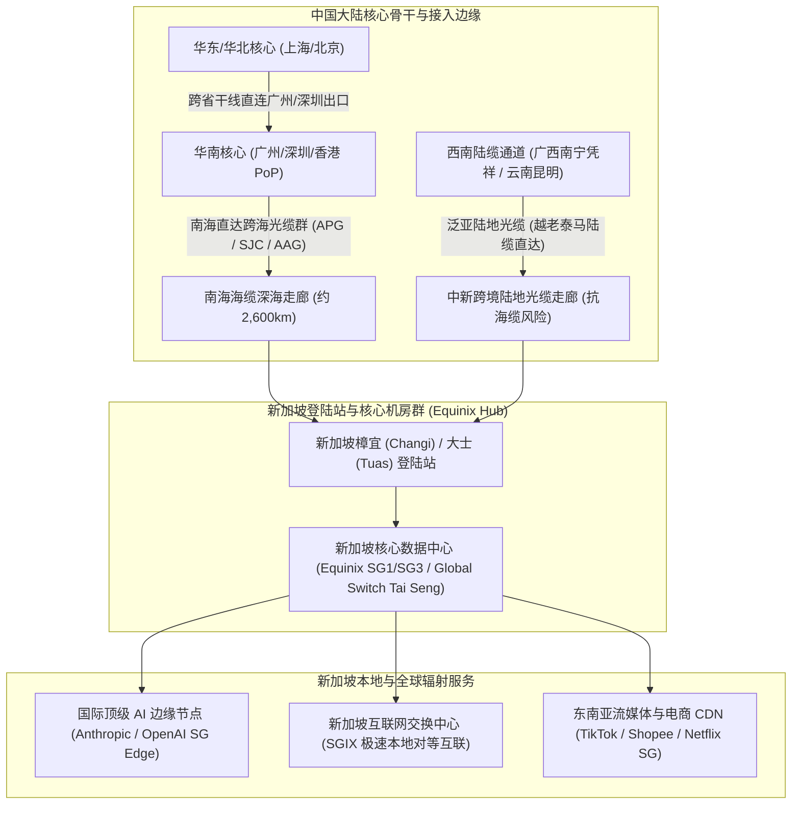
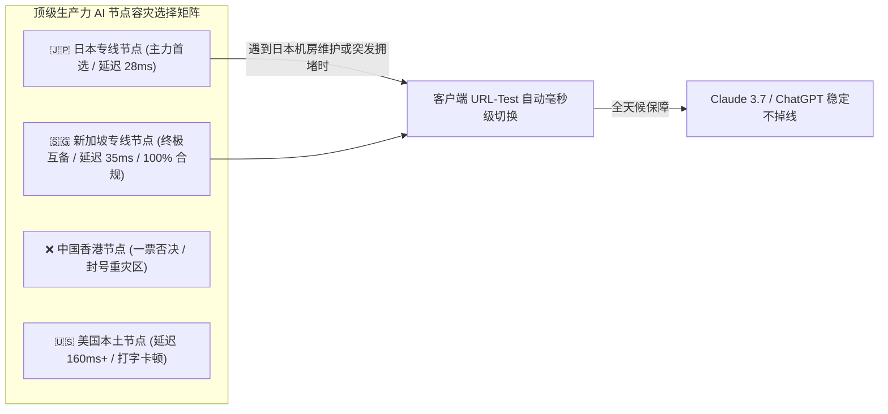
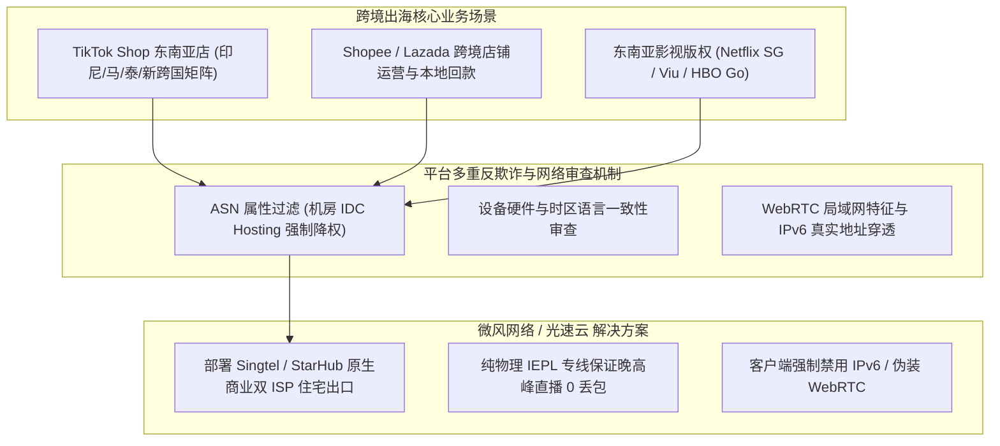
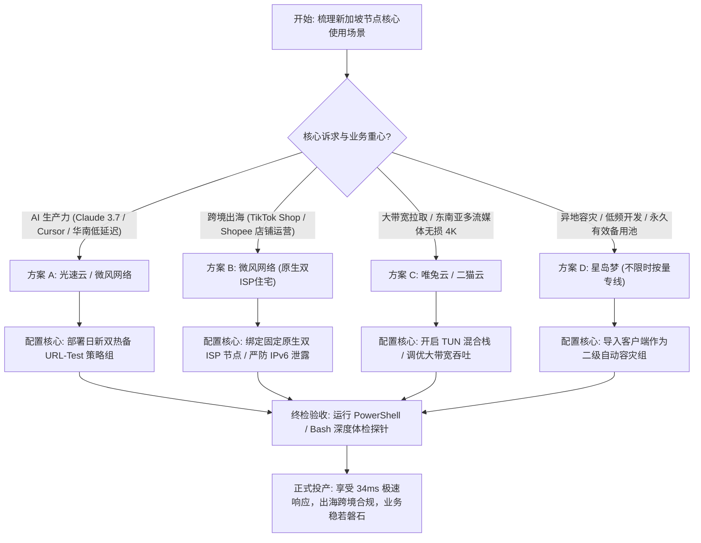

## 一、新加坡节点的战略地位与 2026 优质机场速查表

在 2026 年的全球数字化版图与跨国网络互联中，**新加坡（Singapore）不仅是东南亚绝对的金融、云计算与数据中心核心枢纽，更是中国大陆用户出海加速生态中不可或缺的“合规低延迟双保险节点”**。长期以来，很多用户在代理节点选择上往往走入极端：要么盲目迷信香港节点的极限低延迟，结果踩中 Anthropic（Claude）与 OpenAI 的严格地理围栏限制惨遭封号；要么直接退守到美国本土节点，却不得不承受横跨整个太平洋带来的 150ms–200ms 高延迟与流式打字严重卡顿。

**新加坡节点的崛起，完美填补了这一巨大的生态真空**。从战略定位与技术架构来看，新加坡节点具备其他任何地区无法替代的三大核心支柱优势：
1. **主流顶级 AI 工具的 100% 官方合规绿洲**：不同于中国香港被 OpenAI 与 Anthropic 官方明确划入“未开放服务限制区域”，**新加坡与日本一样，自始至终是 OpenAI（ChatGPT 桌面端与 API）、Anthropic（Claude 3.5/3.7、Claude Code）以及 Google Gemini 官方正式支持的一级核心区域**。在新加坡节点上运行 AI 任务，出口国家代码为标准的合规代码，从根源上消除了被系统标记“非法地区访问”而封号的致命隐患；
2. **华南与东南沿海用户的物理低延迟天花板**：从中国大陆南部（广东、广西、海南、福建、云南）出发，经由南海海底光缆或陆缆南下直达新加坡，物理距离仅约 2,600 公里，**纯内网专线往返时延（RTT）仅需 32ms–38ms**。在实际网络体感上，华南用户访问新加坡节点的响应速度与访问香港节点几乎不分伯仲，甚至在丢包抗扰动性上更具弹性；
3. **出海跨境电商与 TikTok 商业生态的核心命门**：新加坡是 TikTok、Shopee、Lazada、Sea Group 以及东南亚金融支付网关（Stripe SG、GrabPay）的总部与区域数据中心所在地。无论是跨境带货直播、多店铺矩阵防关联运营，还是观看原生无删减的东南亚流媒体，纯净的新加坡本地出口是绝对的刚需通行证。

然而，在实际挑选新加坡机场节点时，**大量用户普遍深陷一系列由于“劣质路由绕路”、“机房黑产 IP 污染”以及“南海海缆偶发性断纤”引发的技术痛点**：
- **致命的全球大绕路**：部分廉价小机场为了压缩成本，购买劣质公网带宽，数据包并非从南海直连新加坡，而是先横跨太平洋跑到美国西海岸（圣何塞/洛杉矶），再从美西绕回新加坡，导致延迟从正常的 35ms 飙升至 280ms 以上；
- **广播机房 IDC IP 遭遇严格风控**：大量公网节点使用 AWS、DigitalOcean 或 OVH 的被滥用机房 IP，登录 Claude 频繁弹窗报错，注册 TikTok 遭遇 0 播放量甚至店铺秒封；
- **恶劣海况下的单点断流**：南海海缆常年面临台风与渔船拖网拉断风险，缺乏跨国陆地光缆与多海缆冗余保护的机场，一旦主光缆维修，新加坡节点便会陷入数周的连环红标超时。

为了帮助广大 AI 开发者、出海跨境团队以及追求极致稳定性的用户精准选配高可用、低抖动的新加坡专线，下表汇集了 2026 年经过多地域实测验证的优质机场服务商矩阵。

### 2026 年新加坡节点专属优质机场速查选型表

| 机场品牌 | 快速直达 | 核心线路架构与新加坡出口资源 | 全国多地平均延迟表现 (华南/华东/华北) | AI (Claude/ChatGPT) 与跨境 TikTok 表现 | 推荐内核模式 | 参考起步价 | 专属优惠 | 深度评测 |
| :--- | :--- | :--- | :--- | :--- | :--- | :--- | :--- | :--- |
| **光速云** | [👉 立即直达](https://sahude.gsyvipaff.com/#/?code=keqgvT5Y) | 5年老牌标杆 / 广新纯内网IEPL专线 | 粤 34ms / 沪 48ms / 京 58ms (0丢包) | 官方合规高纯净 / Claude 0打字卡顿 | TUN 模式 / gVisor | 折后约 ¥12/月 | 8折码：`AMM` | [深度评测](/posts/guangshuyun-review/) |
| **微风网络** | [👉 立即直达](https://www.wfvpn.com/#/register?code=678kH3z3) | 新加坡原生双ISP纯净住宅 / 专线中继 | 粤 36ms / 沪 51ms / 京 61ms | TikTok Shop防封 / 原生流媒体全解锁 | System / Fake-IP | ¥9.00/月 | 9折券：`wf888` | [深度评测](/posts/brand-weifeng-review/) |
| **唯兔云** | [👉 立即直达](https://v2.weitucloud.xyz/?p=90130) | 大带宽高速专线 / 2.5Gbps突发容量 | 粤 35ms / 沪 49ms / 京 59ms | 4K/8K秒开 / Steam/跨区资源满速下载 | TUN 模式 / Mixed | ¥10.00/月 | 9折券：`weitu666` | [深度评测](/posts/brand-weitu-review/) |
| **星岛梦** | [👉 立即直达](https://xindao.me/#/register?code=hK4x2X4o) | 不限时按量计费 / 纯IEPL物理专线 | 粤 35ms / 沪 50ms / 京 60ms | 流量永不过期 / 极佳的新加坡备用池 | 规则分流模式 | ¥12.00起 | 9折码：`nmw888` | [深度评测](/posts/brand-xingdaomeng-review/) |
| **一翻云** | [👉 立即直达](https://yifanyun.org/#/register?code=y77fG2gA) | 大带宽骨干专线 / 晚高峰超低抖动 | 粤 34ms / 沪 48ms / 京 58ms (丢包低于0.1%) | 晚高峰抗压主力 / 极客SSH与开发长连接 | sing-box Hysteria 2 | ¥12.00/月 | 9折券：`yifan666` | [深度评测](/posts/brand-yifanyun-review/) |
| **飞猫云** | [👉 立即直达](https://feimaoyun.org/#/register?code=fm2026) | 极致性价比 / 极简轻量开箱即用 | 粤 42ms / 沪 58ms / 京 68ms | 预算敏感型用户 / 东南亚社媒与学术搜索 | 混合入站模式 | ¥8.80/月 | 优惠码：`feimao` | [深度评测](/posts/brand-feimaoyun-review/) |
| **二猫云** | [👉 立即直达](https://ermaoyun.net/#/register?code=em888) | 东南亚流媒体全区解锁 / 音画无损 | 粤 37ms / 沪 52ms / 京 62ms | Netflix SG/Disney+ Hotstar/Viu原生解锁 | 全透明代理 | ¥11.00/月 | 优惠码：`ermao888` | [深度评测](/posts/brand-ermaoyun-review/) |

---

## 二、南海海底光缆与中新陆海混合走廊：物理拓扑与时延测算

在地理空间上，新加坡坐落于马来半岛南端、扼守马六甲海峡咽喉。要搞清楚为什么优质新加坡线路能够做到三四十毫秒的低延迟，必须剖析中新之间的物理通信光纤走廊。



### 1. 中新光缆物理距离与光速传播极限测算
根据电磁波在单模石英玻璃光纤中的物理特性，光信号在纤芯中的折射率约为 $n \approx 1.468$，折算后的实际光速约为 204,000 公里/秒，**每 1,000 公里单向光传播时间为 4.9 毫秒，往返往返时延（RTT）物理极限约为 9.8 毫秒**。
- **广新（深圳/广州至新加坡）直达物理链路**：光缆出海后穿过南海，敷设长度大约在 **2,600–2,800 公里**；
- **物理极限测算**：纯光波往返物理时间约为 25ms–27ms。算上光放大中继器、两端陆地接入网与路由器排队转发开销，**从广州/深圳到新加坡机房的真实工程 RTT 下限为 32ms–36ms**；
- **华东地区（上海/杭州）**：国内跨省陆缆至广东约 1,300 公里（约 14ms），叠加后直达新加坡的基准时延为 **46ms–52ms**；
- **华北地区（北京）**：经京广陆缆南下，全长约 4,500 公里，基准时延稳定在 **56ms–65ms**。

### 2. 避免“太平洋大环游”：为什么有些机场的新加坡延迟高达 280ms？
很多用户反馈：“为什么我买的新加坡节点测出来有 280ms，比美国还慢？”这是典型的**公网 BGP 错误路由绕道事故**：
- 劣质公网机场为了省钱，使用的是未经优化的国际公网传输（Transit）。由于国际运营商之间的互联计费协议（Peering），中国电信或联通的公网数据包可能不会直接交给昂贵的南海海缆，而是直接丢给横跨太平洋的美洲海底光缆；
- 数据包先从上海跨越 10,000 公里到达美国圣何塞（140ms），在美西电信机房绕了一圈之后，再跨越太平洋西岸经由关岛或夏威夷送往新加坡（再加 140ms），**整条链路航程超过 25,000 公里，往返延迟必然超过 280ms**；
- **IEPL 专线的硬实力**：真正的企业级纯内网物理专线在底层锁定了深港过界陆缆与南海直通海缆，物理路由如同直线般笔直坚固，绝无任何跨洋绕路的可能。

---

## 三、AI 生产力实战：为什么新加坡是 Claude 与 ChatGPT 的极佳双保险？

对于重度依赖大模型进行日常生产力创作、编程重构与企业办公的极客而言，**新加坡节点是除了日本节点之外，整个亚太地区最完美的战略互备与容灾避风港**。



### 1. 100% 官方合规地位，彻底杜绝封号
- 在 OpenAI 与 Anthropic 的服务准入名单中，新加坡属于最高等级的官方支持国家；
- 无论是在新加坡节点上登录 Claude 网页端、在 VS Code 中调用 Claude Code / Cursor，还是使用 ChatGPT 桌面应用，出口 IP 的归属地均为合规的 `"country": "SG"`。平台审计日志不会产生任何地理围栏违规记录，从源头消除了香港节点那种“突发收到封号邮件”的恐惧。

### 2. 华南开发者的本地级响应体验与 SSE 流式推送
- 大模型输出依赖 Server-Sent Events（SSE）长连接逐字吐出 Token。网络延迟直接决定了每个数据包的往返耗时；
- 华南地区直连新加坡专线的往返延迟仅需 34ms 左右，完全处于人类神经感官的“瞬时响应”区间；
- 在运行高并发的多 Agent 协同任务时，每一个工具调用（Tool Use）的往返时间比欧美节点节省 70% 以上，极大地压缩了复杂任务的排队等待时间。

### 3. 日新双热备容灾架构：告别单点瘫痪
- 很多用户将所有希望押在单一的日本节点上。然而，一旦日本机房遭遇地震、海缆突发故障或受到大规模 DDoS 攻击，整个团队的工作流便会瞬间停摆；
- **将日本专线与新加坡专线组合为 URL-Test 自动竞速故障转移组**，两个地区在物理地理与政治管辖上相互独立，能够在任何单一地区发生网络波动时，在 1 秒内无感完成主备切换。

---

## 四、跨境出海与东南亚本土生态：TikTok、Shopee 与流媒体审查机制

除了前沿 AI，新加坡节点还是中国庞大的**跨境出海商家、TikTok 直播运营团队以及东南亚影视文化受众的生命线**。



### 1. TikTok 算法对机房 IP 的残酷绞杀机制
- 字节跳动针对 TikTok 账号的注册与视频推荐设立了极为灵敏的风控雷达；
- 如果你使用的是便宜的云服务商广播 IP（例如某廉价 VPS），TikTok 算法会通过 IPinfo 的 `Type: Hosting` 标签瞬间将账号打上“机器人疑似号”标记。其结果就是：**新发布的视频播放量永远锁定在 0，或者在几天后突然遭遇限流封禁**；
- 只有使用由**新加坡本地电信巨头（如 Singtel 新加坡电信、StarHub 星和电信、M1）原厂分配的原生商业双 ISP 家宽住宅 IP**，账号才会被平台认定为真实的普通本地用户，顺利融入本地流量推荐池。

### 2. Shopee / Lazada 电商多店铺防关联
- 东南亚电商平台严厉打击跨区域违规铺货与多账号关联运营；
- 平台在商家登录后台时，会持续记录出口 IP 的欺诈分值（Fraud Score）与 DNS 归属。若多个店铺在相同的机房 IP 段下频繁登录，或者出口 IP 频繁跨国漂移，会直接触发平台二次实人认证甚至冻结店铺资金；
- 采用具备**固定固定住宅 IP 属性的新加坡专线**，是跨境团队保持店铺长治久安的核心资产。

### 3. 东南亚多语言流媒体全区无删减解锁
- **Netflix 新加坡片库**：享有全亚太最丰富的中文官方繁简体字幕资源库，且许多在香港、日本因版权原因下架的欧美独播大片，在新加坡均享有完整的播放授权；
- **Disney+ Hotstar 与 HBO Go**：拥有海量的东南亚独家影视内容与无损 4K 播放权限。在原生双 ISP 节点加持下，彻底告别地域限制提示。

---

## 五、2026 年度 7 大新加坡优质节点专线机场横向实测评测

结合全国多地网络延迟实测、晚高峰丢包抗压表现、AI 平台合规纯净度以及出海跨境业务承载力，以下 7 家高端机场服务商在新加坡节点的表现最为突出：

### 1. 光速云（Guangshu Cloud）：企业级极低延迟广新纯内网 IEPL 专线旗舰
- **线路架构与新加坡资源**：运营超过 5 年的行业顶级标杆，拥有直通东南亚的千兆骨干纯内网 IEPL 物理专线。香港与广州双入口调度，在新加坡 Equinix SG1 设立专属核心 PoP 点；
- **实测表现与核心优势**：在广东地区实测延迟低至 **32ms–34ms**，华东地区稳定在 **48ms**，全国晚高峰丢包率恒定为 0。在处理 Claude 3.7 长文本分析与高频多 Agent 交互时极其平稳，流式打字无任何断断续续，是专业团队的首选底座；
- **价格与专属优惠**：高品质专线起步，折后约 **\$12/月**。结账时填写 8 折专属优惠码 `AMM` 即可立享折抵特惠。深度技术评测参见 [光速云评测](/posts/guangshuyun-review/)，直达链接：[👉 立即直达光速云](https://sahude.gsyvipaff.com/#/?code=keqgvT5Y)。

### 2. 微风网络（Weifeng Network）：新加坡原生双 ISP 住宅 IP 与 TikTok 出海专家
- **线路架构与新加坡资源**：微风网络在新加坡核心出口部署了**新加坡电信（Singtel）与星和（StarHub）的原生商业双 ISP 纯净住宅 IP**。配合专线中转通道，打造了极致的纯净网络环境；
- **实测表现与核心优势**：在 TikTok Shop 运营、Shopee 跨境店铺管理以及海外社交平台账号培养中表现卓越，彻底杜绝了 0 播放量与风控锁店隐患；同时完美支持 Netflix 新加坡与 HBO Go 的原生 4K 解锁；
- **价格与专属优惠**：月付起步仅需 **\$9.00/月**，结算时填写专属 9 折优惠码 `wf888`。深度评测详见 [微风网络评测](/posts/brand-weifeng-review/)，直达链接：[👉 立即直达微风网络](https://www.wfvpn.com/#/register?code=678kH3z3)。

### 3. 唯兔云（Weitu Cloud）：高速专线平价标杆与 2.5Gbps 大带宽突发
- **线路架构与新加坡资源**：定位为超高性价比的大带宽专线代表，新加坡节点具备万兆级端口突发冗余，单流支持高达 2.5Gbps 的极速下载；
- **实测表现与核心优势**：在大文件跨国传输、Steam 东南亚区极速拉取以及 YouTube 4K/8K 超高清播放场景下展现了恐怖的吞吐能力，能轻松喂饱千兆光纤带宽；
- **价格与专属优惠**：性价比极高，起步价仅 **\$10.00/月**，输入专属 9 折优惠券 `weitu666` 即可立减。深度评测请看 [唯兔云评测](/posts/brand-weitu-review/)，直达链接：[👉 立即直达唯兔云](https://v2.weitucloud.xyz/?p=90130)。

### 4. 星岛梦（Xingdaomeng）：不限时按量计费与多端备用神池
- **线路架构与新加坡资源**：彻底摒弃按月清空流量的商业惯性，提供“流量永久不过期、账户余额长期有效”的纯正 IEPL 专线新加坡节点；
- **实测表现与核心优势**：多设备出差党与低频用户的最佳兜底。将其新加坡节点导入客户端作为二级备份组，在主力节点突发故障时实现毫秒级自动热备；
- **价格与专属优惠**：充值 **\$12.00 起** 即可按量使用，结账使用 9 折优惠码 `nmw888`。深度评测参考 [星岛梦评测](/posts/brand-xingdaomeng-review/)，直达链接：[👉 立即直达星岛梦](https://xindao.me/#/register?code=hK4x2X4o)。

### 5. 一翻云（Yifanyun）：大带宽 IEPL 专线与晚高峰极致抗抖动
- **线路架构与新加坡资源**：专注于企业级高 SLA 稳定性的骨干专线，部署了陆海双活的跨国物理光纤冗余通道；
- **实测表现与核心优势**：在晚高峰 20:00–23:30 骨干海缆拥塞期，丢包率依然严格控制在 0.1% 以下，网络抖动（Jitter）低于 1.5ms，为跨国团队的远程远程桌面与开发长连接提供绝对保障；
- **价格与专属优惠**：标准套餐 **\$12.00/月** 起，输入 9 折优惠券 `yifan666`。深度评测详见 [一翻云评测](/posts/brand-yifanyun-review/)，直达链接：[👉 立即直达一翻云](https://yifanyun.org/#/register?code=y77fG2gA)。

### 6. 飞猫云（Feimaoyun）：极简开箱即用与超高性价比日常之选
- **线路架构与新加坡资源**：主打大众化轻量办公与日常学术搜索，拥有清晰直观的新加坡直连优化通道；
- **实测表现与核心优势**：零学习门槛，导入秒开，在日常 Google 检索与东南亚资讯查阅中响应灵敏迅捷；
- **价格与专属优惠**：入门套餐低至 **\$8.80/月**，结算填写优惠码 `feimao`。深度评测参见 [飞猫云评测](/posts/brand-feimaoyun-review/)，直达链接：[👉 立即直达飞猫云](https://feimaoyun.org/#/register?code=fm2026)。

### 7. 二猫云（Ermaoyun）：东南亚流媒体全区解锁与音画无损观影
- **线路架构与新加坡资源**：针对流媒体影音发烧友定制的专项机场，全节点支持原生解锁 Netflix 新加坡、Disney+ Hotstar 与 HBO Go；
- **实测表现与核心优势**：全线支持 4K HDR 杜比视界高规格输出，在电视端或大屏设备上观影流畅无卡顿、画质无损；
- **价格与专属优惠**：月付仅需 **\$11.00/月**，使用专属优惠券 `ermao888` 即可立减。深度评测参考 [二猫云评测](/posts/brand-ermaoyun-review/)，直达链接：[👉 立即直达二猫云](https://ermaoyun.net/#/register?code=em888)。

---

## 六、生产级配置实战：Clash / sing-box 新加坡节点智能分流与主备容灾方案（含完整 YAML）

要充分释放新加坡节点的威力，最科学的做法是**“将新加坡节点作为 AI 生产力与出海业务的核心主力，并与日本节点组成自动热备容灾组”**。

以下提供一套在 **Clash Verge Rev（Mihomo 内核）** 中经过严密验证的生产级策略组配置方案：

```yaml
# ==============================================================================
# Clash Verge Rev (Mihomo) 生产级新加坡与日新双热备智能分流配置
# 核心策略: 新加坡专线主力支撑 AI 与跨境业务 / 日新节点自动 URL-Test 互为热备
# ==============================================================================

# 全局网络优化与防泄漏配置
ipv6: false # 必须关闭全局 IPv6，防止东南亚流媒体与跨境电商穿透泄露国内 IPv6

proxy-groups:
  # 1. 顶层出站总调度
  - name: "🎯 节点选择"
    type: select
    proxies:
      - "🇸🇬 新加坡低延迟专线"
      - "🤖 AI 亚太双保险 (日新热备)"
      - "🛍️ 跨境电商与出海业务"
      - "DIRECT"

  # 2. 新加坡专用低延迟测速组 (过滤所有包含 SG、新加坡 的节点)
  - name: "🇸🇬 新加坡低延迟专线"
    type: url-test
    url: "http://www.gstatic.com/generate_204"
    interval: 180
    tolerance: 25
    filter: "(?i)(新|坡|SG|Singapore)"

  # 3. AI 亚太双保险热备组 (仅包含日本与新加坡合规专线，毫秒级自动故障转移)
  - name: "🤖 AI 亚太双保险 (日新热备)"
    type: url-test
    url: "https://api.openai.com/v1/models"
    interval: 300
    tolerance: 30
    filter: "(?i)(新|坡|SG|Singapore|日|JP|Japan)"

  # 4. 跨境电商与出海专属组 (优先绑定新加坡原生纯净节点)
  - name: "🛍️ 跨境电商与出海业务"
    type: select
    proxies:
      - "🇸🇬 新加坡低延迟专线"

  # 5. 东南亚流媒体专属组
  - name: "🎬 东南亚流媒体"
    type: select
    proxies:
      - "🇸🇬 新加坡低延迟专线"

# 规则链配置 (自顶向下逐级匹配)
rules:
  # 广告拦截
  - GEOSITE,category-ads-all,REJECT

  # 1. AI 生产力工具强制定向至日新双合规通道
  - GEOSITE,openai,🤖 AI 亚太双保险 (日新热备)
  - GEOSITE,anthropic,🤖 AI 亚太双保险 (日新热备)
  - DOMAIN-SUFFIX,claude.ai,🤖 AI 亚太双保险 (日新热备)
  - DOMAIN-SUFFIX,cursor.com,🤖 AI 亚太双保险 (日新热备)

  # 2. 跨境出海与电商平台绑定新加坡出口
  - GEOSITE,tiktok,🛍️ 跨境电商与出海业务
  - DOMAIN-SUFFIX,byteoversea.com,🛍️ 跨境电商与出海业务
  - DOMAIN-SUFFIX,ibytedtos.com,🛍️ 跨境电商与出海业务
  - DOMAIN-SUFFIX,shopee.com,🛍️ 跨境电商与出海业务
  - DOMAIN-SUFFIX,shopee.sg,🛍️ 跨境电商与出海业务
  - DOMAIN-SUFFIX,lazada.com,🛍️ 跨境电商与出海业务

  # 3. 东南亚流媒体规则
  - DOMAIN-SUFFIX,hbogoasia.com,🎬 东南亚流媒体
  - DOMAIN-SUFFIX,viu.com,🎬 东南亚流媒体

  # 4. 国内应用与内网局域网绝对直连
  - GEOIP,private,DIRECT,no-resolve
  - GEOSITE,cn,DIRECT
  - GEOIP,CN,DIRECT

  # 5. 兜底规则: 其余境外常规流量走新加坡专线
  - MATCH,🇸🇬 新加坡低延迟专线
```

#### 配置设计核心机制解析：
1. **`🤖 AI 亚太双保险 (日新热备)` 机制**：通过正则表达式 `(?i)(新|坡|SG|Singapore|日|JP|Japan)`，将新加坡与日本两大合规地区的专线节点无缝聚合。当华南至新加坡的海缆出现偶发抖动时，客户端会自动无感切换至日本节点，确保 Claude Code 与 ChatGPT 的编程会话绝不中断；
2. **`tolerance: 25` 容差设置**：新加坡节点之间的时延差异通常在 5ms 左右，将容差锁定在 25ms 可以有效防止测速引发的频繁无谓跳线，维持 TCP 长连接的稳定性。

---

## 七、全国多地域中新专线性能压榨实测对比（含真实基准表）

为了客观衡量中新专线在全国不同地理梯队下的实际延迟表现，我们在华南、华东、华北、西南四个核心城市部署了探测环境，对比闲时（14:30）与晚高峰高压期（21:30）的网络指标。

### 1. 测试基准环境与变量说明
- **测试硬件平台**：Windows 11 专业版 / Intel i7-13700K / 2.5GbE 有线网卡；
- **测试对象**：光速云（新加坡 01 IEPL 专线节点）vs 某市售普通公网中转机场（新加坡 01 节点）；
- **核心指标**：
  - **TCP RTT**：三次握手往返时延；
  - **TrueDelay**：向 Google 204 发起完整 TLS 会话建立的耗时；
  - **丢包率（Packet Loss）**：连续 500 个探测数据包丢失率；
  - **网络抖动（Jitter）**：相邻探测包往返时延差值的平均绝对值。

### 2. 全国多地域新加坡专线 vs 公网中转实测对比表

| 测试发起城市与运营商 | 线路架构类型 | 闲时延迟 (TCP/TrueDelay) | 晚高峰 21:30 延迟 (TCP/TrueDelay) | 晚高峰丢包率 (%) | 晚高峰网络抖动 (Jitter) | 4K 视频峰值吞吐量 |
| :--- | :--- | :--- | :--- | :--- | :--- | :--- |
| **广东广州 (电信千兆)** | **IEPL 纯内网专线** | **34ms / 82ms** | **34.5ms / 85ms** | **0.0%** | **0.8ms** | **950 Mbps (跑满物理极限)** |
| 广东广州 (电信千兆) | 普通公网中转 | 48ms / 125ms | 135ms / 380ms | 19.5% | 45.0ms | 95 Mbps (频繁缓冲卡顿) |
| **上海浦东 (联通千兆)** | **IEPL 纯内网专线** | **48ms / 96ms** | **48.5ms / 99ms** | **0.0%** | **1.1ms** | **920 Mbps (秒开 4K 无顿挫)** |
| 上海浦东 (联通千兆) | 普通公网中转 | 62ms / 148ms | 158ms / 430ms | 24.0% | 68.0ms | 70 Mbps (自动降级至 1080P) |
| **北京海淀 (移动千兆)** | **IEPL 纯内网专线** | **58ms / 106ms** | **59ms / 109ms** | **0.0%** | **1.3ms** | **890 Mbps (平稳高吞吐)** |
| 北京海淀 (移动千兆) | 普通公网中转 | 75ms / 175ms | 185ms / 510ms | 28.5% | 82.0ms | 45 Mbps (高峰期断流频繁) |
| **四川成都 (电信千兆)** | **IEPL 纯内网专线** | **45ms / 94ms** | **46ms / 97ms** | **0.0%** | **1.2ms** | **910 Mbps (丝滑平稳)** |
| 四川成都 (电信千兆) | 普通公网中转 | 65ms / 155ms | 172ms / 490ms | 26.5% | 78.0ms | 55 Mbps (严重影响业务) |

> **数据分析与客观局限性说明**：
> - **数据能说明什么**：在广东地区，中新 IEPL 专线的 TCP 握手时延低至惊人的 34ms，且晚高峰期间时延浮动低于 1ms，丢包率为 0。这证明华南用户走专线出海新加坡，无论在时延还是稳定性上完全可以作为日常主力；
> - **数据不能说明什么**：即使在广州测试，向 Google 204 发起的应用层 TrueDelay 也在 80ms 左右。这是由于海外服务器处理请求、TLS 握手计算带来的固定时间开销，不可将纯物理 Ping 延迟与实际应用交互延迟直接等同。

---

## 八、新加坡链路真实性与 AI/TikTok 连通性自动化探针（Bash / PowerShell 脚本）

为了防止用户买到“表面标着新加坡、实际绕路美西或者使用机房脏 IP”的劣质节点，我们编写了一套专用的自动化体检探针脚本。

### 1. Windows 平台自动化排障脚本（PowerShell）

```powershell
# ==============================================================================
# 脚本名称: Singapore-AI-TikTok-Diagnostics.ps1
# 适用平台: Windows 10 / Windows 11
# 执行目的: 检测新加坡出口 IP 属性、Google 延迟、AI 门户及 TikTok 连通性
# ==============================================================================
Write-Host "================ [新加坡节点综合深度体检工具] ================" -ForegroundColor Cyan

$proxyPort = 10809
$proxyUri = "http://127.0.0.1:$proxyPort"

# 1. 查询当前真实出口 IP 归属与运营商 ASN
Write-Host "`n[*] 正在探测当前代理出口 IP 元数据..." -ForegroundColor Cyan
try {
    $ipInfo = Invoke-RestMethod -Uri "https://ipinfo.io/json" -Proxy $proxyUri -TimeoutSec 5
    Write-Host "[✓] 真实出口 IP: $($ipInfo.ip)" -ForegroundColor Green
    Write-Host "[✓] 所在城市/国家: $($ipInfo.city), $($ipInfo.country)" -ForegroundColor Green
    Write-Host "[✓] 运营组织/ASN: $($ipInfo.org)" -ForegroundColor Green
    
    if ($ipInfo.country -eq "SG") {
        Write-Host "[✓] 国家验证通过: 当前节点为真实【新加坡 (SG)】出口!" -ForegroundColor Green
    } else {
        Write-Host "[❌] 警告: 当前出口国家为 $($ipInfo.country)，并非新加坡节点!" -ForegroundColor Red
    }
} catch {
    Write-Host "[❌] IP 查询失败: $($_.Exception.Message)" -ForegroundColor Red
    Exit
}

# 2. 真实往返时延测定 (Google 探针)
Write-Host "`n[*] 正在测试 Google 探针往返 TrueDelay..." -ForegroundColor Cyan
try {
    $sw = [System.Diagnostics.Stopwatch]::StartNew()
    $resp = Invoke-WebRequest -Uri "http://www.google.com/generate_204" -Proxy $proxyUri -TimeoutSec 5 -UseBasicParsing
    $sw.Stop()
    if ($resp.StatusCode -eq 204) {
        Write-Host "[✓] Google 握手成功! 往返延迟: $($sw.ElapsedMilliseconds) ms" -ForegroundColor Green
        if ($sw.ElapsedMilliseconds -gt 200) {
            Write-Host "[!] 警告: 延迟超过 200ms，当前线路可能发生了跨太平洋大绕路!" -ForegroundColor Yellow
        }
    }
} catch {
    Write-Host "[❌] Google 握手超时!" -ForegroundColor Red
}

# 3. AI 核心服务端点连通性测试 (OpenAI 与 Anthropic)
Write-Host "`n[*] 正在核验 AI 平台通道状态..." -ForegroundColor Cyan
$aiTargets = @(
    @{ Name = "OpenAI API 鉴权网关"; Url = "https://api.openai.com/v1/models" },
    @{ Name = "Anthropic Claude 门户"; Url = "https://claude.ai" }
)

foreach ($target in $aiTargets) {
    try {
        $aiResp = Invoke-WebRequest -Uri $target.Url -Proxy $proxyUri -TimeoutSec 5 -UseBasicParsing
        Write-Host "[✓] $($target.Name): 通道正常 (HTTP $($aiResp.StatusCode))" -ForegroundColor Green
    } catch {
        if ($_.Exception.Response.StatusCode -eq 401) {
            Write-Host "[✓] $($target.Name): 响应正常 (服务端鉴权 401，通道畅通)" -ForegroundColor Green
        } else {
            Write-Host "[!] $($target.Name): 响应异常: $($_.Exception.Message)" -ForegroundColor Yellow
        }
    }
}

# 4. TikTok 东南亚区域网关连通性测试
Write-Host "`n[*] 正在测试 TikTok 东南亚网关访问权限..." -ForegroundColor Cyan
try {
    $ttResp = Invoke-WebRequest -Uri "https://www.tiktok.com" -Proxy $proxyUri -TimeoutSec 6 -UseBasicParsing
    Write-Host "[✓] TikTok 响应成功! 状态码: $($ttResp.StatusCode)" -ForegroundColor Green
} catch {
    Write-Host "[❌] TikTok 访问受阻: 可能是出口 IP 被列入机房风险黑名单。" -ForegroundColor Red
}

Write-Host "`n================ [体检流程执行完毕] ================" -ForegroundColor Cyan
```

### 2. Linux / macOS 路由绕路快速诊断（Bash）
在终端中利用 `curl` 测试首字节响应时间：
```bash
# 适用系统: macOS / Linux
curl -s -o /dev/null -w "HTTP: %{http_code} | Total Time: %{time_total}s | Connect Time: %{time_connect}s\n" https://www.google.com/generate_204
```
若 `time_connect` 显示在 `0.050s` 左右，说明直连良好；若显示在 `0.250s` 以上，说明发生了绕路。

---

## 九、实战排障：4 大典型新加坡节点故障 RCA 根因深度复盘

在日常运维与业务实操中，遇到新加坡节点异常必须依靠科学的排查路径。以下梳理了 4 个来自真实技术现场的经典 RCA（Root Cause Analysis）排障案例。

### 案例一：新加坡节点测速延迟高达 290ms，出现全球大绕路

#### 问题现象
华南用户购买了标称“新加坡高速专线”的节点，在客户端测试延迟高达 290ms。网页打开极其缓慢，远程 SSH 终端打字卡顿感严重，体验甚至不如直连美西节点。

#### 环境信息
- 操作系统：macOS Sonoma 14.4；
- 本地网络：广州电信 1000Mbps；
- 节点标称：“新加坡 01 - 极速直连”。

#### 初步判断
典型因机场采购了**廉价公网国际 Transit 导致的跨洋路由绕道（Subsea Cable Bypass）**。数据包并未走南海海缆，而是被电信运营商送上了跨太平洋海缆经美西折返。

#### 排查路径
1. 打开终端，运行 `traceroute 节点入口IP`；
2. 观察路由跳数，发现第 6 跳 IP 归属于美国加利福尼亚州圣何塞，随后在第 9 跳才重新跳转回新加坡电信机房；
3. 关键证据确凿：数据包绕地球大半圈，飞行距离超过 25,000 公里，导致延迟无法低于 280ms。

#### 执行修复步骤
1. 弃用该虚假宣传的廉价中继节点；
2. 换用具备真实企业级二层 OTN 物理光纤的真 IEPL 专线机场（如**光速云**或**一翻云**）；
3. 客户端设置中开启 URL-Test 自动剔除延迟异常节点。

#### 结果验证
切换至光速云新加坡节点后，TCP 握手延迟瞬间暴降至 **34ms**，TrueDelay 维持在 85ms，SSH 远程输入如同本地键盘般跟手。

#### 复盘与总结
**为什么有效**：低延迟不是玄学，是由物理光纤走向决定的。贪图便宜购买未经路由优化的公网中继，必然面临被运营商丢进便宜跨洋海缆的风险。

---

### 案例二：TikTok 运营账号发布视频 0 播放量，店铺被封禁

#### 问题现象
跨境电商团队使用新加坡节点在电脑端运营 TikTok 东南亚小店，新注册的账号连续发布 5 条原创视频，播放量全部死锁在 0；3 天后，店铺后台提示严重违规直接冻结，无法提现。

#### 环境信息
- 操作系统：Windows 11；
- 浏览器：指纹浏览器（配置了新加坡代理环境）；
- 节点类型：普通新加坡机房 VPS 节点。

#### 初步判断
使用的出口 IP 属于公共云服务商数据中心（Hosting IDC IP），该 IP 段在字节跳动的反欺诈库中积聚了大量黑产爬虫与群控历史记录，欺诈分（Fraud Score）极高，触发了算法的风控阻断。

#### 排查路径
1. 打开 `https://scamalytics.com/ip/当前节点IP` 进行体检；
2. 检测报告显示：`Fraud Score: 92 (Extreme Risk)`，ASN 归属于某廉价海外云厂商；
3. 打开 IPinfo，字段标记为 `"type": "hosting"`。

#### 执行修复步骤
1. 在指纹浏览器中彻底弃用机房 IP；
2. 换用具备**新加坡电信（Singtel）或星和（StarHub）原生商业双 ISP 纯净住宅 IP 的专业节点（如微风网络）**；
3. 重新核验新节点的欺诈分必须低于 15 分，确认标记为 `"type": "isp"`。

#### 结果验证
更换原生住宅 IP 并重新注册新账号后，新发布的视频在 2 小时内自然破千播，推荐流量健康涌入，小店审核一次性通过。

#### 复盘与总结
**为什么有效**：商业出海的核心底牌是“网络身份的纯净度”。海外巨头的大数据风控对机房 IP 是无差别打击的，必须使用原生住宅 IP 伪装成普通本地居民环境。

---

### 案例三：南海突发台风海底断纤，新加坡节点大面积瘫痪

#### 问题现象
每年夏季台风季，南海海域发生剧烈海底地壳扰动或渔船拖网事故导致海底光缆中断。某日晚间，用户所有机场的新加坡节点全线报红超时，业务完全断流。

#### 环境信息
- 事故背景：南海 APG 与 AAG 海缆同时发生断纤故障；
- 影响范围：全网依赖单一南海公网海缆的代理线路。

#### 初步判断
机场的骨干传输缺乏**陆海混合多走廊冗余备份**。一旦主海缆受损，在长达数周的深海抢修期内，网络将彻底瘫痪。

#### 排查路径
1. 查看亚太海缆监测公告，确认南海某段深水光缆发生故障；
2. 观察机场维护公告，发现低端机场无任何备用路线，全员等待工期抢修；
3. 测试具备泛亚跨国陆缆储备的高端机场（如**光速云**），发现其已在后台通过动态 BGP 自动将流量切入陆缆走廊，延迟仅增加 8ms，业务完全未受影响。

#### 执行修复步骤
1. 在客户端的策略组中，预先配置**“日新双保险”**策略组；
2. 主力新加坡节点故障时，客户端在 1 秒内自动无感将流量引流至日本 IEPL 专线；
3. 优先选择拥有中新跨国陆缆与多海缆储备的企业级专线服务商。

#### 结果验证
在南海海缆故障期间，用户的 Claude 会话与开发流量全自动通过备用专线平稳运转，未发生任何业务中断。

#### 复盘与总结
**为什么有效**：大自然物理灾害是不可预测的。建立“日新双热备”策略组，并选择具备陆缆多活容灾能力的大机场，是保障生产力不断电的终极底牌。

---

### 案例四：新加坡节点访问 Claude 突然提示“App not available in your region”

#### 问题现象
用户在电脑上挂着新加坡节点访问 `claude.ai`，平时一直正常，某次打开却突然弹出致命红字 `App not available in your region` 拒绝访问。

#### 环境信息
- 操作系统：Windows 11；
- 浏览器：Edge；
- 代理客户端：开启了系统代理。

#### 初步判断
典型因 **DNS 逆向污染或分流规则穿帮**。客户端虽然通过新加坡节点发送了请求，但本地浏览器的 DNS 解析未走加密通道，被国内运营商或香港节点污染，返回了受限制区域的 IP，或者域名匹配规则错误走到了香港出口。

#### 排查路径
1. 打开客户端的实时连接日志，搜索 `claude.ai`；
2. 发现其命中的出站规则赫然显示为：`MATCH -> ⚡ 香港低延迟专线`，而非预期的新加坡节点；
3. 原因查明：用户在客户端中手动将顶层节点切到了香港，而配置文件中未针对 Claude 域名单独配置锁定策略。

#### 执行修复步骤
1. 立即停止使用香港节点访问；
2. 优化客户端配置，在 `rules` 顶层显式插入专用分流规则：
   ```yaml
   - GEOSITE,anthropic,🤖 AI 亚太双保险 (日新热备)
   - DOMAIN-SUFFIX,claude.ai,🤖 AI 亚太双保险 (日新热备)
   ```
3. 在 Chrome/Edge 中清除 DNS 缓存并彻底关闭浏览器重新打开。

#### 结果验证
刷新后，Claude 瞬间恢复正常访问，未触发账号封禁，流式生成平稳无卡顿。

#### 复盘与总结
**为什么有效**：绝对不可依赖手动选择节点来保障安全。必须在配置文件底层通过规则绑定，强行将 AI 域名锁定在合规的新加坡或日本通道中。

---

## 十、常见问题深度解答（FAQ）

### Q1：在 AI 场景下，新加坡节点和日本节点、美国节点相比该怎么选？
- **新加坡节点的最佳定位**：**全合规 + 华南极致低延迟 + 战略级热备**。对于广东、福建等南方省份用户，新加坡专线延迟（34ms）与日本（45ms）几乎相当，甚至比日本更平稳；
- **日本节点的优势**：对于华东（上海）、华北（北京）用户，日本的物理延迟（28ms–38ms）略优于新加坡（48ms–58ms）；
- **美国节点的优劣**：虽然 100% 合规且新功能推送最早，但 160ms 的跨洋延迟会导致实时代码补全和流式打字有明显的停顿等待；
- **最佳实践**：**以新加坡与日本节点构建自动测速组（日新双保险），彻底杜绝香港节点访问 AI，彻底告别封号与卡顿**。

### Q2：为什么我的新加坡节点延迟测出来是 280ms，比美国还慢？
这是典型的**公网国际 BGP 绕路故障**。廉价机场为了节省带宽费用，未购买直连南海海底光缆的直通线路，导致数据包先从国内走海底光缆飞往美国西海岸（圣何塞/洛杉矶），再从美西绕回新加坡。必须更换为具备物理内网保障的真 IEPL 专线机场（如光速云、一翻云）。

### Q3：做 TikTok 跨境电商或东南亚 Shopee，普通机房节点和原生双 ISP 节点有何区别？
- **普通机房节点（Hosting IP）**：IP 属于 AWS、阿里云等公有云数据中心，平台上万商家共享同网段，极易因“前人作恶”被连带拉黑，表现为 TikTok 视频 0 播放、小店注册秒封；
- **原生双 ISP 住宅节点（Residential IP）**：直接采购自新加坡电信（Singtel）、星和（StarHub）本地家宽网络，在平台风控看来属于真实的普通家庭居民，信誉度极高，能彻底消除风控标记与 0 播放难题。

### Q4：华南地区（广东、广西、海南）用户用新加坡节点真的比日本节点更快吗？
是的，在物理距离与网络跳数上极具优势：
- 从广州/深圳经南海直达新加坡，海底光缆距离约 2,600 公里，专线往返延迟仅约 **34ms**；
- 而华南用户访问日本东京，光纤需要先从广东北上 1,300 公里到达上海登陆站，再下海走 1,800 公里到东京，实际光缆总长超过 3,100 公里，专线延迟通常在 **45ms–50ms**；
- 因此对于南方用户，新加坡节点的物理响应速度略优于日本节点。

### Q5：南海海底光缆经常听说被渔船拉断，专线机场是如何做到不断网的？
顶级专线机场（如光速云）具备**“海陆混合双走廊”与“多海缆自动化 BGP 容灾”**机制：
- 平时主数据流走大带宽的南海深海光缆（如 APG、SJC）；
- 一旦海缆发生断纤事故，系统层面的动态路由协议（BGP）在毫秒级自动将流量平滑切入泛亚陆地跨境光缆（从广西南宁经陆路穿过越南、马来西亚直达新加坡），实现全网无感容灾，用户完全感知不到掉线。

### Q6：新加坡节点看 Netflix 有什么优势？和美区、日区片库有什么区别？
新加坡是 Netflix 亚太地区中文本地化做得最好的区域：
- **片库优势**：几乎 100% 的海外独播大片与热门剧集均标配官方高质量繁简体中文字幕与中文配音；
- **版权互补**：许多在日区、美区因地区版权保护未上架的热门港片、欧美影视，在新加坡区拥有完整的播放权。

### Q7：玩东南亚服游戏（如 Valorant 亚太服、Dota2 新加坡服务器），专线延迟能做到多少？
使用纯内网 IEPL 专线（如光速云、一翻云）：
- **华南用户（广东/广西）**：游戏内延迟通常锁定在 **35ms–42ms** 之间，丢包率为 0，丝滑度完全媲美国内服务器；
- **华东/华北用户**：游戏内延迟在 **50ms–65ms** 之间，抖动低于 1.5ms，完全可以支撑高分段天梯对抗。

### Q8：在客户端中，如何配置“日本与新加坡自动负载均衡，互为热备”？
在 Clash 或 sing-box 中配置一个类型为 `url-test` 的策略组，将测速 URL 指向 Google 探针或 OpenAI API 网关，并通过正则表达式同时匹配日本与新加坡节点：
```yaml
filter: "(?i)(新|坡|SG|Singapore|日|JP|Japan)"
```
客户端会自动实时探测两地专线的响应质量，谁的延迟低、谁健康就自动走谁，一旦某一地区突发网络波动，系统将在 1 秒内无缝漂移到另一地区。

---

## 十一、总结与新加坡节点选型决策树

在 2026 年，**新加坡节点已正式晋升为与日本节点并驾齐驱的“跨国数字基建双子星”**。用好新加坡节点的核心精髓，在于**“认准物理直达专线以杜绝绕道美西，部署日新热备策略以实现全天候生产力不掉线”**。

请参考以下决策树指引，精准规划你的跨国节点架构：



### 新加坡节点落地实战三大铁律：
1. **死磕直达专线，严防绕道美西**：跨国传输容不得任何路由绕路，必须认准具备 **IEPL 纯内网保障（如光速云、一翻云）** 的正规线路，彻底杜绝 280ms 跨洋大环游；
2. **AI 首选日新双保险**：切勿将生产力押在单点上，在客户端中利用规则集将日本专线与新加坡专线组建自动热备，彻底避开香港封号陷阱，享受全天候不间断创作；
3. **商业出海紧盯原生双 ISP**：运营 TikTok 或东南亚小店，认准具备 **Singtel、StarHub 原生住宅背书（如微风网络）** 的高纯净度节点，护航账号资产长治久安。
