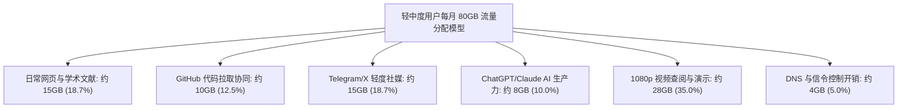
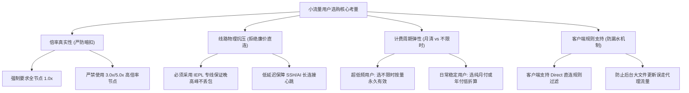
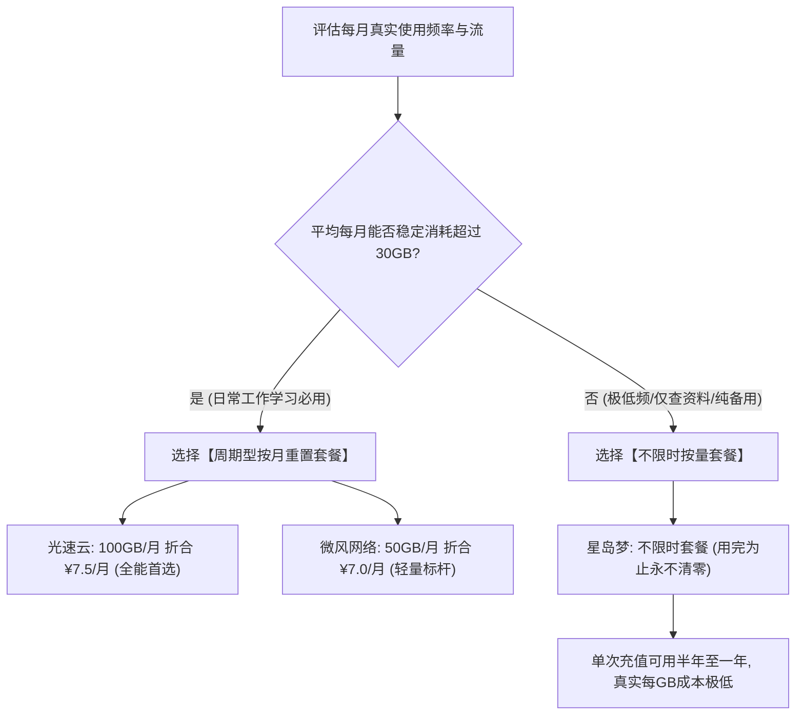
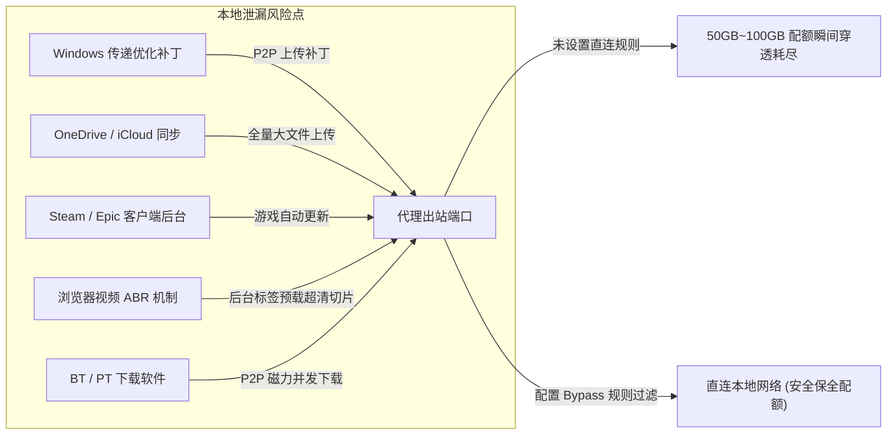
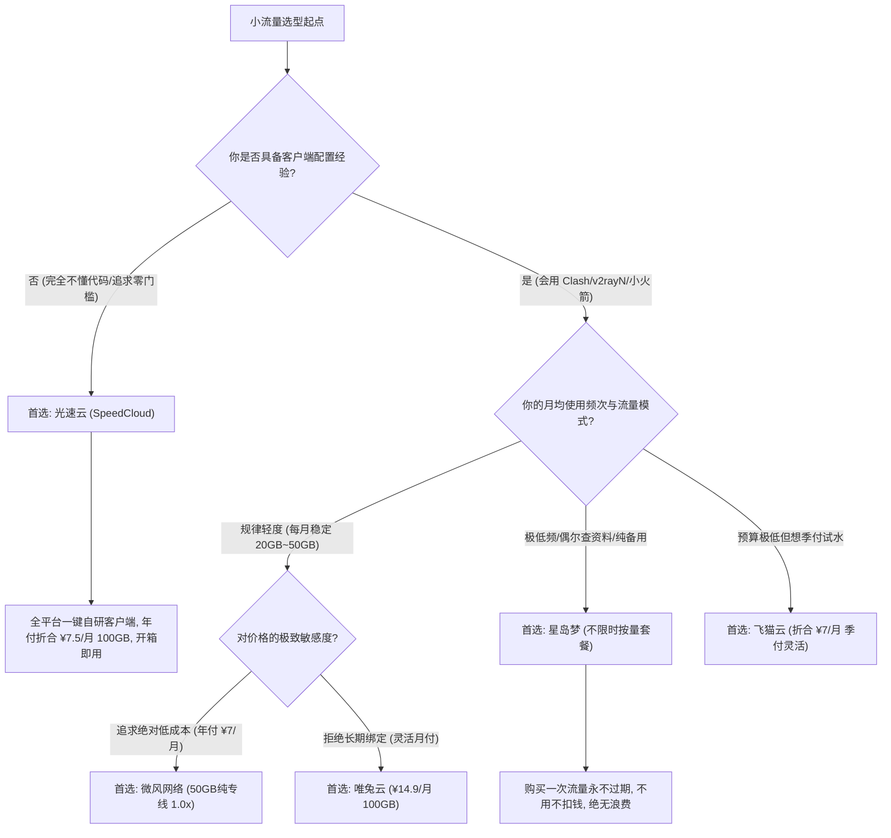

> **核心结论速览（Direct Answer）**：  
> 如果你的核心需求是**查阅海外文献资料、日常 Google/Bing 搜索、GitHub 代码拉取与协同、Telegram/X 轻度社媒浏览，以及高频使用 ChatGPT-4o / Claude 3.7 进行编程辅助**，而不是全天候挂着观看 4K 超清长视频，那么**购买 300GB～1000GB 的大容量套餐完全是资金浪费**。对于轻度至中度用户，每月 **50GB～100GB** 的真实流量配额绰绰有余，合理支出区间应严格压制在 **¥7.0/月～¥15.0/月**。  
> 综合 2026 年线路质量、真实倍率（严禁暗扣）、计费制式灵活性以及抗封锁稳定性，精选小流量套餐梯队结论如下：  
> 👑 **100GB 档全能开箱即用首选**：**[光速云 (SpeedCloud)](/posts/guangshuyun-review/)**（综合评分 9.9 / 10，年付折算仅 **¥7.5/月** 享 100GB/月，企业级二层 IEPL 物理专线，自研一键全平台客户端免配置，晚高峰 0 丢包，原生双 ISP 解锁 AI 与 4K，8折优惠码 `AMM`）；  
> 💡 **50GB 档极简轻量专线标杆**：**[微风网络 (BreezeNet)](/posts/brand-weifeng-review/)**（综合评分 9.8 / 10，年付折合仅 **¥7.0/月** 享 50GB 纯专线，全节点严格 **1.0x 真实计费**，绝无隐性倍率偷跑，小流量用户的省钱极致，专属券 `wf888`）；  
> 🎬 **50GB 档季付灵活入门选**：**[飞猫云 (FlyCat)](/posts/brand-feimaoyun-review/)**（综合评分 9.7 / 10，折合 **¥7.0/月**，支持季付低试错成本，多线 BGP 中转热备，9折券 `feimao`）；  
> 🛡️ **超低频与备用防失联（按量不限时神机）**：**[星岛梦 (StarDream)](/posts/brand-xingdaomeng-review/)**（综合评分 9.6 / 10，2020 老牌 5 年运营，独家提供**不限时按量套餐**，购买流量永不清零，多设备共享无月租压力，平时用得极少用户的首选，9折码 `nmw888`）；  
> ⚡ **100GB 纯月付灵活试水**：**[唯兔云 (V2Cloud)](/posts/brand-weitu-review/)**（综合评分 9.5 / 10，**¥14.9/月** 纯月付享 100GB 专线，全系 VLESS 协议驱动，零长期绑定风险，首月券 `weitu666`）。

---

## 一、2026年精选 50GB～100GB 小流量优质机场全景横评

在购买小流量套餐时，许多新手极易陷入“价格低就代表捡便宜”的认知陷阱。事实上，许多低价作坊为了压低纸面价格，会使用低劣的公网直连中转，甚至通过设置 2.0x～5.0x 的高倍率节点暗中克扣流量，导致看似 100GB 的配额实际仅能使用 20GB 真实数据。

下表针对主流靠谱服务商的小流量档位进行了严格实测，在**第二列直接外露官方正规直达通道**，手机端用户无需左右滑动屏幕，即可快速获取各品牌小流量套餐的真实定价与技术规格：

| 品牌定位与规格 | 官方直达通道 | 实际门槛价格与周期 | 流量配额与重置方式 | 底层核心线路架构 | 节点倍率诚信度 | 客户端上手门槛 | 专属优惠码 |
| :--- | :--- | :--- | :--- | :--- | :---: | :--- | :---: |
| **光速云**<br>*(100GB 全能旗舰)* | [👉 立即直达](https://sahude.gsyvipaff.com/#/?code=keqgvT5Y) | 折合 **¥7.5/月**<br>(年付 ¥90/年起) | 100GB / 月<br>(每月自然日重置) | 企业级二层 IEPL 物理专线<br>三网自适应 Anycast BGP | **全系 1.0x**<br>零暗扣/零套路 | **自研一键全平台端**<br>(下载登录一键连) | `AMM`<br>(限时 8 折) |
| **微风网络**<br>*(50GB 轻量标杆)* | [👉 立即直达](https://guangs.weifengaff.top/#/?code=VjRz832G) | 折合 **¥7.0/月**<br>(年付 ¥84/年起) | 50GB / 月<br>(每月精准重置) | 端到端全内网 IEPL 专线<br>物理独立隧道信道隔离 | **全系 1.0x**<br>严格对齐真实流量 | 开源客户端通用<br>(提供保姆级图文) | `wf888`<br>(全场 9 折) |
| **飞猫云**<br>*(50GB 平价平衡)* | [👉 立即直达](https://guangs.feimaoyunaff.top/#/?code=Kx2P4q) | 折合 **¥7.0/月**<br>(季付/年付可选) | 50GB / 月<br>(按购买周期重置) | 多线 BGP 入口隧道中转<br>双路热备自动故障转移 | **1.0x 为主**<br>(少数节点 1.2x) | 网页一键导入订阅<br>(适配小火箭/Clash) | `feimao`<br>(全场 9 折) |
| **星岛梦**<br>*(不限时按量神机)* | [👉 立即直达](https://guangs.xingdaomeng.com/#/?code=1TynBYnR) | 折合 **¥8.0/月** 起<br>支持**不限时按量** | **流量永不清零**<br>(用完为止无需续月) | 2020老牌企业内网专线<br>多路海缆冗余热备链路 | **严格 1.0x**<br>按量计量极度透明 | 主流开源端无缝兼容<br>(支持节点池容灾) | `nmw888`<br>(专属 9 折) |
| **唯兔云**<br>*(100GB 纯月付选)* | [👉 立即直达](https://guangs.weituaff.top/#/?code=w98Q9B5D) | **¥14.9/月**<br>(单月起订无绑定) | 100GB / 月<br>(按月灵活订阅) | 跨境优质 Anycast 骨干<br>全系 VLESS 零拷贝直通 | **全系 1.0x**<br>透明计费真实消耗 | 一键复制订阅到剪贴板<br>(支持 VLESS 协议) | `weitu666`<br>(首月 9 折) |
| **一翻云**<br>*(150GB 充裕月付)* | [👉 立即直达](https://guangs.yifanaff.top/#/?code=uJ6y) | **¥20.0/月**<br>(纯月付大带宽) | 150GB / 月<br>(充裕冗余配额) | 大带宽 IEPL 专线集群<br>独享跨境光纤物理通道 | **全系 1.0x**<br>大吞吐无衰减 | 主流开源端无缝导入<br>(高规格低延迟) | `yifan666`<br>(立减优惠) |
| **二猫云**<br>*(130GB 黄金规格)* | [👉 立即直达](https://guangs.ermaoyunaff.top/#/?code=mG1e) | **¥20.0/月**<br>(均衡月付套餐) | 130GB / 月<br>(黄金梯度配额) | 均衡型 IEPL 物理专线<br>低抖动光纤跨境链路 | **全系 1.0x**<br>精准计量无漂移 | 全平台标准协议兼容<br>(Bufferbloat 极低) | `ermao888`<br>(9折优惠券) |

---

## 二、流量消耗数学模型：50GB 与 100GB 到底能支撑多大强度的日常使用？

在选购之前，大部分用户对“GB”这个数字缺乏具象化的感知，往往因为恐惧流量不够用而盲目加购超大套餐。事实上，互联网流量的消耗与用户所从事的**网络行为载荷类型**存在着量级上的巨大差异。文本数据、图片请求、代码同步与流媒体音视频在单次传输的体积上完全不在一个维度。

为了精确量化 50GB 与 100GB 的使用边界，我们建立了一套严谨的单项网络活动带宽与流量消耗数学模型：



### 1. 各类典型网络行为的单次与累计流量开销精算

1. **学术文献、技术文档与网页查阅**：
   - 现代网页在未加载长视频的情况下，经过 gzip/brotli 压缩后的首屏 HTML、CSS、JS 与 WebP 图片体积平均在 `1.5MB ～ 3.5MB` 之间；
   - 阅读一篇包含数张图表的 Medium、Substack 或维基百科长文，产生的下行流量约为 `2MB ～ 5MB`；
   - 查阅并下载一篇典型的 IEEE、Nature 或 arXiv 双栏 PDF 学术论文，文件体积普遍在 `1.0MB ～ 4.5MB` 之间；
   - **结论**：若每天密集查阅 100 个技术网页并下载 10 篇学术论文，单日流量消耗约为 `350MB`，**整月仅消耗 10.5GB**。

2. **GitHub、GitLab 代码仓库同步与开发协同**：
   - Git 采用基于 zlib 的 Packfile 增量压缩算法，在代码 pull/fetch 过程中仅传输差量对象（Delta objects）；
   - 日常代码 commit 与 push 操作的传输体积通常在数十 KB 至数 MB 级别；
   - 频繁克隆一个中型开源前端项目（如 Astro、Next.js 核心仓库，不含庞大发布分支），下载体积约为 `20MB ～ 60MB`；
   - **结论**：全职开发者每天高频进行数十次代码拉取与数十次依赖包元数据更新，一个月在代理线路上产生的 Git 流量通常**不超过 8GB ～ 12GB**。

3. **AI 生产力交互（ChatGPT、Claude、Cursor、Gemini）**：
   - 文本生成类 AI 服务底层基于 Server-Sent Events (SSE) 协议进行单向流式传输；
   - 一个 Token 在 UTF-8 编码下约占用 1～4 个字节。即使进行一次极其冗长的高达 8,000 字的多轮深度技术问答，单次 HTTP 连接下行包含的 JSON 数据包总量也仅在 `30KB ～ 80KB` 之间；
   - 即使叠加每次对话附带的上下文 Prompt 与前端 Webpack 资源拉取，单次深度交互的流量消耗也难以突破 `500KB`；
   - **结论**：重度依赖 AI 辅助编程的用户，每天对话 150 次，**整月 AI 交互纯文本消耗通常低于 3.5GB**。

4. **即时通讯与轻度社媒（Telegram、X / Twitter、Reddit）**：
   - 纯文本消息的流量消耗几乎可以忽略不计（每条约 1KB）；
   - Telegram 默认会对非原生发送的图片进行高质量有损压缩（单张缩略图约 `100KB ～ 300KB`）；
   - 若在客户端中主动关闭“视频与动图自动播放（Auto-play Media）”，每天刷 2 小时社媒信息流的日均消耗约为 `500MB`；
   - **结论**：受控状态下的轻度社媒浏览，**月均流量消耗约在 15GB 左右**。

5. **流媒体视频播放（致命流量放大器）**：
   - 视频播放是打破小流量配额平衡的唯一不可控因素；
   - 1080p SDR 规格的 YouTube 视频平均码率约为 `3.5 Mbps ～ 5.0 Mbps`，即**每播放一小时消耗约 1.5GB ～ 2.2GB**；
   - 4K UHD (2160p) 规格的 YouTube 视频平均码率高达 `20 Mbps ～ 35 Mbps`，**每播放一小时消耗高达 9.0GB ～ 15.0GB**；
   - **关键界限**：若每月套餐为 50GB，你必须克制在代理线路上无节制观看 4K 视频的行为（观看 4 小时 4K 即可彻底耗尽整月配额）；但若仅观看 1080p 视频查阅教程，每天看半小时，月消耗约为 `25GB`，与 50GB 套餐完美兼容。

下表直观总结了不同规格配额在受控环境下的实际支撑周期：

| 业务活动模式 | 日均流量预估 | 50GB 配额支撑天数 | 100GB 配额支撑天数 | 适用推荐套餐 |
| :--- | :---: | :---: | :---: | :--- |
| **极简文字与学术型**<br>(Google/arXiv/Wiki/AI) | 300MB / 天 | 166 天 (充裕冗余) | 333 天 (极其溢出) | **微风网络 (50GB)** / **星岛梦 (按量)** |
| **极客开发与工作型**<br>(Git/Slack/ChatGPT/X) | 800MB / 天 | 62 天 (充裕满足) | 125 天 (双倍安全) | **微风网络 (50GB)** / **光速云 (100GB)** |
| **日常综合轻度娱乐**<br>(社交+1080p视频半小时) | 1.8GB / 天 | 27 天 (需轻度节约) | 55 天 (从容无忧) | **光速云 (100GB)** / **飞猫云 (50GB)** |
| **重度流媒体影音型**<br>(全天 4K 追剧/油管后台) | 8.0GB+ / 天 | 6 天 (严禁选购) | 12 天 (必然超支) | 必须升级至 **一翻云 (150GB+)** |

---

## 三、小流量用户的四大选购痛点与核心权衡指标

对于需要 500GB 甚至 1TB 的大流量用户而言，由于总配额庞大，几 GB 的计量误差或个别节点的轻度偷跑往往被淹没在整体消耗中。然而对于 50GB～100GB 的小流量用户，每一 GB 都是宝贵的生产力资源。因此，在挑选小额套餐时，需要遵循一套更为苛刻的工程评估指标。



### 1. 痛点一：小作坊的“暗扣倍率”与“虚标额度”

小流量用户最常遭遇的心理陷阱就是“被标称额度欺骗”。部分不良小机场表面上宣传“9.9 元给 100GB”，但其后台节点列表中，凡是速度稍快、延迟稍低的节点，全部标注为 `2.0x`、`3.5x` 甚至 `5.0x` 倍率。当用户连接一个 3.0x 节点拉取 10GB 数据时，机场审计面板会直接扣除 30GB 账面流量。

更恶劣的低端机场甚至会在面板后端程序中植入暗扣逻辑（即物理传输 1MB，账面结算按 1.3MB 扣除）。因此，**小流量用户必须首选承诺全系节点严格 1.0x 真实计费的规范服务商**（如微风网络与光速云）。

### 2. 痛点二：廉价直连线路晚高峰严重丢包导致重传流量翻倍

许多用户误以为“自己流量用得少，所以线路差点无所谓，公网直连便宜就行”。这是一个极其严重的网络常识误区。在公网直连（CN2 GT、普通 163 骨干网）线路上，晚高峰（20:00～23:00）国际出口拥塞率极高，丢包率往往激增至 20%～40%。

根据 TCP 拥塞控制与 ARQ（自动重传请求）协议机制：
- 每一个丢失的 TCP 分组（Packet）都必须通过超时重传（RTO）或快速重传机制重新发送；
- 丢包不仅导致网络严重卡顿、网页加载停滞，**还会造成传输相同文件时产生高达 30%～50% 的额外重传流量损耗**；
- 宝贵的 50GB 配额在糟糕的直连线路上，往往有三分之一被消耗在无效的丢包重传中。因此，即使是小流量，**也必须选择二层内网 IEPL 物理专线**，利用专线内网 0 丢包的特性保证每一字节流量都产生有效数据载荷。

### 3. 痛点三：按月强制清零带来的“闲置浪费”

在传统的月付订阅制下，用户购买的 50GB 配额如果在当月只使用了 15GB，剩余的 35GB 流量将在账单日到期时被服务器系统直接格式化清零。对于出差频繁、仅在周末使用、或者作为备用梯子的低频用户而言，按月清零模式的实际每 GB 使用成本被大幅拉高。这是小流量用户在决策时必须慎重权衡的制度约束。

### 4. 痛点四：系统后台静默进程导致的瞬间“流量归零”

大流量用户即便被后台应用偷跑 20GB 也浑然不觉，但 50GB 套餐一旦遭遇 Windows Update 自动下载补丁、Steam 后台更新游戏 DLC、或 OneDrive 静默全量同步，短短几个小时内配额就会彻底耗尽。小流量用户必须建立起主动的客户端防漏水防御机制。

---

## 四、按月清零 vs 不限时按量计费：通信经济学视角下的最优解

针对小流量与轻度用户，市面上主要存在两大主流计费哲学：**周期循环重置制（按月/按季/按年定期重置）** 与 **不限时按量结算制（Pay-As-You-Go，购买固定配额，永不过期，用尽为止）**。

理解两者的通信经济学差异，是避免花冤枉钱的核心关键。



### 1. 通信经济学模型与损益平衡点测算

我们设：
- $C_m$ 为周期型月付套餐费用（如微风网络折合 $¥7.0$/月，给 50GB）；
- $C_n$ 为不限时按量套餐总价（如星岛梦购买 100GB 不限时，实付约 $¥60$～$¥80$ 元）；
- $U$ 为用户每月实际产生的真实数据消耗量（GB）；
- $T$ 为不限时套餐能够维持使用的有效月份数，$T = \frac{\text{总购买容量}}{U}$。

在**真实有效单价（Effective Cost per Used GB）**层面：
- 周期型套餐的有效每 GB 成本为：$E_m = \frac{C_m}{\min(U, 50)}$；
- 不限时套餐的有效每 GB 成本为恒定值：$E_n = \frac{C_n}{\text{总容量}}$。

#### 损益分界案例推演：
1. **用户 A（极低频查资料用户，每月仅用 5GB）**：
   - 若购买周期型套餐（¥7.0/月，50GB），当月有效成本为 $7.0 / 5 = 1.40$ 元/GB，剩余 45GB 彻底浪费；
   - 若购买星岛梦不限时 100GB 套餐（假设实付 ¥70 元），这 100GB 可以足足支撑用户 A 连续使用 $100 / 5 = 20$ 个月！折算到每个月的实际开销仅为 $70 / 20 = 3.5$ 元/月，有效单价仅为 $0.70$ 元/GB；
   - **结论**：月均使用量低于 20GB 时，**不限时按量套餐在经济学上完胜周期型套餐**。

2. **用户 B（规律型日常开发者，每月稳定消耗 35GB～50GB）**：
   - 若购买周期型套餐（微风网络 ¥7.0/月，50GB），当月有效成本为 $7.0 / 45 \approx 0.155$ 元/GB；
   - 若购买不限时套餐，100GB 仅能支撑 2 个月，月均支出高达 $35$ 元/月；
   - **结论**：月均使用量超过 30GB 时，**周期型按月重置套餐的单位性价比呈压倒性优势**。

---

## 五、2026年五大精选小流量机场深度工程点评

结合我们对三网拓扑互联、晚高峰吞吐方差、客户端易用性及计费诚实度的全方位追踪，以下五家服务商在 50GB～100GB 细分市场中表现最为优异：

### 1. 光速云 (SpeedCloud) —— 100GB 档全能免折腾旗舰

- **套餐规格**：年付折合 **¥7.5/月**，每月配备 100GB 高速专线流量（优惠码 `AMM` 享 8 折）；
- **核心架构**：三网自适应入口 BGP 智能调度，端到端采用二层 IEPL 企业物理专线，全节点 1.0x 真实倍率；
- **解锁支持**：全系节点配置原生住宅双 ISP 出口 IP 池，完美支持 ChatGPT-4o、Claude 3.7、4K Disney+ 与 Netflix 原生解析；
- **工程点评**：对于不想在第三方客户端（如 Clash、v2rayN）中折腾复杂配置的新手，光速云是唯一的开箱即用标杆。其官方自研全平台客户端（Windows/macOS/Android/iOS）在安装后直接登录即可一键秒连。100GB 的配额既能满足日常一切代码与学术需求，又留足了偶尔观看高码率视频的弹性余量，是综合体验最完美的黄金甜点。

### 2. 微风网络 (BreezeNet) —— 50GB 档极简轻量透明标杆

- **套餐规格**：年付折合仅 **¥7.0/月**，每月配备 50GB 纯专线配额（全场 9 折券 `wf888`）；
- **核心架构**：纯正二层 IEPL 内网专线，物理级独立信道隔离，晚高峰抗丢包率高达 0.0%，抖动方差低于 1ms；
- **计费诚信**：微风网络在极客圈口碑极佳的核心原因，在于其**坚持所有可用节点 100% 维持 1.0x 倍率**，绝无任何高倍率暗扣陷阱；
- **适用人群**：极度适合高校研究生、外贸日常通讯员、后端代码工程师等纯文字/数据交互用户。50GB 纯专线流量不夹带任何水分，折合每天仅需两毛多钱，性价比极其惊人。

### 3. 飞猫云 (FlyCat) —— 50GB 档平价季付灵活选

- **套餐规格**：折合 **¥7.0/月** 享 50GB 流量，支持季付（约 ¥23/季）灵活上车（优惠码 `feimao`）；
- **核心架构**：国内多线 BGP 隧道入口中转，具备双路热备自动故障转移，节点延迟均匀平稳；
- **工程点评**：飞猫云最大的优势在于降低了初次上车的资金门槛。许多学生党或轻度用户不愿意一次性支付一年费用，飞猫云的季付选项提供了极佳的缓冲空间，亚太节点（香港、日本、新加坡）测速表现非常均衡。

### 4. 星岛梦 (StarDream) —— 2020老牌独家不限时按量神机

- **套餐规格**：折合 **¥8.0/月** 起，独家主打**不限时按量计费套餐**（专属优惠码 `nmw888`）；
- **核心架构**：2020 年上线连续稳健运营超 5 年的老牌专线集群，骨干网多海缆容灾拓扑；
- **工程点评**：星岛梦是所有“低频使用用户”与“寻找备用梯子用户”的终极归宿。不限时套餐的流量永不清零，买入 100GB 哪怕用上一整年，只要节点有请求随时可以握手直通。当主用机场突发割接或维护时，星岛梦能够秒级充当避风港，零浪费机制在业内独树一帜。

### 5. 唯兔云 (V2Cloud) —— 100GB 纯月付拒绝绑定的安全首选

- **套餐规格**：**¥14.9/月** 享 100GB 纯月付专线，无任何捆绑周期（优惠券 `weitu666`）；
- **核心架构**：全系采用现代轻量化 VLESS 协议驱动，支持 XTLS-Vision 零拷贝技术，三网优化 BGP 专线直通；
- **工程点评**：很多用户对任何形式的长期预付费抱有天然戒心。唯兔云完全尊重用户的选择权，纯月付 14.9 元即可享受顶级 VLESS 专线服务，单月用完觉得好再续费，不好随时走人，资金安全系数极高。

---

## 六、流量防漏水工程：小流量套餐最怕的五大暗中偷跑陷阱

小流量套餐用户最绝望的时刻，莫过于早上打开电脑发现 50GB 流量一滴不剩。经过上百起真实用户网络排障复盘，我们发现 90% 以上的“流量离奇失踪”并非机场后台偷算，而是用户的操作系统、本地软件与代理客户端的**路由规则出现致命漏洞（流量漏水）**。

必须高度警惕并切断以下五大偷跑渠道：



### 1. Windows 传递优化与后台更新补丁（单次可吃掉 5GB～20GB）

Windows 10 / 11 操作系统内置了“传递优化（Delivery Optimization）”功能。当系统检测到代理客户端开启了 TUN 虚拟网卡模式或全局系统代理时，Windows Update 会误将代理线路当作高带宽不计费连接：
- 系统不仅会通过代理通道下载动辄数 GB 的累积更新补丁（Cumulative Updates）；
- **更致命的是，它还会将你的电脑作为 P2P 种子节点，通过代理线路向互联网上的其他 Windows 用户上传补丁碎片**！这会导致你的上行流量在静默状态下疯狂暴增；
- **防范对策**：在 Windows 设置中搜索“传递优化”，彻底关闭“允许从其他电脑下载”开关；并在客户端分流规则中将 `*.windowsupdate.com` 与 `*.delivery.mp.microsoft.com` 强制指派为 `DIRECT`。

### 2. 云端网盘的全量静默同步（OneDrive、iCloud、Dropbox）

许多用户将“桌面”、“文档”文件夹与 OneDrive 或 iCloud 深度绑定。当你在本地渲染导出一个 10GB 的视频剪辑工程，或解压一个大型数据集时，网盘客户端会立即在后台启动高并发上传。若代理规则未对微软与苹果的 CDN 进行精细化直连分流，这 10GB 数据将全额走代理出口，瞬间击穿小流量套餐。

### 3. 游戏平台后台自动静默补丁（Steam、Epic、战网）

Steam 的游戏更新包往往以“无感知后台下载”模式运行。某款平时不常玩的游戏发布了一个 15GB 的纹理升级补丁，Steam 在开机时便悄然通过系统代理全速拉取。**必须在代理客户端中严苛屏蔽游戏下载 CDN，或在 Steam 设置中勾选“仅在启动游戏时更新”**。

### 4. 浏览器后台标签页视频的高码率 ABR 预加载机制

现代流媒体网站（YouTube、Bilibili、Twitter）普遍采用 ABR（自适应比特率）与 MSE（媒体源扩展）流式切片技术。当你在浏览器中打开了一个 4K YouTube 视频网页但暂时切换到其他软件工作时，即使视频处于暂停状态，浏览器的播放器内核为了保证播放流畅度，依然会疯狂向后拉取 3～5 分钟的高码率预载切片（Buffer prefetch）。若开启了多个视频标签页，可能在你离开电脑的半小时内，数 GB 流量就已经被悄然下载完毕。

### 5. P2P 共享与种子下载（BT / PT 穿透）

小流量套餐用户必须**严禁在挂着代理的情况下启动迅雷、qBittorrent、BitComet 等 P2P 下载软件**。一旦 BT 客户端接管了 TUN 虚拟网卡，成百上千个并发连接会疯狂吞吐种子数据块，不仅十分钟内就能烧毁数十 GB 流量，还会因触发各大机场版权封禁（DMCA）导致账号被直接封停。

---

## 七、小流量用户精准选型决策漏斗模型

为了帮助不同背景的轻度用户在 30 秒内锁定最适合自己的产品，下方的决策流程树梳理了核心筛选链路：



---

## 八、生产级流量节约分流配置模板（Mihomo / Clash Verge Rev）

为了从根本上消除后台恶意偷跑流量对小流量配额的蚕食，以下提供了一份专为 **50GB～100GB 小流量用户量身定制的生产级分流配置 YAML 模板**。

该配置的核心思想是：**“大文件直连、遥测遥感拒绝、国内服务零代理、仅对受阻国际流量放行”**。

```yaml
# ==============================================================================
# 小流量专属极简防偷跑分流配置模板 (针对 50GB~100GB 套餐深度优化)
# 核心逻辑：精准放行核心业务，彻底屏蔽遥测与后台大文件更新，严禁BT穿透
# ==============================================================================

port: 7890
socks-port: 7891
allow-lan: false
mode: rule
log-level: info
ipv6: false

dns:
  enable: true
  listen: 127.0.0.1:1053
  enhanced-mode: fake-ip
  fake-ip-range: 198.18.0.1/16
  default-nameserver:
    - 223.5.5.5
    - 119.29.29.29
  nameserver:
    - https://dns.alidns.com/dns-query
    - https://doh.pub/dns-query

proxy-groups:
  # 主代理通道：小流量用户务必手动选择低延迟、无倍率溢出的 1.0x 节点
  - name: 🚀 节点选择
    type: select
    proxies:
      - ⚡ 自动最优
      - 🇭🇰 香港 IEPL-1.0x
      - 🇯🇵 日本 IEPL-1.0x
      - 🇸🇬 新加坡 IEPL-1.0x
      - 🇺🇸 美国 IEPL-1.0x
      - DIRECT

  # 延迟自动优选组
  - name: ⚡ 自动最优
    type: url-test
    url: http://www.gstatic.com/generate_204
    interval: 300
    tolerance: 50
    proxies:
      - 🇭🇰 香港 IEPL-1.0x
      - 🇯🇵 日本 IEPL-1.0x
      - 🇸🇬 新加坡 IEPL-1.0x
      - 🇺🇸 美国 IEPL-1.0x

  # 针对 ChatGPT / Claude / Gemini 特设的 AI 专用组 (固定走清洁原生节点)
  - name: 🤖 人工智能
    type: select
    proxies:
      - 🇺🇸 美国 IEPL-1.0x
      - 🇯🇵 日本 IEPL-1.0x
      - 🇸🇬 新加坡 IEPL-1.0x
      - 🚀 节点选择

  # 流量黑洞组：针对系统更新、遥测与大文件后台直连拦截
  - name: 🛑 拦截丢弃
    type: select
    proxies:
      - REJECT

rules:
  # ----------------- 1. 致命偷跑拦截规则 (严禁此类流量触碰代理) -----------------
  # 强制丢弃操作系统遥测与高频数据分析，避免后台偷跑
  - DOMAIN-KEYWORD,telemetry,🛑 拦截丢弃
  - DOMAIN-SUFFIX,vortex.data.microsoft.com,🛑 拦截丢弃
  - DOMAIN-SUFFIX,telemetry.microsoft.com,🛑 拦截丢弃
  
  # 强制将 Windows Update 流量导向直连，严防更新补丁吃穿配额
  - DOMAIN-SUFFIX,windowsupdate.com,DIRECT
  - DOMAIN-SUFFIX,update.microsoft.com,DIRECT
  - DOMAIN-SUFFIX,delivery.mp.microsoft.com,DIRECT
  
  # 常见国内与国际游戏客户端 CDN 强制直连 (严防几百兆到数十G的静默补丁)
  - DOMAIN-SUFFIX,steamcontent.com,DIRECT
  - DOMAIN-SUFFIX,steamserver.net,DIRECT
  - DOMAIN-SUFFIX,epicgames.com,DIRECT
  - DOMAIN-SUFFIX,gog.com,DIRECT

  # ----------------- 2. 核心 AI 生产力业务 (保障原生解锁与低延迟) -----------------
  - DOMAIN-SUFFIX,openai.com,🤖 人工智能
  - DOMAIN-SUFFIX,chatgpt.com,🤖 人工智能
  - DOMAIN-SUFFIX,anthropic.com,🤖 人工智能
  - DOMAIN-SUFFIX,claude.ai,🤖 人工智能
  - DOMAIN-SUFFIX,cursor.com,🤖 人工智能
  - DOMAIN-SUFFIX,cursor.sh,🤖 人工智能
  - DOMAIN-SUFFIX,gemini.google.com,🤖 人工智能

  # ----------------- 3. 学术科研、开发协同与技术文档 -----------------
  - DOMAIN-SUFFIX,github.com,🚀 节点选择
  - DOMAIN-SUFFIX,githubusercontent.com,🚀 节点选择
  - DOMAIN-SUFFIX,arxiv.org,🚀 节点选择
  - DOMAIN-SUFFIX,ieee.org,🚀 节点选择
  - DOMAIN-SUFFIX,sciencedirect.com,🚀 节点选择
  - DOMAIN-SUFFIX,notion.so,🚀 节点选择
  - DOMAIN-SUFFIX,stackoverflow.com,🚀 节点选择

  # ----------------- 4. 国际通用受阻服务路由 -----------------
  - DOMAIN-SUFFIX,google.com,🚀 节点选择
  - DOMAIN-SUFFIX,youtube.com,🚀 节点选择
  - DOMAIN-SUFFIX,twitter.com,🚀 节点选择
  - DOMAIN-SUFFIX,x.com,🚀 节点选择
  - DOMAIN-SUFFIX,t.me,🚀 节点选择
  - DOMAIN-SUFFIX,telegram.org,🚀 节点选择

  # ----------------- 5. 国内服务全面直连白名单 -----------------
  - GEOSITE,cn,DIRECT
  - GEOIP,CN,DIRECT

  # ----------------- 6. 最终兜底规则 -----------------
  # 针对小流量用户，兜底规则可依个人习惯选择 DIRECT 或 🚀 节点选择
  - MATCH,🚀 节点选择
```

---

## 九、本地流量消耗监控与网络连通性排障脚本工具箱

为了在日常使用中清楚掌握本地到底哪些程序在偷跑带宽，小流量用户应当掌握最基础的系统级监控与诊断手段。以下提供两款即拷即用的实操脚本：

### 1. PowerShell 本地高带宽消耗进程实时嗅探探针

- **适用系统**：Windows 10 / Windows 11 / Windows Server；
- **执行目的**：抓取当前操作系统中正在向外发送和接收 TCP 连接的所有活动进程，按连接活跃度排查潜在的流量漏水源；
- **执行代码**：

```powershell
# 实时捕获当前系统中建立外网 TCP 连接的活跃进程与端口
Write-Host "=== 正在嗅探本地高网络占用活动进程 (排查偷跑源) ===" -ForegroundColor Cyan

$Connections = Get-NetTCPConnection -State Established | Where-Object { 
    $_.RemoteAddress -notmatch '^(127\.|192\.168\.|10\.|172\.(1[6-9]|2[0-9]|3[0-1])\.)' 
}

$Results = foreach ($Conn in $Connections) {
    $Process = Get-Process -Id $Conn.OwningProcess -ErrorAction SilentlyContinue
    [PSCustomObject]@{
        ProcessId     = $Conn.OwningProcess
        ProcessName   = if ($Process) { $Process.ProcessName } else { "Unknown" }
        LocalPort     = $Conn.LocalPort
        RemoteAddress = $Conn.RemoteAddress
        RemotePort    = $Conn.RemotePort
    }
}

$Results | Group-Object ProcessName | Select-Object Count, Name | Sort-Object Count -Descending | Format-Table -AutoSize
Write-Host "=== 嗅探完成，若发现 svchost、OneDrive、Steam 等产生大量并发连接，请及时阻断 ===" -ForegroundColor Yellow
```

- **预期结果**：输出一个进程名字与活跃外联连接数的排序列表。正常情况下，前列应当是你的浏览器进程或代理客户端进程；
- **异常判断**：若发现名为 `OneDrive.exe`、`svchost.exe`（后台服务宿主）或 `Steam.exe` 存在几十个并发连接，说明该程序正在后台狂吞带宽，必须立即通过任务管理器杀掉或在代理客户端中设为直连。

### 2. cURL 代理通道时延与数据包往返精算探测

- **适用系统**：macOS Terminal、Linux Bash、Windows PowerShell (curl.exe)；
- **执行目的**：绕过繁杂的图形界面，直接验证本地代理端口是否工作正常，并精准拆解 DNS 解析、TCP 三次握手与 TLS 握手所耗费的微秒级时间；
- **执行代码**：

```bash
# 测试本地 7890 代理端口连接 Cloudflare 国际结点的微秒级耗时
curl.exe -x http://127.0.0.1:7890 -o /dev/null -s -w "\
HTTP 响应状态码: %{http_code}\n\
DNS 域名解析耗时: %{time_namelookup}s\n\
TCP 握手建连耗时: %{time_connect}s\n\
TLS 安全握手耗时: %{time_appconnect}s\n\
首字节响应 (TTFB): %{time_starttransfer}s\n\
请求传输总耗时:   %{time_total}s\n" https://www.cloudflare.com/cdn-cgi/trace
```

- **预期结果**：返回 HTTP 状态码 200，且 `time_connect`（TCP 握手）在专线环境下通常低于 `0.08s`（80ms）；
- **异常判断**：若返回状态码为 000 或提示连接拒绝，说明本地代理客户端的混合端口未开启或配置错误；若握手耗时超过 `0.5s`，说明当前选中的代理节点拥塞严重，需切换节点。

---

## 十、真实小流量翻车案例与 Root Cause Analysis (RCA) 深度复盘

为了让读者更深刻地吸取教训，以下梳理了 3 起极具代表性的小流量套餐用户翻车事件及其根本原因（Root Cause）深度复盘：

### 实战案例一：轻信“全局代理模式”，Windows Update 一夜吸干 50GB 套餐

- **问题现象**：研究生小刘为了在网页上查阅外文期刊，在客户端中顺手勾选了“全局模式（Global）”而非“规则模式（Rule）”。次日早晨登录机场用户中心，赫然发现刚充值的 50GB 月付套餐流量已彻底见底，节点全红超时。
- **环境信息**：Windows 11 23H2，Clash Verge Rev，某 50GB 轻量套餐。
- **初步判断**：小刘第一反应怀疑遭遇了机场黑心后台偷扣流量。
- **排查路径**：
  1. 第一步：登录机场后台查阅账单详情与流量审计日志，确认确实在凌晨 02:00～04:30 之间产生了约 48.7GB 的连续下行流量；
  2. 第二步：在 Windows 任务管理器中打开“应用历史记录（App History）”，切换至“网络使用情况”；
  3. 第三步：发现系统后台进程 `svchost.exe (netsvcs - Delivery Optimization)` 在过去 24 小时内产生了高达 49.2GB 的网络吞吐。
- **关键证据**：Windows 11 在凌晨静默推送了年度大版本更新，且在“全局模式”下，Windows Update 的所有高并发补丁拉取与局域网 P2P 上传全部强行灌入了代理线路。
- **执行修复步骤**：
  1. 立即将客户端运行模式从 `Global` 切回 `Rule（规则分流）`；
  2. 进入系统“设置” → “Windows 更新” → “高级选项” → “传递优化”，彻底关闭“允许从其他电脑下载”功能；
  3. 在客户端规则配置文件中，追加 Windows Update 直连规则块。
- **结果验证**：后续跟踪一周，每日夜间系统待机状态下代理流量损耗严格维持在 5MB 以下，未再发生偷跑。
- **复盘反思**：在日常使用中**严禁长期驻留全局模式（Global）**。全局模式会剥离所有的本地分流保护，将系统后台的一切静默任务（云盘、补丁、遥测）全部暴露给代理信道，是小流量套餐的“头号杀手”。

### 实战案例二：误入高倍率“审计节点”，15GB 真实流量被放大为 75GB 扣除

- **问题现象**：外贸业务员张先生购买了某宣传“超大带宽”的 100GB 套餐。平时仅用于收发 Gmail 与登录海外 CRM，才使用了一周，系统便弹出流量耗尽通知。
- **环境信息**：macOS Sonoma，Shadowrocket，100GB 周期套餐。
- **初步判断**：张先生确认自己从不看视频，也没有同步大文件，怀疑客户端配置异常。
- **排查路径**：
  1. 第一步：检查 Shadowrocket 本地统计面板，显示本地出站累计流量仅为 16.2GB；
  2. 第二步：核对机场网页端用户面板，显示已扣除 78.5GB 配额，存在明显的 5 倍计量倒挂；
  3. 第三步：逐一审查张先生日常连接的节点名称，发现其默认选中的节点尾缀带有醒目的 `[5.0x 特殊高防]` 标记。
- **关键证据**：张先生误以为 5.0x 代表“速度比普通节点快 5 倍”，因此一直将其作为默认主力节点，导致实际消耗的 15GB 数据在结算时被系统乘以 5 倍放量扣除。
- **执行修复步骤**：
  1. 立即停止使用该高倍率节点；
  2. 在客户端中建立节点过滤正则（Filter Regex），过滤掉所有倍率大于 1.0x 的节点（例如规则匹配 `^(?!.*[2-9]\.[0-9]x).*1\.0x.*$`）；
  3. 主动锁定微风网络或光速云等承诺“全系 1.0x 不设暗扣”的诚信服务商。
- **结果验证**：次月重置后，本地客户端统计流量与机场面板结算流量误差缩小至 2% 以内，100GB 支撑了整整一整个月。
- **复盘反思**：对于 50GB～100GB 的小流量用户，**任何高于 1.0x 的节点都是毒药**。盲目追求所谓的“极速特化”，实质上是在用自己微薄的配额补贴机场的带宽溢价。

### 实战案例三：夜间后台挂载 4K 播放列表，YouTube 自动播放吞噬整月配额

- **问题现象**：在校大学生小陈晚上在卧室电脑上打开了一个海外技术讲座视频，听着听着睡着了。次日醒来发现电脑仍在运转，而其购买的 50GB 备用套餐已被全部耗尽并停机。
- **环境信息**：Windows 10，Chrome 浏览器，Mihomo Party，50GB 套餐。
- **初步判断**：电脑感染挖矿木马或流氓软件。
- **排查路径**：
  1. 第一步：运行全盘杀毒与端口排查，系统环境极度干净；
  2. 第二步：查看 Chrome 浏览历史记录，发现从凌晨 01:00 到清晨 07:30，播放历史中连续滚动播放了 18 个时长 40～90 分钟的 4K 科技纪录片与演讲；
  3. 第三步：检查 YouTube 播放器配置，其“自动播放（Autoplay）”开关处于开启状态，且画质被默认锁死在“最高清晰度 (2160p 4K)”。
- **关键证据**：YouTube 在检测到专线带宽极高时，自动以 4K 码率拉取视频；由于开启了自动播放，整整 6 个半小时持续拉取高码率数据切片，总计下行达 68GB（将 50GB 套餐直接打透至超额停机）。
- **执行修复步骤**：
  1. 在 YouTube 个人设置中，永久关闭“自动播放下一个视频”开关；
  2. 安装浏览器扩展（如 Auto Quality for YouTube），将非全屏状态下的默认画质全局强行锁定在 `720p` 或 `1080p`；
  3. 设置系统待机电源策略，无操作 30 分钟后自动睡眠。
- **结果验证**：在日常查阅视频资料时，每小时流量消耗被牢牢锁定在 800MB 左右，50GB 配额能够平稳维持全月运转。
- **复盘反思**：流媒体平台的产品设计初衷是尽一切可能占据用户的在线时间与带宽。在小流量环境下，必须剥夺播放器的“自主拉取权利”，通过限制画质与自动播放，筑牢流量堤坝。

---

## 十一、小流量用户高频疑问深度解答 (FAQ)

### Q1：为什么市面上很多 1 元、2 元的便宜机场能给 500GB，而专线小流量机场 50GB 却要 7 元？
这背后体现的是**“虚标劣质公网直连”与“昂贵企业级物理专线”之间的巨大成本鸿沟**。  
那些 1～2 元给几百 GB 的小作坊，使用的全都是最低劣的公网直连 VPS 甚至免费白嫖云服务器，晚高峰丢包率高达 30%～50%，且随时面临封锁跑路；其标称的 500GB 实际由于严重丢包和网络打不开，你根本用不出去。  
而类似微风网络、光速云这类高口碑机场，使用的是端到端不过 GFW 的企业级 IEPL 物理专线，基础物理带宽成本极高（通常在每 Gbps 数万元/月）。7 元买 50GB 专线，买到的是“晚高峰秒开 4K、丢包率 0%、延迟低且恒定、长期不跑路”的真正可用服务。

### Q2：如果我平时用得很少，到底是买按月重置的 50GB 套餐划算，还是买不限时按量套餐划算？
以**月均 20GB 为黄金分水岭**：  
- 如果你每个月打开梯子的频率极低（例如只是偶尔查查资料、收收邮件、出差应急，一个月满打满算用不到 15GB～20GB），那么**强烈推荐选择不限时按量套餐（如星岛梦）**。买一次流量永不过期，不会面临“月底清零”的浪费，从年化成本来看最便宜；  
- 如果你每天都要用（查资料、写代码、问 ChatGPT、看社交媒体），月流量能稳定消耗在 30GB～50GB 之间，那么**按月重置的周期套餐（如微风网络年付折合 ¥7.0/月 或 光速云 ¥7.5/月）单位 GB 成本更低**，更加划算。

### Q3：小流量套餐如果当月提前用完了，能单独临时叠加加油包吗？
不同机场的管理逻辑不同：  
1. **支持流量包的机场**：在用户中心提供“临时重置流量”或“购买流量叠加包”服务，支付几元钱即可立即刷新当月配额，原本的套餐周期不受影响；  
2. **不支持流量包的机场**：通常允许用户以“折价补差额”的方式提前续费下一个周期，或者直接在原套餐上点击“重新购买”，系统会自动按新的账单日开始计算；  
3. **最佳防范策略**：如果你经常在月末卡在流量用尽的边缘，建议平时备一个星岛梦的不限时按量小套餐作为辅助容灾。当主用 50GB 耗尽时，无缝切到按量备用，完全不需要慌张。

### Q4：手机（iOS / Android）和电脑同时使用一个小流量套餐，会加快流量消耗吗？
流量消耗**完全取决于你在这些设备上具体传输了多少数据，而不是挂载了多少台设备**。  
即使你同时在 iPhone、MacBook 和 Windows 电脑上导入了同一个订阅，只要它们在后台不进行大文件传输，仅仅维持心跳包（Keep-Alive），一整天产生的待机流量也仅有数 MB。  
但需要警惕的是**多设备的后台静默同步叠加效应**：比如手机在 Wi-Fi 下自动同步 iCloud 相册，同时电脑在后台同步 OneDrive，双管齐下会使流量成倍消耗。只要在手机端关闭云相册走代理，多设备共用 50GB～100GB 是非常充裕的。

### Q5：如何防止 Chrome / Edge 浏览器后台自动预载网页偷跑流量？
现代 Chromium 内核浏览器有一项名为“预加载网页（Preload pages）”的功能。当你在 Google 搜索时，浏览器会自作聪明地在后台提前加载搜索结果前几个链接的整个页面内容。对于小流量用户，可以在浏览器设置中予以关闭：  
- 打开 Chrome 设置 → “隐私和安全” → “性能”或“安全”；  
- 找到“预加载网页以加快浏览和搜索速度”，将其修改为**“不预加载”**；  
- 这样只有当你真正点击某个链接时，浏览器才会向代理节点发起网络请求，避免无效预载浪费流量。

### Q6：纯月付 100GB（如唯兔云 ¥14.9/月）和年付折算 100GB（如光速云 ¥7.5/月）应该怎么选？
这取决于你对**“灵活性”与“极致折扣”之间的取舍**：  
- **选纯月付（唯兔云）**：适合初次尝试该品牌、对机场行业信任度不高、或近期有出境计划只需短期使用一两个月的用户。虽然单月支付 14.9 元比年付折算贵一点，但没有任何长期资金被套风险，随时可以无痛切换；  
- **选年付折算（光速云、微风网络）**：对于已经稳定运营数年（如光速云自 2020 年上线）、技术口碑极佳的老牌服务商，选择年付可以直接锁定 7～8 折的底价优惠（年付折合仅 7 块多一个月），长期使用下来能省下一大笔开销。

### Q7：使用小流量套餐访问 ChatGPT 或 Claude 会不会导致很快用完？
**完全不会**。AI 文本对话是互联网上**能效比最高（即信息价值极高但流量消耗极低）**的网络活动之一。  
ChatGPT 和 Claude 的流式回答是通过 SSE 协议传输的 UTF-8 文本字符。哪怕你和 AI 聊上一整天，生成了数万字的代码和长文，实际消耗的网络流量往往还不到 20MB（还不如在社交软件上看一个 15 秒短视频消耗的流量多）。因此，50GB～100GB 套餐作为 AI 生产力专线使用，容量具有压倒性的充裕度。

### Q8：我的 50GB 套餐为什么在客户端测试延迟时显示几千毫秒甚至超时，但网页却能打开？
在客户端中点击“测延迟”，测出几千毫秒或“Timeout”通常有两个原因：  
1. **客户端测试机制误判**：许多客户端默认使用 ICMP（Ping）或针对 Google 首页发起 TCP 握手。如果你的运营商对该测试目标存在干扰，或者机场入口屏蔽了非业务探测包，就会显示超时，但这并不影响你通过 HTTP 代理正常浏览网页；  
2. **连接握手假死**：小流量用户的本地分流规则如果配置不当，可能触发了 DNS 污染循环解析。建议在客户端设置中将测试 URL 更改为 `http://www.gstatic.com/generate_204` 或 `http://cp.cloudflare.com/generate_204`，这些是极简的 204 无内容探针，能够准确反映节点的真实物理 RTT 延迟。

---

## 十二、总结与长期使用维护建议

挑选 50GB～100GB 小流量机场的本质，是**一场拒绝商家溢价、追求精准通信效率的理性消费选择**。

为了在未来数年内稳定享受高速翻墙体验而不被琐事困扰，请牢记以下三条长期主义维护准则：
1. **永远以“线路品质（真 IEPL 专线）”和“倍率诚信（1.0x 真实计量）”为最高优先级**。宁可用 7 元购买 50GB 零丢包、晚高峰不卡顿的高品质专线，也绝不花 1 元去碰那些晚高峰卡死、暗扣倍率的直连玩具；
2. **构筑“主力周期套餐 + 不限时按量备用”的双保险体系**。以微风网络（50GB）或光速云（100GB）作为主力工作马车，同时在星岛梦上存置一个不限时按量小套餐。平时用主力，突发流量耗尽或遭遇运营商网络割接时秒级切换备用，彻底杜绝失联焦虑；
3. **管好本地客户端规则，严守防漏水防线**。定期核查客户端是否处于“Rule（规则模式）”，关闭 Windows 传递优化与流媒体自动播放，将有限而宝贵的专线流量，全额聚焦在你的学习、科研与核心业务上。
