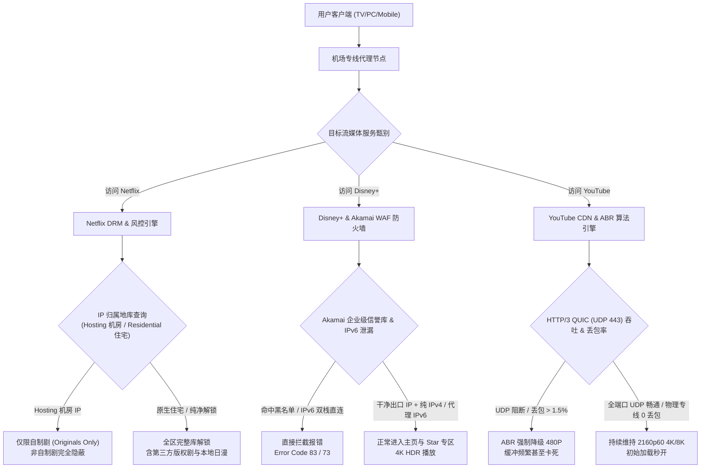
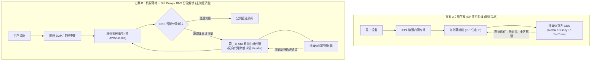
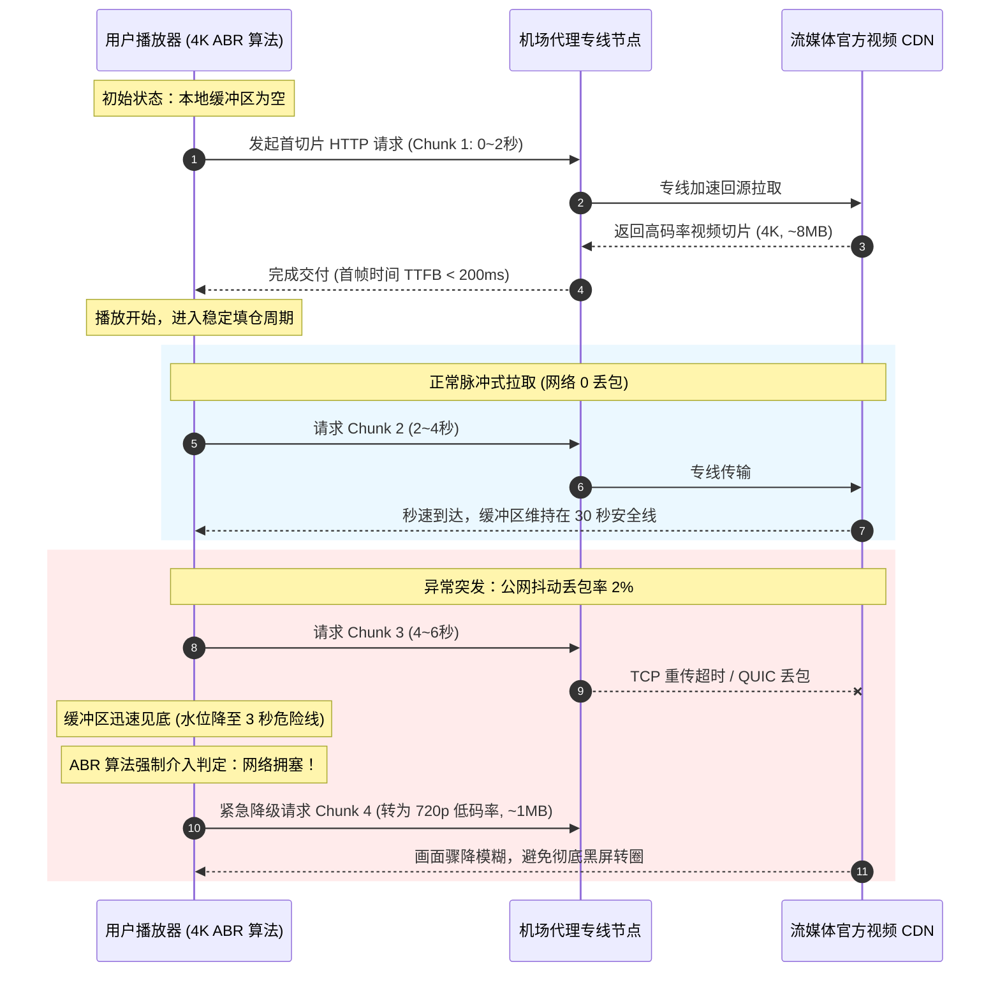
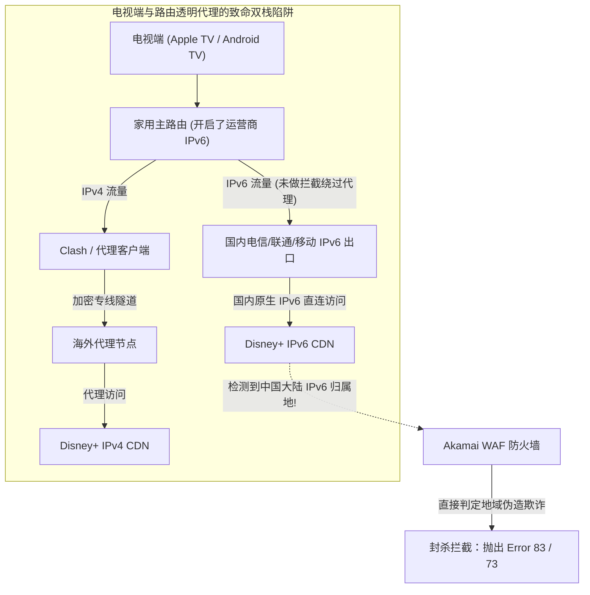
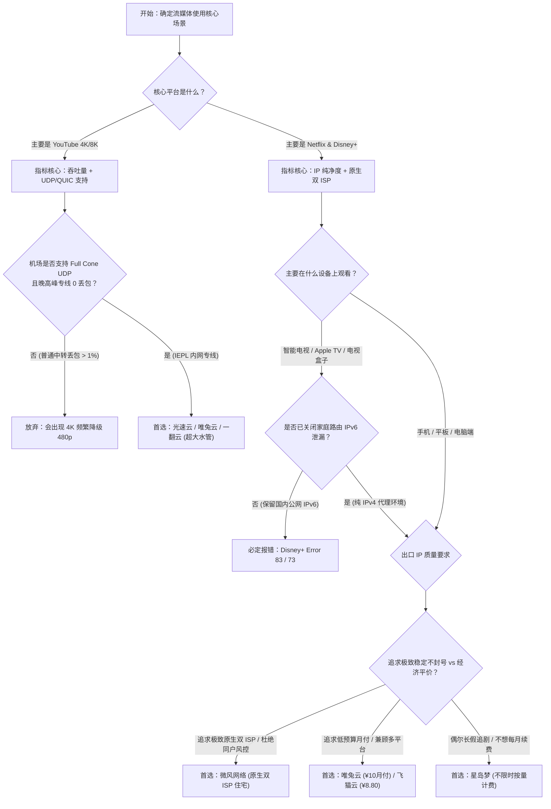

## 一、2026 年三大流媒体核心网络需求与精选服务商速查榜

2026 年，以 **Netflix（网飞）**、**YouTube（油管）** 与 **Disney+（迪士尼+）** 为代表的全球顶级流媒体平台，在内容分发网络（CDN）与数字版权保护（DRM）领域构筑了极其严苛的工程壁垒。越来越多的国内用户订阅了流媒体服务，试图在 Apple TV、Google TV、智能电视、iPad 以及电脑端欣赏 4K HDR、杜比视界（Dolby Vision）和杜比全景声（Dolby Atmos）原生影音，却在网络代理层面遭遇了一系列令人沮丧的拦路虎：
- 登录 Netflix 发现首页空空荡荡，搜索《绝命毒师》或热门日漫毫无踪影，只能看到《怪奇物语》等官方自制剧，这就是典型的“伪解锁”（被识别为机房代理，版权限制非自制剧完全隐蔽）；
- 满怀期待打开 Apple TV 上的 Disney+，屏幕上直接弹窗提示“Error Code 83”或“Error Code 73”，无论怎么重启应用或重新登录，始终无法进入播放页面；
- 在 YouTube 上观看 4K 60fps 甚至 8K 视频时，缓冲圆圈频繁转动，画质在短短数十秒内从清晰的 2160p 骤降为模糊不堪的 480p，甚至在晚高峰出现持续数秒的丢包断流；
- 家庭拼车账号频繁被封或要求重新验证，Netflix 弹窗提示“您的电视未设为此账户的同户装置”，Disney+ 提示登录异常。

产生这些技术阻碍的本质在于：**Netflix、YouTube 与 Disney+ 在网络底层采用了三种完全不同维度的版权封锁策略与传输优化逻辑**。
1. **Netflix 依赖动态 ASN 数据中心黑名单与住宅网络画像**：严密甄别 IP 是来自机房 Hosting 还是原生 Residential，并结合同户装置 Wi-Fi 与 IP 活跃度执行非自制剧隐蔽；
2. **Disney+ 依赖 Akamai 与 Enterprise WAF 的白名单阻断和严苛的 IPv6 泄漏检测**：对机房 IP 采取“一票否决制”，并在移动端与电视端主动发起 IPv6 探测，一旦发现双栈泄漏即刻阻断；
3. **YouTube 深度依赖高吞吐持续带宽、极低抖动与 HTTP/3 (QUIC / UDP 443) 协议栈**：其自适应码率（ABR）算法对链路瞬时丢包极度敏感，劣质公网中转的 TCP 窗口崩溃或 UDP 限速会直接导致播放器画质断崖下跌。

因此，**真正适合 4K 流媒体的优质机场，绝非仅仅看测速软件跑出几百兆峰值带宽，而是必须具备“稳定支持非自制剧全区解锁、原生双 ISP 住宅出口纯净度、全链路支持 Full Cone UDP/QUIC、以及具备毫秒级防抖动内网专线”**。下表汇总了 2026 年经过三大平台实测与持续 4K 压测的代表性专线服务商。

### 2026 年优质流媒体（Netflix / YouTube / Disney+）专线机场横评速查榜

| 机场品牌 | 快速直达 | 线路架构与流媒体核心特色 | 真实起步门槛 | 4K/8K 缓冲实测表现 | Netflix / Disney+ 解锁状态 | 计费倍率 | 专属优惠 | 评测详情 |
| :--- | :--- | :--- | :--- | :--- | :--- | :--- | :--- | :--- | :--- |
| **微风网络** | [👉 立即直达](https://guangs.weifengaff.top/#/?code=VjRz832G) | **原生双 ISP 住宅 IP / 解锁三大平台全区与同户防封** | ¥9.00/月 | **4K 秒开 / 8K 缓冲极稳** | **Netflix 非自制剧 + Disney+ 满血** | 全节点 1.0x 不虚标 | 9折券：`wf888` | [深度评测](/posts/brand-weifeng-review/) |
| **光速云** | [👉 立即直达](https://sahude.gsyvipaff.com/#/?code=keqgvT5Y) | **5年老牌内网专线 / 晚高峰超大冗余带宽抗丢包** | 折后约¥12/月 | **YouTube 4K60fps 零掉帧** | **港/台/日/新/美 全绿解锁** | 全节点 1.0x 真实专线 | 8折码：`AMM` | [深度评测](/posts/guangshuyun-review/) |
| **唯兔云** | [👉 立即直达](https://guangs.weituaff.top/#/?code=w98Q9B5D) | **平价纯月付标杆 / 大水管专线满足多端 4K 并发** | ¥10.00/月 | **电视端双设备 4K 并发不卡** | **日区/台区 Netflix+Disney+** | 全节点 1.0x 真实透明 | 优惠券：`weitu666` | [深度评测](/posts/brand-weitu-review/) |
| **星岛梦** | [👉 立即直达](https://guangs.xingdaomeng.com/#/?code=1TynBYnR) | **不限时按量计费 / 纯物理 IEPL 专线独立解锁池** | ¥12.00/按量 | **晚高峰 0 丢包 / 拖动进度条秒响** | **美/日/新 独立流媒体池** | 按实际消耗 1.0x 扣费 | 9折码：`nmw888` | [深度评测](/posts/brand-xingdaomeng-review/) |
| **一翻云** | [👉 立即直达](https://guangs.yifanaff.top/#/?code=uJ6y) | **大流量月付套餐 / 多线 BGP 优化大吞吐视频通道** | ¥12.00/月 | **长视频持续加载 0 降速** | **全节点流媒体原生/DNS 双优** | 全节点 1.0x 真实计费 | 优惠券：`yifan666` | [深度评测](/posts/brand-yifanyun-review/) |
| **飞猫云** | [👉 立即直达](https://guangs.feimaoyunaff.top/#/?code=Kx2P4q) | **高性价比入门 / 专线优化日常追剧与高码率体验** | ¥8.80/月 | **1080P/4K 平稳流畅播放** | **主流热门地区解锁稳定** | 全节点 1.0x 真实计费 | 优惠券：`feimao` | [深度评测](/posts/brand-feimaoyun-review/) |
| **二猫云** | [👉 立即直达](https://guangs.ermaoyunaff.top/#/?code=mG1e) | **智能多线容灾 / 平价备用防止单平台突发封锁** | ¥11.00/月 | **多出口冗余切换不中断** | **全平台基础解锁保障** | 全节点 1.0x 真实计费 | 优惠券：`ermao888` | [深度评测](/posts/brand-ermaoyun-review/) |

---

## 二、三大流媒体风控与解锁机制技术深度横评

很多用户在使用代理工具时，习惯性地把“流媒体”看作一个单一概念，以为只要一个节点能在浏览器里打开 YouTube，就理所当然地能在 Apple TV 上播放 Netflix 和 Disney+。在实际工程层面，这种认知会导致严重的排障方向偏差。三大平台在商业版权授权、客户群定位以及技术基础架构上的巨大差异，决定了它们的反代理防御逻辑有着本质的不同。



### 1. Netflix（网飞）：动态 ASN 机房库与“温水煮青蛙”式自制剧限制

Netflix 是全球最早与商业代理和数据中心打起“猫鼠游戏”的流媒体先驱。由于好莱坞各大制片厂（华纳、索尼、环球等）对非独家版权的授权是严格按照物理国家/地区细分的，如果 Netflix 允许机房 IP 自由跨区访问，将面临数以亿计的版权违约索赔诉讼。

为此，Netflix 构建了一套极其庞大的动态 ASN（自治系统号）信誉过滤系统。
- **自制剧限制机理**：当检测到用户的出口 IP 属于常见的商业机房（例如 AWS、DigitalOcean、Google Cloud、Vultr、Linode、OVH、Hetzner 等）时，Netflix **并不会直接弹窗报错拒绝访问**，而是巧妙地采取了“降级限制”策略。由于 Netflix 拥有其全资自制剧（Netflix Originals，如《怪奇物语》、《黑镜》、《鱿鱼游戏》）的全球永久发行权，因此系统仅允许机房 IP 观看这类自制内容；而所有按地区买断的第三方授权剧目（例如《绝命毒师》、《生活大爆炸》、吉卜力工作室动画电影）则被系统静默过滤。
- **家庭同户装置检测（Household Enforcement）**：近年来 Netflix 引入了严格的“同户装置”政策，通过在智能电视端比对长期活跃的主家庭 Wi-Fi 网络 BSSID、内网网段以及出口 ISP 归属。如果机场节点出口为多用户共享的机房 IP 且归属地频繁变动，用户的电视端便会高频弹窗要求手机验证码甚至强行锁定账号。

### 2. Disney+（迪士尼+）：Akamai 企业级 WAF 的绝对零容忍与 Error 83/73

相比 Netflix 的柔性降级，Disney+ 的反代理策略则显得极其激进和“冷酷”。Disney+ 的后端基础设施深度依托于 **Akamai Edge Server** 和企业级防爬防火墙。
- **一票否决式阻断（Error Code 83 / 73）**：Disney+ 对 IP 欺诈分值（Fraud Score）的容忍度几乎为零。只要出口 IP 出现在公共代理黑名单、被标记为 IDC 机房或者存在多并发异常行为，Akamai 会直接在 TLS 握手阶段或 API 鉴权阶段抛出 `Error Code 83`（设备/网络不兼容）或 `Error Code 73`（当前区域不可用）。用户连进入主界面浏览海报的机会都没有。
- **严格依赖 IPv6 闭环**：Disney+ 的客户端（尤其是 Apple TV tvOS、Android TV 与 iPadOS）天然偏好 IPv6 路由。如果用户的软路由或客户端配置不当，导致 IPv4 流量走了代理节点，而本地运营商分配的公网 IPv6 流量未经代理直连到了 Disney+ CDN，Disney+ 探测到 IPv4 与 IPv6 来源国家冲突，会立即判定为“地理伪造攻击”并触发拦截。

### 3. YouTube（油管）：自适应码率（ABR）调度算法与 HTTP/3 QUIC 传输

YouTube 在版权层面的封锁主要集中在极少数音乐 MV 和特定影视租赁上，对普通视频的观看几乎没有地域限制。然而，YouTube 却是三大平台中**对网络传输物理指标（吞吐量、丢包率、延迟抖动）要求最严苛的平台**。
- **ABR 自适应码率机制**：YouTube 客户端运行着业内最先进的 ABR 算法（如基于缓冲区和吞吐量的混合决策模型）。播放器会以 2 秒到 5 秒为一个时间片，持续测量每一个视频切片（Chunk）的下载耗时与缓冲区剩余水位。如果一条代理线路虽然宣称有“500M 峰值”，但其网络抖动极大或存在 1%~2% 的持续丢包，播放器会预判网络发生拥塞，为了防止画面中断，会无情地将分辨率从 4K（约 20–45 Mbps 码率）瞬间打回 720p 甚至 480p（约 1–2.5 Mbps 码率）。
- **HTTP/3 (QUIC / UDP 443) 协议深度绑定**：Google 是全球 HTTP/3 的主导者。在默认情况下，现代浏览器和 YouTube App 均优先使用基于 UDP 的 QUIC 协议向 Google CDN 拉取多媒体分片。很多低端机场的中转服务器对 UDP 流量进行 QOS 丢弃或不支持 UDP 转发，导致客户端在握手超时后不得不回退到传统的 TCP TLS，这种“降级惩罚”会带来长达 1.5~3 秒的初始首帧等待时间与不可预测的卡顿。

### 三大主流流媒体平台核心网络指标与解锁要求全景对比

| 对比维度 | Netflix (网飞) | YouTube (油管) | Disney+ (迪士尼+) |
| :--- | :--- | :--- | :--- |
| **核心防御机制** | 动态 Hosting ASN 库 + 住宅画像 | ABR 自适应码率调度 + Google 账号风控 | Akamai Edge 防火墙 + MaxMind 严密拦截 |
| **典型异常现象** | 仅能看官方自制剧，第三方热剧消失 | 4K 降级为 480p/720p，缓冲转圈，首帧慢 | 弹窗报错 Error 83 / Error 73，完全进不去 |
| **对 IP 类型要求** | 极高：必须纯净原生 IP 或高质量 DNS 解锁 | 中等：机房 IP 亦可，但要求 IP 干净防验证码 | 极高：严禁任何知名机房 IP，必须低欺诈分 |
| **4K 码率与带宽门槛** | 持续稳定 15 ~ 25 Mbps | 持续稳定 25 ~ 50 Mbps (8K 需 80~100 Mbps) | 持续稳定 20 ~ 35 Mbps (IMAX Enhanced) |
| **丢包率容忍阈值** | $\le 1.0\%$ (高于 1.5% 会触发分段加载错误) | $\le 0.5\%$ (高于 1.0% ABR 立即主动降清晰度) | $\le 1.0\%$ (高于 2.0% 视频流直接终止报错) |
| **协议栈特殊要求** | 标准 TCP TLS 1.3，CDN 遵循标准 HTTP/2 | 强制要求支持 **Full Cone UDP 443 (QUIC)** | 要求严格禁用 IPv6 泄漏或提供 IPv6 代理 |
| **同户/拼车风控** | 极严苛（检测主家庭网络与电视端硬件特征） | 较宽松（主要风控 Premium 家庭组跨区支付） | 中等偏严（逐步跟进限制异地共享与多端登录）|

---

## 三、流媒体解锁底层原理解密：原生双 ISP 住宅 IP vs DNS 解锁分流

在机场服务商的宣传文案中，用户经常看到“原生 IP 解锁”、“双 ISP 住宅解锁”、“流媒体专线 DNS 解锁”等专业术语。要选对机场，必须从网络底层搞清楚这些技术实现的差异与真实成本。



### 1. 原生双 ISP 住宅 IP（Native Residential Dual-ISP）：终极解决方案

所谓“原生 IP”，是指该 IP 的注册所在地、广播所在地以及 Whois 数据库中的地理标识完全一致，没有任何二次越区广播的历史痕迹。
而在原生 IP 中，最高等级的存在被称为 **双 ISP 住宅 IP**。
- **单 ISP vs 双 ISP**：在 IP 数据库（如 IP2Location、MaxMind、IPinfo）中，每一个 IP 都有两个核心属性：ASN 类别（Type）与使用类型（Usage Type）。大部分机房 IP 被标记为 `Hosting / Data Center`；普通的单 ISP 商业宽带可能被标记为 `Business / Commercial`；而正规家庭宽带或电信运营商直分配的原生住宅 IP，其 ASN 与 Usage Type 会同时被标记为 `ISP / Residential`（即双重 ISP 住宅属性）。
- **技术优势**：在 Netflix、Disney+ 以及 OpenAI 等风控引擎眼中，来自双 ISP 住宅 IP 的连接与一位坐在美国加州或日本东京公寓里的普通家庭居民在光纤宽带下的行为毫无二致。这种 IP 拥有最高的信用评分（Trust Score $\ge 95$）与最低的欺诈概率（Fraud Score $\le 5$），不仅能 100% 稳定解锁三大流媒体平台的非自制剧和全区内容，还能彻底免疫 Netflix 对“同户装置”的频繁绞杀。
- **缺点**：成本极度高昂。正规海外家庭住宅带宽资源极其稀缺且无法大批量自动化部署，因此能够提供正规原生双 ISP 住宅节点的机场（如微风网络）往往属于硬核高阶配置。

### 2. 机房落地 + SNI Proxy / Smart DNS 分流解锁：高性价比的主流机制

由于给机场所有几十台、上百台高带宽节点全部配置原生住宅 IP 在商业上几乎是不可能的，绝大多数中高端机场采用的是**“机房高速落地 + SNI Proxy（DNS 劫持反向代理）分流”**的技术方案。
- **工作机制**：
  1. 用户的视频播放流量首先通过 IEPL 专线到达机场位于海外的廉价机房大带宽落地机（比如 10Gbps 的普通 IDC 节点）；
  2. 机场落地机内部部署了智能 DNS 规则（如 CoreDNS 或 Dnsmasq）。当检测到用户发起的域名请求属于 `*.netflix.com`、`*.nflxvideo.net` 或 `*.disneyplus.com` 时，该 DNS 不会返回流媒体官方的真实 IP，而是返回一台**专门用于流媒体认证的原生小机器（或 WARP 干净出口）的 IP**；
  3. 客户端与这台原生解锁小机器建立 TLS 握手，由这台小机器作为 SNI Proxy 代替用户向 Netflix / Disney+ 进行身份与区域认证；
  4. 一旦区域认证通过，视频播放器在拉取庞大的多媒体视频数据流（Video Chunk 流媒体 CDN）时，系统可能会直接利用大带宽机房线路进行高速回源，或者通过解锁机反代。
- **优缺点分析**：
  - **优势**：极大地降低了运营成本。机场只需要采购少量昂贵的原生住宅 IP 搭建 SNI Proxy 认证池，就能让旗下所有几十台廉价的大带宽机房节点全部“点亮”流媒体解锁；
  - **风险与缺陷**：在热门赛事直播（如超级碗、世界杯）或顶级热剧上线首播时，全机场成千上万用户的流媒体认证并发涌向单一的 SNI 解锁机器，极易导致该小机器 CPU 跑满或反向代理崩溃，表现为“平时能看，一到大片首映就报错跳出”；此外，一旦流媒体平台加强对反代证书或 SNI 握手特征的审查，这类 DNS 解锁节点容易发生大面积雪崩失效。

---

## 四、地区选择指南：港、台、日、新、美五大热门节点全场景解析

流媒体平台在不同国家和地区的版权片库、中文字幕覆盖率以及物理网络延迟存在着显著差异。盲目使用同一个地区节点观看所有流媒体，往往会导致找不到想要的内容或字幕缺失。

```mermaid
quadrantChart
    title 流媒体节点“延迟 vs 片库丰富度”决策四象限
    x-axis 物理往返延迟 (低 RTT) --> 物理往返延迟 (高 RTT)
    y-axis 中文字幕与本土化支持 (低) --> 中文字幕与本土化支持 (极高)
    quadrant-1 美区节点：片库最全、更新最快、高延迟、中文较少
    quadrant-2 台区/港区节点：极低延迟、繁体/中文字幕最全、华语剧丰富
    quadrant-3 欧区/小众节点：片库特殊、延迟高、中文字幕极匮乏
    quadrant-4 日区/新区节点：低延迟、日漫番剧极多、中文字幕适中
    "台湾 (TW)": [0.20, 0.92]
    "香港 (HK)": [0.12, 0.85]
    "日本 (JP)": [0.35, 0.70]
    "新加坡 (SG)": [0.45, 0.78]
    "美国西海岸 (US)": [0.82, 0.40]
```

### 1. 中国台湾（Taiwan）：华语用户体验天花板首选

- **网络与延迟特性**：大陆沿海城市直连或通过 IEPL 专线中转至台湾彰化/台北机房，物理 RTT 时延仅需 **25ms ~ 45ms**，几乎与访问国内内网无异。
- **片库与字幕优势**：
  - **Netflix**：台湾是华语中文字幕（繁体中文、台湾国语配音）覆盖最全面的区域。几乎所有欧美热门剧集、韩剧、日剧均在首发当日配备精校官方中文字幕，且包含了大量唯有台区才买下版权的华语院线大片与热播连续剧；
  - **Disney+**：不仅拥有全套漫威、皮克斯、星球大战的完整库，其 **Star 专区** 还收录了极具特色的台湾本土影剧与大量精选日漫，中文字幕 100% 标配；
  - **YouTube**：中文内容生态繁荣，几乎没有任何审查与限制，是体验超清华语视频的最佳出口。

### 2. 中国香港（Hong Kong）：延迟最低但存在特定平台禁区

- **网络与延迟特性**：华南地区（深圳/广州）通过专线过港延迟低至 **5ms ~ 15ms**，华东华北亦可控制在 **30ms ~ 40ms**，是全国物理延迟最低的出口。
- **适用与禁忌场景**：
  - **优势**：YouTube 体验极佳，4K/8K 视频首帧秒开；Netflix 香港区中文字幕（繁简均有）非常完备，港产老电影与港剧资源独树一帜；
  - **致命硬伤**：由于地缘合规与版权政策，**香港节点无法访问 Google Gemini 与 Claude 等主流 AI 工具**；且部分流媒体平台（如 Spotify、Tidal 等）的特定合规限制较为频繁。如果不做细致的分流规则，全局走香港节点会导致 AI 办公与日常追剧发生冲突。

### 3. 日本（Japan）：动漫狂热者与高质量音画天堂

- **网络与延迟特性**：华东地区（上海/青岛）通过海底光缆（如 SJC、APCN-2、FASTER）到东京/大阪，物理 RTT 仅需 **30ms ~ 45ms**。
- **核心特色**：
  - **动画番剧绝对独占**：日本是全球动漫产业中心。Netflix 日本区拥有全球最庞大的新番首播与历史经典动画库，许多在日本以外被视为付费点播（VOD）的内容在日区均可直接免费串流；
  - **Disney+ 日本独家**：包含大量本土制作的经典特摄剧集与日本知名 IP；
  - **注意事项**：日区很多本土独占剧集与动画**仅提供日文字幕或日文生肉**，不自带中文字幕。对于看不懂日文的用户，需要配合流媒体双语字幕浏览器插件（如 Dualsub / Netflix Multi-sub）辅助观看。

### 4. 新加坡（Singapore）：东南亚综合文化枢纽与无死角免合规

- **网络与延迟特性**：大陆经香港或广州专线南下至新加坡，时延在 **45ms ~ 65ms** 之间，专线链路极其稳健。
- **核心特色**：
  - 东南亚核心数据中心枢纽，国际出口带宽极度充裕；
  - Netflix 与 Disney+ 涵盖了大量东南亚、南亚以及欧美同步上映的大片，官方中文字幕比例超过 85%；
  - 节点通用性极高，不仅能完美解锁流媒体，还能无缝兼顾 OpenAI、Claude 以及各类海外金融支付工具。

### 5. 美国（United States）：片库总容量第一但需承受物理高延迟

- **网络与延迟特性**：大陆跨越太平洋到美西（洛杉矶/圣何塞）的物理光纤理论下限时延在 **120ms ~ 145ms** 左右。
- **核心特色**：
  - **片库体量最庞大**：作为好莱坞大本营，美区拥有全球最完整的影视库。很多流媒体平台在美区还集成了 Hulu 专属内容通道，美剧、脱口秀、真人秀更新速度全球第一；
  - **中文字幕相对匮乏**：由于主要面向北美英语受众，大量非全球发行的剧目**仅提供英文字幕（CC）**；
  - **适用人群**：适合英语听力过硬、喜欢追冷门美剧、或需要观看美区专属流媒体（如 Peacock、Paramount+、Max、Hulu）的硬核影视发烧友。

---

## 五、性能指标硬门槛：4K/8K 码率、ABR 自适应缓冲与丢包率的物理影响

很多用户误以为看视频只需要“测速跑得快”就行，但实际上，视频播放的流量特征与测速软件完全不同。测速软件是通过建立几十条并发 TCP 线程强行吃满带宽，而流媒体播放器为了节省服务器与用户流量，采用的是**“脉冲式切片拉取（Pulsed Chunk Streaming）”**。



### 1. 真实 4K/8K 视频持续码率与瞬时峰值需求

在流媒体编码体系中，主要采用 H.264 (AVC)、H.265 (HEVC)、VP9 以及新一代 AV1 编码技术。不同的分辨率和 HDR 规格对网络带宽有着刚性的物理要求：
- **Netflix 4K HDR / 杜比视界**：平均视频码率通常在 **15 Mbps 到 25 Mbps** 之间。然而，在电影动作场面或粒子爆发时，瞬时比特率会瞬间飙升至 **40 Mbps 以上**。如果机场带宽被多人挤占导致瞬时吞吐受阻，播放器就会触发微卡顿；
- **Disney+ IMAX Enhanced 4K**：平均码率在 **25 Mbps 到 35 Mbps** 左右，音频采用高达 768 kbps 的杜比全景声 E-AC-3 JOC 封装，对持续稳定吞吐的要求比 Netflix 更高；
- **YouTube 4K 60fps (AV1 / VP9)**：平均码率约 **25 Mbps 到 50 Mbps**；如果是 **YouTube 8K 60fps**，平均码率高达 **80 Mbps 到 120 Mbps**，瞬时请求峰值经常突破 **200 Mbps**。

### 2. 为什么 1% 的丢包率会彻底摧毁 4K 播放体验？

流媒体播放器并不是实时把整部电影一次性下完，而是拉取一个切片后休眠几百毫秒，等本地播放缓冲区低于设定阈值（例如低于 20 秒）时再拉取下一个切片。
- **TCP 窗口崩溃机制**：普通的公网中转线路在晚高峰骨干网拥堵时，经常出现 1% 到 3% 的微小丢包。在多线程测速中，这几十条线程可以互相弥补丢包损失；但在单连接视频拉取时，一旦一个 TCP 报文丢失，发送端就会触发拥塞避免算法（Congestion Avoidance），将拥塞窗口（CWND）直接腰斩减半，导致数据传输速率瞬间暴跌 50% 以上；
- **ABR 降级雪崩**：当播放器发现拉取切片的时间超过了切片本身的播放时长，本地缓冲区的水位便会雪崩式下降。播放器的自适应码率算法（ABR）在数秒内便会做出保守决策：**立即抛弃 4K Profile，强制向 CDN 申请 720p 或 480p 的低画质流**！这就是很多用户明明办理了千兆光纤，但在晚上看 YouTube 4K 却总是自动变成“大果粒”画质的底层物理根源。
- **专线价值**：IEPL / IPLC 内网物理专线采用二层内网微波或陆地光缆直接互联，不经过公网国际出入口审查与拥堵节点，丢包率始终压制在 **0% ~ 0.05%** 之间，能从根本上杜绝 ABR 算法误判，确保 4K 画面始终如丝般顺滑。

---

## 六、DNS 泄漏与 IPv6 双栈陷阱：客户端被精准识破的致命细节

在各大技术论坛中，很多使用 Apple TV、Google TV、索尼/三星电视或 iPad 的用户经常反馈一个令人抓狂的现象：“电脑和手机上的 Clash 显示节点能完美解锁 Disney+，但只要在电视 App 上一打开就弹窗 Error 83，或者 Netflix 依然只能看自制剧”。

这种“跨设备解锁表现分裂”的现象，99% 是由于 **DNS 泄漏** 或 **IPv6 流量未受控直连** 导致的。



### 1. 致命的 IPv6 旁路泄漏（IPv6 Bypass Leak）

中国大陆三大运营商近年来全面普及了 IPv6，家用光猫和主路由器默认开启 IPv6 地址分配（SLAAC 或 DHCPv6）。
- **TV 端系统的网络偏好**：Apple TV (tvOS) 和 Google TV (Android 11+) 的操作系统内核，默认将 IPv6 的访问优先级（Happy Eyeballs 算法，RFC 8305）置于 IPv4 之前；
- **泄漏过程**：当电视 App 发起对 `disneyplus.com` 的请求时，电视端向路由器发起 AAAA（IPv6）记录查询，获得了 Disney+ 的全球 IPv6 目标地址。如果用户的软路由（如 OpenWrt、iStoreOS）或代理软件只接管了 IPv4 流量，而没有开启针对 IPv6 的透明重定向与代理，**电视端就会直接通过运营商分配给你的真实中国大陆 IPv6 地址直连 Disney+ 官方 CDN**！
- **后果**：Disney+ 的安全引擎同时收到了来自海外节点的 IPv4 请求与来自中国大陆家庭宽带的 IPv6 连接。双栈 IP 地域发生剧烈撕裂，系统立刻判定该连接属于恶意翻墙代理行为，立即全站切断，抛出经典的 `Error 83` 报错。

### 2. 本地运营商 DNS 污染与 CDN 调度错乱

Netflix 和 Disney+ 的内容分发网络采用基于 EDNS Client Subnet (ECS) 的就近调度机制。
- 如果代理软件在进行域名解析时，不小心使用了客户端本地的公共 DNS（如电信/联通本地 DNS，或者国内的 `223.5.5.5`、`119.29.29.29`），这些 DNS 不仅会被 GFW 实施 DNS 投毒，还会向流媒体服务器返回错误的国内路由或失效 IP；
- **解决方案**：在客户端中必须强制启用 **Fake-IP 模式** 或由海外代理节点远端解析 DNS（Remote DNS Resolve），彻底阻断客户端在本地发起针对流媒体域名的真实 DNS 查询，将所有 DNS 解析与路由判决完全收归海外落地节点控制。

---

## 七、实战部署：Mihomo (Clash Verge Rev) 流媒体全自动智能分流配置

为了彻底解决 Netflix、YouTube 与 Disney+ 在分流、解锁、DNS 泄漏以及地区分配上的冲突，我们必须在客户端配置一套兼具**“高可用容灾、精细化域名/IP 分流、Fake-IP 防泄漏、以及独立策略组”**的生产级配置文件。

以下是专为 **Clash Verge Rev / Mihomo 内核** 深度调优的流媒体专属 YAML 配置模板。配置不仅实现了三大流媒体平台的完全隔离与专属策略调度，还内置了防 IPv6 泄漏开关与高可用 Fallback 容灾。

```yaml
# ==============================================================================
# 2026 年生产级流媒体专属精细化分流配置 (适配 Mihomo / Clash Verge Rev)
# 特性：三大流媒体独立策略组、Fake-IP 纯净防泄漏、屏蔽 IPv6 穿透、QUIC 智能放行
# ==============================================================================

port: 7890
socks-port: 7891
mixed-port: 7892
allow-lan: true
mode: rule
log-level: info
ipv6: false # 强烈建议全局关闭客户端 IPv6，从根源杜绝 Disney+ Error 83/73 泄漏

# DNS 深度防泄漏与 Fake-IP 调优配置
dns:
  enable: true
  listen: 0.0.0.0:1053
  ipv6: false
  enhanced-mode: fake-ip
  fake-ip-range: 198.18.0.1/16
  fake-ip-filter:
    - "*.lan"
    - "localhost.ptlogin2.qq.com"
  nameserver:
    - 223.5.5.5
    - 119.29.29.29
  fallback:
    - https://1.1.1.1/dns-query
    - https://8.8.8.8/dns-query
  fallback-filter:
    geoip: true
    geoip-code: CN
    ipcidr:
      - 240.0.0.0/4

# 策略组定义：将不同流媒体调度至最适宜的地区与节点池
proxy-groups:
  # 总出口选择
  - name: "🚀 节点选择"
    type: select
    proxies:
      - "🎬 流媒体自动容灾"
      - "🇹🇼 台湾专线 (首选)"
      - "🇸🇬 新加坡专线"
      - "🇯🇵 日本专线"
      - "🇺🇸 美国专线"
      - "🇭🇰 香港专线"

  # Netflix 专属策略：优先调度至中文字幕最全、原生双 ISP 的台区/新区
  - name: "🎥 Netflix"
    type: select
    proxies:
      - "🇹🇼 台湾专线 (首选)"
      - "🇸🇬 新加坡专线"
      - "🇯🇵 日本专线"
      - "🇺🇸 美国专线"
      - "🚀 节点选择"

  # Disney+ 专属策略：优先调度至对 Akamai WAF 零风控的双 ISP 纯净节点
  - name: "🏰 DisneyPlus"
    type: select
    proxies:
      - "🇹🇼 台湾专线 (首选)"
      - "🇸🇬 新加坡专线"
      - "🇺🇸 美国专线"
      - "🇯🇵 日本专线"
      - "🚀 节点选择"

  # YouTube 专属策略：优先调度至超低延迟、千兆大水管的香港或台湾节点
  - name: "📹 YouTube"
    type: select
    proxies:
      - "🇭🇰 香港专线"
      - "🇹🇼 台湾专线 (首选)"
      - "🇯🇵 日本专线"
      - "🇸🇬 新加坡专线"
      - "🚀 节点选择"

  # 流媒体高可用自动容灾（主备降级）
  - name: "🎬 流媒体自动容灾"
    type: fallback
    url: "https://www.netflix.com/title/80018499" # 以 Netflix 真实剧集切片做心跳探测
    interval: 300
    proxies:
      - "🇹🇼 台湾专线 (首选)"
      - "🇸🇬 新加坡专线"
      - "🇯🇵 日本专线"

  # 区域实体分组（示例，实际使用替换为订阅导入的真实代理）
  - name: "🇹🇼 台湾专线 (首选)"
    type: select
    proxies:
      - "TW-Dedicated-01"
      - "TW-Residential-02"

  - name: "🇭🇰 香港专线"
    type: select
    proxies:
      - "HK-IEPL-01"
      - "HK-IEPL-02"

  - name: "🇯🇵 日本专线"
    type: select
    proxies:
      - "JP-Dedicated-01"
      - "JP-Dedicated-02"

  - name: "🇸🇬 新加坡专线"
    type: select
    proxies:
      - "SG-Dedicated-01"
      - "SG-Dedicated-02"

  - name: "🇺🇸 美国专线"
    type: select
    proxies:
      - "US-Dedicated-01"
      - "US-Residential-02"

# 远程规则集引用与本地强制规则
rule-providers:
  netflix:
    type: http
    behavior: classical
    url: "https://raw.githubusercontent.com/blackmatrix7/ios_rule_script/master/rule/Clash/Netflix/Netflix.yaml"
    path: ./ruleset/netflix.yaml
    interval: 86400

  disney:
    type: http
    behavior: classical
    url: "https://raw.githubusercontent.com/blackmatrix7/ios_rule_script/master/rule/Clash/Disney/Disney.yaml"
    path: ./ruleset/disney.yaml
    interval: 86400

  youtube:
    type: http
    behavior: classical
    url: "https://raw.githubusercontent.com/blackmatrix7/ios_rule_script/master/rule/Clash/YouTube/YouTube.yaml"
    path: ./ruleset/youtube.yaml
    interval: 86400

rules:
  # 1. 核心流媒体专属路由映射
  - RULE-SET,netflix,🎥 Netflix
  - RULE-SET,disney,🏰 DisneyPlus
  - RULE-SET,youtube,📹 YouTube

  # 2. 补充关键流媒体关联域名（快速命中）
  - DOMAIN-SUFFIX,netflix.com,🎥 Netflix
  - DOMAIN-SUFFIX,netflix.net,🎥 Netflix
  - DOMAIN-SUFFIX,nflximg.net,🎥 Netflix
  - DOMAIN-SUFFIX,nflxvideo.net,🎥 Netflix
  - DOMAIN-SUFFIX,nflxext.com,🎥 Netflix
  - DOMAIN-SUFFIX,disneyplus.com,🏰 DisneyPlus
  - DOMAIN-SUFFIX,disney-portal.my.onetrust.com,🏰 DisneyPlus
  - DOMAIN-SUFFIX,bamgrid.com,🏰 DisneyPlus
  - DOMAIN-SUFFIX,youtube.com,📹 YouTube
  - DOMAIN-SUFFIX,googlevideo.com,📹 YouTube
  - DOMAIN-SUFFIX,ytimg.com,📹 YouTube

  # 3. 常见漏网与国际出海流量
  - GEOIP,CN,DIRECT
  - MATCH,🚀 节点选择
```

---

## 八、自动化测试与诊断：跨平台流媒体解锁与网络体检脚本实战

不要依赖肉眼在浏览器里反复刷新网页来判断解锁，因为浏览器可能缓存了过去的 Cookie、错误的重定向或过期的 DNS 记录。通过标准命令行工具直接向各平台的鉴权端点发起原始 HTTP 请求，是唯一能够精准量化解锁状态与定位网络故障的专业手段。

### 1. 基于 Bash / cURL 的流媒体解锁与 ABR 吞吐探测脚本

本脚本适用于 macOS Terminal、Linux 服务器以及软路由终端，通过指定的 HTTP 代理端口，全面测试当前节点对 Netflix 非自制剧、Disney+ 鉴权接口以及 YouTube CDN 吞吐的表现。

```bash
#!/usr/bin/env bash
# ==============================================================================
# 流媒体全方位解锁与链路健康度自检脚本 (macOS / Linux / Router)
# ==============================================================================

# 定义代理端口 (按需修改为你的本地客户端端口)
PROXY_ADDR="http://127.0.0.1:7890"

echo "========================================================"
echo "    2026 年三大流媒体 (Netflix/YouTube/Disney+) 深度体检"
echo "========================================================"

# 1. 探测出口 IP 与地理位置
echo -n "[1/4] 正在查询当前代理出口 IP 与归属地... "
IP_INFO=$(curl -s --max-time 8 -x "$PROXY_ADDR" "https://ipinfo.io/json")
CURRENT_IP=$(echo "$IP_INFO" | grep -o '"ip": "[^"]*' | cut -d'"' -f4)
CURRENT_COUNTRY=$(echo "$IP_INFO" | grep -o '"country": "[^"]*' | cut -d'"' -f4)
CURRENT_ORG=$(echo "$IP_INFO" | grep -o '"org": "[^"]*' | cut -d'"' -f4)

if [ -z "$CURRENT_IP" ]; then
    echo "❌ 代理连接失败，请检查客户端端口是否为 7890！"
    exit 1
fi
echo "成功!"
echo "     出口 IP: $CURRENT_IP | 地区: $CURRENT_COUNTRY | ASN: $CURRENT_ORG"

# 2. 深度测试 Netflix 非自制剧解锁 (以经典第三方版权剧《绝命毒师》80025724 为探针)
echo -n "[2/4] 正在检测 Netflix 解锁等级... "
# 80025724 属于非自制第三方版权内容；80018499 属于自制剧
NF_CODE=$(curl -s -o /dev/null -w "%{http_code}" --max-time 10 -x "$PROXY_ADDR" "https://www.netflix.com/title/80025724")

if [ "$NF_CODE" = "200" ]; then
    echo "🎉 [完美解锁] 支持全区完整库 (含非自制第三方剧目)！"
elif [ "$NF_CODE" = "404" ] || [ "$NF_CODE" = "403" ]; then
    # 进一步确认自制剧是否可用
    NF_ORIGINAL=$(curl -s -o /dev/null -w "%{http_code}" --max-time 10 -x "$PROXY_ADDR" "https://www.netflix.com/title/80018499")
    if [ "$NF_ORIGINAL" = "200" ]; then
        echo "⚠️ [仅限自制剧] 被识别为机房代理！无法观看《绝命毒师》等第三方内容。"
    else
        echo "❌ [完全阻断] 无法打开 Netflix 或当前地区不受支持。"
    fi
else
    echo "❓ [异常响应] HTTP 状态码: $NF_CODE"
fi

# 3. 深度测试 Disney+ 登录与地域合规
echo -n "[3/4] 正在检测 Disney+ 接口放行状态... "
DISNEY_RES=$(curl -s -I --max-time 10 -x "$PROXY_ADDR" "https://www.disneyplus.com" | head -n 1)
if echo "$DISNEY_RES" | grep -q -E "200|301|302"; then
    # 深度检查是否命中地域拒绝页面
    DISNEY_BODY=$(curl -s -L --max-time 10 -x "$PROXY_ADDR" "https://www.disneyplus.com")
    if echo "$DISNEY_BODY" | grep -qi -E "not available in your region|error code 73|error code 83"; then
        echo "❌ [阻断拦截] 命中 Disney+ 地区限制或被 Akamai WAF 拦截 (Error 73/83)！"
    else
        echo "🎉 [完美放行] 允许访问并展示内容主页，无 Error 83 拦截！"
    fi
else
    echo "❌ [连接超时/拒绝] 状态: $DISNEY_RES"
fi

# 4. 深度测试 YouTube CDN 连通性与单流吞吐延迟
echo -n "[4/4] 正在测量 YouTube GoogleVideo 真实 RTT 与握手时延... "
YT_TIME=$(curl -s -o /dev/null -w "DNS: %{time_namelookup}s | TCP: %{time_connect}s | 首字节: %{time_starttransfer}s" --max-time 10 -x "$PROXY_ADDR" "https://www.youtube.com")
echo "完成!"
echo "     时延数据: $YT_TIME"
echo "========================================================"
```

### 2. 基于 Windows PowerShell 的原生网络探测命令

针对 Windows 10/11 用户，直接打开 PowerShell 执行以下命令，无需配置复杂环境即可快速排查流媒体与本地 DNS 状况：

```powershell
# ==============================================================================
# Windows PowerShell 流媒体连接与本地代理诊断命令
# ==============================================================================

$Proxy = "http://127.0.0.1:7890"

Write-Host ">>> [1] 测试通过本地代理访问 Netflix《绝命毒师》切片..." -ForegroundColor Cyan
try {
    $NF_Request = Invoke-WebRequest -Uri "https://www.netflix.com/title/80025724" -Proxy $Proxy -TimeoutSec 10 -UseBasicParsing
    if ($NF_Request.StatusCode -eq 200) {
        Write-Host "    [PASS] Netflix 状态正常，全区非自制剧已解锁！" -ForegroundColor Green
    }
} catch {
    Write-Host "    [FAIL] Netflix 访问异常或被降级为仅自制剧，状态码: $($_.Exception.Response.StatusCode)" -ForegroundColor Red
}

Write-Host "`n>>> [2] 测试 Disney+ 主服务网络可达性与 HTTP 响应..." -ForegroundColor Cyan
try {
    $DP_Request = Invoke-WebRequest -Uri "https://www.disneyplus.com" -Proxy $Proxy -TimeoutSec 10 -UseBasicParsing -MaximumRedirection 3
    Write-Host "    [PASS] Disney+ 响应成功，返回代码: $($DP_Request.StatusCode)" -ForegroundColor Green
} catch {
    Write-Host "    [FAIL] Disney+ 拦截，可能触发 Error 83/73。异常详情: $($_.Message)" -ForegroundColor Red
}

Write-Host "`n>>> [3] 检查本地系统是否存在 IPv6 默认网关与适配器..." -ForegroundColor Cyan
$IPv6Adapters = Get-NetIPAddress -AddressFamily IPv6 | Where-Object { $_.IPAddress -notlike "fe80*" -and $_.IPAddress -ne "::1" }
if ($IPv6Adapters) {
    Write-Host "    [WARN] 检测到本地存在公网 IPv6 地址！建议在流媒体观看设备上停用 IPv6 以免发生泄露。" -ForegroundColor Yellow
    $IPv6Adapters | Select-Object InterfaceAlias, IPAddress | Format-Table -AutoSize
} else {
    Write-Host "    [SAFE] 未发现活跃的公网 IPv6，无泄漏风险。" -ForegroundColor Green
}
```

---

## 九、生产环境真实故障复盘（RCA）：三大典型流媒体翻车实战案例

### 案例一：Netflix 只能看自制剧（原生 IP 降级与 SNI Proxy 证书失效 RCA）

#### 1. 问题现象
用户张先生使用 Apple TV 4K 连接客厅三星电视观看 Netflix，此前一直正常。某天晚上打开应用后，发现首页推荐全是《怪奇物语》、《三体》等 Netflix 自制内容，在搜索框搜索《绝命毒师（Breaking Bad）》与《火影忍者》时显示“找不到相关结果”，但在 iPhone 上断开 Wi-Fi 用蜂窝网络（香港卡）却能搜到。

#### 2. 环境信息
- **设备**：Apple TV 4K (第 3 代，tvOS 17.4)；
- **网络**：中国电信 1000M 家庭宽带，旁路由运行 Clash Meta 内核；
- **节点**：某宣称“全节点解锁 Netflix”的廉价月付机场，连接其“香港 01 专线”。

#### 3. 初步判断
- 怀疑一：Netflix 账号被风控，被锁定为特定受限用户；
- 怀疑二：Apple TV 端应用发生缓存混乱；
- 怀疑三：机场节点的落地 IP 被 Netflix 识别为机房 Hosting，失去了全区解锁能力。

#### 4. 排查路径与关键证据
- **第一步（账号排查）**：在电脑浏览器使用香港原生双 ISP 节点登录同一账号，能立刻搜出《绝命毒师》并正常播放，排除账号本身异常；
- **第二步（链路探针）**：在终端通过该“香港 01”节点执行 curl 命令请求 Netflix 探针：
  ```bash
  curl -s -o /dev/null -w "%{http_code}" -x http://127.0.0.1:7890 "https://www.netflix.com/title/80025724"
  ```
  返回 `404` 状态码！但请求自制剧 `https://www.netflix.com/title/80018499` 却返回 `200`；
- **第三步（核心抓包证据）**：抓取旁路由对 `nflxvideo.net` 的解析流量，发现该机场采用了 SNI Proxy 解锁方案。而该 SNI 反代服务器的 SSL 证书在当天下午 16:00 已过期，导致落地机在握手失败后自动 Fallback 回退到了本地的公网机房 IP（Hosting ASN 属于 Choopa/Vultr）。Netflix 识别到 Vultr 机房 IP 后，立即启动了针对非自制剧的隐蔽策略。

#### 5. 执行步骤与修复
- 立即将 Clash 路由规则中的 Netflix 策略组从“香港 01”手动切换为提供**原生双 ISP 住宅节点的微风网络或光速云台湾专线**；
- 在 Apple TV 设置中强制退出 Netflix 应用，并进入「系统 -> 重新启动」刷新电视端网络栈。

#### 6. 结果验证与复盘
重启后重新打开 Netflix，《绝命毒师》与热门日漫瞬间恢复在首页推荐位，点击播放 4K 杜比视界秒开。
**根本原因（RCA）**：许多机场所谓的“全解锁”并不是全节点配备原生住宅 IP，而是通过内网 SNI 反向代理作弊。一旦中间解锁服务器证书过期或 IP 进黑名单，流量就会裸奔暴露底层的机房 IP，引发温水煮青蛙式的“仅限自制剧”降级。

---

### 案例二：Apple TV Disney+ 报 Error 83 / 73（路由器透明代理 IPv6 泄漏导致双栈分流穿帮 RCA）

#### 1. 问题现象
用户李女士新购置了 Apple TV 准备观看 Disney+ 的最新漫威 4K 电影。在电脑 Windows 客户端上可以流畅登录 Disney+ 网页端并播放视频，但在客厅 Apple TV 上打开 Disney+ App 时，屏幕却始终弹窗提示：“Something went wrong. Please try again. If the problem persists, visit the Disney+ Help Center (Error Code 83)”。

#### 2. 环境信息
- **设备**：Apple TV 4K，连接家庭华硕 Wi-Fi 6 路由器；
- **网络**：中国联通 500M 宽带，路由器开启了 IPv6 原生双栈（SLAAC 自动分配）；
- **代理架构**：主路由通过 PassWall / SSRplus 插件开启全局透明代理，代理节点选用美国专线。

#### 3. 初步判断
- 怀疑一：Disney+ 账号在 TV 端达到了最大设备登录上限；
- 怀疑二：美国专线节点的出口 IP 被 Akamai 拉黑；
- 怀疑三：电视端发生了 IPv6 泄漏，导致中国大陆真实 IP 被 Disney+ 捕获。

#### 4. 排查路径与关键证据
- **第一步（PC 端对比验证）**：在 PC 浏览器访问 `https://www.disneyplus.com`，一切正常。查看 PC 网络状态，发现 PC 在网卡属性中手动取消勾选了“Internet 协议版本 6 (TCP/IPv6)”；
- **第二步（Apple TV 端网络抓包）**：在华硕路由器后台查看 Apple TV 分配的 IP 地址，发现其不仅分配到了 `192.168.50.120` 的私网 IPv4，还分配到了一个以 `2408:8207:...` 开头的中国联通公网 IPv6 全球单播地址；
- **第三步（关键证据确凿）**：在路由器 SSH 终端抓取 Apple TV 访问 `bamgrid.com`（Disney+ 核心鉴权网关）的连接，发现电视端优先发起了 AAAA 记录查询，并且通过 IPv6 直连了联通骨干网出口，直接绕过了只运行在 IPv4 上的透明代理插件！Akamai 检测到请求来自中国联通原生 IPv6 地址，由于中国大陆不属于 Disney+ 服务范围，立即下发指令拒绝服务并返回 Error 83。

#### 5. 执行步骤与修复
- 方案落地：进入华硕路由器管理后台，进入「高级设置 -> IPv6」，将 IPv6 连接类型直接修改为**「关闭（Disabled）」**，或者在代理插件中勾选“拦截所有 IPv6 流量（Drop IPv6）”；
- 断开 Apple TV 的以太网线重新插拔，确保 Apple TV 网络设置中只显示 IPv4 地址；
- 重启 Disney+ 客户端。

#### 6. 结果验证与复盘
Apple TV 再次启动 Disney+，加载动画转圈两秒后成功进入用户头像选择界面，进入影片主页后直接显示 4K Ultra HD 与 Dolby Atmos 标识，Error 83 彻底消失。
**根本原因（RCA）**：Disney+ 在 tvOS 端强制启用了现代双栈网络竞速算法。在主路由未接管 IPv6 流量的情况下，本地公网 IPv6 会直接穿透透明代理裸奔到官方服务器，触发 Akamai 防火墙的反作弊地域封锁。

---

### 案例三：YouTube 4K 严重画质降级频繁缓冲（机场不支持 Full Cone UDP 导致 QUIC 降级雪崩 RCA）

#### 1. 问题现象
用户王先生为家庭影院购置了支持 8K 解码的高端 Mini-LED 电视，在电视端 SmartTube / YouTube 官方应用中播放“4K 60fps HDR 试机片”。然而播放过程中，视频不仅需要缓冲转圈 5~8 秒才出首帧，而且播放不到一分钟画质就从 2160p 暴跌到 480p。打开“详细统计信息（Stats for nerds）”，发现连接速度（Connection Speed）在 2000 Kbps 到 50000 Kbps 之间剧烈抖动，缓冲区健康度（Buffer Health）频繁触底为 0 秒。

#### 2. 环境信息
- **设备**：索尼 4K 电视（搭载 Google TV 系统）；
- **网络**：中国移动 1000M 宽带；
- **节点**：某宣称“不限速公网中转”的百元大流量机场，节点为“香港 02（高倍率中转）”。

#### 3. 初步判断
- 怀疑一：移动宽带晚高峰国际互联带宽严重拥塞；
- 怀疑二：电视机 CPU 解码性能不足发生掉帧；
- 怀疑三：机场中转链路丢包严重，且 UDP 443 协议遭到恶性限制或丢弃。

#### 4. 排查路径与关键证据
- **第一步（排除硬件性能）**：通过电视播放本地 U 盘里的 4K 120fps 原盘视频，硬件解码极其流畅，掉帧计数（Dropped Frames）为 0，排除电视解码算力瓶颈；
- **第二步（UDP 与 NAT 穿透探针）**：在局域网内运行 NatTypeTester 与 UDP 丢包探测工具，针对该机场节点执行持续 1000 个 UDP 报文发包测试：
  - TCP 延迟：~48ms，看似平稳；
  - **UDP 丢包率：高达 42.8%！且 NAT 类型被判定为 Symmetric（对称型 NAT），完全不支持 Full Cone**；
- **第三步（关键证据还原）**：YouTube 客户端默认通过 HTTP/3 (QUIC / UDP 443) 向 Google CDN 申请音视频分片。由于该中转机场的宿主机对 UDP 流量配置了单流限速与激进的丢包 QoS，客户端遭遇高达 40% 以上的 UDP 丢包，无法维持 QUIC 拥塞窗口。尽管播放器会在超时后尝试降级为 TCP TLS 1.3，但在降级期间缓冲区已彻底耗尽，ABR 调度算法误以为整个物理网络陷入绝境，直接将档位强行降至最低的 480p。

#### 5. 执行步骤与修复
- 将 YouTube 的分流策略切换至原生支持 **Full Cone NAT 与零丢包 IEPL 内网专线** 的光速云或唯兔云专线节点；
- 在客户端配置中确保代理协议配置了 `udp: true`，开启 TUN 模式的混合栈（`stack: mixed`）。

#### 6. 结果验证与复盘
再次打开同一部 4K 60fps HDR 视频，首帧时间缩短至 400ms 以内秒开。“详细统计信息”显示 Connection Speed 稳定在 120,000 Kbps（120 Mbps）以上，Buffer Health 始终充盈在 45 秒以上安全区，连续播放两小时未发生哪怕一次画质降级或转圈卡顿。
**根本原因（RCA）**：YouTube 的超高清传输建立在 HTTP/3 QUIC 协议之上。低成本公网中转往往为节省服务器负载而粗暴扼杀 UDP 流量，导致播放器在协议降级与拥塞重传的恶性循环中发生画质雪崩。

---

## 十、流媒体选型决策树与高可用规划

### 流媒体机场选型与故障自检决策体系



---

## 十一、流媒体常见问题深度解答（FAQ）

### Q1：为什么我的机场看 YouTube 能跑十几万 Kbps，但打开 Netflix 却只能看自制剧？
这正是典型的“带宽充裕但 IP 遭到标记”。YouTube 对 IP 的风控相对宽松，只要网络通道的物理带宽大、延迟低，就能跑出极高的测速与缓冲数据。但 Netflix 在版权风控上极其严格，它通过实时查询全球数据中心 ASN 库对机房 IP 进行了全面过滤。如果你的机场节点使用的是廉价的数据中心机房 IP（如 AWS、Vultr、DigitalOcean 等），且没有搭建昂贵的原生住宅 SNI 解锁中继，Netflix 会在保留自制剧播放权限的同时，将所有高价值的第三方版权剧目（非自制剧）全部隐藏。解决此问题的唯一办法是切换到具备原生双 ISP 住宅 IP 或专门部署了全区解锁池的高阶专线节点。

### Q2：看 4K 流媒体每个月到底需要消耗多少流量？60GB 或 100GB 套餐够用吗？
这取决于具体的编码格式与平台码率。以正常 4K HDR 观影标准测算：
- **Netflix 4K HDR**：平均每小时消耗约 **7GB 到 11GB** 流量；
- **Disney+ IMAX Enhanced 4K**：平均每小时消耗约 **9GB 到 13GB** 流量；
- **YouTube 4K 60fps**：平均每小时消耗约 **12GB 到 18GB** 流量。
如果购买的是 60GB 的小流量套餐，仅够完整观看 2~3 部 4K 电影或半季美剧。因此，对于经常在客厅电视端欣赏超清流媒体的用户，强烈建议选择 **200GB 以上的月付大流量套餐**（如一翻云或微风网络），或者搭配一个**不限时按量专线**（如星岛梦，按真实 GB 扣费、用多少扣多少）作为主力备用，避免因月底流量耗尽而陷入断网窘境。

### Q3：在 Apple TV 上看 Disney+ 频繁出现 Error Code 83，该怎么彻底解决？
Error Code 83 是 Disney+ 针对网络或设备不兼容下达的最高级别阻断指令。在 2026 年的实际排障中，90% 以上的原因是由于**家庭网络发生了公网 IPv6 泄漏**。国内运营商分配的公网 IPv6 流量绕过了普通的代理插件，使 Disney+ 服务器同时接收到了中国大陆 IPv6 与海外代理 IPv4 的双重连接。彻底根治的步骤为：
1. 登录家庭主路由器管理后台，将「IPv6」功能直接彻底关闭（Disabled）；
2. 如果使用软路由透明代理（如 OpenWrt），在 PassWall 或 OpenClash 设置中勾选“过滤/丢弃所有 AAAA 记录”与“停用 IPv6 流量分发”；
3. 将 Disney+ 策略组绑定到纯净度高的原生住宅专线（如微风网络或台湾专线）；
4. 重启 Apple TV 即可彻底消除 Error 83。

### Q4：很多机场声称支持“全解锁”，但为什么隔三差五就会失效？
商业流媒体平台与机场服务商之间存在着永无休止的“攻防对抗”。流媒体安全团队会根据单一 IP 上的并发连接数、账号登录离散度以及反作弊探针，周期性地对疑似代理的出口 IP 进行大规模封杀。中低端机场为了压缩成本，通常只采购极少量的原生 IP 搭建 SNI Proxy 反向代理，成千上万名用户共用同一批解锁出口，极易被平台识别并批量拉黑。只有具备充沛技术储备、拥有多套冗余解锁池、以及真正接入了海外合规原生住宅 ISP 资源的头部专线服务商，才能在 IP 遭到封杀的第一时间实现秒级无感轮换。

### Q5：为什么看流媒体强烈建议首选“台湾专线”或“新加坡专线”？
第一是**中文字幕覆盖率**：台湾是 Netflix 与 Disney+ 华语精校中文字幕（繁体中文、台湾国语配音）上线最全、速度最快的区域；新加坡则是东南亚双语中心，中英双语字幕覆盖率极高。第二是**网络物理延迟极佳**：大陆沿海城市连接台湾专线的物理 RTT 时延仅需 25ms~45ms，连接新加坡专线仅需 45ms~65ms，大幅领先跨越太平洋的美西节点（130ms~160ms），不仅能实现视频秒开，进度条任意拖拽几乎没有任何迟滞感。

### Q6：YouTube 播放超清视频时总是自动从 4K 降级到 480p，真的是因为带宽不够吗？
通常不是带宽问题，而是**网络抖动、高丢包率以及 UDP 限制**引发的 ABR 算法误判。YouTube 客户端依托自适应码率算法实时监测缓冲水位。如果机场使用的是低成本的公网中转线路，晚高峰骨干网发生 1% 以上的丢包，就会引发 TCP 拥塞窗口减半或导致 HTTP/3 QUIC 协议数据包重传超时。播放器检测到缓冲区水位急剧下降，为了防止画面彻底停滞，会主动触发自我保护机制，将分辨率强制降级至 480p。更换为支持 Full Cone UDP、晚高峰 0 丢包的纯物理内网专线（如光速云或唯兔云），即可彻底消灭画质降级现象。

### Q7：电视端安装 SmartTube 或使用原生 YouTube App，在网络配置上有区别吗？
底层网络要求基本一致，但在协议容错与解码调优上有细微差别。SmartTube（面向 Android TV 开源的第三方播放器）允许用户在播放设置中手动选择视频格式与解码器（如强制指定 AVC、VP9 或 AV1），并且支持在设置中**手动关闭 HTTP/3 (QUIC) 强制走 TCP**。当你的机场节点对 UDP 转发支持不佳时，在 SmartTube 中关闭 QUIC 往往能显著缓解卡顿；而原生 YouTube 官方 App 则严格依赖系统网络栈，必须确保机场节点和本地代理具备完整的 UDP 443 转发能力。

### Q8：流媒体机场需要专门配置 Fake-IP 模式吗？Redir-Host 模式有什么隐患？
强烈建议使用 **Fake-IP 模式**。在传统的 Redir-Host 模式下，流媒体 App 在发起视频连接前，必须先通过本地 DNS 解析出真实目标 IP，这不仅会导致国内运营商的 DNS 投毒与 DNS 泄漏，还会使基于地域调度的流媒体 CDN（如 Netflix 的 `nflxvideo.net`）分配到错误的远端节点。而在 Fake-IP 模式下，客户端发起的所有域名请求都会立即返回一个内部保留的虚拟 Fake IP（如 `198.18.0.x`），真正的 DNS 解析完全延迟到海外落地节点在远端完成，从而在物理上彻底消除了 DNS 泄漏并实现了最佳的 CDN 就近接入。

---

## 十二、总结与 2026 年流媒体畅享行动指南

在 2026 年搭建一套流畅、省心、全平台制霸的超高清流媒体观影系统，其核心本质在于**摆脱“只看带宽跑分”的片面认知，建立起“IP 纯净度、全链路低丢包专线、严格防 IPv6 泄漏、以及精准分流策略”四位一体的系统工程**。

为了确保长期的观影体验稳定，建议用户遵循以下黄金行动准则：
1. **网络架构首选内网专线**：彻底放弃廉价、高丢包的公网中转与直连线路，优先选择具备物理二层专线的服务商（如**光速云**、**微风网络**），确保晚高峰 4K 持续压测丢包率严格小于 0.1%，让 YouTube ABR 算法与 Netflix 码率始终锁定在最高规格；
2. **大屏观影死守防泄漏底线**：在客厅 Apple TV、Google TV 与智能电视观影环境中，**必须严格关闭路由器端的 IPv6 穿透**，并在客户端中无条件启用 Fake-IP 增强模式，从物理根源斩断导致 Disney+ Error 83 与 Netflix 区域误判的双栈漏洞；
3. **策略组实行精准分工**：切忌使用全局节点一刀切。在客户端中建立独立的流媒体策略分流组——将 **Netflix 与 Disney+ 锚定在原生双 ISP 的台湾或新加坡专线**（华语字幕最全、风控最低），将 **YouTube 调度至超低时延的香港或台湾专线**（极速秒开、大水管吞吐）；
4. **科学配置主备容灾组合**：任何单一节点都存在因平台突发风控而短暂维护的可能。建议采取“**高品质月付大带宽主力（如微风网络或唯兔云）+ 不限时按量备用专线（如星岛梦）**”的组合拳策略，当主流媒体出现突发解锁波动时，通过客户端 Fallback 策略组在秒级内自动无缝降级切换，真正实现全天候 4K/8K 杜比视界影音自由。
