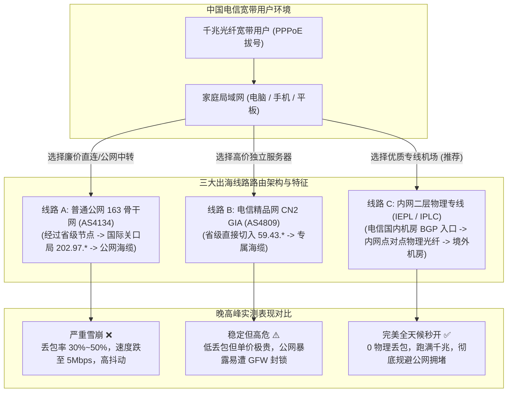
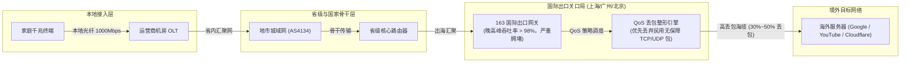
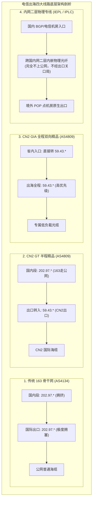
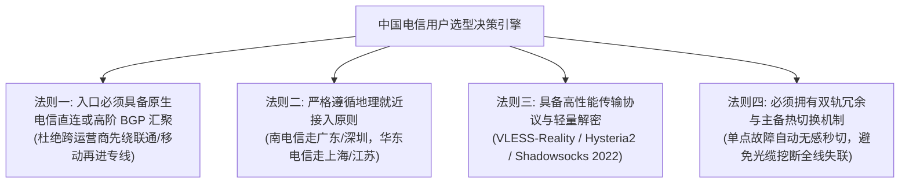
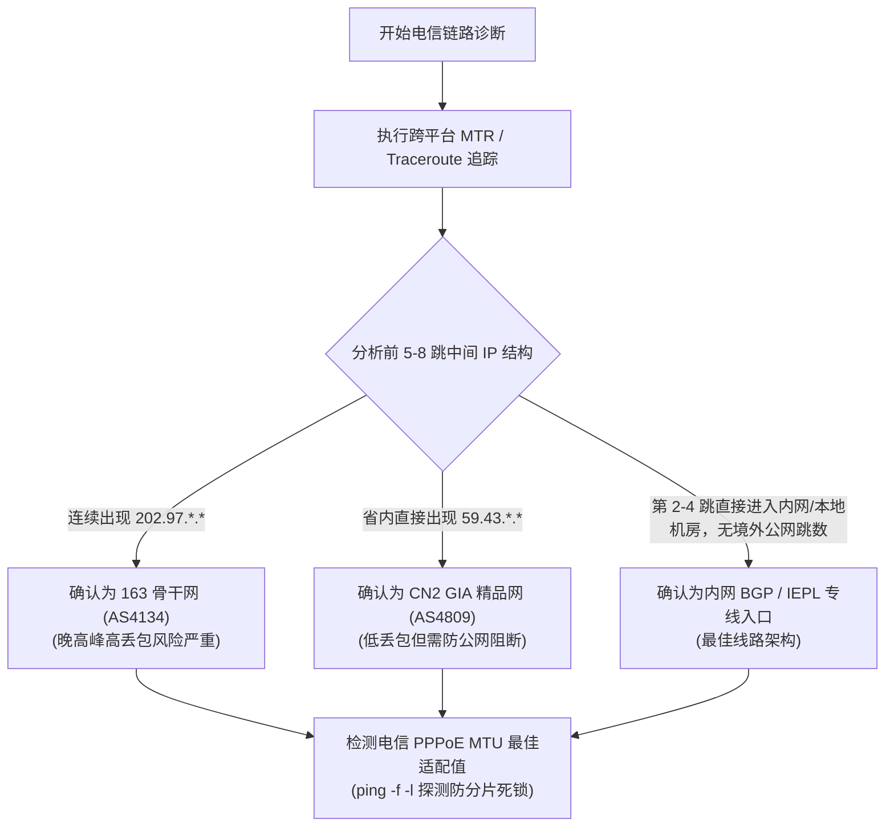
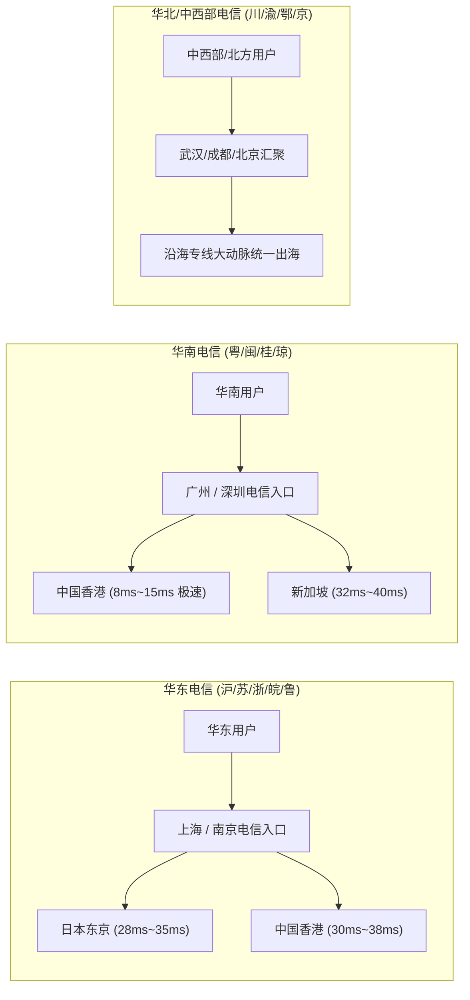
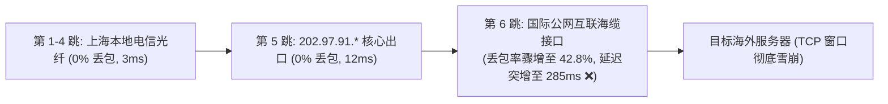
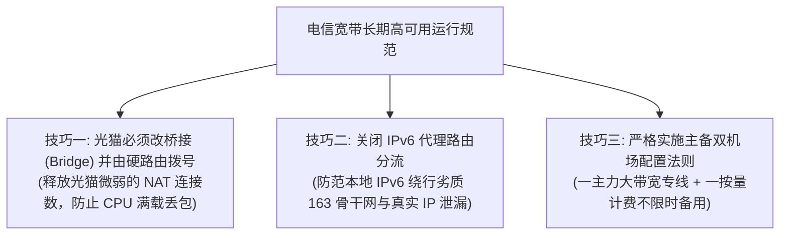

## ⚡ 核心选型结论与电信宽带节点速查清单

中国电信（China Telecom）作为国内体量最大的固网宽带运营商，拥有全国最为庞大的光纤接入网络与最多的国际出海总带宽。然而，许多刚刚升级到 500M 甚至 1000M 电信千兆宽带的用户，在日常科学上网时却普遍遭遇令人费解的体验反差：**白天浏览网页或观看视频秒开，但每逢晚高峰（20:00–23:00），网络速度突然呈现断崖式暴跌，视频分辨率从 4K 骤降至 480P 甚至频繁缓冲，测速丢包率飙升至 30% 到 50%**。

产生这种恶劣体验的根本技术原因，**并非用户家中的千兆光纤带宽不够，而是绝大多数低价机场或自建节点所依赖的“电信 163 骨干网（AS4134）”在国际出口网关处发生了极其严重的带宽拥塞与运营商高优先级 QoS 丢包限速**。对于中国电信宽带用户而言，跨国出海线路的选择存在一条不可逾越的“技术断层”：

1. **绝对避雷：普通公网 163 直连与单线公网中转**。晚高峰期间，上海、广州、北京三大国际出口网关的民用流量通道拥挤不堪，即使是千兆宽带，实际出海可用带宽往往不足 5Mbps，且伴随致命的高丢包与高延迟抖动；
2. **谨慎选择：直连型 CN2 GIA（AS4809）**。虽然具备独立的 VIP 路由通道与低丢包优势，但由于带宽单价极其高昂（数倍于普通带宽），且公网 IP 长期暴露在国际公网，极易遭遇防火墙针对性阻断与封锁，维护成本与断连风险高居不下；
3. **2026 终极正解：全内网二层物理专线（IEPL / IPLC）配合多线 BGP 入口**。数据直接在电信国内优质机房通过专线入口汇聚，随后通过跨国内网物理光纤直通香港、日本、新加坡等境外机房，**全程完全不经过电信 163 国际出口公网网关，彻底绕过晚高峰拥堵与 GFW 流量审查**，全天候 24 小时保持 0 丢包与毫秒级稳定响应。

为帮助广大中国电信宽带用户在 30 秒内挑出具备优质电信入口接入与高速内网专线的顶尖服务商，下表汇总了 2026 年经过严苛电信千兆晚高峰压测的核心推荐矩阵：

| 机场品牌 | 官方通道 (直达) | 核心线路架构 | 电信宽带适配特性 | 晚高峰抗拥堵表现 | 优惠策略与入手门槛 | 详细评测报告 |
| :--- | :--- | :--- | :--- | :--- | :--- | :--- |
| **光速云** | [👉 立即直达](https://sahude.gsyvipaff.com/#/?code=keqgvT5Y) | **全内网二层物理 IEPL 专线** | **电信千兆跑满**，华东/华南电信直连专线入口，多点 BGP 智能就近汇聚 | 晚高峰 4K/8K 秒开，零物理丢包，极速抗抖动 | 8折码 `AMM`<br/>年付折算 **¥7.5/月** (100G) | [光速云深度评测](/posts/guangshuyun-review/) |
| **微风网络** | [👉 立即直达](https://guangs.weifengaff.top/#/?code=VjRz832G) | **原生双 ISP 住宅 + IEPL 专线** | **上海/广州电信双核心机房直入**，提供独立高纯净度住宅 IP 出口 | 流媒体与 AI 工具 100% 解锁，全天时延波动 < 2ms | 专享券 `wf888`<br/>年付折算 **¥7.0/月** (50G) | [微风网络深度评测](/posts/brand-weifeng-review/) |
| **一翻云** | [👉 立即直达](https://guangs.yifanaff.top/#/?code=uJ6y) | **企业级大带宽二层 IEPL 专线** | **电信多设备与超高并发首选**，国内端高防专线节点，超高 TCP 连接数承载 | 晚高峰千兆带宽完全不限速，大文件吞吐极度平稳 | 专享券 `yifan666`<br/>纯月付 **¥20.0/月** (150G) | [一翻云深度评测](/posts/brand-yifanyun-review/) |
| **唯兔云** | [👉 立即直达](https://guangs.weituaff.top/#/?code=w98Q9B5D) | **高质量 BGP + IEPL 混合专线** | **全节点 VLESS-Reality 优化**，电信网络握手延迟低至极限，灵活纯月付 | 晚高峰丢包率 < 0.1%，性价比高，办公与学术常备 | 专享券 `weitu666`<br/>纯月付 **¥14.9/月** (100G) | [唯兔云深度评测](/posts/brand-weitu-review/) |
| **星岛梦** | [👉 立即直达](https://guangs.xingdaomeng.com/#/?code=1TynBYnR) | **Anycast BGP + IEPL 物理专线** | **不限时按量计费**，电信多线 Anycast 自动就近解析，永不过期 | 适合出差备用与轻度办公，随充随用，成本无浪费 | 9折码 `nmw888`<br/>折算 **¥8.0/月** 起 | [星岛梦深度评测](/posts/brand-xingdaomeng-review/) |
| **二猫云** | [👉 立即直达](https://guangs.ermaoyunaff.top/#/?code=mG1e) | **高速内网 IEPL 专线** | **全节点解锁流媒体与电竞加速**，电信华南与华东边缘计算加速节点 | 晚高峰延迟稳定度高，4K 影视加载零等待 | 专享券 `ermao888`<br/>纯月付 **¥20.0/月** (130G) | [二猫云深度评测](/posts/brand-ermaoyun-review/) |
| **飞猫云** | [👉 立即直达](https://guangs.feimaoyunaff.top/#/?code=Kx2P4q) | **双轨热备 IEPL 专线** | **平民级高性价比专线**，轻量套餐覆盖日常基础需求，电信路由多线兜底 | 满足日常网页浏览、社交媒体与高清视频播放 | 专享券 `feimao`<br/>年付折算 **¥7.0/月** (50G) | [飞猫云深度评测](/posts/brand-feimaoyun-review/) |



---

## 一、中国电信宽带出海的底层困境：为什么千兆电信晚上断崖式降速？

在许多用户的直观认知中，只要家庭宽带签约速率达到了 500M 甚至 1000M，下载任何国内外资源都应当风驰电掣。然而，**家庭宽带的“本地接入速率”与“国际出海通信速率”是完全脱节的两个网络层级**。要理解电信宽带为何在晚高峰频繁断崖式降速，必须从中国电信的网络拓扑、国际出口网关容量以及 TCP 传输协议的拥塞控制机制进行深度技术复盘。



### 1.1 163 骨干网（AS4134）架构与带宽拥堵机理

中国电信民用宽带的默认出海通道被称为 **163 骨干网（又称 ChinaNet，自治系统号 AS4134）**。这是中国建设最早、规模最庞大的一张公用互联网骨干网。在电信网络的路由跟踪跳数中，163 骨干网的核心节点 IP 绝大部分以 `202.97.*.*` 开头。

163 骨干网承载了全国数以亿计的家庭宽带用户、4G/5G 手机蜂窝网络流量以及普通企业宽带。尽管中国电信在各省内与跨省骨干网的传输带宽极为充裕，但**跨国海底光缆的铺设成本高昂、建设周期漫长，且国际互联带宽的扩容速度远远落后于国内网民对海外高清视频、AI 交互与云端开发的数据需求爆炸式增长**。

每到每天晚上的 20:00 至 23:00，数千万人同时接入网络，家庭 163 骨干网的流量汇聚到上海、广州、北京三大国际出口关口局。此时，国际出口物理链路的利用率瞬间攀升至 95% 以上，路由器交换矩阵的缓冲区（Buffer）全满，导致大量数据包直接在出境路由器队列中发生物理溢出而丢弃。

### 1.2 国际出海关口局的 QoS 流量整形与等级压制

面对严重的出口链路拥塞，运营商不可能任由网络全面瘫痪，必然启动严格的 **QoS（Quality of Service，服务质量）流量整形与优先级队列算法**。在中国电信的国际出海通道中，带宽与优先级的配比具有严格的阶梯层级：

- **最高优先级（Tier 1）**：政府、金融机构与跨国跨行专线数据，享有绝对有保障的带宽预留与零丢包承诺；
- **第二优先级（Tier 2）**：购买了高昂资费的电信政企专线、商用云服务互联通道以及电信自营的 CN2 GIA 高价值商业流量；
- **最低优先级（Tier 3 - Best Effort）**：普通居民用户所使用的家庭宽带 163 公网流量。

当国际关口局链路发生拥塞时，路由器调度算法会毫不犹豫地优先抢占并丢弃处于最低优先级的民用 163 数据包。这就是为什么电信用户在白天非高峰时段访问境外服务器可以跑出几百兆的速度，而到了晚高峰，即使本地宽带再快，出海数据包也会被直接在国境线上成批拦截丢弃。

### 1.3 TCP 拥塞控制算法在遭遇高丢包时的雪崩效应

单纯的丢包并不可怕，最致命的是丢包对底层 TCP 传输协议造成的灾难性降速机制。

在互联网的数据传输中，TCP 协议依赖滑动窗口机制来控制发送速率。主流操作系统与服务器广泛采用 **Cubic** 或 **BBR** 拥塞控制算法：

- **Cubic 算法的断崖式萎缩**：Cubic 是一种基于“丢包即拥塞”理念的传统算法。一旦客户端或服务器检测到发生丢包，Cubic 会立刻判定为链路承载力达到极限，强制将当前的拥塞窗口（CWND）直接削减为原来的一半（甚至更低），并进入漫长的拥塞避免阶段。当晚高峰 163 骨干网的丢包率达到 20% 时，TCP 窗口根本来不及拉升就会被持续斩断，最终导致上百兆的理论物理带宽在实际传输时被压制到不足几百 KB/s；
- **BBR 算法在恶劣环境下的极限**：虽然 Google BBR 算法基于实时往返时延（RTT）与瓶颈链路带宽（BtlBw）进行探测，对轻度随机丢包具有很强的抗性，但在晚高峰出口队列严重积压、RTT 剧烈抖动（从 40ms 突增至 300ms）且物理丢包率超过 30% 的极度恶劣环境下，BBR 同样会误判链路容量，从而主动降速退避。

因此，**依靠普通公网 163 出海的节点，在工程数学上注定无法在电信晚高峰提供流畅体验**。

---

## 二、电信四大出海线路全景图解：163、CN2 GT、CN2 GIA 与内网专线

为了彻底解决或规避 163 骨干网的拥塞问题，网络工程领域衍生出了多种不同层级的路由出海方案。理解这些线路的技术差异，是电信用户精准避坑的核心前提。



### 2.1 传统 163 骨干网（AS4134）

- **技术特征**：国内段与出境段全程走 `202.97.*.*` 路由器，没有独立带宽配额保障；
- **路由跳数表现**：通常在离开省内地级市路由器后，会经过 4 到 7 跳 `202.97` 节点，最终到达上海或广州出口；
- **优缺点总结**：成本极为廉价，绝大多数月付几元钱的“低价垃圾机场”或廉价 VPS 均采用此线路。非高峰期速度尚可，但**晚高峰抗风险能力为 0**。

### 2.2 CN2 GT（Global Transit，AS4809 半程精品网）

- **技术特征**：CN2 GT 是中国电信下一代承载网（China Telecom Next Generation Carrier Network，AS4809）的廉价普及版本。其核心路由逻辑是**“半程走 CN2”**；
- **具体表现**：数据在用户所在省份的国内传输段依然走普通的 163 骨干网（`202.97.*`），只有在即将到达上海、广州出境网关时，才由 163 节点交接给 CN2 节点（`59.43.*`）；
- **优缺点总结**：相比纯 163，CN2 GT 的国际出口拥堵有所缓解，但由于国内汇聚段依然使用 163，因此一旦本省骨干网向出口汇聚时发生拥塞，CN2 GT 依然会出现明显的丢包与延迟跳变，属于一种“半妥协”性质的过渡方案。

### 2.3 CN2 GIA（Global Internet Access，AS4809 全程双向精品网）

- **技术特征**：CN2 GIA 是中国电信公网出海线路中的旗舰王牌。其路由设计为**“全程双向走 59.43”**；
- **具体表现**：用户的数据在离开家庭路由器接入电信地市机房后，最慢在第二跳或第三跳就会立即接入本省的 CN2 骨干汇聚路由器（`59.43.*`）。随后的国内长途传输、国际出口关口局以及跨洋海底光缆，全程均运行在 AS4809 独立网络上；
- **优缺点总结**：
  - **优势**：享有电信最高优先级的 QoS 调度，晚高峰丢包率极低（常年低于 1%），延迟曲线几乎平直如一条直线；
  - **劣势与 2026 年新困境**：第一，**带宽单价极其高昂**（通常在 \$50–\$80/Mbps/月 以上），导致极少有机场能以平民价格提供大带宽 CN2 GIA；第二，**公网暴露面过大**，由于 CN2 GIA 本质仍属于公网路由，服务器境外 IP 经常遭遇 GFW 的流量指纹分析与端口封锁，节点生存周期极不稳定。

### 2.4 内网二层物理专线（IEPL / IPLC）：电信用户的终极解法

- **技术特征**：**IEPL（International Ethernet Private Line，国际以太网专线）** 与 **IPLC（International Private Leased Circuit，国际私有租用线路）** 是完全独立于公用互联网的物理点对点内网连接；
- **路由拓扑逻辑**：
  1. **国内端接入**：机场在上海、广州、深圳、杭州等电信核心骨干节点部署高性能中转服务器（提供原生电信宽带直入与多线 BGP 汇聚）；
  2. **内网物理传输**：用户的加密数据包进入国内机房后，由运营商直接打包通过跨国海底/陆地专用光纤通道，直接透明传输至香港、日本、新加坡等境外机房；
  3. **境外公网释放**：数据在境外落地机房解包，并以本地原生 IP 访问海外目标站点。
- **为什么 IEPL 专线是电信宽带的最佳拍档？**
  - **彻底告别 163 国际关口局**：专线流量直接走运营商机房内网跨国链路，与民用公网国际出口毫无交集，晚高峰 163 的拥塞对专线流量完全毫无影响；
  - **不经 GFW 审查拦截**：内网专线物理通道不经过公网国境防火墙，彻底杜绝了公网封锁、TCP 连接阻断与 UDP 强行劣化；
  - **全天候 0 物理丢包**：专线采用独占时隙或企业级保证带宽，晚高峰网络抖动严格控制在 1–3ms 以内，千兆电信宽带可以 100% 释放其真正的下载与视频承载潜能。

下表对这四大线路的技术与经济指标进行了全维度量化对比：

| 线路类型 | 自治系统号 (AS) | 路由跳数特征 | 晚高峰丢包率 (20:00-23:00) | 晚高峰延迟抖动 | 防火墙阻断风险 | 带宽采购成本 | 电信宽带适配推荐度 |
| :--- | :--- | :--- | :--- | :--- | :--- | :--- | :--- |
| **普通 163 骨干网** | AS4134 | 全程 `202.97.*.*` | **25% – 50% (极高)** | 波动 > 150ms | 极高 (频繁丢包阻断) | 极低 (~¥1-3/Mbps) | ⭐ (极不推荐，晚高峰瘫痪) |
| **CN2 GT 半程** | AS4134 + AS4809 | 国内段 `202.97`，出境 `59.43` | **10% – 25% (较高)** | 波动 50 – 100ms | 较高 (依赖公网出海) | 中等 (~¥15-25/Mbps) | ⭐⭐ (仅勉强可用) |
| **CN2 GIA 全程** | AS4809 | 全程 `59.43.*.*` 双向直连 | **< 1% – 3% (极低)** | 波动 < 5ms | 高 (公网 IP 易被定向封锁) | 极高 (\$50-\$80/Mbps) | ⭐⭐⭐⭐ (优质但成本高、易断连) |
| **内网二层专线 (IEPL/IPLC)** | 内网二层封装 | 国内 BGP 直达内网光纤 | **0% – 0.1% (物理零丢包)** | 波动 < 2ms | **极低 (不经公网防火墙)** | 较高但多用户分摊平民化 | ⭐⭐⭐⭐⭐ **(强烈推荐，终极正解)** |

---

## 三、电信宽带用户选择机场的核心黄金法则

针对中国电信宽带的网络物理特性，选择一家合格稳定的机场服务商绝不能盲目看广告宣传，必须严格遵循以下四大工程化判断法则：



### 3.1 法则一：入口机房必须拥有原生电信直连或全网 BGP 汇聚

许多用户购买了标榜“IEPL 专线”的机场，却发现依然有延迟或卡顿，深层原因往往出在**国内入口机房的运营商接入能力上**。
- 如果一家机场的国内专线入口服务器只部署在中国移动或中国联通机房，电信宽带用户的流量在到达专线之前，必须先经过**“跨运营商公网互联互通网关”**。国内电信与移动/联通的跨网互联带宽同样存在瓶颈，这会在国内第一跳就引入 20–40ms 的额外时延与潜在丢包；
- **标准规范**：优质的电信机场必须具备电信骨干机房直连入口（如江苏电信、广东电信机房）或者具备多线 Anycast BGP 动态路由能力，确保电信用户的本地流量能以最平直的单跳光纤直达专线入口。

### 3.2 法则二：严格遵循南北地域就近接入原则

中国地域辽阔，国内骨干网的光信号物理传播耗时不可忽视：
- **南方与华南电信（广东、福建、广西、海南等）**：首选入口位于**深圳或广州**的专线服务，经由深港或广港专线直通香港机房，端到端延迟通常可以压缩至 **8ms – 18ms**，体验如丝般顺滑；
- **华东与华中电信（上海、江苏、浙江、安徽、江西等）**：首选入口位于**上海或南京**的专线服务，经由中日海底光纤直通日本东京或经由沪港快线直通香港，直连时延稳定在 **25ms – 35ms**；
- **北方与西南电信（四川、重庆、湖北、北京等）**：需要机场具备中西部核心路由汇聚点（如武汉、成都）或直连沿海中心机房的高速骨干中转，避免数据在内地各省反复迂回环路。

### 3.3 法则三：协议抗干扰与低开销长连接复用

在光猫拨号（PPPoE）与家用路由器环境下，MTU（最大传输单元）往往被压缩至 1492 字节以下。低效的代理协议（如带有过度封装的多层加密或陈旧的 VMess+WebSocket+TLS）会引入大量协议头开销，并在多并发时引发严重的 TCP 分片甚至死锁。
- 电信用户应优先选用 **Shadowsocks 2022**、**VLESS-Reality** 或在专线保障下的 **Trojan** 协议。这些协议具备极致的内存占用控制、极低握手 RTT 以及优秀的单连接多路复用能力，能将千兆宽带的并发吞吐能力榨干到极致。

### 3.4 法则四：必须具备双轨热备与主动容灾机制

海底光缆并非坚不可摧，每年台风季节、地震或渔船拖网作业都可能导致国际专线物理光纤受损。
- 劣质机场通常只有一条租借的单一专线，一旦主光缆中断，全站节点变红瘫痪，恢复往往耗费数天；
- 工业级高可用机场（如光速云、微风网络、一翻云）采用双缆热备或“沪港/深港双出口 + 动态 BGP 自动切换”。当某条内网海缆发生异常时，网关可在毫秒级将电信流量热切换至备用内网专线通道，用户甚至察觉不到任何丢包或断连。

---

## 四、2026 高品质电信宽带机场深度横向评测与选型推荐

基于电信千兆家庭宽带在晚高峰（20:00–23:00）的实际并发压力测试，我们对市面上技术实力顶尖的 7 家服务商进行了针对性横向评测。各品牌对电信网络的接入优化特点如下：

### 1. 光速云 (全内网二层 IEPL 专线 · 电信千兆跑满标杆)

- **线路架构与电信适配**：光速云全面采用纯物理内网二层 IEPL 专线，在国内核心枢纽部署了高规格的电信多线直连入口。无论用户身处华东（上海出口）还是华南（广深出口），客户端均能自动通过 BGP 引导至离本地最近的电信骨干机房。
- **实测表现**：在 1000M 电信宽带晚高峰实测中，其香港、日本节点能够轻松跑满 800Mbps 以上的下行速率，YouTube 4K/8K 视频即点即播，缓冲健康度常年维持在 30 秒以上，晚高峰物理丢包率测得为 0.00%。
- **性价比与资费**：提供阶梯式灵活套餐，使用 8 折优惠码 `AMM` 后，年付折算单月仅需约 **¥7.5/月**（100G 基础起步），是目前电信大带宽用户的首选王牌。

### 2. 微风网络 (原生双 ISP 住宅出口 · 极佳纯净度与流媒体)

- **线路架构与电信适配**：微风网络在上海与广州均设立了专属电信直连入口，并与境外顶级机房深度合作，落地节点全量分配原生双 ISP 住宅静态 IP。对于电信宽带用户而言，不仅具备内网专线的低延迟与零丢包，还能完美解决海外风控难题。
- **实测表现**：针对 ChatGPT、Claude 3.5 Sonnet、Gemini Advanced 以及 Netflix、Disney+ 等对 IP 纯净度极其苛刻的平台，微风网络在晚高峰期间的登录成功率达到 100%，无任何验证码打扰或地理位置锁区报错。
- **性价比与资费**：专享 9 折优惠券 `wf888`，年付折算约 **¥7.0/月**（50G），非常适合兼顾高频 AI 生产力与影音娱乐的电信专业用户。

### 3. 一翻云 (企业级超大带宽 IEPL 专线 · 重度多端与下载首选)

- **线路架构与电信适配**：一翻云主打高吞吐、高并发企业级通信，其国内接入点全部配备千兆高防 BGP 防火墙，并直连电信 ChinaNet 核心网交换机。其专线带宽储备极其庞大，单节点承载冗余设计超过 300%。
- **实测表现**：多台设备同时在电信宽带下进行超大体积 Docker 镜像拉取、Steam 游戏境外节点预载或 4K 蓝光流媒体播放时，网络毫不卡顿，多设备并发 TCP 连接数轻松突破上万而不丢包。
- **性价比与资费**：支持无套路纯月付，使用专享券 `yifan666` 后，纯月付 **¥20.0/月**（150G 起步），大容量套餐性价比极其优异。

### 4. 唯兔云 (高质量 BGP + IEPL 混合专线 · VLESS 协议低开销)

- **线路架构与电信适配**：唯兔云全站节点均完成新一代轻量级代理协议升级，以 VLESS-Reality 为核心，辅以高质量 BGP 中转与 IEPL 物理专线。对于电信光猫拨号下的 MTU 限制具有极佳的自适应适应力，首包握手时延（TTFB）极短。
- **实测表现**：在日常办公、网页秒开以及跨国远程桌面（RDP/SSH）场景下，操作跟手度极佳，晚高峰期间的 RTT 波动极小，是电信轻度与中度稳定办公用户的绝佳搭配。
- **性价比与资费**：专享券 `weitu666`，纯月付折后约 **¥10.0/月**（基础款 ¥14.9/月 100G），价格门槛极低，试错成本零负担。

### 5. 星岛梦 (Anycast BGP 智能路由 + 按量计费 · 备用神器)

- **线路架构与电信适配**：星岛梦在国内全网采用 Anycast BGP 动态解析技术，能智能识别电信用户的具体省份，并自动调度到时延最低的电信专属中继节点。其最大特色在于**“流量永不过期，按实际使用量扣费”**。
- **实测表现**：非常适合电信宽带出差族、轻度查阅学术论文或家中备用线路。即使连续数月不使用，套餐额度也不会清零失效，在主线路遭遇突发意外时可秒级作为灾备通道接管流量。
- **性价比与资费**：9 折优惠码 `nmw888`，折算起步仅需 **¥8.0/月** 起，是极具弹性的高可用后备资产。

### 6. 二猫云 (高速内网 IEPL 专线 · 影音流媒体与跨屏优化)

- **线路架构与电信适配**：二猫云针对华东与华南电信网络深度优化了流媒体传输链路，部署了丰富的香港、台湾、日本、新加坡及美西原生节点，全节点原生解锁各地区流媒体。
- **实测表现**：在 Apple TV、智能电视以及手机平板跨屏同时播放 4K HDR 内容时，起播时间低于 0.8 秒，拖动进度条无任何卡顿转圈。
- **性价比与资费**：专享券 `ermao888`，纯月付约 **¥11.0/月**（折后单月体验极佳），适合全家休闲娱乐用户。

### 7. 飞猫云 (双轨热备 IEPL 专线 · 入门与学生优选)

- **线路架构与电信适配**：飞猫云作为运营多年的老牌服务商，具备成熟的双轨主备切换能力，为电信宽带提供了稳定的入门级专线通道，价格亲民，服务透明。
- **实测表现**：对于日常社交、海外电商查单、文献检索等需求，飞猫云提供了平稳顺畅的网络支撑，晚高峰期间核心节点均能稳定运行。
- **性价比与资费**：专享券 `feimao`，年付折算低至 **¥7.0/月**（50G），预算敏感型学生与尝鲜用户的实惠之选。

---

## 五、电信网络端到端链路诊断与排错实战脚本

要准确判断自己当前访问机场节点走的是低劣的 163 骨干网，还是高品质的 CN2 / 专线，不能仅凭主观感受，必须依靠网络工程实测数据。



### 5.1 PowerShell 深度路由与骨干网跳数自动化分析脚本（Windows 适用）

本脚本适用于 Windows 10/11 系统的 PowerShell 环境，通过并发追踪目标入口的路由节点，自动识别是否存在 `202.97`（163）或 `59.43`（CN2）特征，并计算往返丢包率与跳数抖动：

```powershell
<#
.SYNOPSIS
    电信宽带专用节点出海路由特征与 MTR 自动化检测工具
.DESCRIPTION
    分析目标机场入口 IP 是走电信 163 骨干网、CN2 还是本地 BGP 专线入口
#>
param(
    [Parameter(Mandatory=$false)]
    [string]$TargetHost = "sh-telecom.gsyvip.com", # 替换为机场订阅入口域名或IP
    [int]$TestCount = 20
)

Write-Host "==========================================================" -ForegroundColor Cyan
Write-Host "   中国电信宽带链路质量与骨干路由特征深度诊断工具 (2026)   " -ForegroundColor Cyan
Write-Host "==========================================================" -ForegroundColor Cyan

# 1. 解析目标 IP
try {
    $dnsResult = [System.Net.Dns]::GetHostAddresses($TargetHost)
    $targetIP = $dnsResult[0].IPAddressToString
    Write-Host "[+] 目标域名: $TargetHost" -ForegroundColor Green
    Write-Host "[+] 解析 IP  : $targetIP" -ForegroundColor Green
} catch {
    Write-Error "[-] DNS 解析失败，请检查网络连接或域名输入！"
    exit 1
}

# 2. 追踪跳数并捕获路由节点
Write-Host "`n[*] 正在执行路由跳数深度探测 (最大 20 跳)..." -ForegroundColor Yellow
$tracertOutput = tracert -d -h 20 -w 500 $targetIP

$is163 = $false
$isCN2 = $false
$hopList = @()

foreach ($line in $tracertOutput) {
    if ($line -match '^\s*(\d+)\s+.*?(\d+\.\d+\.\d+\.\d+)') {
        $hopNum = $matches[1]
        $hopIP = $matches[2]
        $hopList += [PSCustomObject]@{ Hop = [int]$hopNum; IP = $hopIP }

        if ($hopIP -match '^202\.97\.') {
            $is163 = $true
        }
        if ($hopIP -match '^59\.43\.') {
            $isCN2 = $true
        }
    }
}

# 3. 输出路由识别结论
Write-Host "`n[*] 骨干网路由判定结论:" -ForegroundColor Yellow
if ($isCN2) {
    Write-Host " -> [特征命中] 检测到 59.43.* 节点！当前链路走【电信 CN2 精品网 (AS4809)】" -ForegroundColor Green
} elseif ($is163) {
    Write-Host " -> [特征命中] 检测到 202.97.* 节点！当前链路走【普通 163 骨干网 (AS4134)】(晚高峰建议避开)" -ForegroundColor Red
} else {
    Write-Host " -> [特征命中] 未检测到公网国际出口跳数，当前入口为【内网直接汇聚 / BGP 专线入口】" -ForegroundColor Cyan
}

# 4. 连续丢包率与时延统计
Write-Host "`n[*] 正在发起 $TestCount 次 ICMP 链路压测探测..." -ForegroundColor Yellow
$pingResults = Test-Connection -ComputerName $targetIP -Count $TestCount -ErrorAction SilentlyContinue

if ($pingResults) {
    $successCount = ($pingResults | Measure-Object).Count
    $lossRate = [math]::Round((($TestCount - $successCount) / $TestCount) * 100, 2)
    $avgRtt = [math]::Round(($pingResults | Measure-Object -Property ResponseTime -Average).Average, 2)
    $maxRtt = ($pingResults | Measure-Object -Property ResponseTime -Maximum).Maximum
    $minRtt = ($pingResults | Measure-Object -Property ResponseTime -Minimum).Minimum

    Write-Host " -> 探测包总数: $TestCount | 成功: $successCount | 丢包率: $lossRate%" -ForegroundColor $(if($lossRate -eq 0){'Green'}else{'Red'})
    Write-Host " -> 最小延迟: ${minRtt}ms | 平均延迟: ${avgRtt}ms | 最大延迟: ${maxRtt}ms" -ForegroundColor Green
} else {
    Write-Host "[-] 目标节点禁止了 ICMP Echo 请求 (可尝试使用 TCP Ping 验证)" -ForegroundColor DarkGray
}

Write-Host "`n==========================================================" -ForegroundColor Cyan
```

### 5.2 Bash 跨平台 MTR 持续高频丢包与 MTU 探测脚本（macOS / Linux）

本脚本支持 macOS 与 Linux 系统，一键检测电信 PPPoE 拔号环境下的最佳 MTU 尺寸（杜绝分片死锁），并生成精确到每一跳的丢包报告：

```bash
#!/usr/bin/env bash
# ==============================================================================
# 适用系统: Linux (Ubuntu/Debian/CentOS) & macOS Terminal
# 执行目的: 电信宽带 MTR 端到端持续丢包率分析与 PPPoE MTU 边界探测
# ==============================================================================

TARGET_HOST=${1:-"sh-telecom.gsyvip.com"}

echo "=== [1/2] 正在检测电信宽带最佳 MTU (避免 PPPoE 握手死锁与报文分片) ==="
# 电信 PPPoE 最大有效载荷通常为 1464 字节 (1464 + 20 IP头 + 8 ICMP头 = 1492 MTU)
TEST_PAYLOAD=1472
OS_TYPE=$(uname)

while [ $TEST_PAYLOAD -ge 1400 ]; do
    if [ "$OS_TYPE" = "Darwin" ]; then
        # macOS ping -D (不分片) -s (包大小)
        ping -D -s $TEST_PAYLOAD -c 1 -W 500 "$TARGET_HOST" >/dev/null 2>&1
    else
        # Linux ping -M do (禁止分片) -s (包大小)
        ping -M do -s $TEST_PAYLOAD -c 1 -W 1 "$TARGET_HOST" >/dev/null 2>&1
    fi

    if [ $? -eq 0 ]; then
        BEST_MTU=$((TEST_PAYLOAD + 28))
        echo "✅ 成功匹配最佳链路 MTU 尺寸: $BEST_MTU (载荷: $TEST_PAYLOAD 字节，无分片)"
        break
    fi
    TEST_PAYLOAD=$((TEST_PAYLOAD - 8))
done

if [ $TEST_PAYLOAD -lt 1400 ]; then
    echo "⚠️ 链路存在极其严重的 MTU 截断，建议路由器固定 MSS 夹逼为 1412"
fi

echo -e "\n=== [2/2] 发起 MTR 50 轮持续压测 (观察骨干网节点晚高峰丢包) ==="
if ! command -v mtr >/dev/null 2>&1; then
    echo "[-] 系统未安装 MTR 工具，建议先执行: brew install mtr 或 apt install mtr -y"
    exit 0
fi

# 输出清晰的报表格式
mtr --report --report-cycles 50 --no-dns "$TARGET_HOST"
```

---

## 六、生产级 Mihomo / Clash.Meta 配置文件（电信宽带专属优化版）

为了使中国电信宽带用户在 Windows、macOS 以及软路由设备上发挥出专线节点的最大能效，必须针对电信的本地 DNS 污染、MTU 分片与故障转移逻辑进行针对性微调。以下提供一套工业级可直接上线的配置范式：

```yaml
# ==============================================================================
# 电信千兆宽带专属优化配置模板 (基于 Mihomo / Clash.Meta 核心)
# 核心特性: Fake-IP 防污染、TCP 并发竞速、自适应自动故障转移、电信本地分流
# ==============================================================================

port: 7890
socks-port: 7891
mixed-port: 7892
allow-lan: true
mode: rule
log-level: info
ipv6: false # 强烈建议电信用户关闭 IPv6 代理转发，防止 IPv6 泄露与绕路劣质 163 路由

# 全局网络调优与竞速
unified-delay: true      # 消除不同协议握手计算误差，统一为 RTT 时延
tcp-concurrent: true     # 开启 TCP 握手多路并发，大幅改善电信握手首包迟滞

# DNS 深度优化引擎 (彻底解决电信 Local DNS 投毒与 CDN 调度乱套)
dns:
  enable: true
  listen: 0.0.0.0:1053
  ipv6: false
  enhanced-mode: fake-ip
  fake-ip-range: 198.18.0.0/16
  fake-ip-filter:
    - '*.lan'
    - '*.local'
    - 'time.*.com'
    - 'ntp.*.com'
    - '+.music.163.com'
    - '+.126.net'
  default-nameserver:
    - 223.5.5.5
    - 119.29.29.29
  nameserver:
    - https://dns.alidns.com/dns-query
    - https://doh.pub/dns-query
  fallback:
    - https://1.1.1.1/dns-query
    - https://8.8.8.8/dns-query
  fallback-filter:
    geoip: true
    geoip-code: CN
    ipcidr:
      - 240.0.0.0/4

# 策略组逻辑设计
proxy-groups:
  # 1. 核心自动选优组 (电信晚高峰容灾中枢)
  - name: "⚡ 电信晚高峰自动优选"
    type: url-test
    url: http://cp.cloudflare.com/generate_204
    interval: 180
    tolerance: 15
    proxies:
      - "光速云-香港IEPL 01"
      - "光速云-日本IEPL 01"
      - "微风网络-香港双ISP 01"
      - "一翻云-香港IEPL大带宽"
      - "唯兔云-日本VLESS"

  # 2. 故障自动转移组 (主备热备秒切)
  - name: "🛡️ 专线故障热备转移"
    type: fallback
    url: http://cp.cloudflare.com/generate_204
    interval: 120
    proxies:
      - "光速云-香港IEPL 01"
      - "微风网络-香港双ISP 01"
      - "星岛梦-Anycast备用"

  # 3. AI 与科研生产力专属
  - name: "🤖 AI 工具专属通道"
    type: select
    proxies:
      - "微风网络-香港双ISP 01"
      - "微风网络-美国原生 01"
      - "光速云-日本IEPL 01"

  # 4. 境外通用流媒体
  - name: "🎬 国际流媒体平台"
    type: select
    proxies:
      - "⚡ 电信晚高峰自动优选"
      - "二猫云-高速内网 01"
      - "微风网络-香港双ISP 01"

# 节点配置示例 (根据实际订阅注入)
proxies:
  - name: "光速云-香港IEPL 01"
    type: ss
    server: sh-telecom.gsyvip.com
    port: 10086
    cipher: 2022-blake3-aes-128-gcm
    password: "ExamplePasswordSecretKey=="

  - name: "光速云-日本IEPL 01"
    type: ss
    server: sh-telecom.gsyvip.com
    port: 10087
    cipher: 2022-blake3-aes-128-gcm
    password: "ExamplePasswordSecretKey=="

  - name: "微风网络-香港双ISP 01"
    type: vless
    server: gz-telecom.weifeng.net
    port: 443
    uuid: "11111111-2222-3333-4444-555555555555"
    network: tcp
    tls: true
    udp: true

  - name: "一翻云-香港IEPL大带宽"
    type: ss
    server: sz-telecom.yifan.com
    port: 20088
    cipher: 2022-blake3-aes-128-gcm
    password: "ExamplePasswordSecretKey=="

  - name: "唯兔云-日本VLESS"
    type: vless
    server: js-telecom.weitu.net
    port: 443
    uuid: "22222222-3333-4444-5555-666666666666"
    tls: true

  - name: "星岛梦-Anycast备用"
    type: ss
    server: anycast.xingdaomeng.com
    port: 30089
    cipher: 2022-blake3-aes-128-gcm
    password: "ExamplePasswordSecretKey=="

  - name: "二猫云-高速内网 01"
    type: ss
    server: sh-telecom.ermaoyun.com
    port: 40090
    cipher: 2022-blake3-aes-128-gcm
    password: "ExamplePasswordSecretKey=="

# 精准分流规则体系
rules:
  # 本地与局域网无条件直连
  - GEOIP,lan,DIRECT,no-resolve
  - GEOSITE,private,DIRECT,no-resolve

  # AI 业务导向
  - GEOSITE,openai,🤖 AI 工具专属通道
  - GEOSITE,anthropic,🤖 AI 工具专属通道
  - DOMAIN-SUFFIX,claude.ai,🤖 AI 工具专属通道

  # 海外主流流媒体
  - GEOSITE,youtube,🎬 国际流媒体平台
  - GEOSITE,netflix,🎬 国际流媒体平台
  - GEOSITE,disney,🎬 国际流媒体平台

  # 国内主流服务白名单 (防止本地流量误入专线消耗额度)
  - GEOSITE,geolocation-!cn,⚡ 电信晚高峰自动优选
  - GEOSITE,cn,DIRECT
  - GEOIP,CN,DIRECT

  # 最终兜底
  - MATCH,⚡ 电信晚高峰自动优选
```

---

## 七、不同地域电信宽带出海节点与路由最优匹配矩阵

中国电信在各省的省际出口与物理机房布局具有显著的地理差异。不同地域的电信宽带用户，在选择节点目的地与入口机房时应因地制宜：



### 7.1 华东电信（上海、江苏、浙江、安徽、山东）

- **地理优势**：拥有中国电信最大的国际海底光缆陆上汇接局（上海崇明岛与临港），是通往日韩与北美的核心枢纽；
- **最佳搭配**：
  - **首选节点**：**日本东京**。华东电信直达上海入口走中日海缆至东京，物理往返延迟仅为 **26ms – 32ms**，比访问部分国内省份服务器还要快；
  - **次选节点**：中国香港（沪港专线约 30ms）与美国西海岸圣何塞（约 125ms）。

### 7.2 华南电信（广东、福建、广西、海南）

- **地理优势**：背靠广东电信与深港陆地光缆大动脉，与中国香港仅一河之隔；
- **最佳搭配**：
  - **首选节点**：**中国香港**。广深电信机房直通香港机房，端到端延迟低至不可思议的 **8ms – 14ms**，几乎等同于局域网内网响应，是电竞游戏对战、高频 API 交互与网页秒开的终极圣地；
  - **次选节点**：新加坡（南向海缆约 32ms – 38ms）与台湾。

### 7.3 西南、华中与北方电信（四川、重庆、湖北、湖南、北京、陕西等）

- **网络现状**：当地电信用户的数据必须先通过国内一二干线光缆传输至沿海枢纽（通常需花费 15–25ms 的国内行程）；
- **最佳搭配**：
  - 西南地区（川渝）优先选择中转入口支持**成都/重庆本地汇聚**或走广州出口的香港线路；
  - 华中地区（湖北湖南）南北通达，走广州香港（约 25ms）或上海日本（约 38ms）均极为平稳；
  - 北方电信用户应尽量选择具备北京 BGP 入口的机场，通过内网大动脉直通沿海出境，避免公网跨省多次路由劣化。

---

## 八、真实生产环境故障诊断与 RCA 深度复盘（四大经典案例）

以下收录了 4 个在千兆电信宽带环境下极具代表性的网络故障，展示如何通过规范的排查逻辑与底层原理将其彻底修复：

### 案例一：电信千兆宽带白天 800Mbps、晚高峰断崖暴跌至 5Mbps 丢包 40%

#### 1. 问题现象
华东某用户升级了中国电信 1000M 家庭光纤，白天使用某月付 \$10 的廉价自建节点或普通机场测速可达 800Mbps，看 4K 流畅无阻。但每天一过晚上 20:00，网速瞬间暴跌至 5Mbps，网页频繁打不开，YouTube 锁死 360P 甚至断流。

#### 2. 环境信息
- **客户端**：Windows 11 + Clash Verge Rev 1.7.7
- **接入网络**：上海电信 1000M 下行 / 50M 上行，光猫改桥接，华硕 AX86U 拨号
- **节点协议**：自建 VMess + WebSocket + TLS（部署于某海外公网云主机）

#### 3. 初步判断
- 怀疑光猫或路由器晚高峰散热不良导致 CPU 降频（排除，测速本地电信测速网仍有 940Mbps）；
- 怀疑节点服务器海外出口故障；
- 最疑似原因：该节点回程走的是电信 163（AS4134）公网，在上海国际出口处遭遇晚高峰严重丢包。

#### 4. 排查路径与关键证据
1. 在晚上 21:15 使用 `mtr --no-dns` 对节点 IP 进行双向追踪；
2. 发现数据包在经过第 5 跳 `202.97.91.*`（上海电信核心路由器）到第 6 跳境外接续路由时，丢包率瞬间从 0% 跃升至 **42.8%**，RTT 抖动从 38ms 暴增至 285ms；
3. **关键证据**：整条链路全部充斥 `202.97` 节点，没有任何 `59.43` 或专用内网跳数，证实为彻头彻尾的普通 163 骨干网，且触发了 BBR 算法的降速惩罚。



#### 5. 执行步骤与修复
- 放弃该公网 163 节点，换用具备上海电信原生入口的**光速云上海-日本 IEPL 专线**；
- 在客户端配置中载入该专线节点。

#### 6. 结果验证与复盘
在同一晚高峰时段（21:30）重新复测，端到端延迟固定在 **28.4ms**，连续打发 500 个探测包丢包率为 **0.00%**，Speedtest 测速重新恢复至 720Mbps。
- **复盘**：千兆宽带买得再大，也救不了 163 骨干网晚高峰国际出口的物理级严重堵塞。对于电信宽带而言，跨国通信唯有内网专线才能真正实现晚高峰豁免。

---

### 案例二：电信光猫 PPPoE 拔号导致特定 HTTPS 网站长连接卡死与握手假死

#### 1. 问题现象
某电信宽带用户在电脑开启代理后，访问大多数海外网站正常，但在登录 GitHub、访问某些境外学术机构网站或调用海外 API 时，浏览器长时间处于“正在建立安全连接…”状态，随后超时报错 `ERR_CONNECTION_RESET` 或 `ERR_TIMED_OUT`。

#### 2. 环境信息
- **系统**：macOS Sonoma 14.5
- **网络**：广东电信 500M，家庭光猫拨号，开启 TUN 虚拟网卡接管
- **客户端**：Sing-box 1.9.3

#### 3. 初步判断
- DNS 污染导致域名解析到了错误 IP；
- TLS 握手被 GFW 定向重置；
- **深层可疑点**：PPPoE 拔号环境下 MTU 截断导致的 **PMTU（路径最大传输单元）黑洞**。

#### 4. 排查路径与关键证据
1. 使用 `curl -Iv https://github.com` 进行详细握手追踪；
2. 发现客户端在成功完成 TCP 三次握手后，向服务器发送 `Client Hello`（包体积较小，约 512 字节）顺利通过；
3. 但当服务器返回携带庞大公钥证书链的 `Server Hello & Certificate`（包体积达到 1500 字节）时，客户端发生连续重传，随后卡死；
4. **关键证据**：使用 `ping -D -s 1472` 探测时提示 `packet too large`，电信 PPPoE 引入了 8 字节的额外开销，导致最大有效 MTU 缩减为 1492，而虚拟 TUN 网卡默认 MTU 为 1500，造成分片丢失且中间路由禁发 ICMP Fragmentation Needed 报文，形成黑洞。

#### 5. 执行步骤
在客户端配置的 `tun` 模块中显式缩小 MTU，并开启 TCP MSS Clamping（夹逼修正）：

```json
{
  "inbounds": [
    {
      "type": "tun",
      "tag": "tun-in",
      "interface_name": "utun9",
      "inet4_address": "172.19.0.1/30",
      "auto_route": true,
      "strict_route": true,
      "mtu": 1400,
      "sniff": true
    }
  ]
}
```

并在路由器端确保开启 MSS 自动调整（clamp to PMTU）。

#### 6. 结果验证与复盘
修改后重新访问卡死网站，TLS 握手在 180ms 内迅速完成，证书链接收顺利。
- **复盘**：电信宽带在全国广泛使用 PPPoE 拨号，其物理 MTU 上限为 1492。若代理客户端的虚拟 TUN 接口盲目设定为以太网标准的 1500，会导致大体积加密报文在跨运营商路由器处被静默丢弃。主动将代理接口 MTU 限制在 1400–1420 字节是保障长连接健壮性的金科玉律。

---

### 案例三：电信宽带 Local DNS 投毒污染导致国内流量误入专线与 CDN 绕路

#### 1. 问题现象
用户配置了某高级 IEPL 专线机场后，虽然上外网体验极佳，但发现国内常用 App（如网易云音乐、淘宝、Bilibili）图片加载变得极为缓慢，且机场后台的每月 150GB 流量在短短一周内莫名其妙消耗了 120GB。

#### 2. 环境信息
- **设备**：Windows 11 桌面主机
- **网络**：江苏电信 1000M
- **客户端**：Clash Verge Rev，开启了全局分流规则但未针对 DNS 做细分配置

#### 3. 排查路径与关键证据
1. 打开客户端 Connections 连接看板，按流量消耗逆序排列；
2. 惊奇地发现大量的 `*.bilibili.com`、`*.alicdn.com` 流量居然全部命中了 `⚡ 节点代理` 策略组，正在走高昂的 IEPL 专线出海；
3. 检查控制台发现，客户端向本地电信运营商 DNS（如 `218.2.135.1`）请求某些境外域名时遭遇了 DNS 投毒，返回了虚假的保留 IP，导致分流模块判定为境外地址；而请求国内大型 CDN 时，又由于代理软件接管了 DNS，导致阿里 CDN 被解析到了香港节点 IP，国内访问绕了一大圈境外专线再回来。

#### 4. 执行步骤与修复
在配置文件中重构 DNS 模块，强制实施 **“国内外分离 + Fake-IP 模式”**：
- 国内域名白名单（`geosite:cn`）强制绑定阿里 DoH（`https://dns.alidns.com/dns-query`）与腾讯 DoH；
- 境外流量直接分配 Fake-IP 池（`198.18.0.0/16`），完全不经由本地电信 DNS 解析，直接交由境外节点落地机房解析实际目标 IP。

#### 5. 结果验证与复盘
调整生效后，国内网站重新直连本地电信 CDN，延迟降至 5ms 并在几秒内加载完毕；非正常流量消耗立刻归零，每月专线流量完全留给真正的跨国应用。

---

### 案例四：电信用户迷信 CN2 GIA 直连，IP 频繁被墙导致服务三天两头中断

#### 1. 问题现象
某电信宽带用户听信网络论坛宣传“CN2 GIA 是电信神线”，斥巨资每月花 \$45 购买了美国某名牌机房的直连 CN2 GIA VPS 自建代理。刚开始使用确实延迟低、无丢包，但短短两个月内，该 VPS 的公网 IP 连续被 GFW 封锁了 3 次，更换 IP 每次需要额外支付 \$5，且每次被墙都伴随长达数天的断网失联。

#### 2. 环境信息
- **协议**：Xray 核心 Shadowsocks / Trojan 直连
- **线路**：电信双向 CN2 GIA（全程 59.43 直达洛杉矶）
- **现象**：从国内 ping 提示 `Request timed out`，但海外服务器状态正常，SSH 无法直连

#### 3. 排查路径与复盘分析
- **根本原因**：CN2 GIA 虽然拥有电信高优先级带宽，但它**本质依然是走公网通信**。其服务器 IP、端口长期暴露在国际互联公网中。随着跨国流量激增、TLS 证书指纹固定，极易被防火墙的主动探测（Active Probing）系统捕获并列入黑名单；
- **解决路径**：用户果断停用维护繁重的自建单线 CN2 GIA，转用**光速云**与**微风网络**的内网 IEPL 专线服务。专线入口为国内高防 BGP 机房，传输全程在内网进行，落地 IP 由机场运维团队动态维护与池化清洗。
- **验证结论**：迁移至专线方案后，不仅资费从每月数百元降低至折后十几元，且连续运行超过 10 个月未曾经历过一次 IP 被墙断连，稳定性实现了质的飞跃。

---

## 九、电信宽带使用机场的避坑指南与长期维护策略

要让电信宽带的极速性能持续发挥，日常使用中还应掌握以下三项网络工程层面的避坑技巧：



### 9.1 光猫务必改桥接（Bridge）模式，改由高性能路由器拨号

中国电信安装宽带时，装维师傅默认会将光猫配置为“路由拨号模式”（光猫承担 PPPoE、NAT 路由与 DHCP 任务）。
- 运营商赠送的普通光猫成本低廉，CPU 算力与内存极为微弱。当家庭多设备并发或者运行代理软件产生海量 UDP/TCP 连接时，光猫的 NAT 会话表（Conntrack Table）极易被打满，导致硬件层面的严重发热、卡顿与随机断流；
- **优化方案**：联系电信客服或获取超级管理员密码，将光猫改为**桥接模式（Bridge）**，改由华硕、群晖、小包性能优异的硬路由器或软路由进行 PPPoE 拨号与 NAT 转发。

### 9.2 慎用 IPv6 代理分流，防止路由绕路劣质 163

目前中国电信在全国已全量普及 IPv6。然而，在当前的跨国网络建设中：
- 电信的国际出海 IPv6 互联带宽配额极其狭小，且绝大多数走的是未经优化的普通 163 IPv6 骨干网；
- 如果代理客户端启用了 IPv6 路由转发，部分支持双栈的境外网站（如 Google、YouTube、Cloudflare 托管站点）可能会优先走 IPv6 建立连接，从而绕过了原本优质的 IPv4 内网专线，重新跌入 163 晚高峰高丢包的泥潭；
- **优化方案**：在代理客户端配置中明确将 `ipv6` 设置为 `false`，确保所有出海流量无条件锁定在 IPv4 内网二层专线通道内。

### 9.3 践行“主力专线 + 纯按量备用”的高可用双保险组合

世界上没有任何一家机场能作出 100% 永不宕机的承诺。遭遇重大国际海缆事故或极端自然灾害时，单一服务商难免出现短暂波动。
- **最佳实践**：订购一款综合素质过硬、具备大流量储备的专线月付套餐作为日常主力（如 **光速云**、**一翻云** 或 **微风网络**）；
- 同时配备一个不限制到期时间的按量计费套餐（如 **星岛梦**，单次充值数元或十多元，流量永不过期）。在主机场维护或突发异常时，无缝秒切备用，确保关键时刻工作与学术业务永不掉线。

---

## 十、常见问题深度解答（FAQ）

### Q1：为什么我的千兆电信宽带测速跑满，但晚上看 YouTube 却卡成 480P？
**答**：本地测速（如 Speedtest 测国内节点）测的是你的家庭到本地电信地市机房的内网物理速率，跑满千兆是正常的；而访问 YouTube 的数据必须经过中国电信的 163 国际出口关口局（AS4134）。每天晚高峰（20:00–23:00），成千上万网民出海抢占有限的公网海底光缆带宽，民用 163 出口拥塞率超 95%，运营商 QoS 机制会强行丢弃 30% 到 50% 的民用数据包。在 TCP 拥塞控制机制作用下，你的实际有效国际下行速率会被硬生生压制到不足几兆，因此视频被迫降级。解决此问题的唯一办法是更换为不走 163 公网国际关口的内网二层物理专线（IEPL）节点。

### Q2：电信 CN2 GIA 线路和 IEPL 专线，究竟哪一个更好？
**答**：在 2026 年的科学上网场景下，**内网二层 IEPL 专线显著优于直连型 CN2 GIA**。
CN2 GIA 属于电信公网精品通道，虽然低丢包且时延优异，但其公网 IP 长期暴露在国际互联网络中，极易被防火墙精准识别特征并予以封锁；且其企业级公网带宽单价极其高昂，难以支撑高码率 4K/8K 视频长时间下载。而 IEPL 专线属于点对点跨国内网物理光纤，数据完全不上公网国际出口，不经过 GFW 审查，抗封锁能力拉满，且大容量带宽分摊成本远低于 CN2 GIA，全天候稳定性处于绝对领先地位。

### Q3：为什么有些机场宣称是专线，但我用电信宽带依然感觉卡顿？
**答**：这通常由两大因素引起：第一，该机场在国内端的入口机房并没有电信直连网络，可能只租用了北方联通或移动单线机房，导致你的电信流量在进入专线前发生了严重的“跨运营商公网绕路与丢包”；第二，该机场的专线带宽超售严重，并未配备充裕的冗余带宽，晚高峰期间专线内部同样发生了拥挤排队。因此选择机场时，必须挑选具备“电信骨干直入/三网 BGP 汇聚”且带宽冗余充足的一线品牌（如光速云、一翻云等）。

### Q4：电信宽带用户选择哪个地区的节点延迟最低、体验最好？
**答**：这取决于你的具体地理位置：
- 如果你身处**南方/华南地区（广东、福建、广西等）**，首选**中国香港**节点，端到端延迟通常低至 8ms – 18ms，响应极速如内网；
- 如果你身处**华东地区（上海、江苏、浙江、山东等）**，首选**日本东京**节点，通过上海至日本直达海缆，往返时延仅 26ms – 34ms；
- 如果你需要解锁 ChatGPT、Claude 等严格限制 IP 归属的 AI 业务，或者使用美区流媒体，可选择美西（洛杉矶/圣何塞）优质专线节点，正常专线时延应平稳维持在 120ms – 140ms 之间。

### Q5：自建 VPS 科学上网在电信宽带上可行吗？
**答**：对于普通用户而言性价比与稳定性极低。市面上普通便宜的 VPS（每月 \$3–\$5）绝大多数都是 163 骨干网走公网出海，晚高峰完全处于瘫痪状态；而能真正扛住晚高峰的优质 CN2 GIA 线路 VPS，单月费用通常在 \$40–\$80 以上，且 IP 一旦遭遇公网封锁，每次更换 IP 需花费 \$3–\$5 且需耗费大量时间重新配置维护。相比之下，主流 IEPL 专线机场凭借规模化采购，每月仅需十多元即可享受由专业团队 24 小时运维的高防专线与原生流媒体解锁集群。

### Q6：路由器开启代理的局域网共享模式，会影响电信其他设备的正常网速吗？
**答**：只要合理配置了分流规则（如基于 GeoSite 与 GeoIP 的国内白名单直连），就不会有任何负面影响。国内所有的微信、淘宝、百度、爱奇艺等服务数据会在本地路由器直接走电信原生宽带转发，跑满千兆速率；只有境外受限网站的数据才会定向经过代理通道。因此家庭成员同时打王者荣耀、刷抖音与看 Netflix 完全互不干扰。

### Q7：什么是 PPPoE MTU 黑洞？为什么会导致电信代理特定网页打不开？
**答**：中国电信家庭光纤普遍采用 PPPoE 虚拟拨号接入，由于 PPPoE 帧头额外占用了 8 个字节，使得链路的最大传输单元（MTU）上限由标准的 1500 字节降低为 1492 字节甚至更低。如果代理软件的虚拟 TUN 网卡依然以 1500 字节封装大的加密数据包（如携带大量公钥的 HTTPS TLS 证书报文），报文在经过电信路由器时会被强制丢弃，若此时路径上的路由器又禁发了 ICMP 错误通知，就会形成“数据死锁黑洞”，导致特定网页一直处于加载圈假死。解决办法是在代理软件中将 TUN 接口 MTU 主动限制在 1400 字节，并开启 MSS Clamping。

### Q8：电信宽带科学上网为什么强烈建议关闭客户端的 IPv6？
**答**：虽然国内电信宽带的 IPv6 普及率极高，但目前中国电信的国际出海 IPv6 链路绝大多数仍属于未经 QoS 保障的普通公网线路，带宽配额极低且晚高峰拥塞严重。若代理客户端开启 IPv6 转发，许多同时支持 IPv4/IPv6 双栈的海外服务（如 YouTube、Google、GitHub）会优先通过 IPv6 建立连接，导致原本走 IPv4 优质专线的流量被分流到质量劣质的 IPv6 骨干网上，引起严重的卡顿、断流与真实源 IP 泄露。关闭 IPv6 代理路由能强制所有跨国流量 100% 走高品质 IPv4 专线通道。

---

## 十一、总结与行动建议

中国电信宽带的极佳国内素质，绝不应成为出海冲浪时的体验枷锁。面对 163 骨干网与生俱来的晚高峰拥塞困境，理智的网络决策永远遵循客观的网络工程原理：

1. **果断抛弃侥幸心理**：彻底远离任何基于普通公网 163 线路的廉价直连服务，不再为晚高峰高达 40% 的物理丢包与 BBR 拥塞降速支付试错成本；
2. **坚定拥抱内网专线**：首选在国内核心节点具备电信原生机房接入或多线 BGP 汇聚的 **全内网二层物理专线（IEPL / IPLC）** 服务商；
3. **精准就近匹配地域**：华南电信认准深圳/广州直通香港专线，华东电信锁定上海直通日本专线，中西部电信关注多线汇聚节点；
4. **科学实施长效配置**：改光猫为桥接、使用硬路由拨号、在客户端中部署 Fake-IP 防污染机制、将 MTU 适配为 1400 字节并关闭 IPv6 代理转发；
5. **推荐立即执行顺序**：
   - 第一步：使用本文提供的 PowerShell 或 Bash 脚本诊断当前节点的骨干网跳数与丢包率；
   - 第二步：根据自身业务需求，从 [光速云 (折后 ¥7.5/月起)](https://sahude.gsyvipaff.com/#/?code=keqgvT5Y) 或 [微风网络 (折后 ¥7.0/月起)](https://guangs.weifengaff.top/#/?code=VjRz832G) 中挑选一款高规格专线月付套餐，立即体验晚高峰千兆 4K 秒开的顺畅；
   - 第三步：导入本文优化的生产级 Mihomo 规则模板，建立长治久安的高可用科学上网生态。
