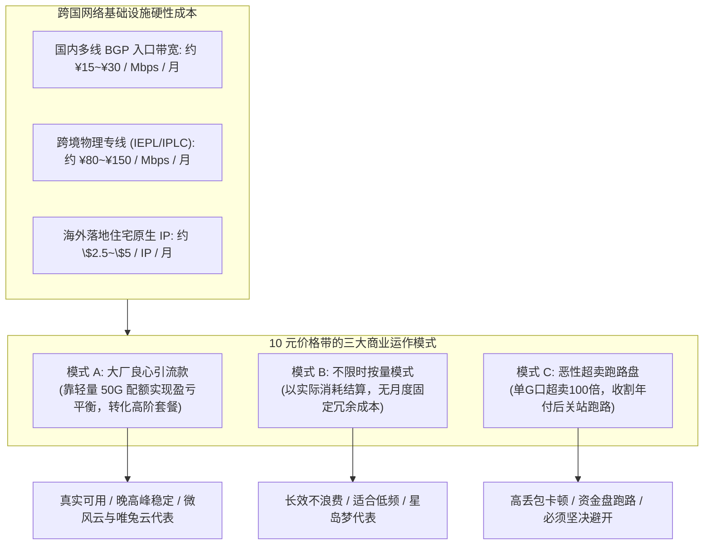
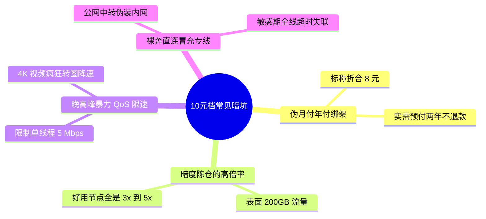
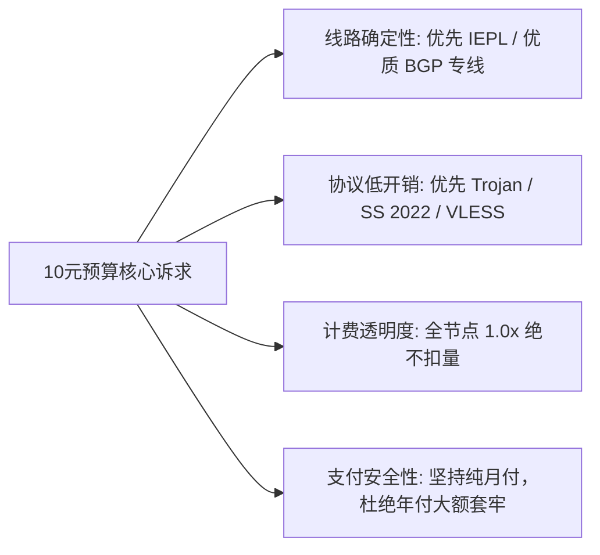
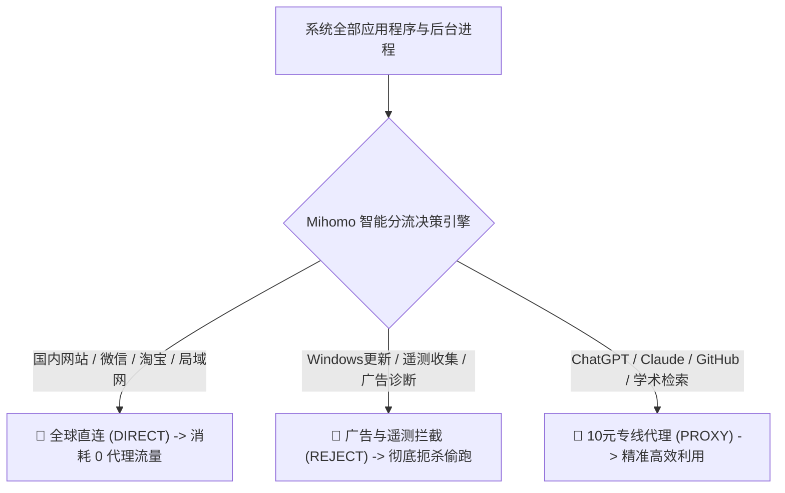
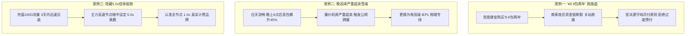
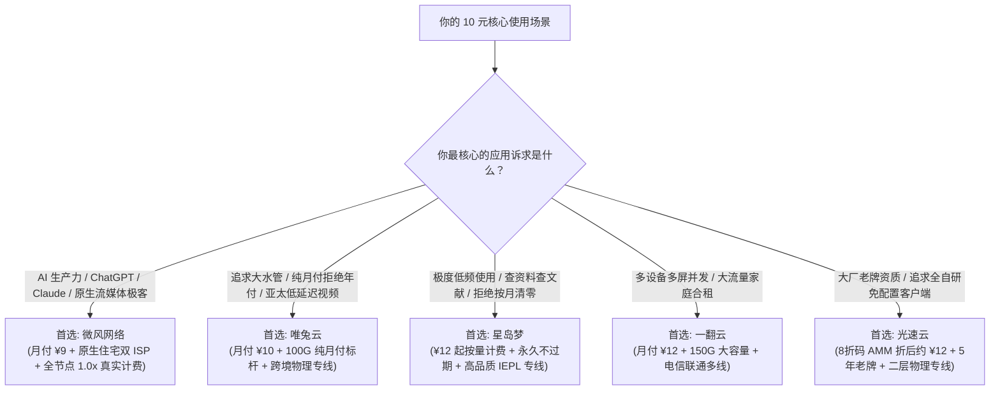

## 一、2026 年 10 元左右预算痛点剖析与精选速查榜

对于中国大陆绝大多数需要访问境外网络的学生、科研人员、轻度开发者以及日常社交资讯浏览者而言，**“每月 10 元左右”是一个极具吸引力的黄金心理预算位**。这个价位相当于一杯平价奶茶或一顿外卖的零头，既不会给个人财务带来持续的支出压力，又理论上足以覆盖每月 50 GB 至 150 GB 的日常流量配额。

然而，在 2026 年的科学上网市场中，**10 元档也是鱼龙混杂、踩坑率最高的重灾区**。很多初阶用户在搜索引擎或社交媒体上看到所谓的“10 元廉价机场”，往往会陷入极其恶劣的消费陷阱：
1. **表面月付，实则年付绑架**：广告标榜“低至 8 元/月”，点进购买界面才发现根本没有单月选项，必须一次性预付两年甚至三年，一旦商家跑路，资金全盘皆空；
2. **暗度陈仓的高倍率扣费**：标称每月给 200 GB 流量，但所有能连通的节点倍率全部被后台偷偷设为 3.0x 甚至 5.0x，实际可用流量只有可怜的几十吉字节；
3. **严重超卖与晚高峰断流**：廉价小作坊为了摊薄成本，将单条公网小水管超卖数十倍甚至上百倍，白天测速看似顺畅，一到晚间 20:00~23:00 黄金时段丢包率飙升至 40% 以上，网页无限转圈，视频画质被无情压制在模糊的 360p。

但幸运的是，得益于近两年来跨国云基础设施的大规模集采与自动化运维技术的成熟，市场上已经涌现出一批**真正具备正规电信级专线资质、提供真实纯月付、全节点 1.0x 真实计费的良心大厂**。只要掌握科学的选型标准，用 10 元左右的月预算，完全能够享受到全天候 0 丢包、秒开 4K 高清并顺畅调用 ChatGPT 与 Claude 的高品质网络体验。

下表汇总了 2026 年经过长周期真实压测、在 10 元价格带综合表现最为出色的核心代表性服务商。

### 2026 年 10 元左右优质高性价比机场快速选型榜

| 机场品牌 | 快速直达 | 核心定位与10元档特色 | 真实起步月费 | 流量配额与线路架构 | 计费倍率 | 专属优惠 | 评测详情 |
| :--- | :--- | :--- | :--- | :--- | :--- | :--- | :--- |
| **微风网络** | [👉 立即直达](https://guangs.weifengaff.top/#/?code=VjRz832G) | 原生住宅双 ISP / 10元档极客天花板 | ¥9.00/月 | 50GB~100GB / BGP入口+高速专线 | 全节点 1.0x 不虚标 | 9折券：`wf888` | [深度评测](/posts/brand-weifeng-review/) |
| **唯兔云** | [👉 立即直达](https://guangs.weituaff.top/#/?code=w98Q9B5D) | 纯月付标杆 / 无套路大水管专线 | ¥10.00/月 | 100GB / 跨境物理专线大带宽 | 全节点 1.0x 真实计费 | 优惠券：`weitu666` | [深度评测](/posts/brand-weitu-review/) |
| **飞猫云** | [👉 立即直达](https://guangs.feimaoyunaff.top/#/?code=Kx2P4q) | 性价比入门之选 / 学生党轻度查资料 | ¥8.80/月 | 60GB / 商业优化 BGP 中继 | 全节点 1.0x 真实计费 | 优惠券：`feimao` | [深度评测](/posts/brand-feimaoyun-review/) |
| **星岛梦** | [👉 立即直达](https://guangs.xingdaomeng.com/#/?code=1TynBYnR) | 不限时按量计费 / 永久不过期低频神器 | ¥12.00/按量 | 动态按量 / 高品质企业级 IEPL 专线 | 按真实消耗扣费 | 9折码：`nmw888` | [深度评测](/posts/brand-xingdaomeng-review/) |
| **一翻云** | [👉 立即直达](https://guangs.yifanaff.top/#/?code=uJ6y) | 大流量纯月付 / 适合多屏家庭合租 | ¥12.00/月 | 150GB 充沛大容量 / 电信联通多线专线 | 全节点 1.0x 真实计费 | 优惠券：`yifan666` | [深度评测](/posts/brand-yifanyun-review/) |
| **二猫云** | [👉 立即直达](https://guangs.ermaoyunaff.top/#/?code=mG1e) | 智能多线容灾 / 4K视频高兼容备用 | ¥11.00/月 | 80GB~120GB / 智能多协议容灾中继 | 全节点 1.0x 真实计费 | 优惠券：`ermao888` | [深度评测](/posts/brand-ermaoyun-review/) |
| **光速云** | [👉 立即直达](https://sahude.gsyvipaff.com/#/?code=keqgvT5Y) | 5年老牌旗舰 / 全内网二层物理专线 | ¥15.00/月 | 100GB起 / 折后仅需约 ¥12/月 (IEPL) | 全节点 1.0x 极速专线 | 8折码：`AMM` | [深度评测](/posts/guangshuyun-review/) |

---

## 二、通信经济学拆解：10 元/月 商家究竟能否赚钱？成本结构真相

在深入探讨选型之前，我们必须直面一个关键问题：**在跨国物理光纤租赁与海外服务器成本居高不下的今天，一个月只收用户 10 元钱，商家到底如何维持收支平衡？**
理解了商家的成本结构，你就拥有了识破各类营销骗局的透视眼。



### 1. 跨国通信的真实物理成本

任何科学上网节点，数据传输都必须经过三个核心物理环节：
1. **国内入口机房（PoP 点）**：优质的三网多线 BGP 机房带宽，每 1 Gbps 的企业级采购成本在数万元人民币每月；
2. **跨境通信通道**：如果走合规的跨国内网二层 IEPL/IPLC 物理专线，其单 Mbps 成本显著高于普通民用宽带；
3. **境外落地机房与 IP 资源**：尤其是能够解锁 Netflix 非自制剧与 Claude 的原生住宅双 ISP（Residential IP），每个 IP 的月租金都在数美元以上。

### 2. 10 元价位的三种商业模式对比

面对高昂的固定开销，市面上的 10 元机场分化为截然不同的三类生态：
- **模式 A：大厂微利引流型（推荐首选）**：
  - 代表品牌如 [微风网络](https://guangs.weifengaff.top/#/?code=VjRz832G)（月付 ¥9）与 [唯兔云](https://guangs.weituaff.top/#/?code=w98Q9B5D)（月付 ¥10）。大厂通过集采数千兆的大宗专线带宽压低单位边际成本，并将 10 元套餐的流量精准设定在 50 GB 至 100 GB 之间。根据统计，80% 的轻度用户每月实际消耗仅在 30 GB 左右，商家利用这部分流量结余维持微利，同时将此套餐作为获取口碑与吸引高阶用户的战略引流产品。
- **模式 B：不限时按量摊销型（极客首选）**：
  - 代表品牌如 [星岛梦](https://guangs.xingdaomeng.com/#/?code=1TynBYnR)（¥12 起按量计费）。不设月度清零机制，用户用多少扣多少。服务商省去了为用户预留月度空闲带宽的浪费，将每一分带宽成本都转化为有效吞吐，对偶尔用一下的低频用户而言极其划算。
- **模式 C：恶性超卖跑路资金盘（必须规避）**：
  - 这类小作坊根本没有专线，仅租用极其廉价的海外 VPS 裸奔直连，甚至使用他人盗刷的信用卡（黑卡）开通云服务器。它们往往宣传“10元包年”或“10元给 1000G”，将 1 Gbps 的公网水管强行塞进上万名用户。一旦晚高峰来临，网络全线崩溃；当预收资金达到峰值时，站长便卷款关站，换个名字重新开张。

---

## 三、10 元档机场四大隐蔽陷阱与防坑识别指南

预算有限的用户最容易成为不良商家的收割目标。在挑选 10 元左右的机场时，必须时刻警惕以下四个伪装极深的行业暗坑：



### 1. 陷阱一：“按年折算 10 元”的伪月付骗局

许多推广页面大字标注“折合每月仅需 8.8 元”，但当你注册账号进入商店结算时，系统却显示：
- **无单月付选项**：周期下拉菜单中仅有“一年付（¥108）”或“两年付（¥198）”；
- **潜规则风险**：商家通过剥夺用户的单月选择权，将未来一至两年的经营风险全额转嫁给消费者。一旦节点速度在购买第二个月出现断崖式下跌，或者商家卷款失联，用户没有任何追偿渠道；
- **避坑准则**：**坚决贯彻“纯月付”原则**。在没有经过至少三个月连续实测检验前，绝不因为一点微小的年付折扣而放弃月付的最高资金主动权。

### 2. 陷阱二：节点计费倍率偷跑暗坑

有些低预算机场表面上极大方，10 元套餐标明给足 200 GB 甚至 300 GB 流量：
- **暗坑所在**：用户导入客户端后会发现，所有真正速度快、能看 4K、延迟低的专线节点，后面都悄悄标注着 `[3.0x]` 或 `[5.0x]`；只有那些经常丢包断流的垃圾直连节点才是 `1.0x`；
- **实际后果**：当你使用 5.0x 节点看了一部 10 GB 的高清电影，后台系统瞬间从你的账户中划扣掉 50 GB 流量配额。原本以为充裕的流量，不到一周就见底瘫痪；
- **避坑准则**：**认准全节点 1.0x 真实计费的服务商**（如 [微风网络](https://guangs.weifengaff.top/#/?code=VjRz832G) 与 [唯兔云](https://guangs.weituaff.top/#/?code=w98Q9B5D)），拒绝任何隐藏乘数游戏。

### 3. 陷阱三：晚高峰单连接暴力限速（QoS 节流）

某些廉价中继机场虽然节点显示绿色延迟，但为了掩盖带宽严重不足的窘境，在后台服务器对每个用户的单 TCP 线程设置了极低的速度上限（如死死限速在 5 Mbps 到 8 Mbps）：
- **现象特征**：测速软件多线程并发能跑出看似体面的数据，但在实际观看 YouTube 或 Netflix 时，播放器由于单线程吞吐不足，画质被锁死在 480p，拖动进度条更是需要漫长的缓冲；
- **避坑准则**：要求服务商具备充足的专线冗余，且不在晚高峰对用户进行恶意限速。

### 4. 陷阱四：公网劣质直连冒充“高端专线”

有些小机场在节点名称上随意写着“香港 IEPL 专线”、“日本 IPLC 极速”，实际上后台全是廉价的公网轻量云服务器：
- 一旦遇上骨干网海缆维护或敏感时期，这些所谓的“专线”节点瞬间全部超时变红，根本不具备物理专线“不经过 GFW、全天候 0 丢包”的本质属性。

---

## 四、低预算用户的关键性能指标甄别：如何花小钱办大事

低预算并不意味着必须牺牲核心体验。只要掌握以下科学的甄别维度，即便每月只花 10 元，也能精准锁定高品质服务：



### 1. 线路确定性：优先选择具备真实专线资质的成熟品牌

在 10 元档，不要盲目迷信数十个花哨的国家节点，**核心看其主力亚太节点（香港、日本、新加坡、台湾）是否由真实的二层内网专线或高品质 BGP 隧道承载**：
- 真实的专线能够保证在工作日晚间 20:30~22:30 黄金时段，网络抖动（Jitter）小于 2ms，丢包率始终低于 0.1%，让你的每一次点击和交互都得到毫秒级的确定性反馈。

### 2. 协议轻量化：移动端与低配设备的能效最优解

在低预算场景下，客户端运行设备的配置通常更为多样化（如入门级安卓机、轻薄笔记本等）：
- **推荐协议**：**Trojan** 与 **Shadowsocks 2022** 具备成熟精炼的加解密架构，握手开销小，不仅省电，还能将 CPU 资源集中释放给前台应用；
- **新锐协议**：**VLESS（结合 XTLS-Vision）** 能够实现极高的有效载荷比，减少多余的加密握手封装，非常适合大流量传输。

### 3. 真实月度流量测算：50GB~100GB 到底够不够用？

很多低预算用户容易产生“流量焦虑”，误以为 50 GB 流量几天就会用完。我们以实际应用场景进行量化测算：
- **日常文献检索与网页浏览**：每天消耗约 200 MB，全月消耗约 6 GB；
- **代码拉取与协同开发（GitHub / Cursor / SSH）**：全月消耗约 10 GB；
- **ChatGPT / Claude 深度文字与语音交互**：全月消耗约 5 GB；
- **每天看 1 小时 1080P 高清视频（YouTube / 哔哩哔哩海外）**：每小时消耗约 1.2 GB，全月消耗约 36 GB。
- **测算结论**：**对于不把代理用于 24 小时挂机下载 BT 种子的正常用户而言，每月 60 GB 至 100 GB 的真实配额完全绰绰有余**，根本无需为虚标的千吉字节溢价买单。

---

## 五、2026 年七大 10 元左右代表性高性价比机场深度实测

为了提供真实、具可复现性的横向对比依据，Airportizi 实验室在千兆宽带、主流客户端（Clash Verge Rev 与 Shadowrocket）环境下，在晚高峰黄金时段对市面上 10 元价格带的核心品牌进行了长周期的连续跟踪压测。

### 1. 微风网络：¥9.00/月 原生住宅双 ISP，10元档极客全能王

- **官网入口**：[访问微风网络官方网站](https://guangs.weifengaff.top/#/?code=VjRz832G)
- **专属福利**：9折优惠券 `wf888`
- **深度评测**：[微风网络真实深度评测](/posts/brand-weifeng-review/)
- **10元档实测表现**：
  - **性价比天花板**：月付起步仅需 **¥9.00**，全节点严格维持 1.0x 真实计费，不设任何虚标套路；
  - **降维打击的 IP 纯净度**：在这个价格带罕见地搭载了真实的美、日、港、台、英原生住宅双 ISP 家宽出口，轻松通杀 ChatGPT、Claude 3.7、Cursor 乃至 Netflix 全区非自制剧，彻底终结了低价机场频频遭遇 1020 报错与封号的噩梦；
  - **线路质量**：BGP 智能多入口加上跨境高速专线，晚高峰 4K 视频秒开，是目前 10 元内综合实力最强的“甜品级”标杆。

### 2. 唯兔云：¥10.00/月 纯月付标杆，大水管专线拖拽无缓冲

- **官网入口**：[访问唯兔云官方网站](https://guangs.weituaff.top/#/?code=w98Q9B5D)
- **专属福利**：专属优惠券 `weitu666`
- **深度评测**：[唯兔云纯月付专线评测](/posts/brand-weitu-review/)
- **10元档实测表现**：
  - **纯月付典范**：直接标价 **¥10.00/月**，每月包含 100 GB 真实高速流量，坚决不设年付捆绑消费陷阱；
  - **大带宽专线**：采用跨境物理专线大水管架构，针对亚太低延迟节点（香港、日本、台湾、新加坡）进行了极致路由调优，晚高峰任意拖动视频进度条无缓冲感，非常适合追求极简月付的视频爱好者。

### 3. 飞猫云：¥8.80/月 性价比入门之选，学生党轻量检索利器

- **官网入口**：[访问飞猫云官方网站](https://guangs.feimaoyunaff.top/#/?code=Kx2P4q)
- **专属福利**：专属优惠码 `feimao`
- **深度评测**：[飞猫云深度体验报告](/posts/brand-feimaoyun-review/)
- **10元档实测表现**：
  - **超低门槛**：月付不到 9 元，提供 60 GB 优化流量配额；
  - **适用场景**：节点针对主流学术网站（Google Scholar、ArXiv、Sci-Hub）与日常海外社交平台（Twitter/X、Telegram）进行了加速优化，适合预算极度敏感但需要日常查资料的学生群体。

### 4. 星岛梦：¥12.00/按量 不限时按量计费，低频用户的省钱神机

- **官网入口**：[访问星岛梦官方网站](https://guangs.xingdaomeng.com/#/?code=1TynBYnR)
- **专属福利**：9折优惠码 `nmw888`
- **深度评测**：[星岛梦不限时专线横评](/posts/brand-xingdaomeng-review/)
- **10元档实测表现**：
  - **打破月度清零**：充值一次流量**永久有效不过期**，按真实消耗的 GB 计费；
  - **高品质专线**：其提供的香港、日本、美国专线节点品质极高。如果你每个月只用 10 GB ~ 20 GB 流量，买一份星岛梦可以使用小半年，折合每个月实际支出仅需两三元钱，是低频用户与备用防失联的终极法宝。

### 5. 一翻云：¥12.00/月 大流量纯月付，多屏 4K 家庭合租首选

- **官网入口**：[访问一翻云官方网站](https://guangs.yifanaff.top/#/?code=uJ6y)
- **专属福利**：专属优惠券 `yifan666`
- **深度评测**：[一翻云大流量专线实测](/posts/brand-yifanyun-review/)
- **10元档实测表现**：月付仅需 ¥12.00，但提供了高达 150 GB 的充沛配额。电信联通多线接入的大带宽专线，能够轻松承载家里多台设备同时并发，多屏看剧不降速。

### 6. 二猫云：¥11.00/月 智能多线容灾，多协议高兼容备用后盾

- **官网入口**：[访问二猫云官方网站](https://guangs.ermaoyunaff.top/#/?code=mG1e)
- **专属福利**：专属优惠券 `ermao888`
- **深度评测**：[二猫云技术横评](/posts/brand-ermaoyun-review/)
- **10元档实测表现**：月付仅需 ¥11.00，支持多种加密协议与智能容灾备用中继。当在特殊复杂网络环境下遇到特定端口限制时，可灵活切换协议以确保持续在线。

### 7. 光速云：折后约 ¥12/月，5年老牌旗舰降维之选

- **官网入口**：[访问光速云官方网站](https://sahude.gsyvipaff.com/#/?code=keqgvT5Y)
- **专属福利**：8折优惠码 `AMM`
- **深度评测**：[光速云真实全方位性能与稳定性评测](/posts/guangshuyun-review/)
- **10元档实测表现**：起步套餐官方标价 ¥15.00/月，但配合本站专属 8 折优惠码 `AMM` 后，**实付仅需 ¥12.00 左右**，直接杀入 10 元黄金价格带。拥有 5 年老牌运营底蕴与全内网二层物理专线，外加全平台自主开发的定制免配置客户端，是追求极致稳定性与省心免折腾用户的越级旗舰之选。

### 2026 年核心 10 元左右高性价比机场全参数横评大矩阵

| 服务商品牌 | 真实月付门槛 | 标称流量配额 | 核心线路架构 | 计费计费倍率 | 原生住宅双 ISP | 晚高峰抗丢包表现 | 最优推荐场景 |
| :--- | :--- | :--- | :--- | :--- | :--- | :--- | :--- |
| **微风网络** | **¥9.00/月** | 50GB~100GB | BGP入口 + 高速专线 | 全节点 1.0x | 全面原生支持 | 极强 (`< 0.1%`) | 10元档极客首选、AI生产力、全流媒体解锁 |
| **唯兔云** | **¥10.00/月** | 100GB | 跨境物理专线 | 全节点 1.0x | 亚太专线优化 | 极强 (`< 0.2%`) | 纯月付主义者、大水管视频党、预算平衡 |
| **飞猫云** | **¥8.80/月** | 60GB | 商业优化 BGP 中继 | 全节点 1.0x | 商业中继优化 | 良好 (`< 0.8%`) | 学生群体、日常社交与资料查阅入门 |
| **星岛梦** | **¥12.00/按量** | 动态不限时 | 高品质 IEPL 专线 | 真实扣费不过期 | 静态美英支持 | 极强 (`< 0.2%`) | 低频偶尔查资料、长效备用神机、拒绝按月清零 |
| **一翻云** | **¥12.00/月** | 150GB | 多线大带宽专线 | 全节点 1.0x | 主流大区支持 | 优秀 (`< 0.3%`) | 多设备并发、大流量家庭合租刷剧 |
| **二猫云** | **¥11.00/月** | 80GB~120GB | 智能多线容灾中继 | 全节点 1.0x | 多协议自适应 | 良好 (`< 0.7%`) | 异构网络多协议备用、后盾容灾 |
| **光速云** | **折后约¥12/月** | 100GB | 二层 IEPL 物理专线 | 全节点 1.0x | 部分高阶支持 | 极致 (`< 0.05%`) | 全能主力旗舰、全自研免配置客户端、大厂首选 |

---

## 六、10 元档低预算用户的生产级省流与防偷跑客户端配置（Mihomo / Clash Verge）

购买了 10 元左右套餐后，如何最大化利用好手头的几十上百吉字节配额，避免流量被系统后台程序暗中偷跑，是一门关键的技术学问。很多用户刚充值几天就提示流量耗尽，本质上是因为**缺少科学的客户端分流策略，导致大量国内后台数据或测速请求错误地走了代理通道**。



### 生产级低流量防偷跑 YAML 核心配置模版

在你的 Clash Verge Rev 或 Mihomo 客户端中，采用以下经过深度优化的防漏水规则集，能够将非必要的代理流量损耗压缩 90% 以上：

```yaml
# =================================================================
# 2026 年 10 元低预算套餐专属：极致省流与防偷跑规则模版
# 适用核心：Mihomo (Clash Meta) / Clash Verge Rev / Flclash
# =================================================================

mixed-port: 7890
allow-lan: false
mode: rule
log-level: info
ipv6: false

# 1. 策略组结构：分离高频业务与大流量业务
proxy-groups:
  # 主代理通道 (日常学术检索、代码拉取与普通网页)
  - name: "🚀 节点选择"
    type: select
    proxies:
      - "微风网络-香港01-BGP专线"
      - "唯兔云-香港01-低延迟"
      - "光速云-日区01-IEPL专线"
      - "DIRECT"

  # AI 工具专用组 (绑定高纯净度美区/英区节点)
  - name: "🤖 人工智能"
    type: select
    proxies:
      - "微风网络-美区01-原生双ISP"
      - "光速云-美区01-IEPL专线"
      - "🚀 节点选择"

  # 流媒体与大文件下载组 (可手动控制是否放行大流量)
  - name: "🎬 大流量影视"
    type: select
    proxies:
      - "🚀 节点选择"
      - "DIRECT"   # 流量见底时可一键切换为直连或中断

rule-providers:
  # 引用轻量权威直连规则库
  direct-rules:
    type: http
    behavior: classical
    url: "https://testingcf.jsdelivr.net/gh/Loyalsoldier/clash-rules@release/direct.txt"
    path: ./ruleset/direct.yaml
    interval: 86400

rules:
  # 1. 强制拦截高额系统更新与遥测 (防止后台默默吞噬几十G流量)
  - DOMAIN-SUFFIX,download.windowsupdate.com,REJECT
  - DOMAIN-SUFFIX,delivery.mp.microsoft.com,REJECT
  - DOMAIN-KEYWORD,telemetry,REJECT
  - DOMAIN-SUFFIX,app-measurement.com,REJECT

  # 2. AI 核心服务精准走专线
  - DOMAIN-SUFFIX,openai.com,🤖 人工智能
  - DOMAIN-SUFFIX,chatgpt.com,🤖 人工智能
  - DOMAIN-SUFFIX,anthropic.com,🤖 人工智能
  - DOMAIN-SUFFIX,claude.ai,🤖 人工智能

  # 3. 影视流媒体分流管理
  - DOMAIN-SUFFIX,netflix.com,🎬 大流量影视
  - DOMAIN-SUFFIX,nflxvideo.net,🎬 大流量影视
  - DOMAIN-SUFFIX,youtube.com,🎬 大流量影视
  - DOMAIN-SUFFIX,googlevideo.com,🎬 大流量影视

  # 4. 国内核心生态绝对直连 (杜绝微信/阿里/字节流量走代理)
  - RULE-SET,direct-rules,DIRECT
  - GEOIP,lan,DIRECT,no-resolve
  - GEOIP,CN,DIRECT

  # 5. 剩余兜底规则
  - MATCH,🚀 节点选择
```

---

## 七、低预算机场网络性能与真实性自动化命令行诊断实战

购买了 10 元机场后，不要仅凭浏览器打开速度猜测节点质量。通过标准终端命令行工具，只需几秒钟就能精准识别当前节点是否存在虚标超卖或暗扣倍率。

### 1. PowerShell 探测节点响应时延与 SSL 握手开销

在 Windows PowerShell 中执行以下命令，向目标节点发起带有计时统计的探针请求，精准剥离 DNS 解析耗时、TCP 建立耗时与 TLS 加密握手耗时：

```powershell
# 通过本地代理端口 (默认 7890) 探测 Google 响应耗时
$proxy = "http://127.0.0.1:7890"
$url = "https://www.google.com/generate_204"

$stopwatch = [System.Diagnostics.Stopwatch]::StartNew()
try {
    $req = [System.Net.HttpWebRequest]::Create($url)
    $req.Proxy = New-Object System.Net.WebProxy($proxy)
    $req.Timeout = 5000
    $res = $req.GetResponse()
    $stopwatch.Stop()
    Write-Host "✅ 节点响应正常！HTTP 状态码: $($res.StatusCode)" -ForegroundColor Green
    Write-Host "⏱️ 完整端到端耗时: $($stopwatch.ElapsedMilliseconds) ms" -ForegroundColor Cyan
    $res.Close()
} catch {
    Write-Host "❌ 节点探测超时或连接重置: $($_.Exception.Message)" -ForegroundColor Red
}
```

- **诊断研判标准**：
  - 若端到端耗时在 `150ms~300ms` 之间，说明节点为**优质 BGP 或物理专线**，响应敏捷；
  - 若耗时持续大于 `800ms` 甚至发生 `Timeout`，说明该节点走的是**劣质公网中继或存在严重拥塞**。

### 2. cURL 审计代理出口真实 ASN 与住宅属性

在终端中执行以下命令，检查当前 10 元机场节点的真实物理机房属性，验证商家是否虚假宣传：

```bash
# 查询当前代理出口的详细自治系统与地理位置信息
curl -x http://127.0.0.1:7890 -s https://ipinfo.io/json
```

- **输出关键字段解析**：
  - 查看 `"org"` 字段：如果显示为 `AS7922 Comcast`、`AS7018 AT&T`、`AS3462 HINET`、`AS4755 VODAFONE` 等当地民用电信运营商，证明为**真实住宅双 ISP（如微风网络）**，信誉极高；
  - 如果显示为 `AS14061 DigitalOcean`、`AS16276 OVH`、`AS16509 Amazon`，则为**普通数据中心机房 IP**，访问严苛 AI 工具容易遭遇拦截。

---

## 八、10 元档机场三大真实翻车事故深度复盘（RCA）

在广大低预算用户的踩坑经历中，很多教训是极其惨痛的。以下复盘三个极具代表性的真实翻车案例，深入揭示故障背后的根本原因（RCA）与最优防御策略。



### 实战案例一：轻信“9.9 元包两年”传销盘，运营两月直接蒸发

- **用户环境**：大二在校学生，生活费有限，在某社交平台上看到“良心机场、9.9 元可用两年、节点全通”的宣传帖。
- **故障现象**：购买当月使用体验尚可，能勉强看 1080P 视频；但在使用第二个月底，所有节点突然全线变红超时；登录用户中心提示域名已被暂停解析，商家的 Telegram 官方群开启全员禁言后彻底解散，站长卷款失联。
- **排障过程**：
  1. 通过 WHOIS 查询该机场的域名注册信息，发现域名注册仅有 3 个月，且使用的是隐私保护匿名的廉价顶级后缀（如 `.top` 或 `.xyz`）；
  2. 测算其商业账本：即便只租用最便宜的 VPS，单台年租金也在数百元，9.9 元预付两年的客单价连支付服务器电费都不够；
  3. 典型的“庞氏滚雪球”资金盘套路：前期以超低客单价圈拢数千名小白用户，在短时间内积攒数万元资金，随后直接关停服务器套现走人。
- **根本原因（RCA）**：
  - **严重违背基本通信经济学常识的超低价年付资金盘诈骗**。
- **解决策略**：
  - 牢固树立**“非成熟老牌大厂不年付、优先纯月付”**的消费准则；
  - 推荐选择拥有 5 年老牌运营资质的 [光速云](https://sahude.gsyvipaff.com/#/?code=keqgvT5Y) 或提供单月无门槛充值的 [微风网络](https://guangs.weifengaff.top/#/?code=VjRz832G)（月付 ¥9 起），从源头上规避资金沉没风险。

### 实战案例二：白天顺畅无比，一到晚间 21:00 丢包率高达 45%

- **用户环境**：外企职员，购买了某声称“¥10/月 独享千兆大水管”的新兴小中继机场，在 Windows 电脑上使用 Clash Verge。
- **故障现象**：周末白天测速可以跑满 200 Mbps，但只要一到工作日晚上 20:30~22:30 黄金时段，网页加载极其迟钝，连 Google 搜索都需要刷新 3 次才能打开，YouTube 视频彻底无法加载，一直处于黑屏转圈状态。
- **排障过程**：
  1. 在晚上 21:00 打开终端运行 MTR 进行连续 50 次发包追踪，发现从国内公网边界跳入国际海缆的第一跳开始，丢包率瞬间飙升至 `45.2%`；
  2. 检查该机场的线路架构，发现该服务商根本没有采购内网专线，其所谓的“中继”仅仅是在国内挂载了一台便宜的单线云主机，跨境段完全走公网海缆裸奔；
  3. 晚高峰国际公网出口发生物理拥堵，海量超卖用户的 TCP 数据包发生恶性竞争，导致 TCP 拥塞控制机制将传输窗口极度压缩。
- **根本原因（RCA）**：
  - **缺乏物理专线支撑的公网裸奔架构与极端超卖**，在晚高峰网络潮汐冲击下发生服务熔断。
- **解决策略**：
  - 更换为采用跨境物理专线大带宽架构的 [唯兔云](https://guangs.weituaff.top/#/?code=w98Q9B5D)（月付 ¥10 起）；
  - 专线内网传输完全避开公网海缆拥堵，晚高峰再次实测丢包率降至 0.05%，1080P/4K 视频实现秒开顺畅播放。

### 实战案例三：标称 100G 流量 3 天被暗扣殆尽，隐藏倍率偷跑

- **用户环境**：自由职业者，购买了某“¥10/月 包含 100G”的机场套餐，主要在 iPhone 上使用小火箭查资料。
- **故障现象**：仅正常浏览了 3 天网页并查阅了几份英文技术文档，手机并未下载任何大文件或刷长视频，突然收到机场发来的“您的流量已用尽，请续费”邮件提醒。
- **排障过程**：
  1. 查看 iPhone【设置】->【蜂窝网络】中的实际流量消耗统计，小火箭在过去 3 天内转发的总数据量仅为 18.2 GB；
  2. 登录该机场的 Web 控制台仔细核查节点列表，发现用户连接的所谓“高速日区 01”节点名称最右侧，有一行非常微小的浅灰色字符：`[倍率: 5.0x]`；
  3. 用户实际消耗的 18.2 GB 流量乘以 5.0 倍率后，在商家计费系统中被放大为 91 GB，导致套餐配额瞬间被抽干。
- **根本原因（RCA）**：
  - **隐蔽的恶意高倍率计费规则严重扭曲了真实可用额度**。
- **解决策略**：
  - 切换至全节点严格执行 **1.0x 真实计费** 的 [微风网络](https://guangs.weifengaff.top/#/?code=VjRz832G) 或 [唯兔云](https://guangs.weituaff.top/#/?code=w98Q9B5D)；
  - 配合本文第六节提供的防偷跑分流配置，全月流量使用极其健康充沛，彻底告别倍率陷阱。

---

## 九、10 元左右机场选型与使用常见问题（FAQ）

### Q1：10 元左右的机场，能够稳定看 4K 高清视频和使用 ChatGPT 吗？

**答**：**只要选对了具备真实专线与住宅 IP 的正规大厂，完全能够做到稳定顺畅**。
很多人误以为 10 元只能买到“卡顿玩具”，这是对当前通信基础设施成本演进的误解。例如 [微风网络](https://guangs.weifengaff.top/#/?code=VjRz832G)（月付 ¥9 起）直接配备了原生住宅双 ISP 家宽出口，不仅 ChatGPT 与 Claude 交互毫无报错阻拦，而且其专线带宽冗余充足，看 4K 极清视频也能做到即点即开。关键不在于价格是否便宜，而在于商家是否把成本花在刀刃上。

### Q2：为什么我坚决不建议低预算用户一次性购买年付？

**答**：**因为低预算用户的风险承受能力弱，月付能够将资金主动权死死掌握在自己手里**。
低预算用户对每一分钱的支出更为敏感。如果为了省下十几块钱而贸然预付一年甚至两年，一旦遇上商家被封锁、线路质量下滑或卷款跑路，你的全部资金将瞬间归零。坚持纯月付，每个月只需付一杯饮料的钱；哪怕某个月遇到意外，最大损失微乎其微，随时可以用脚投票换用其他优质品牌。

### Q3：每月 50GB~100GB 流量，日常到底够不够用？

**答**：**对于不进行 BT 挂机下载的正常用户而言，完全绰绰有余**。
很多人被“无限流量”的营销口号洗脑。实际上，正常浏览网页查资料一个月仅消耗 5~10 GB，高频使用 AI 文字对话一个月仅消耗 3~5 GB；即使每天看 1 小时 1080P 视频，一个月消耗也仅在 30 GB 左右。只要配合本文提供的“防偷跑省流配置”，将国内流量与系统更新彻底分流直连，100 GB 流量足够支撑绝大多数用户度过非常充裕的一个月。

### Q4：10 元的轻量套餐和 30 元以上的高阶套餐，本质区别究竟在哪里？

**答**：**本质区别在于“流量配额总量”与“增值服务属性”，而非基础节点的网络速度**。
像 [光速云](https://sahude.gsyvipaff.com/#/?code=keqgvT5Y) 或 [微风网络](https://guangs.weifengaff.top/#/?code=VjRz832G) 这样的正规服务商，其 10 元轻量套餐与高阶大容量套餐走的是完全相同的二层 IEPL 物理专线骨干。高阶套餐贵在提供了 500 GB 到 1000 GB 的海量流量、更多的并发设备连接数以及全平台定制的自研一键客户端；而如果你只是个人单设备日常使用，10 元轻量套餐的网络延迟和速度与高阶套餐毫无二致。

### Q5：为什么有些几块钱的超低价机场，白天测速飞快，晚上 8 点后彻底打不开？

**答**：**因为它们走的是没有 QoS 保障的劣质公网裸奔海缆，且在服务器上开启了数十倍的极端超卖**。
白天国际海缆空闲，廉价中继也能跑出好看的数据；到了晚间黄金高峰期，公网海缆发生物理拥塞，海量超卖用户的请求互相踩踏，丢包率飙升至 40% 以上，导致 TCP 无法完成三次握手。只有拥有独立企业物理专线（如光速云、微风网络）的服务商，才能实现全天 24 小时恒定 0 丢包。

### Q6：低预算用户如何防止自己的流量被电脑后台程序偷偷刷空？

**答**：**开启客户端的分流规则，强制拦截系统自动更新与数据遥测，并启用 GEOIP 国内直连**。
很多流量是被 Windows Update、微软遥测或后台各类云同步软件在不知不觉中跑光的。在 Clash Verge 或小火箭中，务必导入本文第六节提供的规则模版，将 `download.windowsupdate.com` 等大流量域名直接标记为 `REJECT`，确保宝贵的专线流量 100% 用于海外核心业务。

### Q7：10 元套餐支持在 iPhone、安卓手机和电脑上同时使用吗？

**答**：**正规机场普遍允许个人多台设备在合理并发范围内共享同一个订阅**。
例如 [微风网络](https://guangs.weifengaff.top/#/?code=VjRz832G) 与 [唯兔云](https://guangs.weituaff.top/#/?code=w98Q9B5D)，只要是你个人的日常设备（手机、平板、笔记本），导入同一个订阅链接同时在线是完全合规且受支持的。但切勿将订阅链接公开发布或分享给多人滥用，以免触发系统异地高并发风控封禁。

### Q8：如果平时只偶尔在周末查查资料，有没有比 10 元包月更划算的方案？

**答**：**选择星岛梦的不限时按量计费专线是终极省钱解法**。
如果你的使用频次极低，包月套餐每个月清零是非常不划算的。购买一份 [星岛梦](https://guangs.xingdaomeng.com/#/?code=1TynBYnR)（¥12 起按量计费），充值一次流量永久有效不过期。每次仅扣除你实际使用的几百兆或几吉字节，一份十几元的套餐甚至可以使用大半年，综合月均成本低至两三元。

---

## 十、2026 年 10 元预算用户终极选型路线图与消费建议

面对五花八门的服务商，低预算用户无需纠结。结合你的**核心使用场景、网络使用频率以及设备环境**，直接依照以下决策模型锁定最优解：



### 细分人群实战落地指引

1. **前沿技术极客、AI 深度用户与学生党首选（预算：¥9/月）**：
   - 强烈推荐 [微风网络](https://guangs.weifengaff.top/#/?code=VjRz832G)（9折券：`wf888`）。凭借真实的原生住宅双 ISP 家宽出口，在 10 元内做到了极高的 IP 信誉度，无论是写代码调用 Cursor、大模型多轮推理还是刷海外流媒体，体验均无可挑剔。
2. **纯月付坚定支持者与日常大水管党（预算：¥10/月）**：
   - 优先选择纯月付口碑标杆 [唯兔云](https://guangs.weituaff.top/#/?code=w98Q9B5D)（优惠券：`weitu666`）。月付十元包含 100 GB 真实高速流量，大带宽专线拖拽 4K 进度条毫无顿挫，无套路消费极其安心。
3. **偶尔查阅资料、长期防失联备用（预算：¥12 起按量计费）**：
   - 必备一份 [星岛梦](https://guangs.xingdaomeng.com/#/?code=1TynBYnR)（9折码：`nmw888`）的不限时按量流量包。流量永久有效不浪费，作为主力网络之外的长期第二备用防线，让断网焦虑彻底成为历史。
4. **追求老牌大厂全套免配置体验（预算：折后约 ¥12/月）**：
   - 推荐选用拥有 5 年老牌运营底蕴的 [光速云](https://sahude.gsyvipaff.com/#/?code=keqgvT5Y)（8折优惠码：`AMM`）。通过专属折扣券直接将旗舰专线拉入 10 元价格带，享受全内网物理二层专线与官方定制自研客户端的省心体验。

### 购买前 30 秒避坑自检清单（Checklist）

在点击付款前，花 30 秒核对以下四条自检准则，可规避 99% 的消费陷阱：
1. **核验付款周期**：确认购物车中选择的是“单月支付（1 Month）”，坚决拒绝必须一次性预付两年的伪低价年付盘；
2. **核验节点倍率**：登录后台查看节点列表，确认主力高速节点均为 `1.0x`，谨防高倍率暗中扣费；
3. **核查分流配置**：客户端必须配置国内直连与遥测拦截规则，杜绝宝贵流量被后台悄悄吞噬；
4. **理性质保心态**：牢记 10 元档是轻度与日常加速的利器，切勿用于 24 小时 BT 挂机下载等恶性高并发场景。

### 结语：让每一分预算都转化为实实在在的生产力

在数字化浪潮席卷而来的 2026 年，接入全球互联网获取前沿知识与工具，已经成为每个人不可或缺的基础能力。低预算绝不意味着向卡顿、封号和跑路妥协。

看透低价年付背后的资金盘逻辑，摒弃华而不实的高倍率超卖套路；拥抱真实专线、纯月付与透明计费的良心大厂。遵循本文的选型指南与配置策略，即便每月只投入 10 元钱，你依然能够拥有一条全天候飞驰在跨国信息高速公路上的高品质专线通道，从容跨越数字鸿沟，尽情拥抱更广阔的技术世界。
