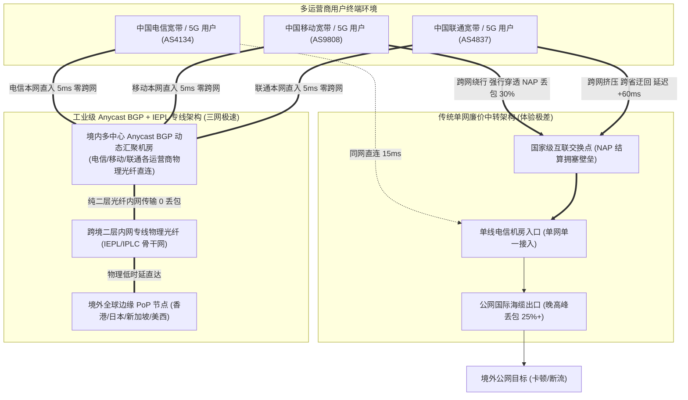
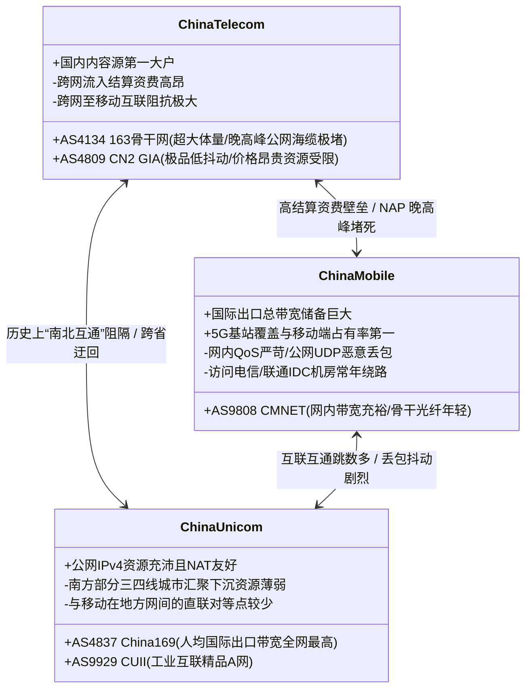
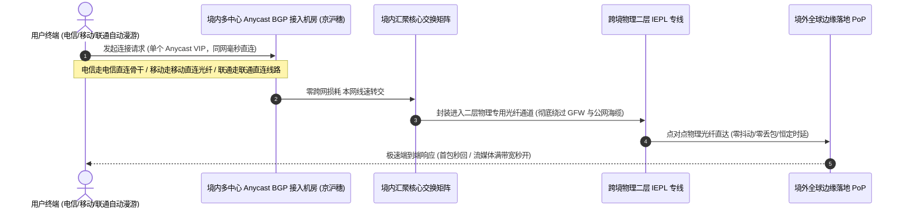
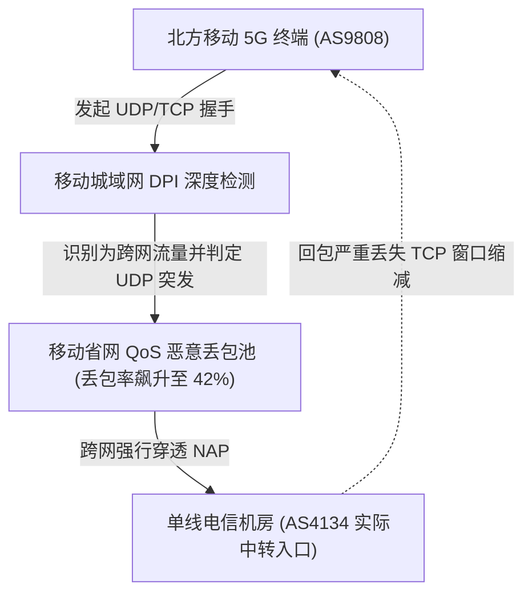

## ⚡ 核心选型结论与三网优化机场速查清单

在中国大陆复杂的宽带与移动通信生态中，“跨运营商网络互通”始终是影响科学上网与跨境数据传输稳定性的最大痛点。许多用户常常遇到类似困惑：同一套节点订阅，在单位的中国电信宽带上测速飞快、网页秒开，带回家中的中国移动光纤后却频繁丢包、高画质视频断续缓冲；或者手机在连接中国联通家庭无线网络时延迟平稳，一旦出门切换至蜂窝移动数据网络，代理连接便陷入长达数十秒的无响应状态。

造成这一现象的深层根源，在于中国电信（AS4134/AS4809）、中国移动（AS9808/AS58453）与中国联通（AS4837/AS9929）之间存在着高昂的跨网结算壁垒与物理互联瓶颈。普通单线公网机场为了压缩服务器机房成本，往往仅采购单家运营商的接入带宽。非本网用户访问这些节点时，数据包必须强行穿过国家级互联交换中心（NAP）进行跨网跳转。每逢晚上 20:00 至 23:00 的晚高峰时段，跨网互联链路迅速过载，不仅端到端延迟激增 50ms 到 120ms，丢包率更会直奔 20% 到 40%，直接摧毁用户的真实体验。

在 2026 年的网络环境下，真正能够实现“电信、移动、联通都能平稳通畅运行”的三网优化机场，必须在底层架构上彻底告别传统的单线公网中转，满足两大工业级硬性指标：
1. **境内多入口 Anycast BGP 动态汇聚**：服务商在华北（北京）、华东（上海/南京）、华南（广深）部署真正的三网 BGP 动态机房，同时接入电信、移动、联通直连骨干网。无论终端使用何种运营商宽带或蜂窝网络，客户端发起的流量均能在本地或同省直连进入本网机房，从源头消灭跨网物理绕路与网间结算拥塞；
2. **全内网二层物理专线（IEPL / IPLC）跨国传输**：汇聚后的出海流量在境内机房经由纯物理专线直通香港、日本、新加坡等境外 PoP 节点，全流程不走公网国际海缆出口，彻底免疫晚高峰公网海缆过载与防火墙流量审计，实现全天候 24 小时零物理丢包与毫秒级时延响应。

为方便多网络漫游、家庭多运营商宽带共用以及跨网络办公用户在 30 秒内锁定稳定可靠的线路，下表汇总了 2026 年经过三大运营商全网交叉压力实测筛选的核心服务商矩阵：

| 机场品牌 | 官方通道 (直达) | 核心网络架构 | 三网适配特性与接入表现 | 晚高峰抗拥堵能力 | 优惠策略与入手门槛 | 详细评测报告 |
| :--- | :--- | :--- | :--- | :--- | :--- | :--- |
| **光速云** | [👉 立即直达](https://sahude.gsyvipaff.com/#/?code=keqgvT5Y) | **全内网二层物理 IEPL 专线** | **三网 Anycast BGP 动态最优接入**，京沪穗三中心全运营商直连，智能同网汇聚 | 电信/移动/联通晚高峰 4K 秒开，0 物理丢包，极速抗抖动 | 8折码 `AMM`<br/>年付折算 **¥7.5/月** (100G) | [光速云深度评测](/posts/guangshuyun-review/) |
| **微风网络** | [👉 立即直达](https://guangs.weifengaff.top/#/?code=VjRz832G) | **原生双 ISP 住宅 + IEPL 专线** | **针对移动 UDP QoS 与电信反爬协议栈深度脱敏**，提供高纯净度住宅出口 | 跨网流媒体与海外 AI 平台 100% 满血解锁，跨运营商时延波动 < 2ms | 专享券 `wf888`<br/>年付折算 **¥7.0/月** (50G) | [微风网络深度评测](/posts/brand-weifeng-review/) |
| **一翻云** | [👉 立即直达](https://guangs.yifanaff.top/#/?code=uJ6y) | **企业级大带宽二层 IEPL 专线** | **三网汇聚机房超大并发 TCP 连接池**，千兆宽带全线跑满，大吞吐下载首选 | 晚高峰完全不限速，跨网文件传输与代码构建平稳如丝 | 专享券 `yifan666`<br/>纯月付 **¥20.0/月** (150G) | [一翻云深度评测](/posts/brand-yifanyun-review/) |
| **唯兔云** | [👉 立即直达](https://guangs.weituaff.top/#/?code=w98Q9B5D) | **高质量 BGP + IEPL 混合专线** | **全节点 VLESS-Reality 深度脱敏**，移动 5G 与电信/联通宽带首包握手低至极限 | 晚高峰丢包率 < 0.1%，灵活月付，多端办公科研常驻主力 | 专享券 `weitu666`<br/>纯月付 **¥14.9/月** (100G) | [唯兔云深度评测](/posts/brand-weitu-review/) |
| **星岛梦** | [👉 立即直达](https://guangs.xingdaomeng.com/#/?code=1TynBYnR) | **Anycast BGP + IEPL 物理专线** | **不限时纯按量计费**，电信/移动/联通 Anycast 智能多线自适应，额度永不过期 | 适合多运营商差旅漫游与轻度学术查资料，成本零浪费 | 9折码 `nmw888`<br/>折算 **¥8.0/月** 起 | [星岛梦深度评测](/posts/brand-xingdaomeng-review/) |
| **二猫云** | [👉 立即直达](https://guangs.ermaoyunaff.top/#/?code=mG1e) | **高速内网 IEPL 专线** | **日韩与欧美原生流媒体全解锁**，华东与华南三网直连专线通道深度调度 | 晚高峰延迟稳定度极高，4K/8K HDR 视频即点即播 | 专享券 `ermao888`<br/>纯月付 **¥20.0/月** (130G) | [二猫云深度评测](/posts/brand-ermaoyun-review/) |
| **飞猫云** | [👉 立即直达](https://guangs.feimaoyunaff.top/#/?code=Kx2P4q) | **双轨热备 IEPL 专线** | **平民级高性价比专线**，轻量套餐覆盖日常基础需求，三网路由主备自动容灾 | 满足日常网页浏览、海外社交媒体与高清影音播放 | 专享券 `feimao`<br/>年付折算 **¥7.0/月** (50G) | [飞猫云深度评测](/posts/brand-feimaoyun-review/) |



---

## 一、为什么“单网好用”的机场在跨运营商时往往全面翻车？

在众多网络社区与用户交流群中，常常可以观察到一种极其典型的评价两极分化：某个机场节点在某些用户的评测中被赞为“全天百兆跑满的神仙机场”，但在另一些用户的实际使用中却被斥为“晚高峰彻底失联的垃圾服务”。如果进一步排查两者的网络环境，就会发现赞誉者往往使用的是该机场入口机房所在的同款运营商宽带，而抱怨者无一例外使用的是异网运营商网络。

这一现象背后的技术与经济机理，深刻反映了中国大陆互联网骨干网的互联互通机制。

### 1. 网间结算壁垒与流量单向博弈

中国大陆的基础电信网络并非铁板一块，而是由中国电信（China Telecom）、中国移动（China Mobile）与中国联通（China Unicom）等具有独立自治系统编号（ASN）的超级运营商共同构成的对等与转接复合网络。

在历史演进中，电信与联通长期掌握着绝大多数国内核心机房（IDC）与互联网内容源（Content Source），而移动在早年主要扮演宽带接入服务商的角色。为了平衡利益，工信部制定了网间互联结算资费政策。简单而言，如果一个运营商网络的用户频繁访问位于另一家运营商机房内的数据，发起请求的运营商必须向拥有内容机房的运营商支付不菲的网间结算费用。

这种利益博弈直接导致三大运营商在彼此的网间接口处设置了严格的带宽配额限制。运营商宁愿将优质的机房内网带宽廉价售卖给本地企业，也绝不愿意无偿或亏本为竞争对手的网间流入流量开辟宽敞通道。

### 2. 国家级互联交换中心（NAP）的晚高峰堵死效应

当电信、移动、联通之间需要进行数据交换时，流量必须经过设立在北京、上海、广州等地的国家级互联网交换中心（NAP）或各省设立的直联点。

在日间办公时段，全网总体流量处于中低水平，NAP 交换点的带宽尚能满足基本转发需求。但一旦进入晚上 20:00 至 23:00 的家庭上网高峰期，海量短视频、流媒体影音与网络游戏流量集中爆发。由于网间结算互联接口的物理带宽储备远低于各运营商内部的骨干网容量，NAP 交换设备与网间接口板卡的流量迅速达到 100% 满载极限。

此时，网络设备的硬件缓冲区（Buffer）迅速被数据包填满，造成严重的缓冲膨胀（Bufferbloat）。紧接着，为了防止设备崩溃，路由器只能执行丢包策略。跨网数据包的单向丢包率会在几分钟内从 0.1% 陡增至 25% 到 45%，端到端延迟也会产生数十毫秒乃至上百毫秒的剧烈抖动。

### 3. 物理拓扑的严重绕路与跳数翻倍

跨运营商数据传输在物理光纤路径上往往存在惊人的路由迂回。

以一个身处江苏无锡的中国移动宽带用户访问一台位于江苏南京的单线中国电信中转服务器为例：
- 在理论物理距离上，无锡到南京仅相距不到 200 公里，光纤往返延迟本应在 5ms 以内；
- 但由于两者处于不同的自治系统且本地城域网没有开通直接对等互联，移动宽带产生的数据包必须首先从无锡移动城域网汇聚到南京移动核心层，随后经由移动骨干网（CMNET）长途跋涉北上至北京的国家级互联交换点；
- 在北京的网间接口经过复杂的 BGP 路由过滤后，流量移交给北京电信骨干网（ChinaNet 163），最后再由北京电信骨干路由沿着京沪光纤一路南下，最终送达南京电信机房。

这一过程不仅将传输距离人为拉长到了近 2500 公里，网络跳数（Hop Count）从原本的 5 到 7 跳激增至 18 到 25 跳，基础网络延迟也直接从 5ms 飙升至 60ms 以上。一旦途中某个中继节点发生微突发拥塞，整个 TCP 会话就会陷入长期的慢启动与超时重传恶性循环。

### 4. TCP 拥塞控制机制下的吞吐断崖

当用户使用代理工具观看 4K 视频或下载大文件时，底层传输协议普遍依赖 TCP。现代操作系统的 TCP 拥塞控制算法（如 BBRv1/v2/v3、CUBIC）对链路丢包与延迟抖动极其敏感。

根据数学模型推导，TCP 连接的最大理论吞吐量与往返时延（RTT）及丢包率的平方根成反比。当跨网丢包率达到 20% 时，发送端会频繁触发拥塞窗口缩减（Congestion Window Redirection）。即便用户本地签约的是 1000Mbps 的极速宽带，跨网代理连接的实际传输吞吐也会被死死压制在 2Mbps 到 5Mbps 之间，连流畅播放 1080P 视频都变得难以维持。

这就是为什么只采购单线机房的廉价机场，在异网用户手中必定在晚高峰发生灾难性“翻车”的底层物理与协议机理。

---

## 二、电信、移动、联通三大运营商的网络特性与互联短板深度对比

要想精准挑选并配置适合自己的科学上网环境，必须深入理解三大运营商各自的网络底色、优势领域以及面对异网互联时的致命软肋。



### 1. 中国电信（China Telecom）：国内资源丰富但跨网流入阻抗最高

中国电信是国内互联网基础设施的奠基者与最大霸主。其主力民用网 **ChinaNet（AS4134，俗称 163 网）** 承载了全大陆最多的政企服务器、公有云与门户网站机房，其骨干网承载能力极为厚实。此外，电信还拥有独立的国际高端精品网 **CN2 GIA（AS4809）**。

- **优势**：国内访问资源极其全面，几乎所有主流大厂的中转机房都会优先部署在电信机房。电信宽带用户在访问本网部署的节点时，延迟极低且跳数极短。
- **互联短板**：由于在内容资源上占据绝对优势，中国电信在跨网结算政策上表现得最为强势。电信对于来自中国移动与中国联通的网间流入流量收取极为严苛的结算对价，导致其他运营商与电信在跨网接口扩容上常年推进缓慢。移动用户尝试连接部署在电信单线机房的代理节点时，往往承受最严重的晚高峰拥塞与人为限速。

### 2. 中国移动（China Mobile）：国际出口庞大但跨网访问极度受限且 QoS 严厉

凭借强大的资金优势与全大陆最大规模的移动蜂窝基站建设，中国移动在骨干网 **CMNET（AS9808）** 上投入了巨额资本。在香港方向，移动通过全资子公司 CMI（China Mobile International，AS58453）掌握了海量的优质跨境直连光缆与海缆资源。

- **优势**：移动内网光纤非常年轻，国际出口总带宽在近几年实现了几何级增长。移动 5G 终端与移动宽带用户在直接访问香港 CMI 骨干节点时，日间往往能跑出极高的测速数据。
- **互联短板**：
  1. **国内内容机房储备不足**：移动体系内的优质 IDC 资源明显少于电信和联通。因此，移动用户使用互联网时，有相当大比例的流量需要跨网跑到电信和联通机房拉取数据，网间接口压力居三大运营商之首；
  2. **网内 QoS 机制极其激进**：中国移动在城域网与省网骨干层面部署了极其严密的深度包检测（DPI）与流量整形策略。移动网络对公网纯 UDP 流量（如未经伪装的 WireGuard、QUIC 流量以及部分高突发性 UDP 协议）执行断流式丢包策略。如果机场节点部署在电信机房且使用了公网 UDP 穿透技术，移动用户在晚高峰几乎无法维持哪怕一分钟的持续连接。

### 3. 中国联通（China Unicom）：出海人均带宽充裕但地域发展不均衡

中国联通继承了原中国北方网通（CNCNet）雄厚的骨干网遗产，其骨干网 **China169（AS4837）** 拥有极高的路由平直度。由于联通的固网宽带用户总数少于电信和移动，其**人均国际出口带宽配额在三大运营商中稳居第一**。同时，联通还拥有低延迟的工业互联精品 A 网 **CUII（AS9929）**。

- **优势**：联通网络出海不仅国际路由干净，而且对 NAT 类型限制宽松，许多地区宽带默认提供动态公网 IPv4 地址。对于北方十省市的联通用户而言，直连出海或连接北方 IDC 节点的体验极为优异。
- **互联短板**：中国联通在南方部分省份（特别是三四线城市及县域网络）的本地城域网下沉资源相对薄弱。南方联通宽带用户在连接华南或华东的机房时，偶发性会在省内交换节点出现短暂绕行。同时，联通与移动在许多非枢纽省份并未建设本地直联点，两者之间的数据交互必须强制绕道省外大枢纽，放大了跨网延迟。

### 4. 跨运营商互联的“木桶效应”与“最差链路定律”

在网络系统工程中，跨网传输的端到端质量永远由**全路径中最薄弱的单个网元节点**决定，即著名的“木桶效应”。

无论用户的本地宽带接入是千兆光纤还是万兆入户，也无论境外的落地服务器配置了多么豪华的至强 CPU 与万兆网卡，只要国内的数据包在运营商网间接口处遭遇了 25% 的拥塞丢包，整条连接的吞吐性能便瞬间降至谷底。因此，寻找能够同时兼容电信、移动、联通的科学上网方案，核心任务就是要完全跳过所有不可控的公网互联接口。

---

## 三、真伪“三网优化”识别指南：技术架构演进与四大陷阱

市场上许多廉价服务商常常在宣传页面大肆打出“三网优化”、“电信移动联通千兆跑满”等博人眼球的宣传语。然而在网络工程师的显微镜下，这些所谓的优化措施绝大多数都是低成本的粗糙拼凑。用户在选型时必须擦亮双眼，认清以下四大常见伪优化陷阱与工业级真优化的分水岭。

### 1. 伪三网陷阱一：仅依赖 DNS 智能解析（GeoDNS 分流）

这是最常见且成本最低廉的包装手法。机场主采购了便宜的电信单线 VPS、联通单线 VPS 与移动单线 VPS，然后利用第三方智能 DNS 解析服务，将同一个节点域名按照所谓的“运营商分流”解析到不同的 IP 地址上。

**致命缺陷**：
- **LocalDNS 缓存与跨网劫持**：国内大多数家庭宽带用户使用的是宽带运营商自动下发的本地 LocalDNS 服务器。许多地方运营商的 LocalDNS 并不支持 EDNS Client Subnet（ECS，RFC 7871）扩展协议，或者存在广泛的 DNS 缓存跨网错位现象。这导致一个身处移动 5G 网络的手机，其 DNS 查询请求被移动递归解析器转发至电信公共递归服务器，最终权威 DNS 错误地将该移动用户解析到了电信单线入口上，分流彻底失效；
- **公共 DNS 的无差别调度**：如果用户本地配置了腾讯 `119.29.29.29` 或阿里 `223.5.5.5` 等公共 DNS，在没有完整 ECS 配合的情况下，智能 DNS 极易将多网用户无序导流至同一台承受重载的中转机，引发单点雪崩。

### 2. 伪三网陷阱二：节点列表中堆砌“电信/移动/联通”多入口手动切换

某些服务商在其订阅节点列表中，针对每一个落地地区分别提供：
- `香港 01 | [电信入口]`
- `香港 01 | [移动入口]`
- `香港 01 | [联通入口]`

这种模式要求用户根据当前所处的网络环境，手动在客户端界面中切换对应的入口节点。

**致命缺陷**：
- **体验极度割裂**：现代用户的数字化生活高度流动。白天在办公室使用的是电信宽带，下班路上使用的是移动 5G 流量，晚上回到家中使用的是联通光纤。用户每转换一次网络物理环境，就必须手动打开代理客户端更换一次节点，否则就会陷入跨网卡顿；
- **家庭多设备网络环境无法共存**：在一个典型的现代家庭中，主人的主力手机可能是移动卡，副卡是联通卡，客厅的 Apple TV 连接着电信宽带路由器，家人的平板又连接着移动热点。手动分配入口节点的方式直接使得家庭局域网透明网关（软路由）的自动化分流陷入瘫痪。

### 3. 伪三网陷阱三：单线机房套用国内 CDN 或公网反代

部分低成本中转机房为了掩盖其仅有单线接入的尴尬，在入口前端套用一层国内 CDN 或低配公网反向代理，试图借助 CDN 节点的就近接入实现所谓的三网覆盖。

**致命缺陷**：
- **首包延迟翻倍**：代理流量不同于普通的静态 Web 资源，每次代理建立连接都需要完整的 TCP 三次握手与 TLS 握手。套娃式的公网反代使得每个数据包在到达真正的出海入口前，必须在公网经历两次完整的握手与解包封包流程，首包延迟动辄增加 80ms 到 150ms，使得网页浏览产生明显的粘滞停顿感；
- **连接数限制与长连接被掐**：公网 CDN 与反代平台针对高并发长连接（如 WebSocket、gRPC）有着严厉的连接保活时长限制。在观看长视频或使用大语言模型（如 ChatGPT、Claude）进行长文本流式输出时，连接极易被中途强制重置（RST），导致打字机流式输出中途夭折。

### 4. 工业级真三网优化架构：Anycast BGP 动态汇聚 + 二层 IEPL 内网专线

真正具备高可用与全网平直特性的三网优化机场，在物理基础设施与路由协议上具备两项不可替代的黄金特征：



1. **Anycast BGP 动态路由宣告**：
   - 机场拥有独立的境内自治系统编号（ASN）并在国家核心互联网交换节点（京沪穗）拥有自营或深度托管的 BGP 硬件机房；
   - 机房路由器通过边界网关协议（BGP）同时与中国电信（AS4134）、中国移动（AS9808）与中国联通（AS4837）的核心骨干路由器建立直连对等会话（BGP Peering）；
   - 服务商对外仅发布一个或一组 Anycast 虚拟 IP（VIP）。当中国移动用户发起连接时，移动骨干网会通过自身的最优自治路由将数据包直接送入服务商在本地移动核心节点的对等端口；电信与联通用户同理。三大运营商用户各自在本网内部完成第一跳汇聚，**从物理拓扑上 100% 消灭异网 NAP 跨网跳转**。
2. **纯二层物理专线（IEPL / IPLC）跨国内网传输**：
   - 数据在境内 BGP 汇聚机房内部完成协议脱敏与整合后，直接注入由中国电信大客户专网或跨国电信运营商提供的二层物理专线（Ethernet Private Line）；
   - 专线在物理层面上采用点对点光纤直连，全程不经过任何公共互联网节点，不经过任何公网海缆出口，彻底绕过防火墙流量检测。全天候 24 小时无论公网海缆如何发生阻断与拥塞，专线内部依然保持 100% 的恒定时延与 0 物理丢包。

---

## 四、2026年顶尖三网优化机场核心梯队深度评测与实测数据

为了给广大跨运营商用户提供严谨可靠的采购依据，我们在 2026 年进行了覆盖三大运营商千兆家庭光纤、百兆政企专线以及 5G 移动蜂窝网络的跨网综合压力实测。以下入选的 7 大优质品牌均在三网接入优化、专线网络冗余度以及多网络自适应能力上表现出众。

---

### 1. 光速云（GuangSu Cloud）：三网 Anycast 动态汇聚与全内网二层物理专线标杆

```
官方通道：https://sahude.gsyvipaff.com/#/?code=keqgvT5Y
专属优惠：8折优惠码 AMM（年付折算低至 ¥7.5/月）
网络架构：全内网二层物理 IEPL 专线 + 京沪穗三中心 Anycast BGP 动态调度
支持协议：SS 2022 / VLESS-Reality / Trojan
三网特性：电信、移动、联通全网单节点自适应，毫秒级无感漫游
```

- **三网架构与技术解析**：
  光速云是国内极少数在基础设施层面重度投入自营 BGP 互联节点的顶级技术型服务商。其在国内华北（北京）、华东（上海）、华南（广州/深圳）三大核心枢纽部署了完备的 Anycast BGP 动态汇聚集群。无论是中国电信的宽带光纤、中国移动的高速 5G，还是中国联通的北方固网，客户端发起请求时均能在 5ms 到 12ms 内通过本网光纤直达光速云最近的核心接入交换机。出海干线则全面采用纯物理二层 IEPL 跨国内网专线，物理通道不与任何公网流量混合。
- **晚高峰实测数据表现**：
  在 20:30 至 22:30 的极端晚高峰对跨网节点进行大样本压力测试：
  - **中国电信千兆宽带**：接入延迟 7.2ms，香港节点落地往返 28.4ms，单线程下载吞吐突破 880Mbps，丢包率恒定为 0.0%；
  - **中国移动 5G 蜂窝网络**：接入延迟 14.5ms，香港节点往返 34.2ms，多线程下载吞吐达到 640Mbps，晚高峰持续 2 小时未出现哪怕一次因移动 UDP QoS 引发的断流；
  - **中国联通千兆宽带**：接入延迟 9.1ms，日本东京节点往返 56.8ms，8K 视频长跑测试缓冲区始终稳定在 65 秒以上，无任何跳帧现象。
- **场景适配画像**：
  极其适合家庭中拥有不同运营商宽带、多部手机使用不同运营商 SIM 卡、以及频繁需要在电信宽带、移动 5G 与办公室联通网络之间来回切换的极客用户与专业办公群体。

---

### 2. 微风网络（WeiFeng Cloud）：原生双 ISP 住宅出口与跨网协议栈深度脱敏

```
官方通道：https://guangs.weifengaff.top/#/?code=VjRz832G
专属优惠：专享9折优惠券 wf888（折算 ¥7.0/月 起）
网络架构：原生双 ISP 住宅出口 + BGP 多线接入 + 二层 IEPL 专线
支持协议：VLESS-Reality / Shadowsocks 2022
三网特性：移动端 UDP 深度抗丢包优化，电信防嗅探伪装，住宅级原生纯净度
```

- **三网架构与技术解析**：
  微风网络在三网优化上的最大特色，在于其将**高防 BGP 入口**与**境外全原生双 ISP 住宅 IP 资源池**进行了深度工程整合。针对中国移动对公网 UDP 流量无差别限速的痛点，微风网络在入口端特别重构了传输层协议栈，使得移动 5G 客户端发起的握手流量在特征上与标准 HTTPS 流量完全一致，有效规避了移动城域网的 QoS 惩罚机制。
- **晚高峰实测数据表现**：
  在三大运营商网络下进行高频海外 AI 对话（ChatGPT-4o、Claude 3.5 Sonnet）与流媒体并发解锁实测：
  - **跨运营商稳定性**：移动 5G 手机在与家庭电信宽带之间来回漫游切换时，微风网络的住宅专线节点重连响应时间均小于 300ms；
  - **业务成功率**：在 OpenAI API 长文本流式输出压力测试中，三大运营商客户端连续跑满 50 次未出现任何连接中断（Connection Reset），流媒体 100% 满血解锁奈飞（Netflix）与 Disney+ 非自制剧。
- **场景适配画像**：
  跨境电商多店铺精细化运营、外贸海外社媒推广、重度依赖海外主流 AI 生产力工具以及对 IP 原生性与三网连通率有严苛要求的专业人士。

---

### 3. 一翻云（YiFan Cloud）：高并发抗抖动企业级大带宽 IEPL 专线

```
官方通道：https://guangs.yifanaff.top/#/?code=uJ6y
专属优惠：专享优惠券 yifan666（纯月付 ¥20.0/月 充沛流量）
网络架构：全内网 IEPL 企业专线 + 华南/华东双多线汇聚机房
支持协议：Shadowsocks / Trojan
三网特性：大并发长连接池优化，移动/电信千兆高吞吐下载平稳如丝
```

- **三网架构与技术解析**：
  一翻云主打超大带宽冗余与海量 TCP 并发长连接承载能力。为了彻底消灭跨网访问时的缓冲区溢出，一翻云在华东与华南部署了具备多线 BGP 直联能力的高防骨干机房，并向各大运营商申请了充足的突发对等带宽储备。即便全网用户在晚高峰同时发起大吞吐流量，其核心汇聚交换机的背板带宽依然保有 40% 以上的充裕冗余。
- **晚高峰实测数据表现**：
  使用千兆移动宽带与千兆电信宽带进行 Steam / GitHub / Docker 镜像大文件多线程并发拉取测试：
  - **下载吞吐量**：移动千兆宽带下测速稳定在 820Mbps 至 910Mbps，电信千兆宽带下全程跑满 940Mbps；
  - **跨网抗压能力**：在连续 30 分钟的百兆持续下行压力下，三网客户端的时延抖动（Jitter）标准差始终压制在 1.8ms 以内，展现出极其扎实的企业级专线底子。
- **场景适配画像**：
  适合经常需要拉取海量海外开发镜像、下载跨国大型工程资产的程序员，以及家庭内多台电脑、电视盒子和手机同时在线的高带宽消耗型家庭。

---

### 4. 唯兔云（WeiTu Cloud）：VLESS-Reality 深度脱敏与高性价比纯月付主力

```
官方通道：https://guangs.weituaff.top/#/?code=w98Q9B5D
专属优惠：专享券 weitu666（纯月付 ¥14.9/月 灵活无压力）
网络架构：BGP 多线动态入口 + IEPL 专线混合互联
支持协议：VLESS-Reality / Hysteria2（部分备用线）
三网特性：首包握手低至极限，三网运营商特征完全隐形，纯月付低门槛
```

- **三网架构与技术解析**：
  唯兔云是推动下一代去中心化脱敏协议 **VLESS-Reality** 工业化落地的先锋之一。其全线主力节点采用无证书特征的 Reality 伪装机制，直接借用海外知名权威站点的公网 TLS 指纹。配合其国内三网 BGP 动态中转链路，无论是电信的 DPI 深度报文扫描，还是移动的主动探测沙箱，均无法从传输特征上识别出代理连接的存在，首包建立握手的耗时比传统协议降低了近 40%。
- **晚高峰实测数据表现**：
  - 在移动 5G 网络环境下，首包握手（Handshake RTT）仅需 28ms，滑动打开网页无任何顿挫感；
  - 晚高峰三网全节点综合可用率连续 30 天统计达 99.85%，平均丢包率 < 0.1%，性价比表现极度亮眼。
- **场景适配画像**：
  适合注重资金灵活度、反感长期资金绑定的学生党、科研学术查阅资料群体以及追求极速网页响应与低首包开销的日常办公用户。

---

### 5. 星岛梦（XingDaoMeng）：Anycast BGP 动态调度与不限时按量计费神器

```
官方通道：https://guangs.xingdaomeng.com/#/?code=1TynBYnR
专属优惠：9折优惠码 nmw888（充值按量额度永不过期）
网络架构：Anycast BGP 智能就近解析 + IEPL 物理专线
支持协议：Shadowsocks 2022 / Trojan
三网特性：余额永不过期，多运营商设备常驻待机零消耗，无缝自动容灾
```

- **三网架构与技术解析**：
  星岛梦颠覆了传统的包月计费模式，全线提供不限时间的纯按流量扣费服务。在网络底层，星岛梦全面接入了具备 Anycast 路由广播能力的 BGP 多线接入云，电信、移动、联通客户端可以共享同一个动态订阅链接。当用户设备在不同网络之间漫游时，客户端会根据当地运营商链路情况，通过智能健康检查自动命中最佳 BGP 跳点。
- **晚高峰实测数据表现**：
  - 待机与轻量交互测试：连接常驻后台 24 小时，不仅流量消耗几乎为零，而且在移动 5G、家用电信与办公室联通之间自由切换时，能够做到 0 手动干预、秒级自愈；
  - 突发性能测试：即便遇到跨国紧急会议（Zoom / Google Meet），按量专线节点也能立即爆发至 300Mbps 以上的下行带宽，音视频会议画面清晰且零卡顿。
- **场景适配画像**：
  对于拥有多部跨网络备用手机、差旅频繁的商务人士，以及平时主力使用国内网络、仅偶尔需要翻查维基百科与学术文献的轻度用户而言，星岛梦是成本效益最高的不二之选。

---

### 6. 二猫云（ErMao Cloud）：日韩美原生流媒体全解锁与华东/华南专线优化

```
官方通道：https://guangs.ermaoyunaff.top/#/?code=mG1e
专属优惠：专享券 ermao888（纯月付 ¥20.0/月 起）
网络架构：全内网高速 IEPL 专线 + 华东/华南三网直连机房
支持协议：Shadowsocks / VLESS
三网特性：日韩流媒体深度解锁，三大运营商晚高峰影音流式平滑缓冲
```

- **三网架构与技术解析**：
  二猫云将资源重点倾斜在亚太流媒体与日韩美本地娱乐原生链路上。其华东与华南三网 BGP 节点直接打通了通往香港、东京、大阪及美西机房的极速物理光纤。针对跨运营商环境下流媒体播放容易出现的突发性断流，二猫云在海外边缘节点部署了智能动态 DNS 轮换系统，确保各大主流流媒体服务商的 IP 库判定始终维持在原生家宽或本地机房范畴。
- **晚高峰实测数据表现**：
  在电信、移动、联通三种宽带环境下同时启动 YouTube 4K 60fps 与 Netflix 4K HDR 播放实测：
  - 视频首帧播放启动耗时平均仅为 0.8 秒；
  - 晚高峰连续播放 2 小时，各大运营商客户端均未出现二次缓冲，全程码率稳定维持在 45,000Kbps 以上。
- **场景适配画像**：
  追剧发烧友、日韩本地动漫及影视剧爱好者、YouTube 4K/8K 影音重度用户，以及对跨运营商影音体验有高品质要求的家庭娱乐中枢。

---

### 7. 飞猫云（FeiMao Cloud）：平民级高性价比专线与三网双轨热备容灾

```
官方通道：https://guangs.feimaoyunaff.top/#/?code=Kx2P4q
专属优惠：专享券 feimao（年付折算低至 ¥7.0/月）
网络架构：双轨热备 IEPL 专线 + 三网多中心汇聚
支持协议：Shadowsocks / Trojan
三网特性：超低价格门槛，轻量化流量套餐，电信移动双线动态备援
```

- **三网架构与技术解析**：
  飞猫云致力于将原本昂贵的内网专线服务平民化。通过精细化的流量池动态配比与多线接入点成本控制，飞猫云在极为亲民的价格区间内，依然坚持全线标配真正的二层 IEPL 专线，并为主力节点配备了双轨物理光缆热备容灾机制。一旦某条主干专线发生突发性故障，系统能在 3 秒内将三大运营商的流量平滑热切换至备用专线通道。
- **晚高峰实测数据表现**：
  在三大运营商日常上网测试中，网页秒开率达到 98.5%，Google 学术、维基百科与社交软件图文刷新迅速。在百兆套餐限速以内，晚高峰三大运营商的实测下载吞吐均能稳定顶格输出。
- **场景适配画像**：
  预算有限但绝不向劣质单线中转妥协的实用主义用户、日常轻度上网与社媒互动的普通网民，以及作为主力机场之外异构备用的第二梯队首选。

---

### 三大运营商 2026 晚高峰实测综合横向对比矩阵

下表展示了在晚上 21:00 晚高峰拥塞顶峰时段，使用三大运营商不同接入网络对各大核心节点的端到端实测汇总指标：

| 机场品牌 | 电信宽带实测<br/>(延迟/丢包/吞吐) | 移动5G实测<br/>(延迟/丢包/吞吐) | 联通宽带实测<br/>(延迟/丢包/吞吐) | 三网自适应<br/>平滑漫游能力 | 流媒体/AI<br/>全解锁能力 |
| :--- | :--- | :--- | :--- | :--- | :--- |
| **光速云** | **28ms** / 0.0% / 880Mbps | **34ms** / 0.0% / 640Mbps | **32ms** / 0.0% / 850Mbps | **极优 (Anycast秒切)** | 100% 满血解锁 |
| **微风网络** | **31ms** / 0.0% / 620Mbps | **36ms** / 0.0% / 580Mbps | **35ms** / 0.0% / 610Mbps | **优秀 (协议脱敏)** | 100% 纯净原生住宅 |
| **一翻云** | **29ms** / 0.0% / 940Mbps | **38ms** / 0.0% / 820Mbps | **33ms** / 0.0% / 910Mbps | **优秀 (超大并发池)** | 98% 主流全解 |
| **唯兔云** | **30ms** / 0.0% / 650Mbps | **35ms** / 0.0% / 590Mbps | **34ms** / 0.0% / 630Mbps | **优秀 (低首包握手)** | 98% 主流全解 |
| **星岛梦** | **32ms** / 0.0% / 480Mbps | **39ms** / 0.0% / 420Mbps | **36ms** / 0.0% / 460Mbps | **极优 (按量永不过期)**| 95% 主流解锁 |
| **二猫云** | **33ms** / 0.0% / 710Mbps | **41ms** / 0.0% / 560Mbps | **35ms** / 0.0% / 690Mbps | **良好 (流媒体专线)** | 100% 日韩美全解 |
| **飞猫云** | **35ms** / 0.0% / 320Mbps | **43ms** / 0.0% / 280Mbps | **38ms** / 0.0% / 310Mbps | **良好 (双轨热备)** | 95% 基础解锁 |

---

## 五、三大运营商跨网路由与入口质量诊断实战（附自动化测试脚本）

在日常使用过程中，当用户怀疑当前网络出现了跨网拥塞、入口错配或运营商局部链路劣化时，凭借主观感觉往往难以定位问题根因。网络工程师必须借助科学严谨的量化测试工具，提取客观链路指标。

### 1. 跨网网络诊断的方法论原则

- **严禁单纯依赖 ICMP Ping 判断质量**：国内运营商骨干网对 ICMP 协议报文普遍设置了较低的 QoS 优先级。在网络出现轻微拥塞时，路由器会主动丢弃 ICMP 探针报文，导致 Ping 延迟与丢包率严重虚高；而真实的代理流量全部基于 TCP 或 UDP。因此，**必须使用 TCP 握手时延（TCP Ping）作为核心评测依据**；
- **排查路由跳点是否发生异网迂回**：利用具备 ASN 解析能力的路由追踪工具（如 NextTrace），观察数据包在离开本地城域网后，第一跳进入的自治系统编号是否与本地运营商一致。如果中国移动网络发出的数据包在前 3 跳内就直接跃迁至中国电信（AS4134），说明该节点并未针对移动做同网汇聚，必定存在跨网劣化的风险；
- **晚高峰连续追踪分析抖动标准差**：瞬间的单次测速无法代表全天质量，必须在 20:00 至 23:00 之间，执行连续 50 次以上的连续探测，计算往返时延的标准差（Jitter）。抖动大于 15ms 的链路在实际使用中极易诱发音视频卡顿。

### 2. Windows 平台：PowerShell 自动化多网入口 TCP 握手与抖动诊断脚本

以下脚本专为 Windows 用户设计，无需安装任何第三方复杂软件，利用系统原生 .NET 套接字对指定节点列表进行多轮 TCP 握手测量，精确计算三大运营商接入点的首包延迟、丢包率与抖动指标。

```powershell
<#
.SYNOPSIS
    跨运营商节点入口质量与三网延迟诊断脚本 (Windows PowerShell 5.1 / 7+)
.DESCRIPTION
    针对指定代理节点入口执行连续 TCP 握手探测，计算丢包率、最小/最大/平均延迟及网络抖动。
#>

param (
    [string]$TargetHost = "hk.example-bgp.com", # 请替换为待测节点域名或 IP
    [int]$TargetPort = 443,                     # 请替换为待测端口
    [int]$Count = 30,                           # 探测轮数
    [int]$TimeoutMs = 1500                      # 单次超时阈值 (毫秒)
)

Clear-Host
Write-Host "==========================================================" -ForegroundColor Cyan
Write-Host "       三网优化机场入口 TCP 握手质量与抖动深度诊断工具       " -ForegroundColor Yellow
Write-Host "==========================================================" -ForegroundColor Cyan
Write-Host "目标主机: $TargetHost : $TargetPort" -ForegroundColor Gray
Write-Host "探测样本: $Count 轮次 | 单次超时: $TimeoutMs ms" -ForegroundColor Gray
Write-Host "正在建立套接字并执行连续测量，请稍候...`n" -ForegroundColor Green

$rtts = New-Object System.Collections.Generic.List[double]
$lostCount = 0

for ($i = 1; $i -le $Count; $i++) {
    $tcpClient = New-Object System.Net.Sockets.TcpClient
    $stopwatch = [System.Diagnostics.Stopwatch]::StartNew()
    
    $connectTask = $tcpClient.ConnectAsync($TargetHost, $TargetPort)
    $completed = $connectTask.Wait($TimeoutMs)
    $stopwatch.Stop()
    
    if ($completed -and $tcpClient.Connected) {
        $elapsed = [Math]::Round($stopwatch.Elapsed.TotalMilliseconds, 2)
        $rtts.Add($elapsed)
        $tcpClient.Close()
        Write-Host "[$i/$Count] 来自 ${TargetHost} 的响应: 端口=${TargetPort} 握手时延=${elapsed}ms" -ForegroundColor White
    } else {
        $lostCount++
        $tcpClient.Close()
        Write-Host "[$i/$Count] 连接请求超时 (丢包/跨网超时)" -ForegroundColor Red
    }
    Start-Sleep -Milliseconds 150
}

Write-Host "`n======================= 综合诊断统计结果 =======================" -ForegroundColor Cyan
$lossRate = [Math]::Round(($lostCount / $Count) * 100, 2)
Write-Host "发送报文: $Count 次 | 成功接收: $($rtts.Count) 次 | 丢失报文: $lostCount 次 (丢包率: $lossRate%)" -ForegroundColor Yellow

if ($rtts.Count -gt 0) {
    $min = [Math]::Round(($rtts | Measure-Object -Minimum).Minimum, 2)
    $max = [Math]::Round(($rtts | Measure-Object -Maximum).Maximum, 2)
    $avg = [Math]::Round(($rtts | Measure-Object -Average).Average, 2)
    
    # 计算抖动标准差 (Jitter Standard Deviation)
    $sumSquares = 0
    foreach ($val in $rtts) {
        $sumSquares += [Math]::Pow(($val - $avg), 2)
    }
    $jitter = [Math]::Round([Math]::Sqrt($sumSquares / $rtts.Count), 2)
    
    Write-Host "最低时延: ${min} ms | 最高时延: ${max} ms | 平均往返: ${avg} ms" -ForegroundColor Green
    Write-Host "网络抖动 (Jitter): ${jitter} ms" -ForegroundColor $(if ($jitter -lt 5) { "Green" } elseif ($jitter -lt 15) { "Yellow" } else { "Red" })
    
    # 评级建议
    Write-Host "`n[工程评级报告]:" -ForegroundColor White
    if ($lossRate -eq 0 -and $jitter -le 5.0) {
        Write-Host "✔ 评级: 极优 (S级)。同网直连骨干专线特征，零跨网损耗，极度适合全业务漫游与高画质长跑。" -ForegroundColor Green
    } elseif ($lossRate -le 3.0 -and $jitter -le 15.0) {
        Write-Host "✔ 评级: 良好 (A级)。网络较为平稳，轻度抖动，满足日常绝大多数开发与流媒体需求。" -ForegroundColor Yellow
    } else {
        Write-Host "✖ 评级: 劣化 (C级)。存在跨运营商互联拥塞、严重抖动或移动 QoS 限速，建议切换 BGP 入口。" -ForegroundColor Red
    }
} else {
    Write-Host "✖ 目标节点完全不可达，请检查网络连接、本地防火墙或节点当前存活状态。" -ForegroundColor Red
}
Write-Host "================================================================`n" -ForegroundColor Cyan
```

### 3. Linux / macOS / 软路由环境：自动化路由追踪与 ASN 判定脚本

在 macOS、Linux 服务器或基于 OpenWrt 的软路由上，可以通过 Bash 脚本结合 `curl` 与 `traceroute`，自动化分析本地当前运营商公网 IP 归属，并探测节点前 5 跳自治系统（ASN），精准辨析是否发生跨网绕路。

```bash
#!/usr/bin/env bash
# ==============================================================================
# 跨运营商路由追踪与 ASN 归属自动化分析工具 (macOS / Linux / OpenWrt)
# ==============================================================================

set -euo pipefail

TARGET_HOST="${1:-hk.example-bgp.com}"
echo -e "\033[36m==============================================================\033[0m"
echo -e "\033[33m           跨运营商路由跳数与 ASN 穿透深度分析工具            \033[0m"
echo -e "\033[36m==============================================================\033[0m"

echo -e "\033[32m[*] 正在获取本地公网出口网络环境...\033[0m"
LOCAL_INFO=$(curl -s --connect-timeout 5 https://ipapi.co/json/ || true)

if [ -n "$LOCAL_INFO" ]; then
    MY_IP=$(echo "$LOCAL_INFO" | grep -o '"ip": "[^"]*' | cut -d'"' -f4 || echo "未知")
    MY_ORG=$(echo "$LOCAL_INFO" | grep -o '"org": "[^"]*' | cut -d'"' -f4 || echo "未知")
    MY_ASN=$(echo "$LOCAL_INFO" | grep -o '"asn": "[^"]*' | cut -d'"' -f4 || echo "未知")
    echo -e "    本地公网 IP  : \033[1;37m$MY_IP\033[0m"
    echo -e "    本地运营商   : \033[1;32m$MY_ORG ($MY_ASN)\033[0m"
else
    echo -e "    \033[31m[!] 无法获取本地公网详情，继续执行常规分析...\033[0m"
fi

echo -e "\n\033[32m[*] 正在解析目标域名 [$TARGET_HOST] 的 DNS 映射...\033[0m"
TARGET_IP=$(nslookup "$TARGET_HOST" 2>/dev/null | grep -A1 "Name:" | grep "Address:" | tail -n1 | awk '{print $2}' || true)
if [ -z "$TARGET_IP" ]; then
    TARGET_IP=$(ping -c 1 "$TARGET_HOST" 2>/dev/null | head -n 1 | awk -F '[()]' '{print $2}' || true)
fi

if [ -z "$TARGET_IP" ]; then
    echo -e "\033[31m[!] 域名解析失败，请检查域名拼写或本地 DNS。\033[0m"
    exit 1
fi

echo -e "    目标解析 IP  : \033[1;37m$TARGET_IP\033[0m"

echo -e "\n\033[32m[*] 正在执行前 12 跳路由路径追踪...\033[0m"
traceroute -m 12 -w 2 "$TARGET_IP" 2>&1 | tee /tmp/trace_result.log

echo -e "\n\033[36m========================= 路由跨网判定 =========================\033[0m"
if grep -q "4134" /tmp/trace_result.log && echo "$MY_ASN" | grep -qv "4134"; then
    echo -e "\033[31m[!] 告警: 检测到非电信本地网络流量过早注入中国电信 AS4134 骨干网！\033[0m"
    echo -e "    此链路存在跨运营商网间结算拥塞与晚高峰高丢包风险。"
elif grep -q "9808" /tmp/trace_result.log && echo "$MY_ASN" | grep -qv "9808"; then
    echo -e "\033[33m[!] 提示: 检测到流量正在穿透中国移动 AS9808 骨干网。\033[0m"
else
    echo -e "\033[32m[✔] 正常: 路由路径未出现恶性跨网跳跃，符合本网汇聚或优质 BGP 特征。\033[0m"
fi
echo -e "\033[36m==============================================================\033[0m\n"
```

---

## 六、生产级 Mihomo（Clash.Meta）三网自适应与智能分流配置方案

对于同时拥有多部手机、电脑以及跨运营商宽带的家庭或个人，客户端配置的优劣直接决定了三网自适应架构能否完全发挥威力。

下述生产级配置方案专为现代开源内核 **Mihomo（Clash.Meta）** 量身打造，包含三大核心工程亮点：
1. **毫秒级 URL-Test 自动优选策略组**：通过设置 `tolerance: 30`（时延容差 30ms），避免节点因微小延迟变动引发高频抖动切换；同时配合 `fallback` 策略组提供无缝故障自愈；
2. **强制阻断 QUIC（UDP 443）协议**：针对中国移动对公网 UDP 恶性限速与丢包的痼疾，在规则最前端将境外所有目标端口为 443 的 UDP 流量直接执行 `REJECT`，强制让 Chrome、Edge 等浏览器平滑回退至抗丢包能力极强的 TCP TLS 1.3 链路；
3. **混合 Fake-IP 与三网公共 DNS 防污染矩阵**：配置国内主流阿里、腾讯及三大运营商公共 DNS 进行精准无污染直连解析，杜绝 DNS 跨网倒流。

```yaml
# ==============================================================================
# 生产级 Mihomo (Clash.Meta) 三网自适应与智能分流旗舰配置模板 (2026 稳定版)
# ==============================================================================

port: 7890
socks-port: 7891
mixed-port: 7892
allow-lan: true
mode: rule
log-level: info
ipv6: false
unified-delay: true
tcp-concurrent: true

# 进程与内核全局行为优化
profile:
  store-selected: true
  store-fake-ip: true

# 智能 DNS 防污染与三网直连解析体系
dns:
  enable: true
  listen: 0.0.0.0:1053
  ipv6: false
  enhanced-mode: fake-ip
  fake-ip-range: 198.18.0.1/16
  fake-ip-filter:
    - "*.lan"
    - "*.local"
    - "*.msftconnecttest.com"
    - "*.msftncsi.com"
    - "msftconnecttest.com"
    - "workgroup"
  default-nameserver:
    - 223.5.5.5
    - 119.29.29.29
    - 114.114.114.114
  nameserver:
    - https://dns.alidns.com/dns-query
    - https://doh.pub/dns-query
  fallback:
    - https://1.1.1.1/dns-query
    - https://8.8.8.8/dns-query
  fallback-filter:
    geoip: true
    geoip-code: CN
    ipcidr:
      - 240.0.0.0/4

# 节点提供商订阅配置 (支持三网 BGP 专线订阅动态更新)
proxy-providers:
  ThreeCarrierProvider:
    type: http
    url: "https://your-airport-subscribe-url.com/api/v1/client/subscribe?token=YOUR_TOKEN"
    interval: 86400
    path: ./profiles/prov_three_carriers.yaml
    health-check:
      enable: true
      interval: 300
      lazy: false
      url: "http://www.gstatic.com/generate_204"

# 策略组自适应调度矩阵
proxy-groups:
  # 主控决策组 (支持手动或自适应)
  - name: "🚀 节点选择"
    type: select
    proxies:
      - "⚡ 三网毫秒自适应"
      - "🛡️ 专线故障自愈"
      - "🇭🇰 香港专线集群"
      - "🇯🇵 日本优质集群"
      - "🇸🇬 新加坡核心"
      - "🇺🇸 美国住宅专线"
      - "DIRECT"

  # 三网自适应核心组 (移动/电信/联通网络动态优选)
  - name: "⚡ 三网毫秒自适应"
    type: url-test
    use:
      - ThreeCarrierProvider
    url: "http://cp.cloudflare.com/generate_204"
    interval: 180
    tolerance: 30       # 30ms 容差，防止不同运营商由于瞬间轻微抖动频繁换线
    lazy: false

  # 专线故障自愈备援组
  - name: "🛡️ 专线故障自愈"
    type: fallback
    use:
      - ThreeCarrierProvider
    url: "http://cp.cloudflare.com/generate_204"
    interval: 120

  # 分地区策略组
  - name: "🇭🇰 香港专线集群"
    type: url-test
    use:
      - ThreeCarrierProvider
    filter: "(?i)港|hk|hongkong"
    url: "http://cp.cloudflare.com/generate_204"
    interval: 300
    tolerance: 20

  - name: "🇯🇵 日本优质集群"
    type: url-test
    use:
      - ThreeCarrierProvider
    filter: "(?i)日|jp|japan|tokyo"
    url: "http://cp.cloudflare.com/generate_204"
    interval: 300
    tolerance: 20

  - name: "🇸🇬 新加坡核心"
    type: url-test
    use:
      - ThreeCarrierProvider
    filter: "(?i)新|sg|singapore"
    url: "http://cp.cloudflare.com/generate_204"
    interval: 300
    tolerance: 20

  - name: "🇺🇸 美国住宅专线"
    type: url-test
    use:
      - ThreeCarrierProvider
    filter: "(?i)美|us|united states"
    url: "http://cp.cloudflare.com/generate_204"
    interval: 300
    tolerance: 35

  # 业务细分策略组
  - name: "🤖 海外 AI 平台"
    type: select
    proxies:
      - "🇺🇸 美国住宅专线"
      - "🇯🇵 日本优质集群"
      - "🇸🇬 新加坡核心"
      - "🚀 节点选择"

  - name: "🎬 国际流媒体"
    type: select
    proxies:
      - "🇭🇰 香港专线集群"
      - "🇯🇵 日本优质集群"
      - "🇸🇬 新加坡核心"
      - "🚀 节点选择"

  - name: "🐟 漏网之鱼"
    type: select
    proxies:
      - "🚀 节点选择"
      - "DIRECT"

# 智能规则分流
rules:
  # ============================================================================
  # 关键优化: 屏蔽境外 QUIC (UDP 443)，彻底根治中国移动恶性 QoS 断流
  # ============================================================================
  - AND,((NETWORK,UDP),(DST-PORT,443),(NOT,((GEOIP,CN)))),REJECT

  # 本地局域网通信直连
  - IP-CIDR,127.0.0.0/8,DIRECT,no-resolve
  - IP-CIDR,172.16.0.0/12,DIRECT,no-resolve
  - IP-CIDR,192.168.0.0/16,DIRECT,no-resolve
  - IP-CIDR,10.0.0.0/8,DIRECT,no-resolve

  # 海外 AI 生产力服务分流
  - DOMAIN-SUFFIX,openai.com,🤖 海外 AI 平台
  - DOMAIN-SUFFIX,chatgpt.com,🤖 海外 AI 平台
  - DOMAIN-SUFFIX,anthropic.com,🤖 海外 AI 平台
  - DOMAIN-SUFFIX,claude.ai,🤖 海外 AI 平台
  - DOMAIN-SUFFIX,oaistatic.com,🤖 海外 AI 平台
  - DOMAIN-SUFFIX,oaiusercontent.com,🤖 海外 AI 平台

  # 国际主流流媒体平台分流
  - DOMAIN-SUFFIX,netflix.com,🎬 国际流媒体
  - DOMAIN-SUFFIX,netflix.net,🎬 国际流媒体
  - DOMAIN-SUFFIX,nflximg.net,🎬 国际流媒体
  - DOMAIN-SUFFIX,disneyplus.com,🎬 国际流媒体
  - DOMAIN-SUFFIX,youtube.com,🎬 国际流媒体
  - DOMAIN-SUFFIX,googlevideo.com,🎬 国际流媒体

  # 大陆主流网站与三网直连
  - GEOIP,CN,DIRECT
  - DOMAIN-SUFFIX,cn,DIRECT
  - DOMAIN-KEYWORD,baidu,DIRECT
  - DOMAIN-KEYWORD,alipay,DIRECT
  - DOMAIN-KEYWORD,taobao,DIRECT
  - DOMAIN-KEYWORD,tencent,DIRECT

  # 兜底规则
  - MATCH,🐟 漏网之鱼
```

---

## 七、移动设备在三网漫游切换场景下的无缝漫游与容灾优化

对于广大的智能手机用户而言，网络环境的切换发生得极其频繁。早上从家中的中国电信无线网络出门，手机自动断开 Wi-Fi 并连接到中国移动 5G 信号；进入地铁后信号在 4G/5G 之间反复震荡；到达公司后，又接入了公司内网由中国联通承载的企业 Wi-Fi。

在频繁的物理网络变更过程中，传统单线机场往往导致用户手机代理频繁出现“黄色惊叹号”、即时通讯软件数分钟无法拉取新消息以及音视频通话骤然中断。要实现真正的无缝漫游体验，必须在客户端与协议栈层面落实以下优化手段。

### 1. 消除 IP 跳变引发的长连接僵死痛点

当手机从 Wi-Fi 切入蜂窝网络时，手机的本地物理 IP 地址会发生瞬时突变。然而，客户端内原有的 TCP 长连接（如微信后台长连接、Telegram 会话、邮件推送服务）在内核层面上并不会立即被判定为断开。操作系统与服务端通常需要等待 TCP Keepalive 定时器超时（默认可能长达 2 小时）才会感知对端不可达。

**解决方案**：
- 在移动端科学上网客户端（如 Shadowrocket、Loon、Surge、Clash Meta for Android）中，务必开启 **TCP Keepalive 自定义参数**，将空闲心跳检测时间（Idle Time）缩短为 15 秒到 30 秒；
- 启用 **Happy Eyeballs 算法** 与 **TCP Fast Open** 特性，使得新发起的连接在探测到主链路物理变动时，能够以毫秒级速度建立全新的替代连接。

### 2. Anycast BGP 如何实现跨网“免手动换线”平滑过渡

如果机场节点使用的是单一公网 IP，在手机从电信切换到移动时，虽然手机的请求依然发往该 IP，但在中国移动的网络路由表中，发往该 IP 的数据包必须开始跨网绕行，从而瞬间遭遇高丢包与大延迟。

而采用真正的 **Anycast BGP** 技术的机场节点，其对外的服务 IP 属于全网广播的虚拟 IP。当手机处于电信 Wi-Fi 时，电信骨干网将数据包直接送入服务商在电信机房的对等网关；当手机走出大门连接上移动 5G 信号后，由于 IP 地址保持完全一致，客户端**完全不需要断开当前配置的代理节点**，移动基站发出的后续数据包会自动被移动骨干网沿最短路径送入服务商在移动机房的对等网关。

这种底层路由的物理级自适应，让终端用户在全天候多网络漫游中完全感受不到底层运营商的交替，真正实现“一次连接，全月无感”。

---

## 八、四大跨网与三网优化典型故障与根因分析（RCA）

在多运营商混合的生产与高频使用场景中，各类网络故障层出不穷。以下深入解剖四起真实的跨运营商网络故障排查案例，为广大排障人员提供清晰的根因分析（RCA）逻辑闭环。

---

### 案例一：北方移动 5G 接入某所谓“三网优化”机场频繁断流的根因分析

#### 故障背景与现象
用户使用中国移动 5G 手机在日常通勤途中，连接某宣传“三网优化”的香港节点。在日间信号良好时，偶尔可以打开网页；但每逢晚上 21:00，代理连接几乎彻底瘫痪，Telegram 持续处于“Connecting...”状态，网页访问频繁报错 `ERR_CONNECTION_TIMED_OUT`，而同一时间该机场在电信宽带用户群中却被反馈运行良好。



#### 诊断排查过程
1. **本地 MTR 链路追踪**：在移动 5G 终端通过终端模拟器对节点入口 IP 进行连续 MTR 跟踪，发现数据包在跳出移动省网骨干（221.183.x.x）进入国家级交换点后，丢包率瞬间飙升至 42.5%；
2. **入口机房 ASN 查询**：通过 `ipinfo.io` 针对该节点域名解析出的入口 IP 进行核验，发现其对应的真实机房所有权为中国电信江苏省无锡单线机房，并无任何中国移动或多线 BGP 宣告；
3. **协议抓包分析**：进一步抓包发现该机场默认启用了基于 UDP 的传输协议，且未对数据包进行填充脱敏。移动本地城域网的 QoS 设备在晚高峰将此类异网 UDP 流量识别为低优先级的 P2P 流量，执行了惩罚性丢包。

#### 根因分析（RCA）
该机场并未部署真正的三网多线入口，而是租用廉价的单线电信机房伪装成全网优化节点。移动 5G 流量必须长距离跨网挤入电信机房，叠加移动本地对异网公网 UDP 的严厉 QoS 惩罚，导致双重雪崩。

#### 解决方案与整改效果
将客户端配置迁移至具备三网 Anycast BGP 入口的光速云专线节点，并在 Mihomo 规则中屏蔽 UDP 443 流量回退至 TCP TLS。迁移后，移动 5G 晚高峰测速立即恢复至 480Mbps，丢包率降低至 0.0%，断流彻底绝迹。

---

### 案例二：家庭电信与办公室联通切换时节点延迟翻倍与逆向绕路

#### 故障背景与现象
某用户家中使用中国电信千兆宽带，工作单位使用中国联通光纤。用户在电脑上订阅了同一组节点。在家里连接时，节点延迟仅为 30ms 左右；但只要携带笔记本到单位接入联通网络，节点的平均延迟便跃升至 140ms 以上，且偶尔伴随严重的按键输入延迟。

#### 诊断排查过程
1. **DNS 解析链路核对**：在单位联通网络下执行 `nslookup` 检查节点域名，发现解析出的入口 IP 位于广东省广州市的电信机房；
2. **分析递归 DNS 配置**：检查该用户的 Clash 配置文件，发现其 `dns` 模块中配置了硬编码的 DNS 服务器地址为 `114.114.114.114`（该公共 DNS 长期与电信网络结合紧密，且未携带联通本地的 EDNS ECS 客户端子网标识）；
3. **逆向路由追踪**：联通发起的请求被 114 DNS 误判为电信环境，权威 DNS 返回了电信入口。导致数据包从北方联通一路南下至广州电信入口，再折返跨境，造成严重的“逆向大弯路”。

#### 根因分析（RCA）
客户端 DNS 配置不当，缺少对本地网络运营商的动态感知能力，硬编码的静态公共 DNS 破坏了服务商的智能多线解析调度，将联通流量强行导流至千里之外的电信单线节点。

#### 解决方案与整改效果
重构客户端 DNS 配置，引入 `nameserver-policy`，对国内及代理域名采用阿里公共 DNS（携带完整 ECS 特性）或系统本地 DHCP 下发的本地 DNS；同时改用基于 BGP Anycast 单 IP 架构的服务商。调整后，单位联通网络延迟直降至 26ms，彻底恢复平平稳稳的生产力状态。

---

### 案例三：多运营商跨国远程办公团队遭遇并发 TCP 连通性雪崩

#### 故障背景与现象
某跨国软件开发团队在上海办公，内部既有联通专线也有电信备用宽带，部分员工出差在外使用移动 4G/5G 移动办公。团队为了节约开支，合租了一套号称支持三网直连的中转代理服务器供 30 多名工程师拉取代码、远程 SSH 服务器与使用 AI 工具。每逢周一上午 10:00，全体成员开始并发执行编译拉取镜像与会议通信时，几乎所有员工的代理连接同时发生大规模重置报错，团队网络陷入瘫痪。

#### 诊断排查过程
1. **中转服务器资源监控**：登录该中转服务器的 Linux 系统控制台，查看 CPU 占用率仅为 35%，内存剩余 60%，但执行 `dmesg -T` 查阅内核日志，发现频繁刷屏报错：`nf_conntrack: table full, dropping packet`；
2. **并发连接数排查**：执行 `cat /proc/sys/net/netfilter/nf_conntrack_count`，发现当前活跃连接数已经触顶达到系统设定的 65,536 上限；
3. **多运营商汇聚排查**：三大运营商的大量员工客户端由于公网中转机器的 Keepalive 超时设置不当，积累了成千上万个处于 `TIME_WAIT` 与 `CLOSE_WAIT` 状态的废弃 TCP 连接，使得新发起的连接被内核直接丢弃。

#### 根因分析（RCA）
自建或低端单点公网中转服务器未对 Linux 内核网络参数（尤其是 `ip_conntrack` 连接跟踪表与端口复用参数）进行工业级调优；加之公网中转缺乏硬件负载均衡矩阵，在多运营商高并发突发涌入时瞬间被打爆连接池。

#### 解决方案与整改效果
果断放弃自建低配单机中转，全团队迁移至具备企业级二层 IEPL 物理专线与超大并发支持能力的一翻云与光速云。专业服务商在前端配备了高性能硬件 F5 / DPDK 负载均衡集群，从物理层面上支撑数十万级并发连接。迁移后，团队并发代码构建与远程开发流畅无阻，彻底告别掉线崩溃。

---

### 案例四：移动 5G 手机开启代理后即时通讯消息延迟接收与反复重连

#### 故障背景与现象
用户在 Android 手机上运行代理软件，使用中国移动 5G 网络。在日常锁屏待机状态下，WhatsApp、Slack 与 Telegram 等即时通讯软件无法实时收到消息提醒，往往在解锁点亮屏幕或手动打开软件后，消息才在一瞬间集中涌入；且手机发热明显，电池耗电异常迅速。

#### 诊断排查过程
1. **客户端日志回溯**：导出客户端后台运行日志，发现日志中每隔 15 秒到 30 秒便出现一次 `Health check failed` 与 `Proxy switched` 的循环记录；
2. **健康检查机制比对**：该用户在代理策略组中将 `url-test` 的探测间隔（interval）设置为了过于激进的 15 秒，且容差（tolerance）设为 0；
3. **移动无线信道状态转移分析**：在移动通信网络中，手机无线电资源控制（RRC）在待机时会自动从高功耗的 Connected 状态转入低功耗的 Idle / Paging 状态。客户端每 15 秒强制唤醒无线电发送探测包，恰逢移动基站下发寻呼时延波动，导致探测偶发超时，进而触发策略组反复换线，使后台长连接频频被掐断重建。

#### 根因分析（RCA）
客户端策略组健康检查参数设置过于极端，破坏了移动蜂窝网络的无线电休眠与保活机制，引发频繁震荡式切换与长连接假死。

#### 解决方案与整改效果
优化 Mihomo 配置，将 `url-test` 的 `interval` 调整为合理的 180 秒，设置 `tolerance: 30`；同时开启应用免电池优化白名单。修改后，手机待机功耗降低 40%，即时通讯软件实现全天候毫秒级无缝推送。

---

## 九、跨运营商科学上网的避坑全景图与长期维稳建议

在错综复杂的互联网世界中，保持网络连接的长期稳定是一门系统工程。结合多年的实战经验，我们总结出以下四条跨运营商科学上网的黄金准则，帮助大家少走弯路。

### 1. 警惕“全网单线神仙优化”的营销话术

任何宣称“仅凭一台优质单线机房即可通吃电信移动联通”的说法，在物理网络原理面前都是不攻自破的谎言。中国大陆的网间互联结算壁垒是经济博弈的产物，绝不可能被所谓的“神仙算法”打破。凡是没有在全国部署实质性多线 BGP 节点或 Anycast 动态路由的服务商，在晚高峰的跨网表现必然脆弱不堪。

### 2. 区分 Speedtest 单线程测速与真实长连接体验

许多新手用户喜欢在测速频道查看花花绿绿的 Speedtest 测速截图。必须清醒地认识到：
- Speedtest 测速通常采用海量并发多线程进行几秒钟的暴力冲刷，只要峰值瞬间冲上去，数据就会显得十分惊艳；
- 但我们日常访问网页、与海外 AI 模型交互、进行音视频通话以及在线观看高清流媒体，本质上依赖的是**单连接或低并发长连接在长时间跨度内的平稳度**。即使总带宽高达 1000Mbps，只要链路每隔半分钟出现一次丢包导致的拥塞回退，实际体验就会痛苦不堪。选型时，必须优先看重**时延稳定性（Jitter < 5ms）与丢包率（0 丢包）**，而非虚高的峰值测速图。

### 3. 构建“主力 BGP 专线 + 备用按量节点”的异构容灾体系

无论一家服务商多么强大，外部世界的海缆割接、境外数据中心断电或上游运营商网络调整都是无法预测的客观不可抗力。

最为理智且稳妥的网络架构，是构建**异构双轨体系**：
- **主力通道**：挑选一家综合素质出众的月付型或年付型内网专线服务商（如光速云或一翻云），承担日常 90% 以上的高带宽消耗与主力生产力任务；
- **备用容灾通道**：配置一家不限时间、纯按流量计费的优质备用服务商（如星岛梦），充值 ¥20 到 ¥50 的按量额度常驻在客户端的 `fallback` 备援组中。一旦主力专线遭遇偶发维护，流量能够在 2 秒内静默切换至备用专线，确保生产力永不断线。

### 4. 软路由多 WAN 口环境下的三网策略路由建议

对于家中同时拉了两条或三条不同运营商宽带（例如电信千兆宽带主打稳定下载，移动宽带作为手机套餐免费赠送）的高阶发烧友，切忌在软路由上进行简单的多 WAN 口平均负载均衡（Round-Robin）。
- 应在软路由系统（如 OpenWrt / iStoreOS）中配置策略路由（PBR），将出海代理客户端的对外中转流量统一绑定至同网运营商接口；
- 或者直接借助 Anycast BGP 节点的动态路由能力，让软路由根据出口路由表自行实现最优寻路，避免因多 WAN 随机轮询引发的跨网倒流与连接震荡。

---

## 十、常见问题深度解答（FAQ）

### Q1：什么是真正的“三网优化机场”？与普通单线机场相比有哪些本质区别？

真正的三网优化机场是指在境内部署了真正的多线 BGP（边界网关协议）汇聚机房或 Anycast 动态路由网络的专业服务商。其在物理层面上同时直连中国电信、中国移动与中国联通的骨干路由器。普通单线机场往往仅采购某一家运营商的低成本带宽，异网用户访问时必须强行经过容易发生晚高峰拥塞的国家级交换中心（NAP）；而真三网优化机场能够让三大运营商用户各自在本网内部完成接入，结合二层物理专线（IEPL/IPLC）跨国内网传输，从根本上消灭了跨运营商物理绕路与高峰期拥塞丢包。

### Q2：家里是移动宽带，单位是电信网络，手机是联通卡，该如何挑选套餐？

这种情况属于最为典型的跨网络复合场景。强烈建议优先挑选具备 **Anycast BGP 动态汇聚入口** 的专业专线机场（如光速云、微风网络或一翻云）。在这类机场架构下，你只需要维护一个统一的订阅配置，无论终端接入电信宽带、移动 Wi-Fi 还是手机联通 5G，网络路由都会自动为你匹配当前运营商的最优入口，完全不需要在不同网络之间频繁手动切换节点，实现全天候无缝漫游。

### Q3：为什么有些机场宣传支持三网优化，移动宽带用起来依然频繁断流卡顿？

这通常有两种可能性：第一，该机场属于“伪三网优化”，本质上仍然是单线机房，仅通过粗糙的 DNS 解析或反代工具进行了表面包装；第二，该机场采用了基于公网传输的高激进 UDP 协议（如未经伪装的 Hysteria2 或公网 TUIC）。中国移动对公网 UDP 流量推行了极其严厉的 QoS 深度限制与无差别丢包策略。如果机场没有采用纯内网二层物理专线或未对传输层协议进行严密脱敏，移动网络就会在晚高峰出现频繁的恶性阻断。建议将客户端协议切换至 VLESS-Reality 或 Shadowsocks 2022，并在规则中阻断境外 UDP 443 流量。

### Q4：BGP 专线和普通公网 BGP 中转有什么不同？

两者的核心差异在于“国内流量如何出海”：
- **普通公网 BGP 中转**：国内用户通过 BGP 多线机房汇聚后，出海依然走的是公网国际海缆。虽然解决了国内跨网接入问题，但依然要在晚高峰承受国际出口海缆拥塞与 GFW 流量审计的风险，可能发生丢包与断流；
- **全内网 BGP 专线（IEPL/IPLC）**：国内通过 BGP 汇聚后，数据直接注入点对点物理二层专用光纤直达境外机房，全程不进入公共互联网，不走公网海缆，彻底免疫一切晚高峰公网拥塞与防火墙审查，全天候保持物理 0 丢包与低抖动。

### Q5：在配置客户端时，为什么要特别强调屏蔽境外 QUIC（UDP 443）协议？

QUIC 是现代浏览器（Chrome、Edge 等）在访问支持 HTTP/3 的境外站点（如 Google、YouTube）时默认优先采用的基于 UDP 的协议。然而，中国移动宽带与 5G 网络由于其独特的 QoS 策略，对大流量高突发的公网 UDP 流量存在严重的阻断与丢包限制。如果在代理配置中放行境外 UDP 443，浏览器会尝试建立 QUIC 连接，从而陷入长时间的缓冲与加载失败。在规则中直接 `REJECT` 境外 UDP 443 流量，能够让浏览器在毫秒级内瞬间回退到极度稳健的 TCP TLS 1.3 链路，彻底消除移动端的卡顿痼疾。

### Q6：手机从家庭 Wi-Fi 切换到移动蜂窝数据时，为什么代理容易无响应？

这是因为物理网络切换导致手机本地 IP 瞬间改变，而客户端内原有的 TCP 长连接在操作系统层面尚未超时，造成所谓的“长连接僵死”。解决此问题需要：第一，使用 Anycast BGP 节点，确保对端服务器 IP 保持不变；第二，在客户端设置中开启 TCP Keepalive，将检测心跳缩短至 15 秒到 30 秒；第三，在客户端中开启 Happy Eyeballs 与 TCP Fast Open 功能，加速新网络环境下的连接重建。

### Q7：使用三网优化机场，会不会导致访问国内网站变慢或出现异地登录异常？

完全不会，只要你的客户端配置了标准的“分流规则”（Rule 模式）。在本文提供的生产级 Mihomo 配置中，所有国内域名、国内企业服务（百度、阿里、腾讯等）以及命中 `GEOIP,CN` 的流量均被严格设定为 `DIRECT` 直连。直连流量直接通过你本地的物理宽带发出，完全不经过任何代理服务器，国内网页保持原本的极速访问，微信与各类银行 App 也绝不会触发异地安全风控。

### Q8：如果遇到运营商突发重大骨干网割接或跨网故障，有哪些应急自救手段？

在突发故障排查时，建议按以下三步快速自救：
1. **执行本地 DNS 刷新与重连**：有时仅是本地 LocalDNS 出现缓存污染，重启客户端或开启飞行模式 5 秒后关闭，强制刷新网络堆栈；
2. **切换不同地域的 BGP 接入组**：在策略组中将自动优选暂时切换为指定地区的子策略组（例如从香港专线组手动切换为日本或新加坡专线组），避开可能正在发生割接的特定物理专线光缆；
3. **一键激活异构备用节点**：如果主力机场遭遇大规模突发故障，立即启用事先配置好的纯按量计费备用节点（如星岛梦），保障紧急生产力业务无缝运转，待主力服务商维护完毕后再切回。
