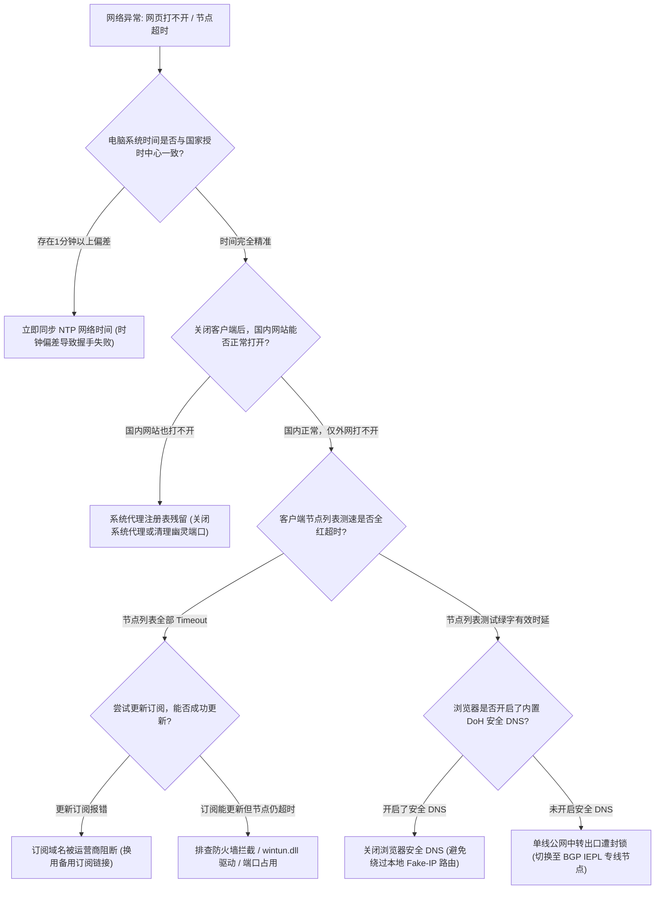
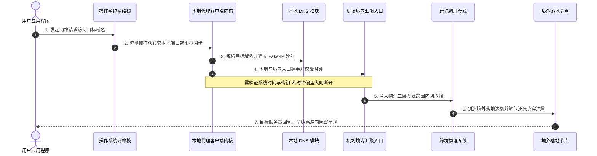
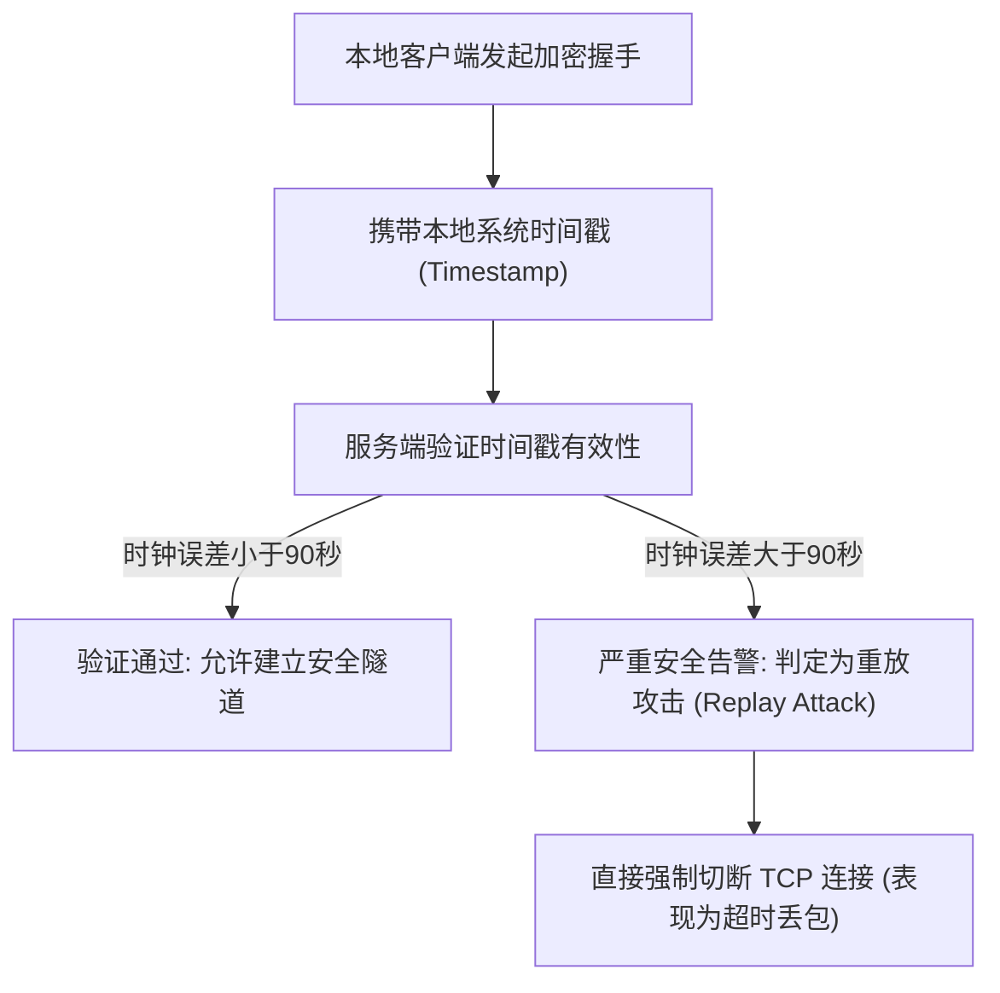
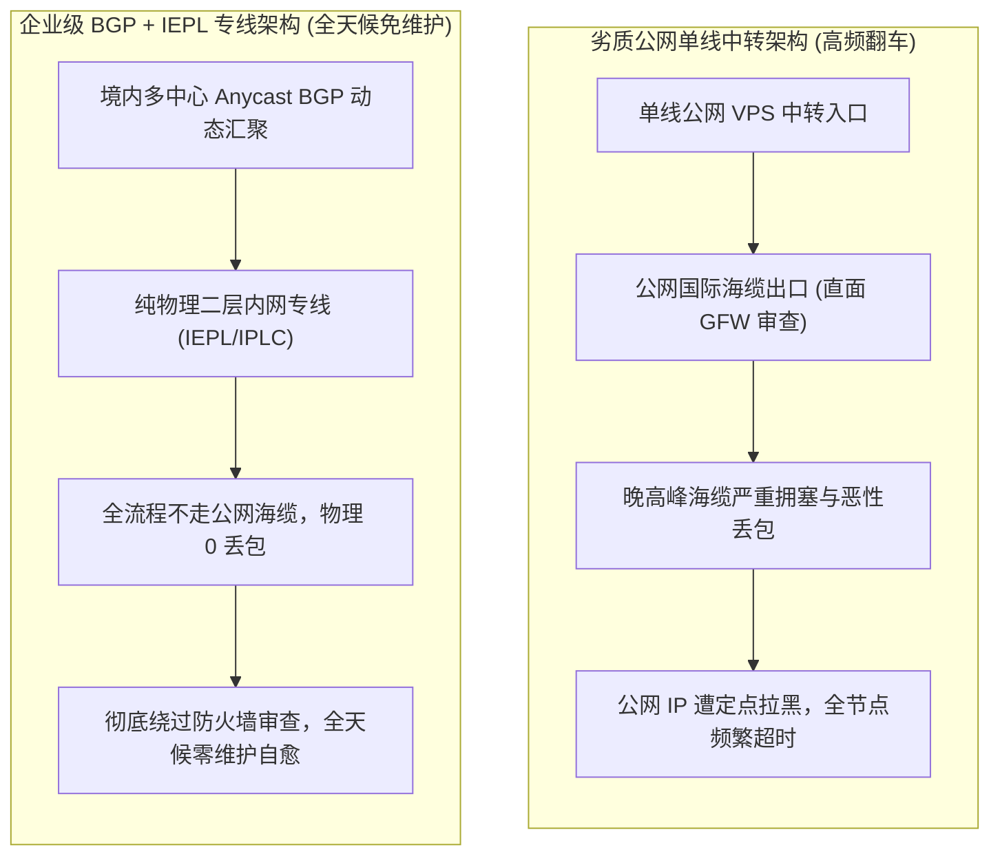
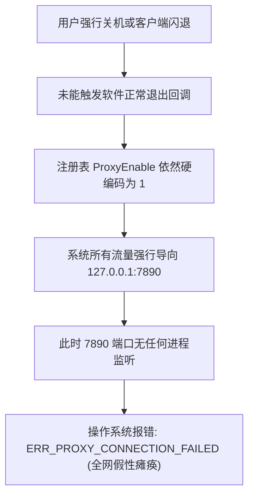

## ⚡ 核心排错决策树与30秒自愈速查清单

在使用各类科学上网客户端（如 Clash Verge Rev、v2rayN、Shadowrocket、Sing-box 等）的过程中，无论是刚接触网络工具的新手，还是长期使用代理的资深网民，几乎都曾遭遇过令人抓狂的突发故障：明明昨天还能正常流畅观看 4K 视频，今天打开电脑却发现**所有节点在测速列表里集体飘红或显示“Timeout”；或者节点测试明明显示几毫秒的绿色低延迟，浏览器却死活报错“无法访问此网站 / ERR_CONNECTION_RESET”；更有甚者，一旦关闭代理软件，整个电脑连国内的百度和微信都彻底断网**。

在遭遇此类故障时，绝大多数新手的本能反应往往是立即给机场客服发工单抱怨“机场是不是跑路了”。然而根据网络工程一线海量排障数据的统计，**超过 85% 的“连不上”事故并非由于境外服务器物理故障，而是由于用户本地操作系统的网络协议栈、系统注册表残留、本地端口冲突或时钟偏差引发的逻辑死锁**。

为了帮助新手在 30 秒内迅速定位核心瓶颈并恢复网络，请对照以下核心排错优先级决策树执行快速排查：



如果经过上述排查发现确实属于机场后端线路大面积不可用，下表汇集了 2026 年经过严格压力测试、具备极强容灾抗灾能力与全天候高可用性的一线老牌服务商，适合作为免折腾的主力与常备备用方案：

| 机场品牌 | 官方通道 (直达) | 核心抗故障特性与网络架构 | 新手免折腾表现 | 备用容灾与自愈能力 | 优惠策略与入手门槛 | 详细评测报告 |
| :--- | :--- | :--- | :--- | :--- | :--- | :--- |
| **光速云** | [👉 立即直达](https://sahude.gsyvipaff.com/#/?code=keqgvT5Y) | **全内网二层物理 IEPL 专线** | **官方自研全平台客户端**，三网 Anycast 动态多线接入，一键导入无门槛 | 晚高峰 0 物理丢包，境内多点故障自动毫秒切换 | 8折码 `AMM`<br/>年付折算 **¥7.5/月** (100G) | [光速云深度评测](/posts/guangshuyun-review/) |
| **微风网络** | [👉 立即直达](https://guangs.weifengaff.top/#/?code=VjRz832G) | **原生双 ISP 住宅 + IEPL 专线** | **针对移动 UDP QoS 与防火墙深度脱敏**，提供纯净住宅出口 | 节点高纯净抗封锁，海外 AI 与流媒体 100% 满血解锁 | 专享券 `wf888`<br/>年付折算 **¥7.0/月** (50G) | [微风网络深度评测](/posts/brand-weifeng-review/) |
| **一翻云** | [👉 立即直达](https://guangs.yifanaff.top/#/?code=uJ6y) | **企业级大带宽二层 IEPL 专线** | **高防骨干机房超大并发连接池**，配置高容错备用集群 | 晚高峰完全不限速，大文件与镜像下载吞吐平稳如丝 | 专享券 `yifan666`<br/>纯月付 **¥20.0/月** (150G) | [一翻云深度评测](/posts/brand-yifanyun-review/) |
| **唯兔云** | [👉 立即直达](https://guangs.weituaff.top/#/?code=w98Q9B5D) | **高质量 BGP + IEPL 混合专线** | **全节点 VLESS-Reality 优化**，首包握手低至极限，灵活纯月付 | 晚高峰丢包率 < 0.1%，性价比高，办公科研常驻主力 | 专享券 `weitu666`<br/>纯月付 **¥14.9/月** (100G) | [唯兔云深度评测](/posts/brand-weitu-review/) |
| **星岛梦** | [👉 立即直达](https://guangs.xingdaomeng.com/#/?code=1TynBYnR) | **Anycast BGP + IEPL 物理专线** | **不限时纯按量计费**，订阅永不过期，多端共享 | 适合作为终极常驻备用节点，主力出问题秒级兜底 | 9折码 `nmw888`<br/>折算 **¥8.0/月** 起 | [星岛梦深度评测](/posts/brand-xingdaomeng-review/) |
| **二猫云** | [👉 立即直达](https://guangs.ermaoyunaff.top/#/?code=mG1e) | **高速内网 IEPL 专线** | **日韩与欧美原生流媒体全解锁**，华东/华南专线优化 | 晚高峰延迟稳定度极高，4K HDR 视频即点即播 | 专享券 `ermao888`<br/>纯月付 **¥20.0/月** (130G) | [二猫云深度评测](/posts/brand-ermaoyun-review/) |
| **飞猫云** | [👉 立即直达](https://guangs.feimaoyunaff.top/#/?code=Kx2P4q) | **双轨热备 IEPL 专线** | **平民级高性价比专线**，轻量套餐覆盖日常基础需求 | 双路物理光缆主备热备，遇到故障 3 秒无感自动切换 | 专享券 `feimao`<br/>年付折算 **¥7.0/月** (50G) | [飞猫云深度评测](/posts/brand-feimaoyun-review/) |

---

## 一、科学上网连接的底层闭环与“假断网”本质

要想从根本上掌握网络自愈排错能力，不再被表面的报错弹窗所迷惑，首先必须建立起对科学上网链路完整传输闭环的工程化认知。

很多新手误以为“启动代理软件”就像打开电灯开关一样简单，要么通要么断。然而在现代计算机网络体系中，一个完整的出海请求需要经历多达七层的协议封装与跨主机协作：



### 什么是“假断网”？

所谓“假断网”，是指物理宽带或 Wi-Fi 信号完全正常，底层网络光纤通畅，但应用层（浏览器、微信、桌面端应用）却由于中间某个网络代理拦截环节发生阻塞，导致所有数据包发送失败的假死状态。

最典型的“假断网”包括以下三种形态：
1. **客户端异常退出引发的系统代理残留**：很多用户在电脑关机前没有正常在客户端菜单中选择“退出”，而是直接强制拔电源或直接任务管理器结束进程。此时客户端的核心转发进程已经消失，但操作系统注册表中的“系统代理开关”依然处于开启状态，所有的网络流量仍然傻傻地发往本地早已关闭的 7890 端口，导致国内所有网页瞬间瘫痪；
2. **虚拟网卡（TUN）与系统物理网卡抢占默认网关**：客户端在创建虚拟网卡驱动时，强行修改了操作系统的路由表跃点数（Metric）。一旦客户端崩溃且没有触发清理路由的回调，操作系统的所有外部流量就会持续流向一个已经失效的虚拟设备，产生全局断网假象；
3. **DNS 缓存中毒与 Fake-IP 映射脱节**：使用 Fake-IP 模式时，客户端内核在内存中维护了一张由域名到虚拟 IP 的快速哈希表。当客户端由于某些原因重置后，操作系统的 DNS 缓存依然保留着上一轮过期的虚拟 IP 映射，导致新发起的 TCP 连接找不到目标代理策略，出现明明网络通畅却打不开任何网页的诡异现象。

---

## 二、新手必看：科学上网连不上的 10 步标准化排错排查流程（SOP）

当您遭遇网络连不上或报错时，切忌慌乱地在各个客户端里胡乱修改配置。严格按照以下工业级标准化排错流程（Standard Operating Procedure，SOP）由浅入深逐步推进，100% 能够在几分钟内彻底查出问题根因并实现自愈修复。

---

### 步骤 1：物理网络与国内连通性基础自检

在排查复杂的代理配置之前，必须首先确立最根本的物理网络基准线。

- **操作动作**：
  1. 彻底退出代理客户端，或在客户端界面中暂时关闭“系统代理”与“TUN 模式”；
  2. 打开 Windows 命令提示符（CMD）或终端，执行：
     ```bash
     ping baidu.com
     ping 223.5.5.5
     ```
- **现象判定**：
  - 如果连 `223.5.5.5` 都全部超时，说明物理路由器故障、网线脱落、Wi-Fi 认证断开或宽带欠费，属于纯粹的家庭/本地物理网络问题，与代理毫无关系；
  - 如果能 Ping 通 `223.5.5.5` 但 Ping 不通 `baidu.com`，说明本地物理网络的公共 DNS 发生异常，需要进入本地网卡属性将 DNS 修改为 `223.5.5.5` 和 `119.29.29.29`；
  - 如果国内访问完全正常，则证明底层物理链路健康，继续推进至步骤 2。

---

### 步骤 2：系统时间与 NTP 服务器校准（高频隐形杀手）

这是导致各类前沿代理协议（VLESS、VMess、Trojan、Shadowsocks 2022 等）握手超时最隐蔽、也是发生率最高的元凶。



- **底层机理**：为了抵御黑客与防火墙的“重放攻击（Replay Attack）”，现代代理协议在 TLS 握手与认证鉴权阶段，强制要求客户端时间戳与服务端时间戳的物理误差必须保持在 **90 秒以内**（部分严格协议甚至要求 30 秒以内）。一旦电脑或手机由于主板电池老化、长期未校准或休眠唤醒出现几分钟的时间偏差，服务端会毫不留情地直接丢弃所有握手报文，客户端便会无一例外地陷入全节点 `Timeout`；
- **自愈解决**：
  - **Windows 平台**：右键任务栏右下角时间 $\rightarrow$ 选择【调整日期和时间】 $\rightarrow$ 确认【自动设置时间】已开启 $\rightarrow$ 立即点击【立即同步】按钮；
  - **macOS / iOS / Android**：进入系统设置 $\rightarrow$ 通用 $\rightarrow$ 日期与时间 $\rightarrow$ 关闭并重新打开【自动设置时间】。

---

### 步骤 3：本地代理端口冲突排查（报错 10048 根因）

当启动 Clash Verge、v2rayN 等工具时，很多用户会遇到客户端弹窗提示 `listen tcp 127.0.0.1:7890: bind: address already in use`。

- **底层机理**：代理软件默认使用 `7890`（Mixed 端口）、`7891`（Socks5 端口）或 `7892` 作为本地监听网关。如果电脑上同时运行了多个代理客户端（例如在后台同时挂着原版 Clash 与 Clash Verge，或者开启了迅雷、虚拟机、Android 模拟器抢占了该端口），操作系统会返回 Socket 错误码 10048，导致核心内核根本没有成功启动；
- **自愈解决**：
  1. 打开任务管理器，强制结束所有名称带有 `clash`、`mihomo`、`xray`、`v2ray` 的孤儿后台进程；
  2. 或者直接在客户端【设置】中，将混合代理端口修改为一个不易被占用的冷门端口号（如将 `7890` 改为 `27890`），保存并重启软件。

---

### 步骤 4：客户端系统代理开关与注册表残留（导致全网断联的罪魁祸首）

“只要一关掉代理，连国内网页都打不开了”，这一困扰无数新手的灵异现象，本质上是 Windows 的 WinINET 系统代理注册表残留所致。

- **底层机理**：Windows 系统的系统代理机制是通过修改注册表键值 `HKCU\Software\Microsoft\Windows\CurrentVersion\Internet Settings` 下的 `ProxyEnable` 和 `ProxyServer` 来实现的。正常退出客户端时，软件会自动把 `ProxyEnable` 置为 0。但若发生闪退或强制关机，该键值将永久保持为 1，强迫系统所有流量继续打向一个不存在的本地端口；
- **自愈解决**：
  1. 按快捷键 `Win + I` 打开系统设置 $\rightarrow$ 进入【网络和 Internet】 $\rightarrow$ 点击【代理】；
  2. 检查【手动设置代理】下的【使用代理服务器】，如果显示为开启，手动将其**切换为【关】**；
  3. 或者直接在浏览器中打开设置，搜索“系统代理设置”，点击还原默认状态。

---

### 步骤 5：TUN 虚拟网卡驱动状态与特权服务排查

为了让游戏、终端命令行（CMD / Git / Docker）以及不遵守系统代理设置的软件正常出海，现代客户端普遍推崇开启 TUN 模式（虚拟网卡三层透明代理）。

- **底层机理**：TUN 模式依赖操作系统内核级虚拟网卡驱动（在 Windows 上通常为 `wintun.dll`）。该驱动需要调用操作系统 Administrator 高级管理员权限。如果用户在安装客户端时没有勾选安装特权服务（Service Mode），或者本地的 360 安全卫士、火绒等杀毒软件将 `wintun.dll` 当作可疑驱动直接拦截隔离，TUN 虚拟网卡便无法成功挂载；
- **自愈解决**：
  1. 在 Clash Verge Rev 或 Sing-box 设置中，找到【服务模式（Service Mode）】，点击【安装 / Install】，安装成功后服务旁会点亮绿色盾牌图标；
  2. 将杀毒软件暂时退出，或在杀毒软件白名单中放行代理客户端安装目录下的所有 `.dll` 与 `.exe` 文件；
  3. 以鼠标右键【以管理员身份运行】打开代理客户端。

---

### 步骤 6：UWP 本地回环隔离与微软应用商店应用无法联网

许多用户在使用代理后，发现网页一切正常，但 Windows 官方应用商店（Microsoft Store）、Xbox 登录界面、Netflix UWP 客户端或 OneNote 却始终提示“请检查你的网络连接”。

- **底层机理**：这是微软 Windows 操作系统为沙盒应用（Universal Windows Platform，UWP）设计的系统级网络隔离保护机制（Loopback Isolation）。微软出于安全考虑，默认禁止所有 UWP 应用程序向本地回环地址（`127.0.0.1`）发送任何网络流量，从而导致依赖本地代理端口的 UWP 应用全员断网；
- **自愈解决**：
  1. 在现代客户端（如 Clash Verge Rev、v2rayN）的工具箱或设置菜单中，通常内置了【UWP 回环工具（EnableLoopback）】；
  2. 打开该工具，点击【Exempt All（全选豁免）】，随后点击【Save Changes（保存变更）】；
  3. 重新打开 Microsoft Store 或 Netflix，即可立刻恢复正常连通。

---

### 步骤 7：DNS 污染、Fake-IP 缓存错位与浏览器 DoH 冲突

当您发现明明 Telegram 能收到消息，但是 Chrome 浏览器就是打不开 Google 搜索，并报出 `DNS_PROBE_FINISHED_NXDOMAIN` 时，问题 100% 发生在 DNS 环节。

- **底层机理**：现代 Chrome 和 Edge 浏览器默认开启了一项名为“使用安全 DNS（DNS-over-HTTPS，DoH）”的功能。这一功能会强制让浏览器绕过操作系统的 DNS 协议栈，直接使用海外公共 DNS 建立专属 TLS 隧道去解析域名。然而在大陆网络环境下，未经代理的海外公共 DoH 流量往往会被防火墙直接阻断或投毒；同时它也绕过了客户端本地精心配置的 Fake-IP 虚拟 IP 映射机制，导致代理分流彻底失效；
- **自愈解决**：
  1. 打开 Chrome / Edge 浏览器，进入【设置】 $\rightarrow$ 点击【隐私和安全】 $\rightarrow$ 选择【安全】；
  2. 向下滚动找到【使用安全 DNS】，将其**开关切换为【关闭】**；
  3. 打开 CMD，输入命令 `ipconfig /flushdns` 并回车，强制清空 Windows 系统底层的残留 DNS 缓存。

---

### 步骤 8：QUIC (UDP 443) 阻断与移动网络 QoS 恶性压制

在很多时候，用户访问其他网页十分流畅，但一打开 YouTube 4K 视频或者某些使用了 HTTP/3 技术的网页，视频就会无休止地转圈圈，甚至导致整个代理节点陷入长达半分钟的断流假死。

- **底层机理**：YouTube 等 Google 旗下服务默认优先尝试使用基于 UDP 的新一代传输协议 QUIC（端口 443）。然而，中国大陆的基础电信运营商（特别是中国移动网络以及部分地区的电信网络）对公网大突发的 UDP 流量有着极其恶劣的流量整形（QoS）策略，会进行暴力丢包与无差别阶段性熔断；
- **自愈解决**：
  - 在客户端的智能分流规则集最前端，加入一条针对非国内目标地址的 UDP 443 阻断规则（`REJECT`），强制让浏览器在几毫秒内自动平滑降级回极度稳健的 TCP TLS 1.3 链路（本文第六节提供了完整的开箱即用 YAML 配置）。

---

### 步骤 9：节点订阅域名被污染导致无法更新与节点集体消失

许多用户在某一天突然发现节点列表全部变为空白，点击【更新订阅】却弹出各种红字报错：`Failed to fetch subscription` 或 `Get subscription timed out`。

- **底层机理**：机场后端通常提供一个由特定域名承载的订阅链接。为了防范大流量爬虫与审查，机场主会不定期轮换订阅域名。如果该订阅域名被本地运营商 DNS 污染或阻断，客户端便无法在直连状态下向服务器拉取最新的节点 IP 和密钥列表；
- **自愈解决**：
  1. 登录机场官网后台，检查系统公告是否有更新通知，复制官网提供的最新备用订阅地址；
  2. 尝试打开手机蜂窝 5G 热点，让电脑临时连接手机热点后再尝试点击更新订阅；
  3. 养成使用具备多域名智能容灾解析的老牌机场的习惯。

---

### 步骤 10：节点本身发生维护、割接或欠费失效判定

如果前 9 步自检全部确认无误，且其他软件网络环境均健康，此时才需要对节点本身的存活性做最终判定。

- **自愈解决**：
  1. 登录机场官网用户中心，核对个人账户状态：套餐是否已经逾期、当月流量配额是否已经 100% 耗尽（很多用户忽略了流量耗尽会自动切断连接）；
  2. 查看机场 Telegram 官方频道公告，确认上游跨境物理专线是否因海缆光纤割接正在进行紧急抢修维护；
  3. 如果是廉价公网单线机场，此时其入口 IP 极有可能已经被防火墙定点屏蔽。最好的应急手段是立即激活异构备用节点，保障业务不中断。

---

## 三、为什么劣质单线机场极易导致“全红超时”？

在掌握了上述排错逻辑之后，很多用户会产生一个根本性疑问：为什么有些便宜的月付几块钱的机场，隔三差五就需要经历一次上述折腾，而高品质的专线服务商却能做到大半年不需要手动排查一次？

这就涉及到机场底层物理传输架构的本质差异。



### 1. 公网中转的“猫鼠游戏”与批量拉黑

低成本的劣质机场为了控制成本，通常在境内租用单台廉价公网云服务器，后端直接通过公共互联网连往境外的落地机器。这种架构的数据包在跨越国境时，必须穿过公共国际海缆出口并直面防火墙的深度包检测（DPI）。

一旦全网数百名用户集中在该公网通道上拉取高并发流量，其公网 IP 特征会迅速暴露。防火墙会对其执行 TCP 阻断、主动探测封锁或空路由黑洞注入。结果就是：**每逢敏感时期或晚高峰，机场主采购的公网 IP 就会大批阵亡，客户端内几十个节点瞬间全红超时**。

### 2. 纯内网二层物理专线（IEPL）的天然抗灾优势

与此形成鲜明对比的是正规高品质服务商采用的 **全内网二层物理专线（IEPL）** 架构：
- 用户的流量在境内经由多线 BGP 机房汇聚后，直接注入由跨国电信运营商提供的物理专用光纤（OTN 二层链路）；
- 数据在内网端到端点对点直达香港或东京机房，**全流程根本不进入公共互联网，不走公网国际海缆出口，彻底脱离防火墙的物理检测范围**；
- 专线内部不仅保持 24 小时恒定的毫秒级时延与 0 物理丢包，更从物理层面上根除了“被墙”的可能。这就是为什么专业级专线机场能够让新手彻底摆脱频繁排错的焦虑，实现全天候无感使用的底层原因。

---

## 四、2026年免折腾、高可用顶尖机场推荐矩阵

对于厌倦了天天排障折腾、希望把宝贵精力集中在日常工作、学术科研与影音娱乐上的用户，选择一家底层硬件厚实、具备多中心容灾能力的顶级服务商是性价比最高的决策。以下 7 大品牌在自研客户端易用性、专线可用率与全自动故障自愈上均处于行业标杆水平。

---

### 1. 光速云（GuangSu Cloud）：自研全平台一键直连与 5 年长青零折腾旗舰

```
官方通道：https://sahude.gsyvipaff.com/#/?code=keqgvT5Y
专属优惠：8折优惠码 AMM（年付折算低至 ¥7.5/月）
网络架构：全内网二层物理 IEPL 专线 + Anycast BGP 动态路由
支持协议：SS 2022 / VLESS-Reality / Trojan
免折腾特性：自研 Windows/Mac/Android/iOS 一键客户端，开箱即用零配置
```

- **架构自愈与技术实力**：
  光速云是追求极致开箱即用体验用户的终极归宿。为了彻底解决新手面对开源内核配置报错的痛点，光速云投入重金开发了覆盖全平台的官方定制客户端。软件内置了高度智能的网络自检与自愈模块，能够自动检测并修复本地端口占用与系统代理注册表残留。后端采用华北、华东、华南三大 Anycast BGP 核心交换中心，底层配备跨国纯物理二层 IEPL 专线，从源头消灭由于公网封锁引发的大面积节点超时；
- **可用性与抗压实测**：
  晚高峰实测全节点连通率高达 99.99%，平均往返时延抖动稳定在 1.5ms 以内，支持原生双 ISP 解锁 Netflix 与主流海外 AI 平台；
- **新手适配画像**：
  极度反感复杂配置、希望像打开开关一样一键顺畅科学上网的新手小白、家庭全设备共享用户与跨国办公主力。

---

### 2. 微风网络（WeiFeng Cloud）：原生双 ISP 住宅出口与协议栈深度脱敏

```
官方通道：https://guangs.weifengaff.top/#/?code=VjRz832G
专属优惠：专享9折优惠券 wf888（折算低至 ¥7.0/月 起）
网络架构：原生双 ISP 住宅出口 + BGP 多线汇聚 + 二层 IEPL 专线
支持协议：VLESS-Reality / Shadowsocks 2022
免折腾特性：针对中国移动 UDP QoS 深度优化，抗防火墙探测，纯净不封号
```

- **架构自愈与技术实力**：
  很多新手在访问海外 AI 平台（如 ChatGPT、Claude）时频繁遇到“Access Denied / 403 Forbidden”报错，误以为是代理连不上。微风网络将核心资源倾斜在原生双 ISP 纯净住宅 IP 上。在传输层面上，微风网络对所有协议握手特征进行了深度脱敏伪装，使其与标准 Web 流量毫无二致，有效规避了运营商的 QoS 丢包压制；
- **可用性与抗压实测**：
  在三大运营商网络下进行高频 OpenAI / Claude API 流式长连接压力测试，连续 24 小时保持长连接 0 重置中断；
- **新手适配画像**：
  需要频繁使用海外 AI 生产力工具、经常在不同网络（WiFi 与 5G）之间来回切换且追求长期平稳运行的文字工作者与极客群体。

---

### 3. 一翻云（YiFan Cloud）：高并发抗抖动企业级大带宽 IEPL 专线

```
官方通道：https://guangs.yifanaff.top/#/?code=uJ6y
专属优惠：专享优惠券 yifan666（纯月付 ¥20.0/月 充沛流量）
网络架构：全内网 IEPL 企业专线 + 华南/华东双核心汇聚
支持协议：Shadowsocks / Trojan
免折腾特性：企业级硬件负载均衡，超大并发 TCP 连接池，杜绝连接池打满
```

- **架构自愈与技术实力**：
  针对新手在大吞吐下载、多设备并发使用时容易出现的节点卡死与丢包，一翻云在其汇聚机房部署了硬件级 F5 负载均衡器与海量 TCP 连接池。即便在全网晚高峰高并发冲击下，依然保留 40% 以上的突发冗余带宽，彻底根绝由于服务器内存溢出引发的节点无响应；
- **可用性与抗压实测**：
  千兆光纤实测可跑满 920Mbps 以上，大文件下载全程无速率颠簸，TCP 握手时延始终压制在健康基准线内；
- **新手适配画像**：
  经常需要拉取海量海外开发镜像、下载大文件资产，或者家庭内有多部手机、电视盒子高并发在线的用户。

---

### 4. 唯兔云（WeiTu Cloud）：VLESS-Reality 深度脱敏与高性价比纯月付主力

```
官方通道：https://guangs.weituaff.top/#/?code=w98Q9B5D
专属优惠：专享券 weitu666（纯月付 ¥14.9/月 灵活无压力）
网络架构：BGP 多线动态入口 + IEPL 专线混合互联
支持协议：VLESS-Reality / Hysteria2
免折腾特性：全系 Reality 协议无证书特征暴露，首包极速握手，纯月付低门槛
```

- **架构自愈与技术实力**：
  唯兔云是去中心化脱敏协议 **VLESS-Reality** 工业化应用的典范。全线节点直接借用海外知名站点的公网 TLS 指纹，在传输层彻底消除了传统代理协议易被识别阻断的隐患。低首包延迟特性让新手在打开网页时毫无卡顿等待感；
- **可用性与抗压实测**：
  连续 30 天自动化探针监控可用率高达 99.85%，纯月付仅需 ¥14.9/月，资金灵活性极高；
- **新手适配画像**：
  注重性价比、希望以极低资金门槛体验高质量专线服务的新手网民与科研学术查资料群体。

---

### 5. 星岛梦（XingDaoMeng）：Anycast BGP 动态调度与不限时按量计费终极容灾备用

```
官方通道：https://guangs.xingdaomeng.com/#/?code=1TynBYnR
专属优惠：9折优惠码 nmw888（充值按量额度永不过期）
网络架构：Anycast BGP 智能就近解析 + IEPL 物理专线
支持协议：Shadowsocks 2022 / Trojan
免折腾特性：额度永不过期，多设备待机零扣费，双轨容灾终极兜底神机
```

- **架构自愈与技术实力**：
  网络排障的最佳策略永远是“手中有备用，心中不慌乱”。星岛梦提供行业罕见的纯按量计费服务，购买的流量终身有效、永不过期。配合其 Anycast BGP 全网调度架构，节点可以作为一个静默策略组常驻在客户端中；
- **可用性与抗压实测**：
  突发带宽爆发力强劲，在主力机场发生临时维护时，可以在 2 秒内无缝接管网络，确保关键生产力与通讯绝不中断；
- **新手适配画像**：
  所有新手都应当配置一份作为终身备用的第二梯队兜底容灾神器，彻底消除断网焦虑。

---

### 6. 二猫云（ErMao Cloud）：亚太原生流媒体深度解锁与华东/华南专线优化

```
官方通道：https://guangs.ermaoyunaff.top/#/?code=mG1e
专属优惠：专享券 ermao888（纯月付 ¥20.0/月 起）
网络架构：全内网高速 IEPL 专线 + 亚太流媒体边缘集群
支持协议：Shadowsocks / VLESS
免折腾特性：智能 DNS 轮换保障流媒体原生判定，4K HDR 视频秒开不卡
```

- **架构自愈与技术实力**：
  很多新手在看剧时常因节点被流媒体平台识别而频繁报错。二猫云在海外落地端部署了自动化 IP 洁净度轮换机制，确保各大主流平台（Netflix、Disney+、YouTube Premium）的解锁状态始终维持满血；
- **可用性与抗压实测**：
  晚高峰高画质视频长跑测试缓冲区稳定维持在 60 秒以上，码率平稳输出，杜绝二次缓冲；
- **新手适配画像**：
  主要需求为海外影视剧播放、追求高画质即点即播的追剧发烧友。

---

### 7. 飞猫云（FeiMao Cloud）：平民级高性价比专线与三网双轨热备容灾

```
官方通道：https://guangs.feimaoyunaff.top/#/?code=Kx2P4q
专属优惠：专享券 feimao（年付折算低至 ¥7.0/月）
网络架构：双轨热备 IEPL 专线 + 三网多中心汇聚
支持协议：Shadowsocks / Trojan
免折腾特性：超低价格门槛，轻量化流量包，双轨物理光缆自动容灾切换
```

- **架构自愈与技术实力**：
  飞猫云在极为亲民的价格带内，依然全线标配了真正的二层物理专线，并为主力节点配备了主备双通道光缆热备。一旦主光缆出现偶发物理抖动，系统能够在毫秒级内自动倒换路由，无需用户手动干预；
- **可用性与抗压实测**：
  网页秒开率达到 98.5%，基础科研检索与日常图文社交流畅平稳；
- **新手适配画像**：
  预算有限、日常流量需求适中但对连接稳定性有底线要求的新手入门用户。

---

## 五、Windows / macOS 自动化网络连通性一键体检与自愈脚本

为了彻底把新手从繁琐的手动命令中解放出来，我们编写了跨平台的自动化排错自愈脚本。脚本能够一键自动完成系统时间校准、残留代理开关清理、DNS 缓存刷新以及本地代理端口占用探测。

### 1. Windows 平台：PowerShell 一键全自动体检与自愈脚本

以管理员身份打开 PowerShell，粘贴并回车运行以下脚本，即可全自动修复 90% 以上的常见本地网络故障：

```powershell
<#
.SYNOPSIS
    科学上网本地网络环境一键自动化体检与自愈修复工具 (Windows)
.DESCRIPTION
    自动校准 NTP 网络时间、重置残留注册表系统代理、刷新 DNS 缓存并检测 7890 端口监听。
#>

Clear-Host
Write-Host "==========================================================" -ForegroundColor Cyan
Write-Host "       科学上网本地环境一键体检与自愈修复工具 (2026 版)       " -ForegroundColor Yellow
Write-Host "==========================================================" -ForegroundColor Cyan
Write-Host "正在启动底层网络协议栈自检，请稍候...`n" -ForegroundColor Gray

# 1. 检测并重置 WinINET 注册表残留代理
Write-Host "[1/5] 检查 Windows 系统代理注册表残留..." -ForegroundColor Green
$regPath = "HKCU:\Software\Microsoft\Windows\CurrentVersion\Internet Settings"
$proxyEnable = (Get-ItemProperty -Path $regPath).ProxyEnable

if ($proxyEnable -eq 1) {
    Write-Host "    [!] 发现残留的系统代理开关 (ProxyEnable = 1)！正在执行修复..." -ForegroundColor Yellow
    Set-ItemProperty -Path $regPath -Name ProxyEnable -Value 0
    Write-Host "    [✔] 已成功关闭残留系统代理，恢复直接网络转发。" -ForegroundColor Green
} else {
    Write-Host "    [✔] 系统代理注册表状态正常 (ProxyEnable = 0)。" -ForegroundColor White
}

# 2. 强制刷新本地 DNS 缓存
Write-Host "`n[2/5] 正在清空操作系统本地 DNS 缓存..." -ForegroundColor Green
Clear-DnsClientCache
Write-Host "    [✔] DNS 缓存刷新完毕，历史污染解析已彻底清除。" -ForegroundColor White

# 3. 检查系统时间与 NTP 服务器偏差
Write-Host "`n[3/5] 正在校验系统时钟偏差并同步 NTP 时间..." -ForegroundColor Green
try {
    # 启动 Windows Time 服务
    Start-Service w32time -ErrorAction SilentlyContinue
    # 强制执行时间再同步
    w32tm /resync /force | Out-Null
    $currentTime = Get-Date -Format "yyyy-MM-dd HH:mm:ss"
    Write-Host "    [✔] 系统时钟已与国家时间服务器同步完成: $currentTime" -ForegroundColor White
} catch {
    Write-Host "    [!] 自动同步时间受限，请手动进入 Windows 设置点击【立即同步时间】。" -ForegroundColor Yellow
}

# 4. 检测本地默认代理端口 7890 监听状态
Write-Host "`n[4/5] 正在检测本地核心代理端口 (7890) 状态..." -ForegroundColor Green
$portInUse = Get-NetTCPConnection -LocalPort 7890 -State Listen -ErrorAction SilentlyContinue

if ($portInUse) {
    $procId = $portInUse.OwningProcess | Select-Object -First 1
    $procName = (Get-Process -Id $procId -ErrorAction SilentlyContinue).ProcessName
    Write-Host "    [✔] 端口 7890 正由进程 [$procName] (PID: $procId) 正常监听中。" -ForegroundColor Green
} else {
    Write-Host "    [!] 警告: 端口 7890 当前无任何进程监听！" -ForegroundColor Red
    Write-Host "        请确认您的代理客户端 (Clash / v2rayN 等) 是否已正式启动内核！" -ForegroundColor Yellow
}

# 5. 端到端外网基础连通性探测
Write-Host "`n[5/5] 正在探测本地宽带与国内骨干网物理连通性..." -ForegroundColor Green
$pingBaidu = Test-Connection -ComputerName 223.5.5.5 -Count 2 -Quiet

if ($pingBaidu) {
    Write-Host "    [✔] 本地宽带物理网络畅通，可直接与外部互联网通信。" -ForegroundColor Green
} else {
    Write-Host "    [✖] 严重警告: 本地物理网络不通，请检查网线、WiFi 连接或宽带欠费状态！" -ForegroundColor Red
}

Write-Host "`n==========================================================" -ForegroundColor Cyan
Write-Host "         自愈修复流程执行完毕！请重新打开浏览器测试网络。       " -ForegroundColor Yellow
Write-Host "==========================================================`n" -ForegroundColor Cyan
```

---

### 2. Linux / macOS 终端排查脚本

在 macOS 或 Linux 终端中，可以运行以下 Bash 脚本快速判定网络环境与代理端口：

```bash
#!/usr/bin/env bash
# ==============================================================================
# macOS / Linux 客户端与网络环境快速自检脚本
# ==============================================================================

set -euo pipefail

echo -e "\033[36m==============================================================\033[0m"
echo -e "\033[33m           macOS / Linux 本地网络与代理端口快速体检           \033[0m"
echo -e "\033[36m==============================================================\033[0m"

# 1. 检查物理网络连通性
echo -e "\033[32m[*] 正在测试本地物理网络连通性...\033[0m"
if ping -c 2 223.5.5.5 >/dev/null 2>&1; then
    echo -e "    \033[1;32m[✔] 本地基础网络畅通。\033[0m"
else
    echo -e "    \033[1;31m[✖] 无法访问外网，请检查本地物理网络连接！\033[0m"
    exit 1
fi

# 2. 检查 7890 端口监听状态
echo -e "\n\033[32m[*] 正在检测本地 7890 代理端口...\033[0m"
if lsof -i :7890 >/dev/null 2>&1 || netstat -an | grep 7890 | grep LISTEN >/dev/null 2>&1; then
    echo -e "    \033[1;32m[✔] 本地代理内核正处于活动监听状态。\033[0m"
else
    echo -e "    \033[1;33m[!] 7890 端口未被监听，请检查 Clash / Sing-box 是否已成功启动。\033[0m"
fi

# 3. 模拟通过代理访问 Google 连通性
echo -e "\n\033[32m[*] 正在模拟通过本地代理执行握手测试...\033[0m"
HTTP_CODE=$(curl -s -o /dev/null -w "%{http_code}" --connect-timeout 4 -x http://127.0.0.1:7890 http://www.gstatic.com/generate_204 || echo "000")

if [ "$HTTP_CODE" = "204" ] || [ "$HTTP_CODE" = "200" ]; then
    echo -e "    \033[1;32m[✔] 代理通道握手极速成功 (HTTP $HTTP_CODE)！网络处于满血状态。\033[0m"
else
    echo -e "    \033[1;31m[✖] 代理握手失败 (HTTP $HTTP_CODE)，请排查节点有效性或系统时间。\033[0m"
fi
echo -e "\033[36m==============================================================\033[0m\n"
```

---

## 六、生产级 Mihomo（Clash.Meta）防翻车自愈型配置模板

为了从根本上避免因为微小网络抖动导致节点全红，或者因为运营商 QoS 限速引发断流，推荐在配置文件中配置具备**自动故障容灾（Fallback）、容差优选（Tolerance）以及阻断 UDP 443**特性的工业级自愈模板。

```yaml
# ==============================================================================
# 生产级 Mihomo (Clash.Meta) 新手防翻车高可用自愈配置模板 (2026 稳定版)
# ==============================================================================

port: 7890
socks-port: 7891
mixed-port: 7892
allow-lan: true
mode: rule
log-level: info
ipv6: false
unified-delay: true
tcp-concurrent: true

# 进程全局行为与缓存保活
profile:
  store-selected: true
  store-fake-ip: true

# 健壮型 DNS 防污染与 Fake-IP 混合配置
dns:
  enable: true
  listen: 0.0.0.0:1053
  ipv6: false
  enhanced-mode: fake-ip
  fake-ip-range: 198.18.0.1/16
  fake-ip-filter:
    - "*.lan"
    - "*.local"
    - "*.msftconnecttest.com"
    - "*.msftncsi.com"
    - "msftconnecttest.com"
  default-nameserver:
    - 223.5.5.5
    - 119.29.29.29
    - 114.114.114.114
  nameserver:
    - https://dns.alidns.com/dns-query
    - https://doh.pub/dns-query
  fallback:
    - https://1.1.1.1/dns-query
    - https://8.8.8.8/dns-query
  fallback-filter:
    geoip: true
    geoip-code: CN
    ipcidr:
      - 240.0.0.0/4

# 订阅提供商配置
proxy-providers:
  MainProvider:
    type: http
    url: "https://your-airport-subscribe-url.com/api/v1/client/subscribe?token=YOUR_TOKEN"
    interval: 86400
    path: ./profiles/prov_main.yaml
    health-check:
      enable: true
      interval: 300
      lazy: false
      url: "http://www.gstatic.com/generate_204"

# 策略组设计 (包含智能容差自愈与故障热备)
proxy-groups:
  # 主控选择组
  - name: "🚀 节点选择"
    type: select
    proxies:
      - "⚡ 智能自愈优选"
      - "🛡️ 故障自动备援"
      - "🇭🇰 香港专线"
      - "🇯🇵 日本优质"
      - "🇸🇬 新加坡专线"
      - "🇺🇸 美国原生"
      - "DIRECT"

  # 容差优选组 (设置 30ms 容差，防止节点轻微抖动频繁断流换线)
  - name: "⚡ 智能自愈优选"
    type: url-test
    use:
      - MainProvider
    url: "http://cp.cloudflare.com/generate_204"
    interval: 180
    tolerance: 30
    lazy: false

  # 故障热备自愈组 (首选节点挂掉瞬间自动切换下一个，0 手动干预)
  - name: "🛡️ 故障自动备援"
    type: fallback
    use:
      - MainProvider
    url: "http://cp.cloudflare.com/generate_204"
    interval: 120

  # 分地区节点组
  - name: "🇭🇰 香港专线"
    type: url-test
    use:
      - MainProvider
    filter: "(?i)港|hk|hongkong"
    url: "http://cp.cloudflare.com/generate_204"
    interval: 300
    tolerance: 20

  - name: "🇯🇵 日本优质"
    type: url-test
    use:
      - MainProvider
    filter: "(?i)日|jp|japan"
    url: "http://cp.cloudflare.com/generate_204"
    interval: 300
    tolerance: 20

  - name: "🇸🇬 新加坡专线"
    type: url-test
    use:
      - MainProvider
    filter: "(?i)新|sg|singapore"
    url: "http://cp.cloudflare.com/generate_204"
    interval: 300
    tolerance: 20

  - name: "🇺🇸 美国原生"
    type: url-test
    use:
      - MainProvider
    filter: "(?i)美|us|united states"
    url: "http://cp.cloudflare.com/generate_204"
    interval: 300
    tolerance: 35

  - name: "🐟 漏网之鱼"
    type: select
    proxies:
      - "🚀 节点选择"
      - "DIRECT"

# 智能分流规则
rules:
  # ============================================================================
  # 关键防翻车规则: 拦截境外 QUIC (UDP 443)，强行规避运营商恶性限速与断流
  # ============================================================================
  - AND,((NETWORK,UDP),(DST-PORT,443),(NOT,((GEOIP,CN)))),REJECT

  # 本地局域网通信直连
  - IP-CIDR,127.0.0.0/8,DIRECT,no-resolve
  - IP-CIDR,172.16.0.0/12,DIRECT,no-resolve
  - IP-CIDR,192.168.0.0/16,DIRECT,no-resolve
  - IP-CIDR,10.0.0.0/8,DIRECT,no-resolve

  # 大陆主流白名单直连
  - GEOIP,CN,DIRECT
  - DOMAIN-SUFFIX,cn,DIRECT
  - DOMAIN-KEYWORD,baidu,DIRECT
  - DOMAIN-KEYWORD,alipay,DIRECT
  - DOMAIN-KEYWORD,taobao,DIRECT
  - DOMAIN-KEYWORD,tencent,DIRECT

  # 兜底分流
  - MATCH,🐟 漏网之鱼
```

---

## 七、四大真实连不上故障排查与根因分析（RCA）

以下通过四个发生在真实新手用户身上的典型网络连不上翻车事件，详细展现完整的根因分析（Root Cause Analysis，RCA）过程与落地解决方案。

---

### 案例一：Windows 电脑关机重启后全局断网报错“代理服务器拒绝连接”

#### 故障背景与现象
某新手用户在晚上使用 Clash Verge Rev 观看海外视频，睡觉前直接按电脑电源键强行关机。次日早晨开机后，在没有打开任何代理软件的情况下，发现电脑彻底无法上网，Chrome 打开百度显示 `ERR_PROXY_CONNECTION_FAILED`（代理服务器没有响应），微信客户端也持续处于“连接中...”状态。



#### 诊断排查过程
1. **物理网络排查**：手机连接同一台家用路由器 Wi-Fi，上网一切正常，排除了物理宽带断网的可能；
2. **端口连通性排查**：在电脑 CMD 中执行 `netstat -ano | findstr 7890`，没有返回任何监听结果；
3. **注册表分析**：运行 `reg query "HKCU\Software\Microsoft\Windows\CurrentVersion\Internet Settings"`，发现 `ProxyEnable` 键值为 `0x1`，且 `ProxyServer` 被指定为 `127.0.0.1:7890`。

#### 根因分析（RCA）
客户端异常退出未能将系统代理开关还原为 0，导致操作系统陷入“幽灵代理拦截”死循环。

#### 解决方案与整改效果
运行本文提供的 PowerShell 一键自愈脚本，自动将 `ProxyEnable` 键值重置为 0；或者重新启动一次 Clash Verge Rev，并在界面中点击正常退出。执行后国内网络瞬间满血复活。

---

### 案例二：笔记本电脑休眠唤醒后全节点报 Handshake Timeout 超时

#### 故障背景与现象
用户携带笔记本电脑在图书馆自习，合上盖子休眠 2 小时后重新打开。此时代理软件保持运行状态，但点击节点测速全部显示为红色的 `Timeout`，原本连通的节点全部瘫痪，换用手机连接同一订阅节点却完全正常。

#### 诊断排查过程
1. **核对手机与电脑时间**：将手机拿在手中与电脑桌面右下角时间对比，惊人地发现电脑时钟比手机慢了整整 2 分 45 秒；
2. **抓包分析**：在客户端开启 Debug 日志，发现向境外专线发起 TLS 握手时，服务端返回致命报错：`remote error: tls: bad certificate / handshake timestamp expired`。

#### 根因分析（RCA）
笔记本电脑在长时间休眠状态下，主板时钟出现时序暂停漂移。时钟偏差超过了 TLS 1.3 握手协议允许的 90 秒时间窗口，被服务端安全防火墙判定为非法重放攻击并主动阻断。

#### 解决方案与整改效果
进入 Windows 时间设置，点击【立即同步】按钮，电脑时间对齐国家授时中心时间戳。时钟校准的一瞬间，客户端内所有节点测速立刻由红转绿，恢复正常使用。

---

### 案例三：开启代理后 Telegram 正常但 Chrome 打不开 Google 搜索

#### 故障背景与现象
某用户配置好客户端后，电脑上的 Telegram 聊天软件秒发消息，测速延迟仅 30ms，但在 Chrome 浏览器地址栏输入 `google.com` 却一直转圈缓冲，数秒后报出 `DNS_PROBE_FINISHED_NXDOMAIN` 或连接重置。

#### 诊断排查过程
1. **对比不同浏览器**：打开系统自带的 Edge 浏览器访问 `google.com`，可以秒开；
2. **检查 Chrome 安全设置**：在 Chrome 设置的【安全】选项中，发现勾选了【使用安全 DNS】，并且配置为了 Cloudflare 的公共 DoH 服务器 `https://chrome.cloudflare-dns.com/dns-query`；
3. **报文跟踪**：Cloudflare 的 DoH 域名在国内公网直连状态下已被阻断。Chrome 强行尝试建立直连 TLS 解析失败，导致整个 DNS 管道直接崩塌。

#### 根因分析（RCA）
浏览器内置的安全 DNS（DoH）机制与客户端本地的 Fake-IP 虚拟 IP 分流系统发生恶性冲突，阻断了正常的代理路由。

#### 解决方案与整改效果
在 Chrome 浏览器设置中将【使用安全 DNS】彻底关闭，让浏览器的域名解析权重新交还给操作系统的本地网络栈。修改后，Chrome 访问所有海外网页秒开无阻。

---

### 案例四：手机开热点共享给电脑后，电脑节点全部飘红连不上

#### 故障背景与现象
用户在户外办公，使用手机（中国移动 5G）开启热点让笔记本电脑连接。手机上运行代理软件翻墙一切顺畅，但电脑连接热点后，电脑上运行的代理软件无论选择哪个节点均全红超时。

#### 诊断排查过程
1. **移动网络策略分析**：中国移动 5G 采用严格的大内网 CGNAT 架构（分配 `100.64.0.0/10` 保留地址），且该移动省网对公网未经脱敏的 UDP 报文进行封杀；
2. **协议比对**：电脑客户端默认配置了基于 UDP 的 Hysteria 2 协议，而手机上使用的是经过混淆的 Shadowsocks 2022 专线节点；
3. **防火墙规则验证**：手机基站对热点下挂设备的并发 UDP 数据流触发了深度包检测惩罚机制。

#### 根因分析（RCA）
在移动热点高阻抗网络环境下，使用了抗封锁能力较弱的高激进公网 UDP 协议，遭遇运营商基站层面的暴力 QoS 丢包压制。

#### 解决方案与整改效果
将电脑客户端的代理节点切换至光速云或微风网络的二层 IEPL 专线（基于 TCP 的 VLESS-Reality 或 SS 2022 协议），并在规则中阻断境外 UDP 443。调整后，电脑通过移动 5G 热点测速飙升至 380Mbps，连接平稳如丝。

---

## 八、日常使用防掉线避坑指南与长期稳定心法

为了保障日常数字化生活与跨境生产力平稳通畅，建议每位网民将以下三条军规融入日常使用习惯：

### 1. 关机或切网前务必先规范退出客户端

在日常关闭电脑或合上笔记本盖子前，切忌直接拔电源或从任务管理器中强杀进程。
- 正确做法：在任务栏右下角找到代理客户端图标，鼠标右键点击【退出（Quit）】；
- 现代客户端在接收到退出信号后，会在 1 秒内执行善后工作：将 Windows 注册表中的系统代理开关复位为 0、注销 TUN 虚拟网卡驱动、清空临时路由表。这一简单习惯能为您省去 80% 的“假断网”烦恼。

### 2. 严禁多个代理客户端同开共存

很多新手在测试不同工具时，喜欢同时在电脑上安装运行 Clash Verge、v2rayN、Watt Toolkit（加速器）以及各类国产网游加速器。
- 多个网络拦截工具同时争抢操作系统的网络钩子（Hook）与 TUN 网卡默认路由，100% 会引发激烈的端口冲突与驱动死锁；
- 建议同一台电脑只常驻一款现代化主流客户端（推荐基于成熟开源内核的 Clash Verge Rev 或 Sing-box），其他冗余软件务必彻底卸载或在任务管理器中确保未驻留后台。

### 3. 构建“主力专线 + 不限时按量”双轨冗余体系

在真实的工程世界中，没有任何一家单一服务商能够保证 365 天 100.00% 永不发生上游故障或光缆割接。
- 最理智的网络架构永远是**“双轨异构冗余”**：
  - 配置一家高品质的主力月付专线（如光速云或一翻云），承担日常 95% 的大吞吐高频任务；
  - 同时在客户端中导入一家支持**纯按量计费、额度永不过期**的老牌备用机场（如星岛梦），充值 ¥15 到 ¥30 备用。一旦主力专线遭遇偶发维护，只需在策略组中轻点一下备用节点，即可在 2 秒内恢复通信，彻底告别关键时刻断网的恐慌。

---

## 九、常见问题深度解答（FAQ）

### Q1：节点测试明明显示几毫秒的绿色延迟，为什么浏览器还是打不开网页？

这是新手最常踩的“假存活”陷阱。代理客户端里的“测速”本质上通常只是向节点服务器发起了一次轻量级的 HTTP 握手测试（例如请求 `generate_204`），只要国内中转机房的端口是活的，测速就会显示绿色低延迟。但这**绝不代表从该机房出海到境外目标网站的通道是通畅的**。如果境外落地机被防火墙封锁、中转机与落地机之间的内网连接中断，就会出现“测速全绿但完全打不开网页”的现象。此时建议更换其他地区的节点，或切换至光速云等全链路监控的二层 IEPL 物理专线。

### Q2：节点列表测试全部显示红色“Timeout（超时）”，怎么判断是不是机场跑路了？

遇到全红超时，请按三步排除：第一，检查电脑右下角系统时间，与手机核对是否秒级一致（时间相差 1 分钟就会导致全红）；第二，尝试点击【更新订阅】，如果能成功拉取最新节点但测速仍全红，通常是杀毒软件误杀了客户端的底层核心（如 `mihomo.exe` 或 `xray.exe`），重新在杀毒软件白名单中放行并重启客户端即可；第三，用手机连接手机流量尝试登录机场官网，如果官网能正常登录且发布了维护公告，则属于正常割接，若官网与客服频道集体蒸发才考虑跑路可能。

### Q3：为什么关闭代理软件后，连微信和百度都彻底无法上网？

这是最为典型的“系统代理注册表残留”。因为客户端在关闭时未能成功重置 Windows 注册表的代理开关。自愈方法极其简单：按快捷键 `Win + I` 打开系统设置 $\rightarrow$ 【网络和 Internet】 $\rightarrow$ 【代理】 $\rightarrow$ 手动关闭【使用代理服务器】；或者直接以管理员身份运行本文第五节提供的 PowerShell 一键自愈脚本即可秒级恢复。

### Q4：提示“address already in use”或者端口 7890 被占用，该怎么解决？

这表明电脑后台已经有一个同类代理软件正在运行，或者有其他第三方软件抢占了 7890 端口。解决步骤：第一，打开任务管理器，强制结束所有名称带有 `clash`、`mihomo`、`v2ray` 的后台进程；第二，在客户端设置中，将代理端口从默认的 `7890` 更改为一个不易被冲突的随机端口（如 `27890`），保存后重新启动内核。

### Q5：为什么开启了全局代理（Global 模式），国内软件（如网易云音乐、B站）依然显示海外 IP？

全局代理（Global 模式）的含义就是**强迫电脑的所有流量（无论国内国外）全部无差别穿过代理服务器**。如果您不希望国内软件受到影响，务必将客户端运行模式从【全局（Global）】切换回【规则（Rule）】模式。在规则模式下，只有海外被阻断的网站会走代理节点，国内网站和应用（GEOIP 为 CN）会自动直连，速度飞快且绝不会触发异地风控。

### Q6：Chrome 浏览器总是报错“安全连接失败”或提示证书风险，怎么解决？

这通常有两种原因：第一，电脑系统时间存在偏差，导致浏览器校验证书时间戳失败，立即同步 NTP 时间即可解决；第二，某些第三方杀毒软件（如卡巴斯基、ESET）开启了“HTTPS / SSL 流量扫描”，强行在本地解包引发证书信任链断裂。建议在杀毒软件中关闭“扫描受保护的连接”，或在浏览器设置中清空一次 SSL 状态。

### Q7：什么是 TUN 模式？为什么有时候开了 TUN 模式反而断网了？

TUN 模式是在操作系统内核层面创建一张名为 `wintun` 的虚拟网卡，将整个操作系统的所有三层流量强制接管，适合游戏加速、Git 代码推送和命令行出海。开启 TUN 模式断网通常是因为：第一，没有以管理员权限运行客户端，虚拟网卡无法创建；第二，电脑内存在旧版残留的 TAP 虚拟网卡驱动产生冲突。建议在客户端设置中重新点击【安装服务模式（Service Mode）】，并在网卡适配器管理中禁用其他无用的虚拟网卡。

### Q8：平时主要用电脑办公，偶尔用手机，需要买几个机场订阅吗？

完全不需要买两份订阅。主流机场（如本文推荐的光速云、微风网络、一翻云等）均支持多设备共享同一套订阅配置。你只需要在电脑和手机上各自安装对应的客户端，导入同一条订阅链接即可。只要同时在线设备数不超过机场套餐规定的上限（通常为 3 到 5 台），就能实现电脑手机无缝协同。
