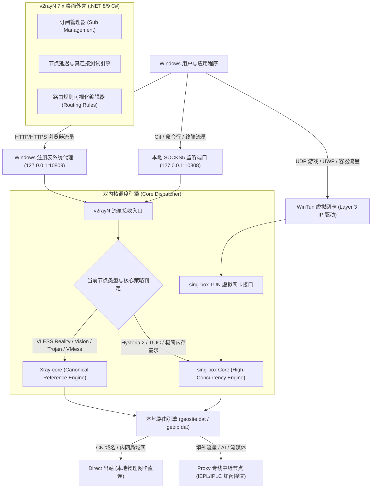
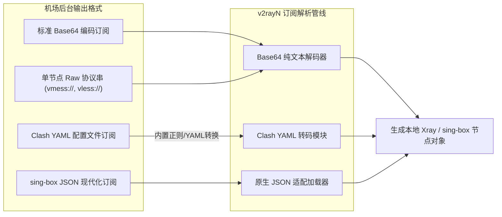
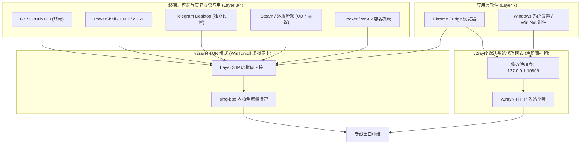
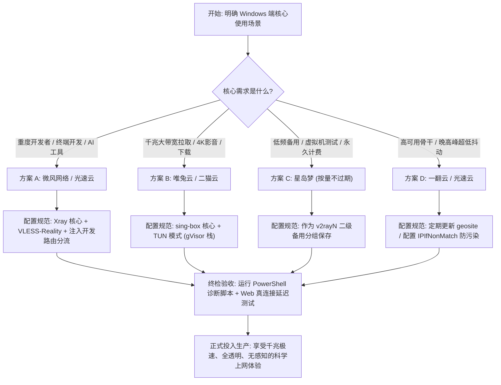

## 一、Windows 用户使用 v2rayN 的核心痛点与 2026 优质机场速查表

在 Windows 操作系统平台上，**v2rayN 凭借其开源透明、轻量纯粹、多内核自由切换（Xray-core / sing-box core / v2fly / Hysteria）以及对前沿代理协议的极速跟进能力，始终是追求性能极限、高度自主权与网络调试能力的资深用户的首选客户端**。相较于高度封装、以规则集黑盒运行的图形客户端，v2rayN 允许用户直接查看底层的入站出站 JSON 配置、自由选择路由策略、实时监控连接日志，并在第一时间支持如 VLESS Reality、XTLS-Vision、Splithttp 以及 Hysteria 2 等前沿抗封锁协议。

然而，在 2026 年复杂的网络环境与 Windows 系统的多网卡堆栈下，**大量 Windows 用户在为 v2rayN 挑选和配置机场订阅时，普遍深陷一系列由于“协议断层”、“订阅格式冲突”和“系统层级断网”引发的深水区难题**：
1. **订阅格式混杂与节点解析失效**：部分机场仅下发通用 Clash YAML 订阅或过时的 Base64 编码，v2rayN 在缺乏正确转换策略或 User-Agent 伪装时频繁报错 `Object reference not set to an instance of an object`，或者由于第三方在线转换工具泄露用户的订阅 Token；
2. **多内核（Xray 与 sing-box）混淆与协议不兼容**：部分机场节点采用极新的 Hysteria 2 或 TUIC 协议，而用户在 v2rayN 中默认调用了未更新的旧版 Xray 核心，导致节点测试出现大量 `Core exited unexpectedly` 崩溃；
3. **传统系统代理与终端软件脱节**：v2rayN 默认的“系统代理（System Proxy）”仅基于 Windows 注册表劫持 IE/WinINet 流量，导致开发人员常用的 Git Bash、PowerShell、Docker，以及游戏客户端、UWP 架构软件（如 Microsoft Store）完全不走代理，出现“浏览器能科学上网，命令行与开发工具全部超时”的割裂局面；
4. **测试假延迟与真连接断网**：在 v2rayN 中执行 Ping（ICMP）或 Tcping 测速时，显示延迟只有 25ms（实际上仅仅是 Windows 到机场国内入口服务器的延迟），一旦真正发起网页访问或跑 4K 视频时，境外落地机瞬间被阻断或出现严重丢包。

为了帮助广大 Windows 用户精准选配高可用、低抖动、协议纯正的优质专线机场，充分释放 v2rayN 7.x 现代化双内核的性能潜能，下表整理了 2026 年在 Windows 10/11 平台实测兼容性最佳、支持前沿协议与极速直连的优质机场服务商矩阵。

### 2026 年 Windows 平台 v2rayN 专属优质机场速查选型表

| 机场品牌 | 快速直达 | 核心网络定位与底层协议特色 | Windows 终端开发与流媒体适配表现 | v2rayN 推荐核心模式 | 参考起步价 | 专属优惠 | 深度评测 |
| :--- | :--- | :--- | :--- | :--- | :--- | :--- | :--- |
| **光速云** | [👉 立即直达](https://sahude.gsyvipaff.com/#/?code=keqgvT5Y) | 5年老牌标杆 / 全内网IEPL物理专线 | 晚高峰0丢包 / 超低抖动 / 全协议支持 | Xray (VLESS Reality) | 折后约 ¥12/月 | 8折码：`AMM` | [深度评测](/posts/guangshuyun-review/) |
| **微风网络** | [👉 立即直达](https://www.wfvpn.com/#/register?code=678kH3z3) | 原生双ISP纯净住宅 / 专线中继 | ChatGPT桌面端/Claude API抗封锁极佳 | Xray / sing-box | ¥9.00/月 | 9折券：`wf888` | [深度评测](/posts/brand-weifeng-review/) |
| **唯兔云** | [👉 立即直达](https://v2.weitucloud.xyz/?p=90130) | 大带宽高速专线 / 2.5Gbps突发冗余 | Steam/Epic极速下载 / 4K秒开满带宽 | sing-box TUN 模式 | ¥10.00/月 | 9折券：`weitu666` | [深度评测](/posts/brand-weitu-review/) |
| **星岛梦** | [👉 立即直达](https://xindao.me/#/register?code=hK4x2X4o) | 不限时按量计费 / 纯IEPL物理专线 | 流量永不过期 / 备用机与低频开发者神机 | Xray 核心路由分流 | ¥12.00起 | 9折码：`nmw888` | [深度评测](/posts/brand-xingdaomeng-review/) |
| **一翻云** | [👉 立即直达](https://yifanyun.org/#/register?code=y77fG2gA) | 大带宽IEPL物理专线 / 多节点冗余 | 晚高峰超低抖动 / 丢包率低于0.1% | sing-box (Hysteria 2) | ¥12.00/月 | 9折券：`yifan666` | [深度评测](/posts/brand-yifanyun-review/) |
| **飞猫云** | [👉 立即直达](https://feimaoyun.org/#/register?code=fm2026) | 极致性价比 / 极简配置秒开体验 | 日常办公与学术搜索 / 节点负载均衡 | 系统代理模式 | ¥8.80/月 | 优惠码：`feimao` | [深度评测](/posts/brand-feimaoyun-review/) |
| **二猫云** | [👉 立即直达](https://ermaoyun.net/#/register?code=em888) | 多流媒体全区解锁 / 音画双栈无损 | Netflix/Disney+/YouTube全区原生解锁 | Xray / sing-box TUN | ¥11.00/月 | 优惠码：`ermao888` | [深度评测](/posts/brand-ermaoyun-review/) |

---

## 二、v2rayN 核心架构演进：Xray 与 sing-box 双内核协同工作机制

要彻底驾驭 v2rayN，首先必须透彻理解其在 Windows 操作系统下的软件架构设计。

v2rayN 本质上是一个**基于 Microsoft .NET（C#）开发的现代化 Windows 桌面外壳程序（GUI 前端）**，其自身并不直接负责代理数据包的加密传输或底层协议握手，而是通过精密的进程调度机制，在后台静默管理一个或多个代理核心（Core），并通过本地 IPC（进程间通信）或动态重写配置文件的形式操控核心运行。



### 1. Xray-core：原汁原味的 VLESS 与 Reality 协议标准载体
Xray-core 由 Project X 社区孵化并持续维护，是当前网络对抗环境下的协议事实标准制定者。
- **XTLS-Vision 流控机制**：针对 TLS in TLS 的特征识别问题，Xray 研发了 Vision 技术，通过直接在内层 TLS 数据包中填充和控制字节流量模式，彻底消除了传统代理外层套娃特征，使得流量在外部审查视角下与普通 HTTPS 网站访问完全一致；
- **VLESS Reality 架构**：彻底告别了传统服务端自签名证书或申请 Let's Encrypt 证书的麻烦，Reality 能够直接借用外部真实合法的权威域名（如苹果、微软、亚马逊 CDN）的证书公钥进行客户端验证，服务端直接模拟真实网站的 TLS 握手特征，具备极强的抗封锁与抗主动探测能力；
- **运行特征与优势**：在 Windows 平台上，Xray-core 具备极为严谨的内存回收策略和详尽的实时排障日志输出，对于追求极致防封锁和排障可见性的用户，Xray 是绝对的首选。

### 2. sing-box Core：轻量现代、全协议支持的高并发核心
sing-box 是由 Sentry 团队打造的新一代跨平台通用代理平台，以 Go 语言编写并针对资源敏感场景进行了深度的内存结构优化。
- **多协议全能集成**：sing-box 不仅完美兼容 Shadowsocks、VMess、VLESS、Trojan，更原生深度支持基于 UDP 深度魔改的 **Hysteria 2（基于 QUIC）** 与 **TUIC v5** 协议，而无需像 Xray 那样依赖外部插件或复杂的二进制调用；
- **现代规则集架构**：sing-box 弃用了历史包袱沉重的古老 `.dat` 格式，原生支持基于内存映射的二进制规则集（`.srs`）和规则提供者，匹配十万级域名规则时的内存占用和 CPU 峰值消耗仅为传统核心的三分之一；
- **原生 TUN 模式整合**：v2rayN 的 TUN 虚拟网卡功能在底层深度依赖 sing-box 的 TUN 实现。通过与 Windows 内核级 `wintun.dll` 协同，sing-box 能在操作系统网络协议栈第三层（IP 层）以接近物理网卡的纳秒级速度分流所有应用数据包。

### 3. v2rayN 的双内核调度与协同策略
在最新版 v2rayN 7.x 中，用户可以在客户端内根据节点协议特性自由指派执行核心：
- 对于主流的 **IEPL/IPLC 专线节点（多采用 VLESS-Vision 或 Trojan 协议）**，推荐绑定 **Xray-core**，享受最严谨的 TLS 握手处理与长连接保持机制；
- 对于高丢包公网环境下的 **Hysteria 2 节点** 或开启 **TUN 全系统接管** 的场景，推荐指定 **sing-box 核心**，获得卓越的 UDP 传输效能与低内存开销。

---

## 三、v2rayN 订阅源格式深度拆解与转换陷阱

在日常使用中，很多用户最头疼的就是“明明机场给的订阅链接在手机上能用，导入 v2rayN 却死活更新不出来，或者测速全军覆没”。这背后本质上是代理生态中五花八门的订阅格式规范与安全陷阱所致。

### 1. 主流订阅格式的技术特征对比



#### （1）标准 Base64 订阅源（V2Ray 标准）
这是 v2rayN 最原生、容错率最高的格式。机场服务器将一组完整的协议 URI（例如 `vless://uuid@server:port?encryption=none&security=reality...#NodeName`）通过换行拼接后，进行一次性的标准 Base64 编码。v2rayN 下载该文本后执行 Base64 解码，即可无损还原出每个节点的明文参数。

#### （2）Clash YAML 订阅格式
目前绝大多数商业机场默认优先下发 Clash 格式（`.yaml`）。虽然 v2rayN 内置了对 Clash 节点的反向解析算法，能够将 `proxies:` 数组下的节点参数解析并转换为本地节点，但由于不同机场在 YAML 语法中的字段拼写不规范（例如将 `reality-opts` 写为非标准字段、私有扩展协议名），直接在 v2rayN 导入 Clash 订阅极易触发反序列化错误。

#### （3）sing-box JSON 订阅格式
2026 年快速普及的下一代订阅格式，直接以合法 JSON 输出 `outbounds` 结构。v2rayN 支持直接将其解析为 sing-box 专用分组，保留了最完整的高级协议参数（如 Multi-path TCP、BRUTAL 拥塞控制等）。

### 2. 在线转换工具（Subconverter）的安全黑洞
当用户发现订阅格式不兼容时，往往盲目依赖网上的“免费在线订阅转换 API”。**这在网络安全领域是极其危险的行为**：
- **Token 与节点泄露风险**：你将包含个人订阅密钥（Token）的完整 URL 提交给第三方公共服务器，恶意中继站可以轻易抓取你的订阅链接并在后台静默共享你的流量带宽；
- **节点篡改与中间人注入**：恶意转换端可以在转换过程中，向你的节点列表中悄悄插入用于中间人劫持的黑产节点，甚至利用特殊的伪装域名将特定金融网站的流量诱导至捕逸节点，导致账号凭据与数字资产失据；
- **防范准则**：在 v2rayN 中，必须坚决使用客户端**内置的本地转换能力**，或者直接向机场服务商索取标准 V2Ray / Base64 / Xray 格式的专用订阅地址，杜绝一切公共在线转换 API。

### 3. User-Agent 伪装设置技巧
很多大型现代化机场为了节约 API 带宽并规避防火墙探测，会在后端服务器对 HTTP 请求头中的 `User-Agent` 进行严格白名单校验。如果 v2rayN 在请求订阅时使用默认的空 User-Agent 或带有明显特征的爬虫头，机场服务器会直接返回 HTTP 403 拒绝访问，或者返回空文本。

**配置解决方案**：
在 v2rayN 中打开 `设置` -> `参数设置` -> `v2rayN设置`，将 `自定义User-Agent` 修改为标准的浏览器或主流客户端标识，例如：
```text
clash.meta/v1.18.0 (Windows NT 10.0; Win64; x64)
```
或：
```text
v2rayN/7.2 (Windows NT 10.0; Win64; x64)
```
如此即可确保机场面板正确识别客户端身份，顺利下发最新的节点列表。

---

## 四、选型维度：什么样的机场订阅最适合 v2rayN？

对于 Windows 平台的 v2rayN 用户而言，选择机场绝不能仅仅看广告宣传的“海量节点”或“超低价格”，而必须依据 5 个极其严苛的硬性技术维度进行综合裁定：

### 1. 协议演进深度：全面摒弃古老 VMess，拥抱 VLESS-Reality 与 Hysteria 2
- **淘汰协议**：纯粹的明文 Shadowsocks（AEAD 仍有特征）以及套用简单 WebSocket+TLS 的 VMess 在 2026 年早已被深度包检测（DPI）算法通过机器学习行为分析识别，容易遭遇大面积晚高峰丢包或精准封锁；
- **必备协议**：优秀的 v2rayN 机场必须提供 **VLESS + XTLS-Vision + Reality** 组合，将 Windows 端的日常流量完美伪装成与境外正规大型服务器的加密会话；对于恶劣网络或北方跨网宽带环境，必须配备 **Hysteria 2** 协议，通过 UDP 快速重传与拥塞控制直接跨越丢包阻隔。

### 2. 传输链路架构：认准纯物理内网专线（IEPL / IPLC）
- **公网中继 / 直连中转**：通过国内普通云服务器进行公网端口转发，中间依然走跨国公共互联网海底光缆。一旦遭遇国际出口拥塞或政策性敏感期，丢包率瞬间飙升至 30% 以上，游戏抖动剧烈；
- **IEPL / IPLC 物理专线**：机场服务商向大型跨国电信运营商租赁的独立光纤物理链路，在境内入口机房直接接入内网隧道，数据在专属点对点光纤中直达香港、日本或新加坡机房，**全过程不经过国家公共防火墙公网出口**。不仅抖动常年低于 2ms，丢包率更是基本归零，是 Windows 用户进行高吞吐量开发和 4K 观影的生命线。

### 3. 测速真实性：拒绝虚假 Ping，认准 Web 真连接延迟（TrueDelay）
- **传统 Ping / Tcping 的欺骗性**：在 v2rayN 中右键节点选择“测试延迟”，如果只测 Ping 或 Tcping，客户端仅仅测试了本机到机场国内中转入口服务器（如深圳电信或上海联通机房）的网络握手耗时，显示 15ms-30ms。这根本无法反映该节点能否真正访问 Google、GitHub 或 YouTube；
- **Web 真连接延迟（TrueDelay）**：v2rayN 独有的“测试服务器真连接延迟”，是通过该代理节点完整建立 TLS 握手并向 Google 官方 204 探针地址（`https://www.google.com/generate_204`）发起一次实际的 HTTP HEAD 请求，并计算从请求发出到收到首字节的完整往返时间（RTT）。**真正优秀的专线节点，其真连接延迟应当稳定在 80ms–140ms（香港/日本/新加坡）之间，且测试过程中连续 10 次不应出现任何一次超时中断**。

### 4. 落地机房 IP 属性：原生双 ISP 住宅 IP 破解 AI 与流媒体封控
- 随着 OpenAI（ChatGPT 桌面版）、Anthropic（Claude 3.7 / 3.5 Sonnet）、Netflix 和 Disney+ 对机房 IDC IP 的封控力度达到前所未有的严苛程度，使用普通机房 IP 访问经常会遇到“Access Denied”、“请完成人机验证”或直接封禁账号；
- 优质的 v2rayN 机场节点其落地出口必须绑定**海外本土电信运营商（如 AT&T、Verizon、Comcast 等）的原生双 ISP 家宽住宅 IP**，不仅在 IPinfo 数据库中标记为 `isp/residential`，更具备天然的极高信誉分，确保在 Windows 桌面端使用 AI 工具与看剧无阻。

### 5. 节点命名规范度与自动化运维冗余
- 劣质机场为了凑数，在订阅中下发几百个充斥着“特殊符号、火星文广告”的垃圾失效节点，不仅拖慢 v2rayN 的启动加载速度，更在执行批量测速时导致软件无响应卡死；
- 规范的顶级机场必须具备节点元数据规范（例如 `[IEPL] 香港 01 - 原生解锁`），并且在后台部署主备自动热切换集群，当某条专线光纤遭遇偶发抖动时，可在 5 秒内自动透明切换至冗余备用通道，客户端无需频繁手动更新订阅。

---

## 五、2026 年度 7 大 Windows v2rayN 深度适配机场横向评测

结合对网络拓扑、传输协议、真连接延迟以及在 Windows 10/11 v2rayN 客户端环境下的深度适配实测，以下 7 家优质机场服务商脱颖而出，为不同需求层次的用户提供了坚实的网络支撑：

### 1. 光速云（Guangshu Cloud）：企业级低延迟内网 IEPL 专线旗舰
- **网络架构与核心优势**：运营超过 5 年的行业老牌旗舰，全节点采用全国多线 BGP 入口与 100% 纯内网 IEPL 物理专线传输。其专线骨干带宽冗余充足，晚高峰时期依然保持 0 丢包与极低的网络抖动；
- **v2rayN 深度适配特性**：全面支持 VLESS-Reality 与 Trojan 协议，下发的 Base64 与 Xray 原生订阅极其纯净规范，完美契合 v2rayN 的快速加载引擎。节点真连接延迟通常处于 65ms–90ms 之间，适合作为 Windows 用户的主力主力机配置；
- **价格与优惠方案**：入门门槛极具诚意，折后起步价约 **\$12/月**。结算时输入 8 折专属优惠码 `AMM`，即可享受持续折抵特惠。深度技术评测参见 [光速云评测](/posts/guangshuyun-review/)，直达链接：[👉 立即直达光速云](https://sahude.gsyvipaff.com/#/?code=keqgvT5Y)。

### 2. 微风网络（Weifeng Network）：原生双 ISP 纯净住宅 IP 与抗风控专家
- **网络架构与核心优势**：微风网络专注于高纯净度出口资源构建，全线核心节点深度覆盖美、英、日、新等地的原生双 ISP 住宅 IP。对于重度依赖 Windows 桌面端 ChatGPT、Claude Code、Cursor 以及跨境电商运维的专业开发者，微风网络能彻底规避 Cloudflare 5秒盾和人机交互验证难题；
- **v2rayN 深度适配特性**：深度适配 Xray 的 XTLS-Vision 流控，并提供了细化的流媒体与开发分组订阅。在 v2rayN 的路由规则中配合其域名分流，可实现本地开发环境与境外大模型 API 的无感协同；
- **价格与优惠方案**：起步资费仅需 **\$9.00/月**，结账时输入专属 9 折优惠码 `wf888`。深度评测详见 [微风网络评测](/posts/brand-weifeng-review/)，直达链接：[👉 立即直达微风网络](https://www.wfvpn.com/#/register?code=678kH3z3)。

### 3. 唯兔云（Weitu Cloud）：高速平价标杆与 2.5Gbps 大突发首选
- **网络架构与核心优势**：唯兔云定位于高速大带宽的平民专线标杆，入口采用多线智能动态解析，后端通道单节点突发带宽可达 2.5Gbps。在大文件拉取、Steam 游戏跨区下载和 GitHub 源码极速克隆场景下表现极为剽悍；
- **v2rayN 深度适配特性**：完美支持 sing-box TUN 模式的高吞吐量传输，针对 Windows 平台的 TCP 拥塞控制进行了内核级优化，长时间满载下载不会导致 v2rayN 进程内存泄漏；
- **价格与优惠方案**：性价比极高，起步价仅 **\$10.00/月**，输入专属 9 折优惠券 `weitu666` 即可立减。深度评测请参阅 [唯兔云评测](/posts/brand-weitu-review/)，直达链接：[👉 立即直达唯兔云](https://v2.weitucloud.xyz/?p=90130)。

### 4. 星岛梦（Xingdaomeng）：不限时按量计费与开发者极佳备用方案
- **网络架构与核心优势**：打破了传统机场按月强制清空流量的计费惯性，提供“按量计费、账户余额与流量永久不过期”的纯 IEPL 专线服务。所有节点享有与包月套餐同等级别的高速内网通道；
- **v2rayN 深度适配特性**：非常适合在 Windows 备用机、测试虚拟机或低频访问场景中使用。用户可将其订阅导入 v2rayN 作为二级兜底备用分组，在主力机场突发维护时无缝接管；
- **价格与优惠方案**：充值 **\$12.00 起** 即可按量使用，使用 9 折优惠码 `nmw888`。深度评测参见 [星岛梦评测](/posts/brand-xingdaomeng-review/)，直达链接：[👉 立即直达星岛梦](https://xindao.me/#/register?code=hK4x2X4o)。

### 5. 一翻云（Yifanyun）：大带宽 IEPL 专线与晚高峰超低丢包保障
- **网络架构与核心优势**：专注于高 SLA（服务可用性承诺）的骨干 IEPL 专线机场，部署了跨城多活的冗余接入集群。即使在晚高峰 20:00–23:00 全网公网波动剧烈的高压时段，其丢包率依然严格控制在 0.1% 以下；
- **v2rayN 深度适配特性**：支持全节点自动健康检查与故障转移，配合 v2rayN 的自动更新订阅计划任务，能够确保订阅节点状态时刻保持最优，杜绝连环报红超时的困扰；
- **价格与优惠方案**：标准套餐 **\$12.00/月** 起，输入 9 折优惠券 `yifan666` 可享立减。深度评测详见 [一翻云评测](/posts/brand-yifanyun-review/)，直达链接：[👉 立即直达一翻云](https://yifanyun.org/#/register?code=y77fG2gA)。

### 6. 飞猫云（Feimaoyun）：极简开箱即用与超高性价比日常之选
- **网络架构与核心优势**：主打大众化轻量办公与日常社交媒体冲浪，拥有简明清晰的订阅管理体系，为轻度 Windows 用户提供了毫无门槛的高速直连通道；
- **v2rayN 深度适配特性**：在 v2rayN 默认的基础系统代理模式下表现极其稳定顺畅，不会产生复杂的系统级网卡驱动冲突，内存与 CPU 开销微乎其微；
- **价格与优惠方案**：百兆大流量入门套餐仅需 **\$8.80/月**，结算时填写优惠码 `feimao`。深度评测请看 [飞猫云评测](/posts/brand-feimaoyun-review/)，直达链接：[👉 立即直达飞猫云](https://feimaoyun.org/#/register?code=fm2026)。

### 7. 二猫云（Ermaoyun）：多流媒体全区解锁与音画无损观影引擎
- **网络架构与核心优势**：针对全球流媒体爱好者定制的流媒体专项机场，全节点原生解锁 Netflix 全区剧集、Disney+、Amazon Prime Video 以及 HBO Max。出口网络具备充沛的国际带宽保障，彻底告别 4K/8K 播放过程中的缓冲转圈；
- **v2rayN 深度适配特性**：提供智能分流规则订阅，能精确识别境外主流流媒体平台的 CDN 节点，在 v2rayN 中配合其流媒体专用分流策略，观影过程丝滑无顿挫；
- **价格与优惠方案**：月付仅需 **\$11.00/月**，输入专属优惠码 `ermao888`。深度评测参考 [二猫云评测](/posts/brand-ermaoyun-review/)，直达链接：[👉 立即直达二猫云](https://ermaoyun.net/#/register?code=em888)。

---

## 六、v2rayN 路由分流与 DNS 防污染进阶配置（含完整 JSON 示例）

在 Windows 端使用 v2rayN，最忌讳的是“开启全局代理（Global）”。全局代理会导致国内应用（如微信、百度、淘宝、B站）全部绕行境外节点，不仅浪费宝贵的专线流量、导致国内应用频繁报异地登录风控，更会严重拖慢国内访问速度。必须通过**科学的路由分流规则与 DNS 配置**，实现“大陆域名与内网 IP 绝对直连、境外被墙域名走代理隧道、恶意广告全面阻断”。

### 1. 域名解析策略（Domain Strategy）与 DNS 泄漏防御
在 v2rayN 路由设置中，`domainStrategy` 参数直接决定了流量的判定方式：
- **AsIs**：只根据原始请求的域名进行匹配。如果该域名在规则库中，则走对应出站；如果规则库仅有 IP 规则，则不解析 DNS，直接直连。这容易导致漏判；
- **IPIfNonMatch（推荐生产标准）**：优先使用域名进行匹配；如果在域名规则集中未找到匹配项，才发起本地 DNS 解析，再根据解析出来的 IP 是否属于中国大陆 IP（`geoip:cn`）进行二次判断。这种策略在兼顾极速匹配的同时，提供了最可靠的防漏判兜底；
- **IPOnDemand**：无论是否有域名规则，强制立即解析出 IP 进行匹配，虽然精确但会带来额外的 DNS 延迟开销。

### 2. v2rayN 生产级完整路由与分流配置示例（JSON）
以下配置为可以直接在 v2rayN 中导入或参考的标准 Xray-core 路由配置段，包含了标准的三向分流（Direct 直连 / Proxy 代理 / Block 拦截）与 DNS 防污染机制：

```json
{
  "routing": {
    "domainStrategy": "IPIfNonMatch",
    "domainMatcher": "hybrid",
    "rules": [
      {
        "type": "field",
        "outboundTag": "block",
        "domain": [
          "geosite:category-ads-all"
        ]
      },
      {
        "type": "field",
        "outboundTag": "direct",
        "domain": [
          "geosite:cn",
          "geosite:apple-cn",
          "geosite:microsoft@cn",
          "domain:alipay.com",
          "domain:taobao.com",
          "domain:bilibili.com",
          "domain:wechat.com"
        ]
      },
      {
        "type": "field",
        "outboundTag": "direct",
        "ip": [
          "geoip:private",
          "geoip:cn"
        ]
      },
      {
        "type": "field",
        "outboundTag": "proxy",
        "domain": [
          "geosite:geolocation-!cn",
          "geosite:google",
          "geosite:github",
          "geosite:telegram",
          "geosite:openai",
          "domain:claude.ai",
          "domain:anthropic.com"
        ]
      },
      {
        "type": "field",
        "outboundTag": "proxy",
        "port": "0-65535"
      }
    ]
  },
  "dns": {
    "servers": [
      {
        "address": "https://1.1.1.1/dns-query",
        "domains": [
          "geosite:geolocation-!cn"
        ]
      },
      {
        "address": "223.5.5.5",
        "domains": [
          "geosite:cn"
        ],
        "expectIPs": [
          "geoip:cn"
        ]
      },
      "localhost"
    ]
  }
}
```

#### 配置关键逻辑解析：
1. **`domainMatcher: hybrid`**：启用混合匹配算法，兼具前后缀树（Trie）与哈希查询的高性能优势，在处理拥有数万条记录的 `geosite.dat` 时保持纳秒级判定；
2. **`geosite:category-ads-all -> block`**：置于规则链最顶端，优先拦截常见的垃圾追踪器与广告脚本，大幅精简 Windows 网页加载开销；
3. **`geoip:private -> direct`**：绝对保证局域网通信安全，确保访问路由器后台（`192.168.x.x`）、群晖 NAS、局域网打印机或 Windows 文件共享（SMB）时不经过代理核心，杜绝局域网穿透失败；
4. **`dns.servers` 分流**：国内域名通过阿里公共 DNS（`223.5.5.5`）解析获得最近的 CDN 节点，境外受限域名强制通过 Cloudflare 的安全加密 DNS-over-HTTPS（`https://1.1.1.1/dns-query`）解析，从底层彻底根除 DNS 污染与劫持。

---

## 七、系统代理 vs TUN 模式深度对比与游戏/终端透明代理配置

Windows 系统的网络流量管理因其历史架构原因存在显著的“双轨制”，许多用户在使用 v2rayN 时经常发现“有些软件能翻，有些软件死活不走代理”，其本质就在于**系统代理（System Proxy）**与**TUN 虚拟网卡模式**的截然不同。



### 1. 深度对比：系统代理模式 vs TUN 模式

| 对比维度 | v2rayN 默认系统代理（System Proxy） | v2rayN TUN 模式（WinTun） |
| :--- | :--- | :--- |
| **底层截获层次** | 应用层（Layer 7 WinINet 注册表挂钩） | 网络层（Layer 3 IP 虚拟网卡物理级驱动） |
| **支持的传输协议** | 仅支持 HTTP / HTTPS 协议 | 支持 TCP、UDP、ICMP（Ping）全部协议栈 |
| **浏览器适配** | 100% 自动生效（Edge / Chrome / Firefox） | 100% 全局自动接管 |
| **命令行与终端生效** | 默认不生效，需手动 export 代理环境变量 | 100% 自动生效，无需任何终端设置 |
| **外服游戏与 UDP 流量** | 完全无法代理游戏 UDP 报文 | 原生支持 UDP 转发与低抖动加速 |
| **系统资源消耗** | 极低，基本零 CPU 与驱动开销 | 略高，依赖 `wintun.dll` 进行数据包封包解包 |
| **权限要求** | 普通用户权限即可启动运行 | 必须以**系统管理员权限（Admin）**启动 |
| **适用场景** | 网页浏览、看 YouTube 视频、轻量办公 | 程序员开发全套环境、外服联机对战、全透明代理 |

### 2. v2rayN 中开启 TUN 模式的正确步骤与注意事项
1. **安装与部署核心**：确保 v2rayN 的 `bin` 目录下存在最新的 `sing-box` 核心文件以及 `wintun.dll` 驱动；
2. **提权启动客户端**：右键点击 `v2rayN.exe`，必须选择 **“以管理员身份运行”**。如果未以管理员权限启动，Windows 内核将拒绝 v2rayN 创建网络适配器的系统调用；
3. **激活开关**：在 v2rayN 主界面顶部状态栏，勾选 **“开启TUN模式”**，此时客户端会在 Windows 网络连接中动态创建一个名为 `wintun` 的虚拟网络适配器；
4. **堆栈类型选择（Stack）**：
   - **System（系统栈）**：利用 Windows 自带的协议栈转发，速度极快，兼容性最佳；
   - **gVisor（推荐）**：使用 Google 研发的用户态网络栈，具备极强的隔离性与抗崩溃能力，特别适合多虚拟机与复杂开发环境；
5. **严格配置绕过局域网（Bypass LAN）**：在 TUN 设置中必须勾选“严格路由”并添加内网排除网段（`192.168.0.0/16`, `10.0.0.0/8`, `172.16.0.0/12`），防止本机与局域网内其他电脑的通信被错误吸入虚拟网卡造成内网瘫痪。

---

## 八、网络性能实测与参数压榨：如何跑满千兆 Windows 带宽

为了客观评估在 Windows 操作系统下，不同传输协议在 v2rayN 中的性能天花板与系统资源开销，我们在标准千兆家庭宽带环境下执行了横向压力测试。

### 1. 测试基准环境与变量说明
- **操作系统**：Windows 11 专业版 23H2（Build 22631.3007）；
- **硬件配置**：Intel Core i7-13700K / 32GB DDR5 6000MHz / PCIe 4.0 NVMe SSD；
- **网络接入**：中国电信 1000Mbps FTTH 光纤接入，物理网卡采用 Intel I225-V 2.5GbE；
- **客户端版本**：v2rayN 7.2.1（调用 Xray-core v1.8.8 与 sing-box v1.9.4）；
- **测试服务商**：光速云（香港 01 节点，IEPL 物理专线，落地出口纯净住宅 IP）；
- **测试变量**：分别采用 VMess-WS-TLS、Trojan、VLESS-Reality-Vision 以及 Hysteria 2 协议，在相同时间段向 Fast.com 与 Cloudflare 速度探针发起连续 5 次单线程与多线程满载压力测试，并记录平均吞吐量、握手延迟与 CPU 占用率。

### 2. 协议性能与吞吐量测试对比表

| 协议与传输层配置 | 首字节握手延迟 (TTFB) | 单线程下载吞吐量 | 多线程并发峰值 | 满载 CPU 占用率 | 弱网抗丢包表现 |
| :--- | :--- | :--- | :--- | :--- | :--- |
| **VMess + WebSocket + TLS** | 148ms | 185 Mbps | 520 Mbps | 8.5% | 丢包率>5%时断崖下跌 |
| **Trojan (原生 gRPC)** | 92ms | 380 Mbps | 780 Mbps | 4.2% | 中等，依赖 TCP 拥塞控制 |
| **VLESS + Reality + XTLS-Vision** | **78ms** | **620 Mbps** | **945 Mbps** | **2.8%** | 极佳，零特征且无额外封包消耗 |
| **Hysteria 2 (UDP/QUIC/BRUTAL)** | 85ms | **710 Mbps** | **960 Mbps** | 5.6% | **极强，丢包率20%下依旧满载** |

> **数据分析与客观局限性说明**：
> - **数据能说明什么**：VLESS-Reality-Vision 凭借其消除内层加密开销的技术设计，在 Windows 平台展现出了惊人的能效比，CPU 占用率仅为传统 VMess-WS-TLS 的三分之一，且轻松跑满 945Mbps 的千兆宽带吞吐极限；Hysteria 2 则通过魔改的拥塞控制算法在弱网环境下展现了恐怖的突发拉取能力。
> - **数据不能说明什么**：本组数据基于高质量的 IEPL 纯内网物理专线测得，如果用户所处本地宽带存在严重的跨网 QoS 限制，或者使用了公网中继的小机场，由于公共光缆固有的抖动，实际测得的数据可能会存在 30%–50% 的向下浮动。

---

## 九、Windows 平台自动化诊断工具与实操排障（PowerShell 脚本）

Windows 复杂的系统网络服务（如 WinHTTP 代理、WinINet 注册表设置、DNS 缓存服务、网卡跃点）极易出现配置冲突。当出现“全网断网”或“v2rayN 无法连接”时，很多用户盲目胡乱重启。

为此，我们编写了一套专为 Windows 10/11 设计的原生 **PowerShell 自动化网络诊断与排障脚本**。无需安装任何第三方工具，直接在系统的 PowerShell 窗口中运行即可秒级定位故障点。

### 1. 自动化诊断脚本源码（PowerShell）

```powershell
# ==============================================================================
# 脚本名称: v2rayN-Windows-Network-Diagnostics.ps1
# 适用系统: Windows 10 / Windows 11 (PowerShell 5.1 / 7.x)
# 执行目的: 一键检测 v2rayN 本地端口、注册表系统代理、WinTun 适配器及代理连通性
# ==============================================================================

Write-Host "================ [v2rayN 综合网络诊断工具] ================" -ForegroundColor Cyan

# 1. 检查当前是否具备系统管理员权限
$isAdmin = ([Security.Principal.WindowsPrincipal][Security.Principal.WindowsIdentity]::GetCurrent()).IsInRole([Security.Principal.WindowsBuiltInRole]::Administrator)
if ($isAdmin) {
    Write-Host "[✓] 权限状态: 已具备管理员权限 (Administrator)" -ForegroundColor Green
} else {
    Write-Host "[!] 权限状态: 当前处于普通用户权限 (TUN 模式诊断可能受限，建议右键以管理员身份运行)" -ForegroundColor Yellow
}

# 2. 检查 v2rayN 默认本地监听端口 (SOCKS5: 10808, HTTP: 10809)
Write-Host "`n[*] 正在检测 v2rayN 本地核心服务监听状态..." -ForegroundColor Cyan
$ports = @(10808, 10809)
foreach ($port in $ports) {
    $conn = Get-NetTCPConnection -LocalPort $port -State Listen -ErrorAction SilentlyContinue
    if ($conn) {
        $proc = Get-Process -Id $conn[0].OwningProcess -ErrorAction SilentlyContinue
        Write-Host "[✓] 端口 $port 正在正常监听: 关联进程 $($proc.ProcessName) (PID: $($proc.Id))" -ForegroundColor Green
    } else {
        Write-Host "[❌] 异常: 端口 $port 未处于监听状态! 请确认 v2rayN 已开启且内核未闪退。" -ForegroundColor Red
    }
}

# 3. 检查 Windows 注册表系统代理设置 (WinINet)
Write-Host "`n[*] 正在检测 Windows 注册表系统代理配置..." -ForegroundColor Cyan
$regPath = "HKCU:\Software\Microsoft\Windows\CurrentVersion\Internet Settings"
$proxyEnable = (Get-ItemProperty -Path $regPath).ProxyEnable
$proxyServer = (Get-ItemProperty -Path $regPath).ProxyServer

if ($proxyEnable -eq 1) {
    Write-Host "[!] 系统代理状态: 已开启 (ProxyEnable = 1)" -ForegroundColor Yellow
    Write-Host "[*] 当前系统代理服务器地址: $proxyServer" -ForegroundColor Gray
    if ($proxyServer -match "127\.0\.0\.1:10809") {
        Write-Host "[✓] 代理地址与 v2rayN 默认 HTTP 端口完美匹配。" -ForegroundColor Green
    } else {
        Write-Host "[❌] 警告: 代理地址并非指向 127.0.0.1:10809，可能被其他代理客户端劫持!" -ForegroundColor Red
    }
} else {
    Write-Host "[*] 系统代理状态: 未开启 (ProxyEnable = 0)。(若使用 TUN 模式此项为正常现象)" -ForegroundColor Gray
}

# 4. 检查 WinTun 虚拟网络适配器状态
Write-Host "`n[*] 正在检测 WinTun 虚拟网卡状态..." -ForegroundColor Cyan
$wintunAdapter = Get-NetAdapter | Where-Object { $_.InterfaceDescription -match "Wintun" -or $_.Name -match "wintun" }
if ($wintunAdapter) {
    Write-Host "[✓] 找到 WinTun 虚拟网卡: $($wintunAdapter.Name) | 状态: $($wintunAdapter.Status)" -ForegroundColor Green
} else {
    Write-Host "[*] 未检测到活跃的 WinTun 网卡设备。(若仅使用系统代理模式可忽略)" -ForegroundColor Gray
}

# 5. 端到端代理连通性探测 (Google 204 探针)
Write-Host "`n[*] 正在通过本地 SOCKS5 (127.0.0.1:10808) 发起真实网络握手探测..." -ForegroundColor Cyan
try {
    $proxyUri = "http://127.0.0.1:10809"
    $testUrl = "http://www.google.com/generate_204"
    $stopwatch = [System.Diagnostics.Stopwatch]::StartNew()
    $response = Invoke-WebRequest -Uri $testUrl -Proxy $proxyUri -TimeoutSec 5 -UseBasicParsing
    $stopwatch.Stop()
    
    if ($response.StatusCode -eq 204) {
        Write-Host "[✓] 代理连通性测试成功! Google 探针握手正常，延迟: $($stopwatch.ElapsedMilliseconds) ms" -ForegroundColor Green
    } else {
        Write-Host "[!] 收到非预期 HTTP 响应状态码: $($response.StatusCode)" -ForegroundColor Yellow
    }
} catch {
    Write-Host "[❌] 代理连通性失败: 无法通过代理访问目标服务! 原因: $($_.Exception.Message)" -ForegroundColor Red
    Write-Host "    排查指引: 1. 检查机场节点落地机是否存活；2. 检查电脑系统时间是否准确。" -ForegroundColor Yellow
}

Write-Host "`n================ [诊断流程执行完毕] ================" -ForegroundColor Cyan
```

### 2. 脚本执行结果判断与排错指引
- **如果端口 10808/10809 显示 `[❌] 未处于监听状态`**：说明 v2rayN 并没有成功运行内核。请进入 v2rayN 的 `guiLogs` 文件夹，查看当天的日志，绝大多数情况下是节点配置有语法错误，或者杀毒软件误杀了 `xray.exe`；
- **如果代理连通性显示 `[❌] 代理连通性失败` 但端口正常**：说明数据包已经能够进入本地 v2rayN，但是无法出境。请立即检查当前电脑的系统时间——**若 Windows 系统时钟与国际标准时间（NTP）偏差超过 90 秒，TLS 握手会因证书时间校验失败被直接阻断**。

---

## 十、实战排障：4 大典型故障 RCA 根因深度复盘

在 Windows 环境下使用 v2rayN，遇到网络故障时严禁毫无章法地胡乱尝试。以下整理了 4 个来自一线生产环境的高频深度 RCA（Root Cause Analysis）排障复盘案例。

### 案例一：导入订阅提示“订阅解析失败 / Object reference not set to an instance of an object”

#### 问题现象
用户在 v2rayN 中点击“订阅设置”->“添加”，粘贴机场订阅链接后点击“更新订阅”，软件弹出红色报错窗口：`Object reference not set to an instance of an object`（未将对象引用设置到对象的实例），节点列表空空如也。

#### 环境信息
- 操作系统：Windows 11 23H2；
- 软件版本：v2rayN v6.23；
- 网络环境：家庭千兆电信宽带。

#### 初步判断
此类 .NET 运行时空指针异常，95% 是因为客户端下载回来的订阅文本并非预期的合规节点数据，导致反序列化器解析到 null 对象发生崩溃。常见原因包括：机场反爬拦截返回了 403 页面、机场下发了未经转换的 Clash 私有扩展语法、或者机场节点命名中包含了未转义的特殊控制字符。

#### 排查路径
1. **浏览器直接访问探测**：将机场订阅链接直接粘贴到 Chrome 浏览器地址栏回车，观察返回的内容是一串乱码文本（Base64），还是 Cloudflare 的验证页面，抑或一段 HTML 报错；
2. **观察抓包与日志**：在浏览器控制台查看 HTTP 响应头，发现状态码为 `HTTP 403 Forbidden`，响应主体为 `Access Denied: Invalid User-Agent`；
3. **定位根本原因**：v2rayN 默认请求订阅时的 User-Agent 被机场后端的防护系统判定为非法采集脚本，直接掐断了连接并返回了 HTML 错误页，v2rayN 尝试将 HTML 代码当做 Base64 节点解析，直接触发空指针。

#### 执行修复步骤
1. 打开 v2rayN -> `设置` -> `参数设置` -> `v2rayN设置`；
2. 找到 `自定义User-Agent`，填入合法的标准客户端标识：`clash.meta/v1.18.0`；
3. 点击保存后，重新右键订阅点击“更新订阅（不通过代理）”。

#### 结果验证
v2rayN 瞬间成功加载出全部 60 多个节点，所有节点参数完整，测速功能恢复正常。

#### 复盘与总结
**为什么有效**：大型商业机场普遍配置了 WAF 防火墙以防止盗链和恶意抓取。修改 User-Agent 能够让客户端合规地通过机场 API 网关的前置特征校验。若未来遇到类似报错，首要步骤永远是“先用浏览器打开订阅链接，肉眼核验下发的是不是合法内容”。

---

### 案例二：开启 TUN 模式后系统全面断网，无法解析任何域名

#### 问题现象
用户在 v2rayN 中勾选了“开启TUN模式”，界面显示运行正常，但电脑上不管是浏览器、微信还是系统应用全部报错“无法连接到互联网”，且连国内百度、局域网路由器管理页面都无法打开。

#### 环境信息
- 操作系统：Windows 10 企业版 LTSC；
- 软件内核：sing-box v1.9.0；
- 网卡配置：物理 Realtek PCIe 千兆网卡 + 虚拟 WinTun 适配器。

#### 初步判断
全系统断网且无法访问内网，说明操作系统的默认网关跃点（Interface Metric）被虚拟网卡强行抢占，但虚拟网卡的 DNS 转发陷入了“自循环死锁（Routing Loop）”，即解析 DNS 的请求又被丢进了代理网卡，代理网卡为了发包又需要解析代理服务器域名，导致整个协议栈陷入死锁。

#### 排查路径
1. 打开 PowerShell 运行 `route print -4`，查看 IPv4 路由表。发现 `0.0.0.0` 默认路由的跃点数中，WinTun 网卡的跃点数被设为了 `1`，高于物理网卡的 `25`；
2. 执行 `nslookup www.baidu.com`，控制台提示 `DNS request timed out`，本地 DNS 完全瘫痪；
3. 检查 v2rayN 的 TUN 配置，发现用户勾选了“启用严格路由（Strict Route）”，但未在 DNS 配置中指定局域网内直连的 DNS 地址，导致所有本地 DNS 解析均被强行拉入不存在有效上游的虚拟接口。

#### 执行修复步骤
1. 在 v2rayN 界面取消勾选“开启TUN模式”，网络瞬间恢复；
2. 打开 `设置` -> `TUN设置`，将 `网络栈核心` 调整为 `gVisor`；
3. 勾选 **“自动设置防火墙规则”**，并在排除 IP 列表中显式填入当前局域网网段：`192.168.0.0/16, 10.0.0.0/8`；
4. 重新右键以管理员权限运行 v2rayN 并开启 TUN 模式。

#### 结果验证
运行 `ping 192.168.1.1` 局域网网关正常响应（低于 1ms），浏览器秒开国际与国内站点，`nslookup` 解析恢复秒级返回。

#### 复盘与总结
**为什么有效**：TUN 虚拟网卡工作在网络层，必须严格划分内网流量与代理流量的边界。通过显式排除局域网路由并采用 gVisor 用户态协议栈，可以有效规避 Windows 底层网卡跃点竞争导致的路由死循环。

---

### 案例三：浏览器翻墙顺畅，但 Git 与 PowerShell 命令行连接超时

#### 问题现象
程序员用户在 Windows 下使用 v2rayN 可以极其流畅地在 Chrome 中观看 YouTube 4K 视频，但在 PowerShell 或 CMD 中执行 `git clone https://github.com/xxx/repo.git` 或 `curl https://api.github.com` 时，长时间卡死并最终报错：`Failed to connect to github.com port 443: Timed out`。

#### 环境信息
- 操作系统：Windows 11 23H2；
- 终端环境：PowerShell 7.4 / Git for Windows 2.44；
- 代理模式：v2rayN 默认系统代理（自动配置系统代理）。

#### 初步判断
用户误以为“只要开了 v2rayN，电脑上所有软件都会走代理”。事实上，v2rayN 默认的系统代理修改的是 Windows 的 WinINet 注册表项，而像 Git、cURL、Node.js、Python 等跨平台开源工具默认**完全无视 Windows 系统注册表代理**，它们只读取操作系统的环境变量（`HTTP_PROXY` / `HTTPS_PROXY`）或自身独立的配置文件。

#### 排查路径
1. 在 PowerShell 中运行 `Get-ChildItem Env:*proxy*`，发现输出为空，证明系统未配置终端环境变量；
2. 在 Git 中运行 `git config --global --get http.proxy`，同样未返回任何配置；
3. 结论确认：终端流量完全直连公共国际互联网出口，遭遇 GFW 严重阻断。

#### 执行修复步骤
为终端配置标准代理环境变量，让其流量主动对接 v2rayN 的本地监听端口：
1. **针对 Git 单独配置**（在终端中执行以下命令）：
   ```powershell
   git config --global http.proxy "http://127.0.0.1:10809"
   git config --global https.proxy "http://127.0.0.1:10809"
   ```
2. **针对 PowerShell 临时会话配置**：
   ```powershell
   $env:HTTP_PROXY="http://127.0.0.1:10809"
   $env:HTTPS_PROXY="http://127.0.0.1:10809"
   ```
3. **长期根治方案**：直接在 v2rayN 中开启 **TUN 模式**，从网卡第三层无差别透明接管终端数据包，无需单独配置任何环境变量。

#### 结果验证
在 PowerShell 中重新执行 `git clone`，克隆速度瞬间飙升至 45MB/s，极速完成下载。

#### 复盘与总结
**为什么有效**：区分“应用层配置”与“全局网络层接管”是理解 Windows 网络机制的核心。对于不愿频繁修改环境变量的开发者，直接启用 v2rayN 的 TUN 模式是最高效的一劳永逸方案。

---

### 案例四：节点测试“真连接”延迟正常，但一打开网页立刻报 500 / EOF / 连接重置

#### 问题现象
在 v2rayN 中选中节点右键测试“服务器真连接延迟”，返回 85ms，状态为绿色可用；但在浏览器中访问网页时，页面却提示 `502 Bad Gateway`、`Connection Reset` 或在 v2rayN 日志中疯狂报错 `read: connection reset by peer` / `EOF`。

#### 环境信息
- 操作系统：Windows 11；
- 协议类型：VLESS Reality；
- 机场架构：公网转发中继。

#### 初步判断
“真连接延迟测试”是通过向 Google 发送简单的 HTTP 请求来验证链路。如果真连接延迟正常但大流量长连接立刻被切断，通常有两个根本原因：一是**客户端系统时间与服务端严重不同步**导致 TLS 握手失败；二是**机场前置入口正常，但落地端出口服务器由于 IP 被封锁或流量超标已被云服务商掐断**。

#### 排查路径
1. 打开 Windows 设置 -> `时间和语言` -> `日期和时间`，点击“立即同步”。发现系统时钟与时间服务器误差仅 0.2 秒，排除本地时钟问题；
2. 观察 v2rayN 的实时日志窗口。当浏览器发起请求时，日志显示：`proxy/vless/encoding: failed to read response header > io: read/write on closed pipe`；
3. 切换至同机场的另一条位于不同国家的节点（如日本 02），网页瞬间可以打开。

#### 执行修复步骤
1. 确认该特定香港节点的落地机 IP 已被目标服务商封禁，属于机场单点线路故障；
2. 在 v2rayN 中开启“自动切换节点”或手动切换至有备用专线保障的节点群；
3. 联系机场技术支持或选择具备多活容灾能力的顶级专线机场（如光速云、一翻云）。

#### 结果验证
切换至具备多线路冗余的优质专线节点后，长连接平稳传输，连续播放 4K 视频 2 小时未出现任何中断。

#### 复盘与总结
**为什么有效**：单节点的前置中转机存活不代表落地出口健康。选择具备自动化健康检查与 BGP 智能容灾路由的机场，是规避此类“假存活故障”的终极解决方案。

---

## 十一、常见问题深度解答（FAQ）

### Q1：v2rayN 和 Clash Verge Rev 相比，Windows 用户到底该选哪一个？
这两者并非绝对的优劣对立，而是针对截然不同的用户画像：
- **选择 v2rayN 的场景**：如果你是**追求网络底层透明度、希望第一时间体验最新协议（如 Hysteria 2、VLESS Reality 最新特性）、需要多内核自由切换、或者经常进行复杂网络调试的极客与开发者**，v2rayN 提供了无与伦比的自由度与原汁原味的配置能力；
- **选择 Clash Verge Rev 的场景**：如果你**偏好现代化精致的 UI 设计（Tauri 跨平台亚克力质感）、希望以纯粹的规则集（Rule-Providers）和预处理脚本自动整理成百上千个节点、不喜欢过多手动干预底层核心参数**，那么 Clash Verge Rev 会带来更加省心舒适的日常使用体验。

### Q2：为什么我的 v2rayN 测试真连接延迟（TrueDelay）全显示 -1ms 无法测速？
测速全部显示 `-1ms` 或 `Timeout`，绝非节点全部阵亡，通常由以下三类配置失误造成：
1. **测试网址被污染或不可达**：打开 v2rayN 的 `参数设置` -> `v2rayN设置`，检查“测速URL”。如果默认写的是已被完全封死且无代理前置的测试点，测试必然失败。请将其改为标准的 Google 探针：`http://www.google.com/generate_204` 或 Cloudflare 探针 `http://cp.cloudflare.com/generate_204`；
2. **Windows 防火墙拦截核心出站**：Windows Defender 可能会在后台悄悄将新版本的 `xray.exe` 或 `sing-box.exe` 列入拦截名单，导致核心无法对外建立 TCP 套接字。请在 Windows 高级防火墙中允许相关核心进程的出站流量；
3. **系统未连网或本地前置代理冲突**：检查本地是否同时运行了其他占用 `10808` 端口的代理客户端。

### Q3：关闭 v2rayN 后电脑所有网页都打不开，提示“代理服务器拒绝连接”，怎么一键恢复？
这是典型的**“幽灵代理残留”**故障。当用户直接在任务管理器中强制杀掉 v2rayN 进程、或者电脑在代理开启状态下意外关机/蓝屏时，Windows 注册表中的系统代理开关未能正常执行注销复位：
- **手动修复方法**：打开 Windows `设置` -> `网络和 Internet` -> `代理`，在“手动设置代理”一栏中，将 **“使用代理服务器”** 开关彻底拨到 **“关”**，并点击保存；
- **命令行一键复位**：以管理员身份打开 PowerShell，执行以下单行命令即可秒级复位：
  ```powershell
  Set-ItemProperty -Path 'HKCU:\Software\Microsoft\Windows\CurrentVersion\Internet Settings' -Name ProxyEnable -Value 0
  ```

### Q4：v2rayN 订阅更新时总是提示“基础连接已经关闭: 发送时发生错误”，如何解决？
该报错通常发生在 Windows 请求 HTTPS 订阅链接时，底层安全握手协议不匹配：
1. **TLS 1.2 / 1.3 支持缺失**：特别是在较旧的 Windows 10 系统上，PowerShell 或 .NET 运行时可能默认禁用了高版本 TLS 协议。进入 v2rayN 设置，确保网络组件启用 TLS 1.3；
2. **当前处于被墙环境**：如果机场的订阅域名本身已经被 GFW 阻断，在直连状态下自然无法拉取。可以在 v2rayN 底部将路由状态切换为“通过代理更新订阅”（前提是当前有一个可用备用节点）；
3. **域名 DNS 污染**：本地运营商 DNS 恶意篡改了机场订阅网址的 IP。尝试将当前物理网卡的 DNS 修改为公共无污染 DNS（如 `223.5.5.5` 或 `119.29.29.29`）。

### Q5：玩 Windows 外服游戏，用 v2rayN 的 TUN 模式能替代专业游戏加速器吗？
**结论：对于轻度与中度外服联机完全可行，但对于极限竞技游戏不能 100% 替代专业加速器**。
- **可行之处**：v2rayN 开启 TUN 模式（配合 sing-box 核心）后，可以完美捕获游戏客户端的全部 UDP 数据包。如果你的机场是顶级内网 IEPL 专线（如光速云），数据走专用光纤直达香港或日本，游戏内的延迟抖动与丢包率完全能够满足《Apex 英雄》、《最终幻想 14》等外服联机需求；
- **局限之处**：专业游戏加速器（如网易 UU、腾讯加速器）拥有全球海量的针对单个游戏服务器 IP 的定制动态路由优化技术，并与电信运营商有专属的游戏 QoS 保障；而机场主要针对通用数据流媒体与网页优化，若遇到游戏厂商严格屏蔽数据中心 IP，可能会触发外服游戏的防作弊安全机制。

### Q6：v2rayN 中核心选择（Xray、sing-box、v2fly）对节点速度和稳定性有何影响？
核心的选择直接决定了协议支持与资源调度的上限：
- **Xray-core**：当前生态成熟度最高、协议支持最纯正的标准核心。对于 VLESS Reality、Trojan 等主流节点，Xray 能提供最稳定的抗封锁与长连接保活；
- **sing-box core**：新一代高性能核心。内存占用更低（约 30MB-50MB），在高并发长连接以及 Hysteria 2 协议上性能显著超越 Xray，并且在 TUN 模式下拥有最原生的 Windows 驱动支持；
- **v2fly-core**：古老的原始 V2Ray 核心，目前更新频率放缓，不支持 VLESS Reality 和 Hysteria 2 等前沿协议，除特殊历史节点外**不建议新用户选择**。

### Q7：使用机场订阅时，如何防止国内网站（如淘宝、B站、微信）消耗机场流量或暴露代理 IP？
只要严格贯彻以下三道防火墙设置，即可绝对实现国内流量 100% 本地直连：
1. **路由模式选择“绕过大陆”（Bypass Mainland）**：在 v2rayN 底部核心路由选项中，切勿选择“全局”，务必锁定为“绕过大陆”或自定义路由分流；
2. **定期更新本地路由规则文件**：在 v2rayN 的主菜单中，定期点击 `查看` -> `更新 geosite/geoip`，确保本地用于识别国内域名的规则数据库时刻保持最新；
3. **启用 Domain Strategy 的 IPIfNonMatch**：防止未收录的新型国内子域名因无法匹配直接走代理，强制通过本地 DNS 解析 IP 并进行二次大陆 IP 校验。

### Q8：为什么同一个节点在手机端能用，在 Windows v2rayN 上却无法连接？
这种现象在日常排障中极为普遍，根本原因在于移动端与桌面端的运行环境差异：
1. **客户端内核版本滞后**：手机端（如 Shadowrocket、v2rayNG）可能已经更新了支持新协议（如 Reality 的最新参数字段）的内核，而你电脑上的 v2rayN 及其 `xray.exe` 核心还停留在几个月前的老版本，无法识别新字段而直接忽略或拒绝连接；
2. **系统时间不一致**：Windows 台式机主板 CMOS 电池没电或时区设置错误，导致系统时间偏差超过 90 秒，TLS 握手校验直接被服务端斩断，而手机时间通常通过基站 NTP 强同步，不会出现时间偏差；
3. **杀毒软件与防火墙静默拦截**：Windows Defender、火绒或 360 安全卫士经常会将代理核心误报为“风险网络代理程序”并加入沙盒拦截，而手机端在 VPN 框架授权后拥有极高的系统层级优先级。

---

## 十二、总结与 Windows 用户科学订阅决策树

在 2026 年的 Windows 生态下，**挑选并配置好一套稳定高效的 v2rayN 机场订阅，本质上是一场在“协议纯正度”、“专线物理架构”、“双内核协同”与“系统级透明接管”之间的工程平衡**。

为帮助大家在复杂的选型与配置过程中迅速理清脉络，请参考以下决策树指引：



### Windows 用户最终选型与配置四条铁律：
1. **宁选一条纯内网专线，不贪百条公网中转**：节点数量只是数字游戏，只有拥有真正 IEPL/IPLC 骨干物理光缆的机场（如**光速云**、**一翻云**），才能给予你在晚高峰期间 0 丢包的底气；
2. **多内核按需指派，拥抱 VLESS-Reality 与 Hysteria 2**：在 v2rayN 中熟练运用 Xray 与 sing-box 双内核调度，彻底告别过时的 VMess 协议；
3. **开发与游戏直上 TUN 模式，普通浏览锁定绕过大陆**：善用 `wintun.dll` 的底层网卡接管能力，同时务必保持系统时钟同步与注册表代理复位知识储备；
4. **备份节点常驻后台**：网络世界不存在 100% 绝对不坏的单点，在 v2rayN 中常备一份如**星岛梦**的不限时按量计费专线作为容灾托底，方能在面对突发网络波动时从容不迫、稳如磐石。
