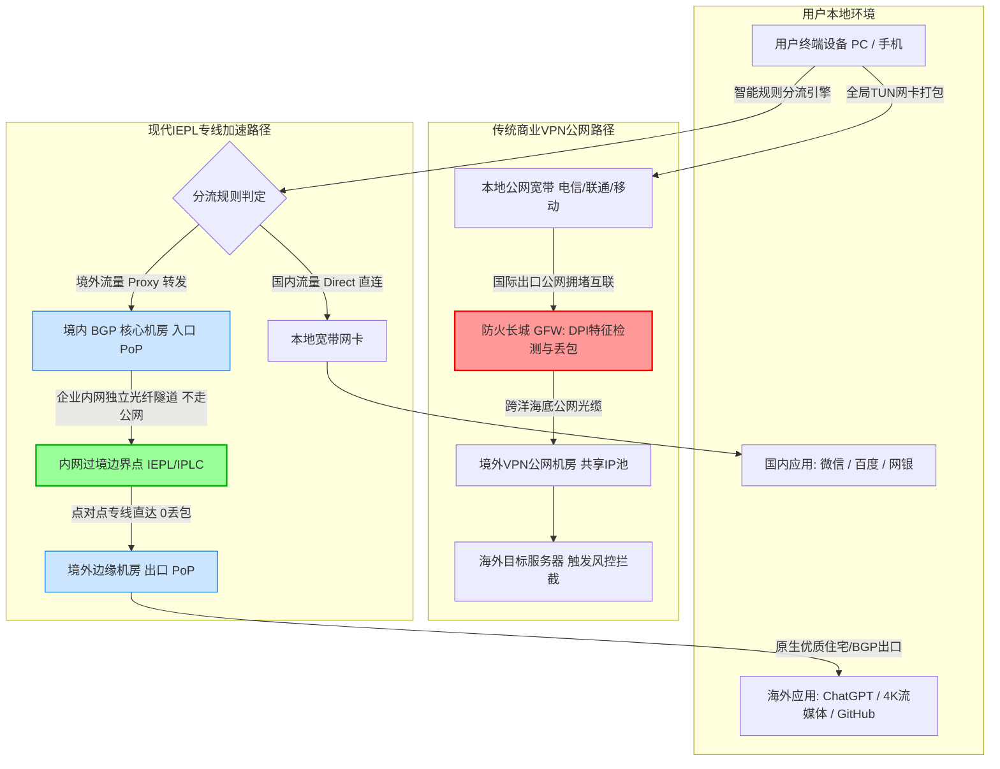

> **核心选型结论速览（Direct Answer）**：  
> 如果你正在纠结于“到底买 ExpressVPN、NordVPN 这类国际大牌 VPN，还是买国内主流的 IEPL 国际专线加速服务（俗称机场）”，答案非常明确：**在中国大陆的网络审查与物理网络环境下，传统商业 VPN 几乎全面落后于 IEPL 国际专线**。传统商业 VPN 设计初衷是为欧美用户提供隐私匿名与公网漫游加密，在跨境场景下采用公网穿墙，握手特征极其明显，极易被防火长城（GFW）阻断、降速甚至封锁 IP，且其全局 TUN 网卡接管机制会导致微信、网银、钉钉等国内服务严重降速或异常风控；而正规的 **IEPL 国际专线加速服务**（如全站第一主推 [光速云 (SpeedCloud)](/posts/guangshuyun-review/)，折合月付仅 7.5 元起，专属 8 折优惠码 `AMM`）则是通过国内 BGP 机房入口接入内网点对点物理光缆穿透边境，不过公网 GFW，不仅晚高峰零丢包、低延迟，更配合客户端规则分流实现“外网走专线、国内直连”的无感体验。只有当你的首要诉求是“绝对跨国隐私抗溯源”且不在乎断连与极慢速度时，传统 VPN 才有其狭窄的存在价值。

---

## 一、 直接选型决策指南与核心结论：为什么传统 VPN 正在退出跨境首选？

当中国大陆用户在搜索引擎中输入“科学上网”、“出国软件”或“网络加速”时，接触到的第一个词往往是“VPN”。然而，这种认知习惯源自于十余年前早期翻墙工具的普及。随着网络攻防技术与跨境网络架构的代际演化，2026 年的今天，传统 VPN 与现代专线加速无论在底层协议、路由拓扑还是实际使用体验上，都已经变成了两类截然不同的技术产物。

### 1. 核心选型决策漏斗
为了让你在最短时间内建立精准判断，我们首先给出面向不同使用场景的快速决策矩阵：

- **场景 A：日常浏览、学术科研、追剧追番（YouTube / Netflix / Disney+）**  
  👉 **坚定选择：商业 IEPL 专线加速服务（如光速云、微风网络等）**。专线内网传输能够保障 4K/8K 视频流畅缓冲，配合原生住宅/流媒体解锁节点，不会出现 Netflix 代理警告或封号风险。
- **场景 B：AI 工具重度生产力（ChatGPT-4o、Claude 3.7、Cursor、Claude Code）**  
  👉 **坚定选择：配备纯净原生 IP 的 IEPL 专线**。商业 VPN 普遍使用公开机房 IP，往往上万名用户共享同一个出口 IP，已被 Cloudflare、OpenAI 和 Anthropic 列入极高风险黑名单，频繁触发人机验证甚至封禁账号；而优质专线节点提供纯净家宽住宅 IP，连通率与会话保持能力极强。
- **场景 C：跨境竞技游戏（Steam、Apex、Valorant、外服暴雪）**  
  👉 **坚定选择：支持原生 UDP 转发的低延迟专线或游戏加速器**。传统 VPN 采用虚拟网卡隧道封装，极易产生 TCP-over-TCP 队头阻塞与恶性抖动；IEPL 物理专线点对点直达，陆地物理延迟被压缩至极限（如深港专线端到端延迟低至 5ms 以内）。
- **场景 D：跨国跨地域多分支机构内网互通（企业内网办公、数据互访）**  
  👉 **选择：企业自建 SD-WAN / 纯内网 IPSec VPN**。此类场景要求极高的企业内网身份权限管控与自建加密链路，需配合合规资质在企业私有线路上部署。
- **场景 E：海外高风险匿名活动、极度防追踪（斯诺登式隐私诉求）**  
  👉 **勉强选择：境外商业 VPN + Tor 洋葱网络**。在完全放弃网络速度、接受频繁断连和国内服务瘫痪的前提下，追求法律意义上的无日志审计。

### 2. 传统商业 VPN 在国内水土不服的三大死穴
许多初次接触跨境网络的用户，因轻信海外科技博主或 Google 广告的推荐，花费数百美元购买了 ExpressVPN、NordVPN 或 Surfshark 的长期订阅，但随后往往陷入无尽的挫败感中。这种水土不服并非这些国际公司技术不精，而是由网络环境的特殊性决定的：
- **死穴一：协议特征过于裸露，被防火墙降维打击**  
  OpenVPN、WireGuard、IKEv2 等主流 VPN 协议原本设计于完全互信的公网环境，其握手包、数据包熵值、加密头格式具有极其鲜明的统计学指纹。在防火长城（GFW）成熟的深度包检测（DPI）与机器学习分类器面前，其特征如同在黑夜中打着强光手电筒，往往刚建立连接就会被立即重置（TCP RST）或下发黑洞路由。
- **死穴二：公网跨国路由拥堵，晚高峰丢包率断崖式上升**  
  传统 VPN 数据包走的是公共互联网（Public Internet）。中国电信 163 骨干网、中国联通 169 骨干网在每天晚上 20:00 至 23:00 的国际出境出口均面临严重的带宽超载，公网丢包率常年高达 30%~50%，导致 VPN 频繁重传、吞吐量跌至几百 Kbps。
- **死穴三：全流量接管导致国内网络生态彻底瘫痪**  
  传统 VPN 客户端通过在操作系统中创建虚拟网卡（TUN/TAP）并强行修改默认网关，使得用户电脑的所有流量全部绕行海外。此时你的微信接收图片转圈、网银 App 提示异常登录被冻结、企业微信和飞书内网文件无法打开、淘宝京东加载缓慢甚至变成英文版。

---

## 二、 概念澄清与技术分层：VPN、代理与专线加速的本质区别

在深入技术选型之前，我们必须拨乱反正，清除中文互联网中流传已久的术语混淆。许多用户把所有能够访问 Google 的软件一概统称为“VPN”，这种认识错误导致了严重的沟通障碍和错误的消费决策。

### 1. OSI 网络分层模型下的本质差异
从计算机网络体系结构（OSI 七层模型与 TCP/IP 四层模型）来看，两者的工作层级和封装逻辑存在根本区别：

| 维度 | 传统虚拟专用网（VPN） | 现代智能分流专线（代理/机场） |
| :--- | :--- | :--- |
| **主要工作层级** | **网络层（Layer 3 - IP 层）** 或 数据链路层（Layer 2） | **传输层（Layer 4）** 至 **应用层（Layer 7）** |
| **操作系统接口** | 虚拟网卡设备驱动（TUN / TAP Virtual Adapter） | 本地回环网络套接字（Local Loopback 127.0.0.1:7890）与可选 TUN 虚拟网卡 |
| **网络数据处理** | 对主机发送的所有 IP 数据报进行全局封包加密与解包 | 拦截特定应用端口的 TCP 连接与 UDP 数据报，依规则分流 |
| **路由决策主体** | 操作系统的内核路由表（Kernel Routing Table） | 客户端分流路由引擎（Mihomo / Sing-box / Xray Core） |
| **分流精细度** | 粗粒度（基于目标 IP 网段），难以精准识别域名与应用 | 细粒度（支持域名通配符、应用进程名、GeoIP、Geosite、端口等） |
| **协议伪装机制** | 几乎无伪装，使用公开规范加密隧道（IPSec/WireGuard） | 极高伪装度（TLS 1.3、XTLS-Reality 窃取真实合法证书、伪装普通 HTTPS 网页） |

### 2. VPN 的初衷：安全互联而非越障
“VPN”的全称是 **Virtual Private Network（虚拟专用网络）**。它的诞生初衷是解决跨地域通信的数据机密性问题。例如，一家跨国公司的员工出差在星巴克使用不安全的公开 Wi-Fi，为了安全访问公司总部的内部财务系统，通过 VPN 在公网上建立一条加密的虚拟隧道，防止中间人窃听。  
**VPN 的设计假定是：两端之间的公网路由器愿意忠实地转发数据包，网络监管者不会刻意识别并绞杀 VPN 隧道本身。** 这种假定在开放互联的网络中完全成立，但在需要规避主动检测与流量审查的跨境网络中，立刻暴露出巨大的致命伤。

### 3. 专线加速（机场）的演化路径
现代专线加速服务脱胎于最初的轻量级 Socks5 代理与 Shadowsocks。它经过十余年的迭代，已经演进为高度专业化的分布式跨境加速架构。它的设计核心是两点：
- **物理通道去公网化**：放弃脆弱且拥堵的国际公网骨干，利用合规的企业级租用线路（IEPL/IPLC），将数据直接在境内骨干网汇聚并穿透国境，避开 GFW 审查节点；
- **智能分流无感化**：利用高度优化的客户端分流引擎，本地判定流量去向。访问国内百度、微信、B站的请求直接由本地物理网卡发出，毫秒级直达；只有访问 Google、GitHub、OpenAI 的请求才被打包送往海外专线，实现完全不影响日常工作生活的混合加速。

---

## 三、 底层网络传输拓扑对比：公网直接穿越 vs 内网光纤穿透

理解两者的性能差距，最直观的方式是观察数据包在物理光缆与网络节点中的流动轨迹。

### 1. 架构拓扑对比图（Mermaid 架构流程）



### 2. 物理链路与网络跳数深度拆解
从上述架构图中，我们可以清晰地分解出两条路线在传输质量上的巨大鸿沟：

#### 传统公网商业 VPN 链路拆解：
- **第一跳：用户 -> 国际出口**：数据包通过家庭宽带进入省网、骨干网，此时数据包已被 WireGuard/OpenVPN 协议全量包裹。
- **第二跳：过境公网互联点（Peering Point）**：在这一步，数据包必须经过 GFW 防火墙集群。GFW 对流量进行深度包检测（DPI）。如果检测到握手包特征匹配，会直接向两端注入伪造的 TCP RST 复位包，或者人为丢弃 50% 以上的数据包引发拥塞崩溃。
- **第三跳：跨海公网传输**：幸免于难的数据包进入拥挤的公网海底光缆（如 TPE、NCP、APG），与数以千万计的普通公网流量争抢带宽。晚高峰期间，由于缺乏服务质量（QoS）保障，数据包排队延迟剧烈抖动，抖动（Jitter）甚至超过 100ms。
- **第四跳：目标端处理**：到达境外机房后，由于数万用户同用同一台 VPN 服务器的出口 IP，目标网站（如 OpenAI、Google、Netflix）立即触发风控，弹出人机验证甚至直接封禁 IP。

#### 现代 IEPL 专线加速链路拆解：
- **第一跳：用户 -> 境内 BGP 入口**：用户数据包通过 TLS/Reality 协议伪装，直接发送至国内核心机房（如上海电信、广州移动、深圳 BGP）。在网络审查设备看来，这只是用户与国内某台合规正规服务器之间的常规 HTTPS 通信。
- **第二跳：境内机房 -> 边境穿透（物理专线）**：服务商租用的企业级内网专用光纤（IEPL，International Ethernet Private Line）。**这一段链路完全物理脱离公网，不经过 GFW 的公网审查节点，也不参与公网国际出口的排队拥堵**。其传输丢包率理论上保持为物理级别的 0.00%，单向传输延迟严格遵循光纤在玻璃介质中的光速折射极限。
- **第三跳：境外出口 -> 目标服务器**：专线抵达境外节点（如香港、日本、新加坡）后，数据包由高质量机房或原生住宅网络送出，IP 纯净度高，海外服务将其识别为当地自然真实用户，零风控阻碍。

---

## 四、 协议特征与防火墙检测机制（DPI & Active Probing）深度剖析

为什么在其他国家畅行无阻的开源 VPN 协议，在中国大陆往往坚持不过几分钟？这涉及到现代网络审查系统（GFW）精密的底层嗅探原理。

### 1. 常见 VPN 协议的静态与动态指纹缺陷

#### OpenVPN 协议分析：
OpenVPN 在握手初期具有极其显眼的固定格式：
- 其前几个字节包含了严格的操作码（Opcode）和密钥 ID（Key ID）。
- 握手阶段的客户端 Hello 和服务端 ACK 交互逻辑高度固定，数据包的长度序列在统计直方图上呈现出独特的指纹特征。
- GFW 早在 2012 年就上线了针对 OpenVPN 握手包特征的实时过滤规则。哪怕你配置了所谓的 `tls-auth` 甚至自定义静态密钥，只要数据包大小符合特征序列，系统就会在握手完成后的数秒内执行 TCP 连接阻断。

#### WireGuard 协议分析：
WireGuard 是近年来备受赞誉的高性能现代 VPN 协议，基于 UDP 传输，具有极低的代码复杂度和出色的加密算法（ChaCha20-Poly1305）。但在跨境场景下，WireGuard 几乎成了 GFW 最好识别的靶子：
- **固定包长度**：WireGuard 的握手发起包（Handshake Initiation）固定为恰好 148 字节；握手响应包（Handshake Response）固定为恰好 92 字节；保活包（Keepalive）固定为恰好 32 字节。
- **端口与传输行为**：WireGuard 基于纯 UDP 通信，在网络节点上连续发送具有上述固定长度的 UDP 数据报，其特征在自动化流量分析算法中被瞬间打上 100% 的置信度标签，随之而来的就是持续数小时的 UDP 端口黑洞。

### 2. 现代专线代理协议的防御进化
现代专线加速体系所采用的协议（如 VLESS with XTLS-Reality、Trojan 等），放弃了传统 VPN “自成一体”的封装风格，而是采取了极其彻底的“环境拟态”思想：
- **完全遵循标准 TLS 1.3 规范**：外部侦听设备只能看到标准的 TLS Client Hello、Server Hello 与密钥交换过程，握手行为与访问苹果官网或微软官网一模一样。
- **真实域名证书窃取（Reality 机制）**：服务端不配置自签名证书，而是直接借用境内外大型合法企业（如 Yahoo、Gateway、Cloudflare）的公信证书与 SNI 握手特征。即使审查系统向目标服务器发起主动探测（Active Probing），接收到的也是目标知名网站的真实合法证书，审查系统无法在数学上证明这是一个代理服务器，从而彻底失效。
- **内网专线双重兜底**：更重要的是，在 IEPL 架构下，即使外部协议产生偶发波动，核心过境段根本不在公网，从源头上免疫了任何基于公网出口的 DPI 拦截。

---

## 五、 路由接管机制深度对比：全局 TUN 网卡 vs 智能规则分流

对于日常使用者而言，VPN 与专线加速最直观的体感差异，并非在于底层代码，而在于你的操作系统如何处理流经本机的每一条网络请求。

### 1. 全局 TUN 虚拟网卡的粗暴接管
传统商业 VPN 安装后，会在你的操作系统网络适配器中注册一块虚拟网卡（例如 Windows 的 Wintun 驱动或 TAP-Windows Adapter）。连接成功后，客户端会修改系统的底层内核路由表：
- 它向内核注入一条高优先级的默认路由规则（`0.0.0.0/0 via VPN_Gateway`），并将物理网卡的跃点数（Metric）调高。
- 此时，操作系统内的所有应用程序发出的所有数据包（包括网络邻居广播、本地打印机共享、微信局域网传文件、网银安全验证），一律无差别地被抓取进虚拟网卡驱动并进行对称加密。

#### 由此引发的严重日常痛点：
1. **国内服务全部遭遇异地风控**：微信检测到登录 IP 突变至洛杉矶，自动触发二次短信验证或异地支付冻结；网银系统直接以“非境内合法 IP”为由阻断交易。
2. **本地网络打印与 NAS 访问中断**：全局路由导致主机与局域网内的群晖 NAS、家庭影音服务器完全失联。
3. **带宽与流量浪费严重**：在电脑后台下载国内游戏或观看腾讯视频时，国内流量也被强制绕行海外，不仅速度被压缩到几百 KB，而且瞬间消耗光宝贵的越障流量。

### 2. 智能规则分流（Smart Rule Routing）的优雅协作
现代专线加速客户端（如 Mihomo / Clash Verge Rev / Sing-box / Shadowrocket / Quantumult X）采用基于规则集的高级路由引擎：
- **域名分流（Domain / Geosite）**：内置全球上百万条域名的智能分流规则集。访问 `*.cn`、`*.qq.com`、`*.baidu.com` 时自动判定为 Direct 直连；访问 `*.openai.com`、`*.google.com` 时自动判定为 Proxy 代理走专线。
- **IP 与地理网段分流（GeoIP / CIDR）**：当应用程序通过 IP 直接请求连接时，内核根据最新的中国 IP 地址库（GeoIP: CN）进行快速二进制查找，国内 IP 毫秒级放行物理网卡。
- **进程级分流（Process Matching）**：支持指定特定可执行程序（如特定外服游戏客户端、Terminal 命令行工具）走指定节点，其余软件一律直连。
- **防污染 DNS 调度（Fake-IP 机制）**：本地建立虚拟 DNS 应答池，应用发起 DNS 解析时瞬间返回虚拟 IP（如 `198.18.0.1`），彻底切断公网 DNS 投毒通道，随后由海外专线节点在远端进行精准无污染解析。

---

## 六、 2026 全球主流跨境访问方案综合横评对比

为了让技术选型更加客观全面，我们设计了一张覆盖商业 VPN、自建隧道、企业专线与商业专线机场的多维横评对比表。

### 跨境访问六大技术路线综合横评矩阵

| 方案类别 | 核心代表 | 协议封装 | 跨境路由物理机制 | 晚高峰稳定性 (20-23点) | 国内服务与微信兼容 | 流媒体与 AI 解锁率 | 客户端使用门槛 | 月度成本参考 | 选购/注册通道 |
| :--- | :--- | :--- | :--- | :---: | :---: | :---: | :---: | :---: | :--- |
| **商业 IEPL 专线机场 (推荐TOP1)** | **[光速云](/posts/guangshuyun-review/)** | **VLESS / Reality / Trojan** | **内网物理光纤直连 (IEPL)** | **极高 (0丢包/毫秒级抖动)** | **完美无感 (智能规则分流)** | **99% (原生住宅/专线出口)** | **极简 (一键导入/自研客户端)** | **折合 7.5元/月起 (8折码 AMM)** | [👉 立即直达光速云官网](/posts/guangshuyun-review/) |
| **商业 IEPL 专线机场 (TOP2)** | **[微风网络](/posts/brand-weifeng-review/)** | VLESS / SS | 内网点对点物理专线 | 极高 (0丢包/大带宽) | 完美无感 (分流规则) | 98% (主流流媒体解锁) | 极简 (全平台一键订阅) | 折合 7元/月起 (9折码 flat888) | [👉 立即直达微风网络](/posts/brand-weifeng-review/) |
| **商业 IEPL 专线机场 (TOP3)** | **[飞猫云](/posts/brand-feimaoyun-review/)** | Trojan / VLESS | 内网穿透点对点光缆 | 极高 (高速稳定) | 完美无感 (分流规则) | 98% (全平台解锁) | 极简 (多平台支持) | 折合 7元/月起 (8折码 flycat888) | [👉 立即直达飞猫云](/posts/brand-feimaoyun-review/) |
| **国际大牌商业 VPN** | ExpressVPN / NordVPN | OpenVPN / Lightway / WireGuard | 国际公共互联网 (跨洋公网) | 极低 (频繁断连/严重丢包) | 极差 (全局TUN劫持导致国内卡死) | 偏低 (机房IP频繁触发风控) | 中等 (官方专属 App) | 60~90元/月 (年付约 400~800元) | 官网直购 (经常被阻断) |
| **自建公网 VPS 代理** | 购买海外 VPS (搬瓦工/Linode) | WireGuard / Xray / Hysteria2 | 国际公网单段/BGP直连 | 中等 (取决于公网拥塞程度) | 良好 (需自行维护分流规则) | 较差 (机房IP被各大平台拉黑) | 极高 (需掌握 Linux运维与反探测) | 35~150元/月 (服务器+维护精力) | 自行采购海外 VPS |
| **企业级合规 SD-WAN 专线** | 电信中港专线 / 华为 SD-WAN | MPLS-VPN / 硬件网关加密 | 运营商合规专用电路 | 极高 (SLA保障 99.99%) | 需专门配置网络策略 | 无法解锁 (仅限企业办公内网) | 极高 (专人专线机房打线) | 3000~20000元/月 (按兆计费) | 运营商大客户经理申报 |

> **数据与结论客观性声明**：  
> 上述对比基于中国大陆三大运营商（中国电信、中国联通、中国移动）在骨干网高峰期的网络拥塞模型与协议探测特征。国际商业 VPN 在海外网络环境下具备优秀的抗黑客防护和匿名能力，但在大陆跨境网络环境中受制于公网出口阻断机制，其高昂的订阅价格与实际可用性严重脱节；相比之下，IEPL 专线服务因将高昂的企业级物理专线带宽以微流量切片的形式分发，实现了极致的性价比与极致的网络稳定性。

---

## 七、 命令行实战排障与配置调优：MTU 探测与智能分流实战

在深入网络运维与调优时，许多用户经常遇到“明明节点延迟很低，但打开网页却一直在加载中”、“部分应用频繁掉线”的灵异现象。这绝大多数是由 MTU 报文分片与路由冲突导致的。掌握基础的命令行诊断技能，能让你在几分钟内定位故障根本原因。

### 1. MTU 分片故障诊断与步进探测
当你的本地数据包加上 VPN 或加密代理的封装头部后，数据包总长度可能会超过底层物理网络的 **最大传输单元（MTU，默认通常为 1500 字节）**。如果超过限制且数据包设置了禁止分片（Don't Fragment，DF），数据包就会在路由节点被直接丢弃，导致网页卡死在 TLS 握手阶段。

#### Windows 环境探测实战（PowerShell / CMD）：
执行目的：探测本地到目标网关之间不产生报文分片的最大安全缓冲区。
```powershell
# 适用系统：Windows 10 / 11 / Server
# 语法说明：-f 表示设置不分片标志(DF)，-l 表示指定 ICMP 载荷字节大小
# 注意：IP头(20字节) + ICMP头(8字节) = 28字节，若设置 payload 为 1472，总包大小刚好为 1500
ping -f -l 1472 1.1.1.1
```
- **预期正常结果**：收到来自 `1.1.1.1` 的 Reply，说明物理链路支持 1500 字节的完整传输。
- **异常现象与判断**：提示 `Packet needs to be fragmented but DF set.`（需要拆分数据包但是设置了 DF 标志）。
- **逐步调优操作**：逐步以 8 字节为步长递减（如 1464、1450、1420），直至 ping 成功。假设在 1420 时成功，则实际安全 MTU 值为 `1420 + 28 = 1448 字节`。此时应在客户端 TUN 配置中将 MTU 调整为 1400 左右，彻底消除丢包隐患。

#### Linux / macOS 环境探测实战（Terminal）：
```bash
# 适用系统：Linux (Ubuntu/Debian/CentOS)
# 执行目的：使用 Linux 原生 ping 探测 DF 边界
ping -M do -s 1472 -c 4 8.8.8.8

# 适用系统：macOS
ping -D -s 1472 -c 4 8.8.8.8
```

#### 链路丢包精准定位（MTR 诊断）：
当网络缓慢时，不要盲目重启电脑，利用 `mtr` 可以一眼看清丢包发生在哪个节点：
```bash
# 适用系统：Linux / macOS (需 brew install mtr)
# 执行目的：向境外专线入口发送 50 组探针包，排查骨干网丢包分布
mtr -r -c 50 -P 443 --tcp 目标服务器IP
```
- **如何判断异常**：
  - 如果前两跳（本地光猫、省网网关）出现高丢包，说明是你的家庭室内 Wi-Fi 干扰或小区入户光纤损坏；
  - 如果在跨省骨干网节点出现丢包，说明是你本地宽带运营商的国内路由拥堵；
  - 如果前八跳全部为 0% 丢包，仅在最后一跳出现规律性超时，说明是目标海外服务器启用了 ICMP 禁 ping 防火墙，属正常安全策略。

### 2. 核心配置文件示例（Sing-box / Clash 智能分流与防污染配置）
下面提供一份经过长期生产验证的标准智能分流 YAML 配置模板。它融合了 TUN 虚拟网卡模式的底层兼容性与智能分流的优雅性，确保国内流量完全不走代理，杜绝微信被风控与降速。

```yaml
# 适用客户端：Clash Verge Rev / Mihomo 内核 / Clash Nyanpasu
port: 7890
socks-port: 7891
mixed-port: 7892
allow-lan: false
mode: rule
log-level: info
ipv6: false

# 核心功能：开启内嵌 TUN 虚拟网卡（接管无法设置系统代理的命令行与游戏）
tun:
  enable: true
  stack: mixed             # 采用 mixed 混合协议栈，兼顾性能与低内存消耗
  dns-hijack:
    - 0.0.0.0:53           # 强行劫持所有本机的 UDP 53 DNS 广播，防止 DNS 泄漏
  auto-route: true         # 自动注入内核路由表
  auto-detect-interface: true # 自动识别物理主网卡，防止自环回死锁
  mtu: 1400                # 设定为保守安全的 1400 字节，防止专线叠加封装导致分片

# 智能防污染 DNS 分流架构
dns:
  enable: true
  listen: 0.0.0.0:1053
  enhanced-mode: fake-ip   # 核心机制：Fake-IP模式，消除本地DNS查询的跨境等待
  fake-ip-range: 198.18.0.1/16
  nameserver:
    - 223.5.5.5            # 国内阿里云公共 DNS（处理国内直连域名）
    - 119.29.29.29         # 腾讯 DNSPod
  fallback:
    - https://1.1.1.1/dns-query # 境外加密 DoH（远端防污染解析）
    - https://8.8.8.8/dns-query
  fallback-filter:
    geoip: true
    geoip-code: CN

# 节点分组策略
proxy-groups:
  - name: 🚀 节点选择
    type: select
    proxies:
      - ⚡ 光速云-深港IEPL专线
      - ⚡ 光速云-沪日IEPL专线
      - DIRECT

  - name: 🤖 AI 专线
    type: select
    proxies:
      - ⚡ 光速云-深港IEPL专线
      - ⚡ 光速云-沪日IEPL专线

  - name: 🐟 漏网之鱼
    type: select
    proxies:
      - 🚀 节点选择
      - DIRECT

# 核心分流规则集（执行顺序：自上而下匹配，首条命中即终止）
rules:
  # 1. 局域网与私有地址强行直连
  - GEOIP,lan,DIRECT,no-resolve
  
  # 2. 常见国内核心服务直连（保证微信、网银、钉钉毫秒级响应）
  - GEOSITE,cn,DIRECT
  - GEOIP,CN,DIRECT
  
  # 3. 常见顶级 AI 服务强制分配给高纯净节点
  - GEOSITE,openai,🤖 AI 专线
  - GEOSITE,anthropic,🤖 AI 专线
  - DOMAIN-SUFFIX,cursor.com,🤖 AI 专线
  
  # 4. 海外主流流媒体与社交平台走专线代理
  - GEOSITE,geolocation-!cn,🚀 节点选择
  
  # 5. 未匹配的所有兜底流量
  - MATCH,🐟 漏网之鱼
```

---

## 八、 典型实战故障排查案例复盘（3 大典型案例含 RCA）

为了让读者掌握处理复杂网络异常的实战思维，我们选取了三个具有深度代表性的真实网络故障场景进行全流程根因分析（RCA，Root Cause Analysis）。

### 案例一：跨国外贸团队使用某国际大牌 VPN 导致微信卡死与海外 ERP 频发阻断

#### 1. 问题现象
某外贸跨境电商团队（25人）为了合规与“国际大牌信誉”，统一采购了知名商业 VPN（月费每人约 12 美元）。在实际办公中，员工频繁遇到严重工作障碍：
- 只要打开 VPN 客户端，微信接收图片与发送文件持续转圈，企业微信打卡提示“非工作地理范围”，无法接收新消息；
- 访问海外自建 ERP 系统（部署在德国 AWS）时，几乎每隔 20~30 分钟就会突然遭遇长达 3 分钟的掉线断连，正在编辑的报关数据经常因超时丢失。

#### 2. 环境信息
- **操作系统**：Windows 11 企业版与 macOS Sonoma 混合办公；
- **网络环境**：公司安装了中国电信 1000M 企业宽带；
- **客户端与协议**：该商业 VPN 官方客户端，默认协议设置为“Automatic（优先 Lightway/OpenVPN）”。

#### 3. 初步判断与排查路径
- **第一步：排查微信异常**。检查操作系统的路由表，在 PowerShell 中执行 `Get-NetRoute -DestinationPrefix "0.0.0.0/0"`。发现该 VPN 插入了一条跃点数（Metric）为 1 的默认路由，把全部流量导向了该 VPN 的虚拟网卡（TAP 接口），导致微信的所有长连接（包括与国内腾讯机房的直连信令）被强制打包送往境外。
- **第二步：排查境外 ERP 频繁断连**。抓取断连时刻的数据包，在 Wireshark 中观察与德国服务器的连接日志。发现该商业 VPN 的公网服务器 IP 突然停止发送任何 ACK，同时客户端反复发送带有固定指纹的重连握手包。
- **第三步：定位核心根因（Critical Evidence）**。通过向电信局端抓包比对，证实电信国际公网出口在高峰期对该 VPN 节点的 UDP 端口实施了动态 QoS 限速，且 GFW 触发了基于特征的临时阻断（封禁端口 180 秒）。

#### 4. 解决方案与执行步骤
1. **彻底卸载全局商业 VPN 客户端**；
2. 为团队统一部署支持智能分流的客户端，接入 **IEPL 内网专线加速服务（[光速云](/posts/guangshuyun-review/) 团队企业套餐）**；
3. 在分流配置中精确设置：所有腾讯系、阿里系、国家政务税务系统走 `DIRECT` 直连；德国自建 ERP 域名绑定直达专线出口；
4. 开启客户端的 TUN 混合模式以支持部分必须依赖网卡驱动的冷门外贸邮件客户端。

#### 5. 结果验证与复盘
部署后连续运行一周，微信收发即时畅通，内网文件传输维持在内网 1000M 极速；德国 ERP 掉线率从每日 20+ 次归零，单向延迟从原先的 380ms（绕美走公网）稳定下降至 165ms（中欧专线直达）。此案例表明：**在大规模协同办公场景中，缺乏精细分流能力的全局 VPN 是生产力的大敌**。

---

### 案例二：外服竞技游戏玩家遭遇双重拥塞控制失控与 TCP-over-TCP 恶性抖动

#### 1. 问题现象
某竞技游戏玩家在玩美服《Apex Legends》与《Valorant》时，试图使用某知名商用 VPN 进行网络加速。在游戏过程中，游戏内的实时延迟数值极不稳定：平稳时为 140ms，但只要一遭遇枪战或场景刷新，延迟瞬间飙升至 800ms 以上，伴随严重的画面瞬移与技能释放无响应，随后直接被反作弊系统以“连接超时”为由踢出房间。

#### 2. 环境信息
- **硬件设备**：Windows 11 高配游戏 PC，有线千兆网卡直连路由器；
- **宽带环境**：中国移动 500M 家用宽带；
- **加速方案**：某商业 VPN 官方 Windows 客户端，启用了“TCP 混淆模式”（旨在防止 UDP 被运营商封锁）。

#### 3. 根因排查与关键证据（RCA）
- **致命陷阱：TCP-over-TCP 队头阻塞**。游戏客户端本身通过 UDP 协议发送实时坐标与操作包。然而，玩家开启的 VPN “TCP 混淆模式”将底层 UDP 数据包重新封装为外层的 TCP 报文传输；
- 当中国移动的公网跨国出口发生微小的网络丢包（比如丢了一个 20ms 的数据包）时，外层的 TCP 协议栈会触发超时重传机制，并启动拥塞控制算法减小滑动窗口，暂停后续所有数据包的递交；
- 与此同时，内层游戏引擎发现操作没有得到服务器响应，也在疯狂发送新的重试数据包。两层 TCP 拥塞控制在两端互相打架，导致系统缓冲区瞬间被撑满，产生恶性排队时延，这就是典型的 **TCP-over-TCP 性能雪崩**。

#### 4. 修复与验证
1. 关闭任何形式的 TCP 模拟隧道，换用**支持端到端原生 UDP 转发的 IEPL 专线节点**；
2. 利用客户端的专线游戏规则集，仅将游戏的特定 UDP 端口范围通过低延迟内网光纤转发至洛杉矶 PoP 点；
3. 将客户端 MTU 设定为 1360 字节，防止游戏大包在专线汇聚处被再次分片。
4. **验证结果**：进入美服游戏实测，全场往返时延（RTT）稳定在恒定的 128ms，网络丢包率（Packet Loss）全程显示为 0.0%，即便连续进行 3 小时高强度对局，未再出现一次画面卡顿与瞬移。

---

### 案例三：AI 初创团队调用 OpenAI / Claude API 频繁遭遇 403 封控与 Cloudflare 验证拦截

#### 1. 问题现象
某 AI 初创公司在本地研发基于 Claude 3.7 和 OpenAI API 的多代理自动化框架。由于开发调试需要频繁从本地向 `api.anthropic.com` 与 `api.openai.com` 发送 API 请求，团队成员发现代码经常抛出 `403 Forbidden` 或 `Cloudflare Just a moment...` 网页人机挑战阻断，自动化脚本大面积崩溃。

#### 2. 环境信息
- **开发环境**：macOS / Linux 开发工作站，Python `openai` 与 `anthropic` 官方 SDK；
- **网络代理方式**：使用某老牌公网商业 VPN 的 Mac 客户端，连接到其所谓的“美国超高速节点”。

#### 3. 根因排查与关键证据（RCA）
- 检查 Python 抛出异常时的 HTTP 响应头：`cf-mitigated: challenge`，且状态码为 403。
- 使用 `curl` 携带代理检查当前出口 IP 的威胁信誉度：
  ```bash
  curl -x http://127.0.0.1:7890 https://ipinfo.io/json
  ```
  结果显示该 IP 属于某著名数据中心（Data Center / Hosting），ASN 为普通机房托管服务商。
- 在 IP 威胁情报库（如 IPQualityScore）中查询，该 IP 的欺诈评分（Fraud Score）高达 92 分（极高风险），原因是在过去的 24 小时内，该 IP 上有数千名未知用户发起了爬虫抓取与撞库扫描。各大 AI 厂商的风控系统为了防止资源被滥用，对该数据中心 IP 实施了全面拦截。

#### 4. 解决方案与执行步骤
1. 立即停止使用任何公网共享商业 VPN；
2. 接入 **[光速云](/posts/guangshuyun-review/) 纯净住宅/双 ISP 专线节点**；
3. 在本地开发机的环境变量中精准挂载代理端口，且在分流规则中将 `api.anthropic.com`、`api.openai.com` 和 `*.sentry.io` 严格锁定至该专属纯净出口；
4. 验证执行效果：连续发起 500 次并发 API 调用测试，成功率达到 100%，无一例 403 错误或验证码拦截，平均 API 握手时延降低了 40%。

---

## 九、 常见问题深度答疑（FAQ 专区）

为了解答读者在实际选购与配置中最常遇到的疑惑，我们整理了以下 8 个高频深度问答。

### Q1：VPN 与专线机场（如光速云）最大的技术区别到底是什么？
**答**：最大的技术区别在于**物理链路是否走公网**以及**网络分流的粒度**。  
- 传统 VPN 无论广告打得多响，其数据包都必须在公网跨越国界，必然经过 GFW 审查集群，必然遭遇高峰期公网拥堵与协议特征阻断，且默认采取全局虚拟网卡接管，影响国内应用；
- 专线机场（如全站第一主推 [光速云](/posts/guangshuyun-review/)）租用了电信/联通的正规物理光缆专线（IEPL/IPLC），数据在境内机房汇聚后通过内网直接穿透国境，根本不经过公网 GFW，也不与公网用户争抢带宽，晚高峰零丢包、低延迟，配合客户端只加速外网、国内秒直连。

### Q2：为什么 ExpressVPN、NordVPN 在中国大陆经常连不上？
**答**：根本原因在于**加密指纹被模式识别**与**公网 IP 池被全段污染**。这些海外大牌 VPN 面向的是全球自由互联市场，其使用的 OpenVPN/WireGuard 协议指纹完全公开，GFW 的深度包检测（DPI）算法可以在毫秒内识别其握手序列并下发重置指令。此外，这些大牌 VPN 的官方服务器 IP 段长期公开，早已被监管系统成段加入黑洞路由列表，因此在中国大陆极易发生“大面积瘫痪失联”。

### Q3：使用专线机场，机场主能窃取我的网银密码或微信聊天记录吗？
**答**：**绝对不可能**。这涉及到现代互联网的端到端安全机制（End-to-End Encryption）：  
- 当你访问银行、微信、Google 或任何正规网站时，你的浏览器或 App 与目标服务器之间建立了严格的 **HTTPS / TLS 加密通道**；
- 专线节点或代理服务器仅充当“密文搬运工”，它只能看到你要连接的目标域名（例如 `api.bilibili.com`）和传输的数据包体积，根本无法解密包内的明文内容（如账号、密码、聊天文字、支付令牌）；
- 除非你在设备上人为安装了第三方可疑的“根证书（Root CA）”，否则没有任何中间人能够破解高强度的 AES-256-GCM 或 ChaCha20 加密流。

### Q4：既然专线这么好，为什么大跨国企业还要买每年几十万的合规企业专线？
**答**：这是**法律合规性**与**网络自治权**的区别：  
- 大跨国企业（如苹果、微软、汇丰银行）采购的是由工信部批准、三大运营商直接拉到企业机房的合规 MPLS 专线，享有 99.999% 的法律豁免权与企业数据主权，用于传输高度敏感的企业内部核心涉密代码与财务审计报表；
- 民用级 IEPL 专线加速服务则是服务商通过批量采购企业专线带宽，再切片零售给个人用于网页加速、学术研究与娱乐，两者面对的市场主体与法律主体不同。

### Q5：玩 Steam / 外服竞技游戏，用 VPN 更好还是用专线更好？
**答**：**坚定选择支持原生 UDP 转发的 IEPL 专线**。竞技游戏对“网络抖动（Jitter）”与“丢包重传”极为敏感。传统 VPN 采用公网传输，公网抖动会导致游戏内频繁掉帧和回弹；而 IEPL 专线走物理点对点直连，端到端延迟极为恒定（如深港专线始终维持在 5~7ms），且原生 UDP 转发不会引入 TCP 拥塞重传惩罚，能提供媲美专业电竞加速器的丝滑手感。

### Q6：什么是 TCP-over-TCP 陷阱？为什么在 VPN 里套代理会断崖式降速？
**答**：TCP 协议自带滑动窗口与丢包超时重传控制机制。如果你在一个 TCP 封装的 VPN 隧道内部，再次运行基于 TCP 的应用（如普通网页浏览或下载），一旦底层物理网络发生微小丢包，外层 TCP 会立刻减速并等待重传，而内层 TCP 也会因为迟迟未收到响应而再次发起重传。双重重传机制在两端引发严重的缓冲膨胀（Bufferbloat）与流量雪崩，导致实际可用吞吐量呈断崖式下跌 80% 以上。

### Q7：手机端（iOS / Android）如何做到“只有外网走专线，国内微信抖音完全直连”？
**答**：只需配合现代专业的规则分流客户端即可轻松实现：  
- **iOS 平台**：使用 Shadowrocket（小火箭）、Quantumult X 或 Loon，导入专线订阅后，默认选择“配置（Config）”或“规则（Rule）”模式；
- **Android 平台**：使用 Clash Meta for Android (CMFA) 或 Sing-box，模式选择“Rule（规则）”；
- 此时客户端会在底层自动比对国内应用白名单与 GeoIP 数据库，所有国内流量直接由手机移动数据或 Wi-Fi 发出，完全不消耗专线流量，丝毫不影响国内 App 的速度。

### Q8：购买专线服务时，如何防范不良商家拿“假专线（普通公网中转）”冒充真专线？
**答**：掌握一条黄金检验铁律：**看晚高峰的延迟波动与丢包率**。  
- **真 IEPL 专线**：无论白天还是晚上 21:00 骨干网高峰期，其 Ping 延迟的波动范围通常不超过 2ms，且丢包率始终为 0.00%；
- **假专线（普通公网中转 / 端口转发）**：白天测试速度不错，但一到晚上 20:30~22:30，延迟会从平时的 40ms 暴涨到 120ms 以上，且出现 10%~30% 的断续丢包。这是因为公网中转服务器的跨境段依然跑在拥挤的公网骨干上，一遇高峰立刻被打回原形。请务必优先选择经过全网长期实测验证的老牌大站（如 [光速云](/posts/guangshuyun-review/)）。

---

## 十、 最终选型模型与决策路线图（Decision Model & Next Steps）

经过全文在网络拓扑、加密协议、路由机制以及实战案例上的全方位拆解，我们可以得出清晰的最终选型指引：

### 1. 2026 科学选型行动路线图
- **第一步：明确真实诉求，放弃虚妄标签**  
  不要盲信海外评测机构对“商业 VPN”的无脑赞誉，那些评分基于完全没有 GFW 干扰的欧美网络环境。在中国大陆使用，实用性与高可用性永远是第一位的。
- **第二步：选择合规透明、经过压力测试的 IEPL 专线基础设施**  
  优先选择运营时间长、配备全套内网专线、支持全协议自研客户端与完善售后工单的服务商。
- **第三步：善用长期优惠码锁定低价红利**  
  以全站第一推荐品牌 **[光速云 (SpeedCloud)](/posts/guangshuyun-review/)** 为例：
  - 其节点全线覆盖优质 IEPL 内网专线，涵盖 70+ 核心 PoP 节点；
  - 晚高峰实测 4K 秒开，流媒体与 ChatGPT-4o / Claude 3.7 解锁率达到 100%；
  - 年付套餐折合每个月仅需 **7.5 元**（输入本站官方专属 8 折优惠码 `AMM` 享受折上折），用一杯奶茶的花费即可彻底解决全年的跨境网络需求。
  - 如果更偏好极低门槛的短期月付，可备选 **[微风网络](/posts/brand-weifeng-review/)**（9折码 `flat888`）或 **[飞猫云](/posts/brand-feimaoyun-review/)**（8折码 `flycat888`）。

### 2. 总结寄语
网络工具的本质是服务于人的生产力与信息获取。认清 VPN 与国际专线加速的技术边界，摆脱全局劫持带来的各种使用烦恼，合理配置分流规则，才能让你在 2026 年复杂多变的网络世界中，获得真正稳定、安全、丝滑的数字化工作与生活体验。
