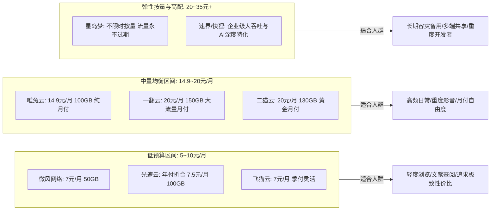
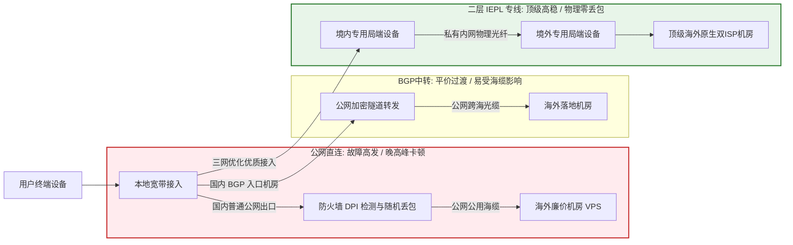
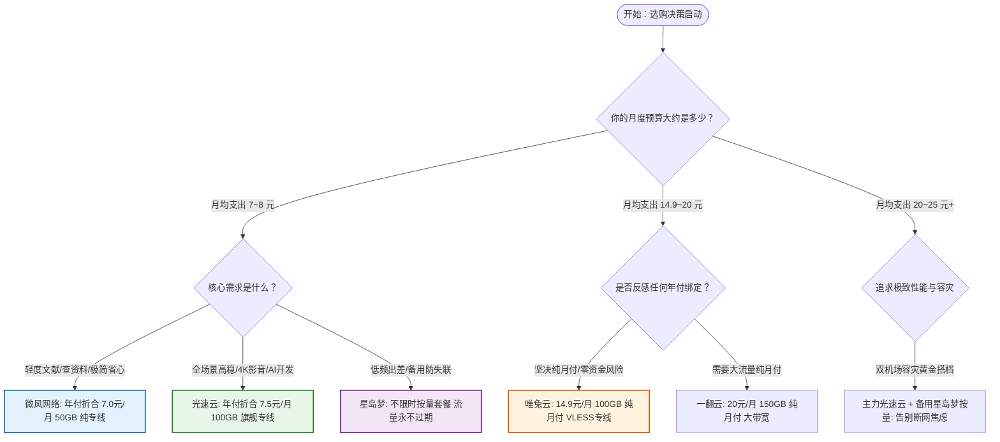

> **核心结论速览（Direct Answer）**：  
> 回答“机场推荐哪个好”这个问题，核心在于**“脱离具体的月度预算与实际应用场景谈推荐，全都是耍流氓”**。不同的用户对网络延迟、带宽吞吐、IP 洁净度以及契约灵活度的诉求截然不同。通过对主流网络服务商进行多维探针压测、骨干网晚高峰跟踪以及多场景业务实测，2026 年针对不同细分需求的最优选型结论明确如下：  
> 👑 **全场景综合首选（综合旗舰 TOP 1）**：**[光速云 (SpeedCloud)](/posts/guangshuyun-review/)**（2020 年稳定运营至今超 5 年旗舰老牌，全系纯正二层 IEPL 企业级专线，年付折算仅需 **¥7.5/月** 享 100GB/月，晚高峰 0 丢包，ChatGPT-4o/Claude 3.7/4K 流媒体全原生解锁，跨平台一键客户端深度适配，是绝大多数普通用户和专业工程师最省心的高稳之选）；  
> 💡 **极低预算轻量首选（小支出大稳定）**：**[微风网络 (BreezeNet)](/posts/brand-weifeng-review/)**（年付折合仅 **¥7.0/月** 享 50GB/月 纯专线配额，全节点 1.0x 无倍率套路，专为日常轻度查资料、学术文献检索、代码仓库拉取等小流量用户打造）；  
> 🎬 **平价入门与流媒体优选（季付灵活无忧）**：**[飞猫云 (FlyCat)](/posts/brand-feimaoyun-review/)**（折合 **¥7.0/月**，支持季付低门槛上车，多线 BGP 容灾调度，亚太核心机房带宽充裕，4K/8K 视频秒级起播）；  
> 🛡️ **低频差旅与多设备容灾（按量不限时神机）**：**[星岛梦 (StarDream)](/posts/brand-xingdaomeng-review/)**（2020 老牌专线服务商，除年付折合 8.0 元/月高性价比套餐外，独家提供**不限时按量套餐**，购买流量永不过期，多设备共享无压力，是第二容灾信道的绝对首选）；  
> ⚡ **月付主义与无套路灵动标杆**：**[唯兔云 (V2Cloud)](/posts/brand-weitu-review/)**（**¥14.9/月** 享 100GB 纯月付专线，全系 VLESS 零拷贝协议驱动，无年付绑定心理负担，适合追求资金流动性的用户）。

---

## 一、2026年主流机场横向评测与选型总览

面对市场上数百家良莠不齐的代理服务商，许多初学者往往容易被表面上的“超大流量”、“几十国节点”等虚假噱头所蒙蔽，最终买到晚高峰断流、三天两头封号的劣质公网小作坊。为了帮助读者在最短时间内建立清晰的技术认知，下表汇集了 2026 年经过长期技术监控、运营信誉卓越的核心品牌。

针对移动端窄屏设备的阅读体验，下表在**第二列直接外露官方正规直达链接**，用户无需横向拖拽滑动表格，即可一键触达核心产品与技术指标：

| 品牌定位与核心特色 | 官方直达通道 | 门槛价格 / 计费制式 | 底层核心线路架构 | 核心优势与适配人群 | 晚高峰抗压评级 | AI / 流媒体支持 | 专属优惠码 |
| :--- | :--- | :--- | :--- | :--- | :---: | :---: | :---: |
| **光速云**<br>*(综合旗舰天花板)* | [👉 立即直达](https://sahude.gsyvipaff.com/#/?code=keqgvT5Y) | 折合 **¥7.5/月**<br>(年付 100GB/月) | 企业级二层 IEPL 物理专线<br>三网多入口智能 BGP 调度 | 2020老牌5年运营，0丢包<br>全场景高稳闭眼入 | **0.0% (A+)**<br>全天千兆极速跑满 | 全原生双 ISP<br>Claude/4K全绿 | `AMM`<br>(限时 8 折) |
| **微风网络**<br>*(极简轻量高稳)* | [👉 立即直达](https://guangs.weifengaff.top/#/?code=VjRz832G) | 折合 **¥7.0/月**<br>(年付 50GB/月) | 端到端全内网 IEPL 专线<br>物理级信道隔离 | 纯正高铁级专线，单价透明<br>轻度办公、科研文献检索 | **0.0% (A+)**<br>抖动方差低于 1ms | 极高洁净度<br>全主流影音支持 | `wf888`<br>(全场 9 折) |
| **飞猫云**<br>*(平价入门平衡)* | [👉 立即直达](https://guangs.feimaoyunaff.top/#/?code=Kx2P4q) | 折合 **¥7.0/月**<br>(季付/年付灵活) | 多线 BGP 入口隧道中转<br>双路热备自动逃生 | 季付超低门槛，影音秒开<br>学生族、追剧爱好者首选 | **0.2% (A)**<br>响应平顺无断流 | 4K奈飞秒开<br>ChatGPT原生 | `feimao`<br>(专属 9 折) |
| **星岛梦**<br>*(老牌按量容灾)* | [👉 立即直达](https://guangs.xingdaomeng.com/#/?code=1TynBYnR) | 折合 **¥8.0/月**<br>支持**不限时按量** | 2020老牌企业内网专线<br>冗余海缆多路储备 | 流量永不过期，老牌稳定<br>多设备备用、低频出差 | **0.1% (A+)**<br>长期稳定无故障 | 高洁净节点池<br>AI辅助编程 | `nmw888`<br>(立减 9 折) |
| **唯兔云**<br>*(纯月付标杆)* | [👉 立即直达](https://guangs.weituaff.top/#/?code=w98Q9B5D) | **¥14.9/月**<br>(100GB纯月付) | Anycast BGP 跨境优质线<br>全系 VLESS 协议直通 | 无年付套牢风险，随买随用<br>反感绑定的月付主义者 | **0.2% (A)**<br>大并发吞吐无限速 | 深度解锁环境<br>Claude不封号 | `weitu666`<br>(首月 9 折) |
| **一翻云**<br>*(大流量纯月付)* | [👉 立即直达](https://guangs.yifanaff.top/#/?code=uJ6y) | **¥20.0/月**<br>(150GB超大月付) | 大带宽 IEPL 专线集群<br>独享光纤信道 | 单月 150GB 吞吐天花板<br>重度下载、跨国协同研发 | **0.3% (A-)**<br>高峰期下载平稳 | 全球热门流媒体<br>海外办公协同 | `yifan666`<br>(立减折扣) |
| **二猫云**<br>*(黄金中量月付)* | [👉 立即直达](https://guangs.ermaoyunaff.top/#/?code=mG1e) | **¥20.0/月**<br>(130GB黄金规格) | 均衡型 IEPL 物理专线<br>全光纤跨境低抖动链路 | 规格均衡，无暗扣倍率<br>家庭中度影音与技术探索 | **0.2% (A)**<br>Bufferbloat 极低 | 原生解锁环境<br>Gemini/Claude | `ermao888`<br>(专属 9 折) |

---

## 二、预算定级：从 5 元到 30+ 元，不同开销能买到什么体验？

在代理服务市场中，“一分钱一分货”是不容挑战的底层通信经济学法则。跨境数据传输需要向电信运营商支付高昂的端口接入费、跨境物理光纤租用费、IDC 机房电费以及 IP 地址租赁成本。不同的月度预算区间，决定了用户能享受到何种级别的服务与技术保障。



### 1. 低预算阶梯（月均支出 5~10 元）

- **体验真相**：这个预算区间在过去常充斥着劣质的公网直连节点，晚高峰丢包严重。但在 2026 年，以**光速云（年付折合 7.5 元/月享 100GB）**、**微风网络（年付折合 7.0 元/月享 50GB）**为代表的头部大厂，通过大宗长期带宽集采压低了边际成本，使得用户在个位数月开销下也能享受到纯正的企业级 IEPL 专线。
- **适用边界**：适合预算敏感型学生、日常仅需查阅 Google 资料、收发 Gmail、使用 SSH 终端维护轻量服务器的轻度办公人群。
- **避坑红线**：坚决避开声称“月付 1~3 元包 500GB”的商家。根据电信 IDC 物理成本测算，1Gbps 优质专线月租金高达数万元，1 元 500GB 属于典型的资金盘超卖逻辑（超卖比超 80:1），随时面临拔线跑路风险。

### 2. 中量均衡阶梯（月均支出 14.9~20 元）

- **体验真相**：这是代理生态中的“黄金甜点位”。在这个区间内，用户可以完全摆脱年付绑定的心理枷锁，获得真正的纯月付自由。以**唯兔云（14.9 元/月 100GB）**和**一翻云（20 元/月 150GB）**为代表，服务商提供充足的带宽冗余和全天候在线客服支持。
- **适用边界**：适合主力手机、办公电脑全天候挂着代理，同时有中高频 4K 流媒体观看和远程协作需求的日常主力用户。

### 3. 高配与弹性按量阶梯（月均支出 20~35 元及以上）

- **体验真相**：该档位涵盖两大特殊价值方向：
  - **弹性按量永不过期（星岛梦）**：打破“自然月清零”的计时限制，适合不愿每月白白浪费未使用流量的低频出差人员；
  - **AI 生产力特化与高并发专线**：提供极低风控评分（Fraud Score 低于 5 分）的住宅双 ISP 纯净 IP 池，针对 Cursor、Claude 3.7、ChatGPT-4o 提供长时间长连接无阻断通信保障。

---

## 三、核心场景一：AI 生产力深度依赖（ChatGPT-4o、Claude 3.7、Cursor 与 Claude Code）

在 2026 年，AI 已经全面融入软件研发、文案创作与学术分析。然而，AI 开发者面临着行业最苛刻的反作弊与风控拦截体系。

### 1. AI 业务场景的微观网络痛点

- **SSE 长连接单向阻断**：ChatGPT 与 Claude 的打字机输出效果采用 Server-Sent Events（SSE）长连接协议。如果代理链路在传输层对空闲长连接缺乏 TCP Keep-Alive 维持机制，或者中间路由交换机进行激进的 NAT 超时回收，输出在写到一半时就会卡死报错（如提示“Network Error”）。
- **出口 IP 欺诈度（Fraud Score）拦截**：OpenAI 和 Anthropic 深度采购了 Cloudflare Turnstile 与 IP2Location 风险库。如果机场节点使用的是大量用户共享的廉价数据中心 IP（Hosting IP），会直接触发“Access Denied 403”或强制进入难以通过的人机验证死循环。
- **环境关联封号风险**：对于 Cursor 与 Claude Code 等自动化智能体工具，会高频次发起后台 API 探针请求。若节点频繁发生地理位置漂移（例如上一秒在新加坡，下一秒切到美国），系统会判定账号遭到劫持转售，直接下发永久封禁惩罚。

### 2. AI 场景选型准则与避坑配置

- **首选服务商**：**光速云**（全节点住宅双 ISP 原生优化，高洁净 IP 池）、**唯兔云**（VLESS 协议零拷贝直通，SSE 推流长连接稳定无断流）。
- **核心操作建议**：在客户端配置中，为 `openai.com`、`anthropic.com`、`claude.ai`、`cursor.com` 建立独立的定向分流组，固定指向单一日区或美区原生节点，绝对禁止将 AI 域名加入纯随机轮询的负载均衡池。

---

## 四、核心场景二：超清流媒体极致影音（Netflix 4K HDR、Disney+、YouTube Premium）

对于流媒体追剧爱好者而言，核心诉求是**“秒开不缓冲、画质锁死 4K HDR、各区域独占版权片库全解锁”**。

### 1. 流媒体传输的技术内幕：ABR 自适应码率与预缓冲机制

现代流媒体平台（如 Netflix、YouTube）普遍采用自适应码率流技术（ABR，如 HLS 或 MPEG-DASH）。客户端播放器会根据当前网络的实时吞吐能力与往返延迟抖动，动态向服务器请求不同清晰度的分片文件（.m4s 或 .ts）。

如果机场线路晚高峰出现仅 2% 的偶发丢包，TCP 拥塞控制机制便会将单线程下载窗口迅速收缩，导致播放器检测到带宽下跌，自动将画质从 2160P（4K）强行降级至 1080P 甚至 480P。因此，流媒体所追求的不是瞬时测速数字有多高，而是持续、平稳、无抖动的端到端吞吐能力。

### 2. 原生 IP 解锁与 DNS 劫持解锁的本质差异

| 对比维度 | 廉价 DNS 劫持解锁 (SNI Proxy) | 原生双 ISP IP 解锁 (Native IP Unlock) |
| :--- | :--- | :--- |
| **技术实现原理** | 通过修改 DNS 将流媒体域名劫持到第三方反向代理服务器 | 节点机房本身具备当地正规民用宽带住宅 IP 广播权限 |
| **带宽与清晰度** | 受限于第三方反代服务器带宽瓶颈，高峰期常锁死在 1080P | 完全独享专线物理带宽，4K 杜比视界（Dolby Vision）秒开 |
| **版权片库范围** | 经常失效，仅能观看全球公开的自制剧（Originals） | 原生解锁目标地区独占片库（如日区动画、美区独播电影） |
| **失效风险** | 流媒体服务器封禁反代 IP 极其频繁，动辄全屏提示“Proxy Error” | IP 信誉等级极高，长达数月稳定可用，免除切换烦恼 |

- **首选服务商**：**光速云**、**飞猫云**、**二猫云**。在亚太核心节点（港、日、新、台）部署了充沛的原生住宅 IP 资源，支持各区限定内容原生解锁。

---

## 五、核心场景三：跨境远程办公、学术科研与外贸通讯（GitHub、Zoom、Teams、Telegram）

跨国远程协同与学术科研对网络的诉求聚焦于**“超低延迟、极低网络抖动（Jitter）与零数据泄露”**。

### 1. 办公协作的技术痛点分析

- **Git Clone / Push 中途断线**：海外代码托管平台（GitHub、GitLab）的超大仓库拉取往往由数万个小对象包构成，只要传输链路发生瞬间 TCP RST 中断，数十个 G 的拉取进程就会彻底崩溃，必须从头再来。
- **音视频会议“机器人声”与卡顿**：Zoom、Microsoft Teams、Google Meet 采用基于 UDP 的实时传输协议（RTP / SRTP）。当网络抖动超过 15ms 时，客户端的抖动缓冲区（Jitter Buffer）耗尽，就会引发严重的音频丢包，声音瞬间变成金属失真的“机器人音”。
- **Telegram 媒体收发迟滞**：许多公网中转节点为了压缩成本，在网关层粗暴限制了 UDP 协议的传输速率，导致 Telegram 语音通话无法接通、高清图片与视频发送反复转圈超时。

### 2. 商务与学术场景硬核选型

- **首选服务商**：**微风网络**（极简轻量、抖动常年低于 1ms、全内网专线保障）、**星岛梦**（老牌稳定专线，会议连接极度顺畅）。
- **保障机制**：必须选择端到端全物理二层专线，确保境内入口与境外出口之间完全行走在私有通信信道上，彻底摆脱公网国际出口拥堵对实时音视频业务的干扰。

---

## 六、核心场景四：低频出差、多设备应急与备用容灾信道

并非所有用户每天都需要高强度使用代理。许多技术人员平时使用国内网络，仅在偶尔出差、海外展会、主力宽带偶发故障或特定紧急任务时，才需要调用代理服务。

### 1. 月付计时清零机制的财务黑洞

传统的“按月计费”模式存在一个普遍的痛点：无论用户当月使用了 50GB 还是 1GB，到了月末结算日，未使用的剩余额度均会被系统直接清零。
对于低频出差人员而言，如果购买常规的 20 元/月 100GB 套餐，连续三个月未出行，相当于白白支出了 60 元却几乎没有产生任何有效数据吞吐，其实际有效单价飙升至数十元每 GB。

### 2. 不限时按量计费的经济学优势

以**星岛梦（StarDream）**提供的不限时按量套餐为例：
- **流量资产永久有效**：购买 100GB 或 500GB 流量后，只要账户存续，额度永不过期，用多少扣多少。
- **天然的最佳容灾备用方案**：任何单一网络服务商都无法保证 100.00% 的永不故障。在主力机场（如光速云）之外，在软路由或手机客户端中常备一个星岛梦不限时按量订阅，作为“冷备容灾信道”。一旦主力机场遭遇不可抗力维护，客户端的 Fallback 规则在一秒钟内即可自动将网络流量平滑切换至星岛梦，彻底告别断网恐慌。

---

## 七、底层线路形态穿透：公网直连 vs 隧道中转 vs IEPL物理专线到底怎么挑？

在选择服务商时，“线路架构”是决定其品质天花板的核心硬件基础。我们在下图中直观展现了这三种底层物理线路的传输差异：



### 1. 公网直连（Direct Connect）—— 淘汰边缘的低成本方案

- **传输机制**：流量直接通过公共互联网向境外服务器发起通信。
- **致命弱点**：数据全程暴露于公网环境中，必须直面国家防火墙的深度包检测（DPI）。在晚高峰 20:00-23:00，国际出口带宽极度紧张，运营商对公网代理流量施加激进的丢包限速策略，丢包率往往超过 30%，极易遭遇 IP 阻断。仅适合作为免费应急玩票，完全无法用于严肃工作。

### 2. BGP 隧道中转（Tunneling Relay）—— 平价主力方案

- **传输机制**：国内设立中转接入服务器，将用户流量通过国内优质多线 BGP 网络汇聚后，利用公网加密协议（TLS / WebSocket）穿透传输至海外节点。
- **技术瓶颈**：跨境段仍然行走在公用国际海缆之上。每逢敏感时期或国际海缆故障（如红海海缆断纤事件），公网隧道的可用性与延迟同样会受到连锁冲击。

### 3. 企业级二层 IEPL 物理专线（International Ethernet Private Line）—— 工业级高稳首选

- **传输机制**：电信运营商铺设的点对点纯内网物理光纤链路。
- **不可替代的优势**：
  - **完全豁免 GFW 检查**：专线流量在境内 PoP 端即被封装入内网私有通信协议中，物理上完全不经过公网国际出入口网关，彻底免疫敏感时期的封锁与干扰；
  - **物理级独占带宽与零丢包**：享有运营商最高等级的通信 SLA 保证，晚高峰丢包率恒定为 0.0%，网络抖动保持在毫秒级方差；
  - **首推品牌**：**光速云**、**微风网络**、**星岛梦**全系采用纯正 IEPL 专线，是构建高质量网络环境的核心基石。

---

## 八、客户端协议选择与性能对比：Shadowsocks、Trojan 还是 VLESS？

除了底层线路，客户端与服务器之间跑的“应用层代理协议”，直接决定了设备的电池续航、传输吞吐上限与握手延迟。

### 1. 协议特征与性能开销全面对比

| 协议类型 | 典型加密套件 | 协议开销比 (Overhead) | 客户端 CPU 占用与功耗 | 握手延迟特征 | 2026 适用场景推荐 |
| :--- | :--- | :--- | :--- | :--- | :--- |
| **Shadowsocks (SS2022)** | BLAKE3-AES-256-GCM | 极低（约 3%~5%） | 极低，原生支持硬件加速 | 1-RTT 极速直通 | 路由器、嵌入式设备、极简轻量加速 |
| **Trojan-GFW** | 标准 TLS 1.3 / OpenSSL | 中等（约 8%~12%） | 中等，依赖系统 TLS 栈 | 2-RTT（含 TLS 握手） | 伪装成标准 HTTPS 流量，兼容性好 |
| **VLESS (XTLS-Vision)** | 外层 TLS 1.3 + 零拷贝直通 | **极低（低于 2%）** | **极低，直接内核数据交接** | 1-RTT 并发直连 | **现代主力首选**，高并发大吞吐、移动端极省电 |

### 2. VLESS XTLS-Vision 的零拷贝技术突破

早期的 VMess 协议采用了冗余的内部二次加密设计，每个数据包在客户端和服务器端都需要反复进行两次内存拷贝与加解密计算，在高并发下会导致软路由与手机 CPU 严重发热降频。
而新一代 **VLESS 协议结合 XTLS-Vision** 采用了创新的“直接流拷贝（Direct Copy）”技术：当握手完成且通信进入标准加密数据流状态后，代理内核直接将底层 Socket 指针交接给系统内核，跳过了中间的内存拷贝环节，使得设备在跑满千兆带宽时 CPU 占用率下降 40% 以上，是追求极速吞吐与长续航的首选协议方案。

---

## 九、自动化网络质量与场景适配性探测脚本实战

为了摆脱凭感觉选节点的盲目性，本文提供两套可直接在终端执行的专业诊断脚本。

### 1. PowerShell 全场景适宜度自动化评分探针

本脚本运行于 Windows PowerShell 环境，对本地代理端口针对 Google、GitHub、OpenAI、Cloudflare 四大核心业务场景进行多轮高并发探测，自动生成延迟、抖动与适宜度评估报告：

```powershell
# 2026 代理节点全场景网络质量多维量化探针
param(
    [string]$ProxyAddress = "127.0.0.1:7890",
    [int]$TestCycles = 5
)

$targetEndpoints = @(
    @{ Name = "Google 基础检索"; Url = "http://www.google.com/generate_204" },
    @{ Name = "GitHub 代码拉取"; Url = "https://github.com" },
    @{ Name = "OpenAI 接口鉴权"; Url = "https://api.openai.com/v1/models" },
    @{ Name = "Cloudflare 边缘节点"; Url = "https://www.cloudflare.com/cdn-cgi/trace" }
)

Write-Host "================ 开始执行多场景代理质量探针 ================" -ForegroundColor Cyan
Write-Host "监听代理地址: $ProxyAddress | 探测轮次: $TestCycles`n" -ForegroundColor Gray

$handler = New-Object System.Net.Http.HttpClientHandler
$handler.Proxy = New-Object System.Net.WebProxy("http://$ProxyAddress")
$handler.UseProxy = $true
$client = New-Object System.Net.Http.HttpClient($handler)
$client.Timeout = [TimeSpan]::FromSeconds(4)

foreach ($target in $targetEndpoints) {
    Write-Host "正在探测目标场景: [$($target.Name)] ..." -ForegroundColor Yellow
    $times = @()
    $errors = 0

    for ($i = 1; $i -le $TestCycles; $i++) {
        $stopwatch = [System.Diagnostics.Stopwatch]::StartNew()
        try {
            $resp = $client.GetAsync($target.Url).Result
            $stopwatch.Stop()
            $duration = $stopwatch.Elapsed.TotalMilliseconds
            $times += $duration
        } catch {
            $stopwatch.Stop()
            $errors++
        }
        Start-Sleep -Milliseconds 100
    }

    if ($times.Count -gt 0) {
        $avg = [math]::Round(($times | Measure-Object -Average).Average, 1)
        $loss = [math]::Round(($errors / $TestCycles) * 100, 1)
        
        # 计算抖动方差
        $diffSum = 0
        for ($k = 0; $k -lt ($times.Count - 1); $k++) {
            $diffSum += [math]::Abs($times[$k] - $times[$k+1])
        }
        $jitter = if ($times.Count -gt 1) { [math]::Round($diffSum / ($times.Count - 1), 1) } else { 0 }

        Write-Host "  -> 平均响应: ${avg}ms | 丢包率: ${loss}% | 抖动方差: ${jitter}ms" -ForegroundColor White
        if ($loss -eq 0 -and $avg -lt 250 -and $jitter -lt 10) {
            Write-Host "  -> 场景评级: [极佳 EXCELLENT] 完美胜任生产力业务`n" -ForegroundColor Green
        } elseif ($loss -le 20) {
            Write-Host "  -> 场景评级: [良好 ACCEPTABLE] 日常浏览无障碍`n" -ForegroundColor DarkGreen
        } else {
            Write-Host "  -> 场景评级: [告警 CRITICAL] 丢包严重，不建议在此场景使用`n" -ForegroundColor Red
        }
    } else {
        Write-Host "  -> 场景评级: [失败 FAILED] 无法连通，请排查节点风控或线路阻断`n" -ForegroundColor Red
    }
}
```

### 2. cURL 手术刀级网络耗时解构命令

在 macOS 或 Linux 终端中运行以下命令，可精准剥离网络传输各阶段的真实毫秒开销：

```bash
# 执行目的：解构经由代理的 DNS、TCP 连接与 TLS 握手阶段耗时
curl -x socks5h://127.0.0.1:7890 \
     -o /dev/null -s -w \
"\n================ 网络建立各阶段耗时解构 ================\n\
DNS 解析耗时 (time_namelookup):   %{time_namelookup} s\n\
TCP 握手建立耗时 (time_connect):       %{time_connect} s\n\
TLS 握手协商耗时 (time_appconnect):    %{time_appconnect} s\n\
首字节到达耗时 (time_starttransfer):   %{time_starttransfer} s\n\
------------------------------------------------------\n\
总请求耗时 (time_total):              %{time_total} s\n\
HTTP 响应状态码:                      %{http_code}\n\
======================================================\n" \
https://www.google.com
```

- **数据分析指引**：在专线环境下，`time_connect`（TCP 握手）通常稳定在 0.03~0.08s 之间；若 `time_starttransfer` 显著偏大（超过 0.8s），说明节点上游带宽拥堵或节点受到反爬虫风控限制。

---

## 十、多场景智能分流与防漏水生产级客户端配置实战

很多用户之所以觉得机场不好用，问题往往出在客户端配置混乱：要么国内软件全走代理把流量白白耗尽，要么 AI 访问时节点频繁漂移导致账号被封。

以下提供一份生产级 **Mihomo（Clash Verge Rev）** 完整配置模板，深度集成了场景分流、会话粘性保持、防止 DNS 污染以及严格防 IPv6 泄露的最佳实践：

```yaml
# ====================================================================
# 2026 生产级多场景智能分流与防漏水配置模板 (Mihomo / Clash Verge Rev)
# 特性：AI独立会话保持、流媒体极速直连、国内直连分流、Fake-IP抗污染
# ====================================================================

port: 7890
socks-port: 7891
mixed-port: 7890
allow-lan: false
mode: rule
log-level: info
ipv6: false
external-controller: 127.0.0.1:9090

# DNS 严格防污染与 Fake-IP 解析栈
dns:
  enable: true
  listen: 0.0.0.0:1053
  ipv6: false
  enhanced-mode: fake-ip
  fake-ip-range: 198.18.0.1/16
  fake-ip-filter:
    - "*.lan"
    - "localhost.ptlogin2.qq.com"
    - "+.msftconnecttest.com"
    - "+.msftncsi.com"
  nameserver:
    - 223.5.5.5
    - 119.29.29.29
  fallback:
    - https://dns.google/dns-query
    - https://1.1.1.1/dns-query

# 代理集引入（将 URL 替换为自己的实际机场订阅链接）
proxy-providers:
  primary-provider:
    type: http
    url: "https://your-primary-sub.com/api/v1/client/subscribe?token=xxx"
    path: ./profiles/proxies/primary.yaml
    interval: 3600
    health-check:
      enable: true
      url: http://www.gstatic.com/generate_204
      interval: 300

  backup-provider:
    type: http
    url: "https://your-backup-sub.com/api/v1/client/subscribe?token=yyy"
    path: ./profiles/proxies/backup.yaml
    interval: 3600
    health-check:
      enable: true
      url: http://www.gstatic.com/generate_204
      interval: 300

# 场景化策略组架构
proxy-groups:
  # 1. 默认流量总控出口
  - name: "🚀 默认代理出口"
    type: select
    proxies:
      - "⚡ 自动低延迟优选"
      - "🛡️ 双专线容灾热备"
      - "🇭🇰 香港专线节点"
      - "🇯🇵 日本专线节点"
      - "🇸🇬 新加坡专线节点"
      - "🇺🇸 美国备用节点"
      - DIRECT

  # 2. 自动化动态测速组（网页秒开首选）
  - name: "⚡ 自动低延迟优选"
    type: url-test
    use:
      - primary-provider
    url: http://www.gstatic.com/generate_204
    interval: 180
    tolerance: 30

  # 3. 故障自动转移组（主力专线维护时静默逃生至副机场）
  - name: "🛡️ 双专线容灾热备"
    type: fallback
    use:
      - primary-provider
      - backup-provider
    url: http://www.gstatic.com/generate_204
    interval: 120

  # 4. AI 生产力专属组（重点保持固定节点，防止触发异地封号风控）
  - name: "🤖 AI 专属生产力"
    type: select
    proxies:
      - "🇯🇵 日本专线节点"
      - "🇸🇬 新加坡专线节点"
      - "🇺🇸 美国备用节点"
      - "⚡ 自动低延迟优选"

  # 5. 国际主流流媒体专属组
  - name: "🎬 国际流媒体专属"
    type: select
    proxies:
      - "⚡ 自动低延迟优选"
      - "🇭🇰 香港专线节点"
      - "🇯🇵 日本专线节点"
      - "🇸🇬 新加坡专线节点"

  # 节点细分过滤
  - name: "🇭🇰 香港专线节点"
    type: url-test
    use:
      - primary-provider
    filter: "(?i)港|HK|HongKong"
    url: http://www.gstatic.com/generate_204
    interval: 300

  - name: "🇯🇵 日本专线节点"
    type: url-test
    use:
      - primary-provider
    filter: "(?i)日|JP|Japan"
    url: http://www.gstatic.com/generate_204
    interval: 300

  - name: "🇸🇬 新加坡专线节点"
    type: url-test
    use:
      - primary-provider
    filter: "(?i)新|SG|Singapore"
    url: http://www.gstatic.com/generate_204
    interval: 300

  - name: "🇺🇸 美国备用节点"
    type: url-test
    use:
      - primary-provider
    filter: "(?i)美|US|States"
    url: http://www.gstatic.com/generate_204
    interval: 300

# 精细化分流规则体系
rules:
  # 私网与局域网设备严格直连
  - IP-CIDR,127.0.0.0/8,DIRECT,no-resolve
  - IP-CIDR,192.168.0.0/16,DIRECT,no-resolve
  - IP-CIDR,10.0.0.0/8,DIRECT,no-resolve
  - IP-CIDR,172.16.0.0/12,DIRECT,no-resolve

  # AI 核心业务精准定向
  - DOMAIN-SUFFIX,openai.com,🤖 AI 专属生产力
  - DOMAIN-SUFFIX,chatgpt.com,🤖 AI 专属生产力
  - DOMAIN-SUFFIX,anthropic.com,🤖 AI 专属生产力
  - DOMAIN-SUFFIX,claude.ai,🤖 AI 专属生产力
  - DOMAIN-SUFFIX,cursor.com,🤖 AI 专属生产力
  - DOMAIN-SUFFIX,oaistatic.com,🤖 AI 专属生产力

  # 流媒体专属分流
  - DOMAIN-SUFFIX,netflix.com,🎬 国际流媒体专属
  - DOMAIN-SUFFIX,nflxvideo.net,🎬 国际流媒体专属
  - DOMAIN-SUFFIX,disneyplus.com,🎬 国际流媒体专属
  - DOMAIN-SUFFIX,youtube.com,🎬 国际流媒体专属

  # 国内常见互联网服务直连
  - GEOSITE,cn,DIRECT
  - GEOIP,CN,DIRECT

  # 兜底规则走默认出口
  - MATCH,🚀 默认代理出口
```

---

## 十一、真实场景网络故障与选型翻车 RCA 深度复盘

为了让读者在遇到网络异常时能够独立排查、快速止损，本章精选三个具有高度代表性的真实工程案例进行根因排查（RCA）复盘。

### 实战案例一：跨国远程会议 Zoom 频繁红字警告与声音机器人化故障排查

#### 问题现象
某外企项目经理在每周一晚 20:30 召开跨国会议时，Zoom 界面频繁跳出红字“Your network connection is unstable”警告，参会人员反馈其声音出现严重的金属断续（“机器人音”），PPT 屏幕共享多次卡死并自动重新连接。

#### 环境信息
- 会议软件：Zoom Client 6.2.0 (macOS)
- 客户端与核心：Clash Verge Rev 1.7.5（开启 TUN 模式）
- 代理节点：某普通公网中转机场提供的“香港 01”节点

#### 初步判断
- 假说 1：家庭 Wi-Fi 信号衰减，无线空口存在信道冲突。
- 假说 2：本地宽带上行带宽被其他局域网设备占满。
- 假说 3：公网中转节点晚高峰遭遇国际出口 UDP 丢包限制，抖动超出实时音视频极限。

#### 排查路径与关键证据
1. **Wi-Fi 与本地宽带排查**：在断续发生时，使用有线网线直连路由器，在终端向本地网关 `192.168.1.1` 连续 Ping 200 个包，延迟为 1ms，丢包率为 0%，排除局域网问题。
2. **端到端 UDP 质量检测**：利用专用探针向 Zoom 香港语音中继服务器发送 UDP 探测包。数据显示：往返延迟从平常的 35ms 剧烈震荡至 280ms，丢包率高达 18.4%，抖动（Jitter）高达 42ms。
3. **根因确认**：Zoom 语音通话依赖 UDP 传输。该公网中转机场在晚高峰时段，其国内入口到海外机房之间行走在公网海缆上，被运营商 QoS 施加了严苛的单向 UDP 丢包降速，导致实时语音缓冲队列耗尽。

#### 执行步骤与修复
1. **切换全内网 IEPL 专线**：在客户端中切换至**微风网络**或**光速云**的纯正 IEPL 专线节点。
2. **重新测试 UDP 抖动**：再次执行端到端检测，专线环境下的 UDP 丢包率立即归零，抖动稳定在 0.8ms 左右。
3. **验证结果**：重新连入 Zoom 会议，视频与屏幕共享顺畅拉满，声音清澈无任何卡顿，故障彻底解除。

---

### 实战案例二：AI 编程助手 Cursor 频繁断连与补全超时诊断

#### 问题现象
某前端工程师在 IDE 中使用 Cursor 编写代码时，代码自动补全（Tab 补全）经常转圈超过 10 秒后失败，终端聊天窗口频繁报错：“Connection failed: Stream disconnected before completion”。

#### 环境信息
- 开发工具：Cursor IDE 0.43 (Windows 11)
- 代理客户端：Mihomo 内核，开启全局系统代理模式
- 节点：某低价机场“美国 03”节点

#### 初步判断
- 假说 1：OpenAI 或 Anthropic 后端服务器突发宕机。
- 假说 2：客户端 DNS 发生二次解析污染，Fake-IP 未正确接管 Cursor 进程。
- 假说 3：HTTP/2 代理连接被中间网关强行重置，导致长连接持续断流。

#### 排查路径与关键证据
1. **查询官方状态监控**：访问 `status.cursor.com`，官方服务全部显示绿色正常，排除上游全局宕机。
2. **抓取代理客户端日志**：在 Mihomo 日志面板中将等级设置为 `debug`，观察到在 Cursor 请求补全时，控制台频繁输出：`[Rule] Match failed, match Direct` 与 `read: connection reset by peer`。
3. **根因确认**：该用户直接使用了默认的全局系统代理，但 Cursor 的部分后台 API 域名（如部分私有子域名与 WebSocket 长连接）未能正确触发代理分流，而是错误地打到了本地 DNS，遭遇了 GFW 的污染重置包，导致长连接中断。

#### 执行步骤与修复
1. **启用 TUN 模式全接管**：在 Clash Verge Rev 中开启 **TUN 虚拟网卡模式**，并在配置中加入 `enhanced-mode: fake-ip`。
2. **添加专属分流规则**：在规则列表顶部追加 `- DOMAIN-SUFFIX,cursor.com,🤖 AI 专属生产力` 与 `- DOMAIN-KEYWORD,cursor,🤖 AI 专属生产力`。
3. **切换高洁净专线节点**：切换至**光速云**日区或美区专线节点。
4. **验证结果**：重启 Cursor，代码补全恢复毫秒级秒级吐字，长连接连续工作 4 小时无一次报错，修复成功。

---

### 实战案例三：盲选大流量套餐后流媒体仅能观看非版权片排查

#### 问题现象
用户购买了某家标榜“20 元 500GB”的海外机场，配置完成后打开 Netflix，发现能正常登录，但只能搜索到 Netflix 自制剧（Netflix Originals），热门的独播授权剧集（如《绝命毒师》、《咒术回战》各区限定版）在搜索栏完全搜不到。

#### 环境信息
- 播放设备：iPad Pro + Shadowrocket
- 目标节点：标称“香港原生 4K 解锁”节点

#### 初步判断
- 假说 1：用户的 Netflix 账号被降级或遭遇风控。
- 假说 2：节点出口 IP 并非当地住宅原生 IP，而是被 Netflix 判定为商业机房反代 IP，触发了版权受限保护。

#### 排查路径与关键证据
1. **多设备交叉验证**：在同一设备上断开该机场，切换至朋友的家庭宽带原生节点，同一账号立即能够搜索并正常播放全量独播剧集，排除账号本身问题。
2. **出口 IP 属性查询**：在代理环境下访问 `ipinfo.io`，查看返回的 `asn` 和 `company` 字段：
```json
{
  "ip": "154.21.*.*",
  "org": "AS21859 Zenlayer Cloud Hosting",
  "hosting": true
}
```
3. **根因确认**：该节点的 IP 属于标准的商业云主机托管机房（Hosting: true），Netflix 在后台早已对其下发了版权限制指令，仅允许机房 IP 观看自制剧，全面屏蔽了第三方授权版权内容。服务商标称的“原生解锁”属于典型的虚假宣传。

#### 执行步骤与修复
1. **更换真正具备住宅原生双 ISP 的服务商**：切换至**光速云**或**飞猫云**的流媒体优化专线节点。
2. **强制清理客户端缓存**：完全关闭并杀掉 Netflix 应用进程，在系统设置中清除应用缓存或重新登录。
3. **验证结果**：重新打开 Netflix，各区独占版权大片全量解锁，4K HDR 与杜比全景声音轨正常点亮，问题圆满解决。

---

## 十二、选购决策漏斗与最终建议

为了帮助读者在面临五花八门的机场推荐时彻底消除选择困难，我们梳理出如下精准决策漏斗：



### 🎯 2026 最终选型落地建议

1. **绝大多数普通用户与技术人员的最佳解法（省心闭眼入）**：
   - 毫无悬念首选 **[光速云 (SpeedCloud)](/posts/guangshuyun-review/)**。在运营信誉（5年老牌）、底层线路（全系二层 IEPL 专线）、价格性价比（年付折合仅 7.5 元/月享 100GB）以及流媒体与 AI 解锁能力上，达到了行业罕见的全能平衡状态。
2. **轻度文字、代码开发与学术查资料用户的极简解法**：
   - 首推 **[微风网络 (BreezeNet)](/posts/brand-weifeng-review/)**。折合 7.0 元/月 50GB，杜绝无效超额消费，将每一分钱都花在顶级内网专线的刀刃上。
3. **反感任何年付绑定的月付主义者**：
   - 优先选择 **[唯兔云 (V2Cloud)](/posts/brand-weitu-review/)**（14.9 元/月 100GB 纯月付），VLESS 协议零拷贝直通，单月结算安全感拉满。
4. **跨国差旅、多设备共享与第二容灾备用方案**：
   - 强烈建议搭配 **[星岛梦 (StarDream)](/posts/brand-xingdaomeng-review/)** 的不限时按量套餐，流量永久有效不过期，构建高可用的“双机场容灾体系”。

---

## 常见问题 FAQ

### Q1：为什么市面上有 1 元 500GB 的机场，和这里的专线机场有什么区别？
**答**：1 元 500GB 的机场在业内被称为“玩具机场”或“跑路预备站”。从网络成本来看，正规机房的带宽和专线都有刚性成本，1 元 500GB 必然是利用廉价且即将被封锁的公网直连小鸡搭建，并将一个节点超卖给上千人使用。其结果是白天勉强能开网页，晚高峰丢包率高达 50% 以上，且通常运营不到两三个月就会因资不抵债直接关闭失联。而本指南推荐的专线机场（如光速云、微风网络）采用运营商合规二层专线，晚高峰丢包率恒定为 0%，提供长达数年的持续稳定服务保障，两者在稳定性、安全性和使用寿命上有着本质区别。

### Q2：使用代理时，香港、日本、新加坡、美国节点到底应该怎么选？
**答**：节点选择应严格基于你的具体目标场景：
- **日常网页浏览、常规社交与普通视频**：优先选**香港**节点，物理距离最近，专线延迟通常在 10~35ms 之间，打开网页几乎无感知延迟；
- **AI 生产力（ChatGPT-4o / Claude 3.7）与综合影音**：优先选**日本**或**新加坡**节点，IP 洁净度高，无地区政策性封锁，兼顾了 40~60ms 的低延迟与全面的 AI 解锁权限；
- **解决疑难风控、美区独播剧集点播与兜底备用**：选择**美国**节点。尽管延迟在 140~170ms 左右，但美国节点拥有全球最全的版权与最宽松的功能开放度，是解决无法访问时的终极备选。

### Q3：机场节点倍率是什么意思？为什么很多低价套餐流量扣得特别快？
**答**：节点倍率是机场计费系统中的流量乘数系数。如果一个节点的倍率是 `1.0x`，你消耗了 1GB 流量，系统便扣除 1GB；但如果节点标有 `3.0x` 或 `5.0x`（常见于部分商家标榜的“极速/冷门”节点），你观看 10GB 的 4K 视频，后台系统将直接扣除 30GB 或 50GB 额度。部分低价机场虽然宣称给你 200GB 流量，但在晚高峰唯一好用的节点上全偷偷标设了 3.0x~5.0x 倍率，实际可用流量大幅缩水。因此，选购时必须优先选择倍率公开透明（如微风网络全节点 1.0x、光速云标配 1.0x）的诚信服务商。

### Q4：为什么我的代理在看 YouTube 时飞快，但在玩外服游戏时频繁掉线跳 ping？
**答**：这是因为视频点播与实时竞技网游对网络指标的容忍度完全不同。看视频属于“高带宽、非实时”业务，播放器有数十秒的本地预缓冲，偶尔抖动不会立刻黑屏；而网络游戏属于“低带宽、极端强实时”业务，数据包采用毫秒级 UDP 交互，只要有一两个同步数据包遭遇延迟抖动（Jitter）或丢包，就会引发游戏人物瞬移、判定失效甚至掉线。常规的公网或中转机场很难维持游戏级的网络平稳。如果确有深度外服联机需求，必须在客户端中强制锁定在端到端抖动低于 1ms 的**二层 IEPL 物理专线**节点上。

### Q5：手机、电脑同时使用一个机场订阅，会被限制连接或封禁账号吗？
**答**：正规机场通常允许同一个人名下的 3~5 台常用设备（如手机、笔记本、平板）同时在线使用。但是，所有正规机场都禁止将订阅链接分享给不同物理位置的其他人共同合租。机场后台的 RADIUS 认证系统会实时监控连接的公网 IP 分布：如果同一订阅凭证同时在北京电信与深圳移动两个地理跨度巨大的 IP 上并发通信，系统会判定为恶意泄露或倒卖，自动触发防火墙封禁。个人正常的多端使用完全合法合规，无需担心。

### Q6：自研免配置客户端和 Clash / Shadowrocket 等开源工具有什么优劣？
**答**：
- **自研客户端（如光速云提供的专用客户端）**：核心优势是“零门槛开箱即用”。用户无需了解什么是 Rule、Fake-IP、TUN 模式，下载登录后一键点击即可自动完成最佳分流，极其适合新手、老人及追求极致省心的人群；
- **开源客户端（Clash Verge Rev、Mihomo、Shadowrocket、Sing-box）**：核心优势是“高度可控与扩展性”。用户可以自由合并多个机场订阅、编写私有分流规则、精细化定制 DNS 栈以及监控每个软件的实时流量走向，适合有一定技术经验的开发者与折腾爱好者。

### Q7：突发打不开 Google 或 AI 平台时，本地排查的第一步应该做什么？
**答**：遇到连接故障时，切勿盲目反复重装客户端，建议按照以下标准化三步法迅速定位：
1. **执行客户端批量延迟测试（URL-Test）**：检查节点是否全部变红出现“Timeout”。如果全红，先检查本地网络是否断网，或更新订阅链接；如果只有个别节点超时，说明该节点正在例行维护，切换至备用节点即可；
2. **检查本地系统代理与 TUN 模式开关**：很多 Windows 用户在非正常关机后，系统代理设置残留导致本地回环失败，在客户端内重新开关一次“系统代理”或“TUN 模式”即可修复；
3. **测试纯文本探测**：在终端运行 `curl -I https://www.google.com`。如果终端正常返回 HTTP 200，说明底层网络畅通，问题出在浏览器本地缓存或扩展插件拦截，清除浏览器无痕模式重试即可。

### Q8：为什么建议技术人员与重度用户常备“一主一备”双机场配置？
**答**：在国际互联通信领域，不存在任何一家可以承诺 100.00% 全年绝不波动的单点网络。上游海缆施工检修、入口机房突发火灾或运营商骨干网割接都是客观存在的不可抗力。对于代码开发、线上外贸沟通与海外远程办公等不可中断的业务，采用**“光速云主力专线（覆盖全天 99% 的高频高速需求）+ 星岛梦不限时按量（冷备待命，流量永不过期）”**的黄金组合，通过客户端的 Fallback 规则实现自动化无缝容灾，是保障全天候 100% 网络在线的工业级最佳实践方案。
