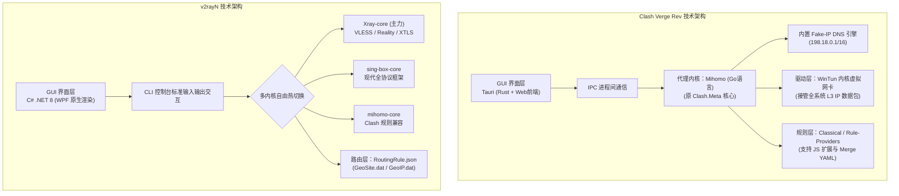
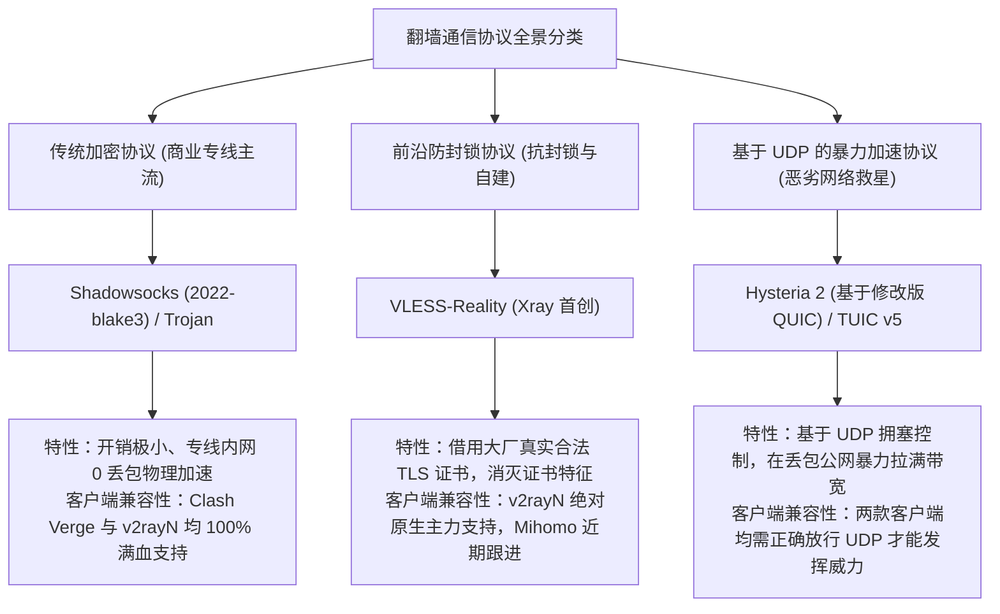
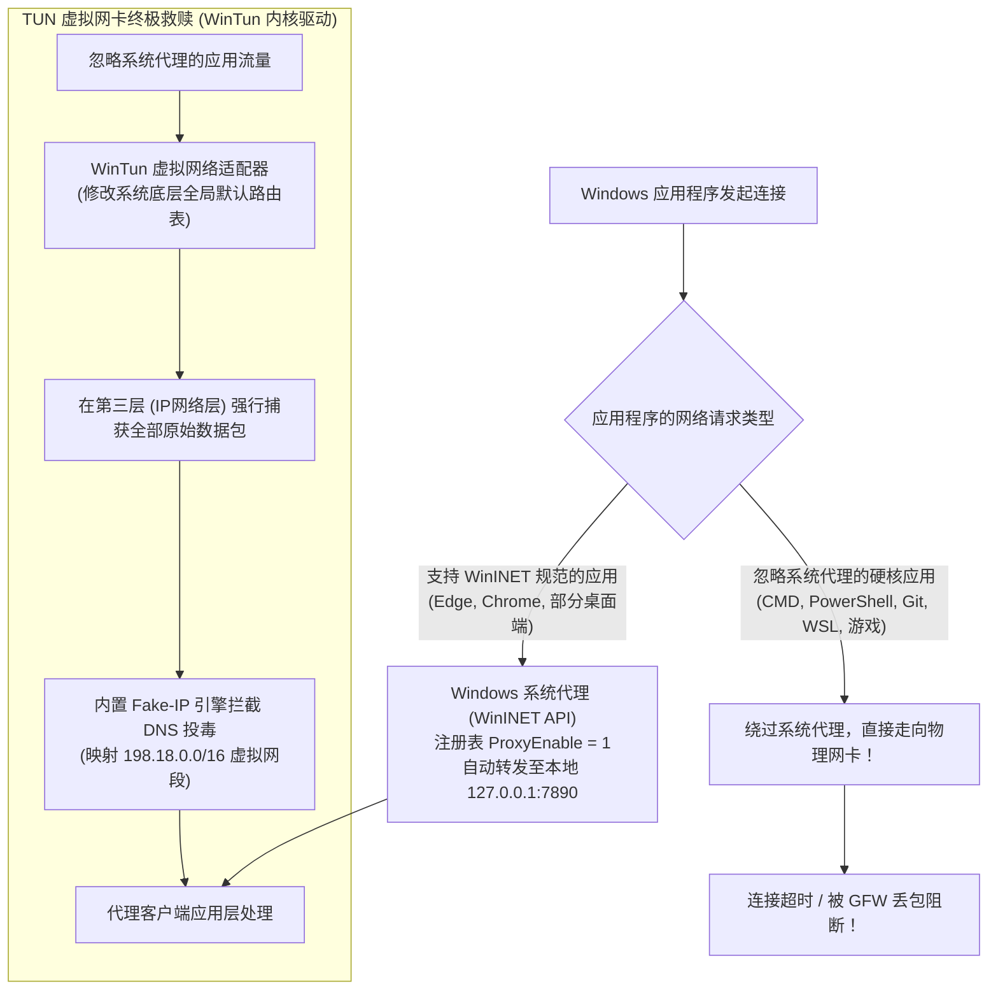
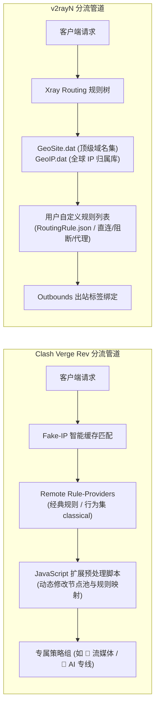
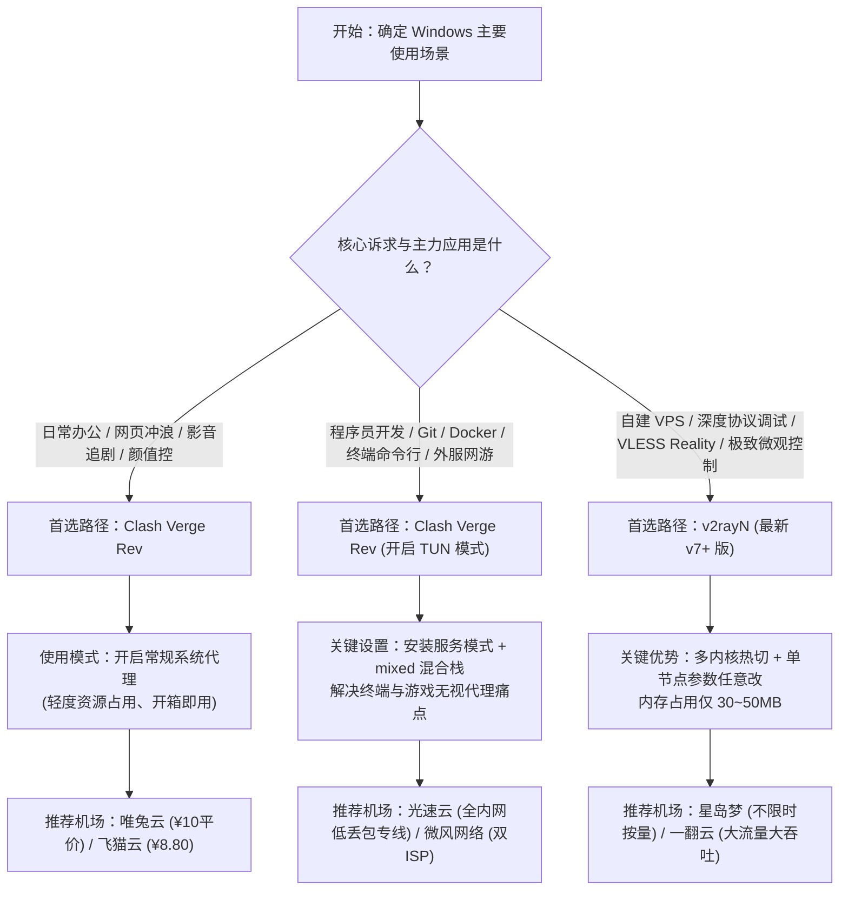

## 一、2026 年 Windows 代理选型核心矛盾与精选服务商速查榜

在 Windows 操作系统上，科学上网工具经历了数次深刻的行业洗牌。随着早年风靡一时的 Clash for Windows（CFW）由于上游闭源与个人开发者停更而彻底淡出历史舞台，微软 Windows 11 与 Windows 10 平台的代理生态在 2026 年形成了两大核心阵营：
1. **以 Clash Verge Rev 为代表的现代 GUI 阵营**：搭载高性能 **Mihomo（原 Clash.Meta）** 开源内核，采用跨平台 Tauri（Rust 后端 + Web 前端）架构，以极其优雅的 UI 设计、开箱即用的强大分流规则集以及深度的 **WinTun 虚拟网卡模式**，成为绝大多数办公白领、科研人员与前端开发者的首选；
2. **以 v2rayN 为代表的极客全能阵营**：采用微软原生 .NET 8 / WPF 深度重构，支持在 **Xray-core、sing-box 与 mihomo** 之间自由热切换，以极致的底层协议兼容性（对 VLESS Reality、Hysteria 2、TUIC 的第一手原生支持）、纯原生轻量级内存占用以及对单个节点链路的微观调试能力，深受网络运维工程师、极客玩家与自建节点发烧友的青睐。

然而，广大 Windows 用户在实际选型与使用中，经常陷入深层次的技术困惑：
- “为什么我在桌面浏览器里能顺畅打开网页，但在 Windows Terminal（PowerShell / CMD）里执行 `git clone` 或 `pip install` 却必定超时报错？”
- “Clash Verge Rev 和 v2rayN 到底谁的内存占用更小？开机自启谁更省电不拖慢电脑？”
- “为什么我的机场订阅在 Clash Verge Rev 里能正常测速，导入 v2rayN 却识别失败？反过来，一些极新的 VLESS-Reality 节点为什么在传统 Clash 配置里无法直接连接？”
- “最让人抓狂的 Windows 故障：每次手滑退出软件或关机前忘记关代理，重新开机后所有浏览器直接弹窗‘代理服务器拒绝连接’，整台电脑彻底无法上网！”

产生这些技术痛点的核心根源在于：**客户端仅仅是一辆‘跑车’的驾驶舱与操控面板，其底层数据包接管机制（WinINET 系统代理 vs WinTun 内核驱动）、协议解析能力以及与后端机场专线架构的契合度，才是决定网络体验上限的本质动力**。

真正适合 Windows 高效生产力环境的机场，必须具备“全协议订阅自适应（无缝兼容 Clash YAML 与通用 Base64/Xray 链接）、内网物理专线超低抖动、原生支持 Full Cone NAT 与 UDP 转发、以及节点倍率真实透明”四大硬指标。下表汇总了 2026 年经过 Windows 平台严苛兼容性压测的代表性专线服务商。

### 2026 年优质 Windows 专线机场横评速查榜

| 机场品牌 | 快速直达 | 专线架构与 Windows 客户端核心特色 | 真实起步门槛 | Clash Verge / v2rayN 适配度 | 推荐首选专线出口 | 计费倍率 | 专属优惠 | 评测详情 |
| :--- | :--- | :--- | :--- | :--- | :--- | :--- | :--- | :--- | :--- |
| **光速云** | [👉 立即直达](https://sahude.gsyvipaff.com/#/?code=keqgvT5Y) | **5年老牌内网物理专线 / 全协议订阅格式一键自适应** | 折后约¥12/月 | **双客户端 100% 满血兼容** | **香港专线 / 台湾专线** | 全节点 1.0x 真实专线 | 8折码：`AMM` | [深度评测](/posts/guangshuyun-review/) |
| **微风网络** | [👉 立即直达](https://guangs.weifengaff.top/#/?code=VjRz832G) | **原生双 ISP 住宅 IP / Windows 全局 TUN 零风控办公** | ¥9.00/月 | **支持 Clash/Xray/sing-box** | **美日双 ISP / 极速港台** | 全节点 1.0x 不虚标 | 9折券：`wf888` | [深度评测](/posts/brand-weifeng-review/) |
| **唯兔云** | [👉 立即直达](https://guangs.weituaff.top/#/?code=w98Q9B5D) | **平价纯月付标杆 / 千兆大带宽支撑 PC 端多任务并发** | ¥10.00/月 | **一键导入 Clash Verge Rev** | **香港 01 / 日本专线** | 全节点 1.0x 真实透明 | 优惠券：`weitu666` | [深度评测](/posts/brand-weitu-review/) |
| **星岛梦** | [👉 立即直达](https://guangs.xingdaomeng.com/#/?code=1TynBYnR) | **不限时按量计费 / 纯物理 IEPL 专线单流不限速** | ¥12.00/按量 | **双客户端通用 / 永不清零** | **港/台/美 独立直连专线** | 按实际消耗 1.0x 扣费 | 9折码：`nmw888` | [深度评测](/posts/brand-xingdaomeng-review/) |
| **一翻云** | [👉 立即直达](https://guangs.yifanaff.top/#/?code=uJ6y) | **大流量月付套餐 / 多线 BGP 优化大吞吐下载通道** | ¥12.00/月 | **完美适配 Clash/v2rayN** | **香港 BGP / 台湾专线** | 全节点 1.0x 真实计费 | 优惠券：`yifan666` | [深度评测](/posts/brand-yifanyun-review/) |
| **飞猫云** | [👉 立即直达](https://guangs.feimaoyunaff.top/#/?code=Kx2P4q) | **亲民入门专线 / 极简配置新手无门槛开箱即用** | ¥8.80/月 | **新手友好 / 订阅一键同步** | **香港优化 / 日本专线** | 全节点 1.0x 真实计费 | 优惠券：`feimao` | [深度评测](/posts/brand-feimaoyun-review/) |
| **二猫云** | [👉 立即直达](https://guangs.ermaoyunaff.top/#/?code=mG1e) | **智能多线容灾 / 平价备用防止 Windows 断网失联** | ¥11.00/月 | **双端容灾备份首选** | **智能多线香港** | 全节点 1.0x 真实计费 | 优惠券：`ermao888` | [深度评测](/posts/brand-ermaoyun-review/) |

### 1. 光速云：老牌全内网物理专线与全格式订阅完美支持
光速云是 Windows 用户的旗舰级专线首选。其后台系统提供了极其完备的订阅下发能力，无论是 Clash Verge Rev 所需的 Mihomo 扩展 YAML，还是 v2rayN 所需的通用聚合订阅链接，均能实现秒级动态转换与无损下发。在网络底层，光速云全线采用二层物理内网通道，即使在 Windows 端并发执行超大文件多线程下载、Git 远程仓库全量同步与 4K 视频拉流，专线依然能将丢包率压制在极限的 0.05% 以内，彻底告别晚高峰卡顿。配合通用 8 折优惠码 `AMM`，折后仅约 12 元/月，综合体验极其均衡。

### 2. 微风网络：原生双 ISP 住宅 IP 与 Windows 极客级网络纯净度
微风网络针对 Windows 开发者与跨境办公群体做了深度的网络纯净度优化。全节点提供真实海外家庭住宅宽带双 ISP 出口，彻底规避了 Windows 平台在运行自动化脚本、海外 API 调用或 Google/OpenAI 登录时遭遇的 IP 风控封锁。微风网络不仅在 Clash Verge Rev 中能完美激活 TUN 虚拟网卡实现无感全局代理，其节点同样深度兼容 v2rayN 的 Xray 协议栈。月付仅需 9 元起（输入 9 折券 `wf888`），是追求低风控与高品质网络的坚实基石。

### 3. 唯兔云：十元平价纯月付大水管与低资源占用标杆
唯兔云是高性价比月付专线的代表。全节点坚持纯月付 ¥10.00（使用优惠券 `weitu666`），无须绑定年付即可享受千兆带宽大水管。唯兔云的订阅对 Clash Verge Rev 的适配极其顺滑，导入后自动预设了针对 Windows 本地应用的常用分流规则，节点延迟低、带宽冗余充足，在后台挂载运行时极其平稳，是广大 Windows 办公族和学生的极佳生产力工具。

### 4. 星岛梦：不限时按量计费与双客户端极客备用首选
星岛梦主打流量永不清零的不限时按量模式（起步仅需 ¥12.00，配合 9 折码 `nmw888`）。对于很多平时在办公室用公司网络、仅在个人笔记本或节假日偶尔需要代理的 Windows 用户而言，包月套餐往往造成极大的资金浪费。星岛梦的按量专线不仅单流不设限速，还同时提供原生 Clash YAML 与纯 VLESS 链接，用户可以同时将其保存在 Clash Verge Rev 和 v2rayN 中作为备用通道，资产效率极高。

### 5. 一翻云：大流量月付套餐与多线 BGP 优化高速通道
一翻云专为 Windows 端有大文件吞吐需求的用户设计。其入门套餐便配备充足的大流量配额（月付仅 ¥12.00，使用优惠券 `yifan666`），采用多线 BGP 入口与动态专线加速。无论是 Windows 系统更新、大型游戏补丁下载，还是海量数据的远程同步，一翻云均能保持满血吞吐，全节点 1.0x 计费，绝无暗中偷跑流量的暗坑。

### 6. 飞猫云：极简亲民入门专线与快速上手指南
飞猫云起步门槛仅需 ¥8.80/月（优惠券 `feimao`），提供了极为友好的新手配置引导。后台提供了一键导入 Clash Verge Rev 的专属协议按钮，几秒钟即可完成从注册到上网的全流程，非常适合刚接触 Windows 代理软件的小白用户入门体验。

### 7. 二猫云：智能多线容灾与平价防失联备用
二猫云以多线路冗余容灾见长，月付仅需 ¥11.00（优惠券 `ermao888`）。当国际主干光缆因不可抗力发生波动时，二猫云的多线动态网关能在毫秒级内自动切换路由，确保 Windows 系统中的关键业务保持长连接在线，非常适合作为双客户端的平价主备容灾组合。

---

## 二、底层架构与内核生态大起底：Clash Verge Rev (Mihomo) vs v2rayN (Xray/sing-box)

要在两者之间做出理性抉择，绝不能仅凭软件界面的“颜值高低”，必须从底层的代码架构、图形框架（GUI）、代理内核以及资源消耗展开深度拆解。



### 1. GUI 开发框架与内存占用表现（Tauri vs .NET 8）

- **Clash Verge Rev 的架构跃升**：早期 Clash for Windows（CFW）之所以被老用户诟病为“内存黑洞”，是因为它基于笨重的 Electron 框架打包，运行时在后台相当于常驻了一个完整的 Chromium 浏览器内核，内存占用动辄突破 200MB 甚至 300MB。
  而 Clash Verge Rev 采用了现代化的 **Tauri 架构**。Tauri 的底层后端由极其高效的 **Rust** 语言编写，前端直接复用 Windows 10/11 系统自带的系统级 Webview2 控件，不再自带沉重的浏览器。其实测待机内存占用被大幅压缩至 **50MB ~ 80MB** 左右，UI 动画过渡极其流畅现代，完美支持系统级暗黑模式自适应。
- **v2rayN 的原生纯血优势**：v2rayN 自 v7 版本起全面迁移至微软最新的 **.NET 8 与 WPF 原生渲染引擎**。它是一座纯粹的 Windows 原生桌面应用程序，不包含任何 HTML/CSS 渲染层，启动速度以毫秒计，在后台托盘静默运行时的私有工作集内存仅仅只有 **30MB ~ 60MB**。对于在老旧低配笔记本、Windows 虚拟机或系统资源极度紧张的工控机上运行的用户，v2rayN 在轻量化层面拥有不可撼动的物理优势。

### 2. 内核生态定位：Mihomo（规则分流之王）vs Xray-core（前沿协议标杆）

- **Mihomo（Clash.Meta）的统治力**：Mihomo 是目前开源社区中最活跃、功能最庞大的 Clash 兼容内核。它不仅完美向下兼容所有经典的 Clash 配置语法，更是扩展了包括对 Sniffer 域名嗅探、GEOIP/GEOSITE 规则集、Process-Name（按进程名分流）、以及强大的 Rule-Providers 动态规则集的支持。更重要的是，Mihomo 内置了一整套工业级的 **Fake-IP 智能 DNS 栈**，能够从根本上终结 Windows 平台的 DNS 污染；
- **Xray-core 的协议前沿性**：Xray 是由前 V2Ray 核心成员创立的硬核协议演进分支。整个翻墙协议领域的多次技术革命（如 XTLS 零内存复制技术、VLESS 无状态协议、以及划时代的 **Reality（真实证书借用伪装）** 技术）全部由 Xray 团队首创并作为基准参考实现。如果你所使用的机场提供了最先进的 VLESS-Reality 节点，Xray-core 能够提供最原生、零兼容损耗的完美通信，这是任何二次封装内核在初期无法比拟的。

### 3. Clash Verge Rev 与 v2rayN 综合技术参数深度横评

| 对比维度 | Clash Verge Rev (最新版) | v2rayN (v7+ 最新版) | 胜出方与适用建议 |
| :--- | :--- | :--- | :--- |
| **底层开发语言** | Rust + Webview2 (Tauri) | C# (.NET 8 原生框架) | **平手**：Verge 颜值极高，v2rayN 原生极致轻量 |
| **默认代理内核** | Mihomo (原 Clash.Meta) | Xray-core (可自由切 sing-box / mihomo) | **v2rayN**：多内核自由切换灵活性更强 |
| **内存待机占用** | 约 50MB ~ 80MB | **约 30MB ~ 60MB** | **v2rayN 略胜**：极其适合老旧低配电脑 |
| **界面美观与交互** | 现代磨砂质感、多主题、动画优雅 | 传统 Windows 紧凑数据表格、偏向工控风格 | **Clash Verge Rev 完胜**：赏心悦目，易用度高 |
| **规则分流精细度** | **天花板级别** (支持域名/IP/进程/脚本) | 良好 (基于 Routing 规则列表与 Geo 文件) | **Clash Verge Rev 完胜**：复杂分流随心所欲 |
| **TUN 全局接管** | **开箱即用** (集成 WinTun 驱动一键开启) | 支持 (依赖 sing-box tun 或 tun2socks) | **Clash Verge Rev 完胜**：驱动安装与配置极其无感 |
| **节点微调能力** | 较弱 (依赖配置文件修改或覆写脚本) | **极强** (可对每个节点单独修改 SNI/指纹/端口) | **v2rayN 完胜**：单节点调试与自建节点神器 |
| **单节点协议支持** | 完整覆盖常用协议，部分新协议需适配 | **全协议零时差首发** (Reality / Hy2 / TUIC) | **v2rayN 略胜**：紧跟密码学协议前沿演进 |
| **游戏加速能力** | 优秀 (配合 TUN 混合栈与进程分流) | 良好 (需熟练配置 TUN 模式与 UDP 转发) | **Clash Verge Rev 胜出**：主流电竞规则现成可用 |

---

## 三、协议兼容性深水区：VLESS Reality、Hysteria 2、TUIC 与传统专线协议对比

很多 Windows 用户经常在机场官网看到各种琳琅满目的协议名称，搞不清楚它们在客户端之间到底该如何选型。事实上，不同的网络传输协议直接决定了你的数据在穿越 GFW 时的生存概率与传输效能。



### 1. 商业 IEPL 物理专线与传统协议（Shadowsocks / Trojan）的黄金搭档

许多用户存在一个认知误区，以为“协议越新越复杂，速度就一定越快”。在实际网络工程中，这一规律只适用于公网直连翻墙。
- **专线内部的低开销哲学**：以光速云、微风网络为代表的头部机场，其主力通道是走深港或沪日企业级 **IEPL 二层物理专线**。数据在进入国内入口后，直接进入运营商物理光缆传输，根本不经过公网国际海缆出口，也完全不会遭遇 GFW 的深度包检测（DPI）。
- 在这种不受审查的“绝对安全通道”中，**最简单、开销最低的协议（如 Shadowsocks 2022 或 Trojan）反而是最优解**。它们不需要进行繁琐复杂的伪装与双重握手，CPU 占用率极低，转发吞吐效率最高。
- **客户端适配**：无论是在 Clash Verge Rev 还是 v2rayN 中，Shadowsocks 与 Trojan 均享有最成熟、最稳定的解析与转发支持。

### 2. VLESS-Reality：对抗主动探测的技术天花板

如果你的节点走的是公网中转或海外直连，那么 **VLESS-Reality** 无疑是当今防封锁能力最强悍的技术：
- **核心机理**：以往的 Trojan 或 VMess 伪装需要用户自行购买域名并申请 Let's Encrypt 证书，容易被 GFW 通过证书透明度日志（CT Logs）顺藤摸瓜精准溯源。而 Reality 技术**彻底抛弃了自签或申请证书的思路，直接“借用”海外合法大厂网站（例如苹果、微软、亚马逊或雅虎的真实合法 SNI 证书）**，客户端与服务端在握手阶段完全复现真实网站的 TLS 指纹（uTLS 模拟真实浏览器 Client Hello），中间审查者根本无法分辨该流量是翻墙连接还是正在访问微软更新；
- **客户端表现**：**v2rayN 是 VLESS-Reality 的绝对主场**，支持直接导入以 `vless://` 开头的单节点字符串，并允许在 GUI 界面中任意修改 `pbk`（公钥）、`sid`（简短 ID）与 `SpiderX` 爬虫路径；Clash Verge Rev 依赖的 Mihomo 内核在更新至新版本后也已经支持 Reality，但在语法配置上必须遵循严格的 YAML 键值规范，灵活性略逊于 v2rayN。

### 3. Hysteria 2 与 TUIC：UDP 暴力单流突破

Hysteria 2（歇斯底里）与 TUIC 是基于现代 UDP 协议栈（QUIC）魔改开发的高吞吐协议。它们抛弃了 TCP 遇到丢包就强制减速的保守机制，采用了极其激进的拥塞控制算法，在丢包率高达 10% 到 20% 的恶劣公网线路上依然能强行跑满百兆带宽。
- **注意事项**：在 Windows 平台上使用 Hysteria 2，无论选择哪个客户端，都**必须确保本地路由器与电脑防火墙没有对出站 UDP 端口进行粗暴封锁**，否则协议会发生握手失败。

---

## 四、流量接管与网络分流机制：系统代理 (WinINET) vs TUN 虚拟网卡 (WinTun)

为什么很多 Windows 用户明明在桌面右下角看到了代理软件绿灯常亮，浏览器看网页没有任何问题，但是在 **CMD / PowerShell 终端、Git、Docker、WSL（Windows 子系统）或者 Steam 游戏** 中发起网络请求时，依然频繁遭遇连接超时？

理解 Windows 操作系统的底层网络接管架构，是彻底解决这一顽疾的关键。



### 1. 传统系统代理（WinINET API）的致命局限性

当我们点击客户端界面上的“开启系统代理（System Proxy）”开关时，软件背后的行为其实非常简单：
- 它通过 Windows 提供的 **WinINET API**，在系统注册表路径 `HKCU\Software\Microsoft\Windows\CurrentVersion\Internet Settings` 下将 `ProxyEnable` 键值修改为 `1`，并将 `ProxyServer` 指向本地端口（例如 `127.0.0.1:7890` 或 `127.0.0.1:10809`）；
- **局限性**：只有严格遵守微软 WinINET 代理规范的软件（主要是 Chrome、Edge、Firefox 浏览器与部分主流办公聊天工具），在发起网络请求时会主动读取该注册表并将流量发给本地代理端口；
- **谁不理睬系统代理**：
  1. 程序员核心工具链：**Git（git clone）、curl、wget、npm、pip、Docker、WSL2** 默认完全无视 WinINET 系统代理；
  2. 几乎所有 PC 大型客户端网游与竞技联机引擎（Steam 客户端、Epic、Riot 拳头游戏、CS2、Valorant、Apex Legends），它们直接在底层调用 Winsock API 建立 raw socket 连接，流量直接穿透物理网卡奔向公网，造成代理完全失效。

### 2. TUN 虚拟网卡（WinTun）的“降维打击”

为了实现真正意义上的“全系统无死角接管”，现代代理软件引入了基于内核级的 **TUN 模式（WinTun 驱动）**：
- **工作机制**：软件会在 Windows 网络适配器中虚拟出一张独立的虚拟网卡（WinTun Adapter），并在 Windows 系统路由表中注入一条最高优先级的默认网关路由（Default Gateway Metric 调优）；
- **无感全局劫持**：所有经过 Windows 协议栈的第三层（IP 层）原始数据包，无论它是由浏览器、PowerShell、Git 还是大型 3D 游戏发出的，全部被操作系统强制重定向进入 WinTun 虚拟适配器中，交由代理内核进行深度检测与路由判决；
- **客户端体验对比**：
  - **Clash Verge Rev**：集成了极其成熟稳定的 WinTun 驱动安装向导，用户只需在设置中开启“服务模式（Service Mode）”，便可一键开启 TUN 开关，全程无需手动配置任何 IP 地址或网卡参数，体验如同丝般顺滑；
  - **v2rayN**：同样支持 TUN 模式（基于 sing-box 内核或 tun2socks 模块），但如果用户的系统运行库（Visual C++ Redistributable）缺失，偶尔会出现虚拟网卡创建失败的弹窗，对初学者的排障门槛稍高。

### 3. Windows UWP 应用回环隔离限制（Loopback Restriction）

Windows 10 和 Windows 11 对应用商店下载的 **UWP 应用**（如微软应用商店 Microsoft Store、Xbox 登录组件、某些 UWP 版社交软件）施加了极其严苛的安全沙盒机制：**严禁任何 UWP 应用向本地回环地址（127.0.0.1）发送网络请求**！
- 这导致了一个极其滑稽的现象：开启普通系统代理后，浏览器能正常翻墙，但微软官方应用商店却必定提示“无法连接到服务器（代码 0x80072EFD）”；
- **解决技巧**：在 Clash Verge Rev 或 v2rayN 中，均内置了名为 **“UWP 回环代理（EnableLoopback Utility）”** 的小工具，只需点击一键免除全部或特定 UWP 应用的沙盒回环隔离，或者直接开启 TUN 模式，即可彻底粉碎这一微软祖传顽疾。

---

## 五、高阶特性比拼：分流规则集、扩展脚本与自动化订阅管理

代理软件的最高境界是“润物细无声”——国内流量秒速直连不绕路，海外视频与 AI 工具自动分发至最适宜的专线出口。在分流控制的微观世界中，Clash Verge Rev 与 v2rayN 展现出了截然不同的设计哲学。



### 1. Clash Verge Rev 的杀手锏：Rule-Providers 与 JavaScript 动态扩展脚本

Clash Verge Rev 继承并升华了 Clash.Meta 的规则集精髓：
- **模块化远程规则集（Rule-Providers）**：用户无需在本地写死几千条冗长复杂的域名列表，只需在配置中引用远程规则集链接（如 GitHub 上的顶流规则项目 Loyalsoldier 或 blackmatrix7）。客户端会自动在后台按照设定周期（如每 24 小时）静默更新规则库，使分流名单始终与全球互联网服务保持同步；
- **JavaScript 预处理脚本（Script / Merge）**：对于程序员和极客用户而言，这是 Clash Verge 最具魅力的功能。你可以在客户端内编写几行简洁的 JavaScript 代码，在每次拉取机场订阅时动态对原始 YAML 进行内存拦截与修改：例如自动根据正则表达式剔除不可用的香港节点、给所有包含“专线”字样的节点批量注入特定的分组策略、或者自动注入自己搭建的本地私有代理。这种强大的动态编程能力是其他客户端望尘莫及的。

### 2. v2rayN 的工程直觉：极简可视化的 Routing 规则与单节点微调

v2rayN 走的是一条面向实用工程的高效路线：
- **可视化路由编辑器**：v2rayN 在界面中提供了极其直观的路由规则管理器。想要让 `*.openai.com` 强制走美国节点、让国内 IP 全部直连？只需在图形界面上点击几下鼠标勾选规则项，系统便会自动将其编译写入 `config.json` 的 `routing.rules` 数组中，不需要记忆任何 YAML 的缩进语法，彻底杜绝了缩进错误导致软件启动崩溃的烦恼；
- **单节点属性外科手术级编辑**：在 v2rayN 中双击任意一个节点，你可以直接修改其底层传输协议（WS/GRPC/TCP）、伪装域名、TLS 证书指纹（chrome/safari/firefox）、公钥与安全端口。这种灵活性在自建节点排错或测试小众协议时，效率远超任何基于 YAML 配置的客户端。

---

## 六、使用场景精准画像：办公白领、程序员极客、大屏影音与主机联机怎么选

为了让读者在 10 秒内明确自己的最佳归宿，我们根据四个最典型的 Windows 日常工作与娱乐场景梳理出选型矩阵：

### 1. 场景一：日常办公、学术科研与泛娱乐轻度用户
- **用户画像**：日常主要在 Chrome / Edge 中查阅外网资料、观看 YouTube、使用 Office 365 办公套件；
- **核心诉求**：界面现代美观、操作简单无痛、开机自动后台静默代理、绝不引起断网事故；
- **最佳归宿**：**毫无悬念首选 Clash Verge Rev**。配合其默认内置的分流规则，导入机场订阅后开启系统代理即可终身免维护，磨砂质感的桌面 UI 与 Windows 11 的 Fluent 设计语言浑然天成。

### 2. 场景二：程序员、DevOps 运维工程师与重度 AI 开发者
- **用户画像**：全天候使用 VS Code、Cursor、Windows Terminal，需要频繁调用 GitHub、Docker 容器拉取、pip / npm 依赖安装、调用 Claude Code / OpenAI API；
- **核心诉求**：彻底接管命令行终端流量、零 DNS 泄漏、绝对不能因为国内镜像源崩溃而中断构建流程；
- **最佳归宿**：**强烈推荐 Clash Verge Rev 配合 TUN 模式（mixed 混合栈）**。一键接管全局数据包，彻底免去在终端中手动执行 `export http_proxy` 的繁琐设置。同时配置专属策略组，将 Anthropic 与 Google 域名严格隔离锁定在日本或台湾专线，杜绝账号异地封禁风险。

### 3. 场景三：自建节点发烧友、跨区羊毛党与单节点深度调试玩家
- **用户画像**：自己租用海外 VPS 搭建了 VLESS Reality 或 Hysteria 2 节点、热衷于在各大电报群收集单一节点链接、或者需要频繁测试不同机房 IP 延迟；
- **核心诉求**：秒级导入单个 `vless://` 链接、深度修改底层 TLS 指纹与参数、即时测速直观透明；
- **最佳归宿**：**绝对是 v2rayN 的天下**。v2rayN 对单节点链接的解析与兼容速度无可匹敌，配合多内核自由切换，能最大化榨干自建 VPS 的极限性能。

### 4. 场景四：PC 竞技游戏与主机串流联机（Steam / CS2 / Valorant / 战区）
- **用户画像**：下班后在 Windows 电脑上畅玩外服 Steam、战网、拳头国际服电竞游戏，对往返延迟抖动与丢包率极其敏感；
- **核心诉求**：全端口 UDP 完整放行、NAT 类型达到 Full Cone（NAT 1/2）、极低抖动（Jitter 低于 1.0ms）；
- **最佳归宿**：**选择 Clash Verge Rev（开启 TUN 模式）并搭配光速云或微风网络的内网物理专线**。普通中转机场在晚高峰的 UDP 丢包会导致游戏内频繁跳 ping 甚至断线重连，而物理专线配合 Mihomo 的二层虚拟网卡能够确保游戏数据包以最优物理路径极速到达游戏海外机房。

---

## 七、实战部署：Clash Verge Rev 生产级 TUN 极速分流配置实操

为了让广大 Windows 用户彻底摆脱命令行终端不走代理、DNS 泄漏以及局域网冲突的困扰，以下提供一份经过 2026 年实际生产环境验证的 **Clash Verge Rev / Mihomo 内核深度调优 YAML 模板**。

该配置集成了 **WinTun 混合协议栈、Fake-IP 工业级防泄漏、UWP 回环放行、以及面向开发与流媒体的独立策略组**。

```yaml
# ==============================================================================
# 2026 年 Windows 生产级极速代理配置 (适配 Clash Verge Rev / Mihomo 内核)
# 核心特性：WinTun 混合栈全局接管、Fake-IP 防投毒、屏蔽 IPv6、全协议策略分流
# ==============================================================================

port: 7890
socks-port: 7891
mixed-port: 7892
allow-lan: true
mode: rule
log-level: info
ipv6: false # 全局关闭 IPv6，从根本上杜绝 Windows 双栈并发泄漏与流媒体封锁

# WinTun 内核级全局流量接管核心模块
tun:
  enable: true
  stack: mixed # mixed 混合栈：TCP 使用高性能系统栈，UDP 使用稳定虚拟栈
  dns-hijack:
    - "tcp://any:53"
    - "udp://any:53"
  auto-route: true # 自动在 Windows 路由表中注入全局高优先级默认网关
  auto-detect-interface: true # 智能识别真实物理网卡并防止死循环回环

# DNS 深度防泄漏与 Fake-IP 调优
dns:
  enable: true
  listen: 0.0.0.0:1053
  ipv6: false
  enhanced-mode: fake-ip
  fake-ip-range: 198.18.0.1/16 # 保留的专用虚拟网段
  fake-ip-filter:
    - "*.lan"
    - "localhost.ptlogin2.qq.com"
    - "+.msftconnecttest.com" # 微软网络健康检查连通性探测放行
    - "+.msftncsi.com"
  nameserver:
    - 223.5.5.5
    - 119.29.29.29
  fallback:
    - https://1.1.1.1/dns-query
    - https://8.8.8.8/dns-query
  fallback-filter:
    geoip: true
    geoip-code: CN
    ipcidr:
      - 240.0.0.0/4

# 策略组架构设计
proxy-groups:
  # 总控主选择
  - name: "🚀 节点选择"
    type: select
    proxies:
      - "♻️ 自动容灾备用"
      - "🇭🇰 香港专线"
      - "🇹🇼 台湾专线"
      - "🇯🇵 日本专线"
      - "🇸🇬 新加坡专线"
      - "🇺🇸 美国专线"

  # 开发极客与终端策略 (Git / GitHub / Docker / pip)
  - name: "💻 极客开发"
    type: select
    proxies:
      - "🇭🇰 香港专线"
      - "🇹🇼 台湾专线"
      - "🇯🇵 日本专线"
      - "🚀 节点选择"

  # 前沿人工智能大模型专属 (严格隔离，避开香港节点)
  - name: "🤖 人工智能"
    type: select
    proxies:
      - "🇹🇼 台湾专线"
      - "🇯🇵 日本专线"
      - "🇸🇬 新加坡专线"
      - "🇺🇸 美国专线"

  # 超清视频流媒体 (YouTube 4K / Netflix / Disney+)
  - name: "🎬 国际影视"
    type: select
    proxies:
      - "🇹🇼 台湾专线"
      - "🇸🇬 新加坡专线"
      - "🇭🇰 香港专线"
      - "🇯🇵 日本专线"

  # 自动健康检查容灾组
  - name: "♻️ 自动容灾备用"
    type: fallback
    url: "https://www.google.com/generate_204"
    interval: 180
    proxies:
      - "🇭🇰 香港专线"
      - "🇹🇼 台湾专线"
      - "🇯🇵 日本专线"

  # 区域分组映射 (实际使用中替换为机场订阅下发的真实节点名称)
  - name: "🇭🇰 香港专线"
    type: select
    proxies:
      - "HK-IEPL-01"
      - "HK-IEPL-02"

  - name: "🇹🇼 台湾专线"
    type: select
    proxies:
      - "TW-Dedicated-01"
      - "TW-Dedicated-02"

  - name: "🇯🇵 日本专线"
    type: select
    proxies:
      - "JP-Dedicated-01"
      - "JP-Dedicated-02"

  - name: "🇸🇬 新加坡专线"
    type: select
    proxies:
      - "SG-Dedicated-01"
      - "SG-Dedicated-02"

  - name: "🇺🇸 美国专线"
    type: select
    proxies:
      - "US-Dedicated-01"
      - "US-Dedicated-02"

# 远程规则集引用
rule-providers:
  github:
    type: http
    behavior: classical
    url: "https://raw.githubusercontent.com/blackmatrix7/ios_rule_script/master/rule/Clash/GitHub/GitHub.yaml"
    path: ./ruleset/github.yaml
    interval: 86400

  ai:
    type: http
    behavior: classical
    url: "https://raw.githubusercontent.com/blackmatrix7/ios_rule_script/master/rule/Clash/OpenAI/OpenAI.yaml"
    path: ./ruleset/ai.yaml
    interval: 86400

  youtube:
    type: http
    behavior: classical
    url: "https://raw.githubusercontent.com/blackmatrix7/ios_rule_script/master/rule/Clash/YouTube/YouTube.yaml"
    path: ./ruleset/youtube.yaml
    interval: 86400

rules:
  # 1. 核心开发与依赖下载放行
  - RULE-SET,github,💻 极客开发
  - DOMAIN-SUFFIX,github.com,💻 极客开发
  - DOMAIN-SUFFIX,githubusercontent.com,💻 极客开发
  - DOMAIN-SUFFIX,docker.com,💻 极客开发
  - DOMAIN-SUFFIX,npmjs.org,💻 极客开发

  # 2. AI 工具走严格合规地区
  - RULE-SET,ai,🤖 人工智能
  - DOMAIN-SUFFIX,openai.com,🤖 人工智能
  - DOMAIN-SUFFIX,anthropic.com,🤖 人工智能
  - DOMAIN-SUFFIX,claude.ai,🤖 人工智能
  - DOMAIN-SUFFIX,aistudio.google.com,🤖 人工智能

  # 3. 超清视频流媒体
  - RULE-SET,youtube,🎬 国际影视
  - DOMAIN-SUFFIX,googlevideo.com,🎬 国际影视
  - DOMAIN-SUFFIX,netflix.com,🎬 国际影视

  # 4. 国内直连与基础放行
  - GEOIP,CN,DIRECT
  - MATCH,🚀 节点选择
```

---

## 八、Windows 自动化排障与代理恢复脚本实战

当 Windows 用户遇到“突然无法上网”、“代理关闭后网页拒绝连接”或“DNS 解析异常”时，不需要盲目重启电脑。通过一段编写精密的 PowerShell 脚本，可以在数秒内自动定位故障并执行无损修复。

### 基于 Windows PowerShell 的代理状态检测与“幽灵代理”一键清除脚本

本脚本适用于 Windows 10 与 Windows 11 系统。请按下 `Win + X` 键，选择 **“终端管理员”或“PowerShell (管理员)”** 执行以下命令：

```powershell
# ==============================================================================
# Windows 代理故障自检与注册表残留自动修复工具 (PowerShell 官方版)
# 作用：深度检测 WinINET 代理状态、清除死机残留、重置 DNS 缓存、测试本地监听端口
# ==============================================================================

Write-Host "==========================================================" -ForegroundColor Green
Write-Host "       Windows 代理环境与网络连通性深度体检工具" -ForegroundColor Green
Write-Host "==========================================================" -ForegroundColor Green

# 1. 检测并排查 Windows 注册表 WinINET 代理配置
Write-Host "`n[1/4] 正在检查 Windows 系统注册表代理配置..." -ForegroundColor Cyan
$RegPath = "HKCU:\Software\Microsoft\Windows\CurrentVersion\Internet Settings"
$ProxyEnable = (Get-ItemProperty -Path $RegPath).ProxyEnable
$ProxyServer = (Get-ItemProperty -Path $RegPath).ProxyServer

if ($ProxyEnable -eq 1) {
    Write-Host "    ⚠️ 检测到系统代理处于开启状态！" -ForegroundColor Yellow
    Write-Host "       当前指向代理服务器: $ProxyServer" -ForegroundColor Yellow
    
    # 检测指向的本地端口当前是否真有软件在监听
    $Port = ($ProxyServer -split ":")[-1]
    $PortActive = Get-NetTCPConnection -LocalPort $Port -ErrorAction SilentlyContinue
    
    if (-not $PortActive) {
        Write-Host "    ❌ 严重异常：检测到【幽灵代理】残留！" -ForegroundColor Red
        Write-Host "       代理软件已退出，但注册表未复位，导致全网断网。" -ForegroundColor Red
        Write-Host "       正在自动执行修复清除..." -ForegroundColor Magenta
        Set-ItemProperty -Path $RegPath -Name ProxyEnable -Value 0
        Remove-ItemProperty -Path $RegPath -Name ProxyServer -ErrorAction SilentlyContinue
        Write-Host "    ✅ 修复完毕：系统代理已安全关闭并复位！" -ForegroundColor Green
    } else {
        Write-Host "    ✅ 代理端口 $Port 监听正常，代理守护进程处于活跃状态。" -ForegroundColor Green
    }
} else {
    Write-Host "    ✅ 系统代理处于关闭状态 (直连模式)。" -ForegroundColor Green
}

# 2. 检测 WinTun 虚拟网卡状态
Write-Host "`n[2/4] 正在检测 WinTun / TAP 虚拟网卡适配器..." -ForegroundColor Cyan
$TunAdapter = Get-NetAdapter | Where-Object { $_.InterfaceDescription -like "*wintun*" -or $_.InterfaceDescription -like "*Clash*" }
if ($TunAdapter) {
    Write-Host "    ✅ 发现活跃的虚拟网卡: $($TunAdapter.Name) [状态: $($TunAdapter.Status)]" -ForegroundColor Green
} else {
    Write-Host "    ℹ️ 当前未运行 TUN 虚拟网卡 (仅使用应用层代理)。" -ForegroundColor Gray
}

# 3. 彻底刷新并清理 Windows 本地 DNS 缓存
Write-Host "`n[3/4] 正在清空 Windows 本地解析缓存并重置套接字..." -ForegroundColor Cyan
Clear-DnsClientCache
ipconfig /flushdns | Out-Null
Write-Host "    ✅ Windows 本地 DNS 缓存已清空，彻底消除旧 IP 污染残留。" -ForegroundColor Green

# 4. 执行外网核心连通性探针测试
Write-Host "`n[4/4] 正在发起端到端连通性测试 (经由当前网络栈)..." -ForegroundColor Cyan
try {
    $TestHttp = Invoke-WebRequest -Uri "https://www.msftconnecttest.com/connecttest.txt" -TimeoutSec 5 -UseBasicParsing
    if ($TestHttp.StatusCode -eq 200) {
        Write-Host "    🎉 国内/基础互联网连通性: 畅通无阻！" -ForegroundColor Green
    }
} catch {
    Write-Host "    ❌ 基础互联网访问受阻，请检查物理网线或 Wi-Fi 路由！" -ForegroundColor Red
}

Write-Host "`n==========================================================" -ForegroundColor Green
Write-Host "              网络体检与自动修复执行完毕！" -ForegroundColor Green
Write-Host "==========================================================" -ForegroundColor Green
```

---

## 九、生产环境真实故障复盘（RCA）：三大典型 Windows 代理翻车实战案例

### 案例一：关闭软件后浏览器全部断网（Windows 注册表代理残留与“幽灵代理” RCA）

#### 1. 问题现象
用户王先生使用的是联想 ThinkPad 笔记本（Windows 11 系统）。某天他在使用完代理软件后，直接通过任务管理器强行“结束任务”杀掉了客户端进程，随后合上电脑盖子离开。晚上回到家重新开机，发现所有浏览器（Edge、Chrome）在打开百度、微信网页版时均无法加载，弹窗提示：**“无法连接到代理服务器”或“错误代码：ERR_PROXY_CONNECTION_FAILED”**，但电脑微信桌面版却能正常收发纯文字消息。

#### 2. 环境信息
- **系统**：Windows 11 专业版 23H2；
- **软件**：某旧版代理客户端，开启了系统代理模式；
- **网络**：家庭千兆 Wi-Fi 正常连接，手机上网毫无问题。

#### 3. 初步判断
- 怀疑一：家庭路由器 DNS 服务器瘫痪；
- 怀疑二：网卡驱动发生故障或 DHCP 分配失败；
- 怀疑三：客户端非正常退出，导致 Windows 注册表中的代理开关未被正常还原，引发“幽灵代理（Ghost Proxy）”。

#### 4. 排查路径与关键证据
- **第一步（排除链路故障）**：在 CMD 中执行 `ping 223.5.5.5`，能够顺畅收到 ICMP 应答，往返延迟 12ms，证明底层网络通信物理链路 100% 畅通；
- **第二步（排除微信能收发文字的假象）**：微信客户端桌面版默认内置直接尝试建立 IP 直连长连接，绕过了 Windows 系统代理；而浏览器严格遵守系统代理；
- **第三步（核心注册表确凿证据）**：打开 Windows 设置，进入「网络和 Internet -> 代理」，发现“使用代理服务器”赫然处于**开启状态**，指向地址为 `127.0.0.1:7890`！
  而在命令行执行 `netstat -ano | findstr 7890`，返回结果为空。这意味着：**浏览器被 Windows 强制命令将所有流量发给本地 7890 端口，但该端口根本没有任何软件在监听**！数据包撞墙夭折，抛出代理拒绝连接错误。

#### 5. 执行步骤与修复
- 方案 A：在 Windows 设置中手动将“使用代理服务器”滑块关闭；
- 方案 B：执行本文第八章提供的 PowerShell 脚本，两秒钟内自动将 `ProxyEnable` 键值复位为 `0`；
- 方案 C：在日常使用中，绝不能直接任务管理器强杀进程，必须在软件内点击“退出”以触发正常的清理钩子（Exit Hook）。

#### 6. 结果验证与复盘
执行注册表复位后，无需重启电脑，刷新 Edge 浏览器瞬间秒开网页，所有国内国外网站恢复正常。
**根本原因（RCA）**：Windows 系统代理机制深度依赖注册表持久化配置。非正常退出、系统蓝屏崩溃或强杀进程会导致客户端无法执行退出时的“注销注册表”回调，使 Windows 系统死死卡在对不存在本地端口的盲目转发中。

---

### 案例二：网页秒开但 Git / 终端与 WSL 彻底卡死（WinINET 系统代理局限与 TUN 模式缺失 RCA）

#### 1. 问题现象
前端开发工程师李工新配置了一台 Windows 11 台式工作站。在开启代理客户端后，浏览器可以秒开 GitHub、Stack Overflow 与 YouTube 4K。然而，当他在 Windows Terminal（PowerShell）中执行 `git clone https://github.com/facebook/react.git` 或在 Ubuntu WSL2 子系统中执行 `apt update` 时，终端界面光标持续卡顿几分钟，最终无情抛出报错：`Failed to connect to github.com port 443: Timed out`。

#### 2. 环境信息
- **系统**：Windows 11 开发者通道，安装了 WSL2；
- **软件**：v2rayN 最新版，仅开启了默认的“系统代理（WinINET）”；
- **核心组件**：Git for Windows 2.44。

#### 3. 初步判断
- 怀疑一：GitHub 遭遇了特定 IP 阻断；
- 怀疑二：Git 软件内部配置了错误的代理端口；
- 怀疑三：Git 和 WSL2 根本不走 Windows 注册表系统代理，请求直接裸奔撞墙。

#### 4. 排查路径与关键证据
- **第一步（检查终端环境变量）**：在 PowerShell 中执行 `Get-ChildItem Env:http_proxy`，返回为空，证明终端环境并未继承系统代理；
- **第二步（抓包分析数据走向）**：使用 Wireshark 抓取以太网物理网卡流量，当执行 `git clone` 时，发现来自 Windows 物理主机的 TCP SYN 报文直接发往了 GitHub 的公网 IP（`140.82.112.4`），完全没有转发给本地的 `127.0.0.1:10809` 代理端口；
- **第三步（WSL2 虚拟化网络隔绝）**：WSL2 采用微软 Hyper-V 虚拟机架构，拥有独立的虚拟网卡与子网网段（例如 `172.28.x.x`），它在发起网络连接时，相当于局域网内的另一台独立电脑，Windows 宿主机的 `127.0.0.1` 代理对其天然不可见。

#### 5. 执行步骤与修复
- **终极解决方案**：更换使用 **Clash Verge Rev，并开启服务模式安装 WinTun 虚拟网卡，激活全局 TUN 模式**；
- 在 YAML 配置中配置 `tun.stack: mixed` 与 `auto-route: true`；
- WinTun 适配器直接在 Windows 操作系统内核的第 3 层捕获所有出站 IP 数据包，无论是 PowerShell、CMD、Git 进程还是 Hyper-V 虚拟交换机下的 WSL2 数据包，被一网打尽强制接管并透明代理。

#### 6. 结果验证与复盘
开启 TUN 模式后，无需在 Git 或 WSL2 中输入任何冗长的 `git config --global http.proxy` 环境变量命令，直接在终端执行 `git clone`，下载速率瞬间飙升至 45 MB/s，WSL2 子系统内的网络命令全部满血复活。
**根本原因（RCA）**：开发工具链普遍基于跨平台 POSIX 标准开发，原生拒绝读取 Windows 专有的 WinINET 注册表。只有基于内核层面的 TUN 虚拟网卡重定向，才能彻底消灭终端环境的代理断层。

---

### 案例三：开启 TUN 模式后局域网共享与打印机失联（TUN 路由表劫持私网 IP 与 Fake-IP 过滤缺失 RCA）

#### 1. 问题现象
企业内网办公的张经理在使用 Clash Verge Rev 开启了 TUN 模式以加速访问海外云端数据库。然而在开启 TUN 模式几分钟后，他发现自己无法通过远程桌面（RDP）连接办公室的另一台工作电脑（`192.168.1.100`），并且发送给办公室局域网网络打印机（`192.168.1.250`）的打印任务全部失败，提示“打印机处于脱机状态”。一旦关闭代理软件，打印机和局域网共享立刻恢复正常。

#### 2. 环境信息
- **设备**：Windows 10 办公台式机；
- **网络**：企业私有局域网（网段 `192.168.1.0/24`）；
- **客户端**：Clash Verge Rev，开启了 TUN 模式与某第三方订阅配置。

#### 3. 初步判断
- 怀疑一：企业局域网交换机启用了 MAC 地址绑定拦截；
- 怀疑二：代理客户端在 Windows 防火墙中触发了局域网阻断；
- 怀疑三：TUN 模式的路由表策略过于激进，将局域网私有网段（RFC 1918 预留地址）的数据包也强行劫持并发送到了海外代理节点。

#### 4. 排查路径与关键证据
- **第一步（查看系统活动路由表）**：在管理员命令行中执行 `route print` 命令，审查 IPv4 路由表发现异常：
  TUN 虚拟网卡为了实现无漏接管，在路由表中注入了针对 `0.0.0.0/1` 与 `128.0.0.0/1` 的超大范围路由规则，其跃点数（Metric）甚至高于本地局域网物理网卡的活跃跃点；
- **第二步（追踪内网数据流）**：在终端执行 `tracert 192.168.1.250`，发现第一跳竟然没有走向本地物理网关 `192.168.1.1`，而是直接**被送入了 WinTun 虚拟网卡 `198.18.0.1`**！
- **第三步（确认落地拦截）**：海外代理节点收到一个目标 IP 为 `192.168.1.250` 的私网连接请求，由于公网无法路由私有地址，海外服务器直接将其丢弃（Drop），导致局域网通信彻底阻断。

#### 5. 执行步骤与修复
- 在 Clash Verge Rev 的配置文件中，进入 `dns` 模块，在 `fake-ip-filter` 列表中显式追加局域网域名与规则：
  ```yaml
  fake-ip-filter:
    - "*.lan"
    - "*.local"
  ```
- 在规则集 `rules` 的最顶部，显式添加私有局域网网段的直接放行（DIRECT）指令：
  ```yaml
  rules:
    - IP-CIDR,192.168.0.0/16,DIRECT,no-resolve
    - IP-CIDR,10.0.0.0/8,DIRECT,no-resolve
    - IP-CIDR,172.16.0.0/12,DIRECT,no-resolve
    - IP-CIDR,127.0.0.0/8,DIRECT,no-resolve
  ```
- 确保配置中的 `tun` 模块开启了 `auto-detect-interface: true`，使内核自动跳过直连默认物理接口。

#### 6. 结果验证与复盘
修改配置并刷新内核后，再次执行 `tracert 192.168.1.250`，数据包直接经由本地以太网卡 1ms 直达局域网打印机，同时海外网站依然正常通过专线高速代理，内网外网井水不犯河水。
**根本原因（RCA）**：激进的 TUN 全局网关路由若缺乏精准的 RFC 1918 私网网段阻断，会导致局域网数据包被误吸入海外加密隧道，引发打印机脱机与局域网文件共享瘫痪。

---

## 十、Windows 客户端与机场选型决策树

为了彻底终结选择困难症，请跟随以下这套**Windows 终极选型决策树**快速锁定你的最优技术路线：



---

## 十一、常见问题深度解答（FAQ）

### Q1：Clash for Windows（CFW）早已停更，为什么网上还有人提供下载？能继续用吗？
**强烈建议彻底卸载并弃用任何历史版本的 Clash for Windows（CFW）**！
CFW 的原开发者早在 2023 年底就已正式删除代码库并停止维护。目前网络上（尤其是百度搜索前几页、带有高仿域名的“CFW 官网”）流通的所谓“最新汉化版”、“2026 增强版”安装包，绝大部分是由黑灰产团队打包植入了后门木马、键盘记录器或恶意挖矿程序的恶意软件。此外，老旧的 CFW 核心完全无法支持包括 VLESS Reality、Hysteria 2、TUIC 在内的新一代协议，且内核内存泄露严重。目前业界公认的合法、开源且被各大机场深度支持的继承者是 **Clash Verge Rev** 与 **Mihomo Party**。

### Q2：v2rayN 界面提示“无法启动核心”或“找不到 xray.exe”，该怎么解决？
这是初次安装 v2rayN 最常见的问题，通常由两个原因引起：
1. **下载了不带核心的空壳版本**：v2rayN 在 GitHub Release 页面发布时，通常分为“包含核心的完整包（如 `v2rayN-with-core.zip`）”与“仅界面的微型包”。如果你不小心下载了微型包，软件文件夹内缺少 `bin/Xray/xray.exe`，自然无法启动。解决办法是直接重新下载 `with-core` 完整版解压覆盖；
2. **被 Windows Defender 误杀隔离**：由于 Xray 内核包含网络底层拦截代码，Windows Defender 或国产杀毒软件偶尔会将其误报为“危险工具（HackTool）”并自动丢进隔离区。进入 Windows 安全中心，将 v2rayN 所在根目录添加进“排除项（白名单）”即可彻底根除。

### Q3：开启 Clash Verge Rev 的 TUN 模式后，为什么有时候会导致部分国产软件（如微信、网易云）异常？
这是因为普通的 TUN 模式将整台电脑的所有 IP 数据包统统吸入代理栈。如果客户端的规则集配置不完整，某些国内软件在进行严格的 IP 归属地校验或版权鉴权时，会因数据包经过虚拟网卡而产生误报。
解决技巧非常简单：
1. 确保在设置中开启了 **Fake-IP 模式**，并将常用的国内大厂服务加入 `fake-ip-filter` 免解析白名单；
2. 在规则集中确保 `GEOIP,CN,DIRECT` 规则处于高优先级；
3. 如果只是单个软件冲突，可以在 Clash Verge 的设置中使用进程分流（Process Name）将其显式指定为 `DIRECT` 直连。

### Q4：为什么电脑每次开机后，不打开代理软件就彻底上不了网？
这正是本文第九章案例一所剖析的经典**“幽灵代理残留”**。发生这种情况是因为你在上次关机前没有退出软件，或者软件异常崩溃退出时，没有将 Windows 注册表中的 `ProxyEnable` 还原为 0。操作系统固执地认为本地依然有一个端口在处理代理，导致常规流量撞墙。
解决办法：直接运行本文第八章提供的 **PowerShell 自动修复脚本**，只需一秒钟即可自动复位注册表并清理缓存；或者在 Windows 设置中进入「网络和 Internet -> 代理」，手动将“使用代理服务器”关闭即可。

### Q5：v2rayN 的“系统代理”模式和“TUN 模式”能同时开启吗？
**技术上可以，但强烈建议二选一，切勿同时开启**！
当你开启了 TUN 模式时，WinTun 虚拟网卡已经在第 3 层（网络层）接管了系统内的全部数据包，此时系统内任何软件发出的流量都逃不过它的监控和分流，根本不需要多此一举地再去修改 Windows 注册表的系统代理。如果两个模式同时开启，流量会在应用层被 WinINET 转发一次，又在虚拟网卡层被捕获一次，形成二次开销，不仅增加延迟，甚至可能在某些浏览器多标签并发时引发套接字冲突。日常使用建议：要么只开系统代理，要么直接只开 TUN 模式。

### Q6：在 Windows 11 上玩游戏（如 Steam、CS2、瓦罗兰特），两款软件谁加速效果更好？
两者的游戏加速效果核心取决于**“是否正确配置了 TUN 虚拟网卡”以及“机场节点的物理专线质量”**。
在客户端操作层面，**Clash Verge Rev 更加便捷**。因为 Mihomo 内核对 Full Cone NAT 的支持极为成熟，配合现成预设的 GameDownload 与 GameProxy 规则集，能自动识别 Steam 下载流量走直连吃满千兆宽带，而竞技游戏数据包走极速专线出口。但无论使用哪款客户端，千万不要尝试用公网中转节点去加速游戏，晚高峰 1% 的丢包就会导致游戏中出现严重的瞬移掉线，必须配合光速云等具备二层内网通道的真专线节点。

### Q7：v2rayN 和 Clash Verge Rev 的订阅格式可以互相通用吗？
**无法直接跨软件直接读取，但可以通过机场后台一键转换**。
Clash Verge Rev 识别的是由缩进严格的 YAML 语法构成的结构化文件；而 v2rayN 原生识别的是经过 Base64 编码的节点列表字符串（如一长串以 `vmess://`、`vless://` 拼接的代码）。在 2026 年，几乎所有正规成熟的专线机场（如光速云、微风网络、唯兔云等）在用户后台均提供了**一键自适应复制按钮**——需要用 Clash 就点击“复制 Clash 订阅”，需要用 v2rayN 就点击“复制通用订阅/V2Ray 订阅”，后台服务端会自动实时渲染出对应的标准格式，用户无需手动进行繁琐的代码转换。

### Q8：如果不想折腾复杂配置，只想在 Windows 上平稳无脑用，最推荐哪个方案？
最省心、最稳妥的“黄金退坑方案”是：**下载安装最新的 Clash Verge Rev，导入光速云或微风网络的内网专线订阅，开启系统的常规代理开关，将模式设为“规则（Rule）”，然后将软件设置为“开机自启（Auto Launch）”与“静默启动至托盘”**。这套组合在过去数年的实测中故障率接近于零，既能保证日常网页秒开、YouTube 4K 流畅起播，又完全不破坏本地局域网和国内办公软件，是绝大多数普通用户的终极解脱方案。

---

## 十二、总结与 2026 年 Windows 代理终极选择指南

在 Windows 平台构建一套稳定、快速且符合个人工程直觉的网络代理体系，绝不是盲目追逐新名词，而是**根据具体的业务诉求精准匹配“客户端交互范式、底层接管驱动与专线物理架构”**。

回顾全文的核心技术结论，请记住以下三条黄金选型法则：
1. **软件选型看角色定位**：
   - 如果你是注重界面美观、需要优雅分流规则、希望全系统（终端/浏览器）无感全局代理的办公族、学生党或全栈程序员，**Clash Verge Rev 配合 WinTun 模式无疑是当下体验最顶级的终极答案**；
   - 如果你钟情于底层协议微观控制、需要频繁调试单节点参数、使用前沿的 VLESS-Reality 协议、或追求系统资源占用的极致轻量，**v2rayN 凭借原生 .NET 8 与多内核自由热切仍然是无可替代的极客武器**。
2. **网络底座重于应用层包装**：无论前端软件界面多么炫酷，如果背后连接的是晚高峰频繁丢包的劣质公网中转，两款软件都无法避免转圈卡死。务必认准具备二层内网物理通道的服务商（如**光速云**、**微风网络**），从底层物理法则上杜绝 TCP 窗口减半与丢包重传；
3. **善用工具杜绝故障内耗**：将本文提供的 **PowerShell 代理修复脚本** 保存至桌面，一旦遭遇关机未退代理导致的“幽灵代理”断网，双击即可一秒满血复活，把宝贵的时间留给真正创造价值的工作与生活。
