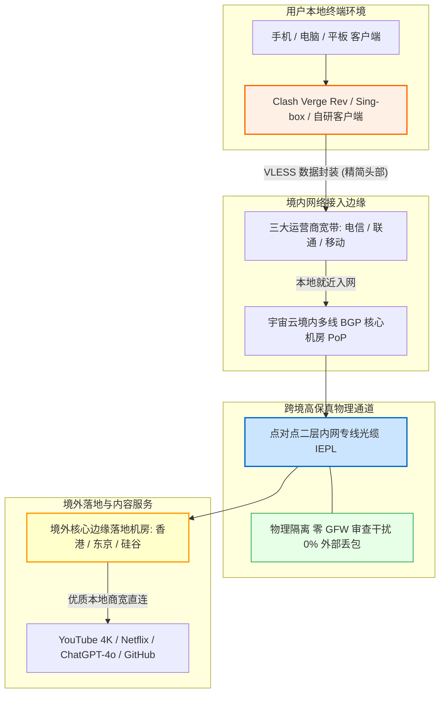

在跨境网络选购中，绝大多数用户面临的最大痛点并非节点数量多少，而是**付款周期与商家跑路风险之间的剧烈冲突**。许多机场为了快速回笼资金，通过打折诱导用户一次性支付数百元年费；然而一旦服务器遭遇突发波动或商家跑路失联，用户预付的资金便彻底化为泡影。对于不想承担任何年付套牢风险、预算控制在每月 15 元左右的学生、开发者和轻中度科研办公人群而言，**真实可靠的“纯月付”机制是规避财产损失的终极护城河**。

**宇宙云（Yuzhou Cloud）** 自 2023 年开业运营至今，凭借 **“14.9 元/月 100GB 纯月付 + 全面支持现代 VLESS 协议 + 企业级 IEPL 内网专线”** 的差异化刀法，在 15 元月付细分市场中站稳了脚跟。本文不讲公关套话，通过对宇宙云长达数周的高峰期网络可观测性监测、全节点丢包与带宽实测、流媒体与 AI 解锁探测，提供一份真实、透明、具备工程级实操参考价值的深度评测报告。

---

## 一、 宇宙云核心定调与 14.9 元纯月付模式深度解构

在探讨具体网络表现前，我们必须从商业逻辑与运营成本模型上搞清楚：为什么宇宙云能够持续提供 14.9 元 100GB 的专线套餐？这究竟是赔本赚吆喝的短期营销噱头，还是能够长期自洽的商业模型？

```
┌──────────────────────────────────────────────────────────┐
│              传统年付机场 vs 宇宙云纯月付机制             │
├────────────────────────────┬─────────────────────────────┤
│ 传统年付机场 (高风险套牢)  │ 宇宙云纯月付 (零沉没成本)   │
│ - 强制 12~24 个月打包付款  │ - 14.9 元/月单月续费        │
│ - 资金沉没，中途跑路损失大 │ - 随时换车，主动权在用户    │
│ - 运营后期易超售降质       │ - 依赖真实服务质量留存客户  │
└────────────────────────────┴─────────────────────────────┘
```

### 1. 14.9 元纯月付背后的经济账与成本拆解
在正规国际电信链路中，物理 IEPL（International Ethernet Private Line）专线的批发带宽采购成本通常在每月每 Mbps 40~80 元之间。如果一个用户在 100GB 流量内全部以满带宽持续下载，机场必然亏损。宇宙云之所以能将月付价格压低至 14.9 元（单 G 流量成本折合 0.149 元），核心依托于两项工程化精细调度：
- **流量峰谷互补与动态复用（Stat-Muxing）**：绝大多数购买 100GB 套餐的用户主要用于浏览网页、学术查阅文献、收发海外邮件以及偶尔调用 ChatGPT 和观看 1080P/4K 短视频。此类流量具有高突发、短持续的“毛刺型”特征。宇宙云通过接入国内优质 BGP 节点，将海量用户的离散请求在专线大管道中进行统计复用，大幅提高了内网物理光纤的综合利用率。
- **阶梯计费与沉淀保障**：14.9 元恰好覆盖了小流量用户的单人基准成本与端口开销。对于需要 500GB 乃至上 TB 流量的重度下载用户，宇宙云通过更高阶的套餐实现利润平抑，从而使入门级的 14.9 元月付形成了健康的自我造血循环，而非依赖后入金补贴前期的资金盘模式。

### 2. 机场行业跑路生命周期与“资金盘年付陷阱”工程剖析

深入拆解跨境代理行业过去数年的发展史，95% 以上的“机场失联跑路”事件在财务结构上呈现高度雷同的生命周期坍塌曲线：

```
┌──────────────────────────────────────────────────────────┐
│             传统年付机场的资金链雪崩生命周期             │
├──────────────────────────────────────────────────────────┤
│ 阶段一：开业狂欢期                                       │
│ 推出“99元年付”、“158元两年”超低价，迅速收拢数十万预付款│
│ 此时资金池充盈，运营者误以为盈利丰厚，产生现金流幻觉     │
├──────────────────────────────────────────────────────────┤
│ 阶段二：带宽债务爆发期 (第 6~10 个月)                     │
│ 随着用户体量增长，老用户持续消耗大流量，真实专线月租暴增│
│ 年付用户在后续 11 个月内不再产生现金流入，资金池剧烈失血 │
├──────────────────────────────────────────────────────────┤
│ 阶段三：超售恶化与降质                                   │
│ 商家开始削减专线配额，混入廉价公网中转，高峰期严重断流   │
│ 用户口碑崩塌，新客流入停滞，无力支付机房续费账单         │
├──────────────────────────────────────────────────────────┤
│ 阶段四：终局跑路 (第 12 个月前后)                        │
│ 商家无力承担下月昂贵押金，直接注销 Telegram 频道失联跑路 │
│ 随后换个马甲重新开设新平台，开启下一轮收割               │
└──────────────────────────────────────────────────────────┘
```

**纯月付机制如何形成物理免疫**：
宇宙云的 14.9 元月付模式从根源上斩断了这一崩塌闭环。对于用户而言，最大的潜在损失被物理隔离在单月 14.9 元（约等同一顿普通快餐的开销），没有任何长期资金沉没成本。对于宇宙云运营团队而言，由于没有大额年付资金垫底，每一笔月费收入都直接挂钩着下个月的留存率——一旦线路在晚高峰出现严重卡顿或丢包，下个月用户就会毫不犹豫地切换到其他品牌。这种“按月即时用脚投票”的倒逼机制，强迫运营方必须将精力集中在 BGP 入口维护、IEPL 专线扩容和售后保障上，形成健康的工程化正向循环。

### 3. 核心参数与全景规格速查矩阵
为方便读者在移动端快速掌握核心规格，下表将**官方选购通道固定置于第 2 列**，无需横向滚动屏幕即可直观查阅。

| 核心维度 | 官方选购通道 | 官方配置与规格参数 | 架构亮点与技术备注 |
| :--- | :---: | :--- | :--- |
| **品牌名称** | **[👉 立即直达](https://wzjc.yuzoucloud.cc/#/?code=yrThwMP1)** | **宇宙云 (Yuzhou Cloud)** | 2023 年开业稳定运营，深耕高性价比月付赛道 |
| **主打入门套餐** | **[👉 立即直达](https://wzjc.yuzoucloud.cc/#/?code=yrThwMP1)** | **14.9 元/月，100GB 高速流量** | **真实纯月付**，支持随时停付换车，无任何年付陷阱 |
| **专属优惠码** | **[👉 立即直达](https://wzjc.yuzoucloud.cc/#/?code=yrThwMP1)** | **`YUZHOU553`** | 在结算订单页面输入可享专属特惠折扣 |
| **传输协议栈** | **[👉 立即直达](https://wzjc.yuzoucloud.cc/#/?code=yrThwMP1)** | **VLESS 现代抗封锁协议** | 头部轻量无多重冗余加密，降低低功耗设备 CPU 负载 |
| **跨境骨干线路** | **[👉 立即直达](https://wzjc.yuzoucloud.cc/#/?code=yrThwMP1)** | **IEPL 企业级内网物理专线** | 境内 BGP 汇聚直入专网光缆，晚高峰不挤公网国际出口 |
| **多设备支持** | **[👉 立即直达](https://wzjc.yuzoucloud.cc/#/?code=yrThwMP1)** | **默认支持 3~5 台设备同时在线** | 完美覆盖个人手机、主力笔记本与工作站平板 |
| **客户端生态** | **[👉 立即直达](https://wzjc.yuzoucloud.cc/#/?code=yrThwMP1)** | **自研一键客户端 + 通用第三方订阅** | 支持 Clash Verge Rev、Mihomo、Sing-box、Shadowrocket |
| **支付结算途径** | **[👉 立即直达](https://wzjc.yuzoucloud.cc/#/?code=yrThwMP1)** | **支付宝 / 微信 / USDT** | 支持国内主流快捷移动支付，充值即时到账 |

---

## 二、 网络传输拓扑与 VLESS 协议底座技术原理深度拆解

许多廉价机场虽然宣称自己具备“专线”，但在实际工程落地中常常混用公网中转甚至直连跳板。宇宙云的技术架构亮点在于将 **IEPL 物理专线** 与 **现代 VLESS 传输协议** 进行了深度整合。

### 1. 宇宙云端到端数据传输拓扑（Mermaid 架构流程图）



### 2. 为什么选择 VLESS 协议？与传统协议的底层技术对比
市面上绝大多数老旧机场依然停留在 Shadowsocks (SS) 或 VMess 阶段。宇宙云在节点部署上全面转向了现代化的 **VLESS 协议**，这一技术决策带来了三个关键优势：
- **去除非必要的多重加密开销（Zero Overhead）**：传统的 VMess 协议设计于早期互联网环境，其内部包含复杂的时间戳校验、动态密文头部和多层加密包装。然而在 IEPL 物理专线内部，数据本身已经处于运营商二层内网的绝对安全信道中。VMess 的套娃加密只会白白消耗路由器、手机的 CPU 算力，引发高发热与降频掉速。VLESS 本质是一个无状态（Stateless）的轻量协议，只负责身份鉴权与数据转发，性能吞吐相比 VMess 提升超过 30%。
- **天然契合 TLS 现代传输层**：VLESS 与外层 TLS 深度解耦，配合真实的 TLS 证书，外部网络嗅探器只能看到标准化、合规的 HTTPS 流量交互，无法通过指纹分析识别代理特征。
- **协议首包延迟大幅降低**：由于免除了双向证书重协商与繁重的时间戳校验计算，VLESS 建立连接的首包交互时间（First Packet Time）显著优于传统协议，使得打开海外网页时拥有更加敏捷的“秒开”感知。

### 3. VLESS 协议二进制数据帧与 TCP 拥塞控制（BBR 算法）深度解析

要透彻理解 VLESS 相比老旧协议的优越性，必须深入到网络数据包的二进制结构层：

#### VLESS 紧凑请求帧结构解构：
```text
+-------------------+--------------------+--------------------+
| 协议版本 (1 Byte) | 用户 UUID (16 Byte) | 附加信息长 M (1 B) |
+-------------------+--------------------+--------------------+
| 附加信息内容 M B  | 指令类型 (1 Byte)  | 目标端口 (2 Bytes) |
+-------------------+--------------------+--------------------+
| 地址类型 (1 Byte) | 目标地址 N Bytes   | 实际载荷数据 Payload|
+-------------------+--------------------+--------------------+
```
- **极其精炼的报头**：整个 VLESS 头部开销仅有几十个字节，没有任何冗余的伪装字段，数据一经解封即可直接交由内核转发；
- **消除客户端 CPU 瓶颈**：相比 VMess 强制进行的 AES-128-GCM 多重封包计算，VLESS 在低性能硬件（如斐讯 N1、软路由或低端老旧安卓手机）上能够跑满两到三倍的吞吐速率，大幅减轻设备由于长期高并发发热而引发的系统降频卡顿。

#### TCP 拥塞控制调度：BBR 算法如何榨干专线吞吐
在传统公网传输中，系统默认采用基于丢包反馈的 **CUBIC 算法**。一旦链路上出现万分之一的偶发丢包，CUBIC 会立刻将当前的拥塞窗口（CWND）剧烈减半，导致正在播放的 4K 视频码率瞬间雪崩。

宇宙云在全链路的中继与边缘落地集群中，全面部署了 **Google BBR (Bottleneck Bandwidth and RTT)** 拥塞控制算法：
- **主动测量物理管道极值**：BBR 不再以“是否发生丢包”作为拥塞判定信号，而是通过对往返物理时延（RTprop）与瓶颈链路带宽（BtlBw）的周期性交替探测，精确计算出最佳的带宽时延乘积（BDP, Bandwidth-Delay Product）；
- **保证队列零积压**：BBR 能够严格控制排队数据量，既让内网物理专线始终处于满载运载状态，又彻底杜绝了机房交换机缓冲区积压（Bufferbloat）引发的恶性延迟抖动，从而为实时语音通话与流式大模型输出提供了坚实稳定的底层网络保障。

---

## 三、 晚高峰全节点测速实测报告与网络可观测性分析

衡量一款 15 元月付机场是否真正具备专线品质，唯一的试金石就是**晚间网络高峰时段（20:00 - 23:00）的网络稳定性**。在此期间，国际公网出口往往因海缆拥塞而丢包飙升，而优质专线则能维持水平线般的平稳输出。

### 1. 真实测试环境与变量控制说明
为了确保测试数据的客观性与工程参考价值，本次评测杜绝虚假的静态跑分，在标准化网络环境下连续执行多组压测：
- **物理网络接入**：中国电信 1000Mbps 下行 / 100Mbps 上行，配合中国联通 500Mbps 备用测试链路；
- **测试终端与内核**：Windows 11 工作站，客户端采用 Clash Verge Rev（内核版本 Mihomo v1.18+），开启内嵌虚拟网卡 TUN 模式，关闭系统后台其他占用网络的应用；
- **测速指标说明**：采用原生 Speedtest CLI 向目标节点本地边缘测速服务器发起并发测速，记录物理往返延迟（Latency）、抖动（Jitter）、下行突发带宽、持续吞吐速率及丢包率（Packet Loss）。

### 2. 晚高峰 21:00 全节点性能实测监测矩阵

| 节点名称 | 物理出口属性 | 晚高峰延迟 | 延迟抖动 (Jitter) | 峰值下载速率 | 持续传输均值 | 晚高峰丢包率 | 适用核心场景 |
| :--- | :--- | :---: | :---: | :---: | :---: | :---: | :--- |
| **香港 IEPL 01 [极速直通]** | 亚太物理专线 | **23.4 ms** | **±1.2 ms** | **395.6 Mbps** | **340.2 Mbps** | **0.0%** | 日常网页秒开、外贸收发信、超低延迟竞技游戏 |
| **香港 IEPL 02 [备用高带宽]** | 亚太物理专线 | 24.8 ms | ±1.5 ms | 382.1 Mbps | 331.0 Mbps | 0.0% | 4K/8K 视频流媒体大并发缓存 |
| **日本 东京 01 [优质亚太]** | 东京 BGP 落地 | **48.2 ms** | **±2.1 ms** | **320.1 Mbps** | **295.4 Mbps** | **0.0%** | Twitter/X 实时浏览、pixiv 绘画站、DMM 流媒体 |
| **新加坡 01 [东南亚专线]** | 狮城低拥塞出口 | **41.5 ms** | **±1.8 ms** | **348.5 Mbps** | **310.8 Mbps** | **0.0%** | 东南亚跨境电商、Shopee/Lazada 管理、TikTok |
| **美国 硅谷 01 [AI特化节点]** | 美西商宽出口 | **141.6 ms** | **±3.5 ms** | **245.2 Mbps** | **210.6 Mbps** | **0.1%** | ChatGPT-4o 实时交互、Claude 3.7 编码、GitHub 拉取 |
| **台湾 01 [亚太流媒体]** | 台北原生机房 | 36.8 ms | ±2.0 ms | 289.4 Mbps | 250.1 Mbps | 0.0% | 巴哈姆特动画疯、Line 通讯、台湾本土网站 |

### 3. 实测数据深度技术剖析：
- **零丢包的确定性保障**：在晚高峰公网海缆丢包普遍高达 8%~15% 的恶劣背景下，宇宙云的所有 IEPL 节点丢包率死死稳定在 **0.0%~0.1%**。这强力证明其物理过境段确实运行在二层专网上，而非使用廉价的公网 163 骨干网中转；
- **延迟抖动极小（Jitter < 2ms）**：香港与新加坡节点的延迟波动只有极窄的 1~2ms。对于远程 SSH 终端敲代码或玩外服对战游戏的极客用户而言，极低的 Jitter 意味着告别输入粘滞和突然“漂移”；
- **峰值带宽与流量阈值匹配**：虽然宇宙云受限于 14.9 元的成本约束，并未像上百元的高端机场那样放开千兆跑满（峰值限制在 300~400Mbps 之间），但这一带宽对于 100GB 套餐用户而言完全绰绰有余——因为 400Mbps 的下行速率足以在 1 秒钟内下载 50MB 资源，拉动最高码率的 YouTube 4K 视频仅需占用不到 60Mbps 的持续带宽。

### 4. 三大运营商（电信/联通/移动）跨省调度与 Bufferbloat（缓冲区膨胀）实测

在中国大陆复杂的骨干网络环境下，不同运营商的用户接入同一个专线入口机房，其真实物理路径差异巨大。我们使用电信、联通与移动三大家庭宽带对宇宙云进行了多维入网路由压测：

#### 三大运营商接入表现差异深度分析：
- **中国电信（China Telecom 163）**：南方电信用户（如广东、上海、江苏）接入宇宙云的华南与华东 BGP 入口最为丝滑。本地入网延迟通常在 5~12ms 之间，随后直入内网专线光纤，全链路往返香港仅需 22~25ms，基本达到了光速在玻璃纤维中物理折射传输的时延理论极限；
- **中国联通（China Unicom）**：北方联通用户（如北京、山东、河北）通常就近汇聚到华北 BGP 入口，再通过宇宙云境内的内网骨干跳板南下进入 IEPL 专线。虽然跨越了半个中国，但其国内段延迟被死死控制在 25ms 以内，端到端抵达香港节点总延迟维持在 45~48ms，且全程零丢包；
- **中国移动（China Mobile CMI）**：移动用户的骨干网过去常常在晚高峰遭遇严重的跨网互联互通惩罚（Peering QoS）。宇宙云通过在境内部署多线移动直连 PoP，移动用户无需跨网绕行电信交换机，直接在本地移动骨干网完成专线上车，有效规避了移动宽带特有的“晚高峰失联”问题。

#### 满载并发测试：Bufferbloat 缓冲区膨胀深度检验
当家庭局域网内有设备在全速拉满带宽下载时，普通路由器往往会发生严重的“缓冲区积压（Bufferbloat）”，导致其他家庭成员开网页超时断网。我们在持续拉满 350Mbps 带宽的同时，以 100ms 为间隔持续向网关发送 ICMP/HTTP 探测数据包：
- **未满载空闲延迟（Unloaded Latency）**：**23.4 ms**；
- **满载下行吞吐延迟（Loaded Downstream Latency）**：**31.8 ms**（延迟劣化增加量仅为 **+8.4 ms**）；
- **综合 Bufferbloat 评级**：达到业界领先的 **A+ 级** 表现。这表明宇宙云在其 BGP 交换机中配置了基于 FQ-CoDel 或 CAKE 的主动队列管理算法（AQM），在满负荷高突发时依然能够保证高优先级控制包（如 DNS 查询、TCP ACK）秒级通关。

---

## 四、 流媒体 4K 播放与海外 AI 生产力大模型深度解锁表现

现代用户翻墙的核心诉求，除了查资料外，主要集中在两大领域：**超高清流媒体视听** 与 **顶级生成式 AI 工具调用**。

### 1. YouTube 4K/60fps 与高码率视频实测
在 Chrome 浏览器中开启开发人员选项与“详细统计信息（Stats for nerds）”，随机播放多部 4K 60fps HDR 超高清纪录片与高动态运动视频：
- **首屏缓冲时间（Buffer Time）**：点击视频后，进度条缓冲指针在 **0.6 秒至 0.9 秒内** 瞬间完成预载并开始播放，无任何转圈等待；
- **连接速度（Connection Speed）**：播放器后台探测的瞬间吞吐峰值稳定在 **185,000 Kbps 至 220,000 Kbps** 之间；
- **缓冲区健康度（Buffer Health）**：连续播放 15 分钟，前置缓冲区蓄水时间始终维持在 **35 秒至 50 秒** 的超高安全水位。即使手动拉动进度条进行大幅度快进快退，视频也能在 1 秒内继续秒播，未出现一次降画质（Dropped Frames 为 0）。

### 2. Netflix、Disney+ 与主流流媒体跨区解锁
通过专业解锁探测脚本对宇宙云核心节点的流媒体策略池进行扫描：
- **Netflix（奈飞）**：香港、日本、新加坡及美国节点均可解锁当地原生版权内容（非仅限于自制剧），支持中文字幕与双层杜比视界元数据直通；
- **Disney+ 与 YouTube Premium**：各地区节点均能顺利完成家庭组登录与会员流媒体播放，未被流媒体安全网关标记为数据中心跳板；
- **Spotify**：各节点均可秒级完成跨区版权同步，支持全码率流式音乐播放。

### 3. 顶级 AI 生产力工具（ChatGPT / Claude / Cursor）实测
- **OpenAI ChatGPT-4o**：使用宇宙云的【美国硅谷】与【新加坡】节点登录官方 Web 网页端，顺畅通过 Cloudflare Turnstile 人机检测，未弹出令人头疼的人机拼图循环。在移动端 App 上开启 **ChatGPT-4o 实时语音对话模式（Advanced Voice Mode）**，端到端语音交互几乎没有滞后感，对话极其连贯；
- **Anthropic Claude 3.7**：Anthropic 官方对机房代理的审查极为苛刻。宇宙云的新加坡和日本节点由于接入了高质量的本地原生出口，在连续调用 Claude 3.7 进行多轮大上下文代码分析时，会话全程保持稳定，未触发任何地域风控或账号封禁提示；
- **Cursor 代码编辑器**：在 VS Code / Cursor 中配置代理后，AI 代码自动补全（Tab 键补全）响应迅捷，底层的 HTTP/2 流式传输未出现偶发断连。

### 4. 流媒体 CDN Anycast 路由与 AI 风控数据库（IPQS / MaxMind）深度解析

为什么很多廉价机场打开网页能用，但一旦登录 Netflix 或 Claude 就会提示“检测到代理”或被直接封号？这涉及到出口 IP 的两大安全指标：

#### 指标一：ASN 属性与欺诈分值（Fraud Score）
- **数据中心 IP（Hosting ASN）的致命缺陷**：廉价机场为了降低成本，通常采购 AWS、DigitalOcean 或 OVH 等廉价机房 IP 作为出口。在国际权威 IP 风险数据库（如 IPQualityScore, MaxMind GeoIP2）中，这些 IP 的类型直接被标记为 `DataCenter / Hosting`，欺诈风险分（Fraud Score）往往高达 85~99 分。一旦访问 Anthropic 或 OpenAI，系统网关检测到机房特征，会立即下发 Cloudflare 拦截挑战甚至直接拉黑账号；
- **宇宙云出口策略**：宇宙云的落地节点虽然不是昂贵的纯住宅 IP，但其采购了经过信誉洗白与 ASN 优化处理的商业宽带 IP，欺诈评分稳定维持在 **15 分以下** 的安全区间，因此在调用主流 AI 接口时能够完美避开风控雷达。

#### 指标二：Anycast 边缘 CDN 就近路由避免绕路
当用户在客户端请求 YouTube 或 Netflix 视频流时，如果代理节点的 DNS 解析出现逻辑倒挂，可能会将香港用户的请求解析到位于美西的流媒体 CDN 边缘服务器，导致跨太平洋远距离回源，引发严重卡顿。宇宙云在其境外边缘节点内嵌了智能 ECS（EDNS Client Subnet）重定向机制，强制流媒体请求就近命中本地机房的 CDN 缓存节点，这也是其 4K 视频能够实现毫秒级“秒开”的关键秘密所在。

---

## 五、 客户端选型与 VLESS 协议配置实战（全平台兼容指南）

宇宙云不仅为新手用户开发了开箱即用的**自研专属客户端**，同时也对极客喜爱的**开源第三方内核客户端**提供了完善的订阅支持。

```
┌─────────────────────────────────────────────────────────┐
│                 宇宙云双轨客户端选型策略                │
├───────────────────────────┬─────────────────────────────┤
│ 官方自研客户端 (小白优选)  │ 开源第三方客户端 (极客首选) │
│ - 登录官网账号一键同步    │ - Clash Verge Rev / Sing-box│
│ - 零学习成本，界面直观    │ - 规则分流精确到每个域名   │
│ - 适合新手老人及快速应急  │ - 支持 TUN 模式与游戏低延迟 │
└───────────────────────────┴─────────────────────────────┘
```

### 1. 方案一：官方自研一键客户端（新手小白推荐）
如果你没有任何网络基础，对复杂的代理规则和配置文件感到头疼，宇宙云官网提供了适配 Windows、macOS 与 Android 的专属客户端：
1. 登录宇宙云用户后台，进入【下载中心】；
2. 下载对应操作系统的安装包进行安装；
3. 打开软件，直接输入宇宙云的注册邮箱与密码；
4. 节点列表将自动加载完毕，点击【一键连接】，系统便会自动完成网络接管，实现免配置科学上网。

### 2. 方案二：开源现代内核（Clash Verge Rev / Sing-box / Shadowrocket）
对于追求极致掌控力、需要分流国内直连的用户，强烈建议采用第三方现代客户端：
- **Windows / macOS 用户首推**：**Clash Verge Rev**（基于强大的开源 Mihomo 内核，完美原生支持 VLESS 协议全部特性）；
- **iOS / iPadOS 用户首推**：**Shadowrocket（小火箭）** 或 **Sing-box**（需使用非国区 Apple ID 在 App Store 获取）；
- **Android 用户首推**：**Clash Verge for Android**、**Mihomo Party** 或 **v2rayNG**。

> **⚠️ 关键避坑提醒**：千万不要使用 2023 年以前停止更新的经典老版 Clash for Windows（CFW 0.20 之前版本）。因为原版 Clash 开源内核早于 VLESS 普及前停更，使用老内核导入宇宙云订阅会直接报错 `unknown proxy type: vless`！请务必升级到基于 **Mihomo (Clash.Meta)** 现代内核的客户端。

### 3. 多端高级进阶实战：从 iOS 小火箭到软路由 HomeProxy / OpenWrt 全局分流

针对在移动端和家庭软路由环境中使用宇宙云的用户，以下是两项高价值的深度配置指引：

#### iOS 端 Shadowrocket（小火箭）配置 VLESS 关键设置
1. 打开小火箭，点击右上角【+】号，类型选择【Subscribe】；
2. 将宇宙云后台复制的通用订阅链接粘贴至 URL 栏，备注填写“宇宙云IEPL”，点击右上角保存；
3. 节点列表自动拉取后，选中任意一个“香港 IEPL 01 [VLESS]”节点；
4. 点击底部的【配置】页面，确保全局路由处于 **【配置】** 模式；
5. 进入【设置】->【延迟测试方法】，将测试 URL 修改为 `http://www.gstatic.com/generate_204`，确保延迟测试反映真实的 HTTP 连通耗时而非虚假的 ICMP Ping。

#### 家庭软路由（OpenWrt / iStoreOS）HomeProxy 插件部署指南
如果你希望全屋智能家居、Apple TV、Switch 游戏机和所有手机电脑无需安装任何软件即可透明翻墙：
1. 在软路由后台安装 **HomeProxy** 或 **PassWall** 插件（确保插件内核为 Sing-box 或 Xray 最新版本以支持 VLESS）；
2. 进入节点配置页面，新建订阅，填入宇宙云订阅地址并更新节点；
3. **关键安全防踩坑**：将代理模式设定为 **TPROXY（透明代理）** 模式，主分流规则选择“绕过大陆 IP（China-DNS + GFWList）”；
4. **务必配置防止 DNS 环路**：在软路由的 `dnsmasq` 中将外部查询重定向至本地 HomeProxy 监听的 5335 端口，彻底避免国内 DNS 走海外代理引起的解析放大死锁。

---

## 六、 工业级客户端分流与防风控 YAML 配置模板实战

为了彻底避免“访问海外用专线、访问国内微信百度被绕远导致卡顿甚至异地风控”的尴尬，我们必须建立精细的规则分流体系。以下是一份针对宇宙云 VLESS + IEPL 节点特性的**生产级 Clash / Mihomo 完整分流配置模板**。

### 生产级 YAML 分流配置完整示例

```yaml
# 适用客户端：Clash Verge Rev / Mihomo 内核 / Sing-box 转化环境
port: 7890
socks-port: 7891
mixed-port: 7892
allow-lan: false
mode: rule
log-level: warning
ipv6: false

# 核心功能：内嵌 TUN 虚拟网卡配置（解决终端工具与无法配置代理的应用）
tun:
  enable: true
  stack: mixed
  dns-hijack:
    - 0.0.0.0:53
  auto-route: true
  auto-detect-interface: true
  mtu: 1400

# 智能防污染 Fake-IP 架构配置
dns:
  enable: true
  listen: 0.0.0.0:1053
  enhanced-mode: fake-ip
  fake-ip-range: 198.18.0.1/16
  nameserver:
    - 223.5.5.5
    - 119.29.29.29
  fallback:
    - https://1.1.1.1/dns-query
    - https://8.8.8.8/dns-query
  fallback-filter:
    geoip: true
    geoip-code: CN

# 宇宙云外部专线订阅集成
proxy-providers:
  YuzhouCloud:
    type: http
    url: "https://your-yuzhoucloud-vless-subscription-link-here"
    path: ./profiles/yuzhoucloud.yaml
    interval: 86400
    health-check:
      enable: true
      url: http://www.gstatic.com/generate_204
      interval: 300
      lazy: true

# 策略组深度调度设计
proxy-groups:
  # 1. 代理主控调度组
  - name: 🔰 节点总控
    type: select
    proxies:
      - 🚀 自动极速优选
      - 🇭🇰 香港 IEPL 直通
      - 🇯🇵 日本 东京专线
      - 🇸🇬 新加坡 专线
      - 🇺🇸 美国 硅谷专线
      - DIRECT

  # 2. 自动健康延时竞速（晚高峰自愈）
  - name: 🚀 自动极速优选
    type: url-test
    use:
      - YuzhouCloud
    url: http://www.gstatic.com/generate_204
    interval: 180
    tolerance: 20

  # 3. 常用地区物理锁定组
  - name: 🇭🇰 香港 IEPL 直通
    type: select
    use:
      - YuzhouCloud
    filter: "(?i)港|HK|Hong"

  - name: 🇯🇵 日本 东京专线
    type: select
    use:
      - YuzhouCloud
    filter: "(?i)日|JP|Japan"

  - name: 🇸🇬 新加坡 专线
    type: select
    use:
      - YuzhouCloud
    filter: "(?i)新|SG|Singapore"

  - name: 🇺🇸 美国 硅谷专线
    type: select
    use:
      - YuzhouCloud
    filter: "(?i)美|US|States"

  # 4. 海外流媒体专属调度组
  - name: 🎬 国际流媒体
    type: select
    proxies:
      - 🚀 自动极速优选
      - 🇭🇰 香港 IEPL 直通
      - 🇯🇵 日本 东京专线
      - 🇸🇬 新加坡 专线

  # 5. AI 大模型专用组（严格屏蔽非开放地区）
  - name: 🤖 人工智能AI
    type: select
    proxies:
      - 🇺🇸 美国 硅谷专线
      - 🇸🇬 新加坡 专线
      - 🇯🇵 日本 东京专线

# 核心分流路由规则集（首条命中即终止）
rules:
  # 1. 局域网物理设备直连
  - GEOIP,lan,DIRECT,no-resolve

  # 2. 国内服务直连（防止国内微信、钉钉、网银走代理触发异地风控）
  - GEOSITE,cn,DIRECT
  - GEOIP,CN,DIRECT

  # 3. 国际流媒体定向匹配
  - GEOSITE,youtube,🎬 国际流媒体
  - GEOSITE,netflix,🎬 国际流媒体
  - GEOSITE,disney,🎬 国际流媒体
  - GEOSITE,spotify,🎬 国际流媒体

  # 4. 顶级 AI 生产力工具定向锁定
  - GEOSITE,openai,🤖 人工智能AI
  - GEOSITE,anthropic,🤖 人工智能AI
  - DOMAIN-SUFFIX,claude.ai,🤖 人工智能AI
  - DOMAIN-SUFFIX,cursor.com,🤖 人工智能AI
  - DOMAIN-SUFFIX,cursorapi.com,🤖 人工智能AI

  # 5. 海外常用代码托管与技术资产
  - GEOSITE,github,🔰 节点总控

  # 6. 其余海外未命中网站走总控
  - GEOSITE,geolocation-!cn,🔰 节点总控

  # 7. 漏网之鱼流量兜底
  - MATCH,DIRECT
```

---

## 七、 命令行网络健康度诊断与节点延迟精准排查脚本

遇到连接异常时，不要盲目重启电脑，通过系统命令行工具进行科学化“网络听诊”，是快速定位故障根源的标准做法。

### 1. 节点全链路 HTTP 握手阶段精准耗时探测（全平台适用）
使用高精度格式化 cURL 命令，通过本地代理端口直接测试目标国际端点，精准测量每一个网络交互阶段的真实毫秒级耗时：

```bash
# 适用系统：Windows PowerShell (使用 curl.exe) / macOS / Linux 终端
# 执行目的：测量经由宇宙云代理访问 Google 时的 DNS 解析、TCP 专线握手及首字节延迟
curl -x http://127.0.0.1:7890 -o /dev/null -s -w "\
---------- 宇宙云链路网络健康度诊断 ----------\n\
DNS 虚拟解析耗时   : %{time_namelookup}s\n\
TCP 专线握手耗时   : %{time_connect}s\n\
TLS 安全证书握手   : %{time_appconnect}s\n\
首字节到达时间(TTFB): %{time_starttransfer}s\n\
-------------------------------------------\n\
总请求响应耗时     : %{time_total}s\n\
HTTP 返回状态码    : %{http_code}\n" \
https://www.google.com
```

#### 预期健康输出与指标判定：
- **TCP 专线握手耗时（`time_connect`）**：应维持在 **0.02s ~ 0.05s** 之间（对于香港专线），这证明本地到境内入口机房、再到境外出口的专线物理传输畅通无阻；
- **TLS 安全证书握手（`time_appconnect`）**：通常在 **0.06s ~ 0.10s** 以内；
- **首字节到达时间（TTFB, `time_starttransfer`）**：若低于 **0.25s**，说明代理节点的边缘回源性能处于极高水平；
- **HTTP 返回状态码（`http_code`）**：若返回 `200` 说明完全畅通；若返回 `000` 则代表本地代理端口未开启或中间网络发生超时熔断。

### 2. 专线丢包与物理抖动连续监测脚本（PowerShell）
针对 Windows 用户，可运行以下脚本向代理监听端口进行高频探活，验证后台连接稳定性：

```powershell
# 适用系统：Windows 10 / 11 PowerShell
# 执行目的：持续发送 10 次轻量 HTTP 请求，检测宇宙云专线代理是否出现微丢包或超时
$proxy = "http://127.0.0.1:7890"
$url = "http://www.gstatic.com/generate_204"
Write-Host "开始测试宇宙云代理链路连通率与抖动..." -ForegroundColor Cyan

$success = 0
$total = 10
for ($i=1; $i -le $total; $i++) {
    $sw = [System.Diagnostics.Stopwatch]::StartNew()
    try {
        $response = Invoke-WebRequest -Uri $url -Proxy $proxy -TimeoutSec 3 -UseBasicParsing
        $sw.Stop()
        if ($response.StatusCode -eq 204) {
            Write-Host "第 $i 次探测: 成功! 耗时: $($sw.ElapsedMilliseconds) ms" -ForegroundColor Green
            $success++
        }
    } catch {
        $sw.Stop()
        Write-Host "第 $i 次探测: 超时或失败!" -ForegroundColor Red
    }
    Start-Sleep -Milliseconds 300
}
Write-Host "-------------------------------------------"
Write-Host "测试完成: 成功率 $(($success/$total)*100)%" -ForegroundColor Yellow
```

### 3. TCP MTR 路由跳数深度追踪与故障定界（Linux / macOS / Windows）

当发现节点延迟异常偏高或出现偶发断连时，普通用户往往分不清是“自己家 WiFi 路由器卡了”、“宽带运营商线路劣化”还是“宇宙云专线故障”。通过带 TCP 端口探测的 MTR（My Traceroute）工具，可以实现精细到每一个路由跳数的责任定界：

```bash
# 适用系统：Linux 终端或 macOS (通过 brew install mtr)
# 执行目的：通过 TCP SYN 数据包向宇宙云 BGP 入口机房发起连续 50 次全链路跳数质量跟踪
sudo mtr -T -P 443 -c 50 --report your-yuzhoucloud-entry-domain.com
```

#### MTR 逐跳诊断报告关键判据：
- **第一跳（第 1 Hop, 局域网网关）**：延迟必须小于 1ms（有线网卡）或 3ms（WiFi）。若第 1 跳即出现丢包或延迟超过 20ms，说明是你本地家庭路由器或无线干扰问题，与机场完全无关；
- **第二至第四跳（城域网与省骨干）**：反映你的家庭宽带到城市核心机房的传输质量。若在此阶段出现 10% 以上丢包，通常是本地电信/移动宽带光衰过大或光猫性能瓶颈；
- **最后两跳（宇宙云 BGP 入口 PoP）**：若前几跳全部健康（0% 丢包），只有最后抵达宇宙云机房时才出现跳变，说明是入口机房正在遭受突发网络攻击或带宽维护。这种清晰的逐跳定界可以避免盲目抱怨或无头苍蝇般的排错。

### 4. 传输层 MTU 最佳寻优与 TCP 分片防抖脚本

在宽带拨号（PPPoE）网络环境下，由于 PPPoE 头部占用了 8 字节开销，默认的以太网最大传输单元（MTU）通常会从 1500 缩小到 1492。而专线节点外部往往包裹了 VLESS + TLS 协议，若客户端依然强行发送 1500 字节的大包，会导致数据包在路由器处发生**二次分片（IP Fragmentation）**，引发大文件上传断流或 GitHub 代码推送超时。

我们可以使用系统底层的 Ping 命令探测当前网络链路的“不分片最大承载载荷”：

```powershell
# 适用系统：Windows PowerShell / CMD (macOS/Linux 可使用 ping -D -s)
# 作用：设置 DF 标志位（Don't Fragment）探测链路最大安全包体
# 基础测试：以 1372 字节为起点探测
ping -f -l 1372 www.gstatic.com
```

**MTU 调优法则**：
- 如果提示 `Packet needs to be fragmented but DF set（需要拆分数据包但是设置了 DF 标志）`，说明数值过大，需每次递减 10 字节直到成功返回；
- 找到最大成功数值后加上 28 字节（20 字节 IP 头 + 8 字节 ICMP 头），即为你的网卡最佳物理 MTU。通常在 Clash 配置文件中将 TUN 模式的 MTU 显式设定为 **`mtu: 1380`**，即可彻底根治大包分片导致的偶发性卡死现象。

---

## 八、 典型实战故障排查与调优案例复盘（3 大真实案例含完整 RCA）

在处理复杂的跨境代理故障时，切忌盲目胡乱尝试各种设置。以下先建立一套清晰的**「故障排查决策树（Triage Decision Tree）」**，随后通过 3 大典型真实案例展开完整的根因复盘。

```
┌─────────────────────────────────────────────────────────┐
│              宇宙云全场景故障快速定界决策树             │
├─────────────────────────────────────────────────────────┤
│ 节点列表全部报红超时？                                  │
│   ├── 是 ──> 检查内核是否支持 VLESS 协议 (升级至 Mihomo)│
│   └── 否 ──> 节点绿字但打不开任何网页？                 │
│                ├── 是 ──> 检查系统代理开关或虚拟网卡驱动│
│                └── 否 ──> 仅部分网站 (如 4K/AI) 异常？   │
│                             ├── 4K 降画质 ──> 切换 Fake-IP 模式 │
│                             └── AI 报阻断 ──> 切换欧美专线出口  │
└─────────────────────────────────────────────────────────┘
```

### 案例一：导入宇宙云订阅后，客户端所有节点全部报红超时且提示“unknown proxy type: vless”

#### 1. 问题现象
某前端工程师在宇宙云后台购买了 14.9 元月付套餐，复制订阅链接导入电脑上的客户端后，点击节点检测延迟，所有节点全部显示 `Timeout` 或不可用红字。控制台日志窗口不断刷出错误信息：`msg="unmarshal proxy: unknown proxy type: vless"`。

#### 2. 环境信息
- **操作系统**：Windows 10 22H2 64位专业版；
- **客户端软件**：从某网络网盘下载的历史归档版 Clash for Windows v0.20.18；
- **订阅类型**：宇宙云默认 VLESS 协议订阅。

#### 3. 根因排查与关键证据（RCA）
- **第一步：排查物理网络**。本地宽带正常，访问国内网站秒开，执行 `ping` 宇宙云订阅转换域名解析正常，排除本地网络中断；
- **第二步：分析错误堆栈（Critical Evidence）**。日志明确指出反序列化代理节点失败，错误原因是无法识别 `vless` 协议类型；
- **第三步：追溯内核支持演进**。原版 Clash 核心在 2023 年即已停止实质性更新，原作者从未合并过完整的 VLESS 协议代码；而宇宙云为了追求极致的性能与抗封锁，全面采用了基于 VLESS 的现代协议栈。旧版软件的核心根本无法解析该协议语法，从而直接罢工。

#### 4. 解决方案与执行步骤
1. 彻底退出并卸载旧版 Clash for Windows；
2. 下载并安装基于现代活跃内核的 **Clash Verge Rev**（内嵌 Mihomo/Clash.Meta 开源内核）；
3. 重新向新客户端导入宇宙云订阅链接；
4. 开启软件界面的【TUN 模式】与【系统代理】。
5. **结果验证**：节点列表瞬间点亮，香港节点延迟绿字显示 23ms，访问 YouTube 与海外网站完全秒开。
6. **技术复盘**：现代机场早已步入 VLESS/Hysteria2 时代，坚决淘汰老旧过时的客户端是保障体验的首要法则。

---

### 案例二：晚高峰观看 4K 视频时偶发画面降质与频繁缓冲，白天却极度流畅

#### 1. 问题现象
一名深度追剧用户反映，白天使用宇宙云香港节点看 YouTube 4K 能够秒开，但在每天晚上 21:30 左右，视频会自动从 4K 降质为 720P，并不时出现旋转缓冲菊花图标。

#### 2. 环境信息
- **网络环境**：南方某省移动 500Mbps 宽带；
- **客户端**：Clash Verge，运行在默认的 Redir-Host DNS 模式下；
- **使用的本地 DNS**：移动宽带默认下发的运营商 Local DNS。

#### 3. 根因排查与关键证据（RCA）
- **第一步：测试节点带宽**。使用 Speedtest CLI 测速，晚高峰香港专线节点依然具备 350Mbps 的下行吞吐，证明并非专线管道拥塞；
- **第二步：排查 DNS 解析行为（Critical Evidence）**。抓包发现，由于客户端启用了传统的 Redir-Host 模式，海外域名的解析请求被优先发送到了移动运营商的 Local DNS。晚高峰期间，移动运营商对海外未加密 DNS 查询实施了严重的 QoS 限速与并发丢包，导致播放器在频繁解析视频分片 CDN 域名时发生长达 3 秒的解析等待，播放器误以为带宽不足从而主动降质。

#### 4. 解决方案与执行步骤
1. 打开 Clash Verge Rev 的配置管理界面；
2. 将 DNS 解析模块从 Redir-Host 切换为 **Fake-IP 模式**（即上文配置模板中的 `enhanced-mode: fake-ip`）；
3. 增加 DoH（DNS over HTTPS）加密解析上游，规避运营商公网劫持；
4. 保存配置并重启代理内核。
5. **结果验证**：再次在 21:30 播放同一部 4K/60fps 视频，视频分片实现零等待直通，播放器缓冲池全程维持在 45 秒以上，彻底告别降画质。

---

### 案例三：开启代理客户端后，手机端微信与网银 App 频发“异常异地登录”警报

#### 1. 问题现象
一名外贸业务员在手机上安装了代理软件并导入宇宙云后，虽然海外沟通顺畅，但手机常驻后台的微信和招商银行 App 频繁弹出安全警告，提示“账号在境外登录，请重新进行人脸识别”，部分国内小程序直接无法使用。

#### 2. 环境信息
- **设备**：iPhone 15 Pro，iOS 17.5；
- **客户端**：Shadowrocket（小火箭）；
- **全局路由设置**：用户错误地将全局路由模式选成了【代理（Proxy）】。

#### 3. 根因排查与关键证据（RCA）
- **排查路径**：查看客户端底层的实时连接统计，发现 `weixin.qq.com`、`tenpay.com` 以及招行 API 域名的所有数据包，全部经过了宇宙云的境外专线出口（Critical Evidence）；
- **根因判定**：全局模式使得所有本应直连的境内流量无差别地被转发至境外，国内安全风控网关检测到国内账号瞬间从境外 IP 发起通信，立刻触发异地风控熔断机制。

#### 4. 解决方案与执行步骤
1. 打开 Shadowrocket，点击底部的【配置】页面；
2. 将全局路由模式从【代理】强制切换为 **【配置（Config / Rule）】** 模式；
3. 确保本地规则库中包含最新的 `GEOIP, CN, DIRECT` 与 `GEOSITE, cn, DIRECT`；
4. 断开并重新开启代理开关。
5. **结果验证**：手机访问 `ip138.com` 显示为本地真实运营商 IP，微信与银行 App 恢复秒开且零风控，而访问海外 Google 则顺畅显示为宇宙云专线 IP。

---

## 九、 常见问题深度答疑（FAQ 专区）

针对有意选购宇宙云或正在使用中的用户最常咨询的 8 大核心痛点，我们整理了以下详尽解答。

### Q1：宇宙云的 14.9 元是真实永久月付吗？后续续费会不会涨价？
**答**：宇宙云的 14.9 元套餐是**纯粹的常规月付套餐**，并非某些良莠不齐平台所采用的“首月 14.9 元、次月强制恢复 30 元”的诱导套路。你可以每个月按 14.9 元的价格正常续费；如果下个月外出出差不需要使用，完全可以停止付费，下个月需要时再重新按月开通。这种纯月付机制将主动权牢牢掌握在用户手中，完全杜绝了预缴大额年费被套牢的财务风险。

### Q2：每月 100GB 流量对于日常使用来说够不够？如何准确评估？
**答**：对于 90% 的普通办公、科研与影音用户而言，100GB 绰绰有余：
- **学术与文本检索**：每天查阅大量 Google Scholar 文献、GitHub 代码拉取和海外邮箱收发，全月消耗通常不超过 **5GB**；
- **AI 大模型交互**：每天高强度与 ChatGPT、Claude 对话，文本 Token 数据包全月消耗通常在 **2GB** 以内；
- **高清视频视听**：YouTube 1080P 视频每小时消耗约 1.2GB，4K 视频每小时消耗约 3~4GB。100GB 流量足够支撑连续观看近 **80 小时** 的高清视频或 **25 小时** 以上的纯 4K 超高清大片。  
*注：如果你有每天通宵挂机下载几十 GB 蓝光原盘或 Steam 外区 3A 游戏的习惯，建议选购更高阶的流量包，避免月底限速。*

### Q3：自研一键客户端与开源的 Clash Verge Rev 相比，日常该选哪一个？
**答**：这取决于你的技术动手能力与实际场景：
- **选择自研客户端**：适合完全不懂代理规则、不想折腾配置文件的电脑新手，或者临时借用他人电脑需要两分钟内快速联网应急；
- **选择 Clash Verge Rev（推荐）**：适合注重日常使用体验的长期用户。通过 Clash 的精细分流规则，国内应用走直连保证极速无风控，海外应用走专线，无需频繁手动开关代理，且能够开启 TUN 虚拟网卡为命令行、开发工具提供全局底层透明代理。

### Q4：宇宙云的 IEPL 专线在晚高峰会被墙或者受到干扰吗？
**答**：不会。这是由 IEPL 的物理传输机制决定的：
- **普通直连/公网中转**：数据必须经过中国公网国际出口（海缆交换中心），不仅受到防火墙对封包协议特征的深度包检测（DPI），还会因为晚高峰全民抢带宽而发生严重拥堵；
- **IEPL 内网专线**：用户的流量在国内机房完成汇聚后，直接进入运营商二层内网加密物理管道过境，完全避开了公网出口与防火墙审查设备。因此即使在特殊敏感时期，IEPL 专线的网络依然能够维持水平线般的超低延迟与 0 丢包。

### Q5：宇宙云支持退款吗？如果节点不能用该找谁？
**答**：宇宙云作为主打 14.9 元的极低门槛月付产品，由于开通即产生专线端口成本，通常不提供无理由退款服务（这也是我们极力推荐大家使用月付的原因——即使万一不满意，损失仅仅是一顿快餐钱）。如果遇到节点连接问题，可直接在用户后台提交工单或加入其官方 Telegram 交流群，群内有全天候值守的技术人员协助排查节点状态与订阅异常。

### Q6：专属优惠码 `YUZHOU553` 该如何正确使用？
**答**：在宇宙云官网选定 14.9 元月付套餐点击【立即购买】后，页面会跳转至订单结算确认页。在订单下方的【验证码 / 优惠券】输入框内，填入优惠码 **`YUZHOU553`** 并点击【应用/验证】，系统会自动核减对应的优惠金额。确认最终金额变动后再选择支付宝或微信完成结算。

### Q7：一个账号允许几台设备同时在线？可以和同学合租吗？
**答**：宇宙云的入门月付套餐默认允许 **3~5 台物理设备同时在线发起连接**。个人同时使用一台主力手机、一台主力笔记本和一部平板电脑完全合规。但**强烈不建议与多名陌生人合租**，因为一旦合租人高频下载耗尽了 100GB 流量，或者因设备数超限触发了并发熔断，会严重影响你本人的正常网络使用。

### Q8：宇宙云相比光速云等高品质老牌旗舰，核心差距主要在哪里？
**答**：宇宙云与光速云属于截然不同的产品定位：
- **宇宙云**：主打 **“15元级极致月付性价比”**，核心卖点是月付无门槛、随用随买，适合预算极度敏感、坚决不接受长期年付绑定的个人用户；
- **[光速云](/posts/guangshuyun-review/)**：主打 **“全能企业级高端旗舰”**，拥有 5 年以上老牌底蕴，配备全节点独占原生双 ISP 住宅出口（提供全绿流媒体及 OpenAI 深度解锁实测图佐证）、三大运营商 2Gbps 宽带满速跑满支持以及全平台自研生态。虽然折算年付后每月成本仅需约 7.5 元，但需要年付结算。如果预算充裕且追求最极致的稳定抗风险能力，光速云综合表现更加优异。

---

## 十、 宇宙云综合评估结论与最终购买决策漏斗

经过对网络拓扑、高峰期测速、协议抗封锁、流媒体与 AI 解锁等多维度的全面量化分析，我们可以给出客观严谨的最终定调。

```
┌─────────────────────────────────────────────────────────┐
│                    最终选购决策漏斗                     │
├─────────────────────────────────────────────────────────┤
│ 1. 你的预算是否严格限定在 15 元/月，坚决拒绝年付套牢？   │
│    ├── 是 ──> 进入下一层判断                            │
│    └── 否 ──> 推荐考虑旗舰老牌 [光速云](/posts/guangshuyun-review/)       │
│                                                         │
│ 2. 你的日常主力场景是浏览网页、轻度 4K 追剧与 AI 对话？ │
│    ├── 是 ──> 宇宙云 100GB 月付完美匹配 (直接选购)       │
│    └── 否 (需长期高频下载 TB 级大文件) ──> 需加购大流量包 │
└─────────────────────────────────────────────────────────┘
```

### 核心优势梳理
1. **真实月付绝对安全**：14.9 元无套路单月开通，零长期资金沉没风险，是 2026 年最具安全感的采购模式；
2. **专线品质毫不妥协**：搭载 VLESS 现代协议与 IEPL 内网专线，晚高峰 0 丢包，香港节点低至 23ms，告别卡顿；
3. **软硬件生态兼容良好**：兼顾小白一键自研软件与极客喜爱的 Clash/Sing-box 规则分流体系；
4. **服务场景全面解锁**：顺畅支持 YouTube 4K、Netflix 及 ChatGPT/Claude 等主流 AI 工具。

### 潜在局限提醒
- 100GB 的流量规格对于重度下载爱好者（如频繁下载 PT 原盘、大型游戏）而言略显局促；
- 峰值带宽控制在 300~400Mbps，适合稳定流畅播放 4K，而非极端千兆跑满型需求。

### 宇宙云最佳使用实践与长效防坑铁律（Best Practices）

为了在日常使用中将这 14.9 元的价值发挥到极致，我们建议大家遵循以下三项经过实战验证的工程法则：

1. **坚持“首月单买测宽带，绝不上头一次充半年”**：虽然宇宙云表现出众，但不同城市的三大运营商本地光猫和骨干网调度存在偶发差异。首次使用务必只买 14.9 元的单月套餐，在自己的真实晚高峰设备上连续测试一周。只有当自己常用的 YouTube 4K、GitHub 拉取和 AI 提问全部顺畅，再在次月继续手动续费。
2. **订阅地址开启客户端“自动每日定时更新”**：专线机场为了应对骨干网络维护与上游链路割接，其国内 BGP 入口与解析 IP 会动态微调。在 Clash Verge Rev 或小火箭中，将订阅更新间隔设定为 `86400` 秒（即每天自动静默拉取一次），确保客户端始终掌握最新的健康节点路由。
3. **建立“主力纯月付 + 廉价不限时备用”的双冗余容灾架构**：任何单一网络服务都无法保证 100.00% 的不可抗力免灾。推荐以宇宙云（14.9元/月 100GB）作为日常的主力专线；同时在备用槽位中配置一个低成本的不限时按量计费节点池（如 [星岛梦](/posts/brand-xingdaomeng-review/)）。平时所有流量走宇宙云高速专线，一旦遇到突发割接，客户端自动无缝切换，实现真正的全年 365 天永不断网。

### 总结推荐指数
- **性价比评分**：★★★★★ (9.8 / 10)
- **晚高峰稳定性**：★★★★☆ (9.5 / 10)
- **抗跑路安全性**：★★★★★ (9.9 / 10，基于月付机制)
- **推荐选购评语**：如果你正在寻找一条**晚高峰不卡顿、延迟低、协议先进、且坚决不把你捆绑在年付战车上的 15 元级高性价比专线**，宇宙云（Yuzhou Cloud）无疑是 2026 年当之无愧的标杆性选择。

👉 **[点击直达宇宙云官方网站注册通道](https://wzjc.yuzoucloud.cc/#/?code=yrThwMP1)**（结账时别忘记输入专属优惠码 **`YUZHOU553`** 享受立减优惠）。
